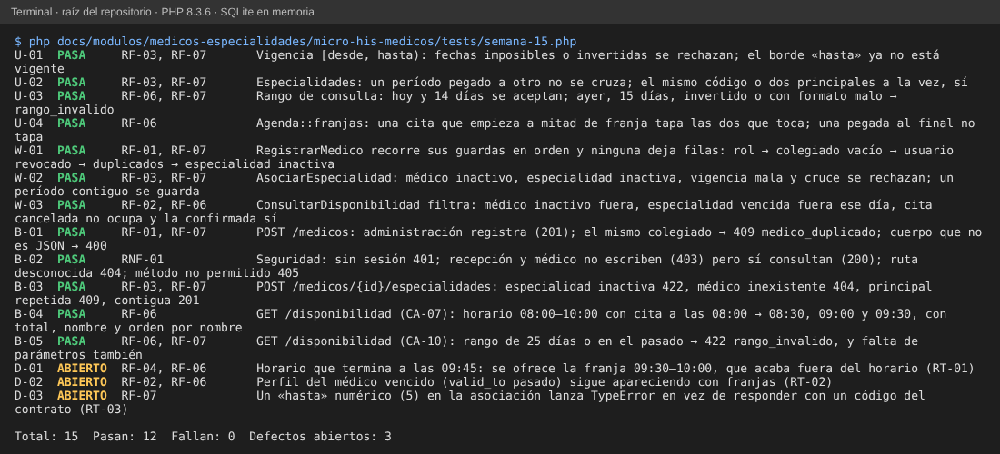

# Semana 15 – Pruebas unitarias, de caja blanca y de caja negra trazadas a RF/RNF

Módulo: Médicos, especialidades y disponibilidad · Grupo G1 · Autor: Joshua Eduardo García Reyes.
Archivo de pruebas: `micro-his-medicos/tests/semana-15.php` (sin dependencias, SQLite en memoria; no modifica `tests/ejecutar.php`).
Numeración de requisitos: la del documento de la semana 2 (RF-01 a RF-07 y RNF-01 a RNF-05).

## 1. Cómo se ejecuta

```
php docs/modulos/medicos-especialidades/micro-his-medicos/tests/semana-15.php
```

Resultado esperado: `Total: 15  Pasan: 12  Fallan: 0  Defectos abiertos: 3` y código de salida 0. Una prueba de defecto (`D-xx`) imprime **ABIERTO** mientras el defecto se reproduce; si alguien lo corrige, pasa a FALLA con el mensaje «conviértalo en prueba normal», para que el defecto no quede escondido ni la prueba obsoleta.



## 2. Matriz de trazabilidad

| Requisito | Prueba(s) | Tipo | Qué comprueba |
|---|---|---|---|
| RF-01 registrar médico, colegiado y documento únicos | W-01, B-01 | blanca, negra | Cada guarda en orden (rol, colegiado vacío, usuario revocado, colegiado repetido, usuario con perfil activo) sin dejar filas; 201 al registrar con su especialidad principal y 409 al repetir. |
| RF-02 médico inactivo no aparece en disponibilidad | W-03, D-02 | blanca, defecto | El médico inactivo no genera franjas. **La operación «desactivar» no existe** en el Micro-HIS. El perfil con fecha final vencida sí aparece (D-02). |
| RF-03 especialidad con vigencia, sin cruce y una sola principal | U-01, U-02, W-02, B-03 | unitaria, blanca, negra | Vigencia [desde, hasta); período pegado al otro sin cruce; misma especialidad o dos principales → 409; especialidad o médico inactivos. |
| RF-04 horario semanal | D-01 | defecto | **Sin prueba de la definición del horario: no existe como caso de uso.** El horario solo se lee y su borde final falla (D-01). |
| RF-05 ausencias | — | — | **Sin prueba: la función no existe en el Micro-HIS PHP.** |
| RF-06 franjas libres de 30 min | U-03, U-04, W-03, B-04, B-05, D-01, D-02 | unitaria, blanca, negra, defecto | Rango de 14 días; cita a mitad de franja; cancelada no ocupa y confirmada sí; CA-07 por HTTP con orden por nombre. |
| RF-07 código estable de rechazo | U-01, U-02, U-03, W-01, W-02, B-01, B-03, B-05, D-03 | todas | `medico_duplicado`, `especialidad_invalida`, `especialidad_duplicada`, `rango_invalido`, `vigencia_invalida`; un `hasta` numérico rompe el contrato (D-03). |
| RNF-01 seguridad por rol | B-02 | negra | Sin sesión 401; recepción y médico no escriben (403) pero consultan (200); 404 y 405. |
| RNF-02 si M05 no responde, sin franjas (503) | — | — | Sin prueba HTTP: el 503 no está implementado. A nivel de puerto lo cubre `semana-06/demostrar-cambio.php` (C-03). |
| RNF-03 consulta de 14 días en menos de 2 s | — | — | **No medido**: requiere prueba de carga que el módulo aún no tiene. |
| RNF-04 mantenibilidad (ISP) | — | — | Ya cubierto por ARQ-01 y REP-01 de `tests/ejecutar.php` y por `semana-02/ejemplo-isp/verificar.php`. |
| RNF-05 verificabilidad | todas | — | Este archivo sale con 0 o 1 y usa solo SQLite en memoria. |

## 3. Cobertura pedida por la entrega

| Pedido | Cantidad | Pruebas |
|---|---|---|
| Unitarias (≥ 3) | 4 | U-01 a U-04 |
| Caja blanca (≥ 2) | 3 | W-01 (guardas de `RegistrarMedico`), W-02 (guardas de `AsociarEspecialidad`), W-03 (filtros de `ConsultarDisponibilidad` y de la consulta SQL) |
| Caja negra (≥ 4) | 5 | B-01 a B-05, solo por HTTP |
| Defectos reportados | 3 | D-01, D-02, D-03 |

Las pruebas se comprobaron también **rompiendo el código a propósito** (27 cambios en bordes de fechas, comparaciones de cruce, roles, guardas, filtros de la consulta SQL, orden, estados de citas, códigos HTTP y enrutador): cada cambio hizo fallar al menos una prueba. Además, al aplicar la corrección propuesta para RT-01, D-01 pasó a FALLA pidiendo convertirla en prueba normal.

## 4. Defectos encontrados (se corrigen en el código aparte; el acta de la semana 13 los registra con responsable)

| ID | Hallazgo | Prueba | Descripción | Requisito | Severidad | Estado |
|---|---|---|---|---|---|---|
| D-01 | RT-01 | D-01 | Con horario 08:00–09:45 se ofrece la franja 09:30–10:00, que termina fuera del horario (`Agenda::franjas` compara solo el inicio). | RF-04, RF-06 | Mayor | Abierto |
| D-02 | RT-02 | D-02 | Un médico con perfil vencido (`valid_to` pasado) sigue con franjas: la consulta ignora la vigencia del perfil. | RF-02, RF-06 | Mayor | Abierto |
| D-03 | RT-03 | D-03 | `"hasta": 5` lanza `TypeError` sin respuesta JSON, en vez de `vigencia_invalida`. | RF-07 | Mayor | Abierto |

## 5. Lo que estas pruebas no cubren

RF-04 (definir horario), RF-05 (ausencias), la operación de desactivar de RF-02, el 503 de RNF-02 y el rendimiento de RNF-03 no tienen prueba porque la función o la medición no existen. Los hallazgos RT-04 (carrera de colegiado: 500 en vez de 409), RT-05 (código de especialidad inexistente responde 200 vacío) y RT-06 (aviso de PHP con `usuario_id` en arreglo) son de severidad Menor y quedan solo en el acta de la semana 13.
