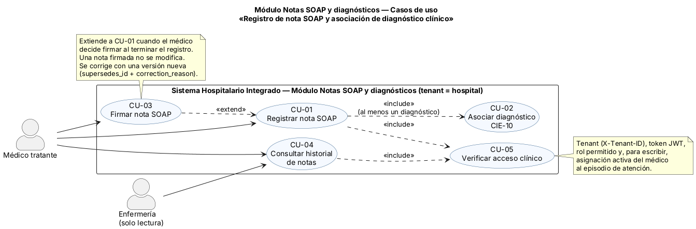
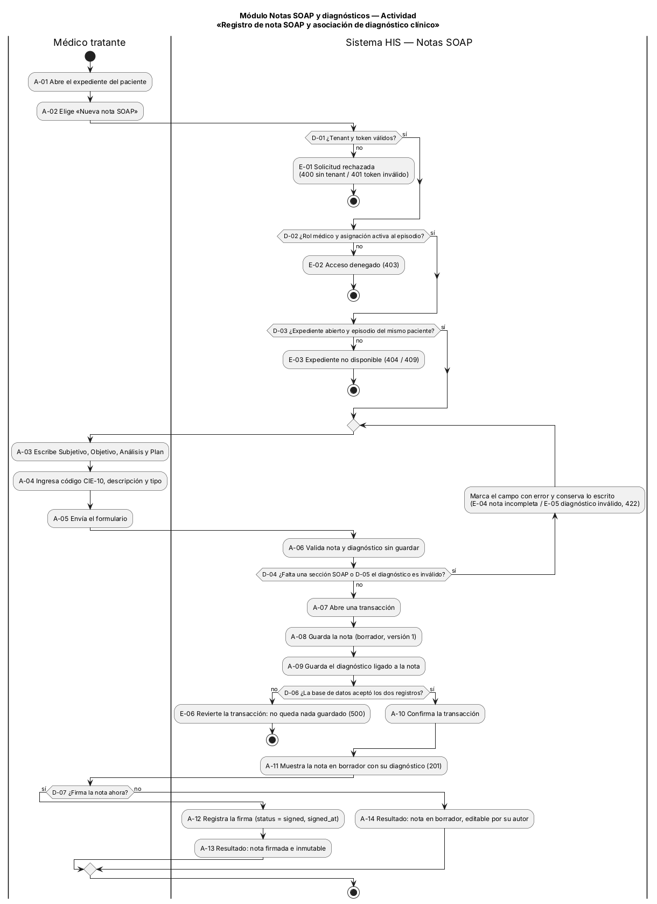
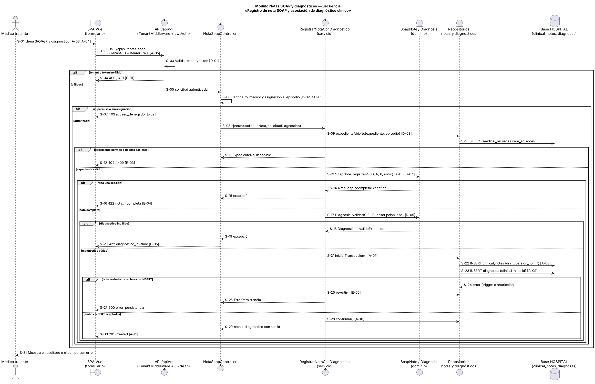

# Semana 1 — Modelado UML del proceso de notas SOAP

| | |
|---|---|
| **Curso** | Análisis de Sistemas II — Proyecto Final 2026 |
| **Proyecto** | Sistema Hospitalario Integrado (HIS) |
| **Módulo** | ASII-11 Notas SOAP y diagnósticos |
| **Tema de la semana** | Conceptos generales, orientación a objetos y UML |
| **Proceso modelado** | «Registro de nota SOAP y asociación de diagnóstico clínico» |
| **Estudiante** | Joshua Eduardo García Reyes (`jgarciar73-svg`) |
| **Fecha** | Octubre 2026 |

## Índice

1. [Introducción](#1-introducción)
2. [Narrativa de alcance](#2-narrativa-de-alcance)
3. [Actores](#3-actores)
4. [Diagrama de casos de uso](#4-diagrama-de-casos-de-uso)
5. [Especificación de casos de uso](#5-especificación-de-casos-de-uso)
6. [Diagrama de actividad](#6-diagrama-de-actividad)
7. [Diagrama de secuencia](#7-diagrama-de-secuencia)
8. [Matriz de trazabilidad](#8-matriz-de-trazabilidad)
9. [Conclusión](#9-conclusión)
10. [Bibliografía](#10-bibliografía)

## 1. Introducción

Cada vez que un médico atiende a un paciente tiene que dejar constancia de lo que vio y de lo que decidió. La forma más usada para eso es la nota SOAP, que propuso Lawrence Weed en 1968 y que divide la nota en cuatro partes: **Subjetivo** (lo que cuenta el paciente), **Objetivo** (lo que el médico encuentra al examinarlo), **Análisis** (su interpretación) y **Plan** (lo que va a hacer). De esa nota salen uno o varios diagnósticos, que en Guatemala se codifican con la CIE-10.

Este documento modela con UML el proceso central de mi módulo en tres vistas:

- **Casos de uso:** quién participa y qué quiere lograr.
- **Actividad:** cómo fluye el proceso, con sus decisiones, excepciones y resultados.
- **Secuencia:** qué componentes intervienen, qué mensajes se mandan, dónde se valida y qué se responde.

Las tres vistas usan los mismos identificadores (CU, A, D, E, S y R), así que cualquier paso se puede seguir de un diagrama a otro con la matriz de la sección 8. Todos los datos de ejemplo son ficticios.

## 2. Narrativa de alcance

**Objetivo del proceso.** Que el médico asignado a un paciente deje registrada una nota SOAP completa en el expediente correcto, con al menos un diagnóstico CIE-10 asociado, sin que puedan quedar notas a medias, y que la nota se pueda firmar para que ya no se modifique.

**Escenario de referencia.** La Dra. Sofía Méndez (dato ficticio) está asignada al episodio de atención de Carlos Pérez en el *Hospital Regional de Oriente*. Carlos consulta por tos con fiebre de tres días. La doctora abre su expediente, escribe la nota (Subjetivo: "tos productiva y fiebre de 3 días"; Objetivo: "T 38.6 °C, estertores en base derecha"; Análisis: "probable neumonía adquirida en la comunidad"; Plan: "radiografía de tórax y antibiótico") y le asocia el diagnóstico `J18.9 Neumonía no especificada` como principal. El sistema guarda la nota y el diagnóstico juntos y la doctora la firma. Desde ese momento la nota ya no se puede editar. Si mañana hay que corregir algo, se crea una versión 2 que apunta a la primera y explica el motivo.

**Reglas que rigen el proceso:**

| Código | Regla |
|---|---|
| R-01 | El hospital es el tenant: toda solicitud trae la cabecera `X-Tenant-ID` y solo se ven expedientes de ese hospital. |
| R-02 | Solo un usuario con rol médico puede escribir notas y diagnósticos, y además debe tener una asignación activa al episodio de atención (`care_assignments`). La base de datos lo vuelve a revisar con el trigger `clinical_notes_author_assignment_trigger`. |
| R-03 | La nota pertenece a un expediente abierto, y el expediente y el episodio deben ser del mismo paciente (`clinical_notes_record_episode_patient_trigger`). |
| R-04 | Las cuatro secciones de la nota (S, O, A y P) son obligatorias y no pueden ir vacías. |
| R-05 | Toda nota registrada en este proceso lleva al menos un diagnóstico con código CIE-10 de formato válido (por ejemplo `J18.9`), descripción y tipo `primary`, `secondary` o `differential`. El diagnóstico tiene el mismo autor y el mismo episodio que la nota (`diagnoses_note_episode_author_trigger`). |
| R-06 | La nota y su diagnóstico se guardan en una sola transacción: o se guardan los dos, o no se guarda ninguno. |
| R-07 | Una nota firmada (`status = signed`) no se modifica. Una corrección es una nota nueva con `version_no` siguiente, `supersedes_id` apuntando a la anterior y `correction_reason` obligatorio. |
| R-08 | Las notas y los diagnósticos nunca se borran físicamente (trigger `preserve_clinical_record`). |

**Dentro del alcance:**

- registrar una nota SOAP en borrador ligada al expediente, al episodio y al médico autor;
- asociar diagnósticos CIE-10 a la nota;
- firmar la nota;
- consultar el historial de notas de un expediente.

**Fuera del alcance (otros módulos o semanas posteriores):**

- **Inicio de sesión y emisión del JWT:** módulo 1. Aquí solo se valida el token.
- **Roles y permisos:** módulo 2 (RBAC). Este módulo usa el permiso, no lo administra.
- **Apertura del expediente y del episodio:** módulos 7 y 10. Cuando el médico escribe, ya existen.
- **Alergias, signos vitales y prescripciones:** módulos 12, 13 y 15, aunque una receta pueda apuntar a una nota.
- **Corrección de una nota firmada:** el flujo de nueva versión se diseña en la semana 6. Aquí solo se deja la regla R-07.

**Supuestos:**

- Las cuatro secciones SOAP se guardan en el campo `content` de `clinical_notes` con `note_type = 'soap'`, porque la tabla no tiene una columna por sección.
- Enfermería solo consulta. No lo encontré escrito en la documentación del curso; lo decidí yo y lo confirmo con el grupo.

## 3. Actores

| Actor | Tipo | Objetivo en el proceso |
|---|---|---|
| Médico tratante | Primario | Documentar la atención del paciente con una nota SOAP y sus diagnósticos, y firmarla. |
| Enfermería | Secundario | Consultar el historial de notas para dar seguimiento al paciente. No escribe ni firma. |

El **paciente** no es actor: no usa ninguna pantalla de este módulo, es el sujeto de la nota. Tampoco lo son los middleware de tenant y JWT ni la base de datos, que son componentes internos. Por eso aparecen en los diagramas de actividad y secuencia, pero no en el de casos de uso.

## 4. Diagrama de casos de uso

Fuente editable: [diagramas/semana-01-casos-de-uso.puml](diagramas/semana-01-casos-de-uso.puml)

**Relaciones:**

- **CU-01 incluye a CU-02:** en este proceso la nota siempre lleva diagnóstico (R-05).
- **CU-01 y CU-04 incluyen a CU-05:** antes de escribir o de leer, siempre se verifica el acceso.
- **CU-03 extiende a CU-01:** firmar es opcional al terminar el registro. El médico puede dejar la nota en borrador y firmarla después.

## 5. Especificación de casos de uso

### CU-01 Registrar nota SOAP

| Campo | Descripción |
|---|---|
| Actor | Médico tratante |
| Objetivo | Guardar una nota SOAP completa con al menos un diagnóstico, en estado borrador. |
| Precondiciones | El médico tiene sesión iniciada (JWT válido) y el paciente tiene expediente abierto y un episodio de atención activo. |
| Flujo básico | 1. El médico abre el expediente y elige «Nueva nota SOAP» (A-01, A-02). 2. El sistema verifica el acceso (CU-05: D-01, D-02) y el expediente (D-03). 3. El médico escribe S, O, A y P (A-03) e ingresa el diagnóstico (A-04, CU-02). 4. El sistema valida todo sin guardar (A-06, D-04, D-05). 5. Abre una transacción y guarda la nota y el diagnóstico (A-07 a A-10). 6. Muestra la nota en borrador (A-11). |
| Flujos alternos / excepciones | E-01: falta el tenant o el token es inválido → 400/401. E-02: sin rol médico o sin asignación → 403. E-03: expediente cerrado o de otro paciente → 404/409. E-04: falta una sección → 422, vuelve al paso 3 sin perder lo escrito. E-05: diagnóstico inválido → 422, igual que E-04. E-06: la base rechaza un registro → se revierte la transacción, 500. |
| Postcondición | Existe una nota en borrador (`version_no = 1`) con al menos un diagnóstico, a nombre del médico que la escribió. Nunca queda una nota sin su diagnóstico. |

### CU-02 Asociar diagnóstico CIE-10

| Campo | Descripción |
|---|---|
| Actor | Ninguno directo (lo incluye CU-01). |
| Objetivo | Ligar a la nota un diagnóstico con código, descripción y tipo. |
| Flujo básico | 1. El médico escribe o busca el código CIE-10, la descripción y el tipo (A-04). 2. El sistema revisa el formato del código y que la descripción no esté vacía (D-05). 3. El diagnóstico se guarda junto con la nota (A-09). |
| Excepción | E-05: código vacío o con formato inválido, descripción vacía o tipo no permitido → 422. |

### CU-03 Firmar nota SOAP

| Campo | Descripción |
|---|---|
| Actor | Médico autor de la nota |
| Condición de extensión | El médico decide firmar al terminar el registro (D-07). |
| Flujo básico | 1. El médico confirma la firma. 2. El sistema cambia `status` a `signed` y guarda `signed_at` (A-12). |
| Postcondición | La nota queda firmada e inmutable (A-13, R-07). Si el médico no firma, la nota sigue en borrador (A-14). |

### CU-04 Consultar historial de notas

| Campo | Descripción |
|---|---|
| Actores | Médico tratante y Enfermería |
| Objetivo | Ver las notas del expediente, de la más reciente a la más antigua, con sus diagnósticos, autor, versión y estado. |
| Nota | No forma parte del proceso modelado esta semana. Aparece en el diagrama porque es parte del módulo y comparte CU-05. No modifica datos. |

### CU-05 Verificar acceso clínico

| Campo | Descripción |
|---|---|
| Actor | Ninguno directo (lo incluyen CU-01 y CU-04). |
| Objetivo | Decidir si la solicitud puede continuar. |
| Flujo básico | 1. Validar tenant y token (D-01, R-01). 2. Verificar el rol: escribir solo médico; leer médico o enfermería. 3. Para escribir, verificar la asignación activa al episodio (D-02, R-02). |
| Excepciones | E-01 (400/401) y E-02 (403). |

## 6. Diagrama de actividad

Fuente editable: [diagramas/semana-01-actividad.puml](diagramas/semana-01-actividad.puml)

El diagrama tiene dos carriles, Médico tratante y Sistema HIS — Notas SOAP, y pasa por tres fases:

1. **Verificación:** A-01 y A-02, con las decisiones D-01 a D-03 y las excepciones E-01 a E-03.
2. **Captura y validación:** A-03 a A-06, con D-04 y D-05. Las excepciones E-04 y E-05 regresan al formulario sin perder lo escrito.
3. **Guardado y firma:** A-07 a A-14, con D-06, D-07 y la excepción E-06.

**Resultados posibles:**

| Resultado | Dónde termina |
|---|---|
| Nota firmada (201 + firma) | A-13 |
| Nota en borrador con diagnóstico (201) | A-14 |
| Rechazada antes de evaluar el acceso (400/401) | E-01 |
| Acceso denegado (403) | E-02 |
| Expediente no disponible (404/409) | E-03 |
| Error de base de datos sin registros a medias (500) | E-06 |

## 7. Diagrama de secuencia

Fuente editable: [diagramas/semana-01-secuencia.puml](diagramas/semana-01-secuencia.puml)

| Participante | Estereotipo | Responsabilidad |
|---|---|---|
| SPA Vue (formulario) | «boundary» | Pantalla del médico; envía `X-Tenant-ID` y `Bearer JWT`. |
| API /api/v1 | «control» | Valida el tenant y el token con los middleware existentes `TenantMiddleware` y `JwtAuth`. |
| NotaSoapController | «control» | Revisa rol y asignación, llama al servicio y traduce el resultado a HTTP. No tiene SQL ni reglas de negocio. |
| RegistrarNotaConDiagnostico | «control» | Coordina el caso de uso: verifica el expediente, pide al dominio que valide y maneja la transacción. |
| SoapNote / Diagnosis | «entity» | Reglas de dominio: cuatro secciones completas (R-04) y diagnóstico válido (R-05). |
| Repositorios | «entity» | Leen y escriben `medical_records`, `clinical_notes` y `diagnoses`. |
| Base HOSPITAL | «database» | Guarda los datos y vuelve a aplicar las reglas con sus triggers. |

Los mensajes están numerados de S-01 a S-31. Entre corchetes, cada mensaje indica la actividad, decisión o excepción con la que se corresponde.

## 8. Matriz de trazabilidad

| Caso de uso | Actividad (nodos) | Secuencia (mensajes) | Resultado / HTTP |
|---|---|---|---|
| CU-01 Registrar nota SOAP | A-01 a A-11; D-03, D-04, D-06; E-03, E-04, E-06 | S-01, S-02, S-08 a S-16, S-21 a S-31 | 201 / 404 / 409 / 422 / 500 |
| CU-02 Asociar diagnóstico | A-04, A-09; D-05; E-05 | S-17 a S-20, S-23 | 422 si es inválido |
| CU-03 Firmar nota | D-07, A-12, A-13 (si no firma: A-14) | Fuera de esta secuencia: es una acción posterior del médico | Nota firmada |
| CU-04 Consultar historial | No forma parte del proceso modelado | No forma parte del proceso modelado | Solo lectura |
| CU-05 Verificar acceso | D-01, D-02; E-01, E-02 | S-03 a S-07 | 400 / 401 / 403 |

| Regla | Dónde se aplica |
|---|---|
| R-01 Tenant obligatorio | D-01 · S-02, S-03 |
| R-02 Rol médico y asignación al episodio | D-02 · S-06, S-07 |
| R-03 Expediente abierto y del mismo paciente | D-03 · S-09 a S-12 |
| R-04 Cuatro secciones obligatorias | D-04 · S-13 a S-16 |
| R-05 Diagnóstico CIE-10 válido | D-05 · S-17 a S-20 |
| R-06 Nota y diagnóstico en una transacción | A-07 a A-10, E-06 · S-21 a S-28 |
| R-07 Nota firmada inmutable | A-12, A-13 |
| R-08 Sin borrado físico | Aplicada por la base de datos; ningún flujo ofrece borrar |

## 9. Conclusión

Al dibujar la secuencia salió un problema que con texto no se notaba: si la nota se guarda antes de validar el diagnóstico y el diagnóstico viene mal, queda una nota huérfana en el expediente. Por eso el diseño valida todo primero y guarda la nota y el diagnóstico en una sola transacción (R-06). También quedó claro que varias reglas se revisan en dos lugares, en el código y en los triggers de la base HOSPITAL, y que eso es a propósito: si alguien se salta la aplicación, la base igual rechaza el registro.

Los identificadores compartidos permiten comprobar que cada regla aparece en el flujo y en los mensajes. Sobre esta base se definen los requerimientos y el principio SOLID de la semana 2.

## 10. Bibliografía

- Cockburn, A. (2000). *Writing Effective Use Cases*. Addison-Wesley.
- Fowler, M. (2003). *UML Distilled: A Brief Guide to the Standard Object Modeling Language* (3.ª ed.). Addison-Wesley.
- Object Management Group. (2017). *Unified Modeling Language (UML), Version 2.5.1*. https://www.omg.org/spec/UML/2.5.1
- Organización Panamericana de la Salud. (1995). *Clasificación estadística internacional de enfermedades y problemas relacionados con la salud, décima revisión (CIE-10)*. Publicación Científica n.º 554.
- Sommerville, I. (2011). *Ingeniería de software* (9.ª ed.). Pearson Educación.
- Weed, L. L. (1968). Medical records that guide and teach. *New England Journal of Medicine, 278*(11), 593-600.
