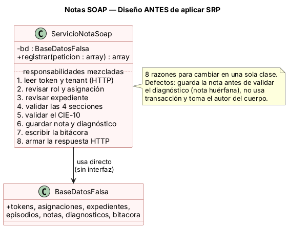
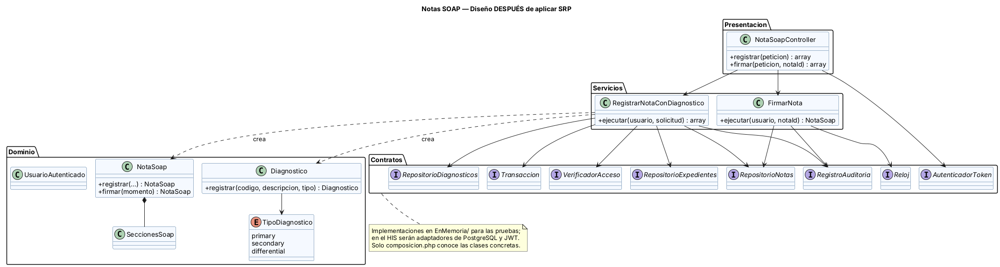

# Semana 2 — Requerimientos, criterios de aceptación y aplicación de SRP

| | |
|---|---|
| **Curso** | Análisis de Sistemas II — Proyecto Final 2026 |
| **Proyecto** | Sistema Hospitalario Integrado (HIS) |
| **Módulo** | ASII-11 Notas SOAP y diagnósticos |
| **Tema de la semana** | Proceso y modelo de diseño; principios SOLID |
| **Flujo de diseño** | «Registro de nota SOAP y asociación de diagnóstico clínico» |
| **Principio aplicado** | SRP — Principio de responsabilidad única |
| **Estudiante** | Joshua Eduardo García Reyes (`jgarciar73-svg`) |
| **Fecha** | Octubre 2026 |

## Índice

1. [Introducción](#1-introducción)
2. [Requerimientos funcionales](#2-requerimientos-funcionales)
3. [Requerimientos no funcionales](#3-requerimientos-no-funcionales)
4. [Criterios de aceptación](#4-criterios-de-aceptación)
5. [El principio de responsabilidad única (SRP)](#5-el-principio-de-responsabilidad-única-srp)
6. [Diseño antes de aplicar SRP](#6-diseño-antes-de-aplicar-srp)
7. [Diseño después de aplicar SRP](#7-diseño-después-de-aplicar-srp)
8. [Responsabilidades y dependencias](#8-responsabilidades-y-dependencias)
9. [Qué cambia cuando cambia un requisito](#9-qué-cambia-cuando-cambia-un-requisito)
10. [Evidencia verificable](#10-evidencia-verificable)
11. [Trazabilidad con la semana 1](#11-trazabilidad-con-la-semana-1)
12. [Conclusión](#12-conclusión)
13. [Bibliografía](#13-bibliografía)

## 1. Introducción

En la semana 1 modelé el proceso con tres diagramas UML y ocho reglas de negocio (R-01 a R-08). Esta semana paso del **qué** al **cómo**: convierto esas reglas en requerimientos funcionales y no funcionales, escribo criterios de aceptación que se puedan probar y aplico un principio SOLID al diseño del flujo.

Elegí **SRP** porque el registro de una nota SOAP junta muchas cosas que cambian por motivos distintos: quién puede escribir, cuándo una nota está completa, qué es un CIE-10 válido, cómo se guarda y qué responde la API. Si todo eso vive en una sola clase, un cambio en la regla del CIE-10 obliga a tocar la misma clase que maneja la base de datos y la respuesta HTTP. Al escribir el ejemplo "antes" salieron además tres defectos reales que vienen justamente de mezclar responsabilidades.

La evidencia es un ejemplo ejecutable en PHP 8.2+ sin framework, con el diseño **antes** y **después**, y un script que corre 20 pruebas: los criterios de aceptación, la verificación de SRP, la paridad entre ambos diseños y los defectos corregidos.

## 2. Requerimientos funcionales

| ID | Requerimiento | Origen (semana 1) |
|---|---|---|
| RF-01 | El sistema debe permitir que un médico registre una nota SOAP con sus cuatro secciones (Subjetivo, Objetivo, Análisis y Plan), ligada a un expediente, a un episodio de atención y al médico autor. | CU-01, A-03, A-08, R-04 |
| RF-02 | El sistema debe permitir escribir notas solo a usuarios con rol médico, del mismo hospital que la solicitud (`X-Tenant-ID`) y con asignación activa al episodio. | CU-05, D-01, D-02, R-01, R-02 |
| RF-03 | El sistema debe rechazar la nota si el expediente no existe, está cerrado o no es del mismo paciente que el episodio. | D-03, R-03 |
| RF-04 | El sistema debe exigir al menos un diagnóstico con código CIE-10 de formato válido, descripción y tipo `primary`, `secondary` o `differential`. | CU-02, D-05, R-05 |
| RF-05 | El sistema debe guardar la nota y su diagnóstico en una sola transacción: si uno falla, no se guarda ninguno. | A-07 a A-10, E-06, R-06 |
| RF-06 | El sistema debe tomar el autor de la nota del usuario autenticado y nunca de los datos que envía el cliente. | R-02 |
| RF-07 | El sistema debe permitir que el autor firme la nota; al firmarla cambia a estado `firmada` y guarda la fecha y hora. | CU-03, A-12 |
| RF-08 | El sistema debe rechazar cualquier cambio sobre una nota firmada, incluida una segunda firma. | A-13, R-07 |
| RF-09 | El sistema debe responder cada error con un código HTTP y un código de error estable (`tenant_requerido`, `token_invalido`, `acceso_denegado`, `expediente_no_disponible`, `nota_incompleta`, `diagnostico_invalido`, `nota_firmada`, `error_persistencia`). | E-01 a E-06 |
| RF-10 | El sistema debe registrar en la bitácora los eventos `NOTA_REGISTRADA` y `NOTA_FIRMADA` con el id de la nota y el autor. | CU-01, CU-03 |

## 3. Requerimientos no funcionales

| ID | Atributo | Requerimiento | Cómo se verifica |
|---|---|---|---|
| RNF-01 | Integridad | Nunca puede quedar una nota sin su diagnóstico, ni por un diagnóstico inválido ni por una falla de la base. | CA-08, CA-10, DEF-01, DEF-02 |
| RNF-02 | Seguridad | La autoría no se puede falsificar desde el cliente. | CA-12, DEF-03 |
| RNF-03 | Confidencialidad | Los mensajes de error no muestran SQL, nombres de tablas ni datos de otros pacientes; la bitácora guarda identificadores, no contenido clínico. | CA-10 (mensaje genérico en el 500) |
| RNF-04 | **Mantenibilidad (SRP)** | Cada clase tiene una sola razón para cambiar: las reglas de la nota, las del diagnóstico, la coordinación, el acceso, la persistencia y el contrato HTTP están en clases distintas. | SRP-01, SRP-02 |
| RNF-05 | Testabilidad | El caso de uso depende solo de interfaces y se prueba con dobles en memoria, sin base de datos. | SRP-03, SRP-04 |
| RNF-06 | Usabilidad | Un error de validación no borra lo que el médico ya escribió (la API responde 422 sin efectos y el formulario conserva los datos). | CA-07, CA-08 (sin efectos en la base) |
| RNF-07 | Rendimiento | El registro de una nota responde en menos de 2 segundos (p95), sin contar la red. | Pendiente: se medirá en la semana 15 con PostgreSQL. |

## 4. Criterios de aceptación

Formato *Dado / Cuando / Entonces*. Cada criterio tiene una prueba automática con el mismo ID en [`ejemplo-srp/verificar.php`](ejemplo-srp/verificar.php).

| ID | RF/RNF | Dado | Cuando | Entonces |
|---|---|---|---|---|
| CA-01 | RF-01, RF-05, RF-10 | la Dra. Méndez, asignada al episodio de Carlos | registra una nota completa con `J18.9` como principal | responde 201, la nota queda en borrador versión 1 con su diagnóstico y se registra `NOTA_REGISTRADA` |
| CA-02 | RF-09 | una solicitud sin `X-Tenant-ID`, o con token inválido | se intenta registrar | responde 400 o 401 y no se guarda nada |
| CA-03 | RF-02 | la enfermera Ana (sin rol médico) | intenta registrar una nota | responde 403 `acceso_denegado` |
| CA-04 | RF-02 | el Dr. López, médico pero no asignado al episodio | intenta registrar una nota | responde 403 |
| CA-05 | RF-02 | un token del Hospital de Oriente | la solicitud llega con `X-Tenant-ID` de otro hospital | responde 403 |
| CA-06 | RF-03 | un expediente cerrado o inexistente | se intenta registrar una nota en él | responde 409 `expediente_no_disponible` |
| CA-07 | RF-01, RNF-06 | una nota con el Plan vacío | se envía | responde 422 `nota_incompleta` y no se guarda nada |
| CA-08 | RF-04, RNF-01 | una nota completa con el código `ZZZ-1` | se envía | responde 422 `diagnostico_invalido` y **no** queda ninguna nota guardada |
| CA-09 | RF-04 | un diagnóstico con tipo `presuntivo` o con descripción vacía | se envía | responde 422 |
| CA-10 | RF-05, RNF-01 | la base de datos rechaza el INSERT del diagnóstico | se registra una nota válida | responde 500, la nota se revierte y no se registra el evento |
| CA-11 | RF-07, RF-08 | una nota en borrador de la Dra. Méndez | la firma y luego intenta firmarla otra vez | la primera vez responde 200 con estado `firmada`; la segunda, 409 `nota_firmada` |
| CA-12 | RF-06, RNF-02 | la Dra. Méndez autenticada | envía `author_user_ref_id = dr-lopez` en el cuerpo | la nota queda a nombre de la Dra. Méndez |

## 5. El principio de responsabilidad única (SRP)

La fuente del curso, *Principios básicos del diseño de software* de MVP Cluster, lo define así:

> «Este principio dice que cada clase tiene que tener una responsabilidad única y concreta.»
> «Una clase debería tener una y sólo una razón para cambiar.»

El artículo lo explica con una aplicación que registra ofertas y ventas: si una sola clase `Vendedor` maneja las dos cosas, un cambio en las ventas puede obligar a tocar el código de las ofertas.

**Aplicado a este módulo:** la pregunta para cada clase es "¿por qué motivo tendría que cambiar?". Si la respuesta tiene más de un motivo (cambia la regla del CIE-10 *y también* cambia el formato de la respuesta HTTP), la clase tiene más de una responsabilidad y hay que separarla.

## 6. Diseño antes de aplicar SRP



Código: [`ejemplo-srp/antes/ServicioNotaSoap.php`](ejemplo-srp/antes/ServicioNotaSoap.php)

```php
public function registrar(array $peticion): array
{
    $tenant = $peticion['headers']['X-Tenant-ID'] ?? '';            // 1. HTTP
    $autor = $b['author_user_ref_id'] ?? $usuario['id'];             //    autor del cuerpo
    if (!in_array('medico', $usuario['roles'], true) /* ... */) {    // 2. permisos
        return ['status' => 403, /* ... */];
    }
    // 3. expediente, 4. secciones...
    $this->bd->notas[$notaId] = [/* ... */];                          // 6. guarda la nota
    if (preg_match('/^[A-Z][0-9]{2}(\.[0-9]{1,2})?$/', $codigo) !== 1) { // 5. CIE-10, DESPUÉS de guardar
        return ['status' => 422, /* ... */];                          //    la nota queda huérfana
    }
    // 6. guarda el diagnóstico (sin transacción), 7. bitácora, 8. respuesta HTTP
}
```

**Problemas del diseño:**

| Problema | Consecuencia |
|---|---|
| Una sola clase con ocho razones para cambiar: HTTP, permisos, expediente, reglas de la nota, reglas del diagnóstico, persistencia, bitácora y respuesta. | Cualquier cambio toca la misma clase y obliga a volver a probar todo el flujo. Viola SRP. |
| La validación del diagnóstico está mezclada con la persistencia y quedó después del INSERT de la nota. | **Defecto DEF-01:** con un CIE-10 inválido queda una nota huérfana. |
| La persistencia no está separada, así que no hay un lugar claro para la transacción. | **Defecto DEF-02:** si falla el INSERT del diagnóstico, la nota se queda guardada. |
| Leer la petición y decidir el autor están en el mismo método. | **Defecto DEF-03:** el autor se toma del cuerpo de la petición y se puede falsificar. |
| Usa la base de datos directamente, sin interfaz. | No se puede probar el flujo sin la base ni simular una falla. |

## 7. Diseño después de aplicar SRP



Código: [`ejemplo-srp/despues/`](ejemplo-srp/despues/)

Separé el flujo en piezas que cambian por motivos distintos. El servicio quedó como un coordinador que no valida ni guarda por su cuenta:

```php
final class RegistrarNotaConDiagnostico
{
    public function ejecutar(UsuarioAutenticado $usuario, SolicitudRegistroNota $solicitud): array
    {
        if (!$this->acceso->puedeEscribir($usuario, $solicitud->tenantId, $solicitud->episodioId)) {
            throw new AccesoDenegado('...');
        }
        if (!$this->expedientes->estaDisponible($solicitud->expedienteId, $solicitud->episodioId)) {
            throw new ExpedienteNoDisponible('...');
        }
        // Primero se valida todo (el dominio lanza la excepción si algo está mal)...
        $nota = NotaSoap::registrar(/* ... */, $usuario->id, new SeccionesSoap(/* S, O, A, P */));
        $diagnostico = Diagnostico::registrar($codigo, $descripcion, $tipo);

        // ...y después se guarda todo junto.
        return $this->transaccion->ejecutar(function () use ($nota, $diagnostico) {
            $notaGuardada = $this->notas->guardar($nota);
            return ['nota' => $notaGuardada,
                    'diagnostico' => $this->diagnosticos->guardar($diagnostico->paraNota($notaGuardada->id))];
        });
    }
}
```

La regla del CIE-10 solo vive en `Diagnostico`, la de las cuatro secciones solo en `SeccionesSoap` y los códigos HTTP solo en `NotaSoapController`. El autor sale de `UsuarioAutenticado`, que arma el controlador a partir del token.

## 8. Responsabilidades y dependencias

### Responsabilidades

| Clase / interfaz | Responsabilidad única | Razón para cambiar |
|---|---|---|
| `NotaSoapController` | Traducir la petición HTTP a un caso de uso y las excepciones a códigos HTTP. | Cambia el contrato de la API. |
| `RegistrarNotaConDiagnostico` | Coordinar el registro: acceso → expediente → validación → transacción → bitácora. | Cambia el orden o los pasos del proceso. |
| `FirmarNota` | Coordinar la firma: buscar la nota, comprobar que es el autor y guardarla firmada. | Cambia el proceso de firma. |
| `NotaSoap` | Representar la nota y controlar su firma (R-07). | Cambia el ciclo de vida de la nota. |
| `SeccionesSoap` | Asegurar que las cuatro secciones estén completas (R-04). | Cambia qué se considera una nota completa. |
| `Diagnostico` y `TipoDiagnostico` | Asegurar que el diagnóstico sea válido (R-05). | Cambia la regla del CIE-10 o los tipos permitidos. |
| `UsuarioAutenticado` | Representar quién hace la petición (id, hospital, roles). | Cambia lo que el sistema sabe del usuario. |
| `VerificadorAcceso` | Decidir si el usuario puede escribir en el episodio (R-01, R-02). | Cambia la política de acceso. |
| `RepositorioExpedientes` | Decir si el expediente está disponible (R-03). | Cambia cómo se consulta el expediente. |
| `RepositorioNotas`, `RepositorioDiagnosticos` | Guardar y leer notas y diagnósticos. | Cambia la base de datos o el esquema. |
| `Transaccion` | Ejecutar el bloque completo o revertirlo (R-06). | Cambia el mecanismo de transacciones. |
| `RegistroAuditoria` | Guardar los eventos del módulo. | Cambia el destino de la bitácora. |
| `composicion.php` | Crear las clases concretas y conectarlas. | Se cambia un adaptador (memoria → PostgreSQL). |

### Dependencias

| Quién | Depende de | Tipo | Justificación |
|---|---|---|---|
| `NotaSoapController` | `AutenticadorToken` | Abstracción | El token lo valida el módulo 1; aquí solo se consume. |
| `NotaSoapController` | `RegistrarNotaConDiagnostico`, `FirmarNota` | Concreta | Son los casos de uso del mismo módulo; el controlador solo los llama. |
| `RegistrarNotaConDiagnostico` | `VerificadorAcceso`, `RepositorioExpedientes`, `RepositorioNotas`, `RepositorioDiagnosticos`, `Transaccion`, `RegistroAuditoria` | Abstracciones | Permite probarlo con dobles y cambiar la base sin tocarlo (SRP-03). |
| `RegistrarNotaConDiagnostico` | `NotaSoap`, `SeccionesSoap`, `Diagnostico` | Concreta (dominio) | Las reglas de negocio son estables y no dependen de infraestructura. |
| `FirmarNota` | `RepositorioNotas`, `Reloj`, `RegistroAuditoria` | Abstracciones | El reloj se inyecta para poder probar la fecha de firma. |
| Dominio | Nada externo | — | No conoce HTTP, SQL ni frameworks (SRP-01). |
| `composicion.php` | Todas las clases concretas | Concreta | Es el único punto acoplado a implementaciones, a propósito. |

## 9. Qué cambia cuando cambia un requisito

Esta tabla muestra la ventaja práctica de SRP: cada cambio toca un solo archivo.

| Si cambia... | Antes se modificaba | Después se modifica |
|---|---|---|
| El formato del código CIE-10 (por ejemplo, validar contra el catálogo) | `ServicioNotaSoap` | Solo `Diagnostico` |
| Se agrega una quinta sección a la nota | `ServicioNotaSoap` | Solo `SeccionesSoap` (y el formulario) |
| Enfermería pasa a poder escribir notas de enfermería | `ServicioNotaSoap` | Solo la implementación de `VerificadorAcceso` |
| La base pasa de memoria a PostgreSQL | `ServicioNotaSoap` | Solo los repositorios y `composicion.php` |
| La API cambia 409 por 404 para expedientes inexistentes | `ServicioNotaSoap` | Solo `NotaSoapController` |
| La bitácora se manda al módulo de auditoría | `ServicioNotaSoap` | Solo la implementación de `RegistroAuditoria` |

## 10. Evidencia verificable

El ejemplo se ejecuta desde la raíz del repositorio con PHP 8.2 o superior, sin instalar nada:

```bash
php docs/modulos/notas-soap-diagnosticos/semana-02/ejemplo-srp/verificar.php
```

Salida obtenida (también en [`evidencia/salida-verificar.txt`](evidencia/salida-verificar.txt)):

```text
Notas SOAP semana 2 - verificacion SRP (PHP 8.3.6)
------------------------------------------------------------------------------
[PASA] CA-01   Registro válido: 201, nota en borrador v1 con su diagnóstico
[PASA] CA-02   Sin X-Tenant-ID responde 400 y con token inválido 401; no guarda nada
[PASA] CA-03   Usuario sin rol médico (enfermería) recibe 403
[PASA] CA-04   Médico no asignado al episodio recibe 403
[PASA] CA-05   Tenant del token distinto al de la solicitud recibe 403
[PASA] CA-06   Expediente cerrado o de otro paciente responde 409
[PASA] CA-07   Falta una sección SOAP: 422 nota_incompleta y no se guarda nada
[PASA] CA-08   Código CIE-10 inválido: 422 y NO queda nota huérfana
[PASA] CA-09   Tipo de diagnóstico no permitido o descripción vacía: 422
[PASA] CA-10   Falla la base al guardar el diagnóstico: 500 y se revierte la nota
[PASA] CA-11   Firmar: la nota pasa a firmada; firmarla otra vez responde 409
[PASA] CA-12   El autor sale del token aunque el cliente mande otro author_user_ref_id
[PASA] SRP-01  Servicios y dominio no contienen SQL ni HTTP
[PASA] SRP-02  Cada regla vive en una sola clase (CIE-10, secciones SOAP, códigos HTTP)
[PASA] SRP-03  El servicio solo depende de interfaces y se prueba sin base de datos
[PASA] SRP-04  La regla del diagnóstico se prueba sola, sin servicio ni repositorios
[PASA] PAR-01  Antes y después responden el mismo código HTTP en 8 escenarios
[PASA] DEF-01  Defecto corregido: antes deja nota huérfana con CIE-10 inválido; después no
[PASA] DEF-02  Defecto corregido: antes deja la nota si falla el diagnóstico; después revierte
[PASA] DEF-03  Defecto corregido: antes acepta el autor del cuerpo; después usa el token
------------------------------------------------------------------------------
Total: 20  Pasan: 20  Fallan: 0
```

Qué demuestra cada grupo:

- **CA-01 a CA-12:** los criterios de aceptación de la sección 4 se cumplen en el diseño después.
- **SRP-01 a SRP-04:** las responsabilidades están separadas de verdad. Por ejemplo, SRP-02 busca en todo el código y confirma que la expresión del CIE-10 aparece solo en `Diagnostico.php`.
- **PAR-01:** la refactorización no cambió el comportamiento visible en los casos que el diseño anterior ya hacía bien.
- **DEF-01 a DEF-03:** los tres defectos del diseño anterior existen ahí y desaparecen después.

## 11. Trazabilidad con la semana 1

| Semana 1 | Semana 2 |
|---|---|
| CU-01 Registrar nota SOAP | RF-01, RF-05 · CA-01, CA-07, CA-10 · `RegistrarNotaConDiagnostico` |
| CU-02 Asociar diagnóstico | RF-04 · CA-08, CA-09 · `Diagnostico` |
| CU-03 Firmar nota | RF-07, RF-08 · CA-11 · `FirmarNota`, `NotaSoap::firmar()` |
| CU-05 Verificar acceso | RF-02, RF-06 · CA-02 a CA-05, CA-12 · `VerificadorAcceso`, `AutenticadorToken` |
| R-03 Expediente disponible | RF-03 · CA-06 · `RepositorioExpedientes` |
| R-06 Nota y diagnóstico en una transacción | RF-05, RNF-01 · CA-08, CA-10 · `Transaccion` |
| E-01 a E-06 | RF-09 · códigos de error en `NotaSoapController` |

## 12. Conclusión

Separar responsabilidades no fue solo ordenar el código. Al escribir la versión "antes" con todo junto, la validación del diagnóstico terminó después del INSERT de la nota sin que se notara, y de ahí salieron los tres defectos. Cuando cada regla tiene su propia clase y el servicio solo coordina, el orden correcto (validar todo, después guardar todo en una transacción) queda a la vista y es fácil de probar. Estas mismas clases son la base del micro-HIS en capas de la semana 3.

## 13. Bibliografía

- Martin, R. C. (2003). *Agile Software Development: Principles, Patterns, and Practices*. Prentice Hall.
- Martin, R. C. (2017). *Clean Architecture: A Craftsman's Guide to Software Structure and Design*. Prentice Hall.
- MVP Cluster. (s. f.). *Principios básicos del diseño de software*. https://mvpcluster.com/diseno-de-software-2/
- Sommerville, I. (2011). *Ingeniería de software* (9.ª ed.). Pearson Educación.
- Wiegers, K. y Beatty, J. (2013). *Software Requirements* (3.ª ed.). Microsoft Press.
