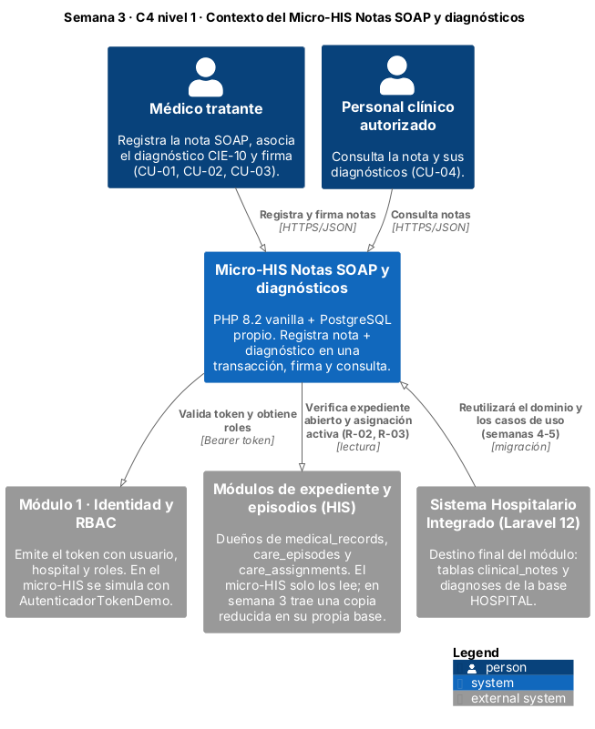
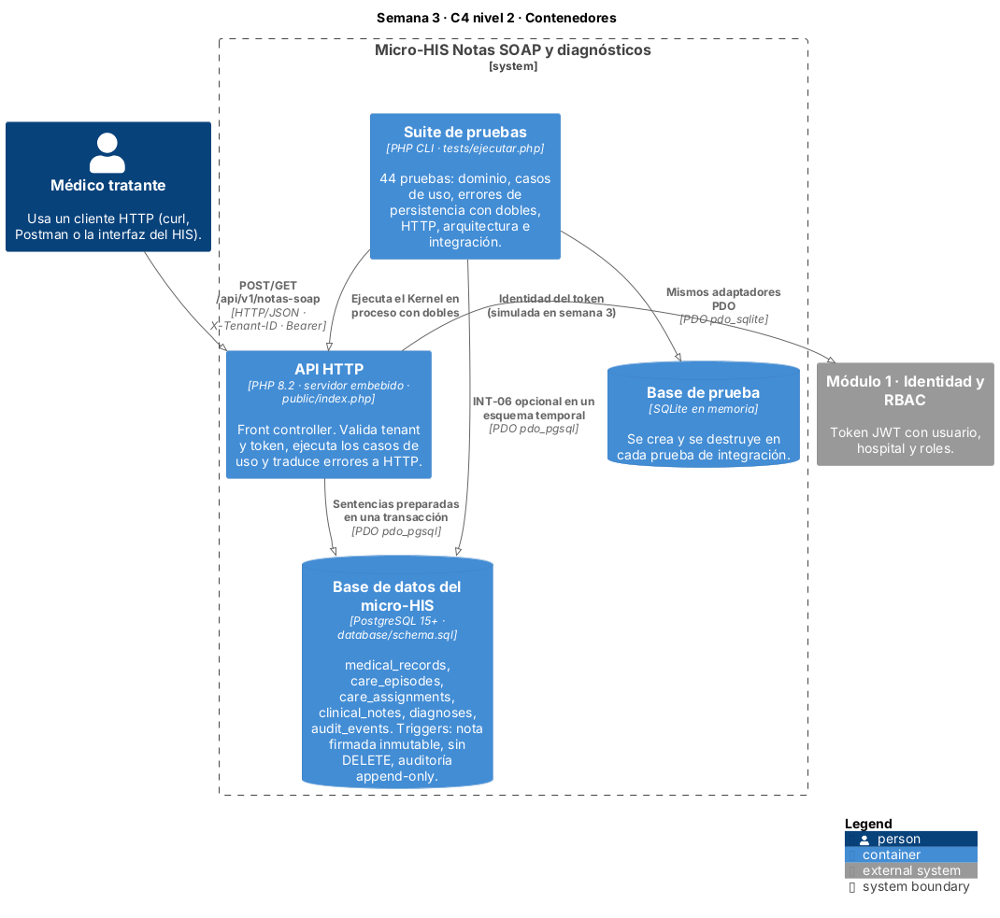
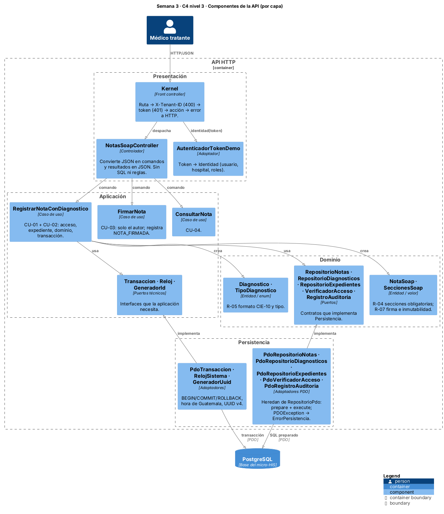
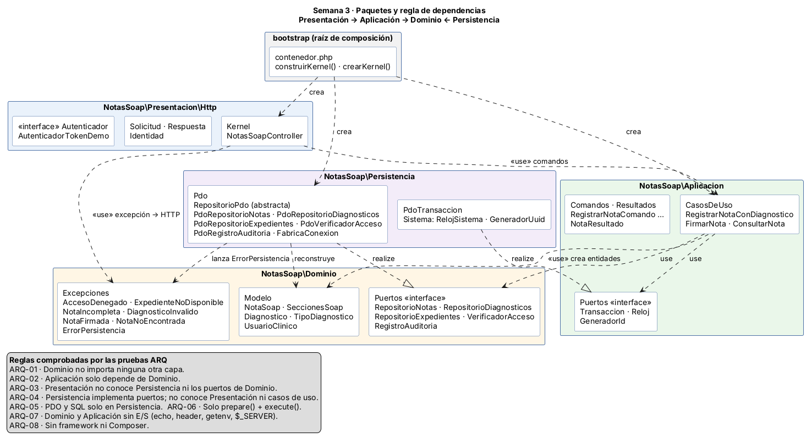
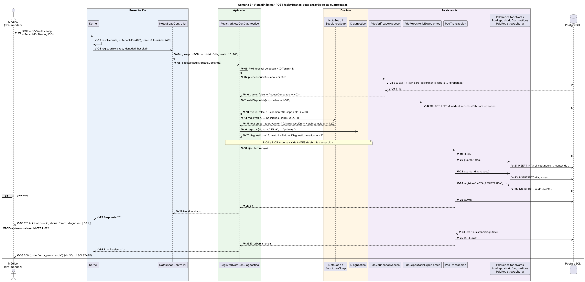

# Semana 3 — Arquitectura en capas del Micro-HIS Notas SOAP y diagnósticos

| | |
|---|---|
| **Curso** | Análisis de Sistemas II — Proyecto Final 2026 |
| **Proyecto** | Sistema Hospitalario Integrado (HIS) |
| **Módulo** | ASII-11 Notas SOAP y diagnósticos |
| **Tema de la semana** | Arquitectura de software: capas, dependencias y persistencia |
| **Flujo implementado** | «Registro de nota SOAP y asociación de diagnóstico clínico» |
| **Tecnología** | PHP 8.2+ vanilla, PDO con sentencias preparadas, PostgreSQL (SQLite en memoria para pruebas) |
| **Código** | [`../micro-his-notas-soap/`](../micro-his-notas-soap/) |
| **Estudiante** | Joshua Eduardo García Reyes (`jgarciar73-svg`) |
| **Fecha** | Octubre 2026 |

## Índice

1. [Introducción](#1-introducción)
2. [Alcance del micro-HIS](#2-alcance-del-micro-his)
3. [Decisiones de arquitectura](#3-decisiones-de-arquitectura)
4. [C4 nivel 1: contexto](#4-c4-nivel-1-contexto)
5. [C4 nivel 2: contenedores](#5-c4-nivel-2-contenedores)
6. [C4 nivel 3: componentes](#6-c4-nivel-3-componentes)
7. [Paquetes y regla de dependencias](#7-paquetes-y-regla-de-dependencias)
8. [Vista dinámica del registro](#8-vista-dinámica-del-registro)
9. [Responsabilidad de cada capa](#9-responsabilidad-de-cada-capa)
10. [Persistencia con PDO](#10-persistencia-con-pdo)
11. [Estrategia de pruebas](#11-estrategia-de-pruebas)
12. [Evidencia](#12-evidencia)
13. [Trazabilidad con las semanas 1 y 2](#13-trazabilidad-con-las-semanas-1-y-2)
14. [Relación con el HIS del grupo](#14-relación-con-el-his-del-grupo)
15. [Limitaciones](#15-limitaciones)
16. [Conclusión](#16-conclusión)
17. [Bibliografía](#17-bibliografía)

## 1. Introducción

En la semana 1 modelé el proceso y en la semana 2 escribí sus requerimientos y separé responsabilidades con SRP. Esta semana el proceso se vuelve un sistema que corre: un **micro-HIS** en PHP 8.2 sin framework que registra la nota SOAP con su diagnóstico, la firma y la consulta, y que guarda todo en PostgreSQL con PDO.

La consigna pide cuatro capas (Presentation, Application, Domain y Persistence), PDO con sentencias preparadas y pruebas de tres situaciones: el camino feliz, una regla de dominio y un error de persistencia. El entregable es la **vista arquitectónica C4/UML del módulo y sus dependencias**. Por eso este documento se centra en los diagramas y en por qué las piezas dependen unas de otras de la forma en que lo hacen. El código está para demostrar que la vista no es solo un dibujo: hay pruebas que revisan el código fuente y fallan si una capa importa algo que no debe.

## 2. Alcance del micro-HIS

| Entra | Queda fuera (y por qué) |
|---|---|
| Registrar nota SOAP + diagnóstico en una transacción (CU-01, CU-02) | Corrección de nota firmada con `supersedes_id` (R-07, segunda parte): se agrega cuando el micro-HIS crezca en las semanas 4 y 5 |
| Firmar la nota, solo el autor (CU-03) | Consulta del catálogo CIE-10: solo se valida el formato del código |
| Consultar la nota con sus diagnósticos (CU-04) | Login y JWT reales: la identidad la da el módulo 1 (RBAC); aquí se simula con tokens de demostración |
| Verificar hospital, rol médico y asignación activa (CU-05) | Interfaz gráfica: se prueba con `curl` y con las pruebas automáticas |
| Auditoría `NOTA_REGISTRADA` y `NOTA_FIRMADA` | Federación CENTRAL/HOSPITAL del HIS: el micro-HIS usa una sola base |

Los datos de prueba son los mismos de las semanas anteriores: la Dra. Méndez atiende a Carlos (episodio `epi-100`, expediente `exp-carlos`), el Dr. López es médico pero no está asignado, y la enfermera Ana no tiene rol médico.

## 3. Decisiones de arquitectura

| ID | Decisión | Alternativa descartada | Motivo |
|---|---|---|---|
| DA-01 | Cuatro capas con la regla **Presentación → Aplicación → Dominio ← Persistencia** | Capas en cadena (Presentación → Negocio → Datos) | En la cadena el negocio depende de la base. Con la flecha invertida hacia Dominio, las reglas clínicas no saben que existe PDO y se prueban sin base de datos. |
| DA-02 | Los **puertos** (interfaces) de repositorio viven en Dominio; los técnicos (`Transaccion`, `Reloj`, `GeneradorId`) en Aplicación | Interfaces junto a su implementación en Persistencia | Quien usa la interfaz es quien la define. Si estuvieran en Persistencia, Dominio tendría que importar Persistencia y la regla se rompería. |
| DA-03 | **Raíz de composición** única (`bootstrap/contenedor.php`) | Que cada clase cree sus dependencias con `new` | Es el único archivo que conoce todas las clases concretas. Las pruebas usan la misma función `construirKernel()` con dobles; la aplicación real usa `crearKernel()` con PDO. |
| DA-04 | El dominio valida **todo antes** de abrir la transacción | Validar dentro de la transacción | Una sección vacía o un CIE-10 mal escrito no deben tocar la base (CA-07, CA-08). La transacción solo se abre con datos ya válidos. |
| DA-05 | Una transacción cubre nota, diagnóstico y auditoría (R-06) | Guardar cada cosa por separado | Si falla el diagnóstico no puede quedar una nota huérfana ni un evento de algo que no pasó. |
| DA-06 | `PDOException` **no sale** de Persistencia: se traduce a `ErrorPersistencia` (con el SQLSTATE) | Dejar que la excepción de PDO suba hasta el controlador | Si el controlador atrapara `PDOException`, Presentación dependería de PDO. Además así el SQLSTATE queda para diagnóstico y el usuario ve un mensaje genérico (RNF-03). |
| DA-07 | Front controller propio (`Kernel`) con rutas fijas | Microframework (Slim, Lumen) | La consigna pide vanilla. Son tres rutas; un framework agregaría más código del que ahorra. |
| DA-08 | La base también protege las reglas críticas (triggers de inmutabilidad, sin `DELETE`, auditoría solo de agregar) | Confiar solo en la aplicación | Defensa en profundidad: si alguien modifica la base sin pasar por la aplicación, PostgreSQL rechaza el cambio. Es lo mismo que hace la base HOSPITAL del grupo. |
| DA-09 | Configuración por **variables de entorno** (`NOTASSOAP_DB_*`) | Credenciales en `config.php` | Ninguna clave queda en el repositorio. |

## 4. C4 nivel 1: contexto



Fuente: [`diagramas/semana-03-c4-contexto.puml`](diagramas/semana-03-c4-contexto.puml)

El micro-HIS tiene dos tipos de usuarios: el **médico tratante**, que registra y firma, y el **personal clínico autorizado**, que consulta. Depende de dos sistemas que no son suyos: el **módulo 1 (identidad y RBAC)**, que dice quién es el usuario, su hospital y sus roles, y los **módulos de expediente y episodios**, dueños de `medical_records`, `care_episodes` y `care_assignments`. El micro-HIS solo lee esas tablas; en esta semana trae una copia reducida en su propia base para poder correr solo. La flecha hacia el **HIS en Laravel** indica hacia dónde va el módulo: el dominio y los casos de uso son los que se van a reutilizar.

## 5. C4 nivel 2: contenedores



Fuente: [`diagramas/semana-03-c4-contenedores.puml`](diagramas/semana-03-c4-contenedores.puml)

| Contenedor | Tecnología | Responsabilidad |
|---|---|---|
| API HTTP | PHP 8.2, servidor embebido (`php -S`), `public/index.php` | Recibe JSON, valida `X-Tenant-ID` y token, ejecuta los casos de uso y responde JSON. Si no hay conexión con la base al arrancar, responde 503. |
| Base de datos | PostgreSQL 15+, `database/schema.sql` | Seis tablas y una función de trigger que impide modificar una nota firmada, borrar notas o diagnósticos y cambiar eventos de auditoría. |
| Suite de pruebas | PHP CLI, `tests/ejecutar.php` | 44 pruebas. Usa el mismo `Kernel` en proceso, con dobles o con PDO real. |
| Base de prueba | SQLite en memoria | Se crea y se destruye en cada prueba de integración. Corre los adaptadores PDO de producción sin instalar nada. |

## 6. C4 nivel 3: componentes



Fuente: [`diagramas/semana-03-c4-componentes.puml`](diagramas/semana-03-c4-componentes.puml)

Dentro de la API, cada componente cae en una capa. Las flechas de "implementa" van **de Persistencia hacia arriba**: los adaptadores PDO implementan interfaces que pertenecen a Dominio y a Aplicación. Esa es la inversión de dependencias de DA-01 y DA-02 vista en el diagrama.

## 7. Paquetes y regla de dependencias



Fuente: [`diagramas/semana-03-paquetes-dependencias.puml`](diagramas/semana-03-paquetes-dependencias.puml)

| Capa (paquete) | Puede usar | No puede usar | Prueba que lo comprueba |
|---|---|---|---|
| `NotasSoap\Dominio` | Solo Dominio | Aplicación, Presentación, Persistencia, PDO, E/S | ARQ-01, ARQ-05, ARQ-07 |
| `NotasSoap\Aplicacion` | Aplicación y Dominio | Presentación, Persistencia, PDO, E/S | ARQ-02, ARQ-05, ARQ-07 |
| `NotasSoap\Presentacion` | Casos de uso, comandos y excepciones de Dominio | Persistencia, puertos de Dominio, PDO | ARQ-03, ARQ-05 |
| `NotasSoap\Persistencia` | Dominio (modelo, puertos, excepciones) y puertos de Aplicación | Presentación y casos de uso | ARQ-04, ARQ-06 |
| `bootstrap` | Todo | — | Es la raíz de composición |

Las pruebas `ARQ` no confían en que yo recuerde la regla: recorren los archivos de `src/` con `token_get_all()` de PHP, sacan cada nombre de clase `NotasSoap\...` que aparece y lo comparan contra la tabla. Si mañana alguien escribe `use NotasSoap\Persistencia\Pdo\PdoRepositorioNotas;` dentro de un caso de uso, la prueba ARQ-02 falla y dice qué archivo rompió la regla.

## 8. Vista dinámica del registro



Fuente: [`diagramas/semana-03-dinamica-registro.puml`](diagramas/semana-03-dinamica-registro.puml)

La secuencia sigue el mismo camino de la semana 1, pero ahora cada participante es una clase real y cada caja de color es una capa. Puntos que conviene señalar:

- **V-02 a V-04 (Presentación):** los errores de forma (falta tenant, token, cuerpo sin diagnóstico) se rechazan antes de llegar a la aplicación.
- **V-06 a V-13 (Aplicación → Persistencia):** el caso de uso pregunta por acceso y expediente a través de puertos; no sabe que detrás hay un `SELECT`.
- **V-14 a V-17 (Dominio):** las reglas R-04 y R-05 viven en `SeccionesSoap` y `Diagnostico`. Si fallan, no se ha abierto ninguna transacción.
- **V-19 a V-26:** `BEGIN`, tres `INSERT` preparados y `COMMIT`.
- **V-31 a V-35:** si cualquier `INSERT` falla, el adaptador lanza `ErrorPersistencia`, `PdoTransaccion` hace `ROLLBACK` y el cliente recibe un 500 sin SQL ni SQLSTATE.

## 9. Responsabilidad de cada capa

| Capa | Clases | Responsabilidad | Lo que nunca hace |
|---|---|---|---|
| Presentación | `Kernel`, `NotasSoapController`, `Solicitud`, `Respuesta`, `AutenticadorTokenDemo` | Rutas, cabeceras, JSON, códigos HTTP. Traduce excepciones de dominio a 403, 404, 409 y 422. | Escribir SQL o decidir reglas clínicas |
| Aplicación | `RegistrarNotaConDiagnostico`, `FirmarNota`, `ConsultarNota`, comandos, `NotaResultado` | Coordinar: en qué orden se verifica, qué va en la transacción y qué se audita | Saber de HTTP o de PDO |
| Dominio | `NotaSoap`, `SeccionesSoap`, `Diagnostico`, `TipoDiagnostico`, `UsuarioClinico`, excepciones, puertos | Las reglas: secciones obligatorias, formato CIE-10, tipos válidos, firma e inmutabilidad | Entrada/salida de cualquier tipo |
| Persistencia | `RepositorioPdo` y sus cinco adaptadores, `PdoTransaccion`, `FabricaConexion`, `RelojSistema`, `GeneradorUuid` | Traducir entidades a filas y filas a entidades con sentencias preparadas; transacciones; hora y UUID | Decidir si una nota es válida |

Esto continúa lo de la semana 2: allá separé las clases por responsabilidad (SRP); aquí agrupo esas clases en capas y fijo hacia dónde pueden apuntar las dependencias.

## 10. Persistencia con PDO

**Conexión** (`FabricaConexion`):

```php
new PDO($dsn, $usuario, $clave, [
    PDO::ATTR_ERRMODE => PDO::ERRMODE_EXCEPTION,   // todo error es excepción, nada falla en silencio
    PDO::ATTR_EMULATE_PREPARES => false,           // el servidor prepara la sentencia de verdad
    PDO::ATTR_DEFAULT_FETCH_MODE => PDO::FETCH_ASSOC,
]);
```

**Una sola puerta de salida a la base** (`RepositorioPdo::ejecutar`): todas las consultas pasan por `prepare()` + `execute($parametros)`, con marcadores con nombre (`:id`, `:contenido`). Ningún valor que venga del usuario se pega dentro del texto SQL, así que una nota que contenga `'); DROP TABLE clinical_notes; --` se guarda como texto y nada más. La prueba ARQ-06 revisa que no haya `->query()`, `->exec()`, cadenas SQL con variables interpoladas ni SQL concatenado con `.` en Persistencia.

**Errores:** `RepositorioPdo` atrapa `PDOException` y lanza `ErrorPersistencia` con el SQLSTATE (`08006` conexión perdida, `23503` llave foránea, `40001` conflicto de serialización, etc.) y la excepción original como causa. El `Kernel` responde 500 `error_persistencia` con un mensaje genérico.

**Transacción:** `PdoTransaccion::ejecutar()` hace `BEGIN`, ejecuta el trabajo y hace `COMMIT`; ante cualquier excepción hace `ROLLBACK` y la vuelve a lanzar. Si el `COMMIT` mismo falla, también revierte e informa `ErrorPersistencia`.

**Firma concurrente:** `registrarFirma()` ejecuta `UPDATE ... WHERE clinical_note_id = :id AND status = 'draft'`. Si dos peticiones intentan firmar a la vez, la segunda afecta 0 filas y recibe 409 `nota_firmada`.

**Mapeo con el HIS:** las columnas son las de la migración de la base HOSPITAL (`clinical_notes`, `diagnoses`). Como `content` es un solo campo de texto, las cuatro secciones se guardan como JSON `{"S", "O", "A", "P"}`. En el HIS los identificadores son `uuid`; aquí son `text` para que los datos de demostración se lean fácil, pero la aplicación igual genera UUID v4.

## 11. Estrategia de pruebas

La consigna pide probar **al menos** el camino feliz, una regla de dominio y un error de persistencia, con dobles o con una base de prueba. Usé las dos cosas:

| Situación pedida | Con dobles | Con base de prueba |
|---|---|---|
| **Camino feliz** | APP-01 (repositorios en memoria), HTTP-01 | INT-01 (SQLite), INT-06 (PostgreSQL) |
| **Regla de dominio** | DOM-01 a DOM-08, APP-06 | INT-02 (asignación y expediente leídos de la base), INT-05 (inmutabilidad en la base) |
| **Error de persistencia** | PER-01 a PER-06 (`PdoQueFalla`, `PdoEspia`, repositorio que falla) | INT-04 (trigger que rompe el `INSERT` del diagnóstico), INT-06 |

| Grupo | Pruebas | Qué cubre |
|---|---|---|
| `DOM` | 8 | Reglas de `NotaSoap`, `SeccionesSoap` y `Diagnostico` sin nada alrededor |
| `APP` | 9 | Casos de uso con dobles en memoria: camino feliz, acceso, hospital, expediente, firma |
| `PER` | 6 | Adaptadores PDO con dobles que simulan la base caída; reversión de la transacción |
| `HTTP` | 7 | Rutas, cabeceras, códigos de estado, autoría tomada del token, errores sin detalles internos |
| `ARQ` | 8 | La regla de dependencias de la sección 7, PDO solo en Persistencia, sentencias preparadas, sin framework |
| `INT` | 6 | Los mismos adaptadores de producción contra SQLite en memoria y PostgreSQL |

**Dobles de prueba** (`tests/Dobles/`):

- `PdoQueFalla` extiende `PDO` sin abrir conexión; su `prepare()` lanza una `PDOException` con el SQLSTATE que se le indique, como haría `pdo_pgsql` con la base caída.
- `PdoEspia` extiende `PDO` y anota `BEGIN`, `COMMIT` y `ROLLBACK` para verificar la transacción.
- Repositorios en memoria que implementan los mismos puertos de Dominio, y una `TransaccionEnMemoria` que restaura su estado si el trabajo falla.
- `RelojFijo` y `GeneradorSecuencial` para que los resultados sean siempre iguales.

Las pruebas no usan PHPUnit para no depender de Composer; `tests/Arnes.php` tiene cinco funciones (`prueba`, `igual`, `afirmar`, `lanza`, `omitir`) y la organización (`tests/ejecutar.php` con un grupo por capa) sigue la del micro-HIS de RBAC del grupo.

## 12. Evidencia

| Archivo | Contenido |
|---|---|
| [`evidencia/salida-pruebas.txt`](evidencia/salida-pruebas.txt) | Ejecución sin PostgreSQL (43 pasan, 1 omitida) y con PostgreSQL 16 (44 de 44 pasan) |
| [`evidencia/salida-api-postgresql.txt`](evidencia/salida-api-postgresql.txt) | La API levantada con `php -S` contra PostgreSQL: registrar (201), consultar (200), firmar (200), firmar otra vez (409), médico no asignado (403), sin tenant (400), CIE-10 inválido (422), filas resultantes en la base e intento de `UPDATE` directo rechazado por el trigger |

Para repetirla:

```bash
cd docs/modulos/notas-soap-diagnosticos/micro-his-notas-soap
php tests/ejecutar.php
```

Resumen de la ejecución con PostgreSQL:

```
Total: 44  Pasan: 44  Fallan: 0  Omitidas: 0
```

## 13. Trazabilidad con las semanas 1 y 2

| Regla (S1) | Requerimiento (S2) | Dónde vive (S3) | Pruebas |
|---|---|---|---|
| R-01 Tenant obligatorio | RF-02, RF-09 | `Kernel` (400) y casos de uso (hospital del token = `X-Tenant-ID`) | HTTP-02, APP-04 |
| R-02 Rol médico y asignación | RF-02 | `VerificadorAcceso` ← `PdoVerificadorAcceso` | APP-02, APP-03, HTTP-03, INT-02 |
| R-03 Expediente abierto y del mismo paciente | RF-03 | `RepositorioExpedientes` ← `PdoRepositorioExpedientes` | APP-05, INT-02 |
| R-04 Cuatro secciones obligatorias | RF-01 | `SeccionesSoap` | DOM-02, APP-06, HTTP-03 |
| R-05 Diagnóstico CIE-10 válido | RF-04 | `Diagnostico`, `TipoDiagnostico` | DOM-03, DOM-04, DOM-05, APP-06 |
| R-06 Nota y diagnóstico en una transacción | RF-05 | `RegistrarNotaConDiagnostico` + `Transaccion` ← `PdoTransaccion` | PER-03, PER-04, PER-05, INT-04, INT-06 |
| R-07 Nota firmada inmutable | RF-07, RF-08 | `NotaSoap::firmar()`, `UPDATE ... AND status = 'draft'`, trigger | DOM-06, DOM-07, APP-07, APP-08, HTTP-05, INT-03, INT-05 |
| R-08 Sin borrado físico | — | Triggers de `schema.sql`; ninguna clase tiene método para borrar | INT-05 |
| — | RF-06 Autor desde el token | `NotasSoapController` ignora `author_user_ref_id` del cuerpo | HTTP-07 |
| — | RF-10 Auditoría | `RegistroAuditoria` ← `PdoRegistroAuditoria` | APP-01, APP-07, INT-01 |
| — | RNF-03 Errores sin detalles | `Kernel` responde mensajes genéricos en 500 | PER-06, HTTP-06 |
| — | RNF-05 Testabilidad | Puertos + raíz de composición | Toda la suite corre sin base de datos |

| Criterio (S2) | Prueba (S3) | | Criterio (S2) | Prueba (S3) |
|---|---|---|---|---|
| CA-01 | APP-01, HTTP-01, INT-01 | | CA-07 | DOM-02, APP-06 |
| CA-02 | HTTP-02 | | CA-08 | DOM-03, APP-06 |
| CA-03 | APP-03 | | CA-09 | DOM-04 |
| CA-04 | APP-02, HTTP-03 | | CA-10 | PER-05, INT-04 |
| CA-05 | APP-04 | | CA-11 | DOM-07, APP-07, APP-08, HTTP-05 |
| CA-06 | APP-05, HTTP-03 | | CA-12 | HTTP-07 |

Los casos de uso de la semana 1 quedaron así: CU-01 + CU-02 → `RegistrarNotaConDiagnostico`, CU-03 → `FirmarNota`, CU-04 → `ConsultarNota` y CU-05 → `VerificadorAcceso`, usado dentro del registro.

## 14. Relación con el HIS del grupo

El HIS del repositorio está hecho en Laravel 12. El micro-HIS no lo reemplaza: es un prototipo pequeño donde las decisiones de arquitectura se pueden ver y probar sin el framework. Lo que se espera reutilizar es lo que no depende de nada:

- **Dominio** (`NotaSoap`, `SeccionesSoap`, `Diagnostico`) y **Aplicación** (los casos de uso) pasan tal cual, porque no importan ninguna clase de framework ni de PDO.
- **Persistencia** se reemplaza por adaptadores que usen la conexión de Laravel a la base HOSPITAL, implementando los mismos puertos.
- **Presentación** se reemplaza por un controlador Laravel y el middleware de JWT del módulo 1.

Esto es exactamente lo que pide la semana 4 (patrón Repository con dos adaptadores, PDO y en memoria) y la semana 5 (contrato de API y frontera de microservicio). El micro-HIS vive en `docs/modulos/notas-soap-diagnosticos/micro-his-notas-soap/`, fuera de `semana-03/`, porque se sigue usando en esas semanas; es la misma organización del micro-HIS de RBAC.

## 15. Limitaciones

- La autenticación es de demostración: tres tokens fijos en `config/config.php`. No hay expiración ni firma.
- No se valida el código contra el catálogo CIE-10, solo su formato.
- No está implementada la corrección de notas firmadas (versión nueva con `supersedes_id` y `correction_reason`).
- El micro-HIS usa una base propia con una copia reducida de las tablas del HIS; no prueba la federación CENTRAL/HOSPITAL.
- El RNF-07 (tiempo de respuesta) todavía no se mide; queda para la semana 15.

## 16. Conclusión

La vista C4 muestra el sistema de afuera hacia adentro: quién lo usa, en qué se ejecuta y de qué piezas está hecho. El diagrama de paquetes fija la regla más importante, que las flechas apunten hacia el dominio, y la vista dinámica enseña esa regla en funcionamiento con un registro real. Lo que más me sirvió fue convertir la regla de dependencias en pruebas: si alguien la rompe, la suite lo dice con el nombre del archivo. Con PDO aprendí que una sola clase base con `prepare()` y `execute()` basta para que ningún adaptador arme SQL a mano, y que traducir `PDOException` a una excepción propia evita que PDO se filtre a las demás capas. Las 44 pruebas pasan con dobles, con SQLite en memoria y con PostgreSQL.

## 17. Bibliografía

- Bass, L., Clements, P. y Kazman, R. (2021). *Software Architecture in Practice* (4.ª ed.). Addison-Wesley.
- Brown, S. (s. f.). *The C4 model for visualising software architecture*. https://c4model.com/
- Cockburn, A. (2005). *Hexagonal architecture (Ports and Adapters)*. https://alistair.cockburn.us/hexagonal-architecture/
- Fowler, M. (2002). *Patterns of Enterprise Application Architecture*. Addison-Wesley. (Repository, Service Layer, Front Controller).
- Martin, R. C. (2017). *Clean Architecture: A Craftsman's Guide to Software Structure and Design*. Prentice Hall.
- OWASP Foundation. (s. f.). *SQL Injection Prevention Cheat Sheet*. https://cheatsheetseries.owasp.org/cheatsheets/SQL_Injection_Prevention_Cheat_Sheet.html
- PHP Group. (s. f.). *PDO: sentencias preparadas y procedimientos almacenados*. Manual de PHP. https://www.php.net/manual/es/pdo.prepared-statements.php
- Sommerville, I. (2011). *Ingeniería de software* (9.ª ed.). Pearson Educación.
