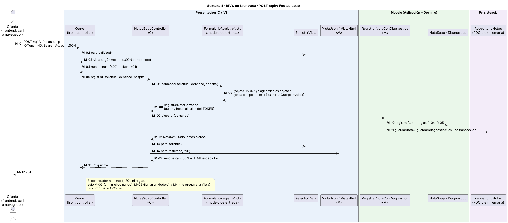
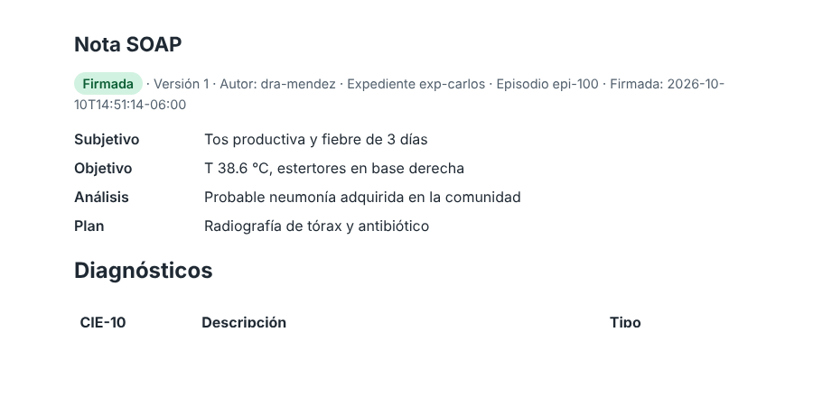
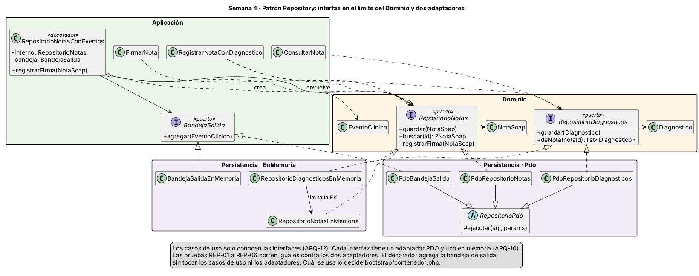
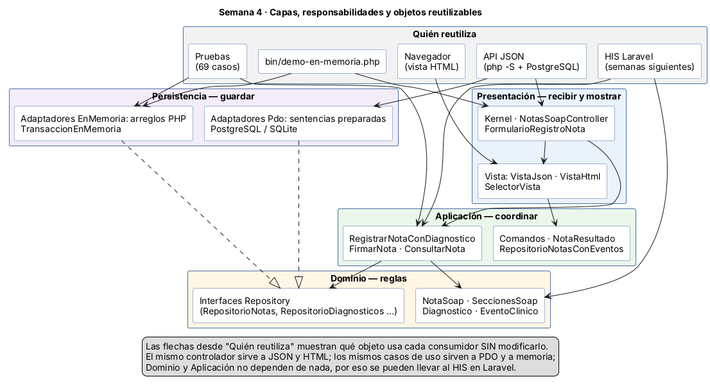
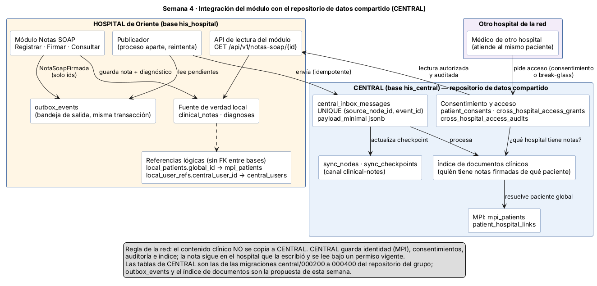
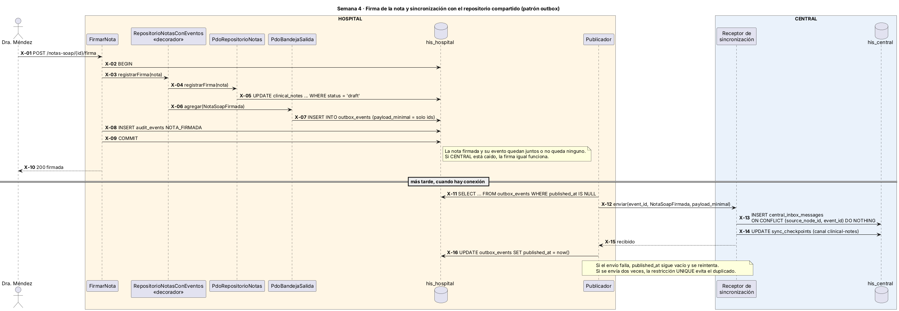

# Semana 4 — MVC en la entrada, patrón Repository y repositorio de datos compartido

| | |
|---|---|
| **Curso** | Análisis de Sistemas II — Proyecto Final 2026 |
| **Proyecto** | Sistema Hospitalario Integrado (HIS) |
| **Módulo** | ASII-11 Notas SOAP y diagnósticos |
| **Tema de la semana** | Arquitectura en capas y patrón repositorio |
| **Flujo** | «Registro de nota SOAP y asociación de diagnóstico clínico» (el mismo de las semanas 1 a 3) |
| **Código** | [`../micro-his-notas-soap/`](../micro-his-notas-soap/) (el mismo micro-HIS de la semana 3) |
| **Estudiante** | Joshua Eduardo García Reyes (`jgarciar73-svg`) |
| **Fecha** | Octubre 2026 |

## Índice

1. [Introducción](#1-introducción)
2. [Qué cambió respecto a la semana 3](#2-qué-cambió-respecto-a-la-semana-3)
3. [MVC en la entrada](#3-mvc-en-la-entrada)
4. [La interfaz Repository y su límite](#4-la-interfaz-repository-y-su-límite)
5. [Adaptadores PDO y en memoria](#5-adaptadores-pdo-y-en-memoria)
6. [Un controlador sin SQL ni reglas de negocio](#6-un-controlador-sin-sql-ni-reglas-de-negocio)
7. [Capas, responsabilidades y objetos reutilizables](#7-capas-responsabilidades-y-objetos-reutilizables)
8. [Integración con un repositorio de datos compartido](#8-integración-con-un-repositorio-de-datos-compartido)
9. [Pruebas y evidencia](#9-pruebas-y-evidencia)
10. [Trazabilidad](#10-trazabilidad)
11. [Limitaciones](#11-limitaciones)
12. [Conclusión](#12-conclusión)
13. [Bibliografía](#13-bibliografía)

## 1. Introducción

La consigna pide continuar el **mismo** micro-HIS y el **mismo** flujo. No hice un proyecto nuevo: trabajé sobre el código de la semana 3 y cambié solo lo necesario para cumplir cuatro cosas.

1. **Organizar la entrada con MVC.** La petición entra por un controlador, el modelo hace el trabajo y una vista decide cómo se muestra el resultado.
2. **Definir una interfaz Repository en el límite apropiado**, con un adaptador PDO y otro en memoria.
3. **Que el controlador no tenga SQL ni reglas de negocio.**
4. **Analizar y diagramar cómo un repositorio de datos compartido integraría este módulo.**

El entregable pide mostrar las **capas, sus responsabilidades y los objetos reutilizables**. La sección 7 responde eso directamente. Las demás secciones explican cómo se llegó ahí y cómo se comprueba.

## 2. Qué cambió respecto a la semana 3

| Pieza | Semana 3 | Semana 4 |
|---|---|---|
| Controlador | `Presentacion/Http/NotasSoapController`: leía el JSON y armaba la respuesta | `Presentacion/Controladores/NotasSoapController`: solo arma el comando, llama al caso de uso y entrega a la vista |
| Lectura de la entrada | Dentro del controlador | `Presentacion/Entrada/FormularioRegistroNota` (modelo de entrada) |
| Salida | `Respuesta::json()` dentro del controlador | `Presentacion/Vistas/`: `VistaJson`, `VistaHtml` y `SelectorVista` |
| Interfaces Repository | `Dominio/Puertos/` con un solo adaptador (PDO) | Las mismas interfaces, ahora con **dos** adaptadores: `Persistencia/Pdo/` y `Persistencia/EnMemoria/` |
| Adaptadores en memoria | Solo existían como dobles dentro de `tests/` | Pasan a `src/Persistencia/EnMemoria/` como código de producción; las pruebas y la demostración usan esos mismos |
| Resultado de los casos de uso | Sin las secciones SOAP | `NotaResultado` lleva expediente, episodio y secciones; `FirmarNota` devuelve también los diagnósticos |
| Repositorio compartido | No existía | Análisis, dos diagramas y un prototipo: evento `NotaSoapFirmada`, bandeja de salida `outbox_events` y decorador `RepositorioNotasConEventos` |
| Pruebas | 44 | 69 (grupos nuevos: contrato del Repository `REP`; más pruebas `ARQ`, `HTTP`, `APP` e `INT`) |

Las reglas del dominio, los casos de uso y los adaptadores PDO de la semana 3 **no cambiaron su comportamiento**. El único cambio de firma es que `FirmarNota` recibe también el repositorio de diagnósticos, para devolver la nota completa. Las 44 pruebas anteriores siguen pasando con los mismos identificadores; tres de ellas (PER-05, PER-06 y HTTP-06) se adaptaron para provocar la falla con dobles nuevos en lugar de banderas dentro de los adaptadores.

## 3. MVC en la entrada



Fuente: [`diagramas/semana-04-mvc-entrada.puml`](diagramas/semana-04-mvc-entrada.puml)

En una API no hay pantallas, pero las tres responsabilidades del MVC siguen existiendo:

| Parte | Clases | Responsabilidad |
|---|---|---|
| **Modelo (M)** | Casos de uso de Aplicación (`RegistrarNotaConDiagnostico`, `FirmarNota`, `ConsultarNota`) y entidades del Dominio (`NotaSoap`, `Diagnostico`) | Hacer el trabajo y aplicar las reglas. No sabe que existe HTTP |
| **Vista (V)** | `VistaJson`, `VistaHtml` con sus plantillas, `SelectorVista` | Convertir un `NotaResultado` en una respuesta: JSON para el frontend y curl, HTML para el navegador |
| **Controlador (C)** | `NotasSoapController` | Recibir la petición, pedir el comando al formulario, llamar al Modelo y pasar el resultado a la Vista |
| Apoyo de entrada | `FormularioRegistroNota`, `CuerpoInvalido` | Traducir el JSON a `RegistrarNotaComando`. Solo revisa **forma**: que sea un objeto y que cada campo sea texto |
| Front controller | `Kernel` | Rutas, `X-Tenant-ID`, token y traducción de excepciones a códigos HTTP, mostradas con la vista que pidió el cliente |

Distingo dos tipos de validación porque es fácil mezclarlas:

- **Formato** (Presentación, 400). Si `plan` llega como arreglo `[1, 2]`, el formulario responde `cuerpo_invalido` y nombra el campo. Eso no es una regla clínica: es un JSON mal armado.
- **Regla de negocio** (Dominio, 422). Si `plan` llega como texto vacío, el formulario lo deja pasar y es `SeccionesSoap` la que responde `nota_incompleta`. Así la regla R-04 vive en un solo lugar.

La vista HTML existe para mostrar que el MVC sirve de algo. **El mismo controlador y el mismo modelo** atienden al frontend (JSON) y al navegador (HTML). Solo cambia la vista, según la cabecera `Accept`. La plantilla escapa todo con `htmlspecialchars`: si alguien escribe `<script>` en una sección, se muestra como texto (prueba HTTP-09).



## 4. La interfaz Repository y su límite



Fuente: [`diagramas/semana-04-repository-clases.puml`](diagramas/semana-04-repository-clases.puml)

Las interfaces `RepositorioNotas` y `RepositorioDiagnosticos` están en **`Dominio/Puertos/`**. Ese es el límite apropiado por tres razones:

1. **Hablan el idioma del dominio.** Reciben y devuelven `NotaSoap` y `Diagnostico`, no filas ni arreglos. Fowler define el Repository justamente como un intermediario que hace ver la persistencia como una colección de objetos del dominio.
2. **Quien las usa es quien las define.** Los casos de uso las necesitan; Persistencia solo las implementa. Si estuvieran en Persistencia, Aplicación y Dominio tendrían que importar Persistencia y se rompería la regla Presentación → Aplicación → Dominio ← Persistencia.
3. **Expresan reglas del dominio.** `registrarFirma` solo cambia una nota en borrador: una nota firmada lanza `NotaFirmada` en cualquier adaptador (R-07). Ese comportamiento forma parte del contrato, no de un adaptador en particular.

| Alternativa | Por qué la descarté |
|---|---|
| Interfaz en `Persistencia/` | El dominio dependería de la capa de datos: es justo lo que se quiere evitar |
| Un repositorio genérico (`guardar(object)`, `buscarPor(array)`) | Pierde el lenguaje del dominio y la regla de la firma. Además invita a armar consultas desde arriba |
| Sin interfaz, usando PDO directo en los casos de uso | No se podría probar sin base ni cambiar el almacenamiento sin tocar las reglas |

La bandeja de salida (`BandejaSalida`) y la transacción (`Transaccion`) son puertos de **Aplicación**, porque son necesidades técnicas de la coordinación y no conceptos clínicos. Siguen la misma idea: interfaz adentro, implementación en Persistencia.

## 5. Adaptadores PDO y en memoria

| Puerto | Adaptador PDO | Adaptador en memoria |
|---|---|---|
| `RepositorioNotas` | `PdoRepositorioNotas` | `RepositorioNotasEnMemoria` |
| `RepositorioDiagnosticos` | `PdoRepositorioDiagnosticos` | `RepositorioDiagnosticosEnMemoria` |
| `RepositorioExpedientes` | `PdoRepositorioExpedientes` | `RepositorioExpedientesEnMemoria` |
| `VerificadorAcceso` | `PdoVerificadorAcceso` | `VerificadorAccesoEnMemoria` |
| `RegistroAuditoria` | `PdoRegistroAuditoria` | `RegistroAuditoriaEnMemoria` |
| `Transaccion` | `PdoTransaccion` | `TransaccionEnMemoria` |
| `BandejaSalida` | `PdoBandejaSalida` | `BandejaSalidaEnMemoria` |

La prueba ARQ-10 recorre los 7 puertos y falla si alguno no tiene sus dos adaptadores.

**Cómo se elige el adaptador.** Solo en `bootstrap/contenedor.php`. `crearKernel()` arma el sistema con PDO y PostgreSQL; `crearKernelEnMemoria()` lo arma con arreglos de PHP. Ningún controlador, caso de uso ni entidad sabe cuál se está usando (ARQ-12 revisa que los constructores de los casos de uso solo reciban interfaces).

**Mismo comportamiento.** Tener dos clases que implementan la misma interfaz no basta: tienen que comportarse igual. Si no, cambiar una por la otra rompería el sistema (principio de sustitución de Liskov). Por eso escribí **pruebas de contrato**: el mismo archivo `tests/Contrato/RepositorioContratoPrueba.php` corre seis pruebas contra los dos adaptadores.

| Prueba | Qué exige el contrato |
|---|---|
| REP-01 | Guardar y buscar devuelven la misma nota |
| REP-02 | Buscar una nota inexistente devuelve `null` |
| REP-03 | Guardar dos veces el mismo id es `ErrorPersistencia` de integridad |
| REP-04 | `registrarFirma` guarda la firma; sobre una nota firmada lanza `NotaFirmada` |
| REP-05 | `deNota` devuelve solo los diagnósticos de esa nota, ordenados por id |
| REP-06 | Un diagnóstico de una nota inexistente es `ErrorPersistencia` de integridad |

Al escribirlas apareció una diferencia real. Ante una llave duplicada, PostgreSQL informa SQLSTATE `23505` y SQLite informa `23000`. El contrato quedó en "SQLSTATE de la clase 23 (violación de integridad)", que es lo que de verdad le importa a quien llama. El adaptador en memoria usa los mismos códigos de PostgreSQL (`23505` y `23503`). Para que REP-06 pase también en memoria, `RepositorioDiagnosticosEnMemoria` recibe el almacén de notas e imita la llave foránea.

**Para qué sirve el adaptador en memoria:**

- Las pruebas de casos de uso y de HTTP corren sin base de datos y en milisegundos.
- `php bin/demo-en-memoria.php` muestra el flujo completo en cualquier computadora con PHP, sin instalar PostgreSQL ([salida](evidencia/salida-demo-en-memoria.txt)).
- La prueba INT-08 corre el mismo flujo (registrar, firmar, consultar y un rechazo) con PDO sobre SQLite y con memoria, y compara las respuestas: son idénticas.

## 6. Un controlador sin SQL ni reglas de negocio

Este es el controlador completo de la acción de registro:

```php
public function registrar(Solicitud $s, Identidad $quien, string $hospital): Respuesta
{
    $resultado = $this->registrar->ejecutar(FormularioRegistroNota::comando($s, $quien, $hospital));

    return $this->vistas->para($s)->nota($resultado, 201);
}
```

No tiene `if`, ni SQL, ni validaciones. Las otras dos acciones (`firmar` y `consultar`) tienen la misma forma. No hace falta confiar en que yo me acuerde de mantenerlo así: la prueba **ARQ-09** lee el código de `Presentacion/Controladores/` y falla si encuentra cualquiera de estas cosas:

- cadenas con `SELECT`, `INSERT`, `UPDATE` o `DELETE`;
- `PDO` o `PDOStatement`;
- cualquier clase de `NotasSoap\Dominio\` (el dominio solo se usa a través de los casos de uso);
- funciones de validación (`preg_match`, `trim`, `strlen`);
- estructuras de decisión (`if`, `switch`, `match`, ciclos).

Hice la prueba de romperla a propósito: con un `if` y un `SELECT` en el controlador, ARQ-09 falla y dice qué encontró.

Las vistas tienen su propia regla (ARQ-11): no llaman casos de uso, no conocen Persistencia y no conocen el Dominio. Solo reciben un `NotaResultado`.

## 7. Capas, responsabilidades y objetos reutilizables



Fuente: [`diagramas/semana-04-capas-objetos-reutilizables.puml`](diagramas/semana-04-capas-objetos-reutilizables.puml)

### Responsabilidad de cada capa

| Capa | Responsabilidad | Nunca hace |
|---|---|---|
| **Presentación** | Recibir HTTP, convertir la entrada en comandos, elegir la vista y traducir errores a códigos HTTP | SQL, reglas clínicas, decidir permisos |
| **Aplicación** | Coordinar cada caso de uso: orden de las verificaciones, qué entra en la transacción, qué se audita y qué evento se publica | Saber de HTTP, de HTML o de PDO |
| **Dominio** | Las reglas: secciones obligatorias, formato CIE-10, tipos de diagnóstico, firma e inmutabilidad, qué datos lleva el evento clínico | Entrada/salida de cualquier tipo |
| **Persistencia** | Guardar y leer entidades con sentencias preparadas o en memoria; transacciones; bandeja de salida | Decidir si una nota es válida |

### Objetos reutilizables

| Objeto | Capa | Lo reutilizan | Por qué se puede reutilizar |
|---|---|---|---|
| `NotaSoap`, `SeccionesSoap`, `Diagnostico`, `TipoDiagnostico` | Dominio | Los tres casos de uso, los dos adaptadores, el evento clínico y, más adelante, el HIS en Laravel | No dependen de nada: ni de PHP web ni de una base |
| `EventoClinico` | Dominio | El decorador, las dos bandejas de salida y el futuro publicador | Define en un solo lugar qué datos mínimos salen del hospital |
| Interfaces `RepositorioNotas`, `RepositorioDiagnosticos`, etc. | Dominio | Casos de uso, adaptadores PDO y en memoria, decorador | Son el contrato; cualquier implementación nueva se conecta sin tocar a quien las usa |
| `RegistrarNotaConDiagnostico`, `FirmarNota`, `ConsultarNota` | Aplicación | La API JSON, la vista HTML, la demostración en memoria, 69 pruebas y el HIS | Reciben solo interfaces; cambiar de almacenamiento no los toca |
| `NotaResultado` | Aplicación | `VistaJson` y `VistaHtml` | Datos planos: cualquier vista lo puede pintar sin conocer el dominio |
| `RepositorioNotasConEventos` | Aplicación | Envuelve tanto a `PdoRepositorioNotas` como a `RepositorioNotasEnMemoria` | Es un decorador: agrega comportamiento sin modificar al envuelto |
| `RepositorioPdo` (clase base) | Persistencia | Los seis adaptadores PDO | Concentra `prepare`/`execute` y la traducción de `PDOException` |
| `TransaccionEnMemoria` + `Restaurable` | Persistencia | Los cuatro almacenes en memoria | Cualquier almacén que sepa tomar y devolver una foto puede participar |
| `AlmacenesEnMemoria` | Persistencia | La demostración, las pruebas e INT-08 | Arma los adaptadores en memoria ya conectados entre sí |
| `NotasSoapController` | Presentación | Respuestas JSON y HTML | La vista se elige aparte (`SelectorVista`) |
| `FormularioRegistroNota` | Presentación | El controlador; serviría también para un formulario web | Solo convierte entrada en comando |
| `VistaJson`, `VistaHtml` | Presentación | Las tres acciones y los errores del Kernel | Implementan la misma interfaz `Vista` |
| `Kernel`, `Solicitud`, `Respuesta` | Presentación | PostgreSQL, memoria y pruebas | No saben qué adaptadores hay detrás |

La prueba más directa de que estos objetos son reutilizables es **INT-08**: el mismo Kernel, controlador, vistas, casos de uso y entidades producen exactamente las mismas respuestas con dos almacenamientos distintos.

## 8. Integración con un repositorio de datos compartido

### 8.1 Qué hay hoy en el repositorio del grupo

El HIS ya está diseñado como una red de hospitales con dos tipos de base. Revisé las migraciones de `database/migrations/central/` y `database/migrations/hospital/`:

| Base | Tablas relevantes | Qué guarda |
|---|---|---|
| **CENTRAL** (`his_central`), el repositorio compartido | `mpi_patients`, `mpi_identifiers`, `patient_hospital_links` | El índice maestro de pacientes (MPI): la identidad única del paciente en toda la red |
| | `central_users`, `hospital_memberships` | Usuarios y en qué hospital trabajan |
| | `patient_consents`, `cross_hospital_access_grants`, `cross_hospital_access_audits`, `break_glass_reviews` | Consentimientos, permisos para que otro hospital vea datos, y su auditoría |
| | `sync_nodes`, `sync_checkpoints`, `central_inbox_messages` | Sincronización: cada hospital es un nodo; los eventos llegan a una bandeja de entrada con `payload_minimal` y una restricción `UNIQUE (source_node_id, event_id)` |
| **HOSPITAL** (`his_hospital`), una por hospital | `clinical_notes`, `diagnoses` | Las notas y diagnósticos de este módulo |
| | `local_patients.global_id`, `local_user_refs.central_user_id` | Referencias **lógicas** a CENTRAL. Los comentarios de la migración dicen explícitamente que no hay llave foránea entre bases |

Conclusión: en este HIS, el "repositorio de datos compartido" no es una base donde todos escriben. Es CENTRAL, que guarda **identidad, permisos, auditoría y sincronización**, y recibe eventos mínimos de los hospitales.

### 8.2 Opciones para integrar el módulo

| Opción | Cómo funcionaría | Problema |
|---|---|---|
| A. Guardar las notas directo en CENTRAL | `PdoRepositorioNotas` apunta a `his_central` | Si CENTRAL se cae, ningún hospital puede escribir notas. Además copia contenido clínico fuera del hospital, contra la regla de `payload_minimal` |
| B. Llamar a CENTRAL en cada registro, dentro del caso de uso | Una llamada HTTP antes del `COMMIT` | Mezcla una transacción local con una llamada remota: si la red falla a medias, una base queda distinta de la otra |
| **C. Bandeja de salida (outbox) + bandeja de entrada de CENTRAL** | La nota se guarda en HOSPITAL y, en la **misma transacción**, se guarda un evento en `outbox_events`. Un publicador aparte lo envía a `central_inbox_messages` | Es eventual: CENTRAL se entera unos segundos o minutos después. Para un índice de documentos eso es aceptable |

**Elegí la opción C.** Es la que encaja con lo que el grupo ya diseñó (`central_inbox_messages`, `sync_checkpoints`) y la que respeta que cada hospital siga funcionando aunque se caiga la red.



Fuente: [`diagramas/semana-04-repositorio-compartido.puml`](diagramas/semana-04-repositorio-compartido.puml)



Fuente: [`diagramas/semana-04-sincronizacion-outbox.puml`](diagramas/semana-04-sincronizacion-outbox.puml)

### 8.3 Decisiones de la integración

| ID | Decisión | Motivo |
|---|---|---|
| RC-01 | La nota y el diagnóstico **se quedan en HOSPITAL**; ese es su repositorio principal | Disponibilidad (el hospital trabaja aunque CENTRAL no responda) y privacidad (el texto clínico no sale) |
| RC-02 | Solo se comparte la nota **firmada**, con el evento `NotaSoapFirmada` | Un borrador puede cambiar; lo que vale como documento es la nota firmada (R-07). La prueba APP-10 comprueba que registrar un borrador no publica nada |
| RC-03 | El evento lleva **solo identificadores**: nota, expediente, episodio, autor, versión y fecha de firma | Igual que `payload_minimal` de CENTRAL. DOM-09 e INT-07 revisan que no viaje texto de la nota |
| RC-04 | El evento se guarda en `outbox_events` **en la misma transacción** que la firma | Si la firma se guarda, el evento también; si falla una, falla la otra. APP-11 lo prueba con una bandeja que falla |
| RC-05 | El publicador reintenta y CENTRAL ignora duplicados con `UNIQUE (source_node_id, event_id)` | Si el publicador se cae después de enviar pero antes de marcar `published_at`, reenvía y no se duplica nada |
| RC-06 | El paciente se identifica en CENTRAL por `local_patients.global_id` y el autor por `local_user_refs.central_user_id` | Son las referencias lógicas que ya define el esquema; los ids locales no sirven entre hospitales |
| RC-07 | Otro hospital **no lee la nota desde CENTRAL**: CENTRAL le dice qué hospital la tiene, revisa el permiso (`cross_hospital_access_grants`) y la lectura se hace contra la API del hospital dueño, quedando auditada | El contenido nunca se replica; el acceso queda controlado por consentimiento o por "break-glass" con justificación |

### 8.4 Qué parte de esto ya existe en el código

Para que el análisis no se quede solo en dibujo, implementé la parte que le toca al módulo:

- `Dominio/Eventos/EventoClinico::notaFirmada()`: arma el evento con el payload mínimo.
- `Aplicacion/Puertos/BandejaSalida`: el puerto, con `PdoBandejaSalida` (tabla `outbox_events` en `database/schema.sql`) y `BandejaSalidaEnMemoria`.
- `Aplicacion/Integracion/RepositorioNotasConEventos`: un **decorador** del Repository. Envuelve a cualquier `RepositorioNotas` y, al firmar, agrega el evento a la bandeja. **No cambié ni una línea de los casos de uso**: el decorador se conecta en `contenedor.php`.

Eso también muestra para qué sirve el patrón Repository: agregar la integración con el repositorio compartido fue una implementación más de la misma interfaz, no una modificación de las reglas.

Lo que queda diseñado y no implementado: el **publicador** (leer `outbox_events` pendientes, enviarlos y marcar `published_at`), el receptor en CENTRAL y el índice de documentos clínicos. Esas piezas no son de este módulo: le corresponden al módulo de sincronización del HIS.

## 9. Pruebas y evidencia

```bash
cd docs/modulos/notas-soap-diagnosticos/micro-his-notas-soap
php tests/ejecutar.php
php bin/demo-en-memoria.php
```

| Grupo | Pruebas | Nuevas esta semana |
|---|---|---|
| `DOM` Reglas de dominio | 9 | DOM-09 evento clínico sin texto |
| `APP` Casos de uso | 12 | APP-10 a APP-12: evento al firmar, reversión si falla la bandeja, firma devuelve la nota completa |
| `PER` Errores de persistencia | 6 | — |
| `REP` Contrato del Repository | 12 | REP-01 a REP-06 × 2 adaptadores |
| `HTTP` Presentación | 10 | HTTP-08 a HTTP-10: vista HTML, escape, errores de formato |
| `ARQ` Arquitectura | 12 | ARQ-09 controlador limpio, ARQ-10 dos adaptadores por puerto, ARQ-11 vistas, ARQ-12 casos de uso con interfaces |
| `INT` Integración | 8 | INT-07 bandeja de salida con PDO, INT-08 mismo flujo con PDO y memoria |
| **Total** | **69** | |

| Archivo | Contenido |
|---|---|
| [`evidencia/salida-pruebas.txt`](evidencia/salida-pruebas.txt) | Sin PostgreSQL: 68 pasan y 1 omitida. Con PostgreSQL 16: 69 de 69 |
| [`evidencia/salida-demo-en-memoria.txt`](evidencia/salida-demo-en-memoria.txt) | El flujo completo con adaptadores en memoria, incluida la bandeja de salida |
| [`evidencia/salida-api-postgresql.txt`](evidencia/salida-api-postgresql.txt) | La API contra PostgreSQL: registro en JSON, error de formato 400, firma, consulta en HTML y la fila de `outbox_events` sin texto clínico |
| [`evidencia/nota-vista-html.html`](evidencia/nota-vista-html.html) y [`.png`](evidencia/nota-vista-html.png) | La vista HTML real que devolvió la API |

## 10. Trazabilidad

| Pide la consigna | Dónde está | Prueba |
|---|---|---|
| Continuar el mismo micro-HIS y el mismo flujo | `micro-his-notas-soap/`; las pruebas de la semana 3 siguen pasando con sus mismos identificadores | Todas |
| Organizar la entrada con MVC | `Controladores/`, `Entrada/`, `Vistas/` (sección 3) | HTTP-01 a HTTP-10 |
| Interfaz Repository en el límite apropiado | `Dominio/Puertos/` (sección 4) | ARQ-01, ARQ-12 |
| Adaptadores PDO e InMemory | `Persistencia/Pdo/`, `Persistencia/EnMemoria/` (sección 5) | ARQ-10, REP-01 a REP-06, INT-08 |
| Controlador sin SQL ni reglas | `NotasSoapController` (sección 6) | ARQ-05, ARQ-09 |
| Analizar y diagramar el repositorio compartido | Sección 8, dos diagramas, prototipo de outbox | DOM-09, APP-10, APP-11, INT-06, INT-07 |
| Capas, responsabilidades y objetos reutilizables | Sección 7 y su diagrama | INT-08 |

| Regla (S1) | Requerimiento (S2) | Cambio en S4 |
|---|---|---|
| R-04 Secciones obligatorias | RF-01 | Separada de la validación de formato: 400 en el formulario, 422 en el Dominio |
| R-06 Nota y diagnóstico juntos | RF-05 | La transacción en memoria también revierte (PER-05 corre sobre los adaptadores en memoria de producción) |
| R-07 Nota firmada inmutable | RF-08 | Forma parte del contrato del Repository (REP-04): los dos adaptadores la respetan |
| R-08 Sin borrado | — | Los almacenes en memoria tampoco tienen método para borrar |
| — | RF-06 Autor desde el token | El formulario de entrada ignora cualquier autor del cuerpo (HTTP-07) |
| — | RF-10 Auditoría | Ahora también se revierte la auditoría si falla la bandeja de salida (APP-11) |
| — | RNF-03 Errores sin detalles | Se mantiene también en las páginas de error HTML |

## 11. Limitaciones

- El publicador hacia CENTRAL está diseñado, pero no implementado; `outbox_events` queda con `published_at` vacío.
- El índice de documentos clínicos en CENTRAL es una propuesta; hoy no existe esa tabla en las migraciones del grupo.
- Los adaptadores en memoria pierden los datos al terminar el proceso. Sirven para pruebas y demostraciones, no para el servidor `php -S`, donde cada petición es un proceso nuevo.
- La vista HTML es de solo lectura; no hay formulario web para registrar notas.
- La autenticación sigue siendo de demostración.

## 12. Conclusión

El MVC dejó al controlador con tres líneas por acción, y eso lo hace fácil de revisar: si alguien le agrega una regla o un `SELECT`, la prueba ARQ-09 falla. Poner la interfaz Repository en el Dominio permitió tener dos almacenamientos intercambiables. Las pruebas de contrato demuestran que se comportan igual, y en el camino encontraron una diferencia real entre PostgreSQL y SQLite. Lo que más me ayudó a entender el patrón fue la integración con el repositorio compartido. Pensaba que iba a tener que modificar los casos de uso, y al final fue un decorador de la misma interfaz. Con eso, la nota firmada deja su evento para CENTRAL sin que las reglas clínicas se enteren y sin que el texto clínico salga del hospital.

## 13. Bibliografía

- Evans, E. (2003). *Domain-Driven Design: Tackling Complexity in the Heart of Software*. Addison-Wesley.
- Fowler, M. (2002). *Patterns of Enterprise Application Architecture*. Addison-Wesley. (Repository, Service Layer, Front Controller, Template View).
- Gamma, E., Helm, R., Johnson, R. y Vlissides, J. (1994). *Design Patterns: Elements of Reusable Object-Oriented Software*. Addison-Wesley. (Decorator).
- Krasner, G. E. y Pope, S. T. (1988). A cookbook for using the model-view-controller user interface paradigm in Smalltalk-80. *Journal of Object-Oriented Programming, 1*(3), 26-49.
- Liskov, B. y Wing, J. M. (1994). A behavioral notion of subtyping. *ACM Transactions on Programming Languages and Systems, 16*(6), 1811-1841.
- Martin, R. C. (2017). *Clean Architecture: A Craftsman's Guide to Software Structure and Design*. Prentice Hall.
- OWASP Foundation. (s. f.). *Cross Site Scripting Prevention Cheat Sheet*. https://cheatsheetseries.owasp.org/cheatsheets/Cross_Site_Scripting_Prevention_Cheat_Sheet.html
- Richardson, C. (2018). *Microservices Patterns*. Manning. (Transactional outbox). https://microservices.io/patterns/data/transactional-outbox.html
