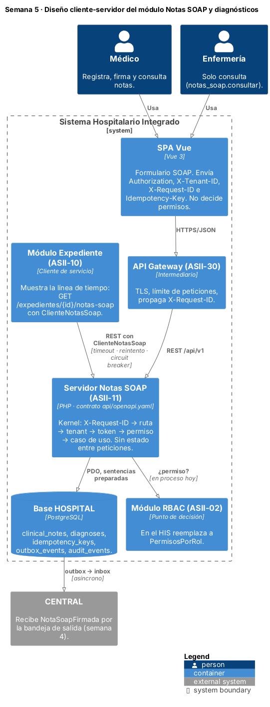
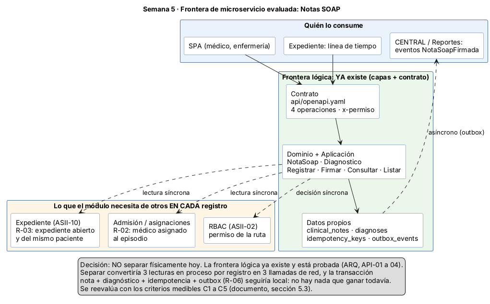
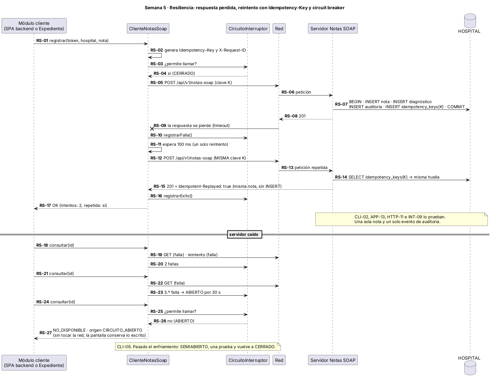
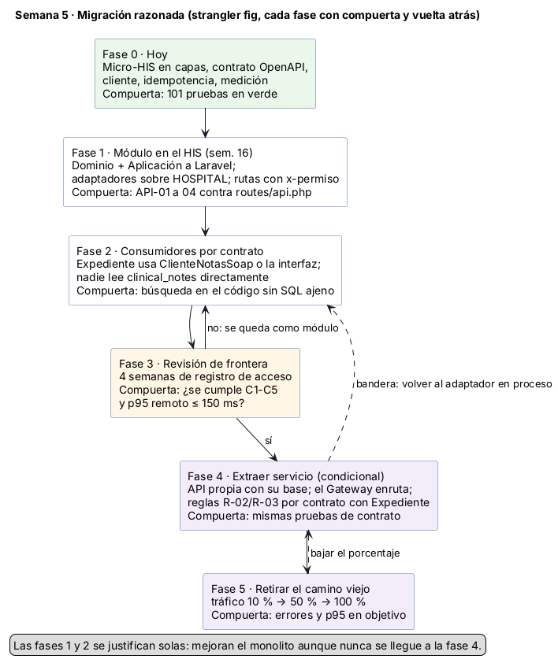
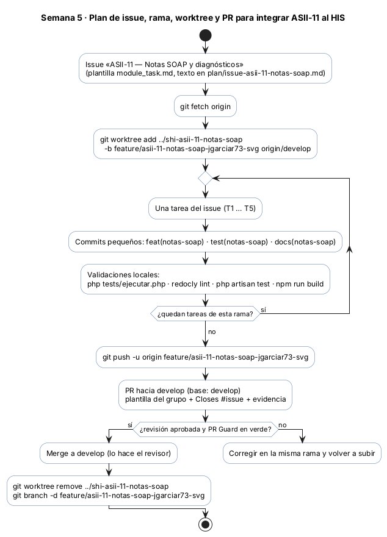

# Semana 5 — Diseño cliente-servidor y evaluación de una frontera de microservicio

| | |
|---|---|
| **Curso** | Análisis de Sistemas II — Proyecto Final 2026 |
| **Proyecto** | Sistema Hospitalario Integrado (HIS) |
| **Módulo** | ASII-11 Notas SOAP y diagnósticos |
| **Tema de la semana** | Cliente-servidor y microservicios |
| **Entregable del plan** | Contrato API preliminar y plan de integración: endpoints, payloads, errores, permisos, rama, worktree y PR |
| **Flujo** | «Registro de nota SOAP y asociación de diagnóstico clínico» (el mismo de las semanas 1 a 4) |
| **Código** | [`../micro-his-notas-soap/`](../micro-his-notas-soap/) (el mismo micro-HIS de las semanas 3 y 4) |
| **Contrato** | [`../micro-his-notas-soap/api/openapi.yaml`](../micro-his-notas-soap/api/openapi.yaml) (OpenAPI 3.1) |
| **Estudiante** | Joshua Eduardo García Reyes (`jgarciar73-svg`) |
| **Fecha** | Octubre 2026 |

## Índice

1. [Introducción y decisión](#1-introducción-y-decisión)
2. [Qué cambió respecto a la semana 4](#2-qué-cambió-respecto-a-la-semana-4)
3. [Diseño cliente-servidor](#3-diseño-cliente-servidor)
4. [Contrato API](#4-contrato-api)
5. [Evaluación de la frontera de microservicio](#5-evaluación-de-la-frontera-de-microservicio)
6. [Propiedad de los datos](#6-propiedad-de-los-datos)
7. [Comunicación](#7-comunicación)
8. [Seguridad](#8-seguridad)
9. [Resiliencia](#9-resiliencia)
10. [Observabilidad](#10-observabilidad)
11. [Consistencia](#11-consistencia)
12. [Migración razonada](#12-migración-razonada)
13. [Plan de issue, rama, worktree y PR](#13-plan-de-issue-rama-worktree-y-pr)
14. [Pruebas y evidencia](#14-pruebas-y-evidencia)
15. [Trazabilidad](#15-trazabilidad)
16. [Limitaciones](#16-limitaciones)
17. [Conclusión](#17-conclusión)
18. [Bibliografía](#18-bibliografía)

## 1. Introducción y decisión

La consigna pide evolucionar el **mismo** micro-HIS y el **mismo** flujo hacia un diseño cliente-servidor, evaluar si Notas SOAP debería ser un microservicio y especificar siete aspectos: contrato API, propiedad de datos, comunicación, seguridad, resiliencia, observabilidad y consistencia. También pide diagramas y una migración razonada, y advierte que no se divida el sistema sin una justificación medible.

Por eso hice dos cosas a la vez:

1. **Convertí el micro-HIS en un servidor con contrato.** El contrato está escrito en OpenAPI 3.1 y las pruebas comprueban que el código y el contrato digan lo mismo. Agregué lo que necesita un servidor que otros llaman por red: permiso declarado por ruta, `X-Request-ID`, registro de acceso, `Idempotency-Key` en el registro y 503 cuando la base no responde. También escribí un **cliente** separado, con timeout, reintento y circuit breaker, como lo usaría otro módulo.
2. **Medí la frontera en lugar de suponerla.** Comparé el mismo registro llamado dentro del proceso y llamado por red. Después revisé con qué otros módulos tiene que hablar el registro cada vez que se ejecuta.

**Decisión:** Notas SOAP **no se separa como microservicio hoy**. Se queda como módulo dentro del HIS, con una frontera explícita: su contrato, sus datos y su cliente. Las razones, en corto:

- Cada registro necesita tres respuestas de otros módulos (expediente abierto, médico asignado, permiso). Separado, eso son tres llamadas de red por nota.
- La transacción nota + diagnóstico + idempotencia + bandeja de salida (R-06) tiene que seguir en una sola base.
- Ninguno de los cinco criterios medibles C1 a C5 se cumple (sección 5.3).

Lo que sí queda listo es el camino para separarlo **si** algún día esos criterios se cumplen (sección 12).

## 2. Qué cambió respecto a la semana 4

| Pieza | Semana 4 | Semana 5 |
|---|---|---|
| Contrato | Tabla de rutas en el README | `api/openapi.yaml` (OpenAPI 3.1), validado con Redocly y comparado con el código por las pruebas `API-01` a `API-04` |
| Rutas | `if` dentro del `Kernel` | `Presentacion/Http/Rutas`: cada ruta declara método, plantilla y **permiso** (`x-permiso`) |
| Permisos | Dentro de los casos de uso (rol médico, asignación) | Se mantienen y además hay un control por ruta: `PoliticaPermisos` ← `PermisosPorRol`, que responde 403 antes de llegar al caso de uso |
| Endpoints | 3 | 4: nuevo `GET /api/v1/expedientes/{expedienteId}/notas-soap` (resúmenes sin texto clínico) |
| Reintentos seguros | No había | `Idempotency-Key` en `POST /notas-soap`: puerto `RegistroIdempotencia`, tabla `idempotency_keys`, respuesta repetida con `Idempotent-Replayed: true` |
| Trazabilidad | No había | `X-Request-ID` (se respeta el que llega si es válido; si no, se genera) y registro de acceso en JSON por petición |
| Base caída | 500 | 503 con `Retry-After: 5` |
| Cliente | No había | `src/Cliente/`: `ClienteNotasSoap`, `CircuitoInterruptor`, `TransporteHttpStream`, `ResultadoCliente` |
| Medición | No había | `bin/medir.php`: mismo registro en proceso, por HTTP en proceso y por red |
| Modo sin base | Solo la demo | `NOTASSOAP_ALMACEN=memoria` levanta la API con los adaptadores en memoria (para medir y para probar el cliente con red real). Con `NOTASSOAP_MEMORIA_ARCHIVO` además conserva los datos entre peticiones, para demostrar la idempotencia sin PostgreSQL |
| Pruebas | 69 | 101 (grupos nuevos: `API`, `CLI`, `OBS`; más `APP`, `HTTP`, `REP`, `ARQ` e `INT`) |

Las reglas de dominio no cambiaron. Las 69 pruebas anteriores siguen pasando con los mismos identificadores. Los casos de uso siguen sin saber que existe HTTP, y el controlador sigue sin SQL ni reglas (ARQ-09).

## 3. Diseño cliente-servidor



Fuente: [`diagramas/semana-05-cliente-servidor.puml`](diagramas/semana-05-cliente-servidor.puml)

En este diseño el **servidor** es el micro-HIS y hay dos tipos de **cliente**: la pantalla del médico (la SPA Vue del HIS, a través del API Gateway) y otros módulos que necesitan notas, como Expediente cuando arma la línea de tiempo del paciente.

| Lado | Responsabilidad | Lo que **no** hace |
|---|---|---|
| Cliente (SPA o módulo) | Mostrar el formulario y conservar lo escrito si hay error (RNF-06). Enviar `Authorization`, `X-Tenant-ID`, `X-Request-ID` e `Idempotency-Key`. Decidir si reintenta según el tipo de operación | Decidir permisos, validar CIE-10 como regla final o elegir el autor de la nota |
| Servidor (Notas SOAP) | Validar tenant, token y permiso. Aplicar todas las reglas R-01 a R-08. Guardar en una transacción y responder según el contrato | Guardar estado de sesión entre peticiones: cada petición trae todo lo que necesita |

El servidor **no guarda estado entre peticiones** (Fielding, 2000). La identidad sale del token en cada llamada y la idempotencia se guarda en la base, no en memoria. Gracias a eso se pueden poner dos copias del servidor detrás del Gateway sin cambiar nada.

El `Kernel` procesa cada petición en este orden. Las pruebas cubren cada paso:

```
X-Request-ID (OBS-01) → ruta: 404 / 405 + Allow (HTTP-06, HTTP-14) → X-Tenant-ID: 400 (HTTP-02)
→ token: 401 (HTTP-02) → permiso de la ruta: 403 (HTTP-13) → controlador → caso de uso
→ excepción → código HTTP (HTTP-03, HTTP-12) → registro de acceso (OBS-02, OBS-03)
```

## 4. Contrato API

El contrato completo está en [`api/openapi.yaml`](../micro-his-notas-soap/api/openapi.yaml). Lo validé con `npx @redocly/cli@1.34.3 lint` y el resultado está en [`evidencia/salida-lint-openapi.txt`](evidencia/salida-lint-openapi.txt) («Your API description is valid»).

### 4.1 Endpoints y permisos

| Método | Ruta | Permiso (`x-permiso`) | Éxito | Errores documentados |
|---|---|---|---|---|
| `POST` | `/api/v1/notas-soap` | `notas_soap.registrar` | 201 | 400, 401, 403, 409, 422, 500, 503 |
| `GET` | `/api/v1/notas-soap/{notaId}` | `notas_soap.consultar` | 200 | 400, 401, 403, 404, 500, 503 |
| `POST` | `/api/v1/notas-soap/{notaId}/firma` | `notas_soap.firmar` | 200 | 400, 401, 403, 404, 409, 500, 503 |
| `GET` | `/api/v1/expedientes/{expedienteId}/notas-soap?estado=draft\|signed` | `notas_soap.consultar` | 200 | 400, 401, 403, 500, 503 |

| Rol (demo, `config/config.php`) | registrar | firmar | consultar |
|---|:---:|:---:|:---:|
| `medico` | Sí | Sí | Sí |
| `enfermeria` | No | No | Sí |

El permiso de la ruta es **la primera** barrera, no la única. Tener `notas_soap.registrar` no basta. El caso de uso sigue verificando que el médico esté asignado al episodio (R-02), que el expediente esté abierto (R-03) y, al firmar, que sea el autor. En el HIS, la tabla `PermisosPorRol` se reemplaza por la decisión del módulo RBAC (ASII-02) sin tocar las rutas, porque las dos cumplen la misma interfaz `PoliticaPermisos`.

### 4.2 Cabeceras

| Cabecera | Dirección | Uso |
|---|---|---|
| `Authorization: Bearer <token>` | petición | Identidad. El autor de la nota sale de aquí y nunca del cuerpo (RF-06, HTTP-07) |
| `X-Tenant-ID` | petición | Hospital. Debe coincidir con el del token (R-01) |
| `X-Request-ID` | petición y respuesta | Correlación. Formato `^[A-Za-z0-9-]{8,64}$`. Si falta o no cumple, el servidor genera un UUID |
| `Idempotency-Key` | petición (solo registrar) | Opcional. Formato `^[A-Za-z0-9-]{8,64}$`. Permite reintentar sin duplicar la nota |
| `Idempotent-Replayed: true` | respuesta | Indica que la respuesta corresponde a una petición anterior con la misma clave |
| `Allow` | respuesta 405 | Métodos válidos para esa ruta |
| `Retry-After` | respuesta 503 | Segundos sugeridos antes de reintentar |

### 4.3 Payloads

Registro (`RegistroNota`). El ejemplo es [`ejemplos/nota.json`](../micro-his-notas-soap/ejemplos/nota.json):

```json
{
  "medical_record_id": "exp-carlos",
  "care_episode_id": "epi-100",
  "subjetivo": "Tos productiva y fiebre de 3 días",
  "objetivo": "T 38.6 °C, estertores en base derecha",
  "analisis": "Probable neumonía adquirida en la comunidad",
  "plan": "Radiografía de tórax y antibiótico",
  "diagnostico": { "code": "J18.9", "description": "Neumonía no especificada", "type": "primary" }
}
```

La respuesta de registrar, consultar y firmar (`Nota`) devuelve la nota completa, con sus secciones SOAP y los diagnósticos. El listado (`ListaNotas`) devuelve solo **resúmenes** (`ResumenNota`: id, episodio, autor, estado, versión, fechas y códigos de diagnóstico), **sin el texto clínico**. Una línea de tiempo no necesita leer el contenido para mostrarse y así se expone menos información (HTTP-14, CLI-08). Así se ve la salida real:

```json
{"medical_record_id":"exp-carlos","items":[{"clinical_note_id":"cce465f7-…","care_episode_id":"epi-100",
 "author_user_ref_id":"dra-mendez","status":"signed","version_no":1,"created_at":"2026-10-10T16:34:59-06:00",
 "signed_at":"2026-10-10T16:35:00-06:00","diagnosis_codes":["J18.9"]}]}
```

### 4.4 Errores

Todos los errores tienen el mismo cuerpo, `{"error": {"code": "...", "message": "..."}}`. El `code` es estable, sirve para que el cliente decida qué hacer y está enumerado en el esquema `Error`:

| HTTP | `code` | Cuándo |
|---|---|---|
| 400 | `tenant_requerido`, `cuerpo_invalido` | Falta `X-Tenant-ID`; JSON, filtro o `Idempotency-Key` con formato inválido |
| 401 | `token_invalido` | Token ausente o desconocido |
| 403 | `acceso_denegado` | El rol no tiene el permiso de la ruta, el médico no está asignado, el hospital no coincide o quien firma no es el autor |
| 404 | `nota_no_encontrada`, `ruta_no_encontrada` | La nota o la ruta no existen |
| 405 | `metodo_no_permitido` | Método equivocado; incluye `Allow` |
| 409 | `expediente_no_disponible`, `nota_firmada` | Expediente cerrado o de otro paciente; nota ya firmada |
| 422 | `nota_incompleta`, `diagnostico_invalido`, `idempotency_key_reutilizada` | Sección vacía; CIE-10 inválido; misma clave con otro contenido |
| 500 | `error_persistencia`, `error_interno` | Mensaje genérico, sin SQL ni SQLSTATE (RNF-03, PER-06) |
| 503 | `servicio_no_disponible` | No hay conexión con la base; incluye `Retry-After` |

### 4.5 Cómo se comprueba que el contrato no miente

Un contrato que nadie verifica se queda viejo en dos semanas. Por eso cuatro pruebas leen el YAML y lo comparan con el servidor:

| Prueba | Qué compara |
|---|---|
| API-01 | Las operaciones del YAML (método + ruta + `x-permiso`) son exactamente las de `Rutas.php` |
| API-02 | Toda operación documenta 400, 401, 403 y 500, y al menos una 2xx |
| API-03 | Ejecuta 24 escenarios reales contra el `Kernel` y cada código HTTP que sale está documentado en esa operación |
| API-04 | Cada `error.code` que devuelve el servidor está en el `enum` del contrato |

Para comprobar que estas pruebas sirven, metí a propósito cuatro errores, uno a la vez: cambié un permiso en el YAML, quité el 409 del registro, quité un código del enum e hice que el cliente importara una clase del servidor. Cada vez falló la prueba que tenía que fallar, y después revertí el cambio ([`evidencia/salida-deteccion-violaciones.txt`](evidencia/salida-deteccion-violaciones.txt)).

## 5. Evaluación de la frontera de microservicio



Fuente: [`diagramas/semana-05-frontera-microservicio.puml`](diagramas/semana-05-frontera-microservicio.puml)

### 5.1 La frontera candidata

Si Notas SOAP fuera un servicio aparte, su frontera sería la que ya tiene el código:

- **Contrato:** las 4 operaciones del YAML.
- **Núcleo:** Dominio y Aplicación (`NotaSoap`, `Diagnostico`, y los casos de uso registrar, firmar, consultar y listar).
- **Datos propios:** `clinical_notes`, `diagnoses`, `idempotency_keys` y `outbox_events`.

Es un buen candidato **lógico**. Tiene un lenguaje propio (nota, sección, firma, diagnóstico), reglas propias (R-04, R-05, R-07) y nadie más escribe en sus tablas. En términos de Evans (2003), es un contexto acotado razonable.

El problema está en lo que el registro **necesita de otros módulos en cada ejecución**:

| Dato que necesita | Dueño | Regla | Hoy | Si fuera microservicio |
|---|---|---|---|---|
| ¿El expediente existe, está abierto y es del mismo paciente que el episodio? | Expediente (ASII-10) | R-03 | Lectura en la misma base | Llamada HTTP a Expediente |
| ¿El médico está asignado a ese episodio? | Admisión / asignaciones (`care_assignments`) | R-02 | Lectura en la misma base | Llamada HTTP a otro módulo |
| ¿El rol tiene el permiso? | RBAC (ASII-02) | — | En proceso | Llamada HTTP o token con permisos |

Son tres dependencias **síncronas**: sin la respuesta no se puede decidir si la nota se acepta. No se pueden volver eventos porque la regla dice que se valida **antes** de guardar.

### 5.2 Medición

Escribí [`bin/medir.php`](../micro-his-notas-soap/bin/medir.php), que ejecuta **el mismo registro** de cuatro formas, con los adaptadores en memoria para que la base no esconda la diferencia:

| Escenario | Qué simula | p50 | p95 | p99 | × p50 de A |
|---|---|---:|---:|---:|---:|
| A | Caso de uso en proceso (monolito modular, como hoy) | 0,039 ms | 0,169 ms | 0,225 ms | 1,0× |
| B | API HTTP completa en proceso (`Kernel`, sin red) | 0,054 ms | 0,270 ms | 0,315 ms | 1,4× |
| C | Servicio separado por red local (`php -S` + `ClienteNotasSoap`) | 0,549 ms | 0,791 ms | 0,960 ms | 14,2× |
| D | C + 2 consultas remotas previas (vecinos también separados) | 1,417 ms | 2,107 ms | 4,450 ms | 36,6× |
| C0 | Control: petición mínima (404) por la misma red | 0,367 ms | 0,556 ms | 0,630 ms | 9,5× |

PHP 8.3.6 en Linux, 3000 repeticiones en proceso y 300 por red, 0 errores. Salida completa en [`evidencia/salida-medicion.txt`](evidencia/salida-medicion.txt).

Cómo leo estos números, sin exagerarlos:

- **Las cifras absolutas son pequeñas** porque todo corre en la misma máquina y sin base. No las uso para decir «la red es lenta». Las uso para ver **proporciones**.
- **C0 explica casi todo el costo de C.** Una petición que no hace nada ya cuesta 9,5 veces el caso de uso completo. Lo caro es cruzar la red, no la lógica de la nota.
- **D crece con cada vecino.** Con dos dependencias remotas el registro cuesta 36,6 veces más. En una red real (Gateway, TLS, otra máquina) cada salto suele costar milisegundos, no décimas. En Windows con `php -S`, un compañero midió entre 33 y 62 ms por salto, así que la proporción ahí sería mucho peor.
- **B casi no cuesta (1,4×).** Tener contrato, rutas con permiso, request-id y registro de acceso **no** obliga a separar. Lo que cuesta es la red, y esa no se necesita para tener una buena frontera.

Para repetirlo: `php bin/medir.php 3000 300` desde la carpeta del micro-HIS.

### 5.3 Criterios medibles para extraer el servicio

Notas SOAP se extrae **solo si** se cumple al menos uno de C1 a C5 **y además** la latencia de red medida en el ambiente del HIS (p95 por salto, con el Gateway) es de 150 ms o menos. Esos 150 ms son un presupuesto: la pantalla también consulta Expediente, Alergias y Signos vitales, y todo tiene que caber en los 2 s de RNF-07.

| ID | Criterio | Cómo se mide | Umbral | Valor hoy |
|---|---|---|---|---|
| C1 | Hay consumidores fuera de la aplicación principal (otro lenguaje o despliegue) | Inventario de integraciones | ≥ 1 | 0. Expediente y la SPA están en la misma app Laravel |
| C2 | La carga exige escalar Notas SOAP aparte | Registro de acceso: peticiones por segundo a `/api/v1/notas-soap` | > 50 req/s sostenidas en hora pico | No medible aún (prototipo). Estimado: < 1 req/s por hospital |
| C3 | Cadencia de despliegue distinta del resto del HIS | Historial de git: versiones solo de este módulo | > 2 por semana durante 1 mes | 1 por semana, junto con el resto |
| C4 | Requisito de disponibilidad mayor que el del HIS | SLO acordado | SLO del módulo > SLO del HIS | No definido (mismo SLO) |
| C5 | Hay un equipo propio que lo mantenga | Personas asignadas | ≥ 2 | 1 |

**Resultado: no se cumple ningún criterio.** Dividir hoy sería pagar el costo de la sección 5.2, más una transacción distribuida (sección 11), sin ganar nada medible. La consigna pide justamente no hacer eso.

Hay un criterio que juega **en contra** de separar aunque se cumplieran los demás: el registro tiene **3 lecturas síncronas** de datos ajenos. Mientras R-02 y R-03 se validen antes de guardar, separar Notas SOAP sin separar también Expediente y asignaciones convierte cada nota en tres llamadas de red. Newman (2021) describe este síntoma como señal de una frontera mal cortada.

## 6. Propiedad de los datos

La regla es: **un dato tiene un solo módulo dueño, que es el único que escribe en él.** Los demás lo leen a través del contrato del dueño o reciben un evento.

| Tabla (base HOSPITAL) | Dueño | Notas SOAP | Otros módulos |
|---|---|---|---|
| `clinical_notes` | **ASII-11 (este módulo)** | Escribe y lee | Leen por `GET /notas-soap/...` o con el cliente; no hacen SQL directo |
| `diagnoses` | **ASII-11** | Escribe y lee | Prescripciones (ASII-15) y Reportes (ASII-23) leen por contrato o por evento |
| `idempotency_keys` (nueva; se agrega en la tarea T1) | **ASII-11** | Escribe y lee | Nadie |
| `outbox_events` (filas `NotaSoapFirmada`; hoy solo en el micro-HIS) | **ASII-11** | Escribe en la misma transacción de la firma | El publicador las lleva a `central_inbox_messages` en CENTRAL |
| `medical_records` | Expediente (ASII-10) | Solo lee (R-03) | — |
| `care_episodes`, `care_assignments` | Admisión / asignaciones (dueño **a confirmar** con el grupo) | Solo lee (R-02) | — |
| `local_user_refs`, `local_patients` | Usuarios (ASII-01) y Pacientes (ASII-03), con referencias lógicas a CENTRAL | Solo guarda el id del autor | — |
| `audit_events` (hoy solo en el micro-HIS; nombre y forma a acordar) | Gobernanza y auditoría (ASII-22) | Agrega eventos (`NOTA_REGISTRADA`, `NOTA_FIRMADA`) | Gobernanza consulta |

Las migraciones actuales de HOSPITAL ya tienen `clinical_notes`, `diagnoses`, `medical_records`, `care_episodes` y `care_assignments`. Las tablas `idempotency_keys`, `outbox_events` y `audit_events` existen en el esquema del micro-HIS (`database/schema.sql`) y todavía no en el HIS.

**Mientras sea monolito**, las lecturas de `medical_records` y `care_assignments` siguen siendo SQL en la misma base, pero solo a través de los puertos `RepositorioExpedientes` y `VerificadorAcceso`. Si mañana Expediente expone un contrato, se cambia **un adaptador** y no el caso de uso (ARQ-12). Esto es lo que hace posible la fase 2 de la migración.

**Si fuera microservicio**, Notas SOAP tendría su propia base con sus cuatro tablas y ya no podría leer `medical_records` directamente: tendría que preguntarle a Expediente.

## 7. Comunicación

| Interacción | Tipo | Por qué |
|---|---|---|
| SPA → Notas SOAP (registrar, firmar, consultar) | Síncrona, REST/JSON | El médico espera la respuesta para saber si la nota quedó guardada |
| Expediente → Notas SOAP (línea de tiempo) | Síncrona, REST con `ClienteNotasSoap` | Es una lectura; si falla, Expediente muestra «notas no disponibles» y el resto del expediente sigue funcionando |
| Notas SOAP → Expediente / asignaciones / RBAC | Síncrona; **hoy en proceso** | Son validaciones previas a guardar (R-02, R-03); no pueden esperar a un evento |
| Notas SOAP → CENTRAL / Reportes / Gobernanza | **Asíncrona**, bandeja de salida (semana 4) | Nadie necesita la respuesta para terminar la firma; el evento lleva solo identificadores (DOM-09) |

Decidí usar REST porque el resto del HIS ya expone `/api/v1` en Laravel, y no tiene sentido agregar gRPC o un bus de mensajes para un módulo que hoy tiene un solo consumidor interno. El evento asíncrono ya existía desde la semana 4 y no cambió.

## 8. Seguridad

Revisé el diseño contra el OWASP API Security Top 10 (2023). Cada fila dice qué hay en el código y qué prueba lo comprueba.

| Riesgo OWASP API 2023 | Cómo se cubre | Prueba |
|---|---|---|
| API1 Autorización a nivel de objeto (BOLA) | Toda consulta filtra por el hospital del token; firmar exige ser el autor; la clave de idempotencia es por usuario, así que otro médico no puede usarla para leer una nota ajena | APP-04, APP-08, APP-15, APP-17 |
| API2 Autenticación rota | Sin token o con token desconocido → 401 antes de cualquier otra cosa. En el HIS el token viene de ASII-01 | HTTP-02 |
| API3 Autorización a nivel de propiedad | El autor sale del token, no del cuerpo; el listado no expone el texto SOAP | HTTP-07, HTTP-14, CLI-08 |
| API4 Consumo de recursos sin límite | Límite de tamaño de `Idempotency-Key` y `X-Request-ID`; el límite de peticiones lo pone el Gateway (ASII-30) | HTTP-12, OBS-01 |
| API5 Autorización a nivel de función | Cada ruta declara su permiso; ARQ-14 falla si una ruta no lo tiene; enfermería no registra ni firma | HTTP-13, ARQ-14, API-01 |
| API6 Acceso sin control a flujos sensibles | La firma no se reintenta automáticamente; una nota firmada no cambia (también lo impide un trigger en la base) | CLI-05, DOM-07, INT-05 |
| API7 SSRF | El servidor no hace peticiones a URLs que mande el cliente | — (no aplica) |
| API8 Mala configuración de seguridad | Errores sin SQL ni rutas internas; credenciales solo por variables de entorno; `X-Request-ID` inválido (por ejemplo `<script>`) se reemplaza | PER-06, HTTP-06, OBS-01 |
| API9 Inventario deficiente | Un único contrato versionado (`/api/v1`) que las pruebas comparan con el código | API-01 a API-04 |
| API10 Consumo inseguro de APIs | El cliente trata cualquier 5xx o falla de red como `NO_DISPONIBLE` y nunca como éxito | CLI-04, CLI-07 |

El registro de acceso **no guarda** token, cuerpo ni texto clínico. Solo guarda request-id, método, ruta, estado, duración, usuario y tenant (OBS-02). Eso cumple RNF-03.

## 9. Resiliencia



Fuente: [`diagramas/semana-05-secuencia-resiliencia.puml`](diagramas/semana-05-secuencia-resiliencia.puml)

El caso que más me preocupaba es este: el servidor guardó la nota, pero la respuesta se perdió en la red. Si el cliente reintenta sin cuidado, quedan **dos notas iguales** en el expediente, lo que en un hospital es un error clínico y no solo técnico. Por eso puse `Idempotency-Key`:

1. El cliente genera una clave por **intención** de registrar (no por intento).
2. El servidor guarda la clave, una huella SHA-256 del contenido y el id de la nota **en la misma transacción** que la nota. Si la transacción se revierte, la clave tampoco queda (APP-16).
3. Si llega la misma clave con la misma huella, responde 201 con la nota original y `Idempotent-Replayed: true`, sin volver a insertar (APP-13, HTTP-11, INT-09, CLI-02).
4. Si llega la misma clave con **otro** contenido, responde 422 `idempotency_key_reutilizada` (APP-14, HTTP-12).

Reglas de reintento del cliente (`ClienteNotasSoap`):

| Operación | ¿Reintenta? | Razón |
|---|---|---|
| `GET` (consultar, listar) | Sí, una vez, ante falla de red o 5xx | Leer dos veces no cambia nada |
| `POST /notas-soap` | Sí, una vez, **con la misma** `Idempotency-Key` | El servidor no duplica |
| `POST /notas-soap/{id}/firma` | **No** | Si la respuesta se perdió, el cliente consulta la nota para ver si quedó firmada. Repetir la firma devolvería 409 y confundiría al médico |
| Cualquier 4xx | Nunca | Es una respuesta válida: el problema está en la petición |

Otros mecanismos:

- **Timeout de 1 s** por intento y **espera de 100 ms** antes del reintento (CLI-03).
- **Circuit breaker** (`CircuitoInterruptor`, según Nygard, 2018). Después de 3 fallas seguidas deja de llamar al servidor durante 30 s y responde enseguida `NO_DISPONIBLE` con origen `CIRCUITO_ABIERTO`. Después pasa a semiabierto, hace una prueba y vuelve a cerrado si funciona (CLI-06). Así, un servidor caído no deja a Expediente esperando un timeout en cada consulta.
- **503 + `Retry-After`** cuando el servidor no tiene base. El cliente lo trata como `NO_DISPONIBLE` y la pantalla conserva lo que el médico escribió (RNF-06).
- **El cliente nunca lanza excepciones por fallas de red.** Siempre devuelve un `ResultadoCliente` con `OK`, `RECHAZADO` o `NO_DISPONIBLE`, para que el módulo que lo usa no tenga que adivinar (CLI-07, con red real contra un puerto cerrado).

## 10. Observabilidad

| Señal | Implementación | Prueba / evidencia |
|---|---|---|
| Correlación | `X-Request-ID` entra y sale en cada respuesta. Si no llega o es inválido, el `Kernel` genera un UUID v4. El cliente lo genera en cada llamada y lo devuelve en `ResultadoCliente` | OBS-01 |
| Registro de acceso | Una línea JSON por petición con `request_id`, método, ruta, estado, `duracion_ms`, usuario, tenant y `repetida` | OBS-02, [`evidencia/salida-registro-acceso.txt`](evidencia/salida-registro-acceso.txt) |
| No romper por observar | Si escribir el registro falla, la respuesta al cliente no cambia | OBS-03 |
| Auditoría de negocio | `audit_events` con `NOTA_REGISTRADA` y `NOTA_FIRMADA` (desde la semana 3) | APP-01, APP-07 |
| Métricas para C2 | El registro de acceso permite contar peticiones por segundo y sacar p95 por ruta sin agregar nada más | Sección 5.3 |

Esto es un ejemplo real de la evidencia: la tercera petición trajo un `X-Request-ID` inválido y el servidor lo reemplazó.

```json
{"tipo":"acceso","request_id":"traza-expediente-0002","metodo":"POST","ruta":"/api/v1/notas-soap","estado":201,"duracion_ms":2.419,"usuario":"dra-mendez","tenant":"hosp-oriente","repetida":false}
{"tipo":"acceso","request_id":"b6e4680f-f085-4563-b164-108abf70e259","metodo":"POST","ruta":"/api/v1/notas-soap","estado":403,"duracion_ms":0.058,"usuario":"enf-ana","tenant":"hosp-oriente","repetida":false}
```

En el HIS, el mismo `X-Request-ID` lo propaga el Gateway (ASII-30) y se puede pasar al formato `traceparent` de W3C Trace Context si el grupo adopta trazas distribuidas.

## 11. Consistencia

| Qué | Tipo de consistencia | Cómo |
|---|---|---|
| Nota + diagnóstico + auditoría + clave de idempotencia | **Fuerte**, una transacción | `Transaccion` ← `PdoTransaccion` (R-06, PER-03 a PER-05, INT-04, APP-16) |
| Firma + evento `NotaSoapFirmada` en la bandeja de salida | **Fuerte** en HOSPITAL | Misma transacción (APP-11, INT-07) |
| Evento en CENTRAL, Reportes, Gobernanza | **Eventual** | Bandeja de salida → `central_inbox_messages` con `UNIQUE (source_node_id, event_id)`: si el evento llega dos veces, se guarda una sola vez |
| Validaciones R-02 / R-03 | Fuerte hoy (misma base) | Si se separara, pasaría a «lo que respondió Expediente hace un momento»; ver abajo |

Si Notas SOAP fuera un microservicio, esta tabla empeora en dos puntos:

1. **Validar y guardar ya no son atómicos.** Expediente podría cerrar el expediente entre la respuesta «está abierto» y el `INSERT` de la nota. Hoy eso no pasa porque las dos operaciones ocurren en la misma base. Separado, habría que aceptar la ventana de tiempo o montar una saga con compensación (Richardson, 2018), y «compensar» una nota clínica guardada en un expediente cerrado no es trivial.
2. **La auditoría** tendría que viajar por evento también, con su propia bandeja de salida.

Ninguno de los dos problemas existe mientras el módulo comparta la base HOSPITAL. Esa es la razón técnica más fuerte para no dividir.

## 12. Migración razonada



Fuente: [`diagramas/semana-05-migracion.puml`](diagramas/semana-05-migracion.puml)

La migración sigue el patrón *strangler fig* (Fowler, 2004; Newman, 2019): se avanza por fases, cada una con una compuerta medible y una forma de volver atrás. **Las fases 1 y 2 valen la pena aunque nunca se llegue a la 4**, porque mejoran el monolito.

| Fase | Qué se hace | Compuerta para pasar | Vuelta atrás |
|---|---|---|---|
| 0 · Hoy | Micro-HIS en capas, contrato OpenAPI, cliente, idempotencia y medición | 101 pruebas en verde, lint del contrato | — |
| 1 · Módulo en el HIS (semana 16) | Portar Dominio + Aplicación a la app Laravel; adaptadores sobre las tablas reales de HOSPITAL; rutas `/api/v1` con su permiso; tabla `idempotency_keys` como migración | API-01 a 04 pasan contra `routes/api.php`; `php artisan test` en verde | Revertir el PR (el módulo es nuevo, no reemplaza nada) |
| 2 · Consumidores por contrato | Expediente arma la línea de tiempo con el listado del contrato y no con SQL sobre `clinical_notes` | Búsqueda en el código: ningún módulo fuera de ASII-11 menciona `clinical_notes` ni `diagnoses` | Volver a la consulta anterior en Expediente |
| 3 · Revisión de frontera | 4 semanas de registro de acceso en staging | ¿Se cumple alguno de C1 a C5 y el p95 por salto es ≤ 150 ms? Si no, **se queda como módulo** y se vuelve a revisar en 6 meses | No aplica: es una decisión |
| 4 · Extraer (condicional) | Servicio con su propia base (las 4 tablas); el Gateway enruta `/api/v1/notas-soap*`; R-02/R-03 por contrato con Expediente y asignaciones | Las mismas pruebas de contrato pasan contra el servicio | Bandera de configuración: el Gateway vuelve a enrutar al módulo |
| 5 · Retirar el camino viejo | Tráfico 10 % → 50 % → 100 % al servicio | Tasa de errores y p95 dentro del objetivo en cada paso | Bajar el porcentaje |

Lo que **no** hago: construir el servicio de la fase 4, un Gateway, contenedores o colas. La consigna lo prohíbe sin justificación y la sección 5 muestra que hoy no la hay.

## 13. Plan de issue, rama, worktree y PR



Fuente: [`diagramas/semana-05-flujo-issue-pr.puml`](diagramas/semana-05-flujo-issue-pr.puml)

Este plan sirve para la integración real del módulo en la app Laravel (fases 1 y 2) y sigue el flujo obligatorio del README del repositorio:

1. **Issue:** crear «ASII-11 — Notas SOAP y diagnósticos» con la plantilla `.github/ISSUE_TEMPLATE/module_task.md`. El texto listo para pegar está en [`plan/issue-asii-11-notas-soap.md`](plan/issue-asii-11-notas-soap.md).
2. **Worktree y rama** desde `origin/develop`:

   ```bash
   git fetch origin
   git worktree add ../shi-asii-11-notas-soap -b feature/asii-11-notas-soap-jgarciar73-svg origin/develop
   cd ../shi-asii-11-notas-soap
   ```

3. **Commits pequeños**, uno por tarea del issue: `feat(notas-soap): …`, `test(notas-soap): …`, `docs(notas-soap): …`.
4. **Validaciones locales** antes del PR:

   ```bash
   php docs/modulos/notas-soap-diagnosticos/micro-his-notas-soap/tests/ejecutar.php
   npx @redocly/cli@1.34.3 lint docs/modulos/notas-soap-diagnosticos/micro-his-notas-soap/api/openapi.yaml
   php artisan test
   php artisan route:list --path=api
   npm run build
   ```

5. **PR hacia `develop`** con la plantilla del repositorio, `Closes #<issue>` y la evidencia. El borrador está en [`plan/pr-integracion-notas-soap.md`](plan/pr-integracion-notas-soap.md).
6. **Revisión:** una aprobación y el check «ASII PR Guard» en verde (descripción de al menos 80 caracteres y rama `feature/asii-11-…`). El merge lo hace el revisor, no yo.
7. **Cierre:** después del merge, `git worktree remove ../shi-asii-11-notas-soap` y `git branch -d feature/asii-11-notas-soap-jgarciar73-svg`.

| Tarea del issue | Rama | Semana del plan |
|---|---|---|
| T1 Migraciones en HOSPITAL: `idempotency_keys` y `outbox_events`; acordar `audit_events` con ASII-22; confirmar triggers de `clinical_notes` | `feature/asii-11-notas-soap-esquema-jgarciar73-svg` | 16 |
| T2 Portar Dominio + Aplicación y adaptadores PDO sobre `clinical_notes`, `diagnoses`, `medical_records` y `care_assignments` | `feature/asii-11-notas-soap-jgarciar73-svg` | 16 |
| T3 Rutas `/api/v1` con permiso y middleware RBAC; API-01 a 04 contra `routes/api.php` | `feature/asii-11-notas-soap-api-jgarciar73-svg` | 16 |
| T4 Formulario SOAP en la SPA (Vue) con `Idempotency-Key` y manejo de `NO_DISPONIBLE` | `feature/asii-11-notas-soap-ui-jgarciar73-svg` | 16–17 |
| T5 Pruebas de permisos, tenant y datos sensibles (matriz OWASP de la sección 8) | `test/asii-11-notas-soap-seguridad-jgarciar73-svg` | 17 |

Nota: las entregas semanales del curso usan la convención del grupo (`semana-N-notas-soap-diagnosticos-joshua-garcia`). El plan de integración usa la convención oficial del README (`feature/asii-XX-…` + worktree), que es la que valida el CI.

## 14. Pruebas y evidencia

```bash
cd docs/modulos/notas-soap-diagnosticos/micro-his-notas-soap
php tests/ejecutar.php
```

Resultado: **101 pruebas; 100 pasan y 1 se omite sin PostgreSQL** (INT-06). Con PostgreSQL pasan las 101 ([`evidencia/salida-pruebas.txt`](evidencia/salida-pruebas.txt)).

| Grupo | Nuevas esta semana | Qué prueban |
|---|---|---|
| `API` | API-01 a API-04 | El contrato y el código dicen lo mismo |
| `CLI` | CLI-01 a CLI-08 | Cliente: camino feliz, respuesta perdida, reintentos, 4xx sin reintento, firma sin reintento, circuit breaker, red real caída, listado |
| `OBS` | OBS-01 a OBS-03 | `X-Request-ID`, registro de acceso sin datos sensibles, el registro no rompe la respuesta |
| `APP` | APP-13 a APP-17 | Idempotencia (misma clave, otro contenido, por usuario, reversión) y listado por expediente |
| `HTTP` | HTTP-11 a HTTP-14 | Respuesta repetida, clave inválida o reutilizada, permiso por ruta, listado con filtro y 405 |
| `REP` | REP-07 y REP-08 (con los dos adaptadores) | `deExpediente` y `RegistroIdempotencia` cumplen el mismo contrato en PDO y en memoria |
| `ARQ` | ARQ-13, ARQ-14 (ARQ-10 ahora cuenta 8 puertos) | El cliente no importa clases del servidor ni al revés; toda ruta tiene permiso |
| `INT` | INT-09, INT-10 (INT-06 ampliada) | Idempotencia con PDO real: una sola nota en la base; el modo memoria con archivo conserva los datos entre procesos |

| Evidencia | Contenido |
|---|---|
| [`salida-pruebas.txt`](evidencia/salida-pruebas.txt) | Las 101 pruebas, sin PostgreSQL y con PostgreSQL 16 |
| [`salida-api-cliente-servidor.txt`](evidencia/salida-api-cliente-servidor.txt) | `curl` contra la API con PostgreSQL: registro, respuesta repetida, 422 por clave reutilizada, 403 de enfermería, listado, firma, filtro, 405 con `Allow`, filas en la base (1 nota, 1 clave, 1 evento de salida, 2 de auditoría) y 503 con `Retry-After` |
| [`salida-registro-acceso.txt`](evidencia/salida-registro-acceso.txt) | Líneas reales del registro de acceso |
| [`salida-medicion.txt`](evidencia/salida-medicion.txt) | La medición de la sección 5.2 |
| [`salida-lint-openapi.txt`](evidencia/salida-lint-openapi.txt) | Validación del contrato con Redocly |
| [`salida-deteccion-violaciones.txt`](evidencia/salida-deteccion-violaciones.txt) | Las cuatro violaciones inyectadas y la prueba que detectó cada una |

## 15. Trazabilidad

| Aspecto que pide la consigna | Sección | Código | Pruebas |
|---|---|---|---|
| Contrato API | 4 | `api/openapi.yaml`, `Presentacion/Http/Rutas.php` | API-01 a API-04 |
| Propiedad de datos | 6 | `database/schema.sql`, puertos de `Dominio/Puertos` y `Aplicacion/Puertos` | REP-01 a REP-08, ARQ-10, ARQ-12 |
| Comunicación | 7 | `Cliente/`, bandeja de salida (semana 4) | CLI-01, CLI-08, INT-07 |
| Seguridad | 8 | `Kernel`, `Autorizacion/`, `FormularioRegistroNota` | HTTP-02, HTTP-07, HTTP-13, APP-15, ARQ-14 |
| Resiliencia | 9 | `ClienteNotasSoap`, `CircuitoInterruptor`, `RegistroIdempotencia`, `public/index.php` (503) | CLI-02 a CLI-07, APP-13 a APP-16, HTTP-11, HTTP-12, INT-09 |
| Observabilidad | 10 | `Kernel`, `Observabilidad/` | OBS-01 a OBS-03 |
| Consistencia | 11 | `Transaccion`, `RegistrarNotaConDiagnostico` | PER-03 a PER-05, APP-11, APP-16, INT-04 |
| Frontera y justificación medible | 5 | `bin/medir.php` | `salida-medicion.txt` |
| Migración razonada | 12 | — | Compuertas de cada fase |
| Rama, worktree y PR | 13 | `plan/` | — |

Requerimientos de la semana 2 que esta semana toca: RF-02 (permiso por ruta, además del caso de uso), RF-05 (la clave de idempotencia entra en la misma transacción), RF-06 (el autor sigue saliendo del token), RF-09 (dos códigos de error nuevos, también enumerados en el contrato), RNF-03 (el registro de acceso no lleva texto clínico) y RNF-06 (el cliente devuelve `NO_DISPONIBLE` sin perder lo escrito).

## 16. Limitaciones

- **La medición es local.** Mide proporciones, no la latencia real del HIS. La compuerta de la fase 3 exige medir en staging con el Gateway.
- **Los tokens y los permisos son de demostración** (`config/config.php`). En el HIS vienen de ASII-01 (JWT) y ASII-02 (RBAC).
- **Quién es dueño de `care_assignments` está por confirmar** con el grupo.
- **El listado por expediente** solo filtra por hospital y permiso. No aplica todavía las reglas de consentimiento entre hospitales de CENTRAL (`patient_consents`, `cross_hospital_access_grants`). Eso le corresponde al módulo de Expediente.
- **Las claves de idempotencia no caducan.** En el HIS conviene borrarlas después de 24 horas con una tarea programada, porque solo sirven para reintentos cercanos.
- **No hay límite de peticiones en el servidor**: se delega al Gateway (ASII-30).
- **El servidor de PHP integrado** (`php -S`) escribe «422 Unknown Status Code» en la línea de estado porque no conoce el texto de ese código. El número 422 y el cuerpo sí son correctos; con Apache, Nginx o Laravel sale «Unprocessable Content».

## 17. Conclusión

El módulo ahora funciona como servidor con un contrato verificable. Sus cuatro operaciones tienen permisos, errores y cabeceras documentados, y hay un cliente que sabe qué hacer cuando la red falla sin duplicar notas clínicas. Todo eso se consiguió **sin separar nada**.

La evaluación de la frontera da una respuesta clara: Notas SOAP es un buen contexto lógico, pero hoy sería un mal microservicio. Cada registro depende de tres validaciones síncronas de otros módulos, su transacción necesita la misma base, la red multiplica el costo (14× con un salto y 37× con dos) y ninguno de los criterios C1 a C5 se cumple. Por eso la decisión es un **monolito modular con frontera explícita**, más una migración por fases que solo llega a la extracción si los números cambian.

## 18. Bibliografía

- Evans, E. (2003). *Domain-Driven Design: Tackling Complexity in the Heart of Software*. Addison-Wesley.
- Fielding, R. T. (2000). *Architectural Styles and the Design of Network-based Software Architectures* (tesis doctoral). University of California, Irvine. (Capítulo 5: REST y la restricción *stateless*).
- Fowler, M. (2004). *StranglerFigApplication*. martinfowler.com. https://martinfowler.com/bliki/StranglerFigApplication.html
- Fowler, M. (2015). *MonolithFirst*. martinfowler.com. https://martinfowler.com/bliki/MonolithFirst.html
- Newman, S. (2019). *Monolith to Microservices: Evolutionary Patterns to Transform Your Monolith*. O'Reilly Media.
- Newman, S. (2021). *Building Microservices: Designing Fine-Grained Systems* (2.ª ed.). O'Reilly Media.
- Nygard, M. T. (2018). *Release It!: Design and Deploy Production-Ready Software* (2.ª ed.). Pragmatic Bookshelf. (Circuit Breaker, Timeouts).
- OpenAPI Initiative. (2021). *OpenAPI Specification v3.1.0*. https://spec.openapis.org/oas/v3.1.0
- OWASP Foundation. (2023). *OWASP API Security Top 10 – 2023*. https://owasp.org/API-Security/editions/2023/en/0x11-t10/
- Richardson, C. (2018). *Microservices Patterns: With Examples in Java*. Manning. (Saga, Transactional Outbox, Database per Service, Idempotent Consumer).
- W3C. (2021). *Trace Context* (W3C Recommendation). https://www.w3.org/TR/trace-context/
