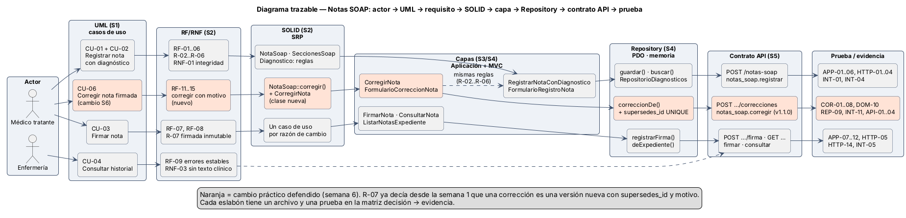
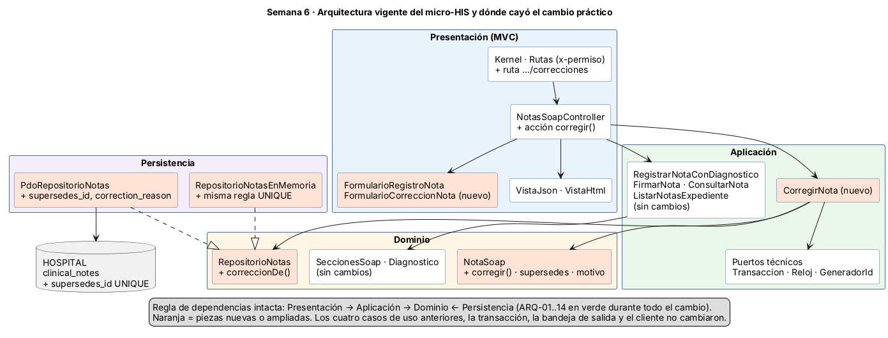

# Semana 6 — Primera evaluación parcial: defensa de la arquitectura de Notas SOAP

| | |
|---|---|
| **Curso** | Análisis de Sistemas II — Proyecto Final 2026 |
| **Módulo** | ASII-11 Notas SOAP y diagnósticos |
| **Proceso defendido** | «Registro de nota SOAP y asociación de diagnóstico clínico» |
| **Entrega del plan** | Primera evaluación parcial: defensa teórica y caso práctico arquitectónico |
| **Cambio práctico** | Corregir una nota SOAP firmada (versión nueva con `supersedes_id` y motivo) |
| **Código** | [`../micro-his-notas-soap/`](../micro-his-notas-soap/) (el mismo micro-HIS de las semanas 3 a 5) |
| **Estudiante** | Joshua Eduardo García Reyes (`jgarciar73-svg`) |
| **Fecha** | Octubre 2026 |

## Entregables

| Entregable | Archivo |
|---|---|
| Presentación de 6 a 8 diapositivas | [`presentacion/semana-06-defensa-notas-soap.pptx`](presentacion/semana-06-defensa-notas-soap.pptx): **8 diapositivas** con notas del orador. Copia en PDF: [`presentacion/semana-06-defensa-notas-soap.pdf`](presentacion/semana-06-defensa-notas-soap.pdf) |
| Diagrama trazable | [`diagramas/semana-06-trazabilidad.png`](diagramas/semana-06-trazabilidad.png) (fuente [`.puml`](diagramas/semana-06-trazabilidad.puml)) |
| Matriz decisión → evidencia | [`matriz-decision-evidencia.md`](matriz-decision-evidencia.md): 19 decisiones |
| Registro del cambio práctico defendido | [`registro-cambio-practico.md`](registro-cambio-practico.md): «Corregir una nota firmada», con pruebas primero (rojo → verde) |

Complementos:

- [`diagramas/semana-06-capas.png`](diagramas/semana-06-capas.png): la arquitectura actual y dónde cayó el cambio.
- [`evidencia/`](evidencia/): salidas reales de las pruebas en cada paso, del lint del contrato y de la demostración contra PostgreSQL.
- [`DECLARACION_IA.md`](DECLARACION_IA.md) y [`GUIA_DEFENSA_ORAL.md`](GUIA_DEFENSA_ORAL.md).

Sobre el enunciado: el plan del README solo dice «Primera evaluación parcial: defensa teórica y caso práctico arquitectónico». Seguí la forma de entrega que usa el grupo para esta semana: presentación, diagrama trazable, matriz y registro del cambio. Elegí un cambio práctico que el propio diseño ya anticipaba (R-07). Si el docente pide otro cambio en vivo, la guía de defensa explica cómo responderlo con el mismo método.

## 1. El hilo de la defensa

La arquitectura se defiende como **una sola cadena**. Cada eslabón justifica al siguiente y termina en una prueba que se puede ejecutar.



| Eslabón | Qué aporta | Dónde |
|---|---|---|
| **Actores** | Médico tratante (registra, firma, consulta y corrige) y Enfermería (solo consulta). El paciente no es actor: es el sujeto de la nota. | [Semana 1](../semana-01/semana-01-uml-proceso-notas-soap.md), §3 |
| **UML** | CU-01 a CU-05, más CU-06 hoy. Actividad con decisiones D-01 a D-07 y excepciones E-01 a E-06, y secuencia S-01 a S-31, todos con identificadores compartidos. Reglas R-01 a R-08. | Semana 1, §4 a §8 |
| **RF/RNF** | RF-01 a RF-10 (RF-11 a RF-15 hoy), RNF-01 a RNF-07, criterios CA-01 a CA-12 (CA-13 a CA-17 hoy) en formato Dado / Cuando / Entonces. | [Semana 2](../semana-02/semana-02-srp-requerimientos-diseno.md) |
| **SOLID (SRP)** | Cada clase tiene una sola razón para cambiar. El ejemplo antes/después de la semana 2 lo demostró con 20 pruebas. El cambio de hoy lo vuelve a demostrar: agregó clases sin tocar las existentes. | Semana 2, §5 a §9 |
| **Capas** | Presentación → Aplicación → Dominio ← Persistencia, verificado por ARQ-01 a ARQ-14 en cada ejecución. | [Semana 3](../semana-03/semana-03-arquitectura-micro-his.md), [Semana 4](../semana-04/semana-04-mvc-repository.md) |
| **Repository** | 8 puertos, cada uno con adaptador PDO y en memoria, y una suite de contrato común (REP-01 a REP-09). | Semana 4, §4 y §5 |
| **Contrato API** | OpenAPI 3.1 (hoy v1.1.0) con `x-permiso` por operación, verificado contra el código (API-01 a API-04). La frontera de microservicio se decidió con mediciones: no se divide. | [Semana 5](../semana-05/semana-05-cliente-servidor-microservicios.md) |
| **Pruebas** | 113 pruebas: 112 pasan, 0 fallan, 1 omitida sin PostgreSQL (113/113 con PostgreSQL). | `php tests/ejecutar.php` |

## 2. Arquitectura vigente



Hay cuatro decisiones que más sostienen el diseño. Cada una se ve en una prueba concreta:

1. **Las reglas clínicas viven en el Dominio y no conocen la base ni HTTP.** Una nota sin sección, un CIE-10 mal escrito o una corrección sin motivo se rechazan antes de abrir la transacción (DOM-02, DOM-03, DOM-10).
2. **La transacción protege la integridad.** Nota, diagnóstico y evento se guardan juntos o nada, en el registro y en la corrección (PER-05, INT-04, COR-07).
3. **Lo firmado no cambia, y eso lo garantizan dos barreras.** La aplicación usa un `UPDATE` condicionado y la base tiene triggers y el `UNIQUE` de la corrección (INT-05, INT-11).
4. **El contrato y el código no pueden divergir.** Lo comprueban API-01 a API-04, y durante el cambio lo hicieron de verdad.

## 3. Cambio práctico defendido

**Corregir una nota firmada.** El médico autor envía la corrección con un motivo. El sistema guarda una **versión nueva** en borrador, con su diagnóstico, que apunta a la anterior (`supersedes_id`). La nota firmada queda igual, como evidencia. Todo ocurre en una transacción con el evento `NOTA_CORREGIDA`.

| | |
|---|---|
| Ruta protegida nueva | `POST /api/v1/notas-soap/{notaId}/correcciones` — `x-permiso: notas_soap.corregir` |
| Diseño | `NotaSoap::corregir()` (regla), `CorregirNota` (coordinación), `FormularioCorreccionNota` (forma del JSON). El puerto `RepositorioNotas` gana `correccionDe()` en sus dos adaptadores |
| Lo que **no** cambió | `RegistrarNotaConDiagnostico`, `FirmarNota`, `ConsultarNota`, `ListarNotasExpediente`, transacciones, bandeja de salida, idempotencia y cliente |
| Base de datos | `supersedes_id UNIQUE` y `correction_reason`, las mismas columnas que la migración 000400 de HOSPITAL |
| Pruebas | DOM-10, COR-01..08, REP-09 (×2), INT-11 e INT-06 ampliada: **13 fallas en rojo → 0 fallas en verde** |

Detalle completo, decisiones, riesgos y evidencias: [`registro-cambio-practico.md`](registro-cambio-practico.md).

## 4. Cómo verificar en vivo

```bash
cd docs/modulos/notas-soap-diagnosticos/micro-his-notas-soap
php tests/ejecutar.php                          # 113 pruebas: 112 pasan, 0 fallan, 1 omitida
npx @redocly/cli@1.34.3 lint api/openapi.yaml   # contrato v1.1.0 válido
```

Para ver la corrección por HTTP sin PostgreSQL, levantar la API en modo memoria con archivo y seguir los pasos de la [guía de defensa](GUIA_DEFENSA_ORAL.md#4-demostración-en-vivo-3-minutos).

## 5. Bibliografía

- Brown, S. (2018). *The C4 model for visualising software architecture*. https://c4model.com
- Evans, E. (2003). *Domain-Driven Design: Tackling Complexity in the Heart of Software*. Addison-Wesley.
- Fowler, M. (2002). *Patterns of Enterprise Application Architecture*. Addison-Wesley. (Repository, Service Layer).
- Martin, R. C. (2017). *Clean Architecture: A Craftsman's Guide to Software Structure and Design*. Prentice Hall. (SRP y regla de dependencias).
- Beck, K. (2002). *Test-Driven Development: By Example*. Addison-Wesley. (Rojo → verde).
- OpenAPI Initiative. (2021). *OpenAPI Specification v3.1.0*. https://spec.openapis.org/oas/v3.1.0
- HL7 International. *FHIR R4 — DocumentReference.relatesTo (código `replaces`)*. https://hl7.org/fhir/R4/documentreference.html (modelo de referencia para documentos clínicos que reemplazan a otros sin borrarlos).
