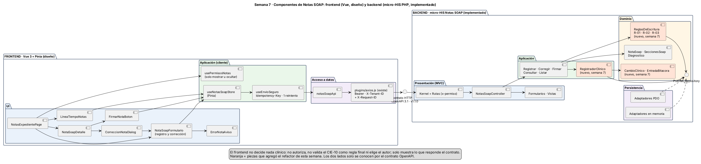
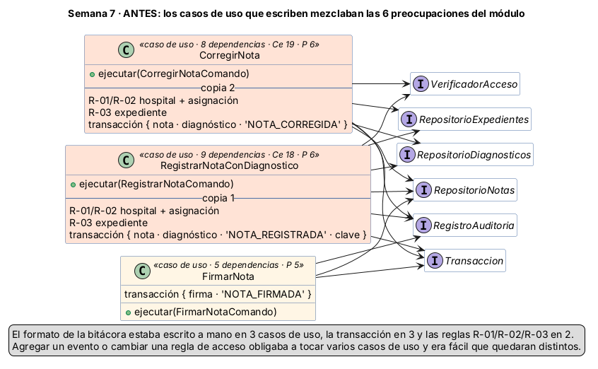
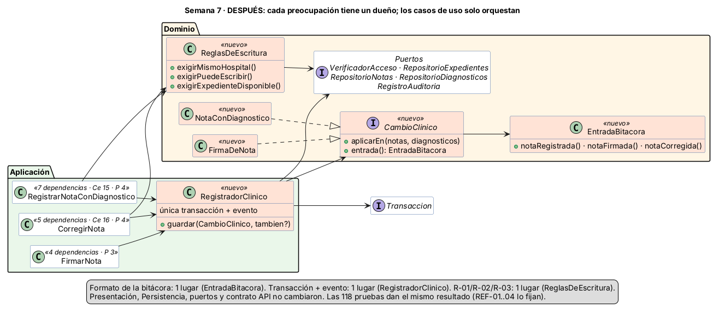

# Semana 7 — Diseño de componentes y refactorización

| | |
|---|---|
| **Curso** | Análisis de Sistemas II — Proyecto Final 2026 |
| **Módulo** | ASII-11 Notas SOAP y diagnósticos |
| **Flujo** | «Registro de nota SOAP y asociación de diagnóstico clínico» |
| **Código** | [`micro-his-notas-soap/`](../micro-his-notas-soap/README.md) — el MISMO proyecto de las semanas 3 a 6 |
| **Estudiante** | Joshua Eduardo García Reyes (`jgarciar73-svg`) |
| **Fecha** | Octubre 2026 |

> **Enunciado que se trabajó.** El enunciado individual de la semana 7 no está en el repositorio (solo existen los de las semanas 1 a 5). Se siguió el mismo planteamiento que usa el grupo para esta semana: *diseñar los componentes backend y frontend propios del módulo para su flujo, y refactorizar conceptualmente el punto con mayor acoplamiento, separando UI, aplicación, dominio y persistencia sin ampliar el módulo*. Queda pendiente confirmarlo con el docente.

## Índice

1. [Resumen](#1-resumen)
2. [Diagrama de componentes](#2-diagrama-de-componentes)
3. [Contratos de entrada/salida](#3-contratos-de-entradasalida)
4. [Cómo se eligió el punto a refactorizar](#4-cómo-se-eligió-el-punto-a-refactorizar)
5. [Refactor: antes](#5-refactor-antes)
6. [Refactor: después](#6-refactor-después)
7. [Comparación medida](#7-comparación-medida)
8. [Justificación](#8-justificación)
9. [Prueba de que no se amplió el módulo](#9-prueba-de-que-no-se-amplió-el-módulo)
10. [Costos y límites del refactor](#10-costos-y-límites-del-refactor)
11. [Conclusión](#11-conclusión)
12. [Bibliografía](#12-bibliografía)

## 1. Resumen

Esta semana tiene dos partes:

- **Diseño de componentes.** Un diagrama que muestra los componentes del módulo en el frontend (Vue 3 + Pinia, el que ya usa el repositorio del grupo, en diseño) y en el backend (el micro-HIS en PHP, implementado), separados por capas, y una tabla de contratos que dice qué recibe, qué devuelve y cómo falla cada componente.
- **Refactor.** Con un script de medición (`bin/acoplamiento.php`) se buscó la clase más acoplada del módulo. Salieron empatados los dos casos de uso que escriben notas: **`CorregirNota`** y **`RegistrarNotaConDiagnostico`**, cada uno mezclando las 6 preocupaciones del módulo. Junto con `FirmarNota`, los tres repetían a mano la misma transacción, el mismo formato de bitácora y las mismas reglas de acceso. El refactor le dio un dueño a cada una de esas cosas y dejó los casos de uso solo orquestando. **No se agregó ninguna ruta, regla ni campo**: las pruebas de caracterización (REF-01 a REF-04) se escribieron y pasaron sobre el código anterior y siguen pasando después.

| | Antes | Después |
|---|:-:|:-:|
| Preocupaciones que mezcla `CorregirNota` / `RegistrarNotaConDiagnostico` | 6 / 6 | 4 / 4 |
| Preocupaciones que mezcla `FirmarNota` | 5 | 3 |
| Dependencias en el constructor (Registrar / Corregir / Firmar) | 9 / 8 / 5 | 7 / 5 / 4 |
| Lugares que abren la transacción de escritura | 3 | **1** (`RegistradorClinico`) |
| Lugares que escriben `'NOTA_*'` y arman los datos del evento | 3 | **1** (`EntradaBitacora`) |
| Copias de las reglas R-01, R-02 y R-03 | 2 | **1** (`ReglasDeEscritura`) |
| Pruebas | 113 (112 pasan, 1 omitida) | 118 (117 pasan, 1 omitida sin PostgreSQL; 118/118 con PostgreSQL) |
| Rutas, permisos y contrato OpenAPI | 5 rutas · v1.1.0 | **sin cambios** |

## 2. Diagrama de componentes



Fuente: [`diagramas/semana-07-componentes.puml`](diagramas/semana-07-componentes.puml).

Los dos lados solo se conocen por el **contrato HTTP** ([`api/openapi.yaml`](../micro-his-notas-soap/api/openapi.yaml), v1.1.0, el mismo de las semanas 5 y 6). El frontend no importa ninguna clase del servidor y el servidor no sabe qué pantalla lo llama.

| Capa | Backend (micro-HIS, implementado) | Frontend (Vue 3 + Pinia, diseño) |
|---|---|---|
| **UI / Presentación** | `Kernel` + `Rutas` (cada ruta con su permiso `x-permiso`), `NotasSoapController`, formularios `FormularioRegistroNota` y `FormularioCorreccionNota`, vistas JSON y HTML | `NotasExpedientePage`, `LineaTiempoNotas`, `NotaSoapDetalle`, `NotaSoapFormulario` (sirve para registrar y para corregir), `CorreccionNotaDialog`, `FirmarNotaBoton`, `ErrorNotaAviso` |
| **Aplicación** | Casos de uso `RegistrarNotaConDiagnostico`, `CorregirNota`, `FirmarNota`, `ConsultarNota`, `ListarNotasExpediente`; servicio `RegistradorClinico` *(semana 7)* | `useNotasSoapStore` (Pinia: estado de la pantalla), `useEnvioSeguro` (Idempotency-Key y un solo reintento), `usePermisosNotas` (solo mostrar u ocultar botones) |
| **Dominio** | `NotaSoap`, `SeccionesSoap`, `Diagnostico`; `ReglasDeEscritura`, `CambioClinico` con `NotaConDiagnostico` y `FirmaDeNota`, `EntradaBitacora` *(semana 7)*; puertos `Repository` | — El frontend **no tiene dominio**: no decide nada clínico. |
| **Persistencia / acceso a datos** | Adaptadores PDO (PostgreSQL) y en memoria de cada puerto | `notasSoapApi` + `plugins/axios.js` (ya existe en el repositorio: pone `Authorization: Bearer` y `X-Tenant-ID`) + `X-Request-ID` |

**Decisiones del diseño del frontend:**

1. **Un solo formulario para registrar y corregir.** La corrección pide las mismas secciones S/O/A/P y el mismo diagnóstico que el registro, más el motivo. `NotaSoapFormulario` recibe un modo (`registro` o `correccion`) y muestra el campo «motivo» solo en el segundo. Así no se duplica la validación visual.
2. **El frontend no decide.** `usePermisosNotas` solo oculta botones que el usuario no podría usar (por ejemplo, «Corregir» en una nota sin firmar). Quien decide es siempre el servidor: si la pantalla se equivoca, el backend responde 403 o 409 y `ErrorNotaAviso` lo muestra.
3. **Reintento seguro, con las mismas reglas del cliente PHP de la semana 5.** `useEnvioSeguro` genera la `Idempotency-Key` **una vez por guardado** y la reutiliza si repite la petición. Las lecturas y el registro se reintentan una sola vez ante falla de red o 5xx; la firma y la corrección **no** se reintentan solas (si la respuesta se perdió, se vuelve a consultar la nota); ningún 4xx se reintenta.
4. **No se pierde lo escrito (RNF-06).** Si el guardado falla, el formulario conserva el texto: el store no limpia el borrador hasta recibir 201.
5. **Reutiliza lo del grupo.** `plugins/axios.js`, `stores/auth.js` y `router/guards.js` ya existen en `resources/js`. El módulo solo agrega su carpeta `modules/notas-soap/` con su página, sus componentes, su store y su cliente, más dos interceptores pequeños: uno que pone `X-Request-ID` y otro que, ante un 401, cierra la sesión (hoy `plugins/axios.js` solo prepara las peticiones, no revisa las respuestas).

## 3. Contratos de entrada/salida

La tabla completa, componente por componente (entrada, salida, fallas y dependencias), está en [contratos-entrada-salida.md](contratos-entrada-salida.md).

## 4. Cómo se eligió el punto a refactorizar

No se eligió a ojo. Se escribió [`bin/acoplamiento.php`](../micro-his-notas-soap/bin/acoplamiento.php), que lee `src/` con el tokenizador de PHP (no ejecuta nada) y calcula para cada clase:

- **Ce** (acoplamiento eferente): cuántas clases del proyecto usa.
- **Ca** (acoplamiento aferente): cuántas clases del proyecto la usan.
- **P**: cuántas de las 6 preocupaciones del módulo mezcla: nota · diagnóstico · acceso clínico · expediente · bitácora · persistencia. Una clase cuenta una preocupación si usa alguno de sus tipos (por ejemplo `RepositorioExpedientes` para «expediente» o `Transaccion` para «persistencia») o si escribe un evento `'NOTA_…'` como texto.

También cuenta las líneas de lógica repetidas entre casos de uso. Resultado antes del refactor ([`evidencia/acoplamiento-1-antes.txt`](evidencia/acoplamiento-1-antes.txt)):

```
Clase                             Capa            Ce   Ca Líneas  P  Preocupaciones que mezcla
CorregirNota                      Aplicacion      19    1     86  6  nota · diagnostico · acceso · expediente · bitacora · persistencia
RegistrarNotaConDiagnostico       Aplicacion      18    1    101  6  nota · diagnostico · acceso · expediente · bitacora · persistencia
ConjuntoAdaptadores               Aplicacion       7    1     45  6  nota · diagnostico · acceso · expediente · bitacora · persistencia
FirmarNota                        Aplicacion       9    1     47  5  nota · diagnostico · acceso · bitacora · persistencia
Kernel                            Presentacion    19    0    157  3  acceso · expediente · persistencia
...
Líneas de lógica repetidas entre casos de uso: 5
Ce total: 225 · Ce medio: 2.45 · Clases que mezclan 4 o más preocupaciones: 4
```

**Por qué esas dos clases y no otras:**

- `ConjuntoAdaptadores` también marca 6, pero es solo una lista de adaptadores que usa la raíz de composición (`bootstrap/contenedor.php`): no tiene lógica. Es normal que conozca todos los puertos.
- `Kernel` tiene el mismo Ce (19), pero mezcla solo 3 preocupaciones y todas son de su trabajo: traducir excepciones a códigos HTTP. Su acoplamiento es ancho, pero cohesivo.
- `CorregirNota` y `RegistrarNotaConDiagnostico` tienen Ce alto **y** mezclan todo: deciden quién puede escribir, si el expediente está abierto, abren la transacción, guardan en dos repositorios y escriben el evento con su formato. `FirmarNota` repite la mitad de eso. Es el **punto de mayor acoplamiento** del módulo.

## 5. Refactor: antes

El código anterior es el de la semana 6, que ya está en `develop` (PRs «Semana 6 (2/5)» y «Semana 6 (3/5)»): `RegistrarNotaConDiagnostico.php`, `CorregirNota.php` y `FirmarNota.php` en `src/Aplicacion/CasosDeUso/`. Se ve en el historial con `git log --oneline -- <ruta>` y `git show <commit>:<ruta>`.



Fragmento de `RegistrarNotaConDiagnostico` (semana 6):

```php
// R-06: nota, diagnóstico y evento juntos o nada.
$this->transaccion->ejecutar(function () use ($nota, $diagnostico, $usuario, $c): void {
    $this->notas->guardar($nota);
    $this->diagnosticos->guardar($diagnostico);
    $this->auditoria->registrar('NOTA_REGISTRADA', ['nota_id' => $nota->id, 'autor_id' => $usuario->id]);
    if ($c->claveIdempotencia !== null) {
        $this->idempotencia->guardar(/* ... */);
    }
});
```

`CorregirNota` tenía el mismo bloque con `'NOTA_CORREGIDA'` y su propio arreglo de datos, y `FirmarNota` otro con `'NOTA_FIRMADA'`.

| Problema | Dónde se veía | Consecuencia |
|---|---|---|
| **La transacción R-06 escrita tres veces** | `transaccion->ejecutar(...)` en los tres casos de uso | Si se cambia cómo se guarda (por ejemplo, agregar la bandeja de salida del evento), hay que acordarse de los tres. |
| **El formato de la bitácora repartido** | `'NOTA_REGISTRADA'`, `'NOTA_CORREGIDA'`, `'NOTA_FIRMADA'` y sus arreglos, cada uno en su caso de uso | Nada garantiza que los tres eventos usen los mismos nombres de campo. Un error de tipeo (`autorId` en vez de `autor_id`) no lo detecta ninguna prueba de la semana 6. |
| **Las reglas R-01/R-02/R-03 duplicadas** | `puedeEscribir` y `estaDisponible` copiados en Registrar y en Corregir | Si cambia la regla de acceso (por ejemplo, permitir al jefe de servicio), hay dos lugares que editar. |
| **Casos de uso con demasiadas dependencias** | 9 en Registrar, 8 en Corregir | Para probar una regla de acceso hay que armar repositorios, transacción y bitácora. |
| **Una clase de Aplicación que conoce todo** | P = 6 en dos clases | Cualquiera de las 6 preocupaciones que cambie obliga a tocar el caso de uso: más de una razón para cambiar (SRP). |

## 6. Refactor: después

Diagrama: [`diagramas/semana-07-refactor-despues.png`](diagramas/semana-07-refactor-despues.png).



En el caso de uso, ese bloque ahora es una sola llamada: `$this->registrador->guardar(new NotaConDiagnostico($nota, $diagnostico), <guardar la clave de idempotencia>)`. Las reglas R-01 a R-03 son `$this->reglas->exigirPuedeEscribir(...)` y `exigirExpedienteDisponible(...)`. El único lugar que guarda es este:

```php
final class RegistradorClinico
{
    public function guardar(CambioClinico $cambio, ?\Closure $tambien = null): void
    {
        $this->transaccion->ejecutar(function () use ($cambio, $tambien): void {
            $cambio->aplicarEn($this->notas, $this->diagnosticos);
            $entrada = $cambio->entrada();
            $this->auditoria->registrar($entrada->evento, $entrada->datos);
            if ($tambien !== null) {
                $tambien();
            }
        });
    }
}
```

**A dónde se movió cada responsabilidad:**

| Responsabilidad | Antes | Después | Capa |
|---|---|---|---|
| R-01, R-02 (hospital y asignación al episodio) | Copiada en Registrar y Corregir | `ReglasDeEscritura::exigirMismoHospital` / `exigirPuedeEscribir` | Dominio (servicio) |
| R-03 (expediente abierto y del episodio) | Copiada en Registrar y Corregir | `ReglasDeEscritura::exigirExpedienteDisponible` | Dominio (servicio) |
| Qué se guarda en cada cambio | Dentro de cada transacción | `CambioClinico`: `NotaConDiagnostico` (registro o corrección) y `FirmaDeNota` | Dominio |
| Nombre y campos de cada evento | Un arreglo en cada caso de uso | `EntradaBitacora::notaRegistrada / notaFirmada / notaCorregida` | Dominio |
| Transacción R-06 + evento | Tres bloques `transaccion->ejecutar` | `RegistradorClinico::guardar` | Aplicación (servicio) |
| Orden de los pasos, idempotencia, mensajes de error en su contexto, carrera del `UNIQUE` | En el caso de uso | **Se queda** en el caso de uso | Aplicación |

`ReglasDeEscritura` está en el Dominio porque son reglas del negocio clínico (R-01 a R-03 de la semana 1) y solo usa puertos del Dominio. `RegistradorClinico` está en Aplicación porque usa `Transaccion`, que es un puerto de Aplicación: la transacción es una decisión de cómo se ejecuta el caso de uso, no una regla clínica.

**Archivos:**

| Nuevos (6) | Modificados | Sin cambios |
|---|---|---|
| `Dominio/Servicios/ReglasDeEscritura.php` | `Aplicacion/CasosDeUso/RegistrarNotaConDiagnostico.php` | Toda la Presentación (`Kernel`, `Rutas`, controlador, formularios, vistas) |
| `Dominio/Cambios/CambioClinico.php` | `Aplicacion/CasosDeUso/CorregirNota.php` | Toda la Persistencia (PDO y en memoria) |
| `Dominio/Cambios/NotaConDiagnostico.php` | `Aplicacion/CasosDeUso/FirmarNota.php` | Puertos, entidades y excepciones |
| `Dominio/Cambios/FirmaDeNota.php` | `bootstrap/contenedor.php` (cableado) | `api/openapi.yaml` (sigue en 1.1.0) |
| `Dominio/Eventos/EntradaBitacora.php` | `tests/Dobles/Escenario.php` y `bin/medir.php` (mismo cableado) | `ConsultarNota`, `ListarNotasExpediente` |
| `Aplicacion/Servicios/RegistradorClinico.php` | `tests/Arquitectura/ReglaDependenciasPrueba.php` (ARQ-12 ajustada, ARQ-15 nueva) | Esquema SQL y cliente HTTP |

Además: `bin/acoplamiento.php` (la medición) y `tests/Aplicacion/RefactorPrueba.php` (REF-01 a REF-04).

## 7. Comparación medida

Salidas reales: [`acoplamiento-1-antes.txt`](evidencia/acoplamiento-1-antes.txt) y [`acoplamiento-2-despues.txt`](evidencia/acoplamiento-2-despues.txt).

| Medida | Antes | Después | Lectura |
|---|:-:|:-:|---|
| P de `CorregirNota` | 6 | 4 | Ya no conoce expediente ni bitácora. |
| P de `RegistrarNotaConDiagnostico` | 6 | 4 | Igual. |
| P de `FirmarNota` | 5 | 3 | Ya no conoce bitácora ni persistencia. |
| Ce de `CorregirNota` / `RegistrarNotaConDiagnostico` | 19 / 18 | 16 / 15 | Menos tipos importados. |
| Líneas de `CorregirNota` / `RegistrarNotaConDiagnostico` / `FirmarNota` | 86 / 101 / 47 | 76 / 87 / 46 | Registrar baja menos porque se dejó el formato original de la llamada a `NotaSoap::registrar` para no inflar el diff. | |
| Dependencias del constructor (Registrar / Corregir / Firmar) | 9 / 8 / 5 | 7 / 5 / 4 | Más fácil de probar y de leer. |
| Lugares con `transaccion->ejecutar` en escritura de notas | 3 | 1 | |
| Lugares que escriben eventos `'NOTA_*'` | 3 | 1 | |
| Líneas de lógica repetidas entre casos de uso | 5 | 4 | Desapareció `$this->diagnosticos->guardar(...)` repetida. |
| Clases con 4 o más preocupaciones | 4 | 4 | **Ver abajo.** |
| Ce total del proyecto / clases en `src/` | 225 / 92 | 244 / 98 | **Ver abajo.** |

**Lo que no mejoró, explicado sin maquillar:**

- **Siguen siendo 4 las clases con P ≥ 4.** Sale `FirmarNota` y entra `RegistradorClinico`, que mezcla nota · diagnóstico · bitácora · persistencia. Eso es **lo buscado**: guardar una nota con su diagnóstico y su evento en una transacción es exactamente su único trabajo, y ahora vive en un solo lugar en vez de tres. Registrar y Corregir siguen en 4 porque conservan dos cosas a propósito: la idempotencia (Registrar) y la carrera del `UNIQUE (supersedes_id)` (Corregir), que son decisiones de cada caso de uso. Moverlas a un servicio común sería esconder diferencias reales.
- **El Ce total subió de 225 a 244.** Hay 6 clases más y cada una importa sus tipos. El Ce total mide cuántas flechas hay, no si apuntan bien. Lo que importa para el cambio es que **cada preocupación tiene un dueño**: para cambiar el formato de la bitácora se toca un archivo, no tres. No se agregaron las clases nuevas como marcas de preocupación en el script para que la medición no se acomodara al resultado.
- **Quedan 4 líneas repetidas.** Tres son la verificación de hospital en `ConsultarNota`, `ListarNotasExpediente` y `FirmarNota`, que no se tocaron para no ampliar el refactor más allá del punto elegido (ver §10).

## 8. Justificación

| Principio | Cómo se aplica |
|---|---|
| **SRP** (una razón para cambiar) | Antes, `CorregirNota` cambiaba si cambiaba la regla de acceso, el formato del evento o la forma de guardar. Ahora cada una de esas razones tiene su clase: `ReglasDeEscritura`, `EntradaBitacora`, `RegistradorClinico`. |
| **OCP** (abierto a extensión, cerrado a modificación) | Un cambio clínico nuevo (por ejemplo, anular una nota) se agrega como otra implementación de `CambioClinico`, sin tocar `RegistradorClinico`. |
| **DIP** (depender de abstracciones) | `ReglasDeEscritura` y `RegistradorClinico` reciben solo interfaces (puertos). Lo comprueba la prueba nueva **ARQ-15**. |
| **Cohesión** | El formato de los tres eventos está junto en `EntradaBitacora`; antes estaba repartido. Lo fija **REF-01**. |
| **Capas** | Las flechas siguen apuntando al Dominio. `ReglasDeEscritura` y los `CambioClinico` están en el Dominio y solo usan puertos del Dominio; `RegistradorClinico` está en Aplicación porque usa `Transaccion`. Lo comprueban ARQ-01 a ARQ-15. |
| **Reglas del módulo** | R-01, R-02 y R-03 (semana 1) tienen ahora un solo lugar en el código. R-06 (todo o nada) también. |

**Decisión sobre la prueba ARQ-12.** La regla de la semana 3 decía que un caso de uso solo recibe interfaces. Ahora `RegistrarNotaConDiagnostico` y `CorregirNota` reciben dos clases concretas: `ReglasDeEscritura` y `RegistradorClinico`. Se ajustó ARQ-12 para aceptar los **servicios** del propio módulo (`Dominio\Servicios` y `Aplicacion\Servicios`), que no son adaptadores, y se agregó ARQ-15 para que esos servicios, a su vez, reciban solo interfaces. La cadena sigue sin tocar nunca un adaptador concreto.

**Alternativas descartadas:**

| Alternativa | Por qué no |
|---|---|
| Crear interfaces `ReglasDeEscrituraInterface` y `RegistradorClinicoInterface` | Tendrían una sola implementación cada una y nunca un doble de prueba: las pruebas usan los servicios reales con adaptadores en memoria. Sería una abstracción sin uso. |
| Una clase base `CasoDeUsoEscritura` de la que hereden los tres | La herencia ata los tres casos de uso a un mismo flujo, pero no lo tienen: Registrar consulta la idempotencia en medio, Corregir maneja la carrera del `UNIQUE`, Firmar no lleva diagnóstico. La composición permite diferencias. |
| Pasar la escritura de la bitácora a `RepositorioNotasConEventos` (decorador de la semana 5) | Ese decorador publica el evento de integración hacia la bandeja de salida; la bitácora de auditoría es otra cosa (RNF-03). Mezclarlas volvería a juntar dos preocupaciones. |
| Mover también la idempotencia al `RegistradorClinico` | Solo el registro la usa. Se dejó como un *closure* opcional (`$tambien`) para que quede en la misma transacción sin que el registrador sepa de claves. |

## 9. Prueba de que no se amplió el módulo

El método es el de Feathers (2004): primero fijar el comportamiento con pruebas, después mover el código.

| Paso | Evidencia | Resultado |
|---|---|---|
| 0. Línea base antes de tocar nada | [`pruebas-1-caracterizacion.txt`](evidencia/pruebas-1-caracterizacion.txt) | 113 pruebas: 112 pasan, 1 omitida (INT sin PostgreSQL) |
| 1. Pruebas de caracterización REF-01 a REF-04 **sobre el código anterior** | el mismo archivo | 117 pruebas: 116 pasan, 1 omitida. Las 4 nuevas pasan sin cambiar el código. |
| 2. Después del refactor | [`pruebas-2-despues.txt`](evidencia/pruebas-2-despues.txt) | 118 pruebas (se suma ARQ-15): 117 pasan, 1 omitida; con PostgreSQL 16, 118 de 118 |

Qué fija cada prueba de caracterización (`tests/Aplicacion/RefactorPrueba.php`):

| Prueba | Qué fija |
|---|---|
| **REF-01** | El nombre, los campos y el orden exactos de los 4 eventos al registrar → firmar → corregir → firmar la versión 2. |
| **REF-02** | El orden de las verificaciones: hospital → acceso → «ya corregida» → expediente → reglas de la nota. Si el refactor cambia el orden, cambia el código de error que recibe el cliente. |
| **REF-03** | Un error inesperado al verificar el acceso da `500 error_interno` en registro y corrección, sin guardar nada ni filtrar detalles internos. |
| **REF-04** | Si la base falla dentro de la transacción, registro y corrección responden `500 error_persistencia` y no queda nota, evento ni clave de idempotencia. |

Además: las 5 rutas y sus permisos son los mismos (API-01, ARQ-14), el contrato OpenAPI sigue en 1.1.0 sin cambios (API-03 y API-04 lo comparan con el código) y no se tocó ningún archivo de Presentación ni de Persistencia.

**Cómo se entregó.** El revisor automático del curso pide que cada PR cambie menos de 400 líneas, así que la semana se divide en cuatro PRs independientes, todos hacia `develop`:

| PR | Contenido |
|---|---|
| Semana 7 (1/4) | Medición y caracterización: `bin/acoplamiento.php`, REF-01 a REF-04, diagrama «antes» y su evidencia |
| Semana 7 (2/4) | Refactor: las 6 clases nuevas, los 3 casos de uso, el cableado y ARQ-12/ARQ-15 |
| Semana 7 (3/4) | Diseño de componentes: diagramas de componentes y «después», contratos de entrada/salida, evidencia final y guía de defensa |
| Semana 7 (4/4) | Este documento y los README |

Las salidas de las pruebas se guardan como extracto (las líneas REF, ARQ y los totales), no completas. Se obtienen completas con `php tests/ejecutar.php`.

## 10. Costos y límites del refactor

- **Más archivos.** Seis clases nuevas para alguien que llega por primera vez. Se mitiga con comentarios de una línea en cada una y con el diagrama de §6.
- **Una indirección más.** Para saber qué guarda el registro hay que abrir `NotaConDiagnostico`. A cambio, ese archivo tiene 37 líneas y dice exactamente eso.
- **Lo que no se tocó a propósito:** la verificación de hospital repetida en `ConsultarNota`, `ListarNotasExpediente` y `FirmarNota`. Podría usar `ReglasDeEscritura::exigirMismoHospital`, pero esos casos de uso son de **lectura** (salvo Firmar) y no estaban en el punto medido. Queda anotado como siguiente paso.
- **El frontend es diseño.** No se implementó en Vue: el enunciado pide diseñar los componentes. El contrato que va a consumir sí existe y está probado.

## 11. Conclusión

El punto de mayor acoplamiento del módulo se eligió con una medición, no a ojo: los casos de uso que escriben notas mezclaban las 6 preocupaciones y repetían la misma transacción, el mismo formato de evento y las mismas reglas de acceso. Después del refactor, cada una de esas cosas tiene un único dueño en su capa, los casos de uso solo orquestan, y las pruebas de caracterización demuestran que el comportamiento observable es el mismo. El diseño del frontend se apoya en el mismo contrato y respeta la misma regla: quien decide lo clínico es el servidor.

## 12. Bibliografía

- Evans, E. (2003). *Domain-Driven Design: Tackling Complexity in the Heart of Software*. Addison-Wesley. (Servicios de dominio.)
- Feathers, M. (2004). *Working Effectively with Legacy Code*. Prentice Hall. (Pruebas de caracterización.)
- Fowler, M. (2018). *Refactoring: Improving the Design of Existing Code* (2.ª ed.). Addison-Wesley. (*Extract Class*, *Move Function*, *Replace Conditional with Polymorphism*.)
- Martin, R. C. (2003). *Agile Software Development: Principles, Patterns, and Practices*. Prentice Hall. (Ce, Ca, SRP, OCP, DIP.)
- Martin, R. C. (2018). *Clean Architecture*. Prentice Hall.
- Vue.js. (s. f.). *Composables*. https://vuejs.org/guide/reusability/composables.html
- Pinia. (s. f.). *Defining a Store*. https://pinia.vuejs.org/core-concepts/
