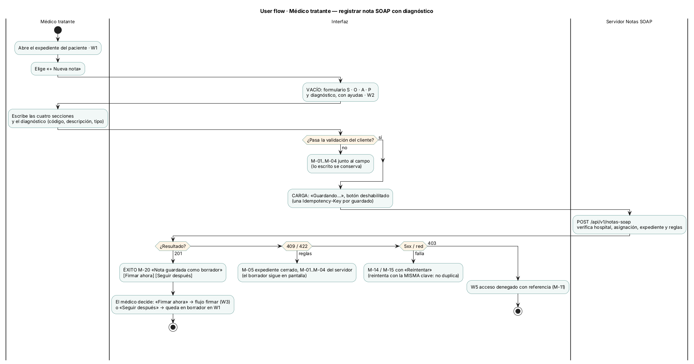
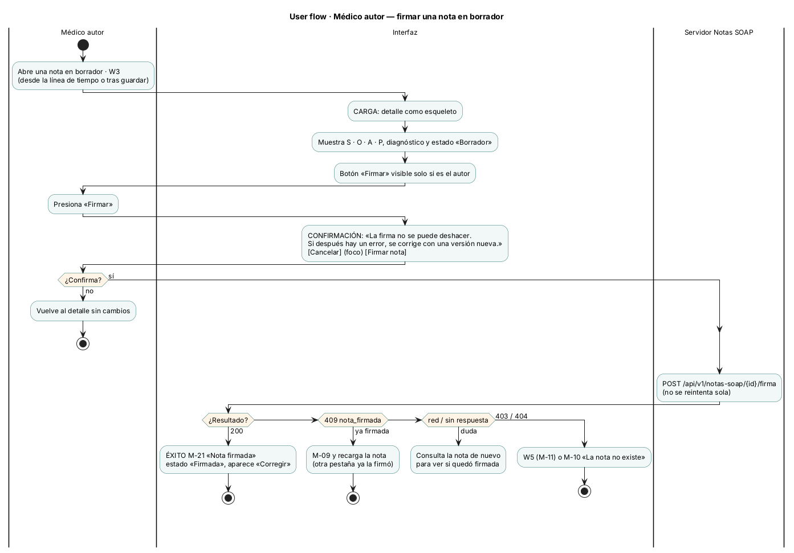
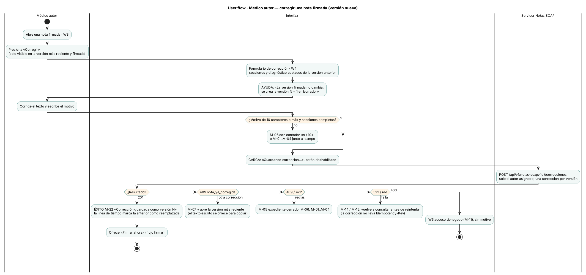
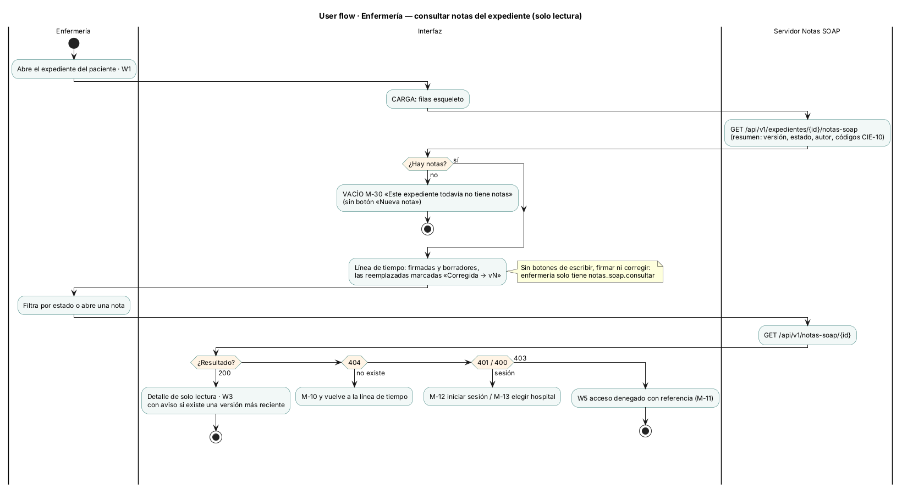
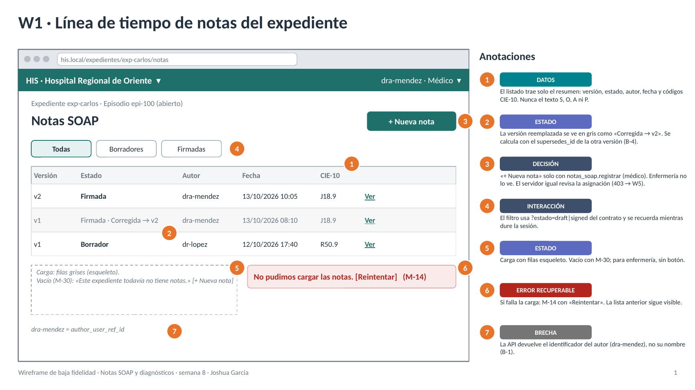
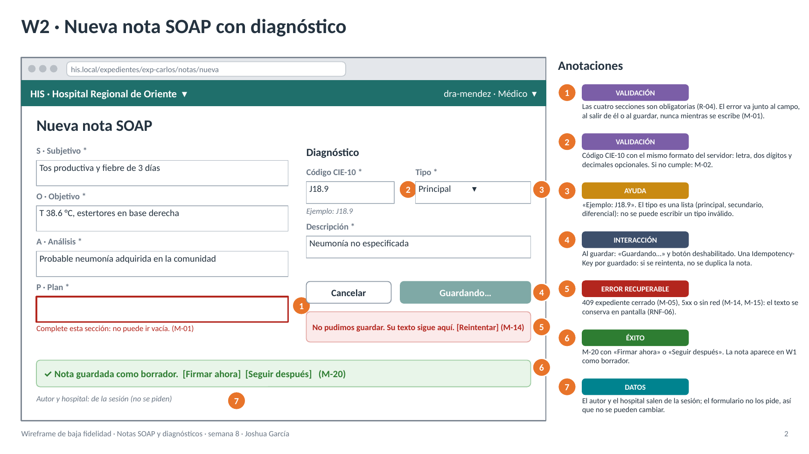
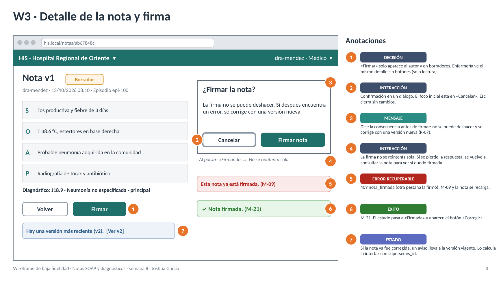
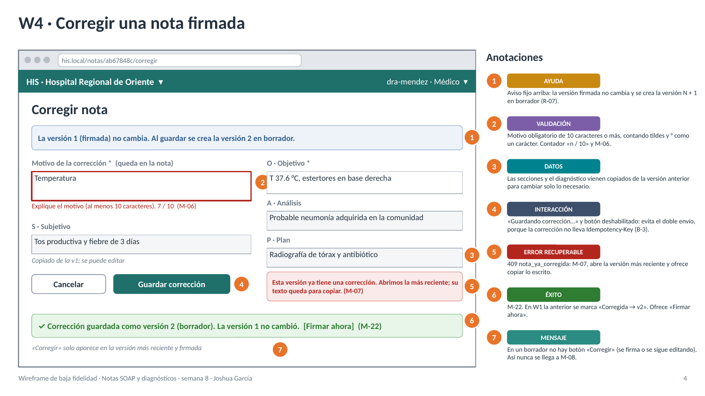
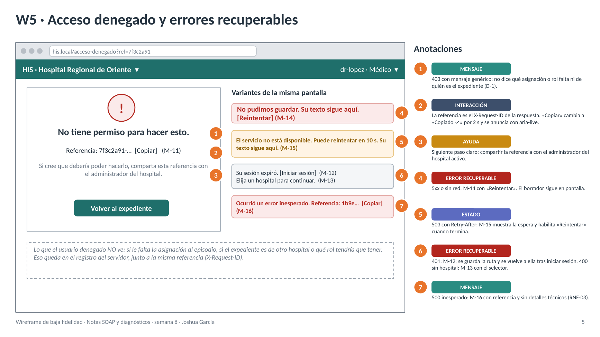

# Semana 8 — Diseño de experiencia de usuario de Notas SOAP

**Estudiante:** Joshua Eduardo García Reyes (`jgarciar73-svg`) · **Módulo:** ASII-11 Notas SOAP y diagnósticos

**Proceso:** «registro de nota SOAP y asociación de diagnóstico clínico», con su firma y su corrección.

**Entregables:**
- user flow por rol (4 diagramas) en [diagramas/](diagramas/);
- 5 wireframes anotados en [wireframes/semana-08-wireframes-notas-soap.pptx](wireframes/semana-08-wireframes-notas-soap.pptx), con versión [PDF](wireframes/semana-08-wireframes-notas-soap.pdf) y PNG.

> El enunciado individual de esta semana no está en el repositorio. Se siguió el del grupo para la semana 8: user flow por rol y wireframes anotados con estados, mensajes, validaciones y reglas de interacción.

## 1. Alcance y punto de partida

Este documento diseña la experiencia de uso. **No** implementa pantallas. Parte de lo que ya existe:

| Origen | Qué aporta |
|---|---|
| Semana 1 | Actores (médico tratante, enfermería), CU-01 a CU-05 y reglas R-01 a R-08 |
| Semana 2 | RF y RNF; en especial RNF-03 (no mostrar detalles internos) y RNF-06 (no perder lo escrito) |
| Semana 5 | Contrato [`openapi.yaml`](../micro-his-notas-soap/api/openapi.yaml): rutas, códigos HTTP, `Idempotency-Key`, `X-Request-ID` |
| Semana 6 | Corrección de una nota firmada (versión nueva con motivo), RF-11 a RF-15 |
| Semana 7 | Componentes Vue diseñados: `NotasExpedientePage`, `LineaTiempoNotas`, `NotaSoapDetalle`, `NotaSoapFormulario`, `CorreccionNotaDialog`, `FirmarNotaBoton`, `ErrorNotaAviso`, `useNotasSoapStore`, `useEnvioSeguro`, `usePermisosNotas` |

Cada mensaje y cada validación sale de un código real del backend (§6), así que la interfaz no promete nada que el servidor no haga.

## 2. Roles y lo que ve cada uno

| Perfil | Permisos del micro-HIS | Pantallas | User flow |
|---|---|---|---|
| **Médico tratante** (autor) | `notas_soap.registrar`, `.firmar`, `.corregir`, `.consultar` | W1, W2, W3, W4 | [registrar](diagramas/semana-08-flujo-medico-registrar.png), [firmar](diagramas/semana-08-flujo-medico-firmar.png), [corregir](diagramas/semana-08-flujo-medico-corregir.png) |
| **Enfermería** | `notas_soap.consultar` | W1 y W3 en solo lectura | [consultar](diagramas/semana-08-flujo-enfermeria-consultar.png) |
| **Médico sin asignación al episodio** o de otro hospital | Tiene el rol, pero el servidor lo rechaza (R-01, R-02) | W5 | Rama «403» de todos los flujos |

El permiso de la ruta solo dice qué rol puede intentar la acción. Que el médico esté asignado al episodio y que el expediente esté abierto lo decide el servidor en cada envío. Por eso un médico puede ver «+ Nueva nota» y aun así recibir un 403 (brecha B-5).

## 3. Principios de diseño

| # | Principio | Cómo se ve |
|---|---|---|
| P-1 | **La interfaz no decide; el servidor sí.** | Ocultar un botón es comodidad, no seguridad. Todo envío se vuelve a validar en el servidor. |
| P-2 | **Lo firmado no se toca.** | Una nota firmada no tiene botón «Editar», solo «Corregir», que crea una versión nueva (R-07). |
| P-3 | **No perder lo escrito** (RNF-06). | Ante cualquier error el texto queda en pantalla; los mensajes van junto al campo. |
| P-4 | **Denegar sin revelar.** | El 403 no dice qué asignación falta ni de quién es el expediente; da una referencia para soporte. |
| P-5 | **Confirmar lo irreversible.** | Firmar pide confirmación; corregir exige motivo. |
| P-6 | **El contexto siempre visible.** | Hospital activo y usuario con su rol en la cabecera; expediente y episodio arriba de cada pantalla. |
| P-7 | **Reintentar sin duplicar.** | El registro reutiliza su `Idempotency-Key`; la firma y la corrección no se reintentan solas. |

## 4. User flows por rol

Los cuatro diagramas son de actividad UML con carriles *Usuario · Interfaz · Servidor Notas SOAP*. Cada uno muestra el inicio, las decisiones, la confirmación, los estados vacío, carga y éxito, los errores recuperables (`detach`: el usuario corrige o reintenta) y la ayuda. Las fuentes `.puml` están junto a cada imagen.

### 4.1 Médico — registrar nota con diagnóstico



| Elemento | Dónde está |
|---|---|
| Inicio | Expediente del paciente → «+ Nueva nota» |
| Decisiones | Validación del cliente · resultado HTTP · firmar ahora o después |
| Vacío / carga / éxito | Formulario con ayudas → «Guardando…» → M-20 |
| Errores recuperables | M-01 a M-04 (cliente y servidor), M-05 expediente cerrado, M-14 y M-15 |
| Ayuda | Ejemplo de código CIE-10 y lista cerrada de tipos |

### 4.2 Médico — firmar



- **Confirmación con la consecuencia escrita:** «La firma no se puede deshacer».
- **Sin reintento automático.** Si la respuesta se pierde, se consulta la nota para ver si quedó firmada, igual que el cliente PHP de la semana 5.

### 4.3 Médico — corregir una nota firmada



- «Corregir» solo existe en la **versión más reciente y firmada**. Así no se llega a `nota_no_firmada` ni, en el caso normal, a `nota_ya_corregida`.
- Si dos correcciones de la misma versión llegan a la vez, el servidor acepta una (UNIQUE de la semana 6). La otra recibe M-07, se le abre la versión vigente y su texto queda para copiar.

### 4.4 Enfermería — consultar



Solo lectura: no ve botones de escribir, firmar ni corregir. Si abre una versión ya corregida, un aviso la lleva a la vigente.

## 5. Wireframes anotados

Son de baja fidelidad: marco de navegador, cabecera con el hospital activo, círculos naranjas numerados y una columna «Anotaciones» con una etiqueta por anotación (`ESTADO`, `MENSAJE`, `VALIDACIÓN`, `INTERACCIÓN`, `DATOS`, `AYUDA`, `ÉXITO`, `DECISIÓN`, `ERROR RECUPERABLE`, `BRECHA`).

| # | Pantalla | Rol | Ruta de UI → endpoint |
|---|---|---|---|
| W1 | Línea de tiempo del expediente | Médico y enfermería | `/expedientes/:id/notas` → `GET /api/v1/expedientes/{id}/notas-soap` |
| W2 | Nueva nota con diagnóstico | Médico | `/expedientes/:id/notas/nueva` → `POST /api/v1/notas-soap` |
| W3 | Detalle y firma | Médico autor; enfermería en lectura | `/notas/:id` → `GET /api/v1/notas-soap/{id}` y `POST …/firma` |
| W4 | Corregir nota firmada | Médico autor | `/notas/:id/corregir` → `POST …/correcciones` |
| W5 | Acceso denegado y errores | Cualquiera | Panel `ErrorNotaAviso`; `/acceso-denegado?ref=…` |

### W1 · Línea de tiempo


### W2 · Nueva nota


### W3 · Detalle y firma


### W4 · Corregir nota


### W5 · Errores y acceso denegado


## 6. Catálogo de mensajes

Cada mensaje tiene un identificador que aparece en los flujos y en los wireframes. Va en lenguaje claro, de usted, y dice qué hacer después.

| ID | Texto para el usuario | Origen (HTTP · código) | Dónde | Recuperación |
|---|---|---|---|---|
| M-01 | «Complete esta sección: no puede ir vacía.» | Cliente · 422 `nota_incompleta` | W2, W4 | Escribir la sección |
| M-02 | «El código no tiene formato CIE-10. Ejemplo: J18.9.» | Cliente · 422 `diagnostico_invalido` | W2, W4 | Corregir el código |
| M-03 | «Escriba la descripción del diagnóstico.» | Cliente · 422 `diagnostico_invalido` | W2, W4 | Completar |
| M-04 | «Elija el tipo: principal, secundario o diferencial.» | 422 `diagnostico_invalido` (la lista lo evita) | W2, W4 | Elegir de la lista |
| M-05 | «El expediente está cerrado o ya no corresponde al episodio. Su texto sigue aquí.» | 409 `expediente_no_disponible` | W2, W4 | Volver al expediente |
| M-06 | «Explique el motivo (al menos 10 caracteres).» con contador «n / 10» | Cliente · 422 `motivo_insuficiente` | W4 | Completar el motivo |
| M-07 | «Esta versión ya tiene una corrección. Abrimos la más reciente; su texto queda para copiar.» | 409 `nota_ya_corregida` | W4 → W3 | Revisar la versión vigente |
| M-08 | «Esta nota todavía es borrador: puede firmarla o seguir editándola.» | 409 `nota_no_firmada` (la UI lo evita) | W3 | — |
| M-09 | «Esta nota ya está firmada.» | 409 `nota_firmada` | W3 | Se recarga la nota |
| M-10 | «La nota no existe o ya no está disponible.» | 404 `nota_no_encontrada` | W3 | Volver a W1 |
| M-11 | «No tiene permiso para hacer esto. Referencia: `<X-Request-ID>` [Copiar]» | 403 `acceso_denegado` | W5 | Compartir la referencia |
| M-12 | «Su sesión expiró. [Iniciar sesión]» | 401 `token_invalido` | W5 | Login y volver a la ruta |
| M-13 | «Elija un hospital para continuar.» | 400 `tenant_requerido` | W5 | Selector de hospital |
| M-14 | «No pudimos guardar. Su texto sigue aquí. [Reintentar]» | Red · 500 `error_persistencia` | W1, W2, W4, W5 | Reintentar |
| M-15 | «El servicio no está disponible. Puede reintentar en N s. Su texto sigue aquí.» | 503 `servicio_no_disponible` + `Retry-After` | W2, W4, W5 | Esperar y reintentar |
| M-16 | «Ocurrió un error inesperado. Referencia: … [Copiar]» | 500 `error_interno` | W5 | Compartir la referencia |
| M-20 | «✓ Nota guardada como borrador. [Firmar ahora] [Seguir después]» | 201 | W2 | — |
| M-21 | «✓ Nota firmada.» | 200 | W3 | — |
| M-22 | «✓ Corrección guardada como versión N (borrador). La versión anterior no cambió.» | 201 | W4 | — |
| M-30 | «Este expediente todavía no tiene notas.» (+ botón solo para el médico) | 200 con lista vacía | W1 | — |

`cuerpo_invalido` (400), `idempotency_key_reutilizada` (422), `ruta_no_encontrada` (404) y `metodo_no_permitido` (405) no tienen mensaje propio: con el formulario, `useEnvioSeguro` y el cliente `notasSoapApi` no deberían ocurrir. Si ocurren, se muestra M-16 con la referencia.

**Lo que ningún mensaje dice:** si falta la asignación al episodio, de qué hospital es el expediente o qué rol haría falta.

## 7. Reglas de interacción

| ID | Regla | Pantallas | Por qué |
|---|---|---|---|
| I-01 | El botón de envío se deshabilita y dice «Guardando…», «Firmando…» o «Guardando corrección…» hasta la respuesta. | W2, W3, W4 | Evita el doble envío. |
| I-02 | El registro usa una `Idempotency-Key` por guardado; si se reintenta, la misma. | W2 | El servidor no duplica la nota. |
| I-03 | La validación del cliente usa las reglas del servidor: 4 secciones, CIE-10 `^[A-Z][0-9]{2}(\.[0-9]{1,2})?$`, motivo de 10 caracteres o más. | W2, W4 | Avisar antes; el servidor sigue siendo la autoridad. |
| I-04 | Los errores aparecen junto al campo al salir de él o al guardar, nunca mientras se escribe. | W2, W4 | No interrumpir. |
| I-05 | Firmar abre un diálogo con el foco en «Cancelar»; `Esc` cierra sin cambios. | W3 | Acción irreversible: el camino seguro es el más fácil. |
| I-06 | La firma y la corrección no se reintentan solas: ante la duda, se vuelve a consultar la nota. | W3, W4 | Repetir daría un 409 que confunde. |
| I-07 | El borrador vive en el store hasta recibir 201; se borra al cerrar sesión o cambiar de hospital. | W2, W4 | RNF-06 sin guardar texto clínico en el navegador (D-5). |
| I-08 | Tras guardar, firmar o corregir, W1 se actualiza sin recargar y la fila afectada queda resaltada. | W1–W4 | Retroalimentación inmediata. |
| I-09 | «Copiar» la referencia muestra «Copiado ✓» por 2 s; avisos con `aria-live="polite"` y el 403 con `role="alert"`. | W5 | Accesibilidad. |
| I-10 | Ante un 401 se guarda la ruta destino y, tras el login, se vuelve a ella. | W5 | No perder el contexto. |

## 8. Matriz de estados por pantalla

| Pantalla | Vacío | Carga | Éxito | Error recuperable | Denegado |
|---|---|---|---|---|---|
| W1 Línea de tiempo | M-30 | Filas esqueleto | Lista con versiones y estados | M-14 | W5 |
| W2 Nueva nota | Formulario con ayudas | «Guardando…» | M-20 | M-01..M-05, M-14, M-15 | W5 (M-11) |
| W3 Detalle y firma | — | Detalle esqueleto | M-21 | M-09, M-10 | W5 (M-11) |
| W4 Corregir | Datos copiados de la versión anterior | «Guardando corrección…» | M-22 | M-01..M-07, M-14, M-15 | W5 (M-11) |
| W5 Errores | — | — | «Copiado ✓» | M-12..M-16 | Es la propia pantalla |

## 9. Ayuda contextual

| Lugar | Ayuda |
|---|---|
| W2, código CIE-10 | «Ejemplo: J18.9» bajo el campo |
| W2, tipo | Lista cerrada: principal, secundario, diferencial |
| W3, diálogo de firma | Qué pasa al firmar y cómo se corrige después |
| W4, arriba | «La versión firmada no cambia; se crea la versión N + 1 en borrador» |
| W4, motivo | Contador «n / 10» y la etiqueta «(queda en la nota)» |
| W5 | A quién pedir acceso y qué darle: la referencia |
| Cabecera | Hospital activo con menú para cambiarlo; usuario con su rol |

## 10. Protección de datos

| ID | Regla | Base |
|---|---|---|
| D-1 | El 403 solo muestra un mensaje genérico y la referencia. | R-01, R-02, RNF-03 |
| D-2 | La línea de tiempo muestra el resumen (versión, estado, autor, fecha, códigos CIE-10), nunca el texto S, O, A ni P. | RNF-03 |
| D-3 | El autor y el hospital salen de la sesión; el formulario no los pide. | R-01, RF-06 |
| D-4 | Ningún texto clínico en la URL; solo identificadores. W5 lleva solo `ref=<X-Request-ID>`. | OWASP API |
| D-5 | El borrador queda en memoria (Pinia), nunca en `localStorage`. Si se cierra la pestaña, se pierde: se prefiere eso a dejar texto clínico guardado en un equipo compartido. | RNF-06, RNF-03 |
| D-6 | Hospital activo siempre visible y cambio de hospital que vacía el store. | R-01 |
| D-7 | Las notas nunca se borran: no hay botón «Eliminar» en ninguna pantalla. | R-08 |

## 11. Trazabilidad y brechas

| Wireframe | Casos de uso | Reglas | Endpoint | Códigos cubiertos |
|---|---|---|---|---|
| W1 | CU-04 | R-01, R-07 | `GET /expedientes/{id}/notas-soap` | 200, 400, 401, 403, 500 |
| W2 | CU-01 (incluye CU-02 y CU-05) | R-01..R-06 | `POST /notas-soap` | 201, 400, 401, 403, 409 `expediente_no_disponible`, 422 `nota_incompleta`, `diagnostico_invalido`, 500, 503 |
| W3 | CU-03, CU-04 | R-07 | `GET /notas-soap/{id}`, `POST …/firma` | 200, 403, 404, 409 `nota_firmada` |
| W4 | CU-06 (semana 6) | R-02, R-03, R-07 | `POST …/correcciones` | 201, 403, 404, 409 `nota_ya_corregida`, `nota_no_firmada`, `expediente_no_disponible`, 422 `motivo_insuficiente`, 500 |
| W5 | CU-05 | R-01, R-02 | Cualquier ruta | 400, 401, 403, 500, 503 |

**Brechas encontradas al diseñar** (quedan como pendientes del contrato):

| ID | Brecha | Impacto | Propuesta |
|---|---|---|---|
| B-1 | La API devuelve `author_user_ref_id`, no el nombre del médico | W1 y W3 muestran «dra-mendez» | Resolver el nombre con el módulo de usuarios |
| B-2 | No hay catálogo CIE-10 consultable | Sin autocompletado; solo se valida el formato | `GET /catalogos/cie10?q=` (ya anotado en la semana 6) |
| B-3 | La corrección no acepta `Idempotency-Key` | Un doble envío llega al 409 | I-01 lo evita; agregar la cabecera como en el registro |
| B-4 | El resumen no dice si una versión ya fue corregida | La UI lo calcula con el `supersedes_id` de las demás | Campo `superseded_by` en el resumen |
| B-5 | No se puede saber antes de enviar si el médico está asignado al episodio | Puede ver «+ Nueva nota» y recibir 403 | Endpoint de capacidades por episodio |

## 12. Validación del diseño

| Comprobación | Resultado |
|---|---|
| Cada rol tiene su user flow | 4: médico registrar, firmar y corregir; enfermería consultar. W5 es común. |
| 4 a 6 wireframes anotados | 5, con 7 anotaciones cada uno |
| Estados, mensajes, validaciones y reglas en cada pantalla | Etiquetas de cada leyenda, §7 y §8 |
| Cada código de error del contrato tiene mensaje | Los 18 del `enum` de `openapi.yaml`: 14 con mensaje propio y 4 que caen en M-16 (§6) |
| Ningún mensaje al usuario denegado revela el motivo | §6 y D-1 |
| Paquete `.pptx` válido | Validador del formato: «All validations PASSED» |

Los wireframes se generaron con un script (pptxgenjs) y se exportaron a PDF y PNG. Los diagramas son PlantUML:

```bash
java -jar plantuml.jar -charset UTF-8 -tpng docs/modulos/notas-soap-diagnosticos/semana-08/diagramas/*.puml
```
