# Semana 9 — Evaluación del diseño, usabilidad y accesibilidad de Notas SOAP

**Estudiante:** Joshua Eduardo García Reyes (`jgarciar73-svg`) · **Módulo:** ASII-11 Notas SOAP y diagnósticos

**Objeto evaluado:** el diseño UX de la semana 8:

- [user flows](../semana-08/diagramas/);
- [wireframes W1–W5](../semana-08/wireframes/semana-08-wireframes-notas-soap.pdf);
- [especificación](../semana-08/semana-08-ux-notas-soap.md) (mensajes M-01..M-30, reglas I-01..I-10, estados, reglas D-1..D-7).

> El enunciado individual de esta semana no está en el repositorio. Se siguió el del grupo: evaluar el diseño con un checklist de usabilidad y accesibilidad, documentar los hallazgos con evidencia y dejar un backlog priorizado.

| Entregable | Dónde |
|---|---|
| Checklist completado | [checklist-evaluacion.md](checklist-evaluacion.md): 82 ítems |
| Evidencia de hallazgos | 16 hallazgos (§4), con [recortes marcados](evidencia/hallazgos/) y [medición de contraste](evidencia/contraste-wcag.txt) |
| Backlog priorizado | §6: corrección propuesta y criterio verificable para cada hallazgo |

## 1. Resumen

El diseño cumple lo esencial del módulo:

- lo firmado no se edita y la corrección es una versión nueva;
- solo el autor ve «Firmar» y «Corregir»; enfermería, solo lectura;
- la lista no muestra texto clínico y el 403 no explica de más;
- los errores del servidor no borran lo escrito.

Los problemas están en tres lugares:

1. **Saber sobre qué paciente y qué nota se actúa.** W2 no muestra el paciente al escribir (H-01) y el diálogo de firma no dice qué nota se firma (H-02). En un hospital, eso es el riesgo más serio: una nota en el expediente equivocado.
2. **Ver el estado de la nota.** «Borrador» y la versión corregida casi no se leen (H-03, H-04), y al corregir no se ve qué cambió (H-05).
3. **No perder trabajo.** La sesión puede expirar o la pestaña cerrarse sin aviso mientras el médico escribe (H-10, H-11).

| Prioridad | Hallazgos | Tema |
|---|---|---|
| **P1** | 6 | Paciente visible, firma identificada, contraste del estado, cambios al corregir, CIE-10 |
| **P2** | 5 | Acceso denegado accesible, aviso de éxito, bordes de campo, sesión, cierre de pestaña |
| **P3** | 5 | Errores al enviar, foco visible, botón ocupado, códigos sin descripción, enlaces «Ver» |

## 2. Método

| Técnica | Qué cubre | Cómo |
|---|---|---|
| Evaluación heurística | Usabilidad | Las 10 heurísticas de Nielsen (1994) en cada pantalla W1–W5 |
| Revisión WCAG 2.2 AA | Teclado, foco, contraste, etiquetas, mensajes, tiempo | 19 criterios elegidos por la tarea |
| Medición de contraste | WCAG 1.4.3 y 1.4.11 | [herramientas/contraste.py](herramientas/contraste.py) con los colores **exactos** del generador de wireframes y el tamaño de letra de cada texto |
| Recorrido de teclado | 2.1.1, 2.4.3, 2.4.7 | Orden de tabulación en W2, W3, W4 y W5 ([checklist §4](checklist-evaluacion.md#4-recorrido-de-teclado)) |
| Checklist propio | Reglas clínicas del módulo | 13 comprobaciones NS-01..NS-13 derivadas de R-01..R-08, RNF-03, RNF-06 y D-1..D-7 |

### 2.1 Priorización

Cada hallazgo recibe dos notas:

- **Severidad** (escala de Nielsen): 1 cosmético, 2 menor, 3 mayor, 4 catastrófico.
- **Impacto clínico:** 3 si puede dejar información clínica equivocada o en el lugar equivocado (otro paciente, otra versión, otro diagnóstico); 2 si afecta la tarea o hace perder trabajo, sin dejar datos equivocados; 1 si es general o cosmético.

**Puntaje = severidad × impacto clínico.** P1 si es 9 o más; P2 de 6 a 8; P3 si es 5 o menos. Los empates se rompen por menor esfuerzo (S < M < L).

El impacto clínico multiplica a propósito: un problema «menor» que lleva a escribir en el expediente equivocado pesa más que uno «mayor» que solo hace más lenta la tarea.

## 3. Medición de contraste

```text
$ python herramientas/contraste.py
ID    Uso                                                       Actual  Mín. Estado  Propuesto  Nuevo Estado
C-01  Encabezados de tabla (10.5 pt negrita)                      4.21   4.5 FALLA     #5A6472   5.54 CUMPLE
C-02  Fila de versión corregida (10.5 pt)                         4.26   4.5 FALLA     #5A6472   5.60 CUMPLE
C-03  Etiqueta «Borrador» (10 pt negrita)                         2.71   4.5 FALLA     #8A6100   5.10 CUMPLE
C-04  Borde de campo de texto                                     2.13   3.0 FALLA     #767F8A   4.06 CUMPLE
...   (C-05 es un botón inactivo, exento; C-06 a C-20 cumplen)
Pares medidos: 20 · Fallan hoy: 4 · Propuestas que no cumplen: 0
```

La salida completa está en [evidencia/contraste-wcag.txt](evidencia/contraste-wcag.txt).

- **Lo que pasa:** texto general 13.10:1; cabecera, botones y enlaces 5.92:1; errores 6.54:1; avisos 5.45–6.17:1.
- **Lo que falla:** el gris secundario `#6B7785` cumple sobre blanco (4.56) pero no sobre los fondos grises; el ámbar de «Borrador» y el borde de los campos.
- **Lo que pasa justo:** el foco (3.01) y el aviso de éxito (4.56). Se proponen colores con más margen (C-06 y C-08).

## 4. Hallazgos

Cada recorte marca en rojo la zona del hallazgo sobre el wireframe original de la semana 8.

### H-01 · Las pantallas para escribir no muestran a qué paciente va la nota — W2, W4

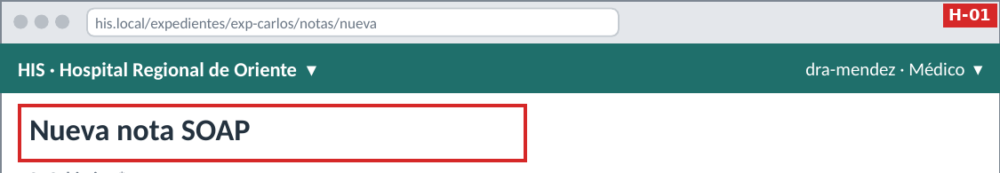

| | |
|---|---|
| Heurística / WCAG | N5 Prevención de errores · N1 · WCAG 3.3.4 |
| Qué pasa | W1 muestra expediente y episodio, pero W2 y W4 solo dicen «Nueva nota SOAP» y «Corregir nota». Con varias pestañas abiertas, nada en la pantalla confirma el paciente. Contradice el principio P-6 de la propia especificación. |
| Por qué importa | Una nota y su diagnóstico guardados en el expediente de otro paciente. El servidor valida acceso y expediente abierto, pero no puede saber que el médico se equivocó de paciente. |
| Severidad × impacto | 4 × 3 = **12 · P1** |

### H-02 · El diálogo de firma no dice qué nota ni de qué paciente — W3

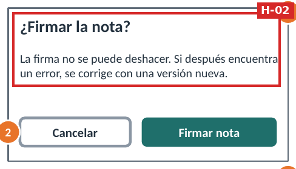

| | |
|---|---|
| Heurística / WCAG | N5 · WCAG 3.3.4 Prevención de errores |
| Qué pasa | «¿Firmar la nota?» explica la consecuencia, pero no identifica la nota (versión, fecha, paciente, diagnóstico). |
| Por qué importa | La firma es irreversible (R-07). Firmar la versión o el paciente equivocado obliga a una corrección que queda para siempre en el expediente. |
| Severidad × impacto | 3 × 3 = **9 · P1** |

### H-03 · La versión corregida y los encabezados de la tabla tienen poco contraste — W1

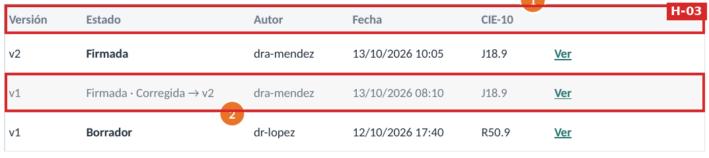

| | |
|---|---|
| Heurística / WCAG | WCAG 1.4.3 · N1 |
| Qué pasa | El gris `#6B7785` da 4.21:1 sobre el encabezado y 4.26:1 sobre la fila corregida (C-01, C-02). El mínimo es 4.5:1. |
| Por qué importa | «Corregida → v2» es lo que avisa que esa versión ya no es la vigente. Si no se lee, alguien puede tomar decisiones con la nota vieja. |
| Severidad × impacto | 3 × 3 = **9 · P1** |

### H-04 · La etiqueta «Borrador» tiene poco contraste — W3

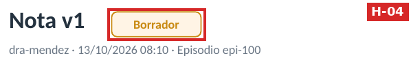

| | |
|---|---|
| Heurística / WCAG | WCAG 1.4.3 · N1 |
| Qué pasa | Ámbar `#C98A12` sobre `#FFF4E5`: 2.71:1 (C-03). |
| Por qué importa | Distinguir borrador de firmada decide si la nota ya es parte oficial del expediente. |
| Severidad × impacto | 3 × 3 = **9 · P1** |

### H-05 · Al corregir no queda claro qué se puede editar ni qué cambió — W4

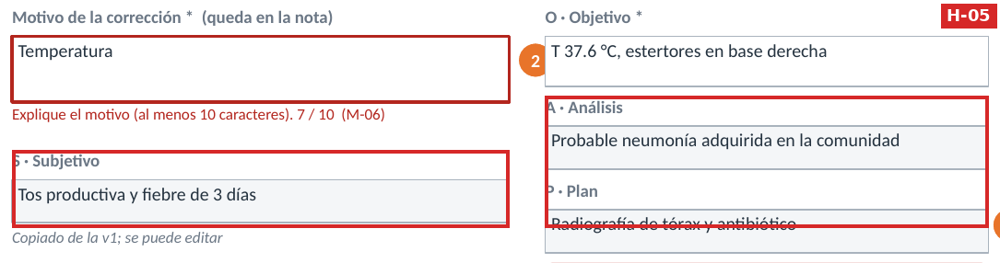

| | |
|---|---|
| Heurística / WCAG | N4 Consistencia · N5 · N1 |
| Qué pasa | S, A y P se dibujan con fondo gris, como solo lectura, pero la anotación 3 dice que se pueden editar. Tampoco hay forma de ver la diferencia con la versión anterior antes de guardar. |
| Por qué importa | El médico puede creer que solo corrigió «O» cuando cambió más, o no corregir una sección porque parecía bloqueada. La corrección queda firmada después. |
| Severidad × impacto | 3 × 3 = **9 · P1** |

### H-06 · El código CIE-10 se escribe a mano — W2, W4

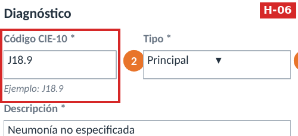

| | |
|---|---|
| Heurística / WCAG | N6 Reconocer antes que recordar · N5 |
| Qué pasa | Se valida el formato (`J18.9`), pero un código bien escrito y equivocado (`J18.0`) pasa sin aviso. La descripción se escribe aparte y puede no coincidir con el código. |
| Por qué importa | Un diagnóstico equivocado viaja a Reportes y Prescripciones. Ya estaba anotado como brecha B-2 del contrato. |
| Severidad × impacto | 3 × 3 = **9 · P1** |

### H-07 · «Acceso denegado» no define foco ni título de página — W5

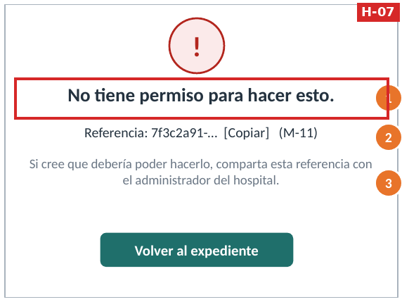

| | |
|---|---|
| Heurística / WCAG | WCAG 2.4.2 · 2.4.3 · 4.1.3 |
| Qué pasa | I-09 define `role="alert"`, pero no dónde queda el foco al llegar a W5 ni el título del documento en la SPA. |
| Por qué importa | Un usuario de lector de pantalla no encuentra la referencia que debe compartir. |
| Severidad × impacto | 3 × 2 = **6 · P2** |

### H-08 · No se define cuánto dura el aviso de éxito con «Firmar ahora» — W2

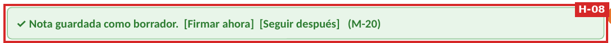

| | |
|---|---|
| Heurística / WCAG | WCAG 2.2.1 Tiempo ajustable · 4.1.3 |
| Qué pasa | M-20 tiene dos botones. Si se implementa como un aviso que desaparece solo, con teclado no se alcanza a llegar. |
| Por qué importa | «Firmar ahora» es el camino corto para no dejar notas en borrador. |
| Severidad × impacto | 3 × 2 = **6 · P2** |

### H-09 · Los bordes de los campos casi no se ven — W2, W4

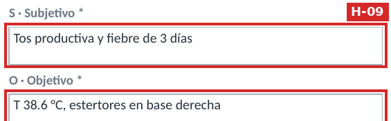

| | |
|---|---|
| Heurística / WCAG | WCAG 1.4.11 Contraste de no texto |
| Qué pasa | Borde `#A9B3BD`: 2.13:1 (C-04); el mínimo es 3:1. |
| Por qué importa | Cuesta ver dónde escribir cada sección, sobre todo en pantallas de hospital con brillo bajo. |
| Severidad × impacto | 3 × 2 = **6 · P2** |

### H-10 · La sesión puede expirar mientras el médico escribe — W5 (M-12)

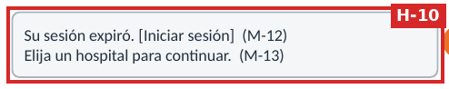

| | |
|---|---|
| Heurística / WCAG | WCAG 2.2.1 Tiempo ajustable · N3 |
| Qué pasa | M-12 aparece cuando ya expiró. No hay aviso antes ni forma de extender la sesión, y no se dice si el borrador sobrevive al nuevo inicio de sesión. |
| Por qué importa | Una nota larga escrita entre pacientes se pierde y hay que rehacerla de memoria. |
| Severidad × impacto | 3 × 2 = **6 · P2** |

### H-11 · Cerrar la pestaña pierde el borrador sin aviso — W2

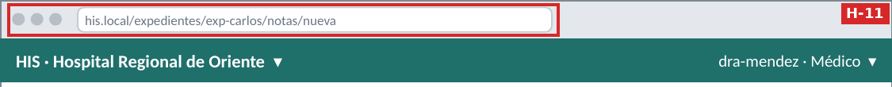

| | |
|---|---|
| Heurística / WCAG | N3 Control y libertad · N5 |
| Qué pasa | D-5 decide, con razón, no guardar el texto clínico en el navegador. Pero no se pide confirmación al cerrar o salir con cambios sin guardar. |
| Por qué importa | Pérdida de trabajo clínico por un clic. |
| Severidad × impacto | 3 × 2 = **6 · P2** |

### H-12 · Con errores al guardar, el foco no va al primero — W2

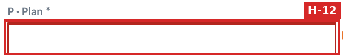

| | |
|---|---|
| Heurística / WCAG | WCAG 3.3.1 · 2.4.3 · N9 |
| Qué pasa | M-01 aparece junto al campo, pero el foco se queda en «Guardar borrador» y no hay un resumen de errores. |
| Por qué importa | Con lector de pantalla no se sabe qué falta ni dónde. |
| Severidad × impacto | 2 × 2 = **4 · P3** |

### H-13 · El foco solo engrosa el mismo borde gris — W3

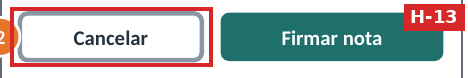

| | |
|---|---|
| Heurística / WCAG | WCAG 2.4.7 Foco visible · 1.4.11 |
| Qué pasa | El foco de «Cancelar» es el borde gris `#8A96A3` más grueso (3.01:1, C-06). Cumple justo, pero se parece al estado normal. |
| Por qué importa | En el diálogo de firma hay que saber con certeza qué botón se va a activar. |
| Severidad × impacto | 2 × 2 = **4 · P3** |

### H-14 · «Guardando…» apenas se lee y no se anuncia — W2


| | |
|---|---|
| Heurística / WCAG | N1 · WCAG 4.1.3 |
| Qué pasa | El botón inactivo da 2.58:1 (C-05; está exento por inactivo), pero es el único aviso de que se está guardando. No se define `aria-busy` ni un anuncio. |
| Por qué importa | El médico puede creer que no pasó nada y salir de la pantalla. |
| Severidad × impacto | 2 × 2 = **4 · P3** |

### H-15 · La lista muestra solo el código CIE-10, sin la descripción — W1

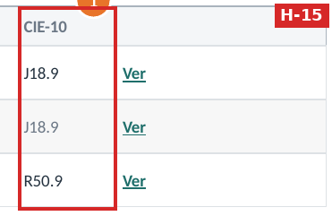

| | |
|---|---|
| Heurística / WCAG | N2 · N6 |
| Qué pasa | «J18.9» sin «Neumonía no especificada». El resumen del contrato solo trae los códigos. |
| Por qué importa | Enfermería tiene que abrir cada nota o recordar códigos para dar seguimiento. |
| Severidad × impacto | 2 × 2 = **4 · P3** |

### H-16 · Tres enlaces «Ver» iguales — W1

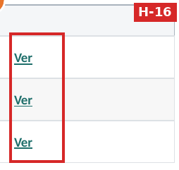

| | |
|---|---|
| Heurística / WCAG | WCAG 2.4.4 Propósito de los enlaces |
| Qué pasa | Un lector de pantalla oye «Ver, Ver, Ver» al recorrer los enlaces. |
| Por qué importa | Poco: el contexto de la fila ayuda, pero la lista de enlaces queda confusa. |
| Severidad × impacto | 2 × 1 = **2 · P3** |

## 5. Fortalezas (se mantienen)

| Aspecto | Evidencia |
|---|---|
| Lo firmado no se edita; la corrección es una versión nueva con motivo | W3, W4 · NS-07 |
| Solo el autor ve «Firmar» y «Corregir»; enfermería solo lee | W1, W3 · NS-03 |
| La lista y la URL no muestran texto clínico | W1 · NS-11 |
| Los errores del servidor no borran lo escrito | W2, W4 · M-05, M-14, M-15 |
| El 403 no revela el motivo y da una referencia y un siguiente paso | W5 · NS-13 |
| Estados con texto, no solo color | W1, W3 · WCAG 1.4.1 |
| Texto, botones, errores y avisos con buen contraste (5.45–13.10:1) | C-09..C-20 |

## 6. Backlog priorizado

Orden: prioridad, luego puntaje y luego esfuerzo. **Esfuerzo:** S cambio de especificación o de estilo; M cambio de interacción o de un componente; L requiere backend.

| # | Hallazgo | P | Puntaje | Esfuerzo | Corrección propuesta | Criterio verificable |
|---|---|---|---:|---|---|---|
| BL-01 | H-01 Paciente no visible | **P1** | 12 | S | Barra fija sobre el formulario de W2 y W4: «Paciente: Carlos R. · Expediente exp-carlos · Episodio epi-100 (abierto)». Se toma de la misma ruta que W1. | **Dado** W2 abierto desde W1, **entonces** la barra muestra el mismo expediente y episodio que W1 y sigue visible al bajar. Prueba de componente. |
| BL-02 | H-02 Firma sin identificar | **P1** | 9 | S | El diálogo dice «¿Firmar la nota v1 del 13/10/2026 de Carlos R. (J18.9)?» antes de la consecuencia. | El texto del diálogo contiene versión, fecha, paciente y código. Prueba de componente. |
| BL-03 | H-03 Versión corregida | **P1** | 9 | S | Gris secundario `#6B7785` → `#5A6472` y etiqueta «Reemplazada por v2» con icono en la fila. | `python herramientas/contraste.py`: C-01 y C-02 CUMPLE y código de salida 0. |
| BL-04 | H-04 «Borrador» | **P1** | 9 | S | Texto `#C98A12` → `#8A6100`. | `contraste.py`: C-03 ≥ 4.5 (5.10 con la propuesta). |
| BL-05 | H-05 Campos al corregir | **P1** | 9 | M | Todos los campos editables con el mismo estilo. Marca «Cambiado» en cada sección modificada y un resumen «Cambia: O · Objetivo» antes de guardar. | **Dado** que solo se cambió O, **entonces** el resumen muestra solo «O · Objetivo». Prueba de componente con las 4 secciones. |
| BL-06 | H-06 CIE-10 a mano | **P1** | 9 | L | Buscador CIE-10 por código o nombre que completa código y descripción juntos. Requiere `GET /catalogos/cie10?q=` (brecha B-2). | **Dado** «neumon», **entonces** la lista muestra J18.9 con su descripción; al elegirla se llenan los dos campos. Prueba e2e. |
| BL-07 | H-07 Acceso denegado | **P2** | 6 | S | Al navegar a W5: `document.title = "Acceso denegado · HIS"`, foco en el `<h1>` y primer `Tab` en «Copiar». Nueva regla I-11. | La prueba e2e comprueba `document.title` y que `document.activeElement` es el `h1`. |
| BL-08 | H-08 Aviso de éxito | **P2** | 6 | S | M-20, M-21 y M-22 persistentes: se cierran con «×» o al iniciar otra acción, nunca con temporizador. | Tras guardar, el aviso sigue visible 60 s después y «Firmar ahora» se alcanza con `Tab`. |
| BL-09 | H-09 Bordes de campo | **P2** | 6 | S | Borde `#A9B3BD` → `#767F8A`. | `contraste.py`: C-04 ≥ 3.0 (4.06). |
| BL-10 | H-10 Sesión | **P2** | 6 | M | Aviso 2 minutos antes de expirar con «Seguir conectado». Si expira, inicio de sesión en un diálogo sin salir de la página, y el borrador se conserva. | **Dado** un borrador escrito, **cuando** la sesión expira y se vuelve a entrar, **entonces** el texto sigue en el formulario. Prueba e2e con un token de vida corta. |
| BL-11 | H-11 Cierre de pestaña | **P2** | 6 | M | Con cambios sin guardar, pedir confirmación al salir de la ruta o cerrar la pestaña (`beforeunload`). | **Dado** W2 con texto, **cuando** se navega a W1, **entonces** aparece la confirmación; sin cambios, no aparece. |
| BL-12 | H-12 Errores al enviar | **P3** | 4 | S | Resumen de errores arriba del formulario con enlaces a cada campo; foco en el resumen. Nota «* obligatorio» al inicio. | Tras enviar con P vacía, el foco está en el resumen y su enlace lleva a «P · Plan». |
| BL-13 | H-13 Foco débil | **P3** | 4 | S | Anillo de foco `#1F6F6B` de 2 px separado del borde. | `contraste.py`: C-06 con la propuesta ≥ 3.0 (5.92). |
| BL-14 | H-14 Botón ocupado | **P3** | 4 | S | Botón teal con indicador giratorio, `aria-busy="true"` y anuncio «Guardando nota…» por `aria-live`. | Durante el guardado, el lector anuncia «Guardando nota…». Prueba de componente. |
| BL-15 | H-15 Solo códigos | **P3** | 4 | L | Mostrar «J18.9 · Neumonía no especificada». Requiere agregar la descripción al resumen del contrato. | La fila de W1 muestra código y descripción; API-01..04 siguen pasando con el contrato actualizado. |
| BL-16 | H-16 «Ver» repetido | **P3** | 2 | S | Nombre accesible «Ver nota v2, firmada, 13/10/2026». | axe-core sin infracciones `link-name` ni enlaces con el mismo nombre y destino distinto. |

### 6.1 Qué cambia en la especificación de la semana 8

| Corrección | Documento afectado |
|---|---|
| BL-01, BL-05 | W2 y W4 |
| BL-02 | Diálogo de W3 |
| BL-07 | Nueva regla I-11 |
| BL-08 | M-20, M-21 y M-22 persistentes |
| BL-10, BL-11 | Ampliar I-07 y D-5 |
| BL-03, BL-04, BL-09, BL-13 | Paleta de colores |
| BL-06, BL-15 | Brechas B-2 y nueva B-6 del contrato |

Esta semana no se modificaron los wireframes: la tarea es evaluar y priorizar. Los criterios de contraste ya se pueden comprobar hoy con el script.

## 7. Limitaciones

- **Se evaluó un diseño, no una implementación.** El contraste es una medición real de los colores definidos; el teclado y el lector de pantalla se evaluaron recorriendo la especificación.
- **Un solo evaluador.** Nielsen recomienda de 3 a 5. Un compañero del grupo podría repetir el checklist.
- **Sin pruebas con usuarios.** Las severidades son juicio del evaluador. BL-01, BL-02 y BL-05 conviene validarlos con médicos y personal de enfermería.
