# Semana 10 — Diseño para movilidad de Notas SOAP

**Estudiante:** Joshua Eduardo García Reyes (`jgarciar73-svg`) · **Módulo:** ASII-11 Notas SOAP y diagnósticos

**Proceso:** «registro de nota SOAP y asociación de diagnóstico clínico», con su firma y su corrección, adaptado a teléfonos de **320 a 430 px**.

**Entregables:**

| Pedido | Dónde |
|---|---|
| Propuesta responsive de 3–5 pantallas | 5 pantallas M1–M5 en un [prototipo HTML/CSS](prototipo/) que se abre en el navegador. Se verificaron 33 vistas en 320, 360, 430, 768 y 1024 px; en [capturas/](capturas/) quedan las que usa este documento. |
| Reglas de breakpoint | §4. Cinco se verifican con un [script](herramientas/verificar-responsive.cjs): [resultado](evidencia/verificacion-responsive.txt). |
| Dos escenarios móviles con decisiones de contenido y error | §9 y §10, con [tiras de capturas](escenarios/) |

## 1. Punto de partida

Este diseño adapta el de la [semana 8](../semana-08/semana-08-ux-notas-soap.md) (W1–W5) y aplica el backlog de la [semana 9](../semana-09/semana-09-evaluacion-ux-notas-soap.md) (§12). No es un rediseño: las reglas I-01..I-10 y D-1..D-7 siguen vigentes.

| Escritorio (semana 8) | Móvil (semana 10) | Cambio principal |
|---|---|---|
| W1 Notas del expediente | **M1** Notas del expediente | La tabla pasa a tarjetas |
| W2 Nueva nota | **M2** Nueva nota en 4 pasos | Un formulario de 7 campos pasa a 4 pasos: S y O · A y P · diagnóstico · revisar |
| W3 Detalle y firma | **M3** Detalle y firma | El diálogo centrado pasa a hoja inferior |
| W4 Corregir | **M4** Corregir | Las secciones que no cambian quedan plegadas; antes de guardar se ve qué cambió |
| W5 Avisos (403, 401) | **M5** Avisos | Referencia en bloques con «Compartir»; aviso antes de que termine la sesión |

**¿Quién usa el teléfono y para qué?**

| Rol | Situación móvil | Tarea móvil prioritaria |
|---|---|---|
| Médico | Pase de visita, de pie junto a la cama, una mano, señal irregular en pasillos | Registrar una nota corta y firmarla; corregir un dato mal anotado |
| Enfermería | Ronda de medicamentos y signos, con prisa | **Leer** la última nota firmada antes de actuar |

**Decisión de alcance.** En el teléfono se trabaja con **un** paciente por vez. Revisar el historial completo de un expediente o comparar muchas versiones queda para escritorio.

## 2. Jerarquía de contenido

- **P1**: visible siempre, incluso a 320 px.
- **P2**: visible desde 320 px, por debajo de P1.
- **P3**: aparece desde 431 px (clase `.extra`) o queda plegado.
- **—**: no se muestra en el teléfono.

| Pantalla | P1 · lo que decide | P2 · lo que explica | P3 · lo que amplía | Fuera del teléfono |
|---|---|---|---|---|
| M1 Notas | Versión; estado con icono + texto; diagnóstico con código **y** descripción; «Ver nota» | Autor y fecha | Episodio y tipo de diagnóstico | Texto S, O, A y P en la lista (D-2) |
| M2 Nueva nota | Paciente; sección del paso; botón del paso | Ayuda del campo; progreso «Paso n de 4» | — | Varias notas a la vez |
| M3 Detalle | Paciente; versión y estado; S, O, A, P; diagnóstico | Autor y fecha | Identificador de la nota | Historial de versiones lado a lado |
| M4 Corregir | Motivo; la sección que cambia, marcada «Cambiado» | Aviso «la versión 1 no cambia» | Las secciones sin cambio, plegadas en `<details>` | — |
| M5 Avisos | Qué pasó; qué hacer; referencia | Por qué no se muestran más datos | — | Rol, permiso o motivo de la denegación (D-1) |

**Lo que el teléfono nunca recorta,** aunque falte espacio:

1. **El hospital activo** (D-6). A 320 px se abrevia («H. R. Oriente»); el nombre completo queda en el `aria-label`.
2. **El paciente, el expediente y el episodio** en toda pantalla de escritura o lectura de una nota (BL-01). Es la barrera contra escribir en el paciente equivocado.
3. **Qué nota se firma**: versión, paciente, fecha y diagnóstico en la hoja de firma (BL-02).
4. **La referencia de una denegación** (D-1).

## 3. Reducción de carga cognitiva

| Técnica | Dónde | Antes (escritorio, semana 8) | Ahora (móvil) |
|---|---|---|---|
| Pocas decisiones por pantalla | M2 | 7 campos a la vez | 4 pasos; el último solo revisa |
| Reconocer en vez de recordar | M2 paso 3 | Escribir «J18.9» de memoria | Buscar «neumon» y elegir de una lista con código y descripción juntos (BL-06) |
| Mostrar solo lo que cambia | M4 | Las 4 secciones abiertas | Se edita O; S, A y P quedan plegadas; el resumen muestra «38.6 → 37.6» (BL-05) |
| Resumen antes de lo irreversible | M2 paso 4, M3 | Firma con «¿Firmar la nota?» | La hoja dice qué nota, de qué paciente y con qué diagnóstico |
| Lenguaje claro | Todas | — | «No sabemos si la nota se guardó» en vez de «Error de red» |
| Acción principal donde está el pulgar | Todas | Botones en el cuerpo | Barra de acción fija abajo |

## 4. Reglas de breakpoint

El CSS es *mobile-first*: la base es 320 px y cada breakpoint **agrega**, nunca quita funciones. Ver [prototipo/estilos.css](prototipo/estilos.css).

| Nombre | Rango | Dispositivo típico | Qué cambia |
|---|---|---|---|
| **XS** (base) | 320–359 px | Teléfono pequeño | Hospital abreviado; una columna; tarjetas; botones a todo el ancho; barra de acción fija; hoja inferior |
| **S** | 360–430 px | Teléfono estándar | Nombre completo del hospital |
| **M** | 431–767 px | Teléfono grande o en horizontal | Aparecen los datos P3 y el rol del usuario; los botones de la hoja quedan en fila |
| **L** | 768–1023 px | Tableta | La acción deja de ser fija; la hoja pasa a diálogo centrado; campos en 2 columnas |
| **XL** | ≥ 1024 px | Escritorio | Las tarjetas vuelven a ser **tabla** (W1) |

### 4.1 Reglas transversales

Las marcadas con ✓ se verifican en las 33 vistas con [herramientas/verificar-responsive.cjs](herramientas/verificar-responsive.cjs).

| ID | Regla | Verificación |
|---|---|---|
| R-B1 | Sin desplazamiento horizontal de 320 px en adelante. | ✓ `scrollWidth − innerWidth ≤ 0` |
| R-B2 | Todo objetivo táctil mide al menos **44 × 44 px**. | ✓ medición de botones, enlaces, campos y opciones |
| R-B3 | Los campos usan letra de **16 px** o más, para que iOS no haga zoom al enfocarlos. | ✓ `font-size` calculado |
| R-B4 | El hospital activo se ve en todas las pantallas y anchos (D-6). | ✓ alto de `.barra .hospital` > 0 |
| R-B5 | La barra del paciente se ve en M1–M4, fija bajo la del hospital (BL-01). | ✓ alto de `.paciente` > 0 |
| R-B6 | La lista es tabla solo desde 1024 px; debajo, una tarjeta por versión. | Capturas `m1-notas-base-320` / `-1024` |
| R-B7 | Firmar se abre como hoja inferior hasta 767 px, con «Cancelar» abajo y con el foco; desde 768 px, diálogo centrado. El fondo queda `inert`. | Capturas `m3-detalle-hoja-firma-360` / `-768` |
| R-B8 | Los datos P3 se ocultan con `display: none`, nunca con texto diminuto. | Revisión de `estilos.css` |

**Resultado:** `Vistas: 33  Fallan: 0`.

## 5. Navegación

| Ancho | Patrón |
|---|---|
| < 1024 px | Barra del hospital (con «←» fuera de M1) + barra del paciente. Sin barra inferior: el módulo tiene una sola sección. |
| ≥ 1024 px | Igual que en escritorio (semana 8) |

- **«←» en M2 y M4** vuelve a M1. Si hay texto escrito, primero pregunta «¿Salir sin guardar?» (BL-11). No se usa `beforeunload`, que los navegadores móviles no respetan siempre.
- **«Atrás» en M2** va al paso anterior sin perder lo escrito.
- **Rutas protegidas.** Si enfermería abre por enlace la ruta de M2 o M4, va a M5 con la referencia (D-1).

## 6. Tablas, formularios y confirmaciones

**Tabla → tarjetas (M1).** Cada versión es una tarjeta: versión y estado en la primera línea, diagnóstico con descripción (BL-15) en la segunda, autor y fecha, y «Ver nota» a todo el ancho con un nombre accesible que dice qué versión abre (BL-16). La versión reemplazada dice «⟲ Reemplazada por v2» con contraste suficiente (BL-03).

**Formularios (M2, M4).** Una columna; etiqueta siempre visible; «* obligatorio» al inicio; ayuda debajo del campo; error junto al campo al salir de él o al guardar (I-04), y, al guardar, un resumen arriba con un enlace a cada dato que falta (BL-12).

**Diagnóstico (M2 paso 3).** Campo de búsqueda con `role="combobox"` y lista `listbox`. El código y la descripción se eligen juntos (BL-06). Depende de B-2.

**Confirmaciones:**

| Acción | Confirmación móvil | Por qué |
|---|---|---|
| Registrar (M2) | Paso 4 completo: paciente, S, O, A, P y diagnóstico | Última revisión antes de guardar |
| Firmar (M3) | Hoja inferior: «¿Firmar la nota versión 1 de Carlos R.?», con fecha y diagnóstico; foco en «Cancelar» (I-05) | Es irreversible (BL-02) |
| Corregir (M4) | «Revisar cambios» muestra solo lo que cambia y el motivo | Una corrección es una versión nueva para siempre |
| Compartir referencia (M5) | Hoja nativa del sistema; el texto lleva solo la referencia y el hospital | Puede salir por WhatsApp o correo: nunca datos del paciente |

## 7. Recuperación ante conexión limitada

### 7.1 Estados de la red

| Estado | Cuándo | Qué ve el usuario |
|---|---|---|
| Normal | Respuesta en menos de 2 s | Nada |
| **Lenta** | 2 s sin respuesta | Barra amarilla «Conexión lenta. Seguimos intentando.»; el botón sigue en «Guardando nota…» con `aria-busy` (BL-14) |
| **Sin conexión** | `navigator.onLine = false` o falla de red | Barra oscura con «Reintentar». La lista muestra lo último cargado y su antigüedad. «+ Nueva nota · requiere conexión» queda deshabilitado con motivo. |
| **Resultado incierto** | Se envió una escritura y no llegó respuesta | «No sabemos si la nota se guardó», lo que se envió y la acción segura (§7.3) |

### 7.2 Tiempos y reintentos

| Operación | Tiempo límite | Reintento automático | Reintento manual |
|---|---|---|---|
| Lecturas: lista y detalle | 8 s | 1, tras 1 s | Sí |
| Registrar | 15 s | **Nunca** | «Reintentar» con la **misma** `Idempotency-Key` (I-02) |
| Firmar | 15 s | **Nunca** | «Consultar estado de la nota» (I-06) |
| Corregir | 15 s | **Nunca** | «Consultar estado de la nota» (I-06) |

Los tiempos son mayores que en escritorio porque un teléfono con mala señal tarda segundos. Las escrituras nunca se repiten sin que el médico lo decida.

### 7.3 ¿Es seguro reintentar? Medido, no supuesto

Se envió dos veces la misma solicitud al kernel del Micro-HIS, como haría un teléfono que no recibió la primera respuesta, y se contaron las notas guardadas ([herramientas/reintento.php](herramientas/reintento.php), [salida](evidencia/reintento.txt)):

```text
Registrar sin Idempotency-Key  1.er envío: 201  reintento: 201 otra nota          notas nuevas: 2  → NO SEGURO (duplica la nota)
Registrar con Idempotency-Key  1.er envío: 201  reintento: 201 misma nota         notas nuevas: 1  → SEGURO
Firmar                         1.er envío: 200  reintento: 409 nota_firmada       notas nuevas: 0  → SEGURO
Corregir nota firmada          1.er envío: 201  reintento: 409 nota_ya_corregida  notas nuevas: 1  → SEGURO
```

Esto lleva a las reglas móviles:

| ID | Regla |
|---|---|
| R-M1 | Ninguna escritura se reintenta sola. |
| R-M2 | Sin conexión se puede **leer** lo ya cargado (en memoria de la pantalla) pero no escribir: las acciones dicen «requiere conexión». |
| R-M3 | Nada clínico se guarda en el teléfono (D-5): ni `localStorage`, ni caché sin conexión de respuestas con texto S, O, A o P. |
| R-M4 | «Resultado incierto» dice qué se envió y ofrece la acción que la medición mostró segura. |
| R-M5 | Registrar **siempre** lleva `Idempotency-Key`. Se genera al llegar al paso 4 y se conserva hasta recibir 201. |
| R-M6 | Un 409 que responde a un reintento propio se **interpreta**: `nota_firmada` → se muestra la nota firmada; `nota_ya_corregida` → se abre la corrección y se compara con lo enviado antes de decir «su corrección sí llegó». |

R-M6 compara antes de afirmar porque la corrección pudo hacerla el mismo médico desde otro equipo. Esto no cierra B-3.

### 7.4 Lo que el diseño **no** hace sin conexión, a propósito

| No se hace | Por qué |
|---|---|
| Guardar notas en cola para enviarlas «cuando vuelva la red» | La nota debe quedar en el episodio y con la hora en que el médico decidió guardarla. Enviada más tarde, el episodio pudo cerrarse (M-05). |
| Firmar sin conexión | La firma es irreversible y la valida el servidor (R-07). |
| Mostrar «acceso denegado» sin conexión | El 403 solo lo da el servidor. Sin red, el mensaje es «requiere conexión». |

## 8. Las 5 pantallas

### M1 · Notas del expediente

| 320 px | Sin conexión | 1024 px |
|---|---|---|
| 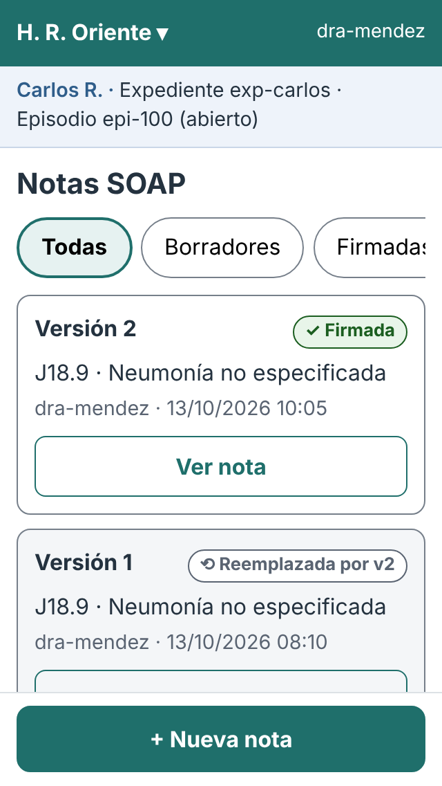 | 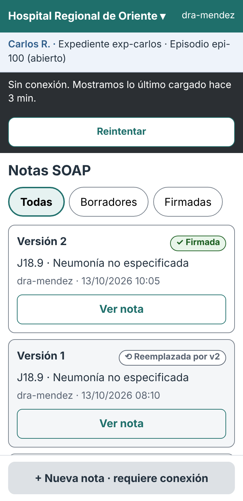 | 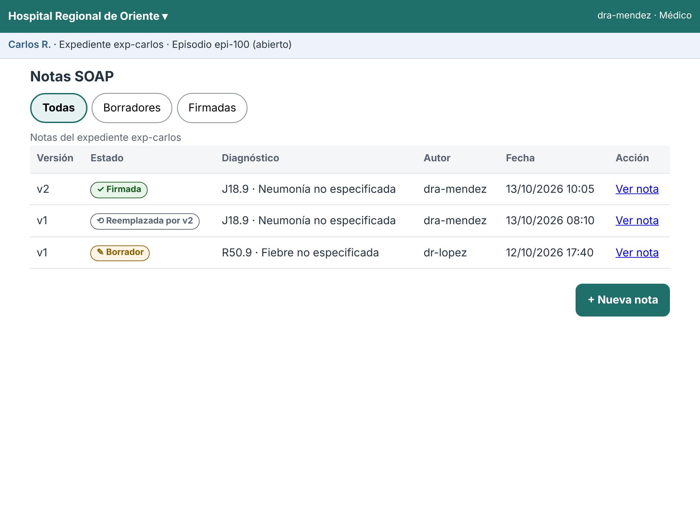 |

Enfermería ve la misma lista sin «+ Nueva nota» (escenario 1).

### M2 · Nueva nota en 4 pasos

| Paso 1 · S y O | Paso 3 · diagnóstico (320 px) | Errores |
|---|---|---|
| 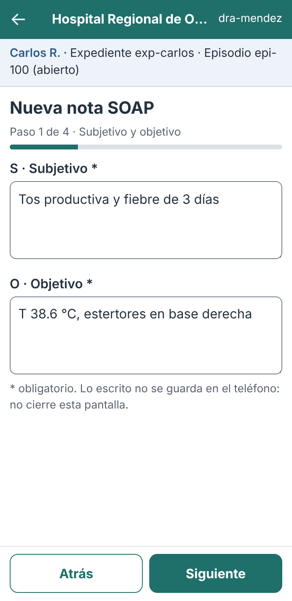 | 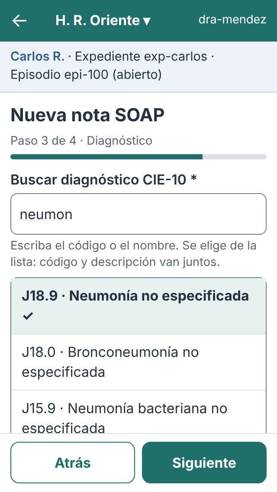 | 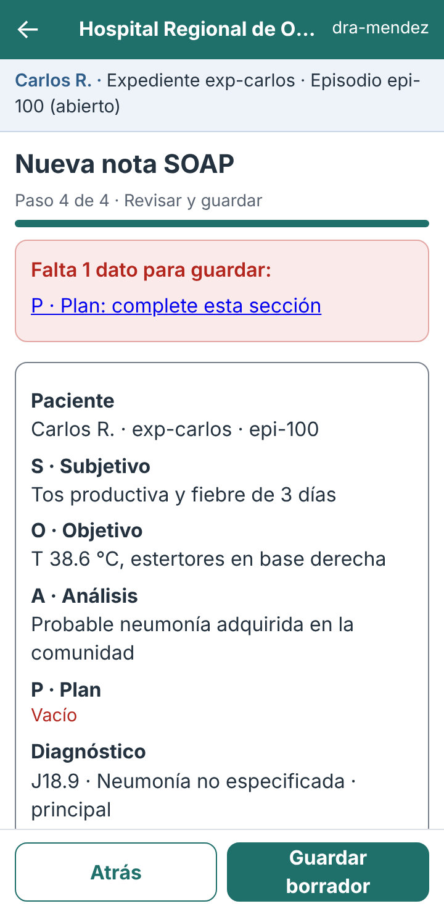 |

Los estados de guardado, resultado incierto y nota guardada están en el escenario 2.

### M3 · Detalle y firma

| Hoja de firma 360 px | 768 px (diálogo) |
|---|---|
| 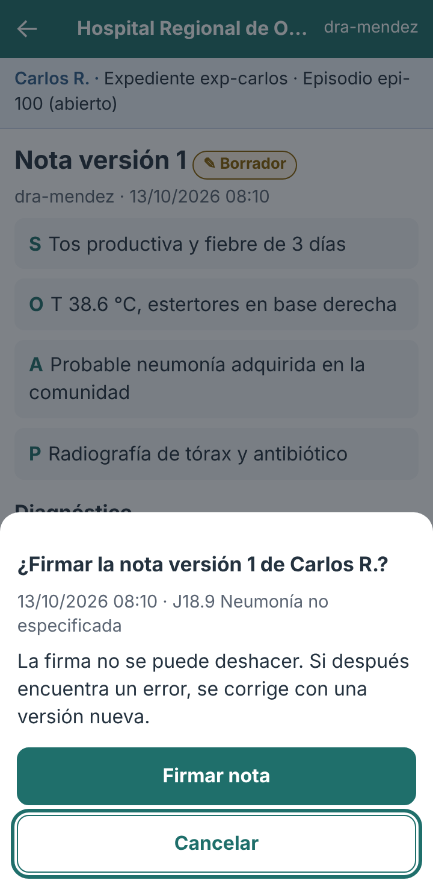 | 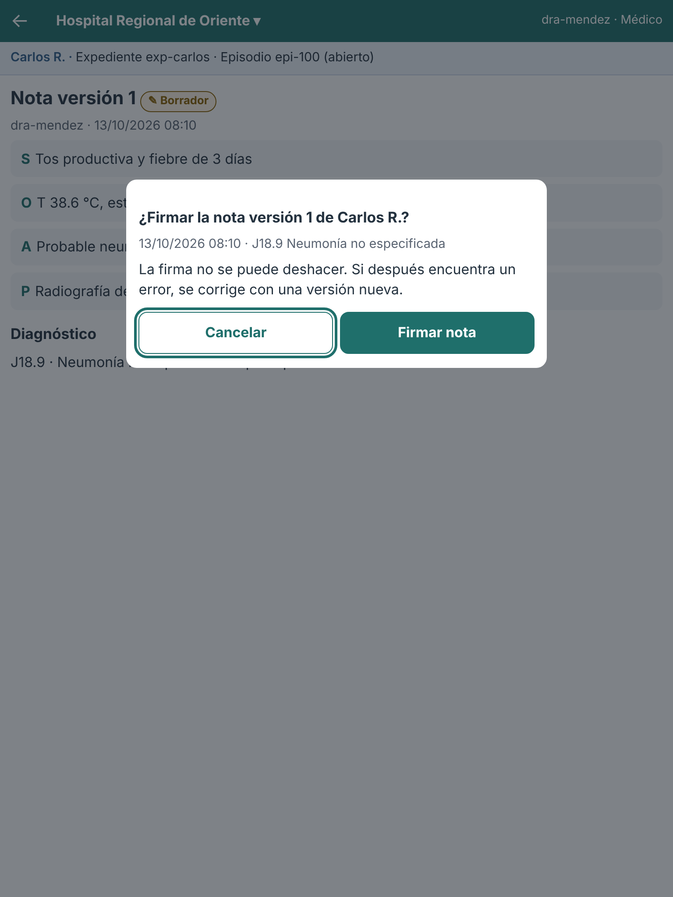 |

### M4 · Corregir

| Editar | Revisar cambios | Ya corregida (M-07) |
|---|---|---|
| 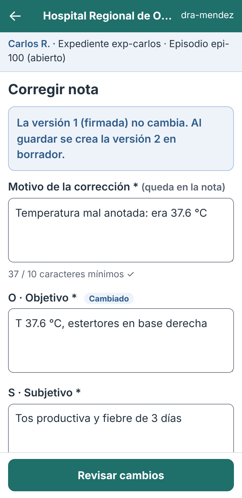 | 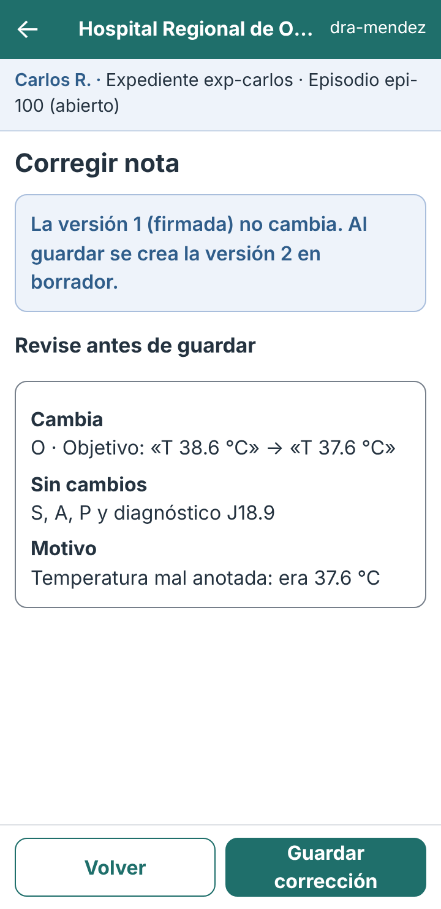 | 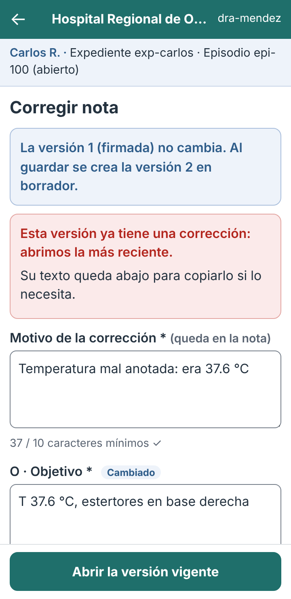 |

### M5 · Avisos

| 403 (320 px) | Sesión por terminar |
|---|---|
| 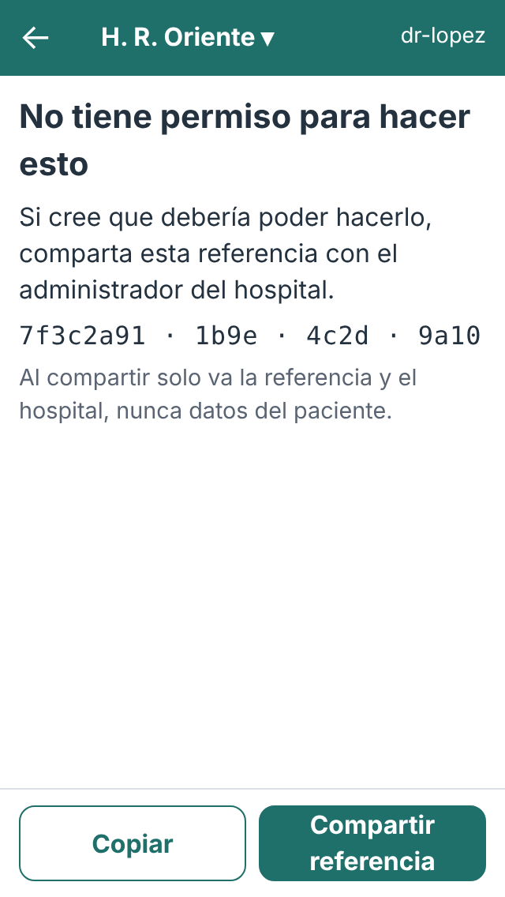 | 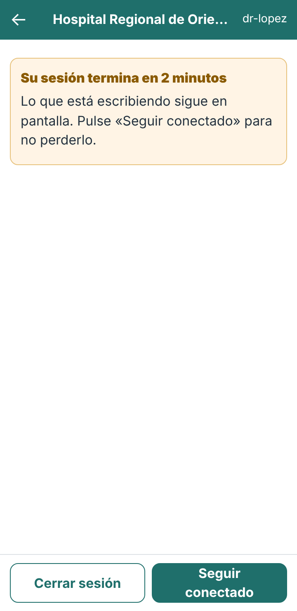 |

El título de la página cambia y el foco va al encabezado del aviso (BL-07). La referencia va en bloques de 4 a 8 caracteres para dictarla por teléfono.

## 9. Escenario 1 · Ana, enfermera en ronda, con señal intermitente

**Contexto.** Teléfono de 360 px, una mano, pasillo con señal irregular. Antes de dar el antibiótico, Ana quiere leer la última nota de Carlos R.

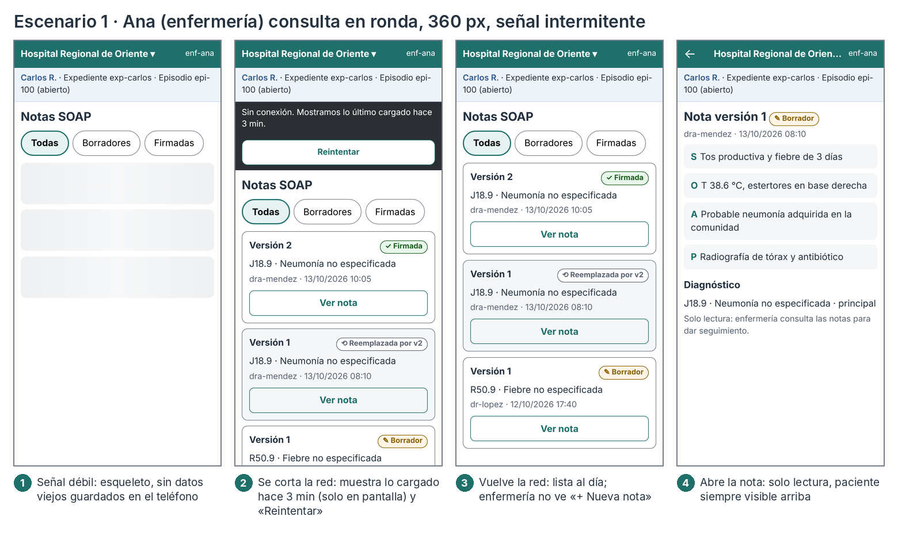

| # | Lo que pasa | Decisión de contenido | Decisión de error |
|---|---|---|---|
| 1 | Abre la lista con señal débil | Esqueleto con `aria-busy`; hospital y paciente ya visibles | No se muestran notas de una visita anterior: no hay copia en el teléfono (R-M3) |
| 2 | Se corta la red | Se mantiene lo cargado hace 3 min, con su antigüedad escrita | Barra «Sin conexión» con «Reintentar»; un reintento automático de lectura (§7.2) |
| 3 | Vuelve la red | Lista al día: v2 firmada arriba, v1 «Reemplazada por v2» | Enfermería no ve «+ Nueva nota» (R-02); no hay botón deshabilitado que confunda |
| 4 | Abre la nota | Solo lectura; el paciente sigue arriba y el diagnóstico lleva su descripción | Si la nota ya no existe: M-10 y vuelta a M1 |

**Qué demuestra:** enfermería puede consultar con señal mala sin que el teléfono guarde texto clínico, y siempre sabe de qué paciente es la nota.

## 10. Escenario 2 · Dra. Méndez registra y firma con red lenta

**Contexto.** Pase de visita, teléfono de 320–360 px, datos móviles lentos. Registra la nota de Carlos R. y la firma.

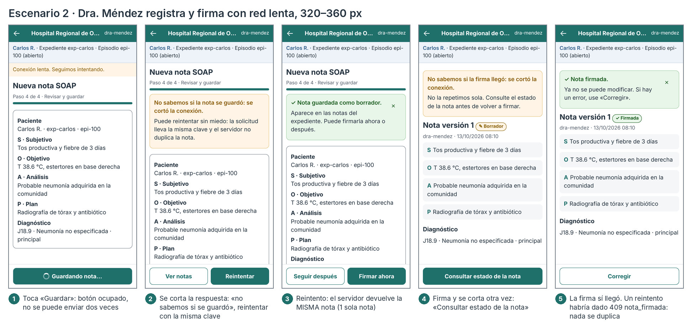

| # | Lo que pasa | Decisión de contenido | Decisión de error |
|---|---|---|---|
| 1 | Pulsa «Guardar» en el paso 4 | El resumen sigue visible; el botón dice «Guardando nota…» | Botón ocupado (I-01); a los 2 s, «Conexión lenta» |
| 2 | La respuesta no llega | «No sabemos si la nota se guardó» y por qué reintentar es seguro | Sin reintento automático (R-M1); botones [Ver notas] [Reintentar] |
| 3 | Reintenta | «Nota guardada como borrador», aviso con «×» que no se cierra solo (BL-08) | La misma clave devuelve la **misma** nota: no hay duplicado (§7.3) |
| 4 | Firma y se corta otra vez | «No sabemos si la firma llegó» | No se ofrece «Firmar» otra vez: solo «Consultar estado» (I-06) |
| 5 | Consulta | La nota aparece firmada, con «Corregir» | Si hubiera reintentado, el 409 `nota_firmada` se muestra como «ya estaba firmada» (R-M6) |

**Variante sin clave.** Si la app no mandara `Idempotency-Key`, el paso 3 crearía una segunda nota (§7.3). Por eso R-M5 es obligatoria.

## 11. Trazabilidad

| Pantalla móvil | Escritorio | Endpoint | Casos de uso / reglas |
|---|---|---|---|
| M1 | W1 | `GET /expedientes/{id}/notas-soap` | CU-04 · R-01, R-07 · D-2 |
| M2 | W2 | `POST /notas-soap` (+ *B-2* catálogo CIE-10) | CU-01 · R-01..R-06 · I-02 |
| M3 | W3 | `GET /notas-soap/{id}`, `POST …/firma` | CU-03, CU-04 · R-07 · I-05, I-06 |
| M4 | W4 | `POST …/correcciones` | CU-06 · R-02, R-03, R-07 |
| M5 | W5 | Cualquier ruta | CU-05 · D-1 |

## 12. Backlog de la semana 9 aplicado

| Ítem | Aplicado | Cómo |
|---|---|---|
| BL-01 Paciente visible | ✓ | Barra fija del paciente en M1–M4 (R-B5) |
| BL-02 Firma identificada | ✓ | La hoja nombra versión, paciente, fecha y diagnóstico |
| BL-03 / BL-04 / BL-09 Contraste | ✓ | `--secundario: #5A6472`, `--borrador: #8A6100`, `--borde: #767F8A` |
| BL-05 Marcar cambios | ✓ | «Cambiado» en la sección y resumen «antes → después» |
| BL-06 Buscador CIE-10 | ✓ (diseño) | Combobox en M2 paso 3. Requiere B-2. |
| BL-07 403 con foco y título | ✓ | `<title>` propio y `tabindex="-1"` en el encabezado |
| BL-08 Aviso persistente | ✓ | Avisos de éxito con «×», sin temporizador |
| BL-10 Aviso de sesión | ✓ | M5: 2 minutos antes, «Seguir conectado» |
| BL-11 Confirmar al salir | Diseño (§5) | No se dibujó la hoja de confirmación |
| BL-12 Resumen de errores | ✓ | M2 «errores» con un enlace a cada dato que falta |
| BL-13 Foco visible | ✓ | Contorno teal de 3 px con `:focus-visible` |
| BL-14 Guardando anunciado | ✓ | `aria-busy` en el botón |
| BL-15 Descripción en la lista | ✓ | «J18.9 · Neumonía no especificada» |
| BL-16 Nombre de «Ver» | ✓ | `aria-label="Ver nota versión 2, firmada, 13/10/2026"` |

## 13. Brechas

| ID | Brecha | Nueva | Afecta |
|---|---|---|---|
| B-1 | La API devuelve el identificador del médico, no su nombre | No (semana 8) | M1, M3 muestran «dra-mendez» |
| B-2 | No hay catálogo CIE-10 consultable | No (semana 8) | Buscador de M2 paso 3 |
| B-3 | La corrección no acepta `Idempotency-Key` | No (semana 8) | El reintento es seguro por `UNIQUE(supersedes_id)`, pero devuelve 409 y la app debe interpretarlo (R-M6) |
| **B-6** | `Idempotency-Key` es opcional al registrar | **Sí** | Un cliente que la olvide duplica notas (medido en §7.3). Propuesta: exigirla en la próxima versión de la API. |

## 14. Verificación y limitaciones

```bash
cd docs/modulos/notas-soap-diagnosticos/semana-10
php herramientas/reintento.php                   # 4 casos; uno NO SEGURO (registrar sin clave)
npm install --no-save playwright-core            # una vez
node herramientas/verificar-responsive.cjs prototipo capturas
# → Vistas: 33  Fallan: 0
```

Para ver el prototipo, abrir `prototipo/m1-notas.html` en el navegador con el modo de dispositivo (F12). Los estados se eligen con `?estado=`, por ejemplo `m2-nueva-nota.html?estado=incierto`. El script regenera las 33 capturas; en el repositorio quedan solo las que usa este documento.

**Limitaciones:**

- **Navegador emulado.** Las capturas salen de Chromium con viewport emulado, no de teléfonos reales.
- **Prototipo estático.** No hace llamadas de red: los estados se muestran con `?estado=`. Los tiempos de §7.2 son una especificación, no una medición.
- **Sin lector de pantalla.** No se probó con VoiceOver ni TalkBack.
- **Datos de ejemplo.** Carlos R. y sus datos clínicos son ficticios, los mismos de `config/datos-demo-memoria.php`.
