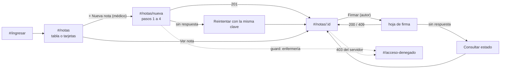

# Semana 11 — Prototipo navegable desktop y móvil de Notas SOAP

**Estudiante:** Joshua Eduardo García Reyes (`jgarciar73-svg`) · **Módulo:** ASII-11 Notas SOAP y diagnósticos · **Flujo:** registro de nota SOAP con diagnóstico CIE-10 y su firma.

| Pedido | Dónde |
|---|---|
| Archivo del prototipo | [prototipo/index.html](prototipo/index.html): se abre con doble clic, sin servidor. **Una sola app** para escritorio y teléfono. |
| Capturas del camino feliz y del error crítico (mapa de navegación: §4) | [escritorio](capturas/escritorio/) y [móvil](capturas/movil/) (`cf-*` y `ec-*`) · láminas: [camino feliz](laminas/camino-feliz-movil.png), [error crítico](laminas/error-critico-movil.png) |

Las 28 capturas las toma [herramientas/recorrido.cjs](herramientas/recorrido.cjs), que usa el prototipo como una persona (clics, escritura, teclado) a 1280 y 360 px. En cada paso comprueba el resultado, corre axe-core (WCAG 2.2 AA) y revisa que no haya desplazamiento horizontal: **14 pasos × 2 vistas = 28 comprobaciones, 0 fallas**.

## 1. Qué es

- `index.html` + `app.js` (rutas por hash, guard y pantallas) + `api-simulada.js` (servidor en memoria). Sin dependencias.
- Usa los estilos de la [semana 10](../semana-10/prototipo/estilos.css), sin copiarlos: mismos breakpoints y colores corregidos en la semana 9.
- La API simulada aplica las reglas del Micro-HIS con sus códigos del [contrato](../micro-his-notas-soap/api/openapi.yaml): 401, 403 con referencia, 422 `nota_incompleta` y `diagnostico_invalido`, `Idempotency-Key` que devuelve la misma nota, solo el autor firma y 409 `nota_firmada`.
- Personas: Dra. Méndez y Dr. López (médicos) y Ana Pérez (enfermería, solo lectura). El botón **Demo** tiene «Perder la próxima respuesta» (el servidor procesa, la respuesta no llega) y «Cambiar de persona».

## 2. Camino feliz: registrar y firmar

| # | Qué pasa | Endpoint |
|---|---|---|
| CF-1/2 | La Dra. Méndez entra; la lista es tabla a 1280 px y tarjetas a 360 px | `GET /expedientes/{id}/notas-soap` |
| CF-3/4/5 | Nueva nota en 4 pasos, con el paciente siempre arriba (BL-01); busca «neumon» y elige J18.9 con el teclado (BL-06); revisa el resumen | — |
| CF-6 | «✓ Nota guardada como borrador»; el aviso recibe el foco | `POST /notas-soap` → 201 |
| CF-7/8 | La hoja dice «¿Firmar la nota versión 1 de Carlos R.?», con foco en «Cancelar» y el fondo `inert` (BL-02); queda firmada | `POST …/firma` → 200 |
| CF-9 | Ana lee la nota: solo lectura, sin botones | `GET /notas-soap/{id}` |

## 3. Error crítico: se pierde la respuesta al guardar y al firmar

Es el momento en que el médico **no sabe** qué pasó con un registro clínico: si adivina mal, quedan dos notas iguales o firma a ciegas (semana 10, §7.3).

| # | Qué pasa | Qué comprueba el script |
|---|---|---|
| EC-1 | Sin respuesta al guardar: «No sabemos si la nota se guardó» y «Reintentar» | El aviso tiene el foco; el servidor sí guardó |
| EC-2 | Reintenta con la **misma** `Idempotency-Key` (R-M5): llega la misma nota | Hay **una** nota nueva, no dos |
| EC-3 | Sin respuesta al firmar: solo «Consultar estado de la nota» (I-06) | No existe el botón «Firmar» |
| EC-4 | Consulta: «✓ La firma sí llegó». Un 409 `nota_firmada` se mostraría como «ya estaba firmada» (R-M6) | El aviso lo confirma |
| EC-5 | Ana abre `#/notas/nueva` por URL: el guard muestra «No tiene permiso para hacer esto» (D-1) | Sin datos clínicos en pantalla |

## 4. Mapa de navegación



## 5. Consistencia, accesibilidad y fallo encontrado

- **Mismos nombres en las dos versiones:** roles («Médico», «Enfermería»), estados con icono + texto («✎ Borrador», «✓ Firmada»), diagnóstico siempre con código y descripción (BL-15) y mensajes de la semana 8.
- **Responsive:** en el teléfono la acción va fija abajo y la firma es hoja inferior; desde 768 px, al final del contenido y diálogo centrado.
- **Foco y anuncios:** al cambiar de ruta el foco va al `<h1>` o al aviso y cambia `document.title`; error e incierto con `role="alert"`; éxito persistente con «×» (BL-08); botón ocupado con `aria-busy` (BL-14). El borrador vive en memoria, nunca en el teléfono (D-5).
- **Fallo real.** La primera corrida falló en EC-5: una respuesta que llegaba tarde pintaba la lista encima de «Acceso denegado». Se corrigió en `pedir()`: si la persona ya cambió de pantalla, la respuesta vieja no se pinta.

## 6. Fuera de alcance y limitaciones

- La corrección de una nota firmada no está en el prototipo; su diseño es M4 de la [semana 10](../semana-10/semana-10-movil-notas-soap.md). El catálogo CIE-10 (B-2) está simulado con 5 diagnósticos.
- Servidor simulado (sin red ni base de datos) y sin prueba de paridad respuesta por respuesta con el kernel PHP. Capturas móviles de Chromium emulado; axe no reemplaza un lector de pantalla.

```bash
cd docs/modulos/notas-soap-diagnosticos/semana-11
npm install --no-save playwright-core axe-core@4.10.2
node herramientas/recorrido.cjs "<ruta de chrome>" node_modules/axe-core/axe.min.js   # → Comprobaciones: 28  Fallan: 0
```

## 7. Defensa oral

1. Abrir el prototipo, entrar como Dra. Méndez, registrar en 4 pasos y firmar: el paciente siempre arriba y la hoja nombra la nota.
2. Demo → «Perder la próxima respuesta» → Guardar → Reintentar: una sola nota, por la misma `Idempotency-Key`. Con la firma solo se ofrece «Consultar estado». Cerrar con el recorrido (0 fallas) y el fallo que encontró.
