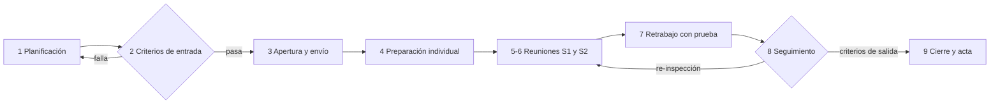

# Plan de la revisión técnica formal — Notas SOAP y diagnósticos

**Autor:** Joshua Eduardo García Reyes · **Proceso revisado:** «registro de nota SOAP y asociación de diagnóstico clínico», con firma y corrección

## 1. Tipo y objetivo

**Inspección** (IEEE 1028): roles separados, preparación individual con checklist, reunión moderada en la que **solo se registran hallazgos**, retrabajo verificado y criterios de entrada y salida. No un *walkthrough*, porque el código decide quién lee y escribe **notas clínicas**: un defecto cuesta caro y la revisión debe dejar evidencia.

| # | Pregunta que debe responder | Ítems |
|---|---|---|
| P1 | ¿Las **reglas de dominio** hacen lo que dicen R-04..R-07 y RF-11..RF-16? | RT-01..RT-03, RT-11 |
| P2 | ¿El **contrato API** describe exactamente el código, sin filtrar datos en los errores? | RT-06, RT-07, RT-12 |
| P3 | ¿**Permisos y hospital** se aplican a toda ruta y a todo dato, con la identidad solo del token? | RT-08..RT-10, RT-15 |
| P4 | ¿Se mantiene la **integridad**: nota + diagnóstico + evento atómicos y bitácora sin texto clínico? | RT-04, RT-05 |
| P5 | ¿Las **dependencias** son solo las necesarias y la regla de capas se cumple? | RT-13, RT-14 |

**Fuera del objetivo:** estilo de código (salvo que oculte un defecto), rendimiento (S15) y UX del prototipo (S9–S12).

## 2. Alcance y paquete

Se congela en un commit (E-1) y se divide en dos sesiones de menos de 1600 líneas efectivas (E-4). [herramientas/criterios-entrada.php](herramientas/criterios-entrada.php) cuenta las líneas.

| Sesión | Contenido (en `micro-his-notas-soap/`) | Archivos | Líneas efectivas | Preguntas |
|---|---|---:|---:|---|
| **S1** · Dominio, aplicación y persistencia | `src/Dominio/**`, `src/Aplicacion/**`, `src/Persistencia/Pdo/*`, `database/schema.sql` | 58 | 1401 | P1, P4 |
| **S2** · Contrato, HTTP, permisos y composición | `src/Presentacion/**`, `api/openapi.yaml`, `bootstrap/contenedor.php`, `config/config.php`, `public/index.php` | 29 | 1482 | P2, P3, P5 |
| **Total** | | 87 | **2883** | |

**Referencia** (se consulta, no se revisa): reglas R-01..R-08 (S1); RF/RNF (S2, S6, S12); matrices de la [S6](../semana-06/matriz-decision-evidencia.md) y la [S12](../semana-12/matriz-decision-rf-rnf-evidencia.md); las pruebas de `tests/` como evidencia; la persistencia en memoria, cubierta por la suite de contrato.

## 3. Roles

| Rol | Quién | Hace | No hace |
|---|---|---|---|
| **Autor** | Joshua Eduardo García Reyes | Congela el paquete, hace la [autorrevisión](autorrevision-autor.md), aclara dudas, hace el retrabajo | No modera, no registra, no defiende ni discute severidades |
| **Moderador** | Compañero/a que no sea el autor *(por confirmar, E-8)* | Verifica la entrada, convoca y envía el material, dirige y controla el tiempo, decide la severidad sin consenso, verifica el retrabajo y firma el acta | No es revisor principal; cubre RT-13 y RT-14 con R3 |
| **Registrador** | Un revisor por turno *(por confirmar)* | Llena en vivo el [registro](plantillas/registro-hallazgos.csv) y el acta | No debate mientras registra |
| **R1** · Seguridad y hospital | *(por confirmar)* | RT-07, RT-08, RT-09, RT-10, RT-15 | — |
| **R2** · Contrato e idempotencia | *(por confirmar)* | RT-06, RT-12 | — |
| **R3** · Dominio e integridad clínica | *(por confirmar)* | RT-01..RT-05, RT-11 | — |

Cada revisor lee **toda** su sesión: un hallazgo fuera de su perspectiva también se registra. Si no hay cinco personas, el moderador puede ser registrador; el autor nunca.

## 4. Proceso y calendario

| Fase | Cuándo | Duración | Quién | Resultado |
|---|---|---|---|---|
| 1. Planificación | D−4 | 30 min | Autor + moderador | Paquete congelado, roles y fechas |
| 2. Entrada | D−3 | 5 min | Moderador | `criterios-entrada.php`: E-1..E-6 PASA |
| 3. Apertura | D−3 | 15 min | Todos | Checklist y formato explicados; material enviado ≥ 48 h antes (E-7) |
| 4. Preparación | D−3 a D−1 | ≤ 2 h por revisor y sesión (150–200 LOC/h) | Revisores | Checklist marcado, hallazgos preliminares y minutos de preparación |
| 5–6. Reuniones | D y D+1 | ≤ 90 min cada una | Todos | Hallazgos con severidad y decisión |
| 7. Retrabajo | D+1 a D+5 | Según hallazgos | Autor | Cada aceptado se corrige **con una prueba** o se rechaza con razón |
| 8–9. Seguimiento y cierre | D+6 | 45 min | Moderador | Criterios de salida, métricas y acta |

## 5. Reglas de la reunión

1. Se revisa el producto, no a la persona.
2. **No se discuten soluciones**: la propuesta se anota en una frase.
3. Se recorre el checklist en orden (RT-01 → RT-15); cada revisor dice sus hallazgos y se registran.
4. Severidad por consenso con el [formato](formato-hallazgos.md#2-severidad); sin consenso en 2 minutos decide el moderador.
5. Los hallazgos de la autorrevisión se confirman, ajustan o rechazan como cualquier otro.
6. Máximo 90 minutos; lo que quede se registra como «no revisado».

## 6. Criterios de entrada

| ID | Criterio | Verificación |
|---|---|---|
| E-1 | Paquete congelado: sin cambios locales en `micro-his-notas-soap/`; se anota el commit | Automática |
| E-2 | Suite sin fallas (`Fallan: 0`) | Automática |
| E-3 | Guardas de contrato (API-01..05) y de capas (ARQ) en verde | Automática |
| E-4 | Cada sesión ≤ 1600 líneas efectivas | Automática |
| E-5 | Checklist de 12–15 ítems y plantilla de hallazgos publicados | Automática |
| E-6 | Autorrevisión del autor registrada | Automática |
| E-7 | Material enviado ≥ 48 h antes | Manual (acta) |
| E-8 | Roles asignados y revisores confirmados | Manual (acta) |

## 7. Criterios de salida y decisión

| ID | Criterio de salida |
|---|---|
| S-1 | Cero hallazgos **críticos** abiertos |
| S-2 | Cada **mayor** corregido y verificado, o con decisión documentada del moderador y un issue con fecha |
| S-3 | Tras el retrabajo: suite con `Fallan: 0` y `redocly lint` válido |
| S-4 | Cada hallazgo corregido tiene su verificación (prueba nueva o comando) |
| S-5 | Métricas calculadas y acta firmada en `semana-13/` |

| Decisión | Cuándo |
|---|---|
| Aceptado | Sin críticos ni mayores |
| Aceptado con condiciones | Sin críticos y hasta 3 mayores; el moderador verifica el retrabajo |
| Re-inspección | Algún crítico, más de 3 mayores o (Críticos + Mayores) > 2 por KLOC; nueva reunión solo sobre lo corregido |

## 8. Métricas y riesgos

**Línea base** (autorrevisión): 6 hallazgos en 2883 líneas, 1 crítico, 1 mayor, 2 menores y 2 observaciones, o sea **1.4 por KLOC** (sin contar observaciones). Si el equipo encuentra más, eso mide el valor de la revisión.

| Riesgo | Mitigación |
|---|---|
| Los revisores no conocen el código | La apertura recorre la matriz de la S12 en 10 minutos; cada ítem dice dónde mirar |
| RT-04 no se prueba de punta a punta sin PostgreSQL (INT-06 omitida) | Se revisa leyendo `PdoTransaccion` y `RegistradorClinico`; queda en el acta para la S15 |
| El paquete cambia antes de la reunión | E-1: si cambia el commit, se vuelve a correr la entrada |
