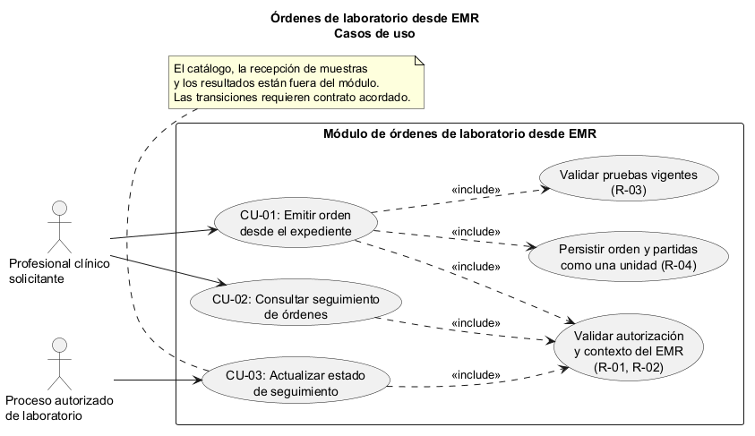
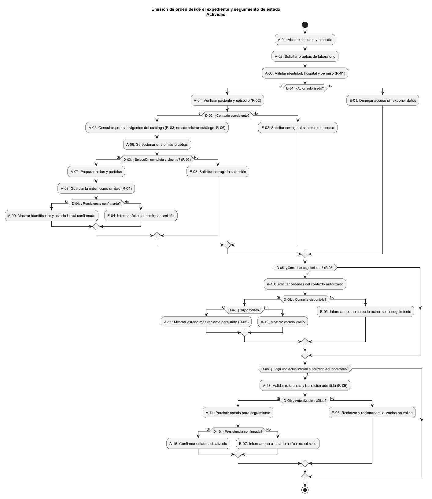
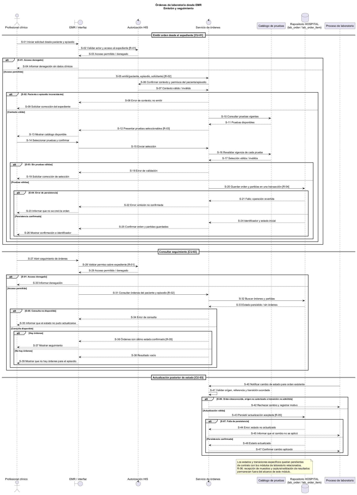

# Semana 1 — Modelado UML de órdenes de laboratorio desde EMR

| | |
|---|---|
| **Curso** | Análisis de Sistemas II — Proyecto Final 2026 |
| **Proyecto** | Sistema Hospitalario Integrado (HIS) |
| **Módulo** | Órdenes de laboratorio desde EMR |
| **Tema de la semana** | Conceptos generales, orientación a objetos y UML |
| **Proceso modelado** | «Emisión de orden desde el expediente y seguimiento de su estado» |
| **Estudiante** | Lopez Perez, Mercedes Azucena |
| **Email** | mlopez58@miumg.edu.gt |
| **Fecha** | Octubre 2026 |

## 1. Introducción

El personal clínico necesita solicitar pruebas de laboratorio desde el expediente electrónico del paciente y luego consultar qué ocurrió con cada solicitud. Una orden debe conservar su relación con el paciente, el episodio de atención, quien la emitió y las pruebas solicitadas. El seguimiento debe mostrar un estado verificable sin confundir la emisión de una orden con la recepción de una muestra ni con la captura o validación de resultados.

Este documento modela el proceso como propuesta académica y presenta tres vistas conectadas:

- **Casos de uso:** actores, objetivos y límites del módulo.
- **Actividad:** decisiones, validaciones, excepciones y resultados posibles.
- **Secuencia:** mensajes entre personal clínico, expediente, autorizador, servicio de órdenes, catálogo y persistencia.

Los identificadores `CU`, `A`, `D`, `E`, `S` y `R` permiten rastrear los casos de uso, actividades, decisiones, excepciones, mensajes y reglas entre las tres vistas. El modelo no afirma que las pantallas, rutas o servicios descritos ya estén implementados.

## 2. Narrativa de alcance

**Objetivo.** Permitir que un profesional clínico autorizado emita desde el expediente una orden asociada al paciente y al episodio de atención correctos, con una o más pruebas de laboratorio válidas, y consulte el estado de seguimiento que el HIS registra para esa orden.

**Escenario de referencia.** La profesional abre el expediente de un paciente durante un episodio de atención. El sistema comprueba su autorización y el contexto del paciente, presenta pruebas vigentes del catálogo y permite seleccionar una o varias. Antes de emitir, valida que la selección esté completa y que el paciente y el episodio sigan siendo consistentes. La orden y sus partidas se guardan como una unidad; si se confirma la operación, el sistema muestra el identificador y el estado inicial. Más adelante, el personal autorizado consulta las órdenes del expediente y ve el estado más reciente disponible. Una falla de autorización, validación, persistencia o consulta se informa como tal y nunca se presenta como éxito.

**Dentro del alcance:**

- iniciar la emisión desde el expediente electrónico y el episodio de atención seleccionado;
- validar acceso, paciente y episodio de atención antes de emitir;
- seleccionar una o más pruebas activas disponibles en el catálogo;
- emitir una orden con sus partidas y conservar la referencia a quien la solicitó;
- consultar las órdenes vinculadas al paciente/episodio y su estado conocido;
- informar validaciones fallidas y fallas técnicas sin confirmar operaciones incompletas.

**Fuera del alcance:**

- crear o mantener pacientes, expedientes, episodios y el catálogo de pruebas;
- definir indicaciones clínicas, criterios diagnósticos o reglas clínicas no especificadas;
- recolectar y recibir muestras, asignarles códigos, procesarlas o registrar resultados;
- validar resultados, generar alertas críticas o gestionar notificaciones;
- definir el contrato final de API, las pantallas, las políticas de permisos o el conjunto definitivo de estados.

**Supuestos y límites del modelo:**

1. El profesional selecciona el paciente desde un expediente y episodio ya existentes; el nombre visible por sí solo no es una clave de asociación suficiente.
2. La aplicación valida que el actor pueda operar en el hospital y consultar el expediente indicado antes de leer o escribir información clínica.
3. Cada orden contiene al menos una partida vinculada a una prueba de laboratorio disponible. Los datos concretos de la prueba los administra el módulo de catálogo.
4. La orden y todas sus partidas deben persistirse de forma atómica: no se debe mostrar una orden emitida si una partida no quedó guardada.
5. El estado inicial y las transiciones definitivas todavía requieren acuerdo con los módulos de catálogo, recepción de muestras, ingreso de resultados y validación bioquímica. En los diagramas, “estado actual” es conceptual; ejemplos como emitida, recibida, en proceso, completada o cancelada no constituyen un contrato aprobado.
6. El diseño del repositorio prevé las entidades `lab_order` y `lab_order_item` dentro de HOSPITAL. No se afirma que el flujo de emisión, el seguimiento, una API o su interfaz estén implementados.

## 3. Actores y sistemas participantes

| Actor / participante | Tipo | Objetivo o responsabilidad |
|---|---|---|
| Profesional clínico solicitante | Primario | Emitir pruebas justificadas para el paciente y episodio seleccionados, y consultar su seguimiento. |
| Servicio de autenticación/autorización del HIS | Soporte externo al límite del módulo | Confirmar identidad, hospital y permisos del actor para el expediente. |
| Expediente médico electrónico (EMR) | Sistema integrado | Proporcionar el paciente y episodio activos desde los que se inicia el flujo. |
| Catálogo de pruebas | Sistema/módulo integrado | Informar pruebas disponibles y vigentes; no se mantiene en este flujo. |
| Servicio de órdenes de laboratorio | Sistema bajo diseño | Validar y coordinar emisión, persistencia y consulta de las órdenes. |
| Repositorio/base HOSPITAL | Persistencia | Guardar órdenes y partidas y devolver el estado registrado. |
| Proceso de laboratorio | Sistema/módulo integrado | Producir actualizaciones de seguimiento a través de los procesos posteriores; no recibe muestras ni captura resultados en este módulo. |

## 4. Diagrama de casos de uso

Fuente editable: [semana-01-casos-de-uso.puml](diagramas/semana-01-casos-de-uso.puml).

## 5. Especificación de casos de uso

### CU-01 — Emitir orden desde el expediente

| Campo | Descripción |
|---|---|
| Actor principal | Profesional clínico solicitante. |
| Objetivo | Crear una orden de laboratorio vinculada al paciente y episodio abiertos en el EMR. |
| Precondición | El actor inició sesión; el paciente y episodio existen y son accesibles en el hospital actual. |
| Disparador | El actor selecciona la opción de solicitar pruebas desde el expediente. |
| Flujo principal | 1. El EMR entrega el contexto del paciente y episodio. 2. El sistema valida identidad, permiso y consistencia del contexto. 3. El sistema consulta las pruebas vigentes. 4. El actor selecciona una o más pruebas y confirma la solicitud. 5. El servicio valida la selección y prepara la orden y sus partidas. 6. El repositorio persiste la orden completa en una transacción. 7. El sistema presenta identificador y estado inicial confirmado. |
| Alternativas y excepciones | Si el actor no tiene permiso, no se lee ni modifica el expediente (E-01). Si el contexto del paciente/episodio no es válido o una prueba ya no está vigente, se solicita corregir la selección (E-02/E-03). Si falla la persistencia, no se comunica que la orden fue emitida (E-04). |
| Postcondición de éxito | Existe una orden persistida con al menos una partida válida, asociada al paciente, episodio y solicitante. |
| Postcondición de falla | No se muestra confirmación de emisión; la interfaz conserva o permite recuperar el contexto sin duplicar silenciosamente la orden. |

### CU-02 — Consultar seguimiento de órdenes

| Campo | Descripción |
|---|---|
| Actor principal | Profesional clínico solicitante. |
| Objetivo | Consultar las órdenes del expediente/episodio y el estado registrado más reciente. |
| Precondición | El actor puede acceder al paciente y al episodio consultados. |
| Disparador | El actor abre la sección de órdenes o solicita actualizar el seguimiento. |
| Flujo principal | 1. El EMR transmite el contexto autorizado. 2. El servicio valida acceso y asociación. 3. El repositorio obtiene las órdenes y partidas del contexto. 4. El servicio entrega el estado almacenado y su referencia temporal si está disponible. 5. La interfaz presenta los resultados diferenciando órdenes sin datos de errores de consulta. |
| Alternativas y excepciones | Si no hay órdenes, se muestra un estado vacío (no un error). Si el actor no tiene permiso, se deniega el acceso (E-01). Si la consulta falla, se informa que no se pudo actualizar y no se presenta un estado desactualizado como actual (E-05). |
| Postcondición | El actor conoce el último estado que pudo verificarse o recibe una notificación clara de que la consulta no pudo completarse. |

### CU-03 — Actualizar estado de seguimiento

| Campo | Descripción |
|---|---|
| Actor principal | Proceso autorizado del módulo de laboratorio. |
| Objetivo | Hacer visible en la orden el cambio de estado producido por un proceso posterior. |
| Precondición | La orden existe y el proceso que reporta la actualización está autorizado e identifica inequívocamente la orden. |
| Disparador | Un proceso posterior notifica un cambio válido del ciclo de laboratorio. |
| Flujo principal | 1. El proceso transmite la referencia de la orden y el estado observado. 2. El servicio verifica origen, asociación y transición admitida según el contrato que se defina. 3. El estado se persiste. 4. La consulta del EMR muestra el nuevo estado registrado. |
| Alternativas y excepciones | Una orden desconocida o transición no permitida se rechaza y se registra para revisión; una falla de persistencia no se comunica como cambio aplicado. Los estados y transiciones concretos son decisiones pendientes de coordinación. |
| Postcondición | El estado aceptado queda disponible para consulta y su origen puede identificarse. |

## 6. Diagrama de actividad

Fuente editable: [semana-01-actividad.puml](diagramas/semana-01-actividad.puml).

La actividad muestra por separado la emisión y la consulta de seguimiento, con excepciones para permiso, contexto, pruebas vigentes, persistencia y disponibilidad de datos.

## 7. Diagrama de secuencia

Fuente editable: [semana-01-secuencia.puml](diagramas/semana-01-secuencia.puml).

La secuencia principal detalla emisión desde el expediente, autorización, validación del catálogo y persistencia transaccional. Un segundo intercambio representa la consulta del estado y distingue el resultado vacío de un error de consulta.

## 8. Reglas y trazabilidad

| Identificador | Regla | Casos de uso | Actividad | Secuencia |
|---|---|---|---|---|
| R-01 | El actor debe estar autenticado y autorizado para el hospital y expediente consultados. | CU-01, CU-02, CU-03 | D-01, E-01 | S-02–S-04, S-28–S-30 |
| R-02 | La orden debe asociarse al paciente y episodio activos; no se permite resolver la relación solo por nombre visible. | CU-01, CU-02 | A-04, D-02, E-02 | S-05–S-09, S-31 |
| R-03 | Para emitir, se requiere al menos una prueba disponible y vigente. | CU-01 | A-05, D-03, E-03 | S-10–S-19 |
| R-04 | La orden y todas sus partidas se confirman como una unidad; una persistencia parcial no es éxito. | CU-01 | A-08, D-04, E-04 | S-20–S-26 |
| R-05 | El seguimiento muestra el último estado persistido conocido y no inventa una transición. | CU-02, CU-03 | A-10–A-15, D-05–D-10, E-05–E-07 | S-32–S-47 |
| R-06 | La creación/mantenimiento del catálogo, recepción de muestras y captura/validación de resultados quedan fuera de este flujo. | CU-01, CU-03 | A-05, A-11, A-13 | S-10, S-40–S-43 y nota de alcance |

| Excepción | Resultado seguro | Caso de uso | Actividad | Secuencia |
|---|---|---|---|---|
| E-01 | Denegar el acceso sin exponer ni modificar datos clínicos. | CU-01, CU-02, CU-03 | D-01 | S-03–S-04, S-29–S-30 |
| E-02 | Solicitar corregir o reabrir el contexto de paciente/episodio; no emitir. | CU-01, CU-02 | D-02 | S-05–S-06 |
| E-03 | No emitir si falta una prueba válida; devolver el motivo de validación. | CU-01 | D-03 | S-08–S-09 |
| E-04 | Informar falla de persistencia sin confirmar la orden. | CU-01 | D-04 | S-10–S-13 |
| E-05 | Informar que el seguimiento no se pudo actualizar; no mostrar un dato fallido como estado actual. | CU-02 | D-06, E-05 | S-32–S-35 |
| E-06 | Rechazar una actualización de estado no autorizada o no admitida por el contrato. | CU-03 | D-08, D-09, E-06 | S-40–S-42 |
| E-07 | Informar que el cambio no se aplicó si falla la persistencia del nuevo estado. | CU-03 | D-10, E-07 | S-43–S-45 |

## 9. Consideraciones y decisiones pendientes

- El diseño federado define `lab_order` y `lab_order_item` entre las entidades previstas para HOSPITAL, pero no prescribe los estados operativos de la orden ni un flujo de usuario.
- Los estados, transiciones y origen de los cambios deben acordarse con los módulos de recepción de muestras, catálogo, ingreso de resultados y validación bioquímica.
- Debe definirse en etapas posteriores el mecanismo de evitar órdenes duplicadas ante un reintento después de una respuesta de red incierta.
- Los detalles de auditoría, autorización, contrato API y presentación deben especificarse antes de la implementación.
- El modelo no agrega datos de paciente ni resultados clínicos al alcance; utiliza referencias del expediente y el estado de las órdenes.

## 10. Conclusión

El proceso propuesto conecta la decisión clínica de solicitar pruebas con la trazabilidad posterior sin mezclar responsabilidades de otros módulos. Sus controles centrales son la autorización y el contexto correcto del expediente, la selección de pruebas disponibles, la persistencia completa de la orden y una consulta de estado que comunica solo lo que se ha confirmado. Los diagramas y reglas dejan identificadas las decisiones pendientes para que la implementación posterior no confunda estados conceptuales con un contrato ya aprobado.

## 11. Referencias del repositorio

1. `README.md`, asignación de módulos y ejercicio individual de Semana 1 para «Órdenes de laboratorio desde EMR».
2. `openspec/changes/postgresql-federated-schema-rebuild/specs/hospital-clinical-schema/spec.md`, inventario previsto de entidades HOSPITAL.
3. `openspec/changes/postgresql-federated-schema-rebuild/design.md`, separación de migraciones y entidades clínicas HOSPITAL.
