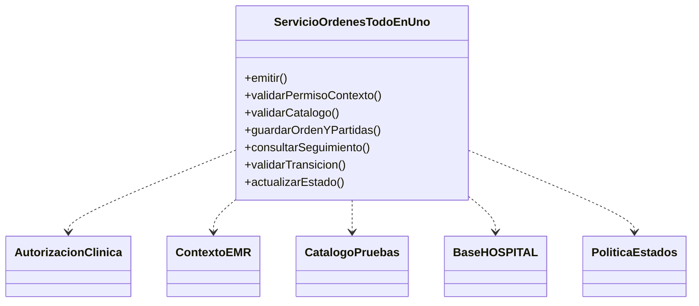
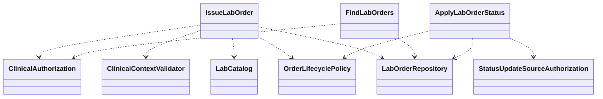

# Semana 2 — Requerimientos y aplicación de SRP a órdenes de laboratorio desde EMR

| | |
|---|---|
| **Curso** | Análisis de Sistemas II — Proyecto Final 2026 |
| **Proyecto** | Sistema Hospitalario Integrado (HIS) |
| **Módulo** | Órdenes de laboratorio desde EMR |
| **Proceso** | Emisión de orden desde el expediente y seguimiento de su estado |
| **Tema** | Proceso y modelo de diseño; principios SOLID |
| **Principio** | SRP — Principio de responsabilidad única |
| **Estudiante** | Lopez Perez, Mercedes Azucena |
| **Fecha** | Octubre 2026 |

## 1. Objetivo y alcance

Esta entrega desarrolla el mismo flujo que Semana 1: el profesional autorizado inicia una orden desde el expediente y episodio activos, selecciona pruebas disponibles, confirma la persistencia de la orden completa y consulta el estado que ha sido confirmado. También separa la actualización de estado recibida desde el proceso de laboratorio.

Se aplica SRP separando casos de uso y adaptadores conforme a sus razones de cambio. El objetivo no es crear una clase por instrucción, sino aislar políticas que evolucionan por motivos distintos: validar una emisión clínica, consultar órdenes, aceptar una actualización de seguimiento y acceder a persistencia/catálogo/autorización.

El ejemplo PHP no es la implementación del HIS: corre sin Laravel ni base de datos, usa adaptadores en memoria y etiquetas de estado sintéticas. No define estados operativos ni transiciones reales. Recepción de muestras, procesamiento, resultados y su validación siguen fuera de alcance, en coordinación con los módulos indicados en Semana 1.

## 2. Requerimientos funcionales

| ID | Requerimiento | Regla Semana 1 |
|---|---|---|
| RF-01 | Permitir iniciar una orden únicamente para el paciente y episodio que el EMR proporciona y que el usuario puede consultar. | R-01, R-02 |
| RF-02 | Rechazar solicitudes incompletas o sin al menos una prueba seleccionada. | R-03 |
| RF-03 | Validar que cada prueba seleccionada esté disponible en el catálogo al momento de emitir. | R-03 |
| RF-04 | Persistir orden y partidas como una unidad y comunicar éxito solo si se confirma la persistencia completa. | R-04 |
| RF-05 | Permitir consultar las órdenes por paciente y episodio, con autorización antes de leerlas. | R-01, R-02 |
| RF-06 | Distinguir «sin órdenes» de una falla de consulta y no presentar una lectura fallida como estado actual. | R-05 |
| RF-07 | Aceptar cambios de seguimiento solo desde un origen autorizado y si el contrato de ciclo de vida acepta la transición. | R-05, E-06 |
| RF-08 | Persistir una actualización de estado confirmada y reportar explícitamente si no se aplicó. | R-05, E-07 |
| RF-09 | Mantener el catálogo, la recepción de muestras y el procesamiento/validación de resultados fuera de este flujo. | R-06 |

## 3. Requerimientos no funcionales

| ID | Atributo | Requerimiento | Verificación |
|---|---|---|---|
| RNF-01 | Mantenibilidad | Emisión, consulta y actualización de seguimiento deben tener responsabilidades de aplicación diferenciadas. | CA-14–CA-16 |
| RNF-02 | Seguridad clínica | Comprobar autorización y contexto antes de consultar o modificar datos de órdenes. | CA-03, CA-10, CA-11 |
| RNF-03 | Integridad | No debe persistir una orden con solo algunas partidas ni confirmar una escritura fallida. | CA-07 |
| RNF-04 | Trazabilidad | Cada orden conserva identificador, referencias de paciente/episodio, solicitante, pruebas y último estado persistido. | CA-01, CA-09 |
| RNF-05 | Veracidad del estado | Mostrar únicamente estado recuperado y confirmado; distinguir lectura vacía, error y dato disponible. | CA-08–CA-10 |
| RNF-06 | Interoperabilidad | La política de transiciones y el estado inicial se inyectan desde el contrato acordado con los módulos relacionados; este ejemplo no lo fija. | CA-11, limitaciones |
| RNF-07 | Testabilidad | Validar reglas mediante dobles, sin requerir datos clínicos ni infraestructura real. | `verificar.php` |

## 4. Criterios de aceptación

Cada criterio se asocia con aserciones automatizadas en [`ejemplo-srp/verificar.php`](ejemplo-srp/verificar.php).

| ID | Requerimiento | Dado | Cuando | Entonces |
|---|---|---|---|---|
| CA-01 | RF-01, RF-04 | contexto autorizado y pruebas disponibles | se emite una orden | se persiste una orden completa ligada a paciente, episodio, solicitante y pruebas |
| CA-02 | RF-02 | la lista de pruebas está vacía o contiene un código vacío | se intenta emitir | se rechaza antes de persistir |
| CA-03 | RF-01, RNF-02 | el actor no está autorizado | intenta emitir | se deniega sin escribir órdenes |
| CA-04 | RF-01 | paciente/episodio no corresponden al contexto del EMR | intenta emitir | se rechaza y no se persiste la orden |
| CA-05 | RF-03 | una prueba no está disponible | intenta emitir | se rechaza la selección completa |
| CA-06 | RF-01, RNF-02 | el actor no tiene acceso al expediente consultado | consulta el seguimiento | se deniega antes de consultar el repositorio |
| CA-07 | RF-04, RNF-03 | el repositorio informa falla al guardar | emite la orden | se reporta falla, no se confirma y no queda escritura parcial |
| CA-08 | RF-05, RF-06 | existen órdenes del paciente y episodio autorizados | consulta seguimiento | se devuelven las órdenes con su estado guardado |
| CA-09 | RF-06 | no existen órdenes para el episodio | consulta seguimiento | se devuelve un resultado vacío, no un error |
| CA-10 | RF-06, RNF-05 | el repositorio no está disponible | consulta seguimiento | se informa indisponibilidad y no se devuelve un estado inventado |
| CA-11 | RF-07, RF-08 | origen autorizado y transición aceptada por política inyectada | llega una actualización | el repositorio persiste y confirma el nuevo estado |
| CA-12 | RF-07 | origen no autorizado o transición no permitida | llega una actualización | se rechaza sin alterar el estado existente |
| CA-13 | RF-08 | la política acepta la transición, pero falla la escritura | llega una actualización | se informa indisponibilidad y conserva el estado previo |
| CA-14 | RNF-01 | se inspeccionan las dependencias de aplicación | se revisa el diseño | emisión, consulta y actualización dependen de contratos distintos según su responsabilidad |
| CA-15 | RNF-01 | el flujo necesita infraestructura | se construye el ejemplo | los casos de uso dependen de interfaces, no de adaptadores concretos |
| CA-16 | RNF-06 | cambia la política acordada de estados | se mantiene la aplicación | el ciclo de vida se inyecta solo donde aplica y no se mezcla con la lectura de seguimiento |

## 5. Aplicación de SRP

Una responsabilidad se entiende como un motivo cohesivo de cambio. En este flujo, las políticas de emisión, lectura de seguimiento y recepción de cambios tienen actores, validaciones y fallos distintos. El acceso al catálogo, la autorización clínica y la persistencia también cambian por necesidades propias de esos componentes.

Las dependencias son contratos explícitos. Los casos de uso coordinan las reglas de su operación; no hablan con SQL, controladores HTTP, pantallas ni detalles de Laravel. La actualización de estado consulta `OrderLifecyclePolicy` en lugar de imponer un conjunto de estados que todavía no se acordó.

## 6. Diseño antes de SRP

El diagrama [`semana-02-clases-antes.puml`](diagramas/semana-02-clases-antes.puml) muestra un servicio monolítico ilustrativo que valida expediente y pruebas, consulta catálogo, escribe orden/partidas, busca seguimiento y acepta transiciones. Una modificación del flujo de autorización o del ciclo de vida puede obligar a tocar la misma clase y dificulta aislar las fallas.

La clase de «antes» es una representación del acoplamiento, no se ejecuta y no describe una clase existente del repositorio.



## 7. Diseño después de SRP

El diagrama [`semana-02-clases-despues.puml`](diagramas/semana-02-clases-despues.puml) separa:

| Componente | Responsabilidad | Razón de cambio |
|---|---|---|
| `IssueLabOrder` | Validar solicitud/contexto/catálogo y coordinar la creación atómica. | Política de emisión desde el EMR. |
| `FindLabOrders` | Autorizar la consulta y devolver órdenes/estados registrados del paciente y episodio. | Reglas de lectura y presentación de seguimiento. |
| `ApplyLabOrderStatus` | Validar el origen y consultar política de transición antes de registrar el cambio. | Contrato de integración y ciclo de vida. |
| `ClinicalAuthorization` | Evaluar permiso del actor para el contexto clínico. | Seguridad/RBAC del HIS. |
| `ClinicalContextValidator` | Confirmar consistencia del paciente y episodio recibidos. | Contrato del EMR. |
| `LabCatalog` | Validar códigos y vigencia de pruebas. | Catálogo clínico. |
| `LabOrderRepository` | Crear orden completa, consultar y guardar actualizaciones. | Persistencia/transacciones. |
| `OrderLifecyclePolicy` | Proveer estado inicial y validar transición según contrato aprobado. | Acuerdo de estados con laboratorio. |

El repositorio de ejemplo implementa varios puertos en un solo adaptador en memoria para facilitar la demostración. Es un **fixture de prueba**, no una recomendación de concentrar esas responsabilidades en producción.



## 8. Trazabilidad con Semana 1

| Referencia Semana 1 | Aplicación SRP | Criterio |
|---|---|---|
| R-01, E-01 — permiso clínico | `ClinicalAuthorization` utilizado por emisión y consulta antes de acceder | CA-03, CA-06 |
| R-02, E-02 — paciente/episodio | `ClinicalContextValidator` valida asociación contextual | CA-04 |
| R-03, E-03 — prueba vigente | `LabCatalog` valida selección justo antes de persistir | CA-02, CA-05 |
| R-04, E-04 — escritura atómica | `LabOrderRepository::createAtomically` devuelve resultado explícito | CA-01, CA-07 |
| R-05, E-05 — último estado confirmado | `FindLabOrders` separa vacío de falla y solo devuelve datos leídos | CA-08–CA-10 |
| R-05, E-06/E-07 — cambio de estado | `ApplyLabOrderStatus` delega transición y persistencia | CA-11–CA-13 |
| R-06 — límites de módulo | Catálogo y proceso posterior son colaboraciones externas | RNF-06, CA-16 |

## 9. Evidencia verificable

Desde la raíz del repositorio:

```bash
php docs/modulos/ordenes-laboratorio-emr/semana-02/ejemplo-srp/verificar.php
```

El comando valida criterios de aceptación con datos sintéticos. La salida real se guarda en [`evidencia/salida-verificar.txt`](evidencia/salida-verificar.txt). Los nombres de estados usados en la prueba tienen prefijo `TEST_` y no constituyen el ciclo de vida acordado para el HIS.

## 10. Límites y decisiones pendientes

- El conjunto de estados, el estado inicial y las transiciones siguen pendientes de acuerdo con los módulos de laboratorio. La política del prototipo usa etiquetas sintéticas solo para probar delegación.
- La garantía de atomicidad corresponde a una futura transacción en el repositorio productivo; el adaptador de memoria permite comprobar el resultado observable, no la integración de PDO.
- El contrato final de autorización, API, identificadores de EMR, auditoría y reintentos/idempotencia no queda definido aquí.
- Recepción de muestras, códigos de muestra, procesamiento, resultados y validación bioquímica permanecen fuera de alcance.
- La evidencia no representa una pantalla, API ni servicio implementado en Laravel.

## 11. Conclusión

SRP da límites claros a emisión, consulta y actualización de seguimiento, manteniendo los detalles de autorización, expediente, catálogo, almacenamiento y ciclo de vida detrás de contratos. Con la separación es posible cambiar una política sin convertir un servicio único en el punto obligado de modificación para todo el flujo. El ejemplo prueba reglas de aplicación y deja explícito que los estados son un contrato pendiente, no un hecho del dominio ya aprobado.

## 12. Referencias

- [Semana 1 — UML de órdenes de laboratorio desde EMR](../semana-01/semana-01-uml-ordenes-laboratorio-emr.md), reglas R-01 a R-06 y excepciones E-01 a E-07.
- Captura de la asignación «Semana 2: Órdenes de laboratorio desde EMR», compartida por la estudiante.
- Robert C. Martin, *Agile Software Development: Principles, Patterns, and Practices*, Single Responsibility Principle.
