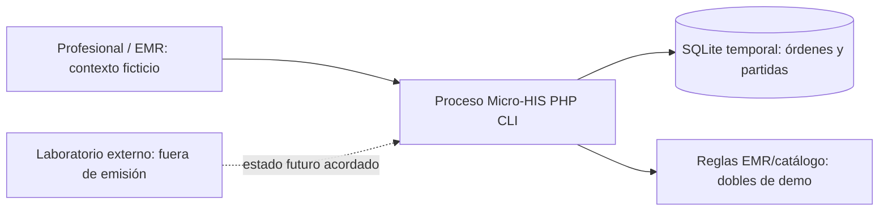
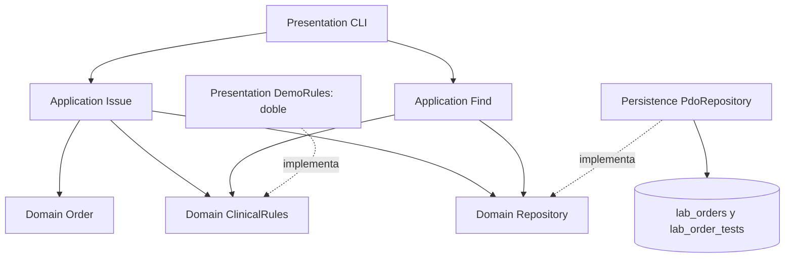
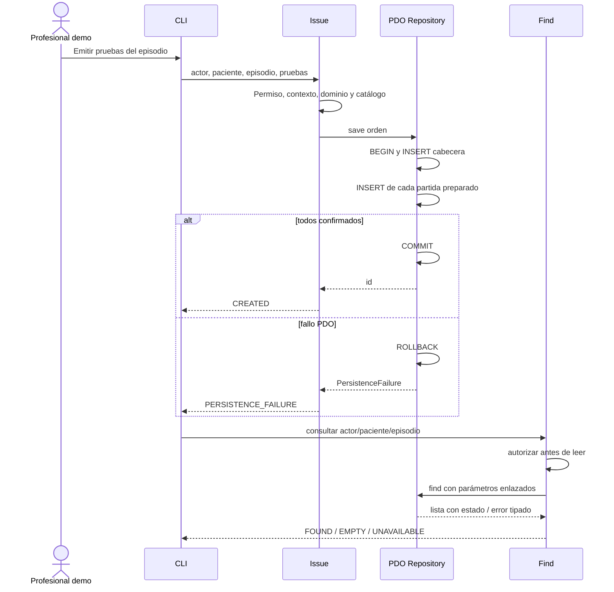

# Semana 3 — Micro-HIS Órdenes de laboratorio desde EMR

**Autora:** Mercedes Azucena Lopez Perez. **Tema:** arquitectura, vistas y patrones. PHP 8.2+ vanilla, PDO SQLite, sin framework ni Composer.

Se continúa el flujo y [RF/RNF de semana 2](../semana-02/semana-02-srp-ordenes-laboratorio-emr.md), base 5dee307: emisión desde paciente/episodio y consulta del estado guardado. Se implementa una composición pequeña ejecutable con persistencia real temporal. Reglas de autorización, contexto, catálogo y estado inicial son de demostración; no se conectan al EMR ni autentican usuarios reales.

## Ejecutar desde raíz

Requisitos: PHP 8.2+ y pdo_sqlite.

```powershell
php docs/modulos/ordenes-laboratorio-emr/semana-03/micro-his/Presentation/cli.php
php docs/modulos/ordenes-laboratorio-emr/semana-03/micro-his/tests/run.php
php docs/modulos/ordenes-laboratorio-emr/semana-02/ejemplo-srp/verificar.php
```

CLI crea SQLite en memoria, emite dos pruebas y consulta el estado persistido; devuelve JSON con CREATED y FOUND. La base desaparece al terminar. No se muestra éxito de almacenamiento durable, servidor HTTP o instalación clínica. Todos los identificadores son ficticios. [Salida CLI](evidencia/cli.txt), [pruebas nuevas](evidencia/pruebas.txt) y [regresión](evidencia/regresion-semana-02.txt).

## Separación por capas

| Capa | Fuente | Razón de cambio |
|---|---|---|
| Presentation | micro-his/Presentation/cli.php y DemoRules.php | Entrada/salida CLI y composición explícita de dobles de reglas. No es fuente de autorización clínica. |
| Application | micro-his/Application/Workflow.php | Issue coordina permiso/contexto/catálogo y persistencia; Find autoriza y consulta. No SQL. |
| Domain | micro-his/Domain/Model.php | Orden inmutable, al menos una prueba no vacía, referencias requeridas, puertos y error tipado. Sin PDO/framework/presentación. |
| Persistence | micro-his/Persistence/PdoRepository.php | SQL parametrizado, transacción orden/partidas, hidratación y traducción de errores PDO. |

Domain no importa ninguna otra capa. Application depende de contratos de Domain. Persistence implementa Repository; Presentation compone aplicación y adaptador. SRP separa emisión, consulta y almacenamiento; DIP orienta dependencias hacia interfaces; Repository aísla SQL. ClinicalRules agrupa reglas externas del contexto solo para este ejemplo acotado; podrá dividirse como los puertos de semana 2 al integrar responsables separados.

## Vista C4: contexto y contenedores



Frontera actual: proceso PHP local y base de prueba. EMR, catálogo e identidad reales siguen fuera y no se simulan como servicios productivos. El seguimiento consulta el último estado guardado, no lo calcula ni actualiza en UI. El laboratorio no se conecta en este ejercicio: semana 2 conserva su ejemplo de política de actualización y conflicto; no se inventa ciclo clínico real.

## Vista UML de componentes y dependencias



Fuente editable: [componentes.puml](diagramas/componentes.puml). Diagramas de contexto y componentes cubren módulo y dependencias; no se afirma haber renderizado PlantUML a PNG.

## Secuencia de emisión y seguimiento



## Persistencia y reglas

schema.sql define cabecera/partidas con clave foránea. SQLite se compone con ERRMODE_EXCEPTION y foreign_keys=ON. DDL es fijo; cada INSERT y SELECT de valores usa prepare/execute, no concatenación de argumentos. save abre transacción propia; el contrato no admite compartirla con otra transacción del llamador. Un fallo revierte cabecera y todas las partidas, sin devolver id de éxito.

El estado inicial lo proporciona ClinicalRules, no una constante clínica en Repository. TEST_INITIAL es etiqueta sintética; no equivale a estado institucional acordado. No se añade recepción, resultado, validación ni cambio de estado público arbitrario. Find devuelve filas persistidas por paciente y episodio, incluye solicitante/pruebas/estado; EMPTY solo si consulta confirmada sin órdenes, UNAVAILABLE ante error.

## Trazabilidad y verificación

| Regla | Evidencia ejecutada |
|---|---|
| RF01 contexto autorizado / RNF02 | Actor no autorizado rechazado; contexto inválido no emite; consulta deniega incluso con base rota. |
| RF02 orden con pruebas | Lista vacía rechazada por dominio. |
| RF03 catálogo vigente | Código desconocido devuelve INVALID_TESTS. Disponibilidad real pendiente. |
| RF04 / RNF03 escritura completa | Trigger real falla al insertar TEST-B; cero cabeceras y cero partidas tras rollback. |
| RF05/06 / RNF05 estado veraz | Consulta FOUND con TEST_INITIAL; EMPTY independiente de UNAVAILABLE al romper tabla. |
| RNF04 trazabilidad | Paciente, episodio, solicitante y ambas partidas recuperados por PDO. No auditoría histórica persistente. |
| RNF01/07 mantenibilidad y pruebas | Cuatro capas, contratos, 19 aserciones nuevas y regresión de semana 2. |
| RF07/08 actualización de laboratorio | No ampliada aquí; referencia al ejemplo verificable de semana 2. No afirmar integración operativa. |

La prueba no infiere atomicidad por nombre de función: provoca un error PDO tras escritura parcial y comprueba rollback. No valida múltiples procesos concurrentes, aislamiento multitenant, JWT, otro motor SQL ni rendimiento. find usa varias lecturas sin snapshot transaccional: coherencia frente a cambios concurrentes de partidas requiere política y prueba adicional antes de producción.

## Límites de integración

No existe autenticación real; actor CLI es dato de fixture, no identidad confiable. Antes de usar contexto real se debe derivar identidad/tenant del mecanismo de seguridad del HIS y validar autorización en servidor. No introducir datos clínicos en esta demo. PDOException conserva causa internamente, pero salida de aplicación no imprime SQL ni stack.

Sin idempotencia de emisión, control de doble envío ni auditoría temporal completa. El caso no rechaza códigos repetidos por regla nueva: preserva requerimientos de base; decisiones adicionales requieren acuerdo. Sin API ni framework; presentación CLI satisface demostración del flujo y ofrece un borde sustituible para futuras vistas.