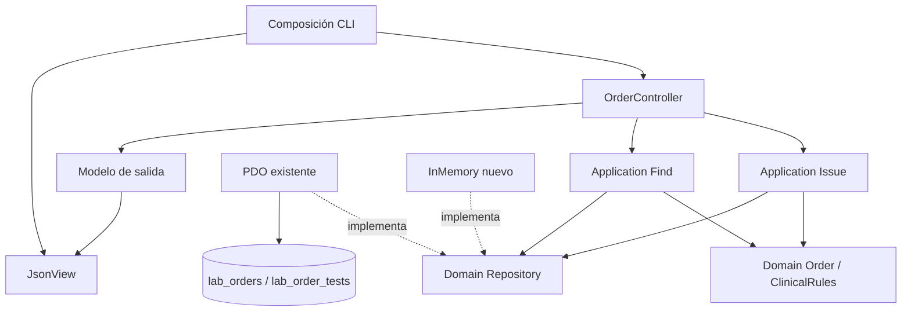
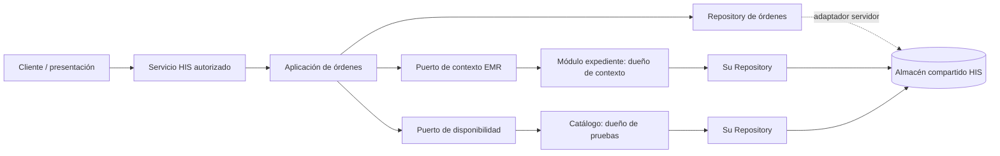

# Semana 4 — MVC y patrón Repository: Órdenes desde EMR

**Estudiante:** Mercedes Azucena Lopez Perez.

Se continúa el mismo [Micro-HIS de semana 3](../semana-03/README.md), base 9392745. Se reutilizan sin modificar Order, Issue, Find, ClinicalRules, Repository, esquema y PdoRepository. Esta entrega agrega MVC CLI y adaptador InMemory; emisión desde contexto ficticio de expediente y consulta del estado guardado. PHP 8.2+ vanilla, sin framework.

## Ejecutar

Desde raíz, con PHP y pdo_sqlite para modo PDO/suite:

```powershell
php docs/modulos/ordenes-laboratorio-emr/semana-04/mvc/cli.php memory
php docs/modulos/ordenes-laboratorio-emr/semana-04/mvc/cli.php pdo
php docs/modulos/ordenes-laboratorio-emr/semana-04/mvc/tests/run.php
php docs/modulos/ordenes-laboratorio-emr/semana-03/micro-his/tests/run.php
```

Ambos modos devuelven JSON DEMO_ONLY con CREATED y FOUND, dos pruebas y estado TEST_INITIAL. PDO usa SQLite en memoria, no una base durable; InMemory vive por instancia. Los dos pierden datos al finalizar esta demo. Modo inválido termina con código 2; fallo de operación con código 1. No se ejecutan servidor HTTP ni datos clínicos.

## Capas, responsabilidades y reutilización

| MVC / capa | Objeto | Responsabilidad |
|---|---|---|
| Composición | mvc/cli.php | Elige adaptador y conecta controlador, aplicación y vista. Inicializa SQLite en demo, fuera del controlador. |
| Controller / Presentation | OrderController | Recibe actor del contexto de composición y entrada, valida tipos/forma de listas, delega Issue/Find. No contiene SQL, disponibilidad de pruebas, estados permitidos ni autorización de negocio. |
| View / Presentation | JsonView | Serializa el modelo de salida, etiqueta DEMO_ONLY; no consulta ni escribe. |
| Model / Application existente | Issue / Find | Coordinan validación, autorización y Repository; mismo flujo de semana 3. |
| Model / Domain existente | Order / ClinicalRules / Repository | Invariantes, contratos y decisiones externas. Model no equivale a tabla SQL. |
| Persistence existente | PdoRepository | Escritura transaccional cabecera/partidas, prepared statements y consultas parametrizadas. |
| Persistence nuevo | InMemoryRepository | Guarda orden completa y consulta paciente/episodio bajo el mismo contrato. Volátil, sin garantías multiproceso. |

La forma de una lista y el tipo string se validan en frontera; que esté vacía o contenga pruebas no disponibles lo decide dominio/aplicación. actor es fixture en CLI: en integración real debe derivarse de sesión confiable, nunca del cuerpo de formulario. No hay seguridad real por pasar una cadena al controller.

Repository existente en semana-03/micro-his/Domain/Model.php define save(Order):int y find(patient,encounter):array. El límite representa persistencia de órdenes propias del módulo, no CRUD universal del expediente ni catálogo. No se copia interfaz ni se agregan dependencias de presentación al dominio.

## MVC y dependencias



[Fuente UML editable](diagramas/mvc.puml). Mermaid es vista arquitectónica; no se ha renderizado PlantUML a PNG.

## Contratos y errores

OrderController.issue(actor,input): input con patient, encounter y tests:list<string>. Devuelve INVALID_INPUT para tipos incorrectos; la aplicación conserva INVALID_REQUEST, FORBIDDEN, INVALID_CONTEXT, INVALID_TESTS, DEPENDENCY_UNAVAILABLE, PERSISTENCE_FAILURE o CREATED/id. La vista no transforma error en éxito.

OrderController.find(actor,input): paciente/episodio requeridos como strings; aplicación autoriza antes de leer. Devuelve FOUND con órdenes persistidas, EMPTY con lista vacía confirmada o UNAVAILABLE sin inventar estado actual. Actor denegado no ve lista.

La persistencia PDO conserva transacción de semana 3: cabecera y partidas se guardan como unidad; cualquier fallo revierte todo. InMemory devuelve misma forma y mantiene pruebas/referencias/estado; igualdad observable de pruebas no demuestra durabilidad ni concurrencia equivalente. IDs propios de cada adaptador no son claves globales de integración.

## Repositorio de datos compartido: integración propuesta



El almacenamiento puede ser compartido en servidor sin convertir todos los módulos en un Repository universal. Órdenes posee cabecera/partidas; EMR posee expediente/episodio; catálogo posee definición y disponibilidad de pruebas. Integración mediante contratos autorizados; UI no conecta directamente a tablas ni modifica estado clínico por SQL remoto.

| Área | Acuerdo previo / responsabilidad |
|---|---|
| Identidad/tenant | Servicio de identidad y autorización; actor/ámbito no se confían al cliente. El esquema demo no tiene tenant: no reutilizarlo como multitenant seguro sin migración y pruebas. |
| Paciente/episodio | EMR valida referencia y acceso; órdenes conserva referencias mínimas, no copia expediente. |
| Catálogo | Dueño valida pruebas al emitir; no cambiar definición desde Repository de órdenes. |
| Estado | Política acordada y origen autorizado de laboratorio; UI solo consulta. TEST_INITIAL no es ciclo institucional. |
| Migraciones | Cada módulo dueño administra tablas y contratos; adaptar referencias/FK según esquema HIS aprobado. |
| Transacción | Orden/partidas localmente atómicas; servicios remotos no se incluyen mágicamente en una transacción PDO. |

Plan de integración: acordar esquema/propiedad y permisos; añadir contexto tenant confiable y filtrado en todas las consultas; mapear identificadores existentes; implementar adaptador de servidor con credenciales fuera del cliente; probar integridad, aislamiento y concurrencia; planear migración/rollback antes de datos reales. No se implementa ni se anuncia servidor compartido productivo.

Idempotencia, auditoría temporal completa y cambios concurrentes siguen pendientes. find usa múltiples SELECT sin snapshot transaccional; antes de soporte concurrente acordar consistencia y pruebas. No se modifica recepción, resultados ni validación. Ante fallo de lectura no presentar orden almacenada en caché como estado actual.

## Evidencia

[Suite MVC/Repository](evidencia/mvc.txt): 34 aserciones. Mismo controller/application con ambos adaptadores; CREATED/FOUND, pruebas/estado/actor conservados, vacío exitoso, acceso denegado, tipo inválido, regla de lista vacía, catálogo desconocido, segunda orden sin sobrescribir, vista sin cambiar resultado. InMemory filtra paciente/episodio. PDO falla segunda partida y revierte cabecera/partidas; tabla rota produce UNAVAILABLE.

[Regresión semana 3](evidencia/regresion-semana-03.txt): 19 aserciones. [CLI InMemory](evidencia/cli-memory.txt), [CLI PDO](evidencia/cli-pdo.txt), lint en evidencia/. PHP ejecutado localmente; SQLite real temporal y reglas clínicas demo.

Trazabilidad: RF01/02/03 emisión/contexto/pruebas → Issue/Order/ClinicalRules; RF04/RNF03 integridad → Repository; RF05/06/RNF05 estado veraz → Find y View; RNF01 mantenibilidad → MVC y dependencias; RNF04 referencias de orden conservadas. RF07/08 de seguimiento desde laboratorio no se amplían en esta entrega y permanecen modelados en semana 2.

No se certifican autenticación, JWT, aislamiento tenant, API, GUI, accesibilidad ni infraestructura clínica por tener MVC. La entrega demuestra capas, responsabilidades y sustitución de adaptadores dentro del mismo proceso acotado.