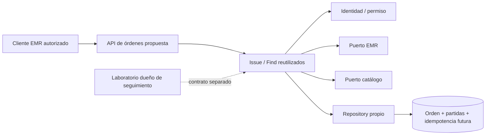
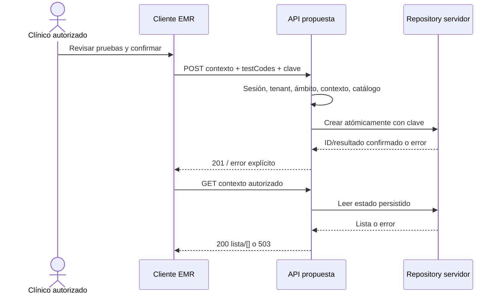

# Semana 5 — Cliente-servidor, API REST e integración de Órdenes desde EMR

**Autora:** Mercedes Azucena Lopez Perez.

Se evoluciona el mismo [Micro-HIS MVC de semana 4](../semana-04/README.md), base 3cd3e0e. Flujo: emisión de orden desde paciente/episodio del EMR y consulta del estado confirmado. Entrega de diseño permitida por la tarea: [OpenAPI](api/openapi.json), diagramas, migración y [plan de issues/rama/worktree/PR](plan-issues.md). No se instala infraestructura productiva ni se implementa servidor HTTP en esta semana.

## Cliente-servidor y propiedad

UI/EMR → cliente HTTP → controlador de servidor → Issue/Find → dominio/puertos → Repository PDO. Se conserva la separación MVC; cliente no lleva credencial de BD ni consulta SQL remoto. SQLite temporal y DemoRules actuales son solo base de prueba, no multitenant clínico.

| Datos | Propiedad y contrato |
|---|---|
| Orden, partidas, solicitante y estado persistido | Módulo de órdenes; Repository propio, cabecera/partidas atómicas. |
| Paciente/episodio y correspondencia | EMR dueño; consulta/validación autorizada por puerto, no duplicar expediente. |
| Definición/disponibilidad de pruebas | Catálogo dueño; validar al emitir, no administrar desde este flujo. |
| Identidad, membresía y tenant | Módulo de identidad; cada petición obtiene contexto confiable y permiso. |
| Cambios de estado | Proceso autorizado de laboratorio y política acordada; no edición arbitraria desde formulario clínico. |

No se agregan muestras, resultados ni validación. El endpoint de actualización externa no se expone en este contrato de emisión/consulta; el ejemplo de semana 2 documenta origen/transición/conflicto como futura integración separada.

## Contrato REST propuesto

OpenAPI 3.1.0; host https://his.example.invalid/api/v1 ilustrativo, no operativo. Ruta:

/tenants/{tenantId}/patients/{patientId}/encounters/{encounterId}/lab-orders

| Método | Entrada | Respuesta |
|---|---|---|
| POST | Sesión bearer, Idempotency-Key; testCodes:[TEST-A,TEST-B] | 201 representación con ID, referencias, solicitante desde sesión, partidas y estado acordado. Solo tras commit. |
| GET | Sesión y contexto solicitado | 200 lista autorizada; [] solo lectura exitosa sin órdenes. |

Sin actor, estado inicial ni tenant autorizante en el cuerpo. Ruta expresa contexto solicitado, nunca permiso. 400 formato, 401 sesión, 403 permiso, 404 contexto no disponible sin revelar existencia fuera de ámbito, 422 contexto/pruebas inválidos, 409 clave idempotente incompatible/en proceso, 429 limitación y 503 indisponibilidad. Errores code/message/requestId; no stack SQL ni información clínica. Cabeceras no-store y correlación generada por servidor. TEST_INITIAL es ejemplo sintético, no ciclo clínico institucional.

Brecha respecto al código: Issue de semana 3 devuelve solo status/id; API propuesta exige representación. El controlador HTTP futuro deberá consultar detalle autorizado o devolver DTO completo tras commit, sin fabricar campos. La demo actual no tiene tenant, idempotencia, identidad real ni servidor; implementarlos y probarlos antes de anunciar estas garantías.

## Comunicación, seguridad y resiliencia

HTTPS entre cliente/servidor; credenciales desde mecanismo HIS, no en URL/localStorage/logs de este módulo. Comprobar sesión, tenant activo, membresía, permiso y ámbito paciente/episodio antes de consultar catálogo u orden. Revalidar autorización también al devolver respuesta idempotente; no filtrar representación histórica a una sesión revocada. Rechazo de tenant ajeno sin lista. Consulta SQL parametrizada y acceso mínimo por adaptador servidor; secretos de BD fuera del cliente distribuido.

GET puede reintentarse manualmente tras timeout/red con contexto vigente. Objetivos experimentales propuestos: timeout total 5 s, conexión 2 s; no son mediciones/SLA. 429 respeta Retry-After. No reintentar 400/401/403/404/422 sin corregir contexto/entrada. Indisponibilidad de EMR/catálogo falla cerrada: no considerar permiso/catálogo válido por defecto.

POST: nunca reemitir con clave nueva automáticamente cuando se desconoce resultado. Reintentar misma operación con misma clave/payload, después de validar sesión. Servidor propuesto enlaza clave a tenant/actor/operación, guarda fingerprint y resultado en la misma transacción de cabecera/partidas; operaciones concurrentes deben resolverse mediante restricción única/serialización, no check-then-insert sin bloqueo. Mismo payload retorna mismo ID; distinto devuelve IDEMPOTENCY_MISMATCH; operación aún en curso devuelve REQUEST_IN_PROGRESS sin éxito falso.

Retención propuesta de claves: mínimo 24 h por acordar con responsable y política de datos; debe comunicarse al cliente. Después de ventana, una clave ya no garantiza deduplicación: reconciliar resultado por vía autorizada antes de otra emisión. No prometer exactamente una vez indefinidamente. No se implementa este registro en SQLite demo. Cachear respuestas de creación requiere revalidar acceso y limitar datos/retención.

## Consistencia y observabilidad

Transacción local de orden/partidas e idempotencia en servidor; sin transacción distribuida con EMR/catálogo. Revalidar pruebas/contexto al emitir según contrato de dueños. Si esa validez cambia en otro servicio durante operación, acordar versión/reserva/política de compensación antes de extraer frontera; no afirmar atomicidad global.

Lectura devuelve estado persistido, no estado calculado en cliente. El adaptador actual usa varios SELECT sin snapshot; aislamiento de lectura/partidas y actualización concurrente deben medirse y probarse en servidor. Cambios del laboratorio requieren origen autenticado, transición permitida y comparación de versión/estado esperado, con 409 ante conflicto; no sobrescribir a ciegas.

Registrar requestId del servidor, operation, outcome técnico y latencia; métricas de errores por tipo, p95 y duplicados prevenidos. No guardar bearer, datos clínicos o payload de expediente en logs. Correlación segura debe unir emisión/consulta sin convertir ID de paciente en etiqueta de métrica. Alertas propuestas: incremento sostenido de 503, colisiones de idempotencia y fallos de transacción; umbrales por medir en sandbox, sin dashboard ya operativo.

## Frontera de microservicio evaluada

Candidata: servicio de órdenes con API propia y propiedad de orden/partidas; EMR y catálogo consumidos por puertos. **Decisión actual: mantener módulo dentro del HIS y cliente HTTP**, sin extracción nueva. No hay carga, equipos o ciclos de entrega independientes medidos que compensen costo de red, disponibilidad, identidad de servicio y consistencia de catálogo/contexto.

Criterio de decisión propuesto: comparar baseline en sandbox bajo misma carga/datos ficticios; extraer solo si hay necesidad de despliegue independiente aprobada y mejora medible (por ejemplo ≥20 % en p95 sin empeorar errores/aislamiento) con presupuesto operativo y dueño de datos asignado. Ninguna de esas mediciones existe en esta entrega. Compartir servidor por ahora no justifica acoplar UI a tablas.

## Migración y rollback razonados

1. Revisar OpenAPI con dueños de EMR/catálogo/identidad; asignar permisos/ciclo real y reglas de contexto.
2. Añadir borde HTTP y DTO sobre mismo Issue/Find; mantener CLI y regresiones como control. Sin conectar datos reales.
3. Implementar tenant, identidad y políticas autorizadas; adaptar esquema/consultas y verificar H1/H2 antes de piloto.
4. Añadir idempotencia transaccional y pruebas de misma clave, payload distinto, concurrencia y pérdida de respuesta tras commit.
5. Probar endpoint/cliente contra sandbox: error dependencia, rollback, vacío vs indisponible, consulta autorizada y representación completa.
6. Activar por configuración de piloto sin doble escritura; medir métricas y decidir frontera con evidencia.

Rollback: desactivar borde HTTP de piloto y volver a recorrido local/demo, no borrar órdenes clínicas ni claves de idempotencia para “limpiar” fallos. Si hubiera migración real, preparar restauración/compatibilidad y reconciliación aprobada; aquí no se ejecutan cambios productivos. No escribir simultáneamente dos bases para comparar.

## Diagramas

Fuente UML en diagramas/. La notación ilustra componentes/contratos futuros, no infraestructura desplegada.

## Validación

Contrato validado con swagger-parser y aserciones de sesión/rutas/cuerpo/idempotencia/errores. Regresión MVC de semana 4: 34 aserciones; Micro-HIS semana 3: 19. Evidencia y comandos en evidencia/. La validación OpenAPI no ejecuta servidor, identidad, tenant, concurrencia o deduplicación durable.

Formato elegido según [especificación primaria OpenAPI 3.1.0](https://spec.openapis.org/oas/v3.1.0.html), ya consultada para contratos de este proyecto. No se presenta como versión más reciente. PR de esta rama contiene dependencias propias de semanas 3/4 aún locales, para que el diseño continúe el mismo Micro-HIS sin enlaces rotos.