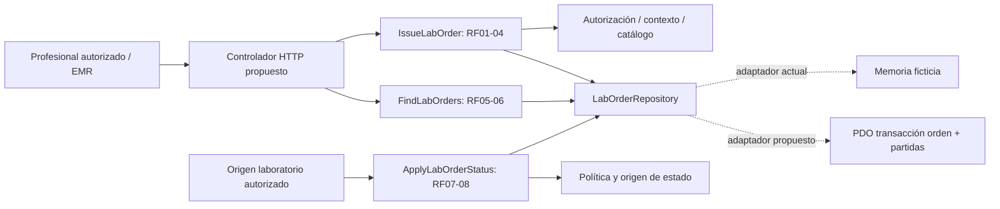

# Semana 6 — Primera evaluación parcial: Órdenes desde EMR

**Autora:** Mercedes Azucena Lopez Perez. Proceso: emisión desde expediente y seguimiento de estado.

Entregables: [presentación de 8 diapositivas](presentacion.md), [matriz decisión → evidencia](matriz-decisiones.md), [cambio práctico defendido](registro-cambio.md), [UML trazable](diagramas/arquitectura.puml) y evidencia real de ejecución.

Base: semana 2, commit 5dee307. Se reutilizan [RF/RNF y SRP](../semana-02/semana-02-srp-ordenes-laboratorio-emr.md) y UML de semana 1. No hay entregas 3/4/5 de este módulo en esta rama: capas, adaptador PDO y API descritos aquí son propuesta arquitectónica de defensa, no implementación atribuida a semanas inexistentes. Código ejecutable: ejemplo PHP con dobles de memoria y cambio acotado; no servidor HTTP ni base clínica.

## Arquitectura defendida

Actor clínico autorizado emite desde paciente/episodio validados; laboratorio entrega seguimiento mediante origen autorizado. El usuario que consulta no modifica estado por un campo libre. Presentación interpreta HTTP y usa identidad autenticada; aplicación coordina IssueLabOrder/FindLabOrders/ApplyLabOrderStatus; dominio decide validez y ciclo mediante contratos; persistencia implementa LabOrderRepository. SRP separa motivos de cambio y Repository aísla almacenamiento. La composición inyecta adaptadores: ninguna entidad necesita SQL ni HTTP.



El adaptador PDO futuro usa sentencias preparadas, transacción orden/partidas y rollback ante error. updateStatus aplica comparación de estado esperado para detectar conflicto; no sobrescribe un cambio concurrente a ciegas. Son garantías del contrato que deberá demostrar integración real; el doble no demuestra atomicidad de una BD.

## Contrato API mínimo propuesto para la defensa

Base /api/v1. Autenticación y contexto de tenant se obtienen del servidor, nunca de actorId libre en cuerpo. Autorización antes de leer/escribir. No se envían datos clínicos reales en ejemplos.

| Operación | Entrada / salida | Errores y límites |
|---|---|---|
| POST /patients/{patientId}/encounters/{encounterId}/lab-orders | testCodes:[TEST-A,TEST-B]; actor desde sesión. 201: id, referencias, pruebas, estado inicial acordado | 400 formato, 401 sesión, 403 permiso, 422 contexto/pruebas/duplicados, 503 dependencia/escritura; jamás 201 sin persistencia. |
| GET /patients/{patientId}/encounters/{encounterId}/lab-orders | 200 lista y estado persistido; [] solo lectura exitosa vacía | 401/403 sin lista; 503 lectura fallida, sin convertirla en []. |
| PATCH /lab-orders/{orderId}/status | source autenticado del proceso y nextStatus validado | 200 persistido; 403 origen, 404 no disponible en ámbito autorizado, 409 conflicto/transición, 503 falla. |

Respuesta de error: code/message/requestId; sin secretos ni expediente en logs. No exponer existencia fuera del contexto autorizado. Payload del cliente no autoriza tenant, actor ni source. Los enums del PHP son resultados internos; controlador futuro hace mapeo explícito, no serialización ciega. TEST_INITIAL/TEST_NEXT/TEST_FINAL son estados sintéticos de la fixture, no vocabulario clínico definitivo. POST no tiene idempotencia implementada: ante timeout de resultado desconocido comprobar con referencia segura antes de reemitir; selección sin duplicados no evita órdenes repetidas entre solicitudes.

## Reproducir evidencia

Desde raíz del worktree:

```powershell
php docs/modulos/ordenes-laboratorio-emr/semana-02/ejemplo-srp/verificar.php
php docs/modulos/ordenes-laboratorio-emr/semana-06/cambio/verificar.php
php -l docs/modulos/ordenes-laboratorio-emr/semana-06/cambio/UniqueTestCatalog.php
php -l docs/modulos/ordenes-laboratorio-emr/semana-06/cambio/verificar.php
```

Salidas guardadas en evidencia/. No se afirman pruebas JWT, multitenant, PDO, API ni revisión docente. Presentación en Markdown con separadores de diapositiva; UML editable y Mermaid visibles en este documento. No se renderizó PlantUML a PNG.