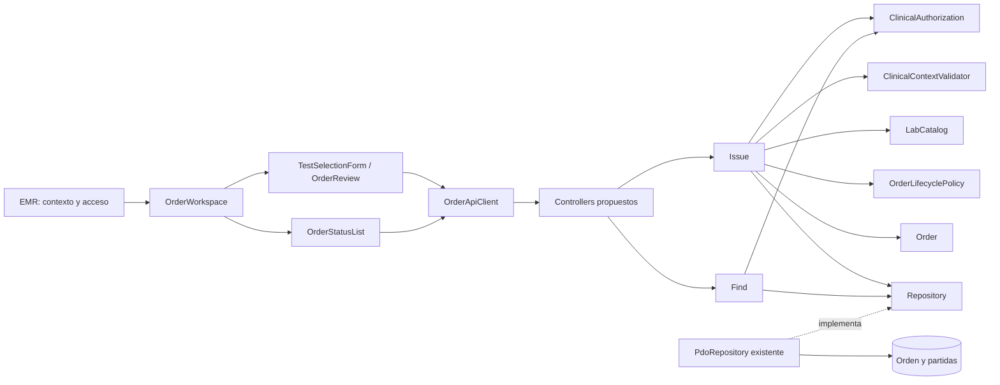

# Semana 7 — Componentes y refactorización de Órdenes desde EMR

**Estudiante:** Mercedes Azucena Lopez Perez.

Proceso: emisión desde expediente y seguimiento de estado. Base inspeccionada: [Micro-HIS de semana 3](../semana-03/README.md), commit 9392745, y [contratos SRP de semana 2](../semana-02/ejemplo-srp/src/LabOrderWorkflow.php). Se diseña un refactor conceptual concreto; no se cambian los fuentes de semanas anteriores ni se presenta frontend/API como implementado. Semanas 4/5 no están incluidas en esta línea base. Solo datos ficticios.

Entregables: [contratos de componentes](contratos.md), [antes/después y justificación](refactor.md), diagramas editables y evidencia de regresión. No se añade recepción, catálogo administrable, procesamiento ni validación de resultados.

## Componentes frontend propuestos

| Componente | Entrada y responsabilidad | Salida / límite |
|---|---|---|
| OrderWorkspace | Contexto autorizado de EMR: paciente/episodio/permiso | Coordina selección, revisión y seguimiento; al cambiar contexto cancela presentación de resultados anteriores. No autoriza por sí solo. |
| TestSelectionForm | Opciones del catálogo autorizado y selección local | Draft testCodes, errores de forma; no decide disponibilidad clínica ni guarda en SQL. |
| OrderReview | Contexto y selección para revisar | Confirmar/cancelar; cancelar no emite, confirmar bloquea doble toque en curso. |
| OrderFeedback | Resultado tipado de emisión | CREATED solo confirmado, error/pendiente desconocido separados. No inventa estado ni reemite automáticamente. |
| OrderStatusList | Lista autorizada y estado de carga/lectura | FOUND, EMPTY y UNAVAILABLE visualmente distintos; no ofrece edición libre de estado. |
| OrderApiClient | DTO mínimos / contexto de sesión existente | Traduce transporte a resultados tipados, correlación sin secretos; sin credenciales o reglas clínicas embebidas. |

La lista de pruebas se reemplaza como conjunto al cambiar episodio; una respuesta tardía de un contexto anterior se descarta por identidad de petición/contexto. Texto de paciente solo si el permiso vigente lo permite; en esta propuesta se ilustran referencias ficticias. Componentes UI pueden reusarse como patrón visual, sin un repositorio universal de módulos clínicos.

## Componentes backend

| Capa | Componente | Responsabilidad |
|---|---|---|
| Presentación propuesta | IssueOrderController / FindOrdersController | Validar forma de DTO, extraer identidad/contexto confiable, delegar y mapear resultados. Sin SQL ni decisión de pruebas/ciclo. |
| Aplicación existente | Issue / Find (semana 3) | Coordinar emisión/consulta. Refactor propuesto sustituye dependencia ClinicalRules agregada por puertos específicos. |
| Dominio | Order y políticas/puertos específicos | Pruebas requeridas, integridad de selección, referencias y ciclo acordado. No depende de UI/PDO/HTTP. |
| Persistencia existente | PdoRepository | Escritura transaccional de orden/partidas y lectura por paciente/episodio, prepared statements. |
| Integración propuesta | Adaptadores de permiso EMR, contexto, catálogo y ciclo | Obtener decisiones de módulos dueños sin exponer sus tablas a UI. |
| Seguimiento separado | ApplyLabOrderStatus (ejemplo semana 2) | Origen confiable, transición válida y actualización condicional; no endpoint editable por clínico. |

La actualización del seguimiento no se añade al Micro-HIS de semana 3: se conserva como contrato de integración separado ya modelado en semana 2, con estados sintéticos. No se afirma haber conectado ese ejemplo a PDO de semana 3.

## Diagrama después del refactor propuesto



[Componentes UML](diagramas/componentes.puml). [Antes/después UML](diagramas/refactor.puml). Mermaid es vista de diseño, no inventario de aplicación desplegada.

## Trazabilidad y límites

| RF/RNF de semana 2 | Componentes / decisión | Evidencia |
|---|---|---|
| RF01 RNF02 contexto y permiso | Workspace + controlador + autorización/contexto | Contratos distinguen dato solicitado de contexto confiable; regresión con actor/contexto inválidos. |
| RF02/03 selección disponible | Formulario + Order + LabCatalog | Prueba vacía/desconocida; disponibilidad real es decisión del catálogo. |
| RF04 RNF03 integridad | Issue + Repository | SQLite revierte cabecera y partida previa al fallar segunda partida. |
| RF05/06 RNF05 lectura veraz | Find + StatusList | FOUND/EMPTY/UNAVAILABLE separados, autorización antes de consultar. |
| RF07/08 RNF06 seguimiento | Puerto separado de laboratorio | Contratos de semana 2, sin conexión PDO nueva. |
| RF09 límite modular | Adaptadores de consulta | Catálogo/expediente no pasan a ser propiedad de órdenes. |
| RNF01 mantenibilidad | Puertos específicos después | Find deja de depender de validación de pruebas/ciclo. |
| RNF04 trazabilidad | DTO y entidad | Paciente/episodio/actor/pruebas/estado conservados; auditoría histórica adicional pendiente. |

Regresiones ejecutadas: 19 aserciones del Micro-HIS y 34 de semana 2. No validan código refactorizado nuevo, pues esta entrega pide diseño conceptual y no implementa los puertos nuevos en semana 3. Sí documentan comportamiento que la futura implementación debe preservar. No hubo pruebas UI, HTTP, JWT, tenant o carga/concurrencia.

## Secuencia y manejo de fallos

Usuario revisa contexto/selección → confirma una vez → controlador obtiene identidad confiable → aplicación autoriza → valida contexto → valida selección/catálogo → Repository confirma transacción → respuesta CREATED. Error en cualquier frontera no produce éxito UI. Consulta posterior autoriza antes de leer; vacío exitoso no equivale a indisponibilidad.

Si POST queda sin respuesta, estado del cliente es desconocido: comprobar referencia autorizada si el servidor lo permite, no reemitir automáticamente. Idempotencia durable y búsqueda por correlación no existen en semana 3 y son requisitos de integración pendientes, no garantías agregadas por el diseño. Doble toque bloqueado solo mejora UI; no reemplaza control servidor.

Reproducción desde raíz:

```powershell
php docs/modulos/ordenes-laboratorio-emr/semana-03/micro-his/tests/run.php
php docs/modulos/ordenes-laboratorio-emr/semana-02/ejemplo-srp/verificar.php
```

Salidas en evidencia/. No se modificó el backend ni trabajo de otros módulos.