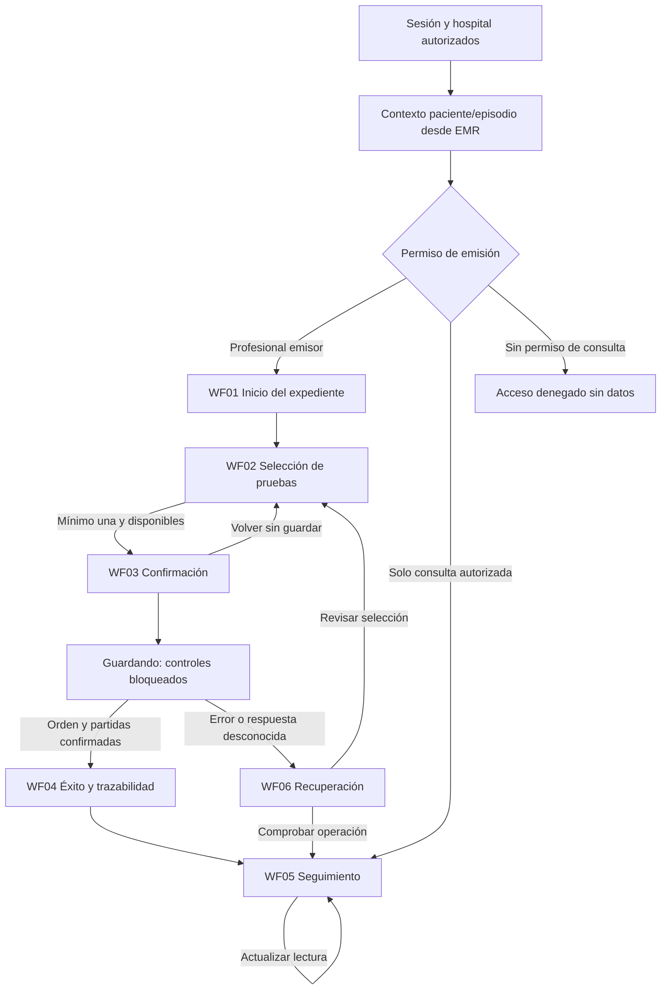
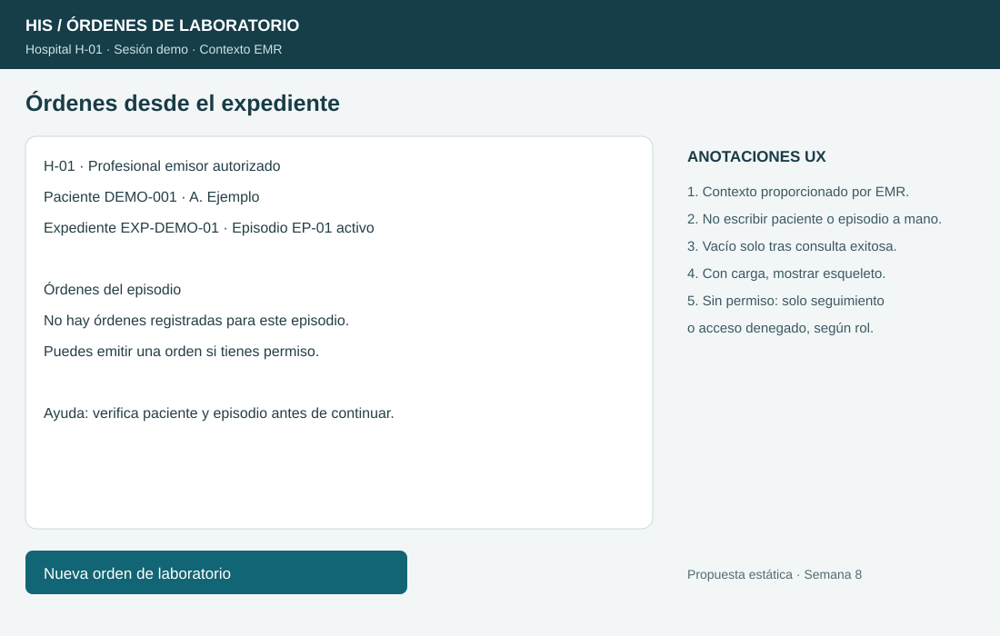
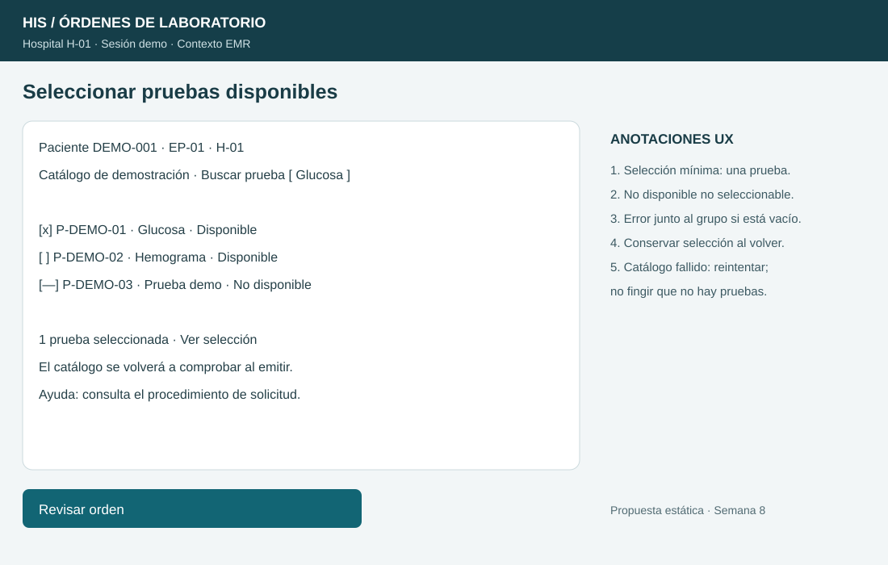
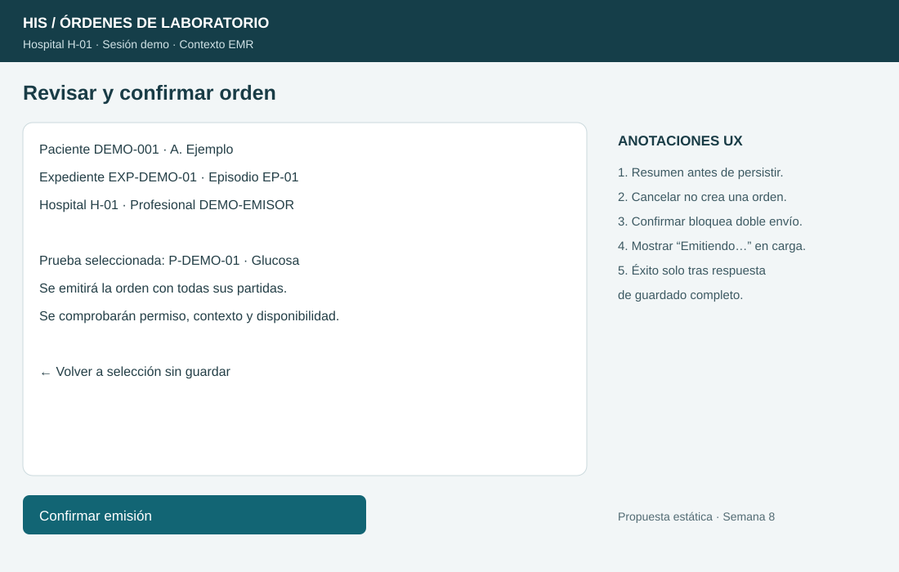
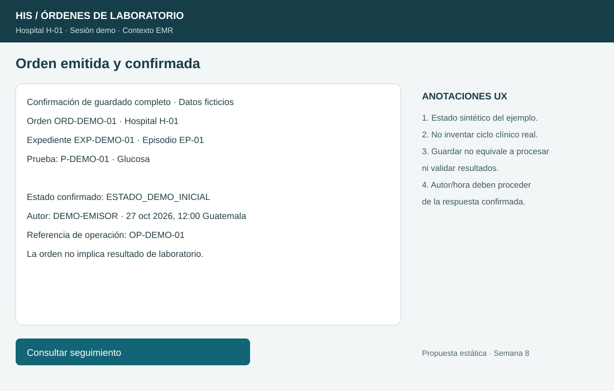
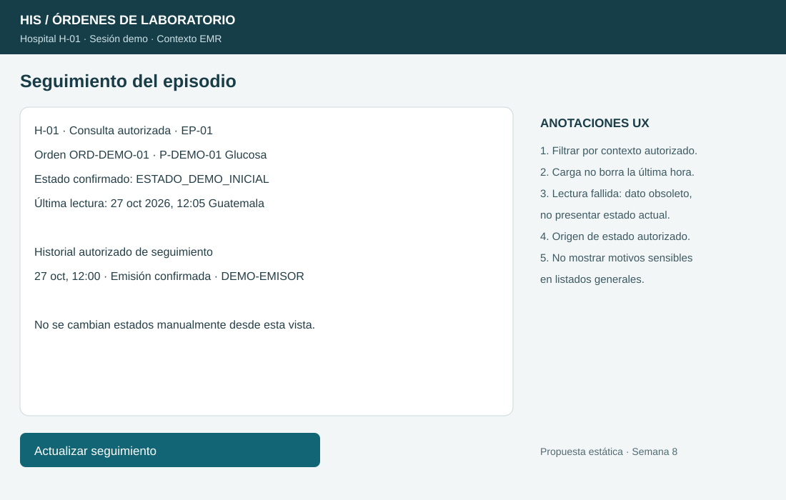
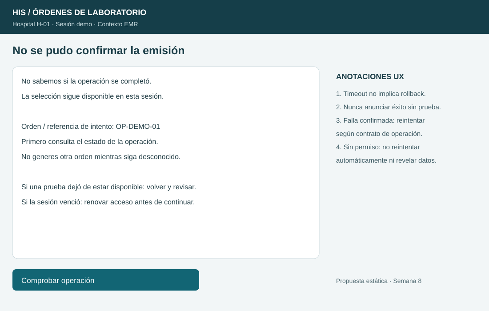

# Semana 8 — UX de órdenes de laboratorio desde EMR

**Estudiante:** Lopez Perez, Mercedes Azucena

**Flujo:** Emisión de orden desde el expediente y seguimiento de su estado.

## Alcance y roles

Propuesta UX de seis wireframes anotados, no pantallas desplegadas. Datos, pruebas, horas y estados son ficticios. Se conserva el alcance y los RF/RNF de [semana 2](../semana-02/semana-02-srp-ordenes-laboratorio-emr.md). El profesional autorizado emite desde paciente/episodio del EMR; un consultor autorizado solo ve seguimiento; el origen de laboratorio autorizado actualiza seguimiento mediante un contrato externo. Nombres de rol son responsabilidades de diseño, no permisos técnicos ya implementados.

No se mantienen catálogo, muestras, resultados ni validación bioquímica aquí. No se inventa un ciclo clínico: ESTADO_DEMO_INICIAL representa una etiqueta sintética del ejemplo hasta acordar estados/transiciones con laboratorio.

## User flow por rol

Origen autorizado de laboratorio (actor de integración, sin botón manual en esta UI): evento de seguimiento → verificar origen, hospital y transición mediante política acordada → persistir actualización → confirmar → WF05 presenta la lectura confirmada. Si origen/transición no se acepta, no cambiar estado; el fallo queda en el canal de integración autorizado. No permitir que el profesional invente un estado operativo desde la pantalla de órdenes.

## Wireframes y reglas de interacción

### WF01 — Inicio desde expediente

Contexto visible y de lectura: hospital, paciente mínimo, expediente y episodio. “Sin órdenes” solo tras consulta exitosa. Durante carga usar esqueleto y mensaje, sin habilitar acciones que requieren contexto. Emisión disponible solo al rol autorizado; consulta autorizada no implica permiso para emitir.

### WF02 — Decisión de pruebas

Buscar y seleccionar desde catálogo, no escribir identificadores libres. Exigir al menos una prueba, evitar duplicados y bloquear no disponibles. Mensaje junto al grupo si selección vacía; conservar selección al volver. Revalidar catálogo al confirmar: una prueba que deje de estar disponible requiere revisar selección completa antes de emitir. Ayuda contextual remite al procedimiento institucional, sin sugerir pruebas clínicas por cuenta del sistema.

### WF03 — Confirmación

Resumen de paciente/episodio/hospital, pruebas y emisor. Volver conserva selección sin crear orden. Confirmar bloquea repetición mientras persiste. Servidor vuelve a comprobar autorización, contexto y disponibilidad. La UI no trata la presencia del botón como garantía de permiso.

### WF04 — Éxito y trazabilidad

Éxito solo después de persistencia de orden y todas sus partidas. Mostrar ID, autoría, hora y estado confirmados por servidor, no generarlos para aparentar guardado. Registrar orden no equivale a obtener resultados ni validarlos. Abrir seguimiento conserva contexto autorizado.

### WF05 — Seguimiento

Vista de lectura para emisores y consultores autorizados; limita a paciente/episodio/hospital. Mostrar última lectura e historial autorizado de cambios. Si falla actualizar, conservar la información previa solo como “última lectura, no actualizada”, con hora y error; nunca presentarla como estado vigente confirmado. Sin lectura previa, mostrar indisponibilidad, no un estado inventado.

### WF06 — Recuperación

Distinguir falla confirmada de respuesta desconocida. Ante timeout, consultar por referencia de operación antes de repetir. El contrato real deberá permitir esa comprobación y definir reintento/idempotencia; el wireframe no afirma que exista un endpoint. No enviar órdenes automáticamente al volver la conexión. Conservar selección solo en memoria durante sesión válida; no guardar datos de paciente en almacenamiento persistente del navegador.

## Estados, mensajes y validaciones

| Estado / condición | Mensaje y acción | Regla |
|---|---|---|
| Carga inicial | “Cargando órdenes…” y esqueleto | No confundir con vacío. |
| Vacío confirmado | “No hay órdenes para este episodio”; Nueva orden según permiso | No ocultar fallos como lista vacía. |
| Sin selección | “Selecciona al menos una prueba disponible” | Foco al grupo y error asociado. |
| Catálogo fallido | “No se pudo cargar el catálogo”; Reintentar | No interpretar como sin pruebas. |
| Prueba no disponible al confirmar | “La selección cambió; revisa las pruebas” | No emitir solo una parte sin nueva decisión. |
| Guardando | “Emitiendo orden…”; bloquear envío repetido | No anunciar éxito anticipado. |
| Falla de escritura confirmada | “No se emitió la orden”; revisar/reintentar según contrato | Cero orden con partidas incompletas. |
| Timeout / respuesta desconocida | “No sabemos si se completó”; Comprobar operación | No duplicar ni afirmar rollback. |
| Consulta fallida | “No se pudo actualizar”; mostrar hora previa y obsolescencia | No inventar estado actual. |
| Sesión vencida | “Renueva tu acceso para continuar” | Revalidar contexto antes de recuperar borrador; no revelar datos sin sesión. |
| Sin permiso / otro hospital | “No tienes acceso a este recurso” | No mostrar identidad clínica ni facilitar cambio de hospital sin autorización. |
| Éxito | “Orden emitida y confirmada” con referencia | Solo respuesta completa confirmada. |

## Accesibilidad, privacidad y ayuda

Etiquetas persistentes y controles de al menos 44 px; foco visible y orden contexto → selección → revisar → confirmar. Al cambiar pantalla, foco al encabezado principal; al fallar, resumen accesible y vínculo al campo/grupo. Avisos de carga/éxito mediante región de estado; errores con texto, no solo color. Confirmación debe poder recorrerse con teclado y volver sin perder selección. Estas son reglas de implementación; los SVG estáticos no prueban interacción ni lector de pantalla.

En listado mostrar orden, pruebas y estado, sin nombres completos ni datos clínicos innecesarios. El detalle muestra paciente mínimo para evitar confusión, bajo autorización. No incluir valores de resultados en notificaciones generales. Revalidar permisos al emitir, consultar y recibir cambios. Logs/evidencia usan datos ficticios y referencias mínimas, sin tokens. Ayuda contextual del procedimiento permanece en el contexto sin reemplazar juicio profesional.

## Trazabilidad

| RF/RNF de semana 2 | Evidencia UX |
|---|---|
| RF-01 / RNF-02 autorización y contexto | WF01, WF03, acceso denegado y sesión vencida |
| RF-02 selección mínima | WF02 y error en grupo |
| RF-03 disponibilidad | WF02/WF03 y selección modificada |
| RF-04 / RNF-03 persistencia completa | WF03/WF04/WF06 |
| RF-05/06 consulta y vacío distinto de falla | WF01/WF05 |
| RF-07/08 origen, transición y actualización confirmada | Flujo por rol de integración y WF05; sin edición manual |
| RF-09 límites | Sin muestras, catálogo mantenible, captura ni validación aquí |
| RNF-01 responsabilidades | Inicio, emisión y consulta separados |
| RNF de respuesta explícita y ciclo acordado | Mensajes específicos, estado demo sin transiciones clínicas inventadas |

## Evidencia y límites

Seis SVG anotados, con fuentes editables y estados documentados. No hay despliegue ni API nueva; el user flow incluye capacidades propuestas que deben validarse al implementar. Se verifica XML y encaje de textos del boceto; no se afirma validación de usuarios, accesibilidad completa o integración clínica.