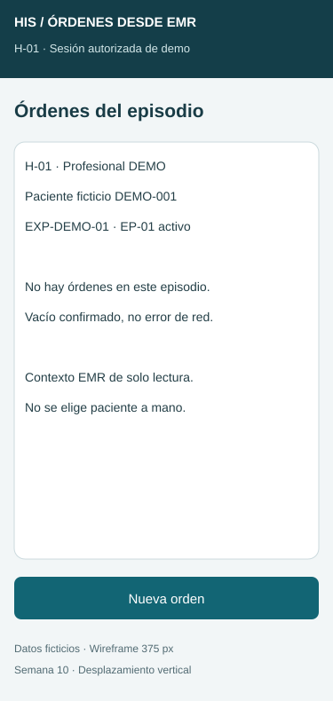
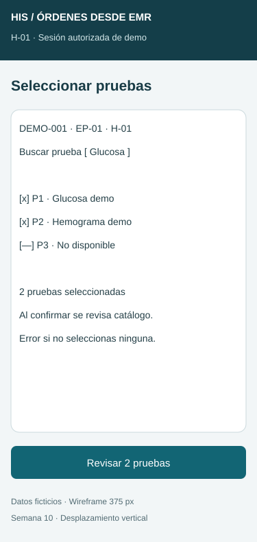
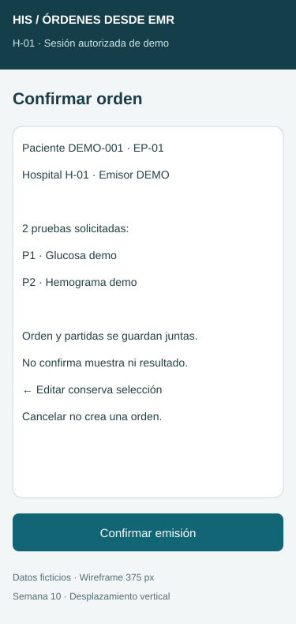
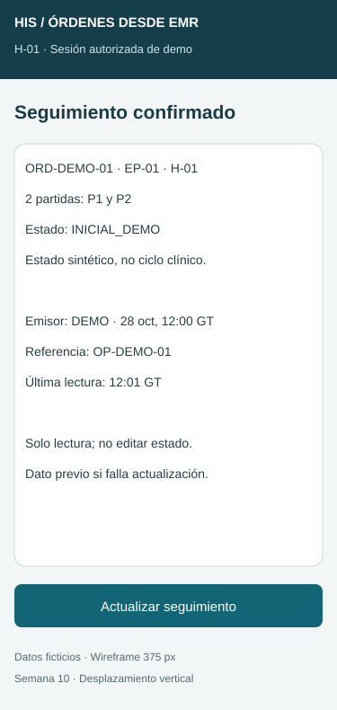
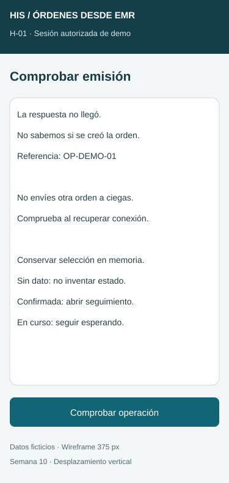

# Semana 10 — Movilidad: órdenes de laboratorio desde EMR

**Estudiante:** Lopez Perez, Mercedes Azucena.

Propuesta responsive de cinco pantallas para 320–430 px, derivada del [UX de semana 8](../semana-08/semana-08-ux-ordenes-emr.md), base f5eb814. Quince SVG estáticos, cinco pantallas en tres anchos; no aplicación desplegada ni integración real. Todos los datos y estados son ficticios. Integrar esa base antes de esta entrega.

## Pantallas y jerarquía

| Pantalla | Datos y acción principal | Variante 375 px |
|---|---|---|
| M1 Episodio | Hospital, paciente mínimo, expediente/episodio, lista en tarjetas y nueva orden según permiso | [Ver](wireframes/01-episodio-375.svg) |
| M2 Pruebas | Búsqueda etiquetada, selección disponible, contador y revisión | [Ver](wireframes/02-pruebas-375.svg) |
| M3 Confirmación | Contexto, total/lista de pruebas, emisor y efecto; editar/cancelar sin persistir | [Ver](wireframes/03-confirmacion-375.svg) |
| M4 Seguimiento | Orden, partidas, estado confirmado, emisor/hora/referencia y última lectura | [Ver](wireframes/04-seguimiento-375.svg) |
| M5 Recuperación | Respuesta desconocida y comprobación por referencia antes de repetir | [Ver](wireframes/05-recuperacion-375.svg) |

La tabla de escritorio se convierte en tarjetas de una orden con sus pruebas/estado; no se decide desde una fila compacta ni se oculta contexto para ganar espacio. Datos personales mínimos solo en detalle autorizado. Historial completo y ayuda bajo demanda reducen carga cognitiva sin ocultar estado, unidad de contexto ni versión de catálogo aplicable.

## Navegación, roles y formularios

Emisor autorizado: M1 → M2 → M3 → M4 solo al confirmar persistencia de orden y todas sus partidas. Editar vuelve a M2 con selección; cancelar no crea orden y pide confirmar descarte si corresponde. Consulta autorizada solo M1/M4, sin emisión. Sin permiso: denegar sin datos. Las actualizaciones de estado vienen de un origen autorizado y política acordada, no de un selector manual.

Paciente/episodio/hospital proceden del EMR y se muestran como lectura. No permitir cambiarlos como campos libres. En M2 usar etiqueta persistente “Buscar prueba”, ayuda separada del texto introducido y controles de selección con nombre. Mínimo una prueba, sin duplicados y sin seleccionar inactivas. Catálogo se revalida al confirmar; no eliminar una partida silenciosamente y emitir el resto.

M3 muestra todas las pruebas con total coincidente, desplazamiento vertical si son varias y acción al final, sin botón fijo sobre el teclado. Valor/prueba clínica no se recomienda automáticamente. El servidor revalida rol, hospital, contexto y catálogo; los bocetos no implementan seguridad.

## Breakpoints

| Ancho | Reglas propuestas |
|---|---|
| 320–359 px | Una columna, márgenes 16 px, contenido 288 px a 320; acciones apiladas y tarjetas sin scroll horizontal. |
| 360–430 px | Misma jerarquía; crece espacio, no se agregan columnas ni se ocultan pruebas/estado. |
| 431–767 px | Columna centrada, formulario hasta 560 px. |
| Desde 768 px | Listado puede usar tabla con encabezados; resumen lateral si cabe; formulario mantiene ancho de lectura. |

Implementación futura: viewport de dispositivo, ancho fluido, min-width:0 y ajuste de IDs largos. No ocultar overflow para encubrir recorte. Texto base de interfaz 16 px; los bocetos usan 14 px para describir contenido, sujeto a revisión en implementación. Controles ≥44 px, separación de acciones, foco visible, etiquetas persistentes y estados textuales. Con zoom/teclado abierto, scroll vertical mantiene visibles controles; probar con teclado y lector de pantalla. Los SVG no certifican accesibilidad ni reflow ejecutado.

## Estados y conexión limitada

| Estado / error | Mensaje y decisión |
|---|---|
| Carga inicial | Esqueleto y “Cargando órdenes…”; no anunciar vacío antes de respuesta. |
| Vacío confirmado | No hay órdenes del episodio; nueva orden solo al emisor. |
| Catálogo caído | Error y reintento; no confundir con cero pruebas disponibles. |
| Selección vacía/inactiva | Error junto al grupo; conservar selección válida para revisar. |
| Emisión en curso | Bloquear doble envío; no mostrar orden creada antes de persistencia completa. |
| Falla confirmada | No se emitió; ninguna partida persistida como orden parcial; recuperación según contrato. |
| Timeout / respuesta desconocida | M5: no sabemos si se creó; comprobar operación antes de reenviar. |
| Seguimiento caído | Dato previo con fecha y aviso “No actualizado”; sin lectura previa, “Sin dato”. No presentar estado actual inventado. |
| Sesión vencida / sin permiso | Renovar acceso o denegar antes de consultar datos; no recuperar borrador fuera del ámbito. |
| Éxito persistido | Abrir M4 con orden/partidas/referencia/autor/hora confirmados. No implica muestra recibida ni resultado disponible. |

Borrador solo en memoria durante sesión válida; no persistir datos clínicos en navegador ni encolar órdenes offline. Contrato integrado debe definir clave de idempotencia, referencia y consulta de resultado; no se afirma endpoint implementado. La conexión recuperada no dispara reenvío automático.

## Escenario móvil 1 — Emisión con respuesta perdida (320 px)

1. Profesional autorizado abre episodio correcto en M1 y selecciona dos pruebas en M2; contador visible evita recordar una lista larga.
2. M3 confirma paciente/episodio/total y lista. El servidor podría guardar y perderse la respuesta.
3. M5 muestra resultado desconocido; no éxito ni Nueva orden para la misma operación. Conservar selección y referencia en memoria, sin duplicar petición a ciegas.
4. Al reconectar: comprobar referencia. Confirmada → M4 con la misma orden; en curso/desconocida → permanecer en recuperación; no aplicada de forma confirmada → permitir reintento según misma clave/contenido y nueva validación del contexto. Nunca crear dos órdenes por doble toque.

**Decisión de contenido:** contexto/total antes de confirmar; historial secundario. **Error:** timeout no equivale a rollback. **Criterio verificable:** una orden con todas sus partidas y una referencia; cero éxito antes de confirmación.

## Escenario móvil 2 — Catálogo cambia y seguimiento no actualiza (430 px)

1. M2 contiene P1/P2 disponibles; al confirmar una dejó de estar habilitada. Rechazar emisión completa y volver a selección con explicación de esa prueba; no quitarla y guardar el resto sin decisión.
2. Emisor revisa alternativa autorizada o cancela; no se recomienda otra prueba automáticamente. Al confirmar selección válida, se crea orden completa y M4 muestra estado sintético confirmado.
3. Más tarde falla actualizar seguimiento. Mantener última lectura con fecha y “No actualizado”; sin datos anteriores, mostrar indisponibilidad. Reintento consulta, no emite otra orden.
4. Si el rol es solo consulta, ocultar emitir; sesión vencida exige renovar y revalidar hospital/episodio antes de continuar.

**Decisión de contenido:** motivo de indisponibilidad junto a la prueba; estado y fecha juntos en seguimiento. **Error:** catálogo fallido no es vacío y lectura fallida no es estado actual. **Criterio verificable:** cero orden parcial, selección no descartada sin aviso y ninguna emisión al reintentar lectura.

## Evidencia y límites

Quince variantes SVG. [Verificación estructural](evidencia/verificacion.txt): XML válido y textos dentro de lienzo medidos con Arial. No es prueba de navegador, API, lector de pantalla, red ni transacciones reales. Estados INICIAL_DEMO son sintéticos hasta acordar ciclo con laboratorio. El módulo no recibe muestras, captura resultados ni los valida.