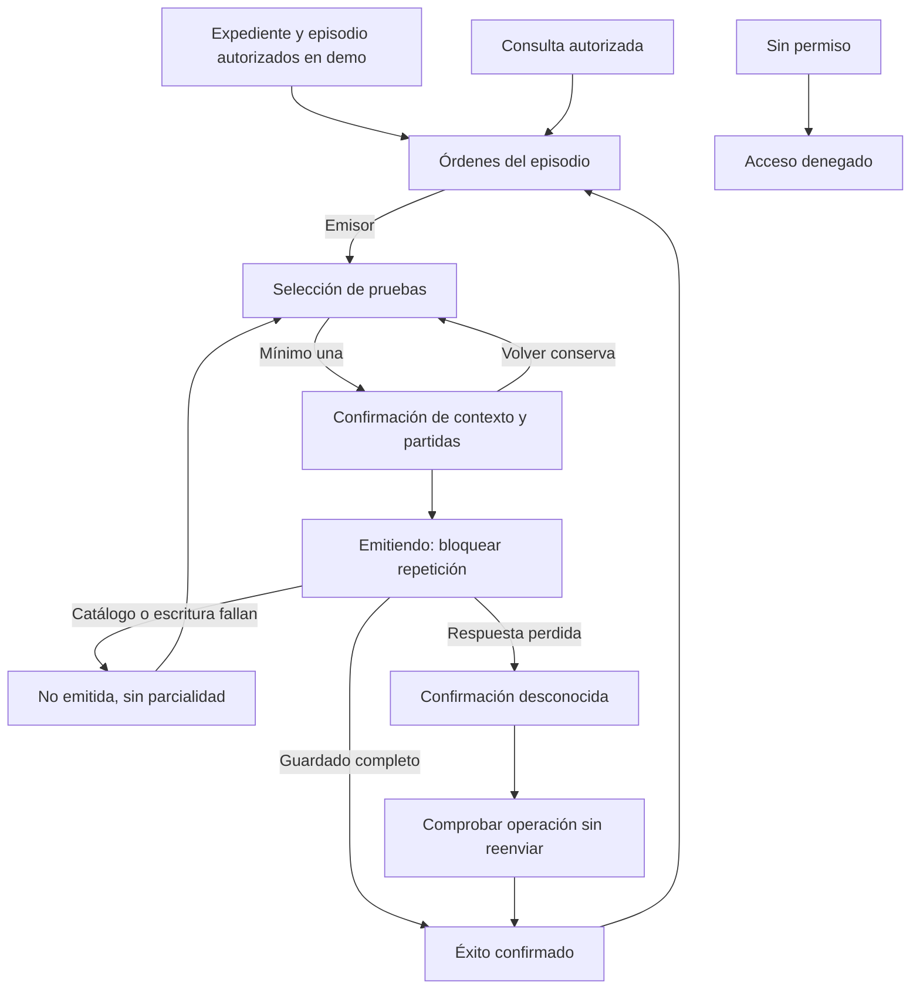

# Semana 11 — Prototipo navegable: órdenes desde EMR

**Estudiante:** Lopez Perez, Mercedes Azucena.

[Abre el prototipo local](prototipo/index.html) en Edge o Chrome. No necesita servidor ni instalación. Contiene datos ficticios en memoria; recargar o reiniciar borra la demostración. No hay llamadas a una API ni persistencia clínica.

## Procedencia y alcance

Base f5eb814 de [semana 8](../semana-08/semana-08-ux-ordenes-emr.md). Se reutilizan los archivos navegables de semana 12, commit ad12f5d, adaptados a esta entrega autónoma: no requiere abrir semana 12 ni incluye su presentación/cambio práctico. Integrar la base UX antes de esta rama.

El flujo es emisión de orden desde contexto del expediente y seguimiento confirmado. Paciente/episodio son de lectura; pruebas proceden de catálogo ficticio. No incluye recepción de muestras, resultados, validación bioquímica ni edición manual del estado. ESTADO_DEMO_INICIAL es una etiqueta sintética, no un ciclo clínico acordado.

## Camino feliz

1. Profesional emisor → Nueva orden. Contexto H-01, EXP-DEMO-01, EP-01 y paciente ficticio visible.
2. Seleccionar Glucosa demo y Hemograma demo; revisar resumen. Volver conserva selección; cancelar no crea orden.
3. Confirmar y emitir bloquea repetición durante simulación. Éxito solo tras guardado completo; orden y partidas se muestran juntas.
4. Ver seguimiento y trazabilidad: ID, pruebas, estado sintético, emisor, hora de Guatemala y referencia de operación.
5. Consulta autorizada ve seguimiento pero no Nueva orden. Sin acceso no ve órdenes. Es simulación UX de roles, no autorización de servidor.

## Error crítico y recuperación

Reiniciar, seleccionar una prueba y escenario Respuesta perdida tras guardar. Al confirmar, el almacenamiento simulado conserva la orden pero la UI informa confirmación desconocida. No anuncia éxito, no muestra la nueva orden como confirmada y no ofrece emitir otra mientras no se resuelva.

Comprobar operación recupera esa misma referencia y confirma una sola orden, sin duplicar partidas. El escenario modela respuesta perdida después de guardar; no simula todas las posibilidades de operación desconocida. Integración real deberá distinguir no aplicada/en curso/confirmada antes de permitir reenvío.

Otros errores: sin pruebas impide revisar; catálogo que cambia rechaza la selección completa, sin orden parcial; falla confirmada de escritura no agrega orden. No confundir catálogo/guardado fallidos con lista vacía ni inventar un estado actual.

## Mapa de navegación


## Consistencia, accesibilidad y movilidad

La UI mantiene contexto mínimo y no permite editar IDs de paciente/episodio. El rol no decide transiciones operativas; seguimiento es de lectura y el origen de actualizaciones debe ser autorizado en una integración futura. La confirmación no presenta éxito antes de completar orden/partidas.

Desde 768 px navegación lateral; móvil una columna y acciones apiladas. Controles ≥46 px, etiquetas persistentes, foco visible, enlace de salto, foco al contenido al navegar, error de selección textual y foco al grupo. Mensajes no dependen solo del color. Pruebas en 1366, 375, 320 y 430 px; no se afirma auditoría WCAG ni prueba con lector de pantalla/dispositivo físico.

## Capturas y verificación

| Escenario | Escritorio | Móvil |
|---|---|---|
| Emisión y seguimiento | [Captura](evidencia/desktop-seguimiento.png) | [Captura](evidencia/movil-seguimiento.png) |
| Error crítico: respuesta desconocida | [Captura](evidencia/desktop-timeout.png) | [Captura](evidencia/movil-timeout.png) |
| Recuperación sin duplicado | [Captura](evidencia/desktop-recuperado.png) | [Captura](evidencia/movil-recuperado.png) |

Las seis capturas se regeneran desde esta copia de semana 11. [Resultados](evidencia/verificacion.txt).

Repetir con Node.js, Playwright y Edge:
```powershell
$qa = Join-Path $env:TEMP 'shi-browser-qa'
npm install --prefix $qa playwright --no-audit --no-fund
$env:PLAYWRIGHT_MODULE = Join-Path $qa 'node_modules/playwright'
node docs/modulos/ordenes-laboratorio-emr/semana-11/verificacion/run.cjs
```
BROWSER_PATH permite otro Chromium. La demo no implementa permisos/tenant del servidor, persistencia real, idempotencia de API ni contrato clínico de estados. Es evidencia de navegación y manejo visual del flujo, no de integración hospitalaria aprobada.