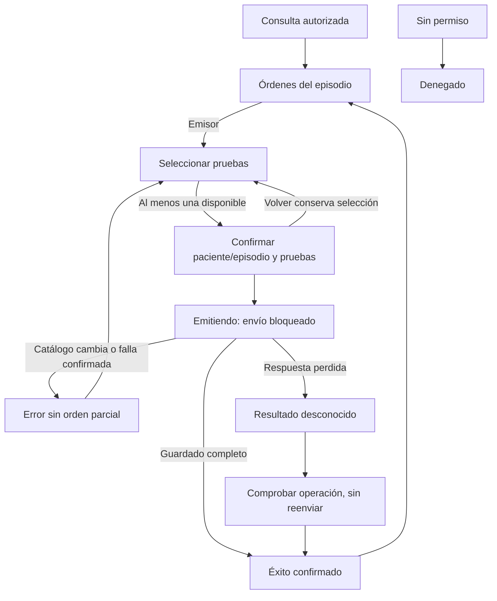

# Semana 12 — Segunda evaluación parcial: órdenes desde EMR

**Estudiante:** Lopez Perez, Mercedes Azucena

Abrir [prototipo/index.html](prototipo/index.html) en Edge o Chrome. Demo local con datos ficticios y memoria temporal, sin API ni persistencia clínica. Rama basada en f5eb814 de semana 8: [UX y wireframes](../semana-08/semana-08-ux-ordenes-emr.md). Integrar esa base antes de esta entrega.

## Recorrido de defensa (5 minutos)

1. Profesional emisor, contexto paciente/expediente/episodio de lectura. Nueva orden → seleccionar Glucosa demo y Hemograma demo → Revisar orden → confirmar → seguimiento con orden, partidas, estado sintético, autor y hora.
2. Consulta autorizada ve seguimiento sin emitir. Sin acceso muestra denegación, no datos de órdenes. Roles son escenarios, no autenticación real.
3. Reiniciar → emitir con prueba que deja de estar disponible. Error y cero partidas guardadas; volver conserva selección para revisión. Falla confirmada de escritura tampoco crea orden.
4. Elegir Respuesta perdida tras guardar. La demo simula guardado, pero no muestra éxito ni la nueva orden como confirmada. Comprobar operación confirma la misma referencia y no crea un duplicado. No hay reenvío mientras el resultado es desconocido.
5. Presentar CH-01, matriz y límites de integración. No se modifica manualmente el estado ni se capturan/validan resultados.

## Mapa de navegación


## Matriz decisión → RF/RNF → evidencia

IDs de [semana 2](../semana-02/semana-02-srp-ordenes-laboratorio-emr.md), complementados con criterios UX de la consigna.

| Decisión defendida | RF/RNF / criterio | Evidencia |
|---|---|---|
| Contexto EMR de lectura; no escribir paciente/episodio libremente | RF-01, RNF-02 | Cabecera/detalle; no campos editables de contexto |
| Selección mínima y disponibilidad revalidada antes de guardar | RF-02/03 | Error por vacío y escenario de cambio de catálogo |
| Orden y partidas se confirman juntas | RF-04, RNF-03 | Éxito con dos pruebas; falla/catálogo no generan orden parcial |
| Consulta sin privilegio de emisión | RF-05, RNF-02 | Selector de rol lector y ausencia de acción Nueva orden |
| Vacío no equivale a lectura fallida | RF-06 | Inicio vacío confirmado en demo; errores explícitos distintos |
| No editar estados manualmente; origen/transición son contrato del laboratorio | RF-07/08 | Seguimiento de lectura; actualizaciones externas pendientes de integración |
| No ampliar a muestras/resultados/validación | RF-09 | Alcance visible y sin acciones clínicas ajenas |
| Respuesta desconocida exige comprobar antes de reenviar | RF-04/06, criterio recuperación | CH-01, pantalla timeout y recuperación sin duplicado |
| Emisión, consulta y cambios externos separados en diseño | RNF-01 | Presentación y contrato SRP de semana 2; UI no decide transiciones |
| Etiquetas, foco, avisos y controles legibles en móvil | Criterio accesibilidad/movilidad | CSS, salto, foco al navegar y capturas en escritorio/móvil |
| Datos mínimos y ficticios | Criterio privacidad | Listados sin paciente completo ni valores clínicos; demo sin red/almacenamiento persistente |

## Componentes y decisiones UX

El diseño objetivo separa vista/presentación, casos de uso de emisión/consulta/actualización, reglas de autorización/catálogo/ciclo y adaptadores de persistencia. Esta demo JS compacta representa la interacción; no implementa el backend PHP ni reemplaza sus transacciones o autorización. No hay un endpoint de consulta por operación desplegado: es requisito propuesto de integración.

Se mantiene contexto mínimo en cada decisión, resumen de pruebas antes de emitir y una acción primaria por vista. Confirmar bloquea el envío durante la simulación. Desktop desde 768 px usa navegación lateral; móvil una columna y acciones apiladas. Controles ≥46 px, foco visible, salto a contenido, etiquetas persistentes y avisos por texto. Al validar selección, foco al primer control. No se afirma prueba con lector de pantalla ni cumplimiento WCAG completo.

Los estados son sintéticos (ESTADO_DEMO_INICIAL). No se inventa un ciclo clínico ni una transición real. Emisor y consultor no actualizan estado manualmente; esa responsabilidad pertenece a un origen autorizado y una política acordada que esta demo no integra.

## Cambio y evidencias

[CH-01](cambio-solicitado.md) es una solicitud simulada para la defensa, no atribuida al docente/usuario: comprobar operación cuando se pierde la respuesta antes de permitir un nuevo envío.

| Recorrido | Desktop | Móvil |
|---|---|---|
| Emisión y seguimiento | [Captura](evidencia/desktop-seguimiento.png) | [Captura](evidencia/movil-seguimiento.png) |
| Confirmación desconocida | [Captura](evidencia/desktop-timeout.png) | [Captura](evidencia/movil-timeout.png) |
| Comprobación sin duplicado | [Captura](evidencia/desktop-recuperado.png) | [Captura](evidencia/movil-recuperado.png) |

[Resultados](evidencia/verificacion.txt): navegador Edge headless con Playwright a 1366, 375, 320 y 430 px. Se recorren selección vacía, conservación, emisión completa, catálogo/falla, timeout, recuperación y roles. Las capturas muestran demo ejecutada, no sistema clínico integrado.

## Repetir verificación y límites
```powershell
$qa = Join-Path $env:TEMP 'shi-browser-qa'
npm install --prefix $qa playwright --no-audit --no-fund
$env:PLAYWRIGHT_MODULE = Join-Path $qa 'node_modules/playwright'
node docs/modulos/ordenes-laboratorio-emr/semana-12/verificacion/run.cjs
```
BROWSER_PATH permite otro Chromium. Para abrir el HTML no hacen falta Node ni Playwright. Recargar o reiniciar borra la demo. Faltan permisos/tenant del servidor, catálogo real, persistencia transaccional, comprobación/idempotencia del contrato y cambios autorizados de seguimiento. La demo solo simula timeout con guardado ya realizado; no cubre todos los posibles estados desconocidos. No representa aprobación de uso clínico.