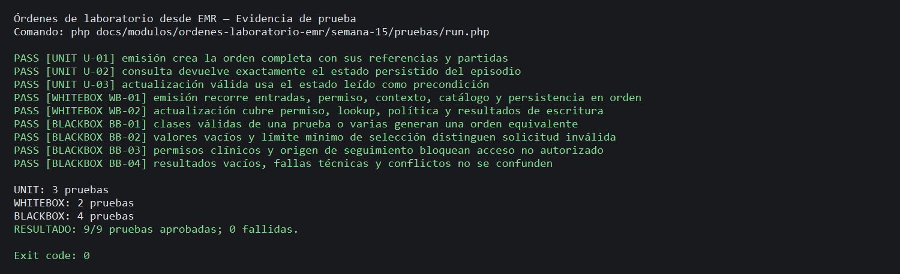
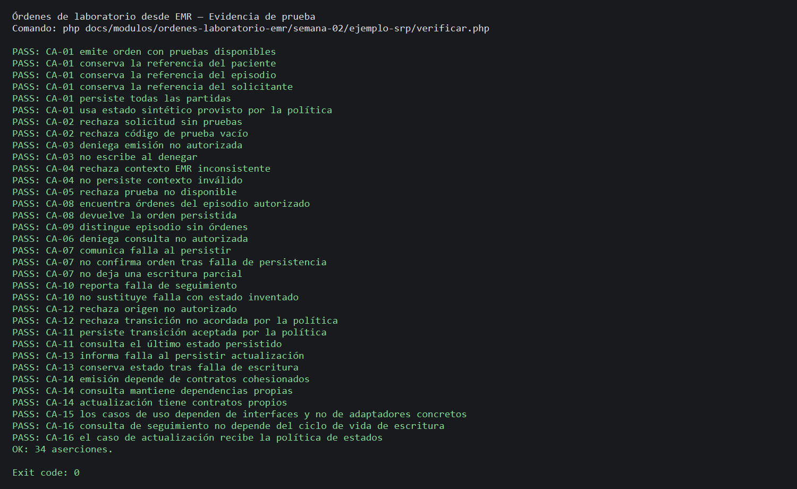

# Semana 15 — Pruebas de órdenes de laboratorio desde EMR

| | |
|---|---|
| **Curso** | Análisis de Sistemas II — Proyecto Final 2026 |
| **Proyecto** | Sistema Hospitalario Integrado (HIS) |
| **Módulo** | Órdenes de laboratorio desde EMR |
| **Tema** | Pruebas unitarias, caja blanca y caja negra |
| **Flujo bajo prueba** | Emisión de orden desde el expediente y seguimiento de su estado |
| **Estudiante** | Lopez Perez, Mercedes Azucena |
| **Fecha** | Octubre 2026 |

## 1. Objetivo y alcance

Diseñar y ejecutar pruebas trazables para los casos de uso aislados de Semana 2: `IssueLabOrder`, `FindLabOrders` y `ApplyLabOrderStatus`. Se ejercitan solicitudes y partidas, contexto de paciente/episodio, permisos del actor y del origen, ciclo de vida provisto por política, lectura del estado persistido, errores y conflictos.

La prueba corresponde al prototipo académico PHP con interfaces y fixture; no comprueba un EMR real, el catálogo productivo ni tablas de base de datos. Los valores `TEST_*` son datos sintéticos. No se prueba autenticación general, recepción de muestras, procesamiento ni validación de resultados.

## 2. Requisitos bajo prueba

| ID | Requerimiento |
|---|---|
| RF-01 | Emitir una orden solo para paciente/episodio autorizados y conservar referencias del solicitante. |
| RF-02 | Rechazar campos obligatorios vacíos y órdenes sin pruebas seleccionadas. |
| RF-03 | Rechazar la selección completa si una prueba no está disponible o el catálogo falla. |
| RF-04 | Persistir orden y partidas como unidad y confirmar solo la escritura completa. |
| RF-05 | Consultar órdenes por paciente/episodio con autorización previa. |
| RF-06 | Distinguir lista vacía de falla de seguimiento, sin inventar estados. |
| RF-07 | Admitir actualización solo desde origen confiable y transición permitida por política. |
| RF-08 | Persistir actualización confirmada y comunicar rechazo, conflicto o falla explícitamente. |
| RF-09 | Mantener catálogo, recepción y procesamiento/resultados fuera del alcance de los casos probados. |
| RNF-01 | Mantener dependencias distintas para emisión, consulta y actualización. |
| RNF-02 | Autorizar antes de leer o modificar. |
| RNF-03 | No confirmar escritura incompleta ni fallida. |
| RNF-04 | Conservar identidad de orden, paciente, episodio, solicitante, pruebas y estado. |
| RNF-05 | Devolver solo estado consultado y confirmado; diferenciar vacío y error. |
| RNF-06 | Usar la política de ciclo de vida inyectada, sin definir aquí transiciones reales. |
| RNF-07 | Ejecutar con dobles reproducibles, sin datos clínicos ni infraestructura. |

## 3. Estrategia y cantidad

| Tipo | Mínimo solicitado | Casos diseñados | Cobertura |
|---|---:|---:|---|
| Unitarias | 3 | 3 | Emisión completa; consulta del estado persistido por episodio; transición aceptada con estado esperado. |
| Caja blanca | 2 | 2 | Orden de guardas para emisión; ramas de autorización, búsqueda, política y escritura de seguimiento. |
| Caja negra | 4 | 4 | Clases equivalentes de selección; límites y datos vacíos; permisos; vacío, errores técnicos y conflictos. |

Los dobles y contadores de llamadas están en [`pruebas/TestDoubles.php`](pruebas/TestDoubles.php). El runner imprime identificadores U/WB/BB junto a cada caso.

## 4. Matriz RF/RNF → prueba

| Requisito | Prueba(s) | Resultado verificable |
|---|---|---|
| RF-01 | U-01, WB-01, BB-03 | Contexto autorizado crea orden y conserva paciente/episodio/solicitante; denegación no persiste. |
| RF-02 | BB-02 | Campos vacíos, lista sin pruebas y código vacío se rechazan antes de autorización o escritura. |
| RF-03 | WB-01 | Catálogo inválido/indisponible distingue estados y no alcanza escritura. |
| RF-04 | U-01, BB-04 | Orden completa queda creada; falla técnica no devuelve una orden de éxito. |
| RF-05 | U-02, BB-03 | Consulta se limita a episodio y exige autorización previa. |
| RF-06 | U-02, BB-04 | `EMPTY` es respuesta válida; `UNAVAILABLE` conserva error y no inventa órdenes. |
| RF-07 | U-03, WB-02, BB-03 | Fuente confiable y política habilitan transición; origen no confiable o transición no permitida no escribe. |
| RF-08 | U-03, WB-02, BB-04 | Estado esperado se compara; `UPDATED`, `CONFLICT`, `NOT_FOUND` y falla tienen resultados distinguibles. |
| RF-09 | Todas | Los runners solo cargan el workflow de órdenes; no llaman módulos hermanos. |
| RNF-01 | U-01–U-03 | Cada caso usa solamente sus puertos relevantes; los constructores previos documentan contratos. |
| RNF-02 | WB-01, WB-02, BB-03 | Contadores prueban que una denegación termina antes de leer/escribir. |
| RNF-03 | U-01, BB-04 | Se verifica escritura completa y ausencia de respuesta exitosa ante error. |
| RNF-04 | U-01 | Se verifican paciente, episodio, actor solicitante, partidas y estado inicial. |
| RNF-05 | U-02, BB-04 | Se devuelve exactamente el estado provisto por repositorio y vacío no se confunde con error. |
| RNF-06 | WB-01, WB-02 | Las pruebas inyectan estados sintéticos de ciclo de vida y ejercitan transición no permitida. |
| RNF-07 | Todas | Se ejecuta PHP CLI con dobles en memoria y datos `TEST_*`. |

## 5. Caja blanca

### WB-01 — Ramas de emisión

Ejecuta: entrada inválida; autorización denegada; contexto inválido o no disponible; catálogo inválido o no disponible. Comprueba que cada rama produce su resultado específico y detiene la operación antes de `createAtomically()`. La ruta aprobada es cubierta por U-01.

### WB-02 — Ramas de actualización de seguimiento

Ejecuta origen no confiable; orden no encontrada; lookup indisponible; orden encontrada sin transición autorizada; y resultados de escritura `NOT_FOUND`, `CONFLICT`, `UNAVAILABLE` y `SAVED` inesperado. Comprueba mapeo explícito y cero escrituras previas a las precondiciones.

## 6. Caja negra: equivalencia, límites, permisos y errores

| Caso | Entradas equivalentes/condición | Esperado |
|---|---|---|
| BB-01 | Una prueba válida o varias pruebas válidas | Orden creada con exactamente la selección solicitada. |
| BB-02 | Actor, paciente, episodio, lista o código vacío; selección mínima de una prueba | Datos incompletos → `INVALID_REQUEST`; una prueba válida → `CREATED`. |
| BB-03 | Emisión/consulta sin autorización y actualización de fuente no confiable | `FORBIDDEN` / `REJECTED`, sin acceso o escritura posterior. |
| BB-04 | Consulta vacía, consulta indisponible, emisión fallida, orden inexistente y conflicto de escritura | Respuestas diferenciadas; no se informa estado inventado ni confirmación falsa. |

## 7. Comandos y resultados

Desde la raíz del repositorio:

```powershell
php docs/modulos/ordenes-laboratorio-emr/semana-15/pruebas/run.php
php docs/modulos/ordenes-laboratorio-emr/semana-02/ejemplo-srp/verificar.php
```

| Comando | Resultado |
|---|---|
| `php docs/modulos/ordenes-laboratorio-emr/semana-15/pruebas/run.php` | Exit 0; 9/9 casos aprobados: 3 unitarios, 2 caja blanca, 4 caja negra. |
| `php docs/modulos/ordenes-laboratorio-emr/semana-02/ejemplo-srp/verificar.php` | Exit 0; 34 aserciones aprobadas. |
| `php -l` sobre runner, dobles, workflow, fixture y regresión | Sin errores de sintaxis; detalle en `evidencia/salida-lint.txt`. |

**Resultados observados:** la suite de Semana 15 ejecuta 9 casos —3 unitarios, 2 de caja blanca y 4 de caja negra—; la suite de regresión verifica los criterios CA-01–CA-16 con 34 aserciones. PHP 8.2.33 pasa lint para workflow, adaptadores y pruebas. Las salidas exactas están en [salida-semana-15.txt](evidencia/salida-semana-15.txt), [salida-regresion-semana-02.txt](evidencia/salida-regresion-semana-02.txt) y [salida-lint.txt](evidencia/salida-lint.txt). Las capturas visuales de consola están en [capturas/](evidencia/capturas/).

### Captura de la suite Semana 15



### Captura de regresión de Semana 2



## 8. Defectos y límites registrados

| ID | Hallazgo | Severidad | Estado |
|---|---|---|---|
| — | No se observaron defectos en los escenarios ejecutados. | — | Sin defectos abiertos. |

Las pruebas verifican contratos observables del ejemplo, no una integración EMR ni una política clínica productiva. Los estados sintéticos no definen estados reales; la persistencia en memoria no sustituye pruebas transaccionales de base de datos.
