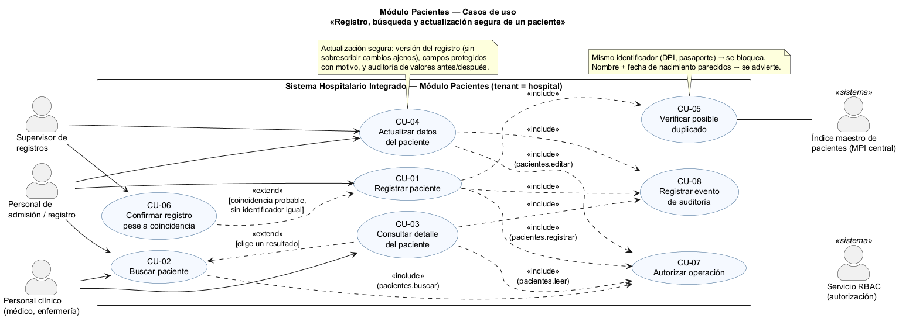
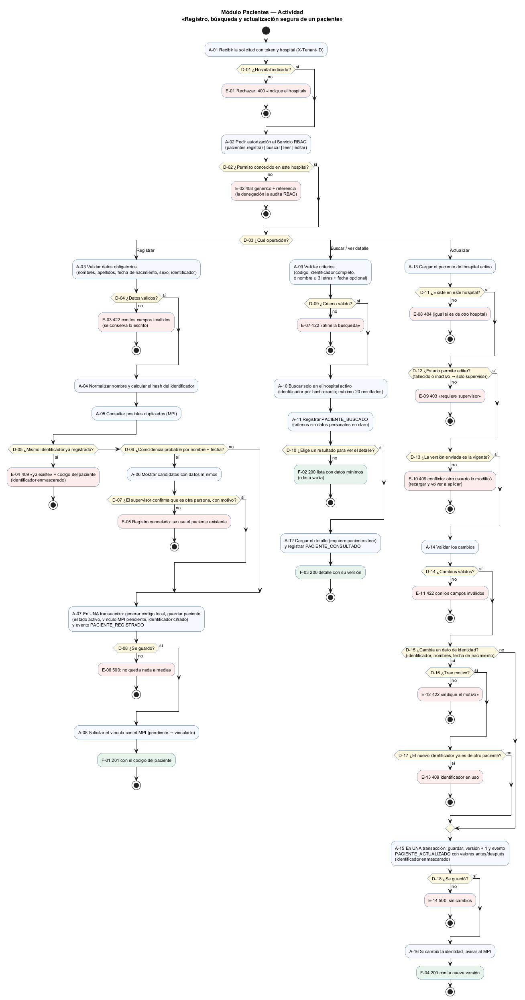
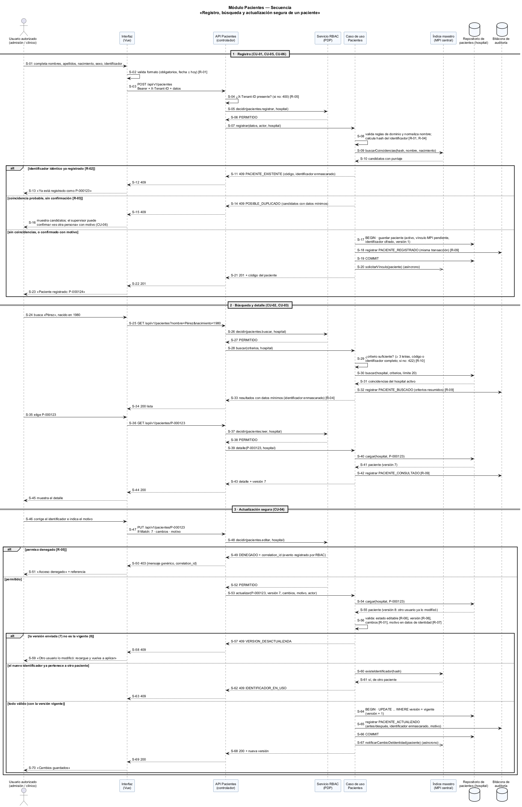

# Semana 1 — Modelado UML del proceso de Pacientes

| | |
|---|---|
| **Curso** | Análisis de Sistemas II — Proyecto Final 2026 |
| **Proyecto** | Sistema Hospitalario Integrado (HIS) |
| **Módulo** | Pacientes: registro, edición, búsqueda y detalle |
| **Tema de la semana** | Conceptos generales, orientación a objetos y UML |
| **Proceso modelado** | «Registro, búsqueda y actualización segura de un paciente» |
| **Estudiante** | Boris Alexander Quiroa Orellana |
| **Fecha** | Octubre 2026 |

## Índice

1. [Introducción](#1-introducción)
2. [Narrativa de alcance](#2-narrativa-de-alcance)
3. [Actores](#3-actores)
4. [Reglas de negocio](#4-reglas-de-negocio)
5. [Diagrama de casos de uso](#5-diagrama-de-casos-de-uso)
6. [Especificación de casos de uso](#6-especificación-de-casos-de-uso)
7. [Diagrama de actividad](#7-diagrama-de-actividad)
8. [Diagrama de secuencia](#8-diagrama-de-secuencia)
9. [Matriz de trazabilidad](#9-matriz-de-trazabilidad)
10. [Conclusión](#10-conclusión)
11. [Bibliografía](#11-bibliografía)

## 1. Introducción

El paciente es el dato central del HIS: admisiones, citas, notas clínicas, laboratorio y facturación dependen de que exista **una sola ficha correcta por persona** en cada hospital. Un paciente duplicado reparte su historia clínica en dos fichas. Una edición sin control puede sobrescribir datos de identidad sin dejar rastro.

Este documento modela con UML el proceso «registro, búsqueda y actualización segura de un paciente» en tres vistas:

| Vista | Qué muestra |
|---|---|
| Casos de uso | Quién interactúa con el módulo y con qué objetivo |
| Actividad | El flujo con sus decisiones, excepciones y resultados |
| Secuencia | Los mensajes entre participantes, las validaciones y las respuestas |

Las tres comparten identificadores (CU, A, D, E, F, R y S; F = resultado final, R = regla de negocio) para que se puedan **trazar** entre sí (§9).

El modelo se apoya en el esquema real del proyecto:
- `local_patients` en la base de cada hospital;
- `mpi_patients`, `mpi_identifiers` e `identity_match_candidates` en la base central (índice maestro de pacientes, MPI).

Así, las reglas de este documento no son inventadas: corresponden a restricciones que ya existen en las migraciones.

## 2. Narrativa de alcance

### 2.1 Objetivo del proceso

Permitir que el personal autorizado de un hospital:

1. **Registre** a un paciente una sola vez, evitando duplicados.
2. **Encuentre** a un paciente rápido, sin exponer datos sensibles de más.
3. **Consulte** su detalle.
4. **Actualice** sus datos sin perder cambios de otros usuarios y sin modificar la identidad sin justificación.

Todo con evidencia de quién hizo qué.

### 2.2 Dentro del alcance

| Tema | Incluido |
|---|---|
| Registro | Datos demográficos mínimos: nombres, apellidos, fecha de nacimiento, sexo, contacto y un identificador oficial (DPI, pasaporte u otro). Código local único y estado inicial «activo». |
| Prevención de duplicados | Bloqueo por identificador idéntico. Advertencia por coincidencia probable de nombre y fecha de nacimiento, que el supervisor puede confirmar con motivo. |
| Búsqueda | Por código local, por identificador completo o por nombre (3 letras o más) con fecha de nacimiento opcional. Solo en el hospital activo, con un máximo de 20 resultados y datos mínimos. |
| Detalle | Ficha completa del paciente, con su versión vigente |
| Actualización segura | Control de versión, motivo obligatorio para datos de identidad, restricción para pacientes fallecidos o inactivos, y auditoría con valores antes y después |
| Seguridad | Hospital obligatorio y permiso por operación, que decide el módulo RBAC: `pacientes.registrar`, `.buscar`, `.leer` y `.editar` |
| Auditoría | Eventos `PACIENTE_REGISTRADO`, `PACIENTE_BUSCADO`, `PACIENTE_CONSULTADO` y `PACIENTE_ACTUALIZADO` |

### 2.3 Fuera del alcance

| Excluido | Por qué |
|---|---|
| Fusión de fichas duplicadas ya existentes (`merged` en el MPI) | Es un proceso de calidad de datos del MPI central, con su propio responsable |
| Admisión, citas, camas, episodios de atención | Son otros módulos que **consumen** el paciente |
| Historia clínica, alergias, signos vitales | Módulo de expediente clínico |
| Consentimientos y acceso entre hospitales | Existen en el esquema (`patient_consents`, `cross_hospital_access_grants`), pero son del módulo de acceso compartido |
| Eliminación física de pacientes | No se elimina: se pasa a «inactivo» (las tablas usan `ON DELETE RESTRICT`) |
| Autenticación | Módulo de autenticación (JWT) |

### 2.4 Supuestos y restricciones

- **Tenant.** Cada hospital es un tenant con su propia base. El paciente local (`local_patients`) se vincula con el MPI central por `global_id`, sin llave foránea física entre bases.
- **Identificadores cifrados.** Se guardan cifrados (`value_encrypted`) y se buscan por un *hash* (`search_hash`). Nunca se muestran completos en listas.
- **Unicidad del identificador.** Es única por emisor y tipo entre los identificadores activos: índice `mpi_identifiers_active_identity_unique`.
- **Fecha de nacimiento.** No puede ser futura (`CHECK birth_date <= current_date`).
- **Catálogos fijos.** Sexo ∈ {female, male, other, unknown}; estado ∈ {active, inactive, deceased}.

## 3. Actores

| Actor | Tipo | Objetivo |
|---|---|---|
| **Personal de admisión / registro** | Principal | Registrar pacientes nuevos, buscarlos y corregir sus datos |
| **Personal clínico** (médico, enfermería) | Principal | Encontrar al paciente y consultar su detalle; no edita la identidad |
| **Supervisor de registros** | Principal | Confirmar un registro pese a una coincidencia probable y editar pacientes inactivos o fallecidos |
| **Servicio RBAC** | Secundario (sistema) | Decidir si el usuario tiene el permiso de la operación en ese hospital |
| **Índice maestro de pacientes (MPI central)** | Secundario (sistema) | Detectar posibles duplicados por identificador y por datos demográficos, y vincular la ficha local con la identidad global |

## 4. Reglas de negocio

| ID | Regla | Origen |
|---|---|---|
| R-01 | Datos obligatorios y válidos: nombres, apellidos, fecha de nacimiento no futura, sexo del catálogo | `local_patients` (NOT NULL, CHECK) |
| R-02 | Un identificador (emisor + tipo + valor) pertenece a **un solo** paciente: si ya existe, el registro se bloquea | `mpi_identifiers_active_identity_unique` |
| R-03 | Una coincidencia probable por nombre y fecha (sin identificador igual) **advierte**. Para registrar igual, el supervisor confirma con motivo. | `identity_match_candidates` (puntaje) |
| R-04 | El identificador se guarda cifrado y se busca por hash. En listas y respuestas se muestra **enmascarado**. | `value_encrypted`, `search_hash` |
| R-05 | Toda operación exige hospital (`X-Tenant-ID`) y su permiso: `pacientes.registrar`, `.buscar`, `.leer` o `.editar`. La decisión y la denegación auditada las hace RBAC. | Módulo RBAC |
| R-06 | **Control de concurrencia optimista**: la actualización indica la versión que se leyó; si cambió, 409 y no se sobrescribe | Diseño (actualización segura) |
| R-07 | Cambiar un dato de identidad (identificador, nombres, fecha de nacimiento) exige **motivo**, y se vuelve a verificar la unicidad del identificador | Diseño (actualización segura) |
| R-08 | Un paciente fallecido o inactivo solo lo edita el supervisor | `local_patients.status` |
| R-09 | Registro, búsqueda, consulta y actualización dejan un evento de auditoría. En los cambios, el evento va en la **misma transacción** e incluye valores antes y después, con el identificador enmascarado. | Diseño (trazabilidad) |
| R-10 | La búsqueda exige un criterio mínimo (3 letras, código o identificador completo), se limita al hospital activo y devuelve como máximo 20 resultados con datos mínimos | Diseño (minimización de datos) |

## 5. Diagrama de casos de uso

Fuente: [semana-01-casos-de-uso.puml](diagramas/semana-01-casos-de-uso.puml)

**Relaciones:**

| Relación | Justificación |
|---|---|
| CU-01 **incluye** CU-05 | Verificar duplicados es obligatorio en todo registro |
| CU-06 **extiende** CU-01 | Ocurre solo si hay coincidencia probable: punto de extensión «resultado de la verificación» |
| CU-03 **extiende** CU-02 | Desde los resultados se puede abrir el detalle. El personal clínico también puede llegar directo al detalle. |
| CU-01..CU-04 **incluyen** CU-07 | Toda operación pasa por la autorización (R-05) |
| CU-01, CU-03 y CU-04 **incluyen** CU-08 | Deben dejar evidencia (R-09). CU-02 también registra su búsqueda: en el diagrama se omite la flecha para no saturarlo, y se muestra en actividad (A-11) y secuencia (S-32). |

## 6. Especificación de casos de uso

### CU-01 Registrar paciente

| | |
|---|---|
| **Actor** | Personal de admisión |
| **Precondición** | Sesión iniciada; hospital activo; permiso `pacientes.registrar` |
| **Flujo principal** | 1. Captura los datos. 2. El sistema valida (R-01). 3. Normaliza el nombre y calcula el hash del identificador (R-04). 4. Verifica duplicados (CU-05). 5. Guarda el paciente con su evento en una transacción (R-09). 6. Solicita el vínculo con el MPI. 7. Muestra el código asignado. |
| **Excepciones** | Sin hospital → 400 · sin permiso → 403 · datos inválidos → 422 · identificador existente → 409 · coincidencia probable → 409 con candidatos (puede seguir con CU-06) · falla al guardar → 500 sin cambios |
| **Postcondición** | Paciente activo con código único, vínculo MPI «pendiente» y evento `PACIENTE_REGISTRADO` |

### CU-02 Buscar paciente

| | |
|---|---|
| **Actor** | Personal de admisión o clínico |
| **Precondición** | Permiso `pacientes.buscar` |
| **Flujo principal** | 1. Ingresa el criterio. 2. El sistema lo valida (R-10). 3. Busca en el hospital activo. 4. Registra `PACIENTE_BUSCADO`. 5. Muestra hasta 20 resultados con datos mínimos. |
| **Excepciones** | Criterio insuficiente → 422 · sin resultados → lista vacía (200) |
| **Postcondición** | Ningún cambio de datos; la búsqueda queda auditada |

### CU-03 Consultar detalle del paciente

| | |
|---|---|
| **Actor** | Personal de admisión o clínico |
| **Precondición** | Permiso `pacientes.leer` |
| **Flujo principal** | Abre la ficha → el sistema la carga del hospital activo → registra `PACIENTE_CONSULTADO` → muestra el detalle con su **versión** (que CU-04 necesita) |
| **Excepciones** | No existe en este hospital → 404 (idéntico si es de otro hospital) |

### CU-04 Actualizar datos del paciente

| | |
|---|---|
| **Actor** | Personal de admisión; supervisor (pacientes inactivos o fallecidos) |
| **Precondición** | Permiso `pacientes.editar`; versión leída en CU-03 |
| **Flujo principal** | 1. Modifica los datos (y el motivo, si toca la identidad). 2. El sistema carga el paciente. 3. Valida el estado (R-08), la versión (R-06), los cambios (R-01) y el motivo (R-07). 4. Si cambia el identificador, verifica su unicidad (R-02). 5. Guarda con versión + 1 y el evento con valores antes y después, en una transacción (R-09). 6. Avisa al MPI si cambió la identidad. |
| **Excepciones** | Sin permiso → 403 · no existe → 404 · estado no editable → 403 · versión desactualizada → 409 · datos inválidos o sin motivo → 422 · identificador en uso → 409 · falla al guardar → 500 sin cambios |
| **Postcondición** | Datos actualizados, versión incrementada y evento `PACIENTE_ACTUALIZADO` con antes y después |

### CU-05 Verificar posible duplicado (incluido)

El MPI compara el **hash** del identificador (coincidencia exacta → bloqueo, R-02) y los datos demográficos normalizados (coincidencia probable con puntaje → advertencia, R-03). También se usa en CU-04 cuando cambia el identificador.

### CU-06 Confirmar registro pese a coincidencia (extiende CU-01)

Solo el supervisor, con un motivo escrito. Queda en el evento `PACIENTE_REGISTRADO`. No aplica si el identificador es idéntico: ese caso siempre se bloquea.

### CU-07 Autorizar operación (incluido)

Delegado al módulo RBAC (PDP). Si deniega, la respuesta es 403 genérico con referencia, y RBAC registra la denegación.

### CU-08 Registrar evento de auditoría (incluido)

Evento con: actor, hospital, paciente, acción, fecha, referencia y, en los cambios, los valores antes y después (identificador enmascarado). Las búsquedas guardan los criterios **resumidos**, sin datos personales en claro.

## 7. Diagrama de actividad

Fuente: [semana-01-actividad.puml](diagramas/semana-01-actividad.puml)

| Elemento pedido | Dónde está |
|---|---|
| **Decisiones** | D-01..D-18: hospital, permiso, tipo de operación, validez, duplicados, confirmación, versión, identidad, motivo y persistencia |
| **Excepciones** | E-01..E-14, en rojo, cada una con su respuesta: 400, 403, 404, 409, 422 o 500 |
| **Resultados** | F-01..F-04, en verde: 201 registrado, 200 lista, 200 detalle con versión, 200 actualizado con nueva versión |

Tres decisiones de diseño se ven en el diagrama:

| Decisión | Dónde |
|---|---|
| La verificación de duplicados va **antes** de guardar | A-05 → D-05/D-06 |
| La versión se verifica **antes** de validar los cambios | D-13: un conflicto se resuelve recargando, no corrigiendo campos |
| Guardar y auditar ocurren en **una** transacción | A-07, A-15: sin evidencia no hay cambio |

## 8. Diagrama de secuencia

Fuente: [semana-01-secuencia.puml](diagramas/semana-01-secuencia.puml)

**Participantes:** usuario, interfaz (Vue), API Pacientes (controlador), Servicio RBAC (PDP), caso de uso, MPI central, repositorio de pacientes y bitácora de auditoría.

| Bloque | Mensajes | Validaciones visibles | Respuestas |
|---|---|---|---|
| 1 · Registro | S-01..S-23 | Formato en la interfaz (S-02), hospital (S-04), permiso (S-05), reglas de dominio (S-08), duplicados en el MPI (S-09) | 409 existente · 409 posible duplicado · 201 |
| 2 · Búsqueda y detalle | S-24..S-45 | Permisos `buscar` y `leer` (S-26, S-37); criterio suficiente (S-29) | 200 lista mínima · 200 detalle con versión |
| 3 · Actualización segura | S-46..S-70 | Permiso `editar` (S-48); estado, versión, cambios y motivo (S-56); unicidad del identificador (S-60) | 403 con referencia · 409 versión desactualizada · 409 identificador en uso · 200 |

La versión viaja en la cabecera `If-Match` (S-47). Es la forma estándar de HTTP para la concurrencia optimista: la petición solo se aplica si el recurso no cambió.

## 9. Matriz de trazabilidad

| Caso de uso | Actividad (nodos) | Secuencia (mensajes) | Resultado / HTTP |
|---|---|---|---|
| CU-01 Registrar paciente | A-01..A-08; D-01..D-08; E-01..E-06; F-01 | S-01..S-23 | 201 / 400 / 403 / 409 / 422 / 500 |
| CU-02 Buscar paciente | A-09..A-11; D-09, D-10; E-07; F-02 | S-24..S-34 | 200 / 422 |
| CU-03 Consultar detalle | A-12; F-03 | S-35..S-45 | 200 / 404 |
| CU-04 Actualizar datos | A-13..A-16; D-11..D-18; E-08..E-14; F-04 | S-46..S-70 | 200 / 403 / 404 / 409 / 422 / 500 |
| CU-05 Verificar duplicado | A-05; D-05, D-06; D-17 | S-09, S-10, S-60, S-61 | Bloqueo o advertencia |
| CU-06 Confirmar pese a coincidencia | A-06; D-07; E-05 | S-14..S-16 | Registro con motivo o cancelado |
| CU-07 Autorizar operación | A-02; D-02; E-02 | S-05, S-06, S-26, S-27, S-37, S-38, S-48..S-52 | PERMITIDO / 403 |
| CU-08 Registrar evento | A-07, A-11, A-12, A-15 | S-18, S-32, S-42, S-65 | Eventos `PACIENTE_*` |

| Regla | Actividad | Secuencia |
|---|---|---|
| R-01 Datos obligatorios | A-03, D-04, A-14, D-14 | S-02, S-08, S-56 |
| R-02 Identificador único | D-05, D-17; E-04, E-13 | S-11..S-13, S-60..S-63 |
| R-03 Coincidencia probable | D-06, A-06, D-07; E-05 | S-14..S-16 |
| R-04 Identificador cifrado y enmascarado | A-04, A-07, A-10 | S-08, S-11, S-33, S-65 |
| R-05 Hospital y permiso | D-01, D-02; E-01, E-02 | S-04, S-05, S-26, S-37, S-48..S-51 |
| R-06 Concurrencia optimista | D-13; E-10 | S-47, S-56, S-57..S-59, S-64 |
| R-07 Motivo en datos de identidad | D-15, D-16; E-12 | S-46, S-56, S-65 |
| R-08 Fallecido o inactivo | D-12; E-09 | S-56 |
| R-09 Auditoría | A-07, A-11, A-12, A-15 | S-18, S-32, S-42, S-65 |
| R-10 Búsqueda acotada | A-09, A-10, D-09; E-07 | S-29, S-30, S-33 |

Toda regla aparece en las dos vistas dinámicas, y todo caso de uso tiene nodos y mensajes. Así se verifica que el modelo es **consistente**.

## 10. Conclusión

Modelar el proceso en tres vistas hizo visibles dos riesgos que una pantalla de formulario esconde:

1. **El duplicado.** Por eso la verificación contra el MPI es un caso de uso incluido (CU-05), y no un detalle de la interfaz.
2. **La sobrescritura silenciosa.** Por eso la actualización «segura» se concreta en tres mecanismos:
   - la **versión** (R-06), que evita perder cambios de otro usuario;
   - el **motivo** obligatorio para tocar la identidad (R-07);
   - la **auditoría con antes y después** en la misma transacción (R-09).

La autorización se delega al módulo RBAC (CU-07): el módulo de Pacientes no decide permisos, solo los pide.

Los identificadores compartidos permiten comprobar, regla por regla, que el modelo es consistente. Esa base servirá para los requisitos y para aplicar LSP en la semana 2.

## 11. Bibliografía

- Object Management Group. (2017). *Unified Modeling Language (UML), Version 2.5.1*. https://www.omg.org/spec/UML/2.5.1
- Larman, C. (2004). *Applying UML and Patterns* (3.ª ed.). Prentice Hall.
- Cockburn, A. (2001). *Writing Effective Use Cases*. Addison-Wesley.
- Fielding, R., Nottingham, M. y Reschke, J. (2022). *RFC 9110: HTTP Semantics* (§13.1.1 If-Match). IETF. https://www.rfc-editor.org/rfc/rfc9110
- HL7 International. (2023). *FHIR R5 — Patient Resource* y *Patient $match*. https://hl7.org/fhir/R5/patient.html
- OWASP Foundation. (2024). *Logging Cheat Sheet*. https://cheatsheetseries.owasp.org/cheatsheets/Logging_Cheat_Sheet.html
