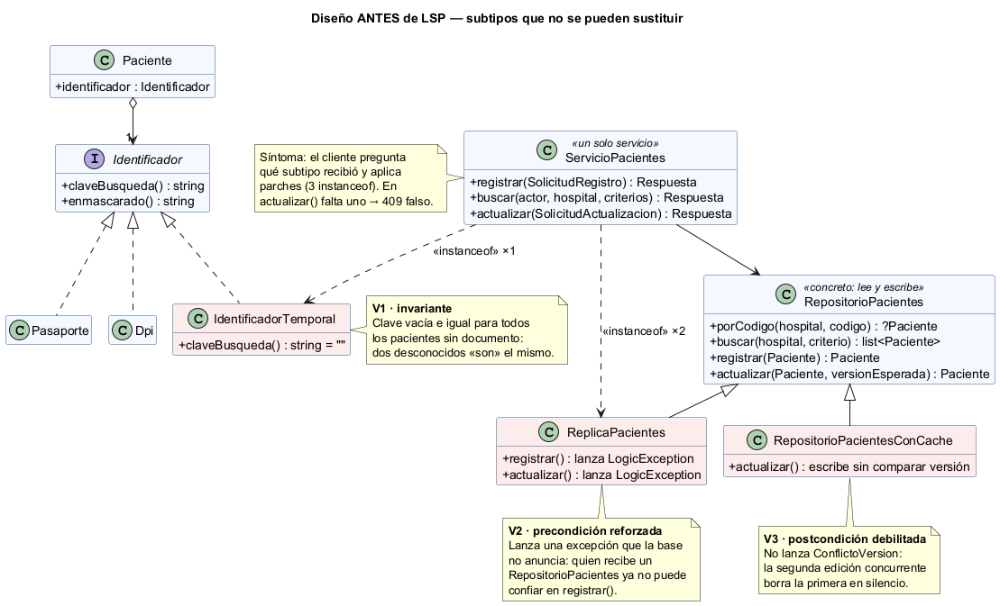
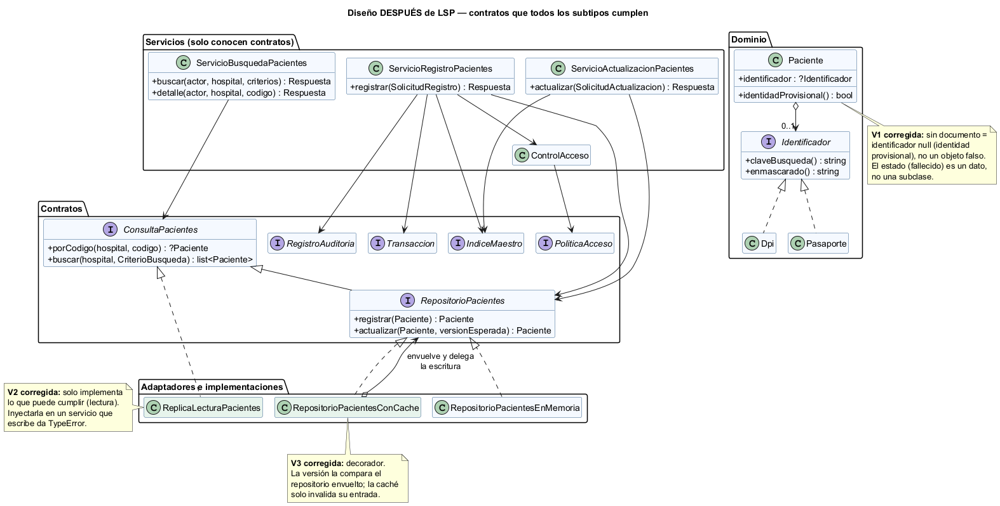

# Semana 2 — Requerimientos, criterios de aceptación y aplicación de LSP

| | |
|---|---|
| **Curso** | Análisis de Sistemas II — Proyecto Final 2026 |
| **Proyecto** | Sistema Hospitalario Integrado (HIS) |
| **Módulo** | Pacientes: registro, edición, búsqueda y detalle |
| **Tema de la semana** | Proceso y modelo de diseño; principios SOLID |
| **Flujo de diseño** | «Registro, búsqueda y actualización segura de un paciente» |
| **Principio aplicado** | LSP — Principio de sustitución de Liskov |
| **Estudiante** | Boris Alexander Quiroa Orellana |
| **Fecha** | Octubre 2026 |

## Índice

1. [Introducción](#1-introducción)
2. [Requerimientos funcionales](#2-requerimientos-funcionales)
3. [Requerimientos no funcionales](#3-requerimientos-no-funcionales)
4. [Criterios de aceptación](#4-criterios-de-aceptación)
5. [El principio de sustitución de Liskov (LSP)](#5-el-principio-de-sustitución-de-liskov-lsp)
6. [Diseño antes de aplicar LSP](#6-diseño-antes-de-aplicar-lsp)
7. [Diseño después de aplicar LSP](#7-diseño-después-de-aplicar-lsp)
8. [Responsabilidades y dependencias](#8-responsabilidades-y-dependencias)
9. [Evidencia verificable](#9-evidencia-verificable)
10. [Trazabilidad con la semana 1](#10-trazabilidad-con-la-semana-1)
11. [Conclusión](#11-conclusión)
12. [Bibliografía](#12-bibliografía)

## 1. Introducción

En la semana 1 se modeló el proceso con tres diagramas UML (casos de uso CU-01..CU-08, actividad y secuencia) y diez reglas de negocio (R-01..R-10). Esta semana se pasa del **qué** al **cómo**:

1. Se formalizan los requerimientos funcionales (RF) y no funcionales (RNF).
2. Se escriben criterios de aceptación verificables (CA).
3. Se diseña la solución aplicando el **principio de sustitución de Liskov (LSP)**.

**Por qué LSP en este módulo.** El flujo de pacientes depende de abstracciones que tienen **varias implementaciones**:

| Abstracción | Implementaciones |
|---|---|
| Documento de identidad | DPI, pasaporte, y la tentación de un «identificador temporal» para quien llega sin documento |
| Acceso a pacientes | Repositorio principal, réplica de solo lectura para las búsquedas, caché |

El riesgo no es que el código no compile, sino que un subtipo **compile y se comporte distinto**. Si la caché no respeta la versión, se pierden ediciones. Si el identificador temporal devuelve una clave vacía, dos desconocidos «son» el mismo paciente. LSP es el principio que obliga a que cada implementación cumpla el **contrato** de su tipo base.

**La evidencia** es un ejemplo ejecutable en PHP 8.2+ sin framework, en [`ejemplo-lsp/`](ejemplo-lsp/README.md):
- el diseño **antes**, con tres violaciones reales de LSP;
- el diseño **después**;
- pruebas de contrato que se ejecutan **contra cada implementación**;
- un script con 25 pruebas y una comprobación por mutación.

## 2. Requerimientos funcionales

| ID | Requerimiento | Origen (semana 1) |
|---|---|---|
| RF-01 | El sistema debe registrar un paciente con nombres, apellidos, fecha de nacimiento no futura, sexo del catálogo, teléfono opcional y documento opcional (DPI o pasaporte), y asignarle un código único con versión 1. | CU-01, A-03, D-04, R-01 |
| RF-02 | El sistema debe rechazar el registro si el documento ya pertenece a otro paciente, e indicar el código existente con el documento enmascarado. | CU-05, D-05, E-04, R-02 |
| RF-03 | El sistema debe advertir una coincidencia probable (mismo nombre normalizado y fecha de nacimiento). Solo un supervisor puede confirmar el registro, con un motivo. | CU-05, CU-06, D-06, D-07, R-03 |
| RF-04 | El sistema debe permitir registrar a un paciente **sin documento** con identidad provisional, sin tratarlo como duplicado de otros pacientes sin documento. | Nuevo: extiende CU-01 (ingreso por emergencia) |
| RF-05 | El sistema debe buscar por código, por documento completo o por nombre (3 letras o más) con fecha de nacimiento opcional. Solo en el hospital activo, con un máximo de 20 resultados y datos mínimos. | CU-02, A-09, A-10, R-10, R-04 |
| RF-06 | El sistema debe mostrar el detalle del paciente con su versión, y responder 404 (igual que si no existiera) cuando el paciente es de otro hospital. | CU-03, A-12, E-08 |
| RF-07 | El sistema debe rechazar con 409 una actualización hecha sobre una versión que ya no es la vigente, sin modificar los datos. | CU-04, D-13, E-10, R-06 |
| RF-08 | El sistema debe exigir un motivo para cambiar datos de identidad, y rechazar un documento nuevo que ya pertenezca a otro paciente. | D-15, D-16, D-17, R-07, R-02 |
| RF-09 | El sistema debe permitir editar a pacientes fallecidos o inactivos solo a quien tenga el permiso de supervisor. | D-12, E-09, R-08 |
| RF-10 | El sistema debe registrar `PACIENTE_REGISTRADO`, `PACIENTE_BUSCADO`, `PACIENTE_CONSULTADO` y `PACIENTE_ACTUALIZADO` (con valores antes y después). Los cambios y su evento se guardan en la misma transacción. | CU-08, A-07, A-11, A-12, A-15, R-09 |
| RF-11 | El sistema debe exigir el hospital y el permiso de cada operación: `pacientes.registrar`, `.buscar`, `.leer`, `.editar`, `.confirmar_duplicado` y `.editar_restringido`. | CU-07, D-01, D-02, R-05 |

## 3. Requerimientos no funcionales

| ID | Atributo | Requerimiento | Cómo se verifica |
|---|---|---|---|
| RNF-01 | **Sustituibilidad (LSP)** | Toda implementación de `Identificador`, `ConsultaPacientes` y `RepositorioPacientes` debe pasar la **misma** batería de pruebas de contrato. Los servicios no deben preguntar por el tipo concreto (`instanceof`). | LSP-01..LSP-04, LSP-06 |
| RNF-02 | Seguridad de tipos | Una implementación que no puede escribir no debe poder inyectarse en un servicio que escribe: el error debe ocurrir al componer, no en producción. | LSP-05 |
| RNF-03 | Confidencialidad | El documento nunca aparece completo en respuestas, listas ni auditoría: solo enmascarado (`*********0101`). | CA-01, CA-03, CA-06, CA-09 |
| RNF-04 | Integridad | No se pierden ediciones concurrentes, y un cambio y su evento de auditoría son atómicos. | CA-08, CA-11 |
| RNF-05 | Minimización de datos | La búsqueda devuelve como máximo 20 resultados con 4 campos, y su auditoría no guarda los criterios en claro. | CA-06 |
| RNF-06 | Disponibilidad de lectura | Las búsquedas pueden servirse desde una réplica de solo lectura sin cambiar el servicio. | LSP-02, LSP-06 |
| RNF-07 | Aislamiento multi-hospital | Un hospital no puede leer ni editar pacientes de otro, ni saber si existen. | CA-07, contrato Q2 y R7 |
| RNF-08 | Testabilidad | Toda dependencia externa se recibe como interfaz y se prueba con dobles en memoria. | Todo `verificar.php` |
| RNF-09 | Rendimiento | La búsqueda por nombre debe responder en menos de 300 ms (p95) con 100 000 pacientes por hospital. | Pendiente: se medirá con PostgreSQL cuando exista el adaptador PDO. |

## 4. Criterios de aceptación

Formato *Dado / Cuando / Entonces*. Cada criterio tiene una prueba automática con el mismo ID en [`ejemplo-lsp/verificar.php`](ejemplo-lsp/verificar.php).

| ID | RF/RNF | Dado | Cuando | Entonces |
|---|---|---|---|---|
| CA-01 | RF-01, RF-10, RNF-03 | personal de admisión con permiso | registra a Ana con DPI válido | 201 con código `P-000001` y versión 1; evento `PACIENTE_REGISTRADO` con el DPI enmascarado y sin el DPI completo |
| CA-02 | RF-01 | nombre vacío, fecha futura, sexo `x`, teléfono `abc` y DPI de 3 dígitos | intenta registrar | 422 `DATOS_INVALIDOS` con los 5 campos; también para el 30 de febrero y un DPI con departamento 99; no se guarda nada |
| CA-03 | RF-02 | Ana ya registrada | se registra otra persona con el mismo DPI escrito con espacios | 409 `PACIENTE_EXISTENTE` con `P-000001` y `*********0101` |
| CA-04 | RF-03 | Ana ya registrada | se registra «ana lucia LOPEZ  PEREZ», sin documento, misma fecha | 409 `POSIBLE_DUPLICADO`; si admisión confirma: 403; supervisor sin motivo: 422; supervisor con motivo: 201 y el motivo queda auditado |
| CA-05 | RF-04 | dos pacientes distintos sin documento | se registran y luego se corrige el nombre del primero | ambos 201 con identidad provisional; la corrección responde 200 |
| CA-06 | RF-05, RNF-05, RNF-07 | 23 «Pérez» en Oriente y 1 en Norte | un clínico busca «pe», luego «PÉREZ», luego un DPI | 422 `CRITERIO_INSUFICIENTE`; 20 resultados solo de Oriente con 4 campos; 1 resultado enmascarado; la auditoría no contiene «perez» ni el DPI |
| CA-07 | RF-06, RNF-07 | Ana en Oriente | un clínico de Oriente abre el detalle; uno de Norte también | 200 con versión 1; para Norte, 404 idéntico al de un código inexistente |
| CA-08 | RF-07, RNF-04 | dos usuarios leyeron la versión 1 | el primero guarda y después el segundo | primero 200 (versión 2); segundo 409 `VERSION_DESACTUALIZADA` y el dato del primero se conserva |
| CA-09 | RF-08, RF-10 | Ana y Luis registrados | se cambia el nombre de Ana sin motivo; luego su DPI por el de Luis; luego por uno nuevo con motivo | 422 `MOTIVO_REQUERIDO`; 409 `IDENTIFICADOR_EN_USO`; 200 con auditoría antes/después enmascarada y el MPI actualizado |
| CA-10 | RF-09 | Ana fallecida | admisión intenta editar; luego el supervisor | 403 `REQUIERE_SUPERVISOR`; 200 |
| CA-11 | RF-10, RNF-04 | la bitácora no está disponible | se registra o se actualiza | 500 y no queda paciente, entrada en el MPI ni cambio de datos |
| CA-12 | RF-11 | — | sin hospital; clínico registra; admisión busca en otro hospital; clínico edita | 400 `HOSPITAL_REQUERIDO`; 403 en los demás casos |

## 5. El principio de sustitución de Liskov (LSP)

La fuente obligatoria del curso, *Principios básicos del diseño de software* de MVP Cluster, lo explica así:

> «Viene a decir que una clase derivada de otra debe poder ser sustituida por su clase base y debemos garantizar que los métodos de la primera no provoquen un mal funcionamiento de los métodos de la clase base.»

El artículo usa el ejemplo del **cuadrado y el rectángulo**. `Cuadrado` hereda de `Rectángulo` y sobrescribe los métodos que cambian el ancho y el alto para que siempre sean iguales. Un método de prueba que funciona con cualquier rectángulo **falla** cuando recibe un cuadrado. La corrección consiste en que los constructores reciban sus medidas, lo que evita «operaciones por detrás que nos lleven a confusión».

**La lección del ejemplo:** «es un» en el mundo real (un cuadrado *es* un rectángulo) no garantiza que una clase sea un subtipo **sustituible** en el código. Lo que importa es el **comportamiento** que el cliente espera.

Liskov y Wing (1994) formalizaron ese comportamiento como un contrato. Un subtipo es sustituible si:

| Regla | Significado | Violación de este módulo |
|---|---|---|
| Las **precondiciones** no se refuerzan | El subtipo no puede exigir más de lo que exige la base | V2: la réplica «exige» que nadie le pida escribir |
| Las **postcondiciones** no se debilitan | El subtipo debe garantizar al menos lo que garantiza la base | V3: la caché no garantiza el 409 por versión |
| Las **invariantes** se conservan | Lo que siempre es cierto en la base sigue siéndolo | V1: «la clave identifica a una sola persona» deja de ser cierto |
| No hay **excepciones nuevas** | El subtipo no lanza errores que la base no anuncia | V2: `LogicException` |

**Aplicado a este módulo:** cada interfaz documenta su contrato en el código ([`Identificador`](ejemplo-lsp/despues/src/Dominio/Identificador.php), [`ConsultaPacientes`](ejemplo-lsp/despues/src/Contratos/ConsultaPacientes.php), [`RepositorioPacientes`](ejemplo-lsp/despues/src/Contratos/RepositorioPacientes.php)). Ese contrato se convierte en **pruebas de contrato** ([`pruebas/contratos.php`](ejemplo-lsp/pruebas/contratos.php)) que se ejecutan igual contra cada implementación. Así LSP deja de ser una opinión y pasa a ser algo verificable.

## 6. Diseño antes de aplicar LSP



Código: [`ejemplo-lsp/antes/`](ejemplo-lsp/antes/)

El diseño **compila y funciona en el caso feliz**. PHP acepta las tres clases porque implementan la interfaz o heredan de la clase base: el problema es de **comportamiento**, no de tipos.

### 6.1 V1 — `IdentificadorTemporal` (invariante rota)

```php
final class IdentificadorTemporal implements Identificador
{
    public function claveBusqueda(): string
    {
        return ''; // «no aplica»
    }
}
```

| | |
|---|---|
| **Por qué existe** | Para que «todo paciente tenga un `Identificador`», a quien llega sin documento se le asigna uno falso |
| **Qué contrato rompe** | I1 (clave no vacía) e I3 (personas distintas, claves distintas) |
| **Síntoma** | El servicio pregunta `instanceof IdentificadorTemporal` para saltarse la verificación de unicidad al registrar |
| **Consecuencia** | En `actualizar()` falta ese parche. Al corregir el nombre de un desconocido, `titularDe('')` devuelve **a otro desconocido** y el sistema responde **409 IDENTIFICADOR_EN_USO falso** (ANT-05) |

### 6.2 V2 — `ReplicaPacientes extends RepositorioPacientes` (precondición reforzada)

```php
final class ReplicaPacientes extends RepositorioPacientes
{
    public function registrar(Paciente $paciente): Paciente
    {
        throw new \LogicException('La réplica es de solo lectura.');
    }
}
```

| | |
|---|---|
| **Por qué existe** | Para reutilizar `buscar()` del repositorio en una réplica de lectura |
| **Qué contrato rompe** | R1: `registrar()` lanza una excepción que la base no anuncia. Es el equivalente directo de «cuadrado que hereda de rectángulo». |
| **Síntoma** | El servicio pregunta dos veces `instanceof ReplicaPacientes` y responde 503 |
| **Consecuencia** | Cada método nuevo que escriba tendrá que recordar el parche. Si no lo recuerda, la réplica llega a producción y el error aparece como un 500. |

### 6.3 V3 — `RepositorioPacientesConCache extends RepositorioPacientes` (postcondición debilitada)

```php
public function actualizar(Paciente $cambios, int $versionEsperada): Paciente
{
    // «La caché ya tiene la última versión»: se escribe sin comparar $versionEsperada.
    $guardado = $cambios->conVersion($cambios->version + 1);
    ...
}
```

| | |
|---|---|
| **Qué contrato rompe** | R5: no lanza `ConflictoVersion` con una versión desactualizada. R7: acepta un paciente de otro hospital. |
| **Síntoma** | **Ninguno visible**: no hay excepción ni `instanceof`. Es la violación más peligrosa. |
| **Consecuencia** | La segunda edición concurrente **borra la primera en silencio** y responde 200 (ANT-06). Es exactamente lo que R-06 de la semana 1 quería evitar. |

### 6.4 Diseño evitado: `PacienteFallecido extends Paciente`

Una opción tentadora para R-08 es una subclase `PacienteFallecido` cuyo `actualizar()` lance una excepción. Repetiría el problema del cuadrado:
- el cliente que edita «un paciente» fallaría con uno fallecido;
- además, el estado **cambia** en el tiempo (activo → fallecido), y un objeto no puede cambiar de clase.

Por eso el estado es un **dato** de `Paciente`, y la regla «solo el supervisor» vive en `ServicioActualizacionPacientes` (CA-10).

## 7. Diseño después de aplicar LSP



Código: [`ejemplo-lsp/despues/`](ejemplo-lsp/despues/)

La corrección no consistió en agregar parches, sino en **cambiar las abstracciones** para que cada implementación prometa solo lo que puede cumplir.

| Violación | Corrección | Principio aplicado |
|---|---|---|
| V1 | Un paciente sin documento tiene `identificador = null` e `identidadProvisional() = true`. No existe un `Identificador` falso, y las implementaciones (`Dpi`, `Pasaporte`) cumplen las 4 cláusulas. | No modelar «la ausencia» como un subtipo que rompe el contrato |
| V2 | Se separó la lectura: `ConsultaPacientes` (lee) y `RepositorioPacientes extends ConsultaPacientes` (además escribe). La réplica implementa **solo** `ConsultaPacientes`. | Segregar la interfaz para que el subtipo no herede promesas que no puede cumplir |
| V3 | La caché es un **decorador** que implementa `RepositorioPacientes` y **delega** la escritura al repositorio envuelto. Ese repositorio compara la versión; la caché solo invalida su entrada. | Composición en lugar de herencia: no se reimplementa la parte del contrato que es difícil de cumplir |

**Qué cambió en los servicios:**
- El servicio único se dividió en tres, y cada uno pide el contrato **mínimo** que necesita:
  - `ServicioBusquedaPacientes` → `ConsultaPacientes`;
  - registro y actualización → `RepositorioPacientes`.
- Ninguno usa `instanceof` (LSP-04).
- Intentar inyectar la réplica en el registro produce un `TypeError` al componer (LSP-05).

```php
final class ServicioBusquedaPacientes
{
    public function __construct(
        private readonly ConsultaPacientes $consulta,   // repositorio, réplica o caché: da igual
        private readonly RegistroAuditoria $auditoria,
        private readonly ControlAcceso $acceso,
    ) {}
}
```

Las implementaciones concretas se eligen **solo** en la raíz de composición ([`composicion.php`](ejemplo-lsp/despues/composicion.php)):

```php
$repositorio = $conCache ? new RepositorioPacientesConCache($almacen) : $almacen;
$consulta = match ($fuenteBusqueda) {
    'principal' => $repositorio,
    'replica' => new ReplicaLecturaPacientes($almacen),
};
```

**Refinamiento respecto de la semana 1.** El diagrama de actividad verificaba la versión (D-13) antes de validar los cambios. En el diseño, la verificación **definitiva** la hace el repositorio en el mismo `UPDATE ... WHERE version = ?`, porque leer, comparar y escribir por separado deja una carrera entre dos usuarios. Por eso esa garantía es parte del **contrato** de `RepositorioPacientes`, y es justamente la que la caché del antes no cumplía.

## 8. Responsabilidades y dependencias

### Responsabilidades

| Clase / interfaz | Responsabilidad única | Razón para cambiar |
|---|---|---|
| `ServicioRegistroPacientes` | Coordinar el registro: acceso, validación, duplicados (R-02, R-03), transacción con auditoría | Cambio en el proceso de registro |
| `ServicioBusquedaPacientes` | Buscar y mostrar el detalle con datos mínimos y auditoría | Cambio en qué se muestra o se audita al leer |
| `ServicioActualizacionPacientes` | Coordinar la actualización: estado (R-08), identidad (R-07), unicidad, transacción con antes/después | Cambio en las reglas de edición |
| `ControlAcceso` | Hospital obligatorio y permiso por operación (R-05) | Cambio en la política de acceso |
| `Paciente` | Validar sus datos (R-01) y producir resumen, detalle e instantánea para la auditoría | Cambio en los datos del paciente |
| `Identificador` (+ `Dpi`, `Pasaporte`) | Formato de cada documento, clave de búsqueda y enmascarado (R-04) | Un tipo de documento nuevo: **se agrega una clase**, sin tocar los servicios |
| `FabricaIdentificador` | Único lugar que conoce los tipos concretos de documento | Un tipo de documento nuevo |
| `CriterioBusqueda` | Validar el criterio (R-10) y decidir qué coincide. Todas las implementaciones buscan igual. | Cambio en las reglas de búsqueda |
| `ConsultaPacientes` / `RepositorioPacientes` | Contratos de lectura y de escritura (con control de versión) | Solo si cambia lo que el dominio necesita |
| `RepositorioPacientesEnMemoria` | Guardar y leer; comparar la versión al escribir | En el HIS: PDO sobre `local_patients` |
| `ReplicaLecturaPacientes` | Leer de una réplica | Cambio en la conexión de lectura |
| `RepositorioPacientesConCache` | Cachear lecturas por código e invalidarlas al escribir | Cambio en la política de caché |
| `IndiceMaestro` | Detectar duplicados entre hospitales | En el HIS: `mpi_identifiers` e `identity_match_candidates` |
| `composicion.php` | Elegir implementaciones y conectarlas | Cambiar réplica, caché o almacén: **es el único lugar que cambia** |

### Dependencias

| Quién | Depende de | Tipo | Justificación |
|---|---|---|---|
| `ServicioBusquedaPacientes` | `ConsultaPacientes` | Abstracción mínima | Solo lee: acepta repositorio, réplica o caché (LSP-06) |
| `ServicioRegistroPacientes`, `ServicioActualizacionPacientes` | `RepositorioPacientes` | Abstracción | Escriben: el tipo garantiza que la implementación puede escribir y respeta la versión |
| Servicios | `IndiceMaestro`, `RegistroAuditoria`, `Transaccion` | Abstracciones | MPI, bitácora y atomicidad sin acoplarse a PostgreSQL |
| Servicios | `ControlAcceso` | Concreta | Clase pequeña y estable del propio módulo; ella sí depende de la abstracción `PoliticaAcceso` (RBAC) |
| Servicios | `Paciente`, `CriterioBusqueda`, `Identificador` | Dominio | El dominio es lo más estable; los servicios no conocen `Dpi` ni `Pasaporte` |
| `RepositorioPacientesConCache` | `RepositorioPacientes` | Abstracción (decorador) | Envuelve **cualquier** repositorio y hereda su garantía de versión |
| `ReplicaLecturaPacientes` | `ConsultaPacientes` | Abstracción | Lee de su fuente |
| `composicion.php` | Todas las clases concretas | Concreta | Único punto acoplado a implementaciones, a propósito |

**Sentido de las dependencias:** los servicios dependen de contratos, y las implementaciones cumplen esos contratos. La prueba LSP-04 lo verifica de dos formas:
- analiza el código y no encuentra `instanceof` ni nombres concretos;
- revisa por reflexión que ningún constructor reciba una clase de `EnMemoria` o de `Adaptadores`.

## 9. Evidencia verificable

**Ejecución:** con PHP 8.2 o superior, desde la raíz del repositorio:

```bash
php docs/modulos/pacientes/semana-02/ejemplo-lsp/verificar.php
```

**Resultado obtenido** (archivo completo en [`evidencia/salida-verificar.txt`](evidencia/salida-verificar.txt)):

```
Pacientes semana 2 - verificacion LSP (PHP 8.4.26)
----------------------------------------------------------------------------------------------------
[PASA] CA-01   Registro válido: 201, código, versión 1 y PACIENTE_REGISTRADO con DPI enmascarado
[PASA] CA-02   Datos inválidos: 422 con cada campo que falla y sin guardar nada
[PASA] CA-03   Mismo DPI (escrito con espacios): 409 PACIENTE_EXISTENTE con el código y el DPI enmascarado
[PASA] CA-04   Coincidencia probable: 409; admisión no confirma (403); sin motivo 422; supervisor con motivo 201
[PASA] CA-05   Dos pacientes sin documento: ambos 201 (identidad provisional) y se pueden corregir
[PASA] CA-06   Búsqueda: criterio corto 422; solo el hospital activo, máx. 20, datos mínimos y auditoría sin datos
[PASA] CA-07   Detalle con versión; de otro hospital da el mismo 404 que uno inexistente
[PASA] CA-08   Edición concurrente: la primera guarda (versión 2); la segunda recibe 409 y no borra la primera
[PASA] CA-09   Identidad: sin motivo 422; DPI de otro paciente 409; con motivo 200 y auditoría antes/después
[PASA] CA-10   Paciente fallecido: admisión recibe 403 REQUIERE_SUPERVISOR; el supervisor sí edita
[PASA] CA-11   Bitácora caída: registro y actualización responden 500 y no queda nada a medias
[PASA] CA-12   Acceso: sin hospital 400; sin permiso 403 en registrar, buscar y editar
[PASA] LSP-01  Contrato Identificador: Dpi y Pasaporte cumplen las 4 cláusulas
[PASA] LSP-02  Contrato ConsultaPacientes: repositorio, réplica y caché cumplen las 8 cláusulas
[PASA] LSP-03  Contrato RepositorioPacientes: repositorio y caché cumplen las 8 cláusulas de escritura
[PASA] LSP-04  Los servicios no usan instanceof ni dependen de implementaciones concretas
[PASA] LSP-05  La réplica sirve para buscar, pero el sistema de tipos impide inyectarla donde se escribe
[PASA] LSP-06  Sustitución en contexto: el mismo escenario da respuestas idénticas con cada implementación
[PASA] ANT-01  V1: IdentificadorTemporal implementa la interfaz pero viola I1 e I3 (clave vacía y compartida)
[PASA] ANT-02  V2: ReplicaPacientes cumple la lectura, pero viola R1 (registrar lanza LogicException)
[PASA] ANT-03  V3: la caché por herencia viola R5 (pierde ediciones) y R7 (acepta otro hospital)
[PASA] ANT-04  El servicio del antes pregunta por tipos concretos (3 instanceof) para esquivar las violaciones
[PASA] ANT-05  Consecuencia de V1: corregir el nombre de un paciente sin documento da 409 falso en el antes
[PASA] ANT-06  Consecuencia de V3: con la caché del antes la segunda edición concurrente borra la primera
[PASA] PAR-01  Antes (repositorio base, pacientes con documento) y después responden igual en 8 escenarios
----------------------------------------------------------------------------------------------------
Total: 25  Pasan: 25  Fallan: 0
```

**Qué demuestra cada grupo:**

| Grupo | Demuestra |
|---|---|
| CA-01..CA-12 | Que el diseño cumple los RF y RNF |
| LSP-01..LSP-03 | Que **la misma** batería de contrato pasa con cada implementación del después: 2 identificadores, 3 lectores y 2 escritores |
| LSP-04, LSP-05 | Que los servicios no preguntan por tipos y que una implementación incapaz de escribir se rechaza al componer |
| LSP-06 | Sustitución **en contexto**: con el repositorio, la réplica o la caché, el mismo escenario produce respuestas idénticas |
| ANT-01..ANT-04 | Que esas mismas pruebas **detectan** las tres violaciones del antes y el síntoma `instanceof` |
| ANT-05, ANT-06 | Las consecuencias observables: un 409 falso y una edición perdida |
| PAR-01 | Que la refactorización no cambió el comportamiento donde el antes era correcto |

**Comprobación por mutación** ([`evidencia/mutaciones.txt`](evidencia/mutaciones.txt)). Se introdujo un defecto a la vez en una **copia** del ejemplo, para confirmar que las pruebas no pasan por casualidad:

| Mutación | Pruebas que fallan |
|---|---|
| M1: el repositorio deja de comparar la versión | CA-08, LSP-03, LSP-06, PAR-01 |
| M2: la búsqueda deja de aplicar el límite de 20 | CA-06, LSP-02 |
| M3: `porCodigo()` deja de filtrar por hospital | CA-07, LSP-02, LSP-03 |
| M4: la caché deja de invalidarse al actualizar | LSP-03 |

**Hallazgo de la comprobación.** En la primera versión del contrato, **M4 sobrevivió** (25/25 pasaban con la caché rota). El contrato no decía que, después de actualizar, `porCodigo()` debe devolver lo guardado: una caché vieja lo cumplía «técnicamente». Se agregó la cláusula **R8** al contrato y a su documentación, y M4 ahora se detecta. Es un ejemplo de por qué LSP depende de que el contrato esté **escrito completo**: un subtipo solo puede respetar lo que la base promete explícitamente.

## 10. Trazabilidad con la semana 1

| Semana 1 | Requerimiento | Clase (después) | Prueba |
|---|---|---|---|
| CU-01, A-03, D-04, R-01 | RF-01 | `ServicioRegistroPacientes`, `Paciente::desdeDatos()` | CA-01, CA-02 |
| CU-05, D-05, E-04, R-02 | RF-02 | `IndiceMaestro::titularDe()`, contrato `Identificador` | CA-03, LSP-01 |
| CU-06, D-06, D-07, E-05, R-03 | RF-03 | `ServicioRegistroPacientes::verificarDuplicados()` | CA-04 |
| CU-01 (extensión) | RF-04 | `Paciente::identidadProvisional()` | CA-05, ANT-01, ANT-05 |
| CU-02, A-09, A-10, R-10, R-04 | RF-05 | `ServicioBusquedaPacientes`, `CriterioBusqueda`, `ConsultaPacientes` | CA-06, LSP-02 |
| CU-03, A-12, E-08 | RF-06 | `ServicioBusquedaPacientes::detalle()` | CA-07 |
| CU-04, D-13, E-10, R-06 | RF-07 | contrato `RepositorioPacientes::actualizar()` | CA-08, LSP-03, ANT-06 |
| D-15, D-16, D-17, E-12, E-13, R-07 | RF-08 | `ServicioActualizacionPacientes::verificarCambioDeIdentidad()` | CA-09 |
| D-12, E-09, R-08 | RF-09 | `ServicioActualizacionPacientes` (estado como dato, §6.4) | CA-10 |
| CU-08, A-07, A-15, E-06, E-14, R-09 | RF-10 | `RegistroAuditoria` + `Transaccion` | CA-11 |
| CU-07, D-01, D-02, R-05 | RF-11 | `ControlAcceso` → `PoliticaAcceso` | CA-12 |

## 11. Conclusión

Aplicar LSP cambió la pregunta de diseño: de «¿esta clase *es un* repositorio?» a «¿esta clase **cumple todo lo que promete** un repositorio?». Las tres violaciones del antes compilaban y pasaban el caso feliz. Solo se notaban por sus síntomas (`instanceof` repartidos) o, peor, por sus consecuencias (un 409 falso y una edición perdida sin ningún error).

**La corrección no agregó condiciones; cambió las abstracciones:**
- la ausencia de documento es `null`, no un documento falso;
- la lectura y la escritura son contratos distintos;
- la caché envuelve en lugar de heredar.

**La evidencia lo respalda de cuatro formas:**
1. La misma batería de contrato pasa con todas las implementaciones del después y falla con las del antes.
2. Los servicios no preguntan por tipos.
3. Los escenarios dan respuestas idénticas al sustituir implementaciones.
4. La comprobación por mutación mostró que el contrato estaba incompleto (M4), y se corrigió.

Este diseño por contratos, con adaptadores en memoria intercambiables, es la base para conectar después los adaptadores PDO reales de `local_patients` y del MPI.

## 12. Bibliografía

- Rodríguez González, L. M. (s. f.). *Principios básicos del diseño de software* [SOLID]. MVP Cluster. https://mvpcluster.com/diseno-de-software-2/ *(fuente obligatoria del curso)*
- Liskov, B. H. y Wing, J. M. (1994). A behavioral notion of subtyping. *ACM Transactions on Programming Languages and Systems, 16*(6), 1811–1841. https://doi.org/10.1145/197320.197383
- Martin, R. C. (2018). *Clean Architecture: A Craftsman's Guide to Software Structure and Design*. Prentice Hall. Cap. 9: «LSP: The Liskov Substitution Principle».
- Meyer, B. (1997). *Object-Oriented Software Construction* (2.ª ed.). Prentice Hall. Cap. 11: «Design by Contract».
- Gamma, E., Helm, R., Johnson, R. y Vlissides, J. (1994). *Design Patterns: Elements of Reusable Object-Oriented Software*. Addison-Wesley. Patrón *Decorator*.
- Sommerville, I. (2016). *Software Engineering* (10.ª ed.). Pearson. Cap. 4: «Requirements engineering».
- The PHP Group. (2026). *PHP Manual — Interfaces de objetos*. https://www.php.net/manual/es/language.oop5.interfaces.php
