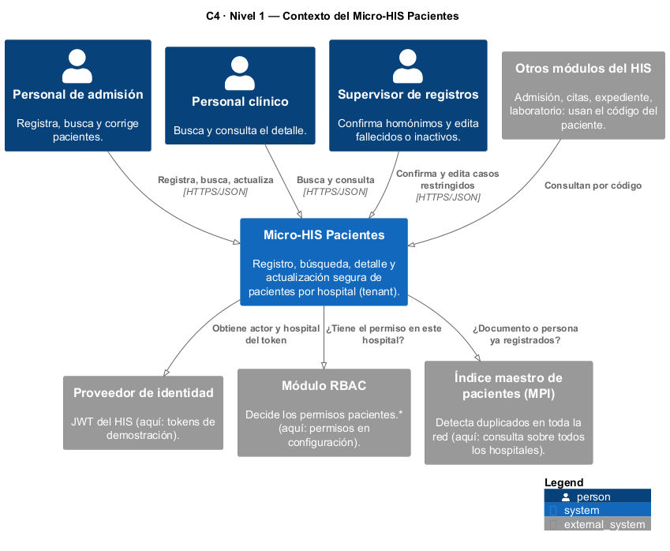
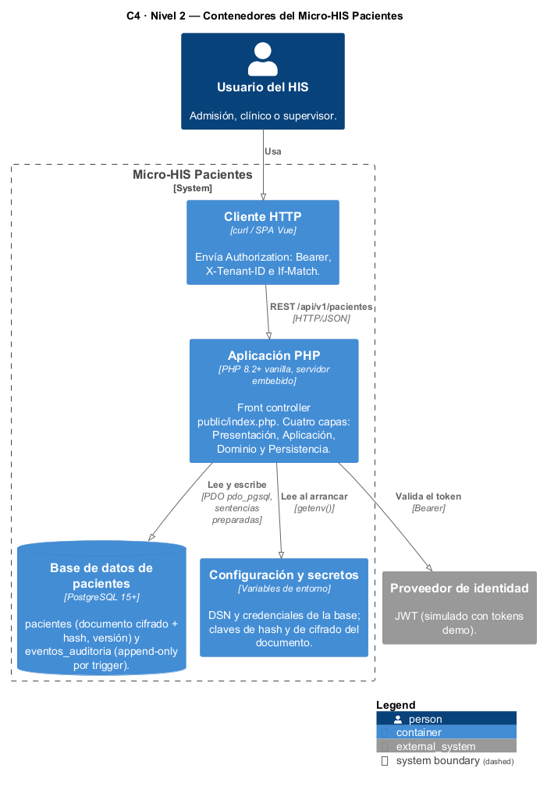
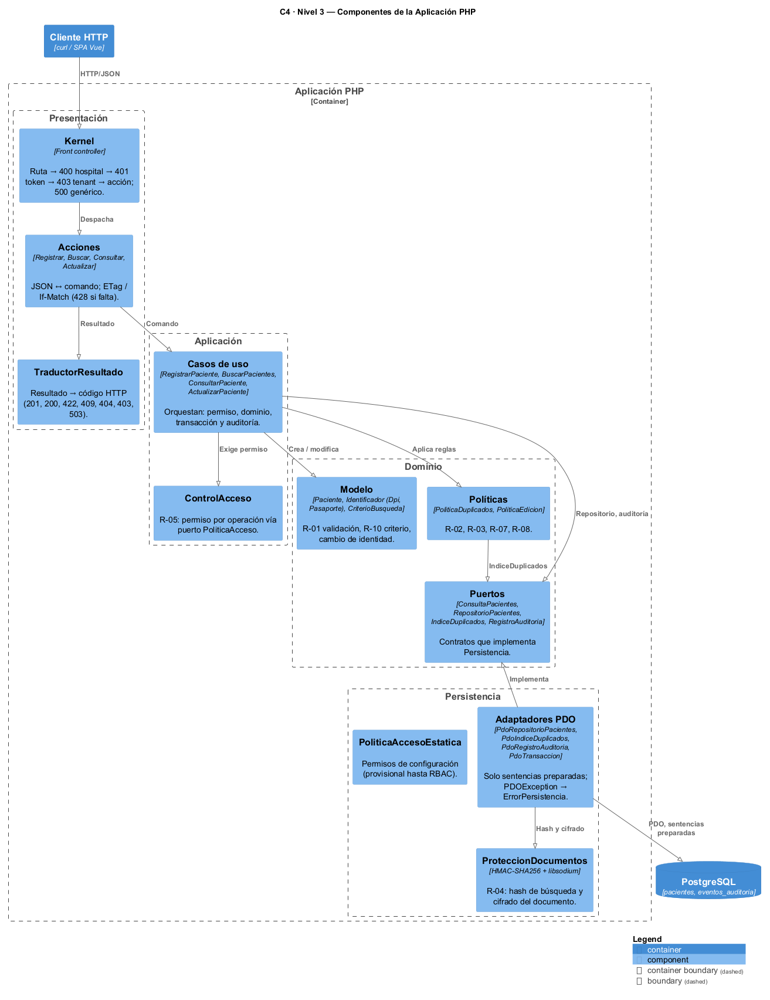
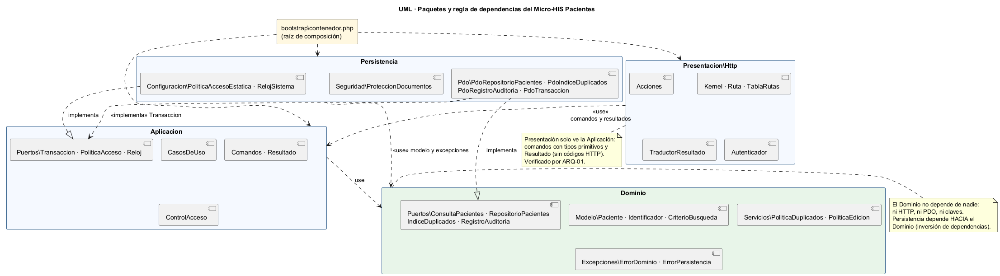
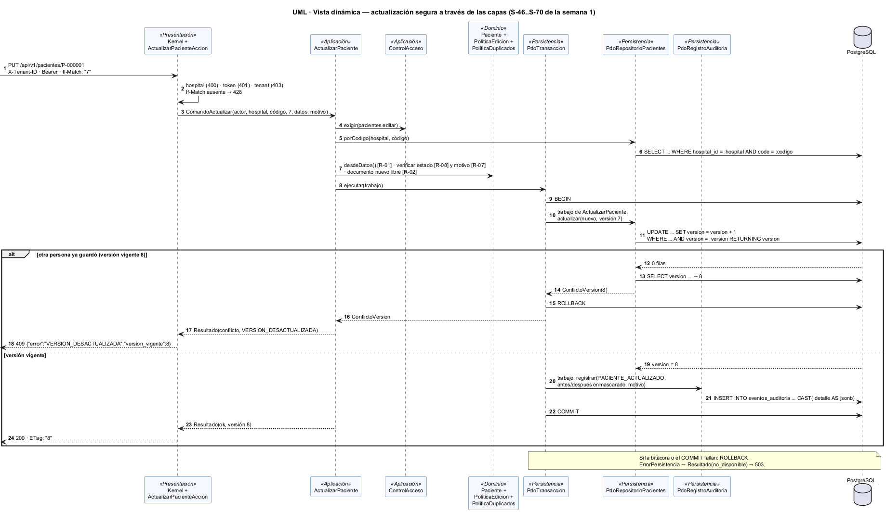

# Semana 3 — Arquitectura del Micro-HIS Pacientes

| | |
|---|---|
| **Curso** | Análisis de Sistemas II — Proyecto Final 2026 |
| **Proyecto** | Sistema Hospitalario Integrado (HIS) |
| **Módulo** | Pacientes: registro, edición, búsqueda y detalle |
| **Tema de la semana** | Diseño arquitectónico, vistas y patrones |
| **Flujo ejecutado** | «Registro, búsqueda y actualización segura de un paciente» |
| **Código** | [`micro-his-pacientes/`](../micro-his-pacientes/README.md) |
| **Estudiante** | Boris Alexander Quiroa Orellana |
| **Fecha** | Octubre 2026 |

## Índice

1. [Introducción](#1-introducción)
2. [Decisiones y restricciones arquitectónicas](#2-decisiones-y-restricciones-arquitectónicas)
3. [Vista de contexto (C4 nivel 1)](#3-vista-de-contexto-c4-nivel-1)
4. [Vista de contenedores (C4 nivel 2)](#4-vista-de-contenedores-c4-nivel-2)
5. [Vista de componentes (C4 nivel 3)](#5-vista-de-componentes-c4-nivel-3)
6. [Vista de paquetes y regla de dependencias](#6-vista-de-paquetes-y-regla-de-dependencias)
7. [Vista dinámica: actualización segura a través de las capas](#7-vista-dinámica-actualización-segura-a-través-de-las-capas)
8. [Responsabilidades por capa](#8-responsabilidades-por-capa)
9. [Persistencia con PDO y sentencias preparadas](#9-persistencia-con-pdo-y-sentencias-preparadas)
10. [Patrones aplicados](#10-patrones-aplicados)
11. [Estrategia de pruebas y evidencia](#11-estrategia-de-pruebas-y-evidencia)
12. [Trazabilidad con las semanas 1 y 2](#12-trazabilidad-con-las-semanas-1-y-2)
13. [Limitaciones y trabajo siguiente](#13-limitaciones-y-trabajo-siguiente)
14. [Conclusión](#14-conclusión)
15. [Bibliografía](#15-bibliografía)

## 1. Introducción

En la semana 1 se modeló el proceso con UML. En la semana 2 se fijaron los requerimientos y los contratos (LSP). Esta semana se **inicia el Micro-HIS Pacientes**: una aplicación ejecutable en PHP 8.2+ vanilla, sin framework, que corre el flujo completo de punta a punta.

**Qué hace:**
- registra un paciente (con verificación de duplicados);
- lo busca con datos mínimos;
- muestra su detalle con su versión;
- lo actualiza de forma segura.

**Cómo está organizado:** en cuatro capas (**Presentación, Aplicación, Dominio y Persistencia**), con PostgreSQL vía PDO y solo sentencias preparadas.

**Cómo se prueba:** con dobles en memoria y dobles de PDO (sin base de datos), más una prueba de integración opcional con PostgreSQL real. Cubre el camino feliz, las reglas de dominio y los errores de persistencia.

**El entregable de la semana** es la vista arquitectónica C4/UML del módulo y sus dependencias:
- tres niveles C4: contexto, contenedores y componentes;
- un diagrama UML de paquetes con la regla de dependencias;
- una vista dinámica.

Las dependencias no solo se dibujan: cinco pruebas de arquitectura (ARQ-01..ARQ-05) las **verifican leyendo el código**.

## 2. Decisiones y restricciones arquitectónicas

| ID | Decisión | Motivo | Alternativa descartada |
|---|---|---|---|
| DA-01 | **Cuatro capas** con la regla Presentación → Aplicación → Dominio ← Persistencia | Lo exige la tarea. Además, aísla las reglas del paciente de HTTP y de SQL. | Controladores con SQL dentro: imposible probar las reglas sin base de datos |
| DA-02 | **PHP 8.2+ vanilla**, autoload PSR-4 propio, sin Composer | Lo exige la tarea («sin framework») | Laravel, que ya usa el proyecto principal (ver §13) |
| DA-03 | **PDO + `pdo_pgsql`** con `ATTR_EMULATE_PREPARES = false` y solo sentencias preparadas con parámetros con nombre | Lo exige la tarea. Elimina la inyección SQL y usa la misma base que el HIS (PostgreSQL). | `query()` con concatenación; SQLite (no está habilitado en el entorno) |
| DA-04 | **Puertos en el Dominio** (`RepositorioPacientes`, `IndiceDuplicados`, `RegistroAuditoria`) implementados en Persistencia | Inversión de dependencias: el dominio define qué necesita y la persistencia se adapta | Que el dominio importe clases PDO |
| DA-05 | El Dominio **no conoce HTTP**: sus errores tienen *categoría* (inválido, conflicto, no encontrado, prohibido) y Presentación los traduce a códigos | Mantiene el dominio reutilizable fuera de una API (por ejemplo, una carga masiva) | `ErrorPaciente(409, ...)` como en el ejemplo de la semana 2 |
| DA-06 | **Comandos con tipos primitivos**: Presentación no importa clases del Dominio | Presentación solo depende de Aplicación (verificado por ARQ-01) | Construir `DatosPaciente` en el controlador |
| DA-07 | **Documento protegido en Persistencia**: HMAC-SHA256 para buscar y para la unicidad, cifrado libsodium para leerlo. Las claves se leen de variables de entorno. | R-04. El secreto es un asunto de infraestructura: el dominio solo conoce el valor canónico. | Clave HMAC dentro del dominio (como en la semana 2); DPI en claro |
| DA-08 | **Concurrencia optimista** en el `UPDATE ... WHERE version = :version`, con `ETag`/`If-Match` en HTTP; sin `If-Match` → 428 | R-06 sin carreras. Es el estándar HTTP para «modificar solo si no cambió». | Leer, comparar y escribir en pasos separados |
| DA-09 | **Permisos a través de un puerto** (`PoliticaAcceso`) con un adaptador provisional desde la configuración | Cuando se integre RBAC se cambia un adaptador, sin tocar los casos de uso | Llamar a RBAC desde los controladores |

## 3. Vista de contexto (C4 nivel 1)



Fuente: [semana-03-c4-contexto.puml](diagramas/semana-03-c4-contexto.puml)

- **Personas:** los tres actores principales de la semana 1 (admisión, clínico, supervisor).
- **Sistemas externos:** los secundarios (RBAC y MPI) y el proveedor de identidad.
- **Consumidores:** otros módulos del HIS que leen al paciente por su código.

En el micro-HIS, los sistemas externos están **simulados detrás de puertos**:

| Sistema externo | Simulado con |
|---|---|
| Proveedor de identidad | Tokens de demostración |
| RBAC | Permisos en la configuración |
| MPI | Una consulta sobre todos los hospitales |

## 4. Vista de contenedores (C4 nivel 2)



Fuente: [semana-03-c4-contenedores.puml](diagramas/semana-03-c4-contenedores.puml)

| Contenedor | Tecnología | Responsabilidad |
|---|---|---|
| Cliente HTTP | curl / SPA Vue (futura) | Envía `Authorization: Bearer`, `X-Tenant-ID` e `If-Match` |
| Aplicación PHP | PHP 8.2+, servidor embebido (`php -S`) | Front controller `public/index.php` y las cuatro capas |
| Base de datos | PostgreSQL 15+ | `pacientes` (documento cifrado + hash, `version`) y `eventos_auditoria` (append-only por trigger) |
| Configuración y secretos | Variables de entorno | DSN y credenciales de la base; claves del documento. Nada de esto queda en el repositorio. |

## 5. Vista de componentes (C4 nivel 3)



Fuente: [semana-03-c4-componentes.puml](diagramas/semana-03-c4-componentes.puml)

La vista muestra los componentes de cada capa y sus relaciones. Lo más importante es el **sentido de las flechas**: los adaptadores PDO apuntan **hacia** los puertos del Dominio («implementa»), nunca al revés.

## 6. Vista de paquetes y regla de dependencias



Fuente: [semana-03-paquetes-dependencias.puml](diagramas/semana-03-paquetes-dependencias.puml)

| Capa | Puede usar | No puede usar | Verificación |
|---|---|---|---|
| Dominio | Solo Dominio | Aplicación, Presentación, Persistencia, PDO, HTTP, criptografía | ARQ-01, ARQ-02, ARQ-04, ARQ-05 |
| Aplicación | Dominio | Presentación, Persistencia, PDO | ARQ-01, ARQ-02 |
| Persistencia | Dominio (puertos, modelo, excepciones) y los puertos de Aplicación (`Transaccion`, `PoliticaAcceso`, `Reloj`) | Presentación | ARQ-01 |
| Presentación | Aplicación (casos de uso, comandos, `Resultado`) | Dominio, Persistencia, PDO | ARQ-01, ARQ-02 |
| `bootstrap/contenedor.php` | Todo | — | Es la **raíz de composición**: el único lugar que conoce las clases concretas |

## 7. Vista dinámica: actualización segura a través de las capas



Fuente: [semana-03-dinamica-actualizacion.puml](diagramas/semana-03-dinamica-actualizacion.puml)

Es el bloque 3 de la secuencia de la semana 1 (S-46..S-70), ahora con las **clases reales**. Sigue un `PUT` con `If-Match: "7"` cuando otro usuario ya guardó la versión 8:

1. El `UPDATE ... WHERE version = :version` no afecta filas.
2. El repositorio consulta la versión vigente y lanza `ConflictoVersion(8)`.
3. La transacción hace `ROLLBACK`.
4. La Aplicación devuelve `Resultado(conflicto)`.
5. Presentación responde **409** con `version_vigente: 8`.

En el camino feliz, el `UPDATE` y el evento `PACIENTE_ACTUALIZADO` se confirman en el mismo `COMMIT`.

## 8. Responsabilidades por capa

| Capa | Clases | Responsabilidad | Lo que NO hace |
|---|---|---|---|
| **Presentación** | `Kernel`, `Ruta`, `TablaRutas`, 4 acciones, `EntradaPaciente`, `TraductorResultado`, `AutenticadorTokenDemo` | Resolver la ruta y exigir hospital (400), token (401) y tenant (403). Pasar de JSON a comando. Exigir `If-Match` (428). Traducir el `Resultado` a HTTP. Responder 500 genérico ante lo inesperado. | No valida reglas de negocio ni conoce el Dominio ni SQL |
| **Aplicación** | `RegistrarPaciente`, `BuscarPacientes`, `ConsultarPaciente`, `ActualizarPaciente`, comandos, `Resultado`, `ControlAcceso`, puertos `Transaccion`/`PoliticaAcceso`/`Reloj` | Orquestar cada caso de uso: permiso, reglas del dominio, transacción y auditoría. Convertir `ErrorDominio` y `ErrorPersistencia` en un `Resultado`. | No decide las reglas ni sabe si los datos vienen de PostgreSQL o de memoria |
| **Dominio** | `Paciente`, `Identificador` (`Dpi`, `Pasaporte`), `CriterioBusqueda`, `PoliticaDuplicados`, `PoliticaEdicion`, excepciones, puertos | Las reglas R-01..R-10: validación, duplicados, edición, criterio de búsqueda, cambio de identidad. Define los contratos de lectura y escritura (semana 2). | No hace E/S, no conoce HTTP, no tiene claves |
| **Persistencia** | `PdoRepositorioPacientes`, `PdoIndiceDuplicados`, `PdoRegistroAuditoria`, `PdoTransaccion`, `FabricaConexion`, `ProteccionDocumentos`, `PoliticaAccesoEstatica`, `RelojSistema` | SQL con sentencias preparadas. Traducir `PDOException` a `ErrorPersistencia` y `23505` a `DocumentoDuplicado`. Hash y cifrado del documento. Transacciones. | No decide reglas de negocio |

## 9. Persistencia con PDO y sentencias preparadas

**Conexión.** `FabricaConexion` crea el PDO con:
- `ERRMODE_EXCEPTION`;
- `FETCH_ASSOC`;
- `ATTR_EMULATE_PREPARES = false`: PostgreSQL prepara cada sentencia en el servidor.

Si la conexión falla, lanza `ErrorPersistencia` sin exponer el DSN ni la clave (PER-08).

**Solo sentencias preparadas.** Todo pasa por `RepositorioPdo::ejecutar()` (`prepare` + `execute` con parámetros con nombre). El SQL son **constantes literales**: no hay concatenación ni interpolación. ARQ-03 lo verifica analizando los tokens del código.

**El texto del usuario es un dato.** La búsqueda por nombre usa `LIKE :patron ESCAPE '!'`. Los comodines que escriba el usuario (`%`, `_`) se escapan antes de enlazarlos, así que buscar «50%» no devuelve a todos (PER-02, mutación M7).

**Concurrencia en una sola sentencia:**

```sql
UPDATE pacientes SET ..., version = version + 1, updated_at = now()
WHERE hospital_id = :hospital AND code = :codigo AND version = :version
RETURNING version
```

Si no devuelve filas, una segunda consulta distingue entre «no existe» (404) y «cambió la versión» (409) (PER-05).

**Protección del documento (R-04)** en el esquema ([`schema.sql`](../micro-his-pacientes/database/schema.sql)):

| Columna | Contenido |
|---|---|
| `documento_hash` | HMAC-SHA256 del canónico, con un índice **único parcial**. Es la última defensa si dos registros simultáneos pasan la verificación previa: `23505` → `DocumentoDuplicado` (PER-04). |
| `documento_cifrado` | libsodium `secretbox` con *nonce* aleatorio: cifrar dos veces da resultados distintos (PER-07) |
| `documento_enmascarado` | `*********0101`, para listas sin descifrar nada |

Una restricción `CHECK` impide guardar un documento a medias. El DPI completo **nunca viaja en el SQL ni en los parámetros** (PER-01).

**Integridad también en la base:**
- `CHECK` de fecha no futura, sexo y estado (como en `local_patients`);
- `version >= 1`;
- un trigger que hace la bitácora *append-only*.

## 10. Patrones aplicados

| Patrón | Dónde | Para qué |
|---|---|---|
| **Arquitectura en capas** | `src/Presentacion`, `Aplicacion`, `Dominio`, `Persistencia` | Separar responsabilidades con una regla de dependencias verificable |
| **Puertos y adaptadores** (hexagonal) | Puertos en `Dominio/Puertos` y `Aplicacion/Puertos`; adaptadores en `Persistencia` | Cambiar PostgreSQL, RBAC o el reloj sin tocar los casos de uso |
| **Repository** | `RepositorioPacientes` / `PdoRepositorioPacientes` | El dominio trabaja con objetos `Paciente`, no con filas |
| **Unit of Work** (simplificado) | `Transaccion` / `PdoTransaccion` | Dato + evento de auditoría, o nada (R-09) |
| **Front Controller** | `public/index.php` + `Kernel` | Un solo punto de entrada que aplica hospital, identidad y tenant |
| **Command** | `ComandoRegistrar`, `ComandoActualizar`, etc. | Entrada de cada caso de uso con tipos primitivos |
| **Composition Root** | `bootstrap/contenedor.php` | Único lugar que crea clases concretas; las pruebas componen con dobles |
| **Optimistic Offline Lock** | `version` + `ETag`/`If-Match` | Evitar la pérdida de actualizaciones (R-06) |
| **Factory** | `FabricaIdentificador` | Único lugar que conoce `Dpi` y `Pasaporte` (semana 2) |

## 11. Estrategia de pruebas y evidencia

| Grupo | Pruebas | Qué cubre | Con qué |
|---|---|---|---|
| Dominio | DOM-01..DOM-08 | R-01, R-02, R-03, R-07, R-08 y R-10; contrato `Identificador` de la semana 2; cambio de identidad | Objetos puros |
| Aplicación | APP-01..APP-08 | **Camino feliz** completo (APP-01). **Reglas de dominio** a través de los casos de uso (APP-02..APP-05). **Errores de persistencia** al guardar, en la bitácora (con rollback) y al leer (APP-06..APP-08). | Dobles en memoria |
| Persistencia | PER-01..PER-08 | SQL preparado, parámetros sin el DPI, escape del `LIKE`, `08006` → `ErrorPersistencia`, `23505` → `DocumentoDuplicado`, versión en el `UPDATE`, rollback, cifrado | Dobles de PDO: `PdoGuionado` (respuestas programadas) y `PdoQueFalla` |
| Presentación | HTTP-01..HTTP-08 | Códigos 201, 200, 400, 401, 403, 404, 405, 409, 422, 428, 500 y 503; `Location`, `ETag`, `If-Match` | Kernel con dobles |
| Arquitectura | ARQ-01..ARQ-05 | Regla de dependencias, SQL/PDO solo en Persistencia, solo sentencias preparadas, dominio sin E/S ni HTTP, criptografía solo en Persistencia | Análisis de tokens del código |
| Integración | INT-01..INT-05 | PostgreSQL real: documento cifrado en la tabla, búsqueda, 409 real, índice único (23505), trigger append-only, ROLLBACK real | Base de prueba (opcional) |

**Ejecución** (archivo completo en [`evidencia/salida-pruebas.txt`](evidencia/salida-pruebas.txt)):

```bash
cd docs/modulos/pacientes/micro-his-pacientes
php tests/ejecutar.php
```

```
Micro-HIS Pacientes - pruebas (PHP 8.4.26)
== Dominio: reglas de negocio ==                                   8 PASA
== Aplicación: camino feliz, reglas y errores de persistencia ==   8 PASA
== Persistencia: PDO con sentencias preparadas (dobles de PDO) ==  8 PASA
== Presentación HTTP ==                                            8 PASA
== Regla de dependencias entre capas ==                            5 PASA
== Integración con PostgreSQL ==                                   1 OMITE (defina PACIENTES_DB_DSN)

Total: 38  Pasan: 37  Fallan: 0  Omitidas: 1
```

**La prueba omitida** es la de integración con PostgreSQL. El servicio PostgreSQL 18 está instalado y corriendo en el equipo, pero exige contraseña, y la prueba solo se ejecuta si se definen las credenciales en `PACIENTES_DB_DSN`. Las instrucciones están en el [README del micro-HIS](../micro-his-pacientes/README.md). La evidencia del error de persistencia se obtuvo con dobles, que es una de las dos opciones que admite la tarea.

**Comprobación por mutación** ([`evidencia/mutaciones.txt`](evidencia/mutaciones.txt), script [`tests/mutaciones.php`](../micro-his-pacientes/tests/mutaciones.php)). Se introduce un defecto a la vez en una copia temporal y se verifica que alguna prueba lo detecte:

| Mutación | Detectada por |
|---|---|
| M1 El `UPDATE` deja de comparar la versión | PER-05 |
| M2 El hash del documento pasa a ser el número en claro | PER-01, PER-07 |
| M3 La política deja de bloquear el documento repetido | DOM-06, APP-02, HTTP-03 |
| M4 Registrar responde «creado» aunque la base falle | APP-06, APP-07, HTTP-07 |
| M5 Presentación importa una clase del Dominio | ARQ-01 |
| M6 Los datos inválidos se traducen a 400 | HTTP-03, HTTP-04 |
| M7 La búsqueda deja de escapar los comodines | PER-02 |
| M8 El dato y su evento ya no van en una transacción | APP-07 |

Resultado: **8 de 8 detectadas**. Un primer intento con `sed` parecía mostrar dos mutaciones sobrevivientes. En realidad `sed` no había aplicado el cambio por un problema de escapado. Por eso el script PHP verifica que cada mutación se aplique **exactamente una vez** antes de ejecutar las pruebas.

**Prueba de humo del servidor real** (`php -S`):

| Situación | Respuesta |
|---|---|
| Sin claves de documento | `503 {"error":"CONFIGURACION_INCOMPLETA"}` |
| Con claves, sin credenciales de PostgreSQL | `503 {"error":"SERVICIO_NO_DISPONIBLE"}` |

En ninguno de los dos casos aparecen trazas ni SQLSTATE.

## 12. Trazabilidad con las semanas 1 y 2

| Semana 1 | Semana 2 | Semana 3: dónde vive | Prueba |
|---|---|---|---|
| CU-01, A-03, D-04, R-01 | RF-01, CA-02 | `Paciente::desdeDatos()` | DOM-02, HTTP-03 |
| CU-05, D-05, R-02 | RF-02, CA-03 | `PoliticaDuplicados` + índice único `pacientes_documento_unico` | DOM-06, APP-02, PER-04, INT-03 |
| CU-06, D-06, D-07, R-03 | RF-03, CA-04 | `PoliticaDuplicados::verificarRegistro()` | DOM-06 |
| — | RF-04, CA-05 (sin documento) | `identificador = null`; la restricción `pacientes_documento_completo` | DOM-08 |
| CU-02, A-09, A-10, R-10, R-04 | RF-05, CA-06 | `CriterioBusqueda`, `BuscarPacientes`, `SQL_POR_NOMBRE*` | DOM-05, PER-02, HTTP-04 |
| CU-03, A-12, E-08 | RF-06, CA-07 | `ConsultarPaciente` + `ETag` | APP-05, HTTP-05 |
| CU-04, D-13, R-06 | RF-07, CA-08 | `UPDATE ... WHERE version`, `If-Match` | APP-03, PER-05, HTTP-06 |
| D-15..D-17, R-07 | RF-08, CA-09 | `PoliticaEdicion`, `verificarDocumentoNuevo()` | DOM-07, APP-04 |
| D-12, R-08 | RF-09, CA-10 | `PoliticaEdicion` (estado como dato) | DOM-07, APP-04 |
| CU-08, A-07, A-15, R-09 | RF-10, CA-11 | `Transaccion` + `RegistroAuditoria` | APP-07, PER-06, INT-05 |
| CU-07, D-01, D-02, R-05 | RF-11, CA-12 | `Kernel` (hospital, tenant) + `ControlAcceso` | APP-05, HTTP-02 |
| — | Contratos LSP (`Identificador`, `ConsultaPacientes`, `RepositorioPacientes`) | `Dominio/Puertos`, `Dominio/Modelo/Identificador` | DOM-04 |

## 13. Limitaciones y trabajo siguiente

- **Por qué el código no está en `app/` (Laravel).** La tarea pide PHP vanilla **sin framework**, y el proyecto principal es una aplicación Laravel. Por eso el micro-HIS vive en `docs/modulos/pacientes/micro-his-pacientes/`, igual que los micro-HIS de los otros módulos del equipo. Cuando el módulo se integre al HIS, las capas Dominio y Aplicación pueden pasar a `app/` casi sin cambios. Solo se reemplazarían Presentación (por controladores Laravel) y la configuración.
- **Columna `version` en el HIS.** `local_patients` todavía no tiene `version`. Se agregaría con una migración nueva del hospital al integrar el módulo. No se hizo esta semana porque afecta un esquema compartido y no se pudo validar aquí: no están instaladas las dependencias de Laravel (`vendor/`) ni las credenciales de la base.
- **Integración con PostgreSQL no ejecutada** en esta entrega, por falta de credenciales. Las pruebas INT-01..INT-05 están escritas y listas.
- **MPI simulado:** el índice de duplicados consulta la misma tabla en todos los hospitales. En el HIS consultará `mpi_identifiers` en la base central.
- **RBAC simulado:** los permisos salen de la configuración, detrás del puerto `PoliticaAcceso`.
- **Rendimiento (RNF-09)** pendiente de medir con datos reales.

## 14. Conclusión

El Micro-HIS Pacientes convierte en código ejecutable lo que las semanas 1 y 2 dejaron en diagramas y contratos. Las cuatro capas no son solo carpetas: la regla de dependencias está dibujada (C4 y paquetes UML) **y** verificada (ARQ-01..ARQ-05). Si alguien hace que Presentación importe el Dominio, una prueba falla (mutación M5).

Las decisiones más importantes protegen al paciente, no al código:
- el documento nunca se guarda ni viaja en claro;
- dos ediciones simultáneas no se pisan, gracias a la versión en el mismo `UPDATE`;
- ningún cambio queda sin su evento de auditoría.

Las tres situaciones que pide la tarea están cubiertas y comprobadas por mutación: **camino feliz** (APP-01), **regla de dominio** (DOM, APP-02..05) y **error de persistencia** (APP-06..08, PER-03..06).

## 15. Bibliografía

- Brown, S. (2018). *The C4 model for visualising software architecture*. https://c4model.com
- Object Management Group. (2017). *Unified Modeling Language (UML), Version 2.5.1*. https://www.omg.org/spec/UML/2.5.1
- Martin, R. C. (2018). *Clean Architecture: A Craftsman's Guide to Software Structure and Design*. Prentice Hall. Cap. 22: «The Clean Architecture».
- Fowler, M. (2002). *Patterns of Enterprise Application Architecture*. Addison-Wesley. Patrones *Repository*, *Unit of Work*, *Front Controller* y *Optimistic Offline Lock*.
- Cockburn, A. (2005). *Hexagonal Architecture (Ports and Adapters)*. https://alistair.cockburn.us/hexagonal-architecture/
- Fielding, R., Nottingham, M. y Reschke, J. (2022). *RFC 9110: HTTP Semantics* (§8.8.3 ETag, §13.1.1 If-Match). IETF. https://www.rfc-editor.org/rfc/rfc9110
- Nottingham, M. y Fielding, R. (2012). *RFC 6585: Additional HTTP Status Codes* (428 Precondition Required). IETF. https://www.rfc-editor.org/rfc/rfc6585
- The PHP Group. (2026). *PHP Manual — PDO: Prepared statements* y *Sodium*. https://www.php.net/manual/es/pdo.prepared-statements.php
- OWASP Foundation. (2024). *SQL Injection Prevention Cheat Sheet* y *Cryptographic Storage Cheat Sheet*. https://cheatsheetseries.owasp.org
