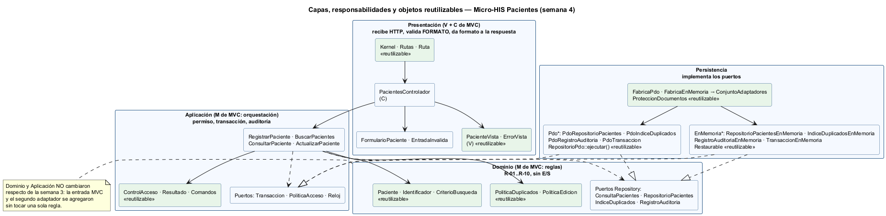
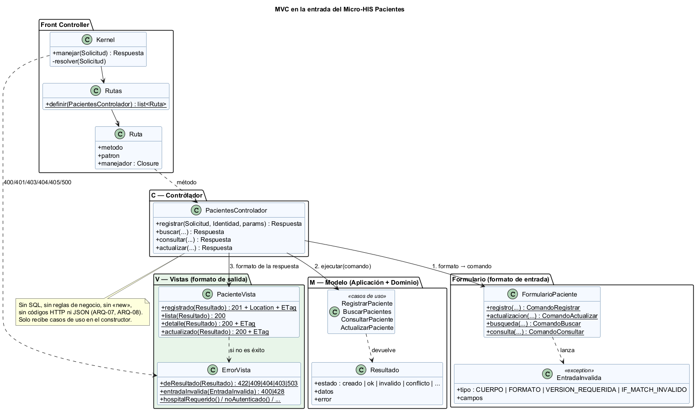
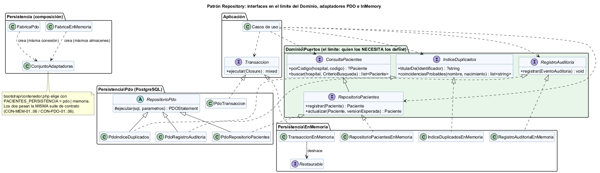
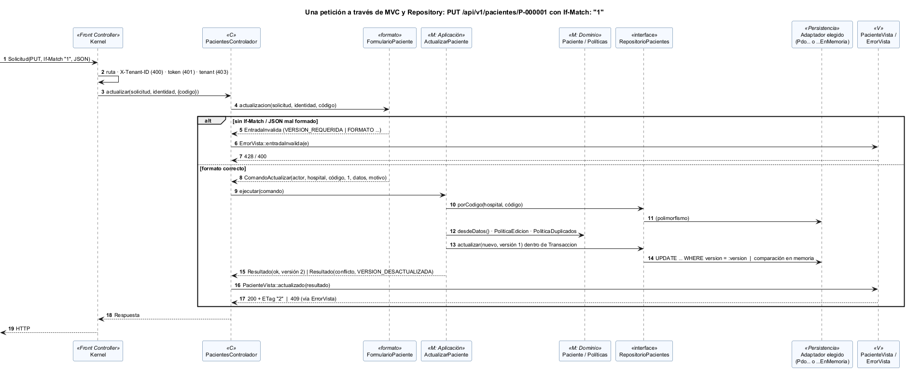
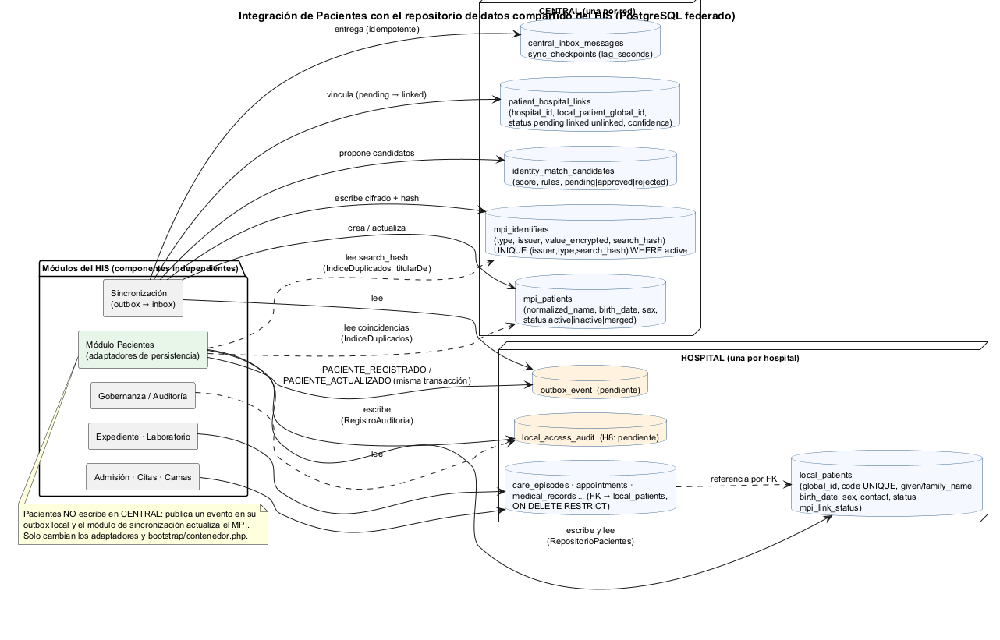

# Semana 4 — Arquitectura en capas, MVC y patrón Repository

| | |
|---|---|
| **Curso** | Análisis de Sistemas II — Proyecto Final 2026 |
| **Proyecto** | Sistema Hospitalario Integrado (HIS) |
| **Módulo** | Pacientes: registro, edición, búsqueda y detalle |
| **Tema de la semana** | Arquitectura en capas y patrón repositorio |
| **Flujo** | «Registro, búsqueda y actualización segura de un paciente» |
| **Código** | [`micro-his-pacientes/`](../micro-his-pacientes/README.md) (el MISMO de la semana 3) |
| **Estudiante** | Boris Alexander Quiroa Orellana |
| **Fecha** | Octubre 2026 |

## Índice

1. [Introducción](#1-introducción)
2. [Qué cambió respecto de la semana 3](#2-qué-cambió-respecto-de-la-semana-3)
3. [Capas y responsabilidades](#3-capas-y-responsabilidades)
4. [MVC en la entrada](#4-mvc-en-la-entrada)
5. [Patrón Repository](#5-patrón-repository)
6. [Objetos reutilizables](#6-objetos-reutilizables)
7. [Vista dinámica: una petición a través de MVC y Repository](#7-vista-dinámica-una-petición-a-través-de-mvc-y-repository)
8. [Integración con un repositorio de datos compartido](#8-integración-con-un-repositorio-de-datos-compartido)
9. [Evidencia](#9-evidencia)
10. [Trazabilidad](#10-trazabilidad)
11. [Limitaciones y trabajo siguiente](#11-limitaciones-y-trabajo-siguiente)
12. [Conclusión](#12-conclusión)
13. [Bibliografía](#13-bibliografía)

## 1. Introducción

Esta semana continúa el **mismo** Micro-HIS Pacientes de la semana 3 y el mismo flujo. La tarea pide tres cosas:

1. **Organizar la entrada con MVC.** El controlador no tendrá SQL ni reglas de negocio.
2. **Definir una interfaz Repository en el límite apropiado**, con dos adaptadores: PDO e InMemory.
3. **Analizar y diagramar** cómo un repositorio de datos compartido integraría este módulo.

El entregable es **capas, responsabilidades y objetos reutilizables** (§3, §6).

Como en la semana anterior, cada afirmación de arquitectura tiene una prueba que la verifica. Además, una comprobación por mutación demuestra que esas pruebas detectan cuando la regla se rompe.

## 2. Qué cambió respecto de la semana 3

| Aspecto | Semana 3 | Semana 4 |
|---|---|---|
| Entrada HTTP | Una `Accion` por ruta: leía el JSON, llamaba al caso de uso y pasaba el resultado a `TraductorResultado` | **MVC:** `PacientesControlador` (coordina) + `FormularioPaciente` (valida formato) + `PacienteVista`/`ErrorVista` (dan formato) |
| Rutas | `TablaRutas` → objeto `Accion` | `Rutas` → método del controlador (`$pacientes->registrar(...)`) |
| Códigos HTTP | En `TraductorResultado` y repartidos en `Kernel` y acciones | **Solo en las Vistas** (ARQ-08) |
| Error de formato vs. regla de negocio | Se mezclaban: un JSON mal formado y una fecha imposible terminaban igual | **Formato → 400** (formulario); **regla → 422** (dominio) (MVC-04) |
| Adaptadores | Solo PDO; las versiones en memoria eran copias dentro de `tests/` | **PDO e InMemory de producción** en `src/Persistencia/`, elegibles con `PACIENTES_PERSISTENCIA` |
| Dobles de prueba | Copias en memoria de cada repositorio | **Decoradores** (`*ConFallas`) sobre el adaptador InMemory real: no duplican lógica |
| Garantía de intercambiabilidad | — | **Suite de contrato** que se ejecuta igual contra InMemory y PDO |
| Ejecución sin base de datos | Solo las pruebas | API con `PACIENTES_PERSISTENCIA=memoria` y la demo `php bin/demo.php` |

**Dominio y Aplicación no cambiaron.** `git status` no muestra ningún archivo modificado en `src/Dominio` ni en `src/Aplicacion`. Reorganizar la entrada y agregar un segundo adaptador no obligó a tocar ninguna regla de negocio, que es lo que promete una arquitectura en capas.

## 3. Capas y responsabilidades



Fuente: [`diagramas/semana-04-capas.puml`](diagramas/semana-04-capas.puml)

| Capa | Carpeta | Responsabilidad | Clases | Puede depender de |
|---|---|---|---|---|
| **Presentación** (V + C de MVC) | `src/Presentacion/Http` | Recibir HTTP. Exigir hospital (400), identidad (401) y mismo tenant (403). Validar el **formato** de la entrada, delegar en el Modelo y dar formato a la respuesta. | `Kernel`, `Rutas`, `Ruta`, `Solicitud`, `Respuesta`, `PacientesControlador`, `FormularioPaciente`, `EntradaInvalida`, `PacienteVista`, `ErrorVista`, `AutenticadorTokenDemo` | Aplicación |
| **Aplicación** (M de MVC: orquestación) | `src/Aplicacion` | Cada caso de uso: permiso (R-05), reglas del dominio, transacción y auditoría (R-09). Traducir los errores a un `Resultado` sin HTTP. | 4 casos de uso, comandos, `Resultado`, `ControlAcceso`, puertos `Transaccion`/`PoliticaAcceso`/`Reloj` | Dominio |
| **Dominio** (M de MVC: reglas) | `src/Dominio` | Las reglas R-01..R-10 y los **contratos Repository**. | `Paciente`, `Identificador` (`Dpi`, `Pasaporte`), `CriterioBusqueda`, `PoliticaDuplicados`, `PoliticaEdicion`, puertos, excepciones | — |
| **Persistencia** | `src/Persistencia` | Implementar cada puerto **dos veces**: PDO (PostgreSQL) e InMemory. Traducir los errores técnicos. Proteger el documento. | `Pdo/*` + `RepositorioPdo`, `EnMemoria/*` + `Restaurable`, `FabricaPdo`, `FabricaEnMemoria`, `ConjuntoAdaptadores`, `ProteccionDocumentos`, `Configuracion/*` | Dominio, Aplicación (sus puertos) |
| **Composición** | `bootstrap/` | Crear y conectar objetos; elegir PDO o InMemory. | `contenedor.php` | Todas |

**Por qué Aplicación + Dominio forman el «Modelo» de MVC.** En MVC, el Modelo es todo lo que el usuario no ve: datos y reglas. Partirlo en Aplicación (orquestación) y Dominio (reglas) es la arquitectura en capas aplicada **dentro** del Modelo. El controlador solo ve los casos de uso, nunca el Dominio (ARQ-01, ARQ-07).

## 4. MVC en la entrada



Fuente: [`diagramas/semana-04-mvc.puml`](diagramas/semana-04-mvc.puml)

| Pieza | Clases | Hace | No hace |
|---|---|---|---|
| **Front Controller** | `Kernel`, `Rutas`, `Ruta` | Resuelve la ruta, aplica 400/401/403 y llama al método del controlador | No conoce casos de uso ni reglas |
| **C — Controlador** | `PacientesControlador` | Coordina: formulario → caso de uso → vista | No tiene SQL ni reglas, no usa `new`, no conoce códigos de negocio ni arma JSON |
| **Formulario** | `FormularioPaciente`, `EntradaInvalida` | Valida el **formato**: el cuerpo es un objeto JSON, cada campo es texto, `documento` es un objeto, `confirmar_coincidencia` es booleano, `If-Match` existe y es un número. Construye el comando con el actor y el hospital **del token**, no del cuerpo. | No decide si el nombre falta, si la fecha es futura o si el DPI existe: eso es del Dominio (422) |
| **V — Vistas** | `PacienteVista`, `ErrorVista` | Son el **único** lugar con códigos HTTP y cabeceras (`Location`, `ETag`) | No consultan datos ni deciden reglas |
| **M — Modelo** | Casos de uso + Dominio | Decide y persiste | No sabe nada de HTTP |

El método completo del controlador para actualizar:

```php
public function actualizar(Solicitud $solicitud, Identidad $identidad, array $parametros): Respuesta
{
    try {
        $comando = FormularioPaciente::actualizacion($solicitud, $identidad, $parametros['codigo']);  // formato
    } catch (EntradaInvalida $e) {
        return ErrorVista::entradaInvalida($e);                                                     // 400 / 428
    }

    return PacienteVista::actualizado($this->actualizarPaciente->ejecutar($comando));               // Modelo → Vista
}
```

**Reglas del controlador y cómo se verifican:**

| Regla | Prueba |
|---|---|
| Solo recibe casos de uso en el constructor | ARQ-07 (reflexión) |
| Sin SQL, sin `new`, sin códigos de negocio (`'pacientes.editar'`, `'PACIENTE_EXISTENTE'`, `'deceased'`, `'DPI'`…) | ARQ-07 (análisis del código) |
| No arma respuestas (`Respuesta::json`, `json_encode`, `http_response_code`) | ARQ-07 y ARQ-08 |
| No depende del Dominio ni de la Persistencia | ARQ-01 |
| Se puede probar solo, sin Kernel ni rutas | MVC-03 |

**Formato (400) frente a regla (422).** Un `"nombres": 7` es un error de **formato**: lo rechaza el formulario con 400 `FORMATO_INVALIDO`. Un `"nombres": ""` tiene formato correcto pero rompe una **regla**: llega al Dominio y vuelve como 422 `DATOS_INVALIDOS` (MVC-01, MVC-04). Separar las dos cosas evita que el controlador termine validando reglas de negocio.

## 5. Patrón Repository



Fuente: [`diagramas/semana-04-repositorio.puml`](diagramas/semana-04-repositorio.puml)

### 5.1 El límite apropiado de la interfaz

Las interfaces de datos (`ConsultaPacientes`, `RepositorioPacientes`, `IndiceDuplicados`, `RegistroAuditoria`) están en **`Dominio/Puertos`**. `Transaccion` está en **`Aplicacion/Puertos`**.

| Opción | Consecuencia | Decisión |
|---|---|---|
| Interfaz en Persistencia, junto a los adaptadores | El Dominio tendría que depender de la Persistencia para conocerla: la flecha queda al revés | ✗ |
| Sin interfaz (los casos de uso usan `PdoRepositorioPacientes`) | La aplicación queda atada a PostgreSQL y no se puede probar sin base | ✗ |
| **Interfaz en el Dominio**, porque quien la necesita la define | La Persistencia se adapta al Dominio y se pueden tener N adaptadores | ✓ |
| `Transaccion` en Aplicación | Delimitar una transacción es una decisión de orquestación, no una regla del paciente | ✓ |

Las interfaces hablan el idioma del dominio (`porCodigo`, `titularDe`, `coincidenciasProbables`), no el de la base (`findBy`, `query`). Sus errores también son del dominio: `ConflictoVersion`, `DocumentoDuplicado`, `PacienteNoEncontrado`, `ErrorPersistencia`.

La separación lectura/escritura de la semana 2 (`ConsultaPacientes` ⊂ `RepositorioPacientes`, LSP) sigue vigente. La búsqueda solo recibe `ConsultaPacientes`, así que mañana puede leer de una réplica.

### 5.2 Dos adaptadores por puerto

| Puerto | Adaptador PDO | Adaptador InMemory |
|---|---|---|
| `ConsultaPacientes` + `RepositorioPacientes` | `PdoRepositorioPacientes`: `UPDATE ... WHERE version`; índice único → SQLSTATE 23505 → `DocumentoDuplicado` | `RepositorioPacientesEnMemoria`: misma comparación de versión y misma unicidad del documento, en código |
| `IndiceDuplicados` | `PdoIndiceDuplicados` (`documento_hash`, nombre normalizado + fecha) | `IndiceDuplicadosEnMemoria` |
| `RegistroAuditoria` | `PdoRegistroAuditoria` (append-only por trigger) | `RegistroAuditoriaEnMemoria` (sin métodos para editar ni borrar) |
| `Transaccion` | `PdoTransaccion` (BEGIN/COMMIT/ROLLBACK) | `TransaccionEnMemoria` (instantánea y restauración de los almacenes `Restaurable`) |

ARQ-06 verifica por reflexión que **cada uno** de los 5 puertos tenga un adaptador en `Persistencia\Pdo` y otro en `Persistencia\EnMemoria`.

**Selección.** `bootstrap/contenedor.php` arma un `ConjuntoAdaptadores` con `FabricaPdo` o con `FabricaEnMemoria`, según `PACIENTES_PERSISTENCIA=pdo|memoria`. El conjunto es **coherente**: comparte la conexión (o los almacenes), así que la transacción abarca al repositorio y a la bitácora. Ningún caso de uso, regla, controlador ni vista sabe cuál se eligió.

### 5.3 Contrato: la misma suite para los dos adaptadores

[`tests/Contratos/ContratoRepositoriosPrueba.php`](../micro-his-pacientes/tests/Contratos/ContratoRepositoriosPrueba.php) define `contratoRepositorios($prefijo, $fabrica)` con 6 verificaciones:

| # | Verificación |
|---|---|
| 01 | `registrar` da código único y versión 1; `porCodigo` devuelve lo guardado (documento incluido) y solo en su hospital |
| 02 | `buscar`: solo el hospital, máximo 20, ordenado; por documento, por código y por fecha; `%` es literal; sin resultados → lista vacía |
| 03 | `actualizar`: con la versión vigente da +1 y se lee lo nuevo; con una vieja, `ConflictoVersion` y nada cambia; con otro hospital, `PacienteNoEncontrado` |
| 04 | El documento es único en **toda la red**, al registrar y al actualizar (`DocumentoDuplicado`) |
| 05 | El índice ve todos los hospitales y libera el documento anterior cuando cambia |
| 06 | La transacción confirma paciente + evento juntos, o revierte los dos |

Se ejecuta como `CON-MEM-*` sobre InMemory, y como `CON-PDO-*` sobre PostgreSQL en un esquema temporal (solo si hay credenciales). Si los dos adaptadores pasan el mismo contrato, son **sustituibles**: el principio de sustitución de Liskov de la semana 2, ahora aplicado a la persistencia.

## 6. Objetos reutilizables

| Objeto | Capa | Reutilizado por | Por qué es reutilizable |
|---|---|---|---|
| `RepositorioPdo::ejecutar()` | Persistencia | Los 3 adaptadores PDO de datos | Concentra `prepare` + `execute` + traducción de `PDOException`. Un repositorio nuevo hereda la seguridad sin repetirla. |
| `FabricaConexion` | Persistencia | API, pruebas de integración y de contrato | Configura PDO una sola vez (excepciones, sin emulación de prepares) |
| `ProteccionDocumentos` | Persistencia | Repositorio e índice PDO | Un solo lugar con el HMAC y el cifrado del documento |
| `FabricaPdo` / `FabricaEnMemoria` → `ConjuntoAdaptadores` | Persistencia | API, demo, pruebas, suite de contrato, `cargar-demo.php` | Entregan siempre un juego coherente; cambiar de base es cambiar una variable |
| `Restaurable` + `TransaccionEnMemoria` | Persistencia | Cualquier almacén en memoria | Un almacén nuevo obtiene ROLLBACK implementando 2 métodos |
| `Paciente`, `Identificador`, `CriterioBusqueda` | Dominio | Casos de uso y los dos adaptadores (`coincideCon` en memoria) | Una sola definición de «paciente válido», «documento igual» y «coincide con la búsqueda» |
| `PoliticaDuplicados`, `PoliticaEdicion` | Dominio | Registro, actualización y cualquier canal futuro (carga masiva, cola) | No dependen de HTTP ni de la base |
| `ControlAcceso` | Aplicación | Los 4 casos de uso | Un solo punto para R-05, con la constante de cada permiso |
| `Resultado` | Aplicación | Casos de uso, vistas y pruebas | Dice qué pasó sin HTTP: la misma Aplicación serviría a una CLI |
| `Kernel`, `Rutas`, `Ruta`, `Solicitud`, `Respuesta` | Presentación | Cualquier controlador nuevo | Proteger una ruta nueva es una línea en `Rutas::definir()` |
| `ErrorVista` | Presentación | `Kernel`, `PacienteVista`, controlador | Errores idénticos en toda la API y sin detalles internos |
| `FormularioPaciente` / `EntradaInvalida` | Presentación | Controlador, pruebas MVC | Validación de formato separada y probada aparte (MVC-01) |
| `construirCasosDeUso()` / `construirKernel()` | bootstrap | API, demo, todas las pruebas | La misma composición en producción y en pruebas: lo que se prueba es lo que corre |
| `RepositorioPacientesConFallas`, `RegistroAuditoriaConFallas` | tests | Pruebas de error | Decoradores: reutilizan el adaptador real y solo agregan la falla |
| `contratoRepositorios()` | tests | InMemory, PDO y futuros adaptadores (§8) | Cualquier adaptador nuevo se valida ejecutando la misma función |

## 7. Vista dinámica: una petición a través de MVC y Repository



Fuente: [`diagramas/semana-04-secuencia-mvc.puml`](diagramas/semana-04-secuencia-mvc.puml)

El mismo `PUT` de la semana 3, ahora con las piezas de MVC:

1. El **Kernel** aplica hospital, identidad y tenant.
2. El **controlador** pide el comando al **formulario**. Si falta `If-Match`, el formulario lanza `EntradaInvalida` y la **vista de error** responde 428, sin tocar el Modelo.
3. El **caso de uso** usa la **interfaz** `RepositorioPacientes`. El adaptador concreto (PDO o InMemory) se resuelve por polimorfismo.
4. La **vista** convierte el `Resultado` en 200 + `ETag` o en 409.

## 8. Integración con un repositorio de datos compartido

### 8.1 Qué es y cuál es el del HIS

En el estilo **repositorio de datos compartido** (*shared data*), varios componentes independientes se comunican leyendo y escribiendo un almacén común, en lugar de llamarse entre sí. En el HIS ese repositorio ya existe: es el **PostgreSQL federado** del proyecto principal (`database/migrations/`).

| Parte | Cuántas | Qué tiene (relacionado con pacientes) |
|---|---|---|
| **CENTRAL** | Una por red | El índice maestro: `mpi_patients`, `mpi_identifiers`, `patient_hospital_links`, `identity_match_candidates`. Además, la sincronización: `sync_nodes`, `sync_checkpoints`, `central_inbox_messages`. |
| **HOSPITAL** | Una por hospital | `local_patients` y todo lo clínico que la referencia por llave foránea (`care_episodes`, `appointments`, `medical_records`…). Especificadas pero **aún no migradas**: `local_access_audit`, `outbox_event`, `inbox_message`. |



Fuente: [`diagramas/semana-04-repositorio-compartido.puml`](diagramas/semana-04-repositorio-compartido.puml)

### 8.2 Correspondencia entre el Micro-HIS y el repositorio compartido

| Micro-HIS (puerto → tabla local) | Repositorio compartido del HIS | Compatibilidad |
|---|---|---|
| `RepositorioPacientes` → `pacientes` (nombres, apellidos, nacimiento, sexo, teléfono, estado, código) | HOSPITAL `local_patients` (`given_name`, `family_name`, `birth_date`, `sex`, `contact`, `status`, `code UNIQUE`) | **Directa** en datos, catálogos y `CHECK`: mismos sexos, mismos estados, fecha no futura. Cambian los nombres de las columnas, y el hospital es implícito (una base por hospital) en lugar de una columna `hospital_id`. |
| `pacientes.version` (R-06) | — | **Brecha:** `local_patients` no tiene versión. Sin ella no hay `UPDATE ... WHERE version`. Hace falta una migración nueva en HOSPITAL. |
| `documento_hash` / `documento_cifrado` | CENTRAL `mpi_identifiers` (`type`, `issuer`, `value_encrypted`, `search_hash`) con `UNIQUE (issuer, type, search_hash) WHERE status = 'active'` | **Directa en el diseño:** la misma idea (hash para buscar, cifrado para leer, unicidad por emisor y tipo). Pero vive en **otra base**: no puede ir en la misma transacción que `local_patients`. |
| `IndiceDuplicados::titularDe` | CENTRAL `mpi_identifiers.search_hash` | Directa (lectura) |
| `IndiceDuplicados::coincidenciasProbables` | CENTRAL `mpi_patients.normalized_name` + `birth_date`; el HIS agrega `identity_match_candidates` con puntaje y revisión | **Directa**, y el HIS es más rico: un puntaje en lugar de igualdad exacta |
| Identidad provisional (sin documento) | `local_patients.mpi_link_status = 'pending'` y `patient_hospital_links.status` | **Directa:** «pendiente de vincular» es el mismo concepto |
| `RegistroAuditoria` → `eventos_auditoria` | HOSPITAL `local_access_audit` | **Brecha:** especificada, sin migrar |
| (implícito: el MPI se actualiza en la misma base) | HOSPITAL `outbox_event` → CENTRAL `central_inbox_messages` (idempotente por `(source_node_id, event_id)`) | **Brecha:** `outbox_event` sin migrar. Es la pieza que permite avisar al MPI sin transacciones distribuidas. |

### 8.3 Cómo se integraría

Gracias a los puertos, la integración es **solo de Persistencia y composición**:

1. **Escritura local en HOSPITAL.** Un adaptador `PdoLocalPatients implements RepositorioPacientes` sobre la conexión del hospital, con las mismas sentencias preparadas y los nombres del HIS:

   ```sql
   UPDATE local_patients
      SET given_name = :nombres, family_name = :apellidos, birth_date = :nacimiento,
          sex = :sexo, contact = :telefono, status = :estado,
          version = version + 1, updated_at = now()
    WHERE code = :codigo AND version = :version
   RETURNING version
   ```

2. **Evento en el outbox, en la misma transacción.** `PACIENTE_REGISTRADO` / `PACIENTE_ACTUALIZADO` se escriben en `outbox_event` junto con el cambio. El evento lleva datos **mínimos** (la especificación prohíbe payloads clínicos completos). Así, cambio y aviso son atómicos sin tocar CENTRAL.
3. **El MPI lo actualiza la sincronización, no Pacientes.** El módulo de sincronización lleva el evento a `central_inbox_messages` y desde ahí:
   - crea o actualiza `mpi_patients` y `mpi_identifiers`;
   - vincula en `patient_hospital_links` (`pending` → `linked`);
   - y, si hay parecidos, propone `identity_match_candidates`.
4. **Lectura de duplicados en CENTRAL.** `PdoIndiceMpi implements IndiceDuplicados` usa una conexión **de solo lectura** a CENTRAL (`mpi_identifiers`, `mpi_patients`).
5. **Auditoría local.** `PdoRegistroAuditoria` apunta a `local_access_audit`, con el mismo trigger append-only que ya usa `cross_hospital_access_audits` en CENTRAL.
6. **Composición.** Se agrega una `FabricaHis` que entrega un `ConjuntoAdaptadores` con esas clases. **Dominio, Aplicación y Presentación no se tocan.**
7. **Validación.** Cada adaptador nuevo debe pasar `contratoRepositorios()` (§5.3) antes de usarse.

**Consecuencia importante: la unicidad del documento pasa a ser eventual.** En el Micro-HIS, el índice único está en la **misma base** que el `INSERT`, así que dos registros simultáneos del mismo DPI se resuelven con 23505 → 409. En el HIS federado:
- el `INSERT` va a HOSPITAL y la unicidad está en CENTRAL;
- si dos hospitales registran el mismo DPI a la vez, ambos lo aceptan;
- el conflicto aparece cuando la sincronización intenta crear el segundo `mpi_identifiers` activo.

El diseño debe tratarlo como **candidato a fusión** (`identity_match_candidates`, revisión humana), no como un error. La verificación previa (`IndiceDuplicados::titularDe`) sigue evitando la mayoría de los casos.

### 8.4 Ventajas y riesgos del repositorio compartido para Pacientes

| | Detalle | Mitigación |
|---|---|---|
| ✓ Fuente única de identidad | Un paciente registrado en Oriente se reconoce en Norte por el MPI, sin integraciones punto a punto | — |
| ✓ Integridad en la base | `CHECK`, `UNIQUE` y llaves foráneas `ON DELETE RESTRICT` protegen incluso frente a otros módulos | — |
| ✓ Desacople por eventos | Pacientes no conoce a Admisión ni a Laboratorio: ellos leen `local_patients` | — |
| ✗ Acoplamiento al esquema | Si otro módulo cambia `local_patients`, Pacientes puede romperse | Acceso **solo** por adaptadores, y la suite de contrato detecta el cambio. Migraciones revisadas por los dueños de cada tabla. |
| ✗ Propiedad difusa | ¿Quién escribe `local_patients`? ¿Y `mpi_identifiers`? | Pacientes es el **único** que escribe `local_patients`; Sincronización es el único que escribe el MPI; los demás solo leen |
| ✗ Privilegios excesivos | Una cuenta con permisos totales en las dos bases es un riesgo | Rol por módulo con mínimo privilegio. Pacientes: `SELECT, INSERT, UPDATE` en `local_patients`; `INSERT` en `outbox_event` y `local_access_audit`; `SELECT` en `mpi_identifiers` y `mpi_patients`; **nunca** `DELETE` |
| ✗ Disponibilidad | Si CENTRAL no responde, `titularDe` falla → 503 y nadie puede registrar pacientes en urgencias | Degradar: registrar con `mpi_link_status = 'pending'` y marcar «verificación de duplicados pendiente». La sincronización revisa después. (Decisión de dominio a llevar a la semana 5.) |
| ✗ Consistencia eventual | El MPI se entera del cambio cuando la sincronización lo procesa | Monitorear `sync_checkpoints.lag_seconds`; idempotencia por `(source_node_id, event_id)` |
| ✗ Datos sensibles replicados | El documento viaja de HOSPITAL a CENTRAL | El evento lleva el **hash** y el **cifrado**, nunca el documento en claro; la clave de cifrado se administra por versión (`sync_nodes.key_version`) |

### 8.5 Decisión recomendada

Integrar Pacientes al repositorio compartido con **escritura local + eventos**:

- **Escribe** solo en HOSPITAL (`local_patients`, `local_access_audit`, `outbox_event`) y en una transacción local.
- **Lee** el MPI en CENTRAL para la verificación previa de duplicados, con una conexión de solo lectura.
- **Delega** la actualización del MPI al módulo de sincronización.

Antes hay que cerrar tres brechas del esquema compartido, todas en el **proyecto principal**:

1. columna `version` en `local_patients`;
2. migrar `local_access_audit`;
3. migrar `outbox_event`.

No se hicieron esta semana porque son migraciones de un esquema que comparte todo el equipo y no se pudieron validar aquí: no están instaladas las dependencias de Laravel ni las credenciales de la base. Quedan registradas como trabajo de integración.

## 9. Evidencia

### 9.1 Pruebas

```bash
cd docs/modulos/pacientes/micro-his-pacientes
php tests/ejecutar.php
```

Resultado completo: [`evidencia/salida-pruebas.txt`](evidencia/salida-pruebas.txt).

| Grupo | Pruebas | Resultado |
|---|---|---|
| Dominio | DOM-01..08 | 8 PASA |
| Aplicación (camino feliz, reglas, errores de persistencia) | APP-01..08 | 8 PASA |
| Persistencia PDO (dobles de PDO) | PER-01..08 | 8 PASA |
| **Contrato Repository** | CON-MEM-01..06 / CON-PDO | 6 PASA / 1 OMITE |
| Presentación HTTP + **MVC** | HTTP-01..08, MVC-01..04 | 12 PASA |
| Arquitectura | ARQ-01..08 | 8 PASA |
| Integración PostgreSQL | INT | 1 OMITE |
| **Total** | **52** | **50 pasan, 0 fallan, 2 omitidas** |

Las dos omitidas son las que necesitan PostgreSQL real: la suite de contrato contra PDO y la integración. El servicio PostgreSQL 18 está corriendo en el equipo, pero pide contraseña. Se activan con `PACIENTES_DB_DSN`.

### 9.2 Las pruebas detectan violaciones reales (mutación)

[`evidencia/mutaciones.txt`](evidencia/mutaciones.txt) (script [`tests/mutaciones.php`](../micro-his-pacientes/tests/mutaciones.php)). Se introduce un defecto a la vez en una copia temporal:

| Mutación | Detectada por |
|---|---|
| M1 El `UPDATE` deja de comparar la versión | PER-05 |
| M2 El hash del documento pasa a ser el número en claro | PER-01, PER-07 |
| M3 La política deja de bloquear el documento repetido | DOM-06, APP-02, HTTP-03 |
| M4 Registrar responde «creado» aunque la base falle | APP-06, APP-07, HTTP-07 |
| M5 El controlador importa una clase del Dominio | ARQ-01 |
| M6 La vista traduce «inválido» a 400 en vez de 422 | HTTP-03, HTTP-04, MVC-02, MVC-04 |
| M7 La búsqueda deja de escapar los comodines | PER-02 |
| M8 El dato y su evento ya no van en una transacción | APP-07 |
| M9 El adaptador InMemory deja de comparar la versión | APP-03, **CON-MEM-03**, HTTP-06 |
| M10 El controlador toma una decisión de negocio y usa `new` | **ARQ-07** |
| M11 El Kernel arma una respuesta sin pasar por las Vistas | **ARQ-08** |
| M12 El adaptador InMemory deja de exigir el documento único | **solo CON-MEM-04** |

Resultado: **12 de 12 detectadas**.

**Por qué importa M12.** Solo la detecta la suite de contrato. Las pruebas de Aplicación no la ven, porque `PoliticaDuplicados` ya verifica el documento antes de guardar. Pero esa verificación puede perder una carrera entre dos registros simultáneos, y entonces la única defensa es la garantía del adaptador. Sin el contrato, un adaptador nuevo podría olvidarla y ninguna otra prueba lo notaría.

### 9.3 Demostración de punta a punta sin base de datos

`php bin/demo.php` ejecuta la API completa con los adaptadores InMemory ([`evidencia/demo-sin-base.txt`](evidencia/demo-sin-base.txt)):

```
1. Registrar un paciente nuevo                       POST -> 201  ETag "1"
2. Registrar otra vez el DPI de Ana (ya existe)      POST -> 409  PACIENTE_EXISTENTE, *********0101
3. El clínico intenta registrar                      POST -> 403  ACCESO_DENEGADO
4. Buscar «lopez»                                    GET  -> 200  1 resultado, DPI enmascarado
5. Ver el detalle de P-000001                        GET  -> 200  ETag "1"
6. Actualizar sin If-Match                           PUT  -> 428  VERSION_REQUERIDA
7. Actualizar con If-Match "1"                       PUT  -> 200  ETag "2"
8. Otro usuario actualiza con la versión vieja "1"   PUT  -> 409  VERSION_DESACTUALIZADA (vigente 2)
9. Token de Norte con X-Tenant-ID de Oriente         GET  -> 403  TENANT_NO_COINCIDE
```

Además, el servidor real (`php -S` con `PACIENTES_PERSISTENCIA=memoria`) responde 200, 200 con `ETag` y 428 a las peticiones `curl` de [`evidencia/humo-servidor.txt`](evidencia/humo-servidor.txt).

## 10. Trazabilidad

| Requisito de la tarea | Dónde | Evidencia |
|---|---|---|
| Continuar el mismo Micro-HIS y flujo | `micro-his-pacientes/` (Dominio y Aplicación sin cambios) | `git status` sobre `src/Dominio` y `src/Aplicacion`: vacío |
| Entrada con MVC | `Controladores/`, `Formularios/`, `Vistas/`, `Rutas` | MVC-01..04, HTTP-01..08 |
| Controlador sin SQL ni reglas | `PacientesControlador` | ARQ-07, ARQ-01, M10 |
| Interfaz Repository en el límite apropiado | `Dominio/Puertos`, `Aplicacion/Puertos/Transaccion` | §5.1, ARQ-06 |
| Adaptadores PDO e InMemory | `Persistencia/Pdo`, `Persistencia/EnMemoria` | ARQ-06, CON-MEM-01..06, PER-01..08 |
| Analizar y diagramar el repositorio compartido | §8 y su diagrama | Correspondencia con las migraciones reales |
| Capas, responsabilidades y objetos reutilizables | §3 y §6, diagrama de capas | ARQ-01..08 |
| Reglas de las semanas 1 y 2 | R-01..R-10, contratos LSP | DOM, APP, CON |

## 11. Limitaciones y trabajo siguiente

- **Brechas del esquema compartido**: `version` en `local_patients`, `local_access_audit` y `outbox_event`. Requieren migraciones en el proyecto principal (§8.5).
- **Suite de contrato contra PDO e integración**: escritas, no ejecutadas por falta de credenciales.
- **Modo memoria**: los datos viven lo que dura un proceso. Con `php -S`, cada petición empieza desde los pacientes de demostración. Sirve para demos y pruebas, no para producción.
- **Degradación si CENTRAL no responde** (§8.4): es una decisión de dominio pendiente; se evaluará con la frontera de servicio en la semana 5.

## 12. Conclusión

La entrada quedó organizada en MVC con responsabilidades que se verifican, no solo se describen:

- el controlador **coordina**;
- el formulario valida **formato**;
- las vistas son el **único** lugar con HTTP;
- el Modelo (Aplicación + Dominio) **decide**.

El patrón Repository quedó con las interfaces **en el Dominio**, que es quien las necesita, y con dos adaptadores reales que pasan **la misma** suite de contrato. Eso los vuelve intercambiables: la demo corre la API completa sin base de datos con el mismo código que usa PostgreSQL.

La mejor prueba de que las capas funcionan es lo que **no** cambió: ningún archivo de Dominio ni de Aplicación se modificó para incorporar MVC ni el segundo adaptador.

El análisis del repositorio compartido muestra que el diseño encaja con el PostgreSQL federado del HIS cambiando solo adaptadores. También muestra el costo de federar: la unicidad del documento pasa de inmediata a **eventual**, y eso debe tratarse como candidato a fusión en el MPI, no como un error.

## 13. Bibliografía

- Fowler, M. (2002). *Patterns of Enterprise Application Architecture*. Addison-Wesley. Patrones *Repository*, *Model View Controller*, *Front Controller*, *Unit of Work* y *Optimistic Offline Lock*.
- Martin, R. C. (2018). *Clean Architecture: A Craftsman's Guide to Software Structure and Design*. Prentice Hall. Cap. 22: «The Clean Architecture».
- Evans, E. (2003). *Domain-Driven Design: Tackling Complexity in the Heart of Software*. Addison-Wesley. Cap. 6: «Repositories».
- Bass, L., Clements, P. y Kazman, R. (2021). *Software Architecture in Practice* (4.ª ed.). Addison-Wesley. Estilos de datos compartidos (*shared-data*).
- Richardson, C. (2018). *Microservices Patterns*. Manning. Patrón *Transactional Outbox*.
- Cockburn, A. (2005). *Hexagonal Architecture (Ports and Adapters)*. https://alistair.cockburn.us/hexagonal-architecture/
- Gamma, E., Helm, R., Johnson, R. y Vlissides, J. (1994). *Design Patterns*. Addison-Wesley. Patrones *Decorator* y *Abstract Factory*.
- The PHP Group. (2026). *PHP Manual — PDO*. https://www.php.net/manual/es/book.pdo.php
