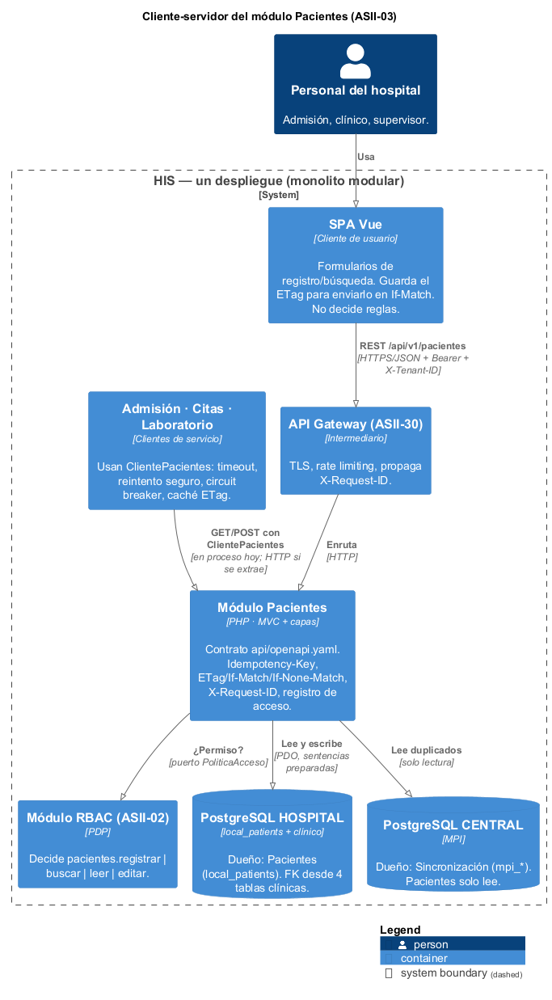
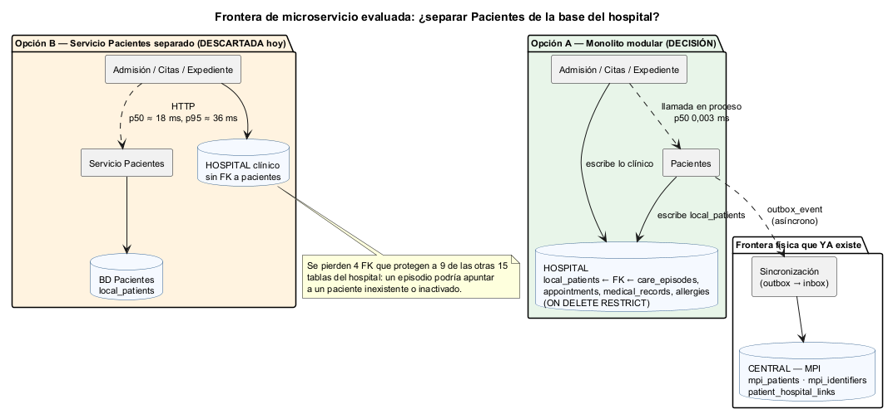
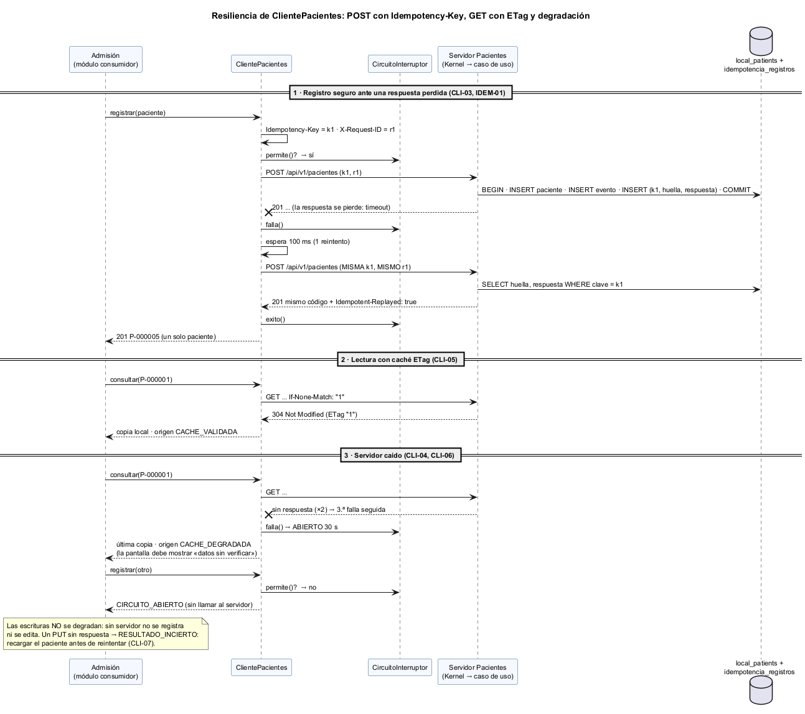
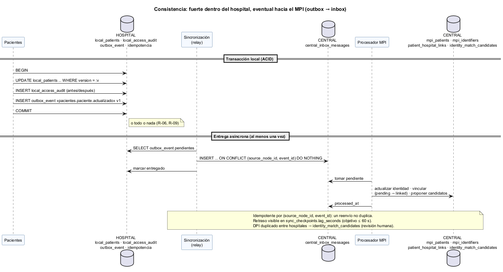
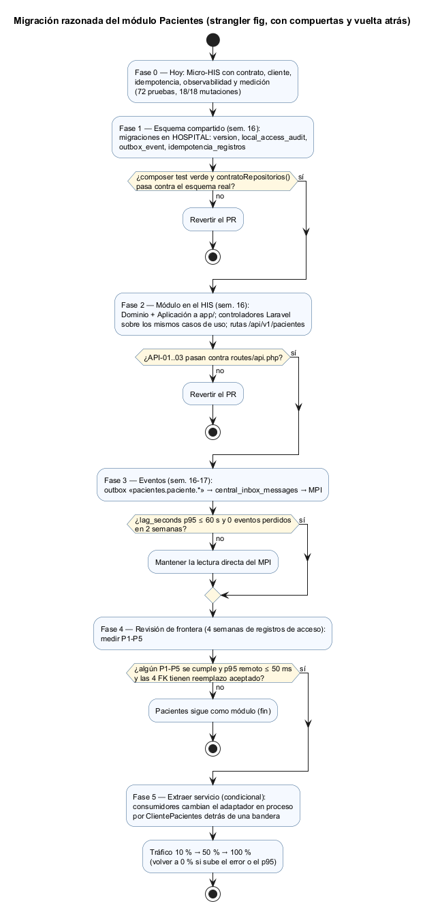
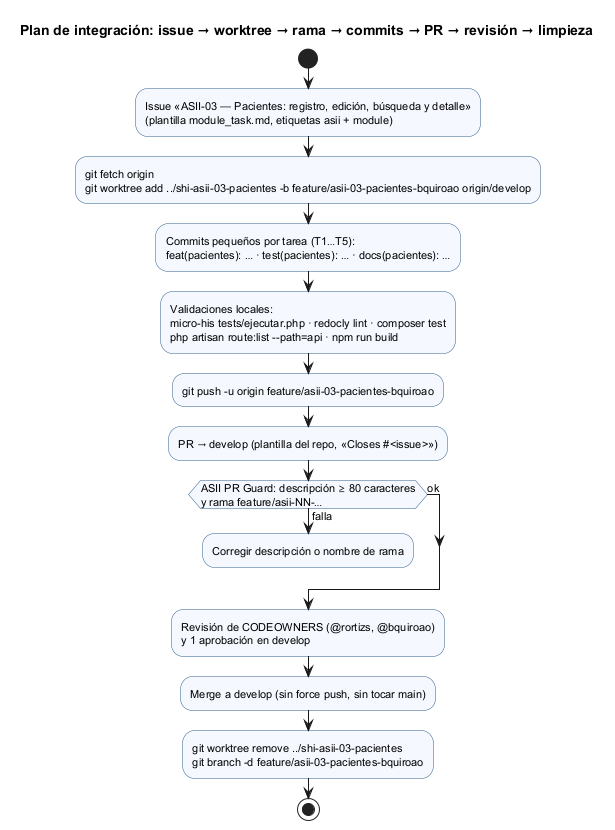

# Semana 5 — Cliente-servidor, API REST, frontera de microservicio e integración

| | |
|---|---|
| **Curso** | Análisis de Sistemas II — Proyecto Final 2026 |
| **Proyecto** | Sistema Hospitalario Integrado (HIS) |
| **Módulo** | ASII-03 · Pacientes: registro, edición, búsqueda y detalle |
| **Tema de la semana** | Cliente-servidor, API REST, microservicios e integración |
| **Flujo** | «Registro, búsqueda y actualización segura de un paciente» |
| **Código** | [`micro-his-pacientes/`](../micro-his-pacientes/README.md) (el MISMO de las semanas 3 y 4) |
| **Contrato** | [`micro-his-pacientes/api/openapi.yaml`](../micro-his-pacientes/api/openapi.yaml) |
| **Estudiante** | Boris Alexander Quiroa Orellana |
| **Fecha** | Octubre 2026 |

## Índice

1. [Introducción y decisión](#1-introducción-y-decisión)
2. [Qué se construyó esta semana](#2-qué-se-construyó-esta-semana)
3. [Diseño cliente-servidor](#3-diseño-cliente-servidor)
4. [Contrato API](#4-contrato-api)
5. [Evaluación de la frontera de microservicio](#5-evaluación-de-la-frontera-de-microservicio)
6. [Propiedad de los datos](#6-propiedad-de-los-datos)
7. [Comunicación](#7-comunicación)
8. [Seguridad](#8-seguridad)
9. [Resiliencia](#9-resiliencia)
10. [Observabilidad](#10-observabilidad)
11. [Consistencia](#11-consistencia)
12. [Migración razonada](#12-migración-razonada)
13. [Plan de issue, rama, worktree y PR](#13-plan-de-issue-rama-worktree-y-pr)
14. [Evidencia](#14-evidencia)
15. [Limitaciones](#15-limitaciones)
16. [Conclusión](#16-conclusión)
17. [Bibliografía](#17-bibliografía)

## 1. Introducción y decisión

Esta semana el Micro-HIS Pacientes evoluciona hacia un diseño **cliente-servidor** explícito:

- **Contrato REST formal** (OpenAPI 3.1, validado con Redocly) y pruebas que impiden que contrato y código diverjan.
- **Protocolo HTTP completo para la actualización segura:**
  - `ETag` / `If-Match` (ya existían);
  - `If-None-Match` → 304, nuevo;
  - `Idempotency-Key` para reintentar un `POST` sin efectos dobles, nuevo.
- **Observabilidad:** `X-Request-ID` en toda respuesta y un registro de acceso estructurado sin datos personales.
- **Una librería cliente** (`ClientePacientes`) para los módulos que consumen pacientes, con timeout, reintento seguro, circuit breaker y caché que se degrada con aviso.

Con esa base se **evalúa con datos** si conviene separar Pacientes como microservicio.

> **Decisión:** **no dividir el sistema.** Pacientes queda como **módulo del HIS (monolito modular)** dentro de la base de cada hospital, con frontera explícita (contrato + puertos + cliente). La frontera física que sí se justifica **ya existe**: el índice maestro (MPI) en CENTRAL, al que Pacientes avisa por eventos. Extraer Pacientes queda condicionado a los criterios P1–P5 (§5.3).

Motivos, con datos medidos:

| Dato | Valor | Fuente |
|---|---|---|
| Costo de consultar un paciente dentro del proceso | **0,003 ms** (p50) | `bin/medir.php`, escenario A |
| Costo por red local | **18 ms** (p50) · **37 ms** (p95) | escenario C |
| Tablas clínicas con FK directa a `local_patients` | **4** (`care_episodes`, `appointments`, `medical_records`, `allergies`) | migraciones HOSPITAL |
| Tablas que dependen de `local_patients`, directa o transitivamente | **9 de las otras 15** | migraciones HOSPITAL |
| Criterios P1–P5 que se cumplen hoy | **0 de 5** | §5.3 |

Separar Pacientes con su propia base rompería 4 llaves foráneas `ON DELETE RESTRICT`, que hoy garantizan que ningún episodio, cita, expediente ni alergia apunte a un paciente inexistente. Además, convertiría cada consulta de admisión en un salto de red. Nada de eso tiene hoy una necesidad que lo justifique.

## 2. Qué se construyó esta semana

| Pieza | Archivo | Propósito |
|---|---|---|
| Contrato OpenAPI 3.1 | `api/openapi.yaml` | 4 operaciones con `x-permiso`, cabeceras, esquemas, ejemplos y todos los errores. Validado con Redocly 1.34.3. |
| Idempotencia de `POST` | puerto `AlmacenIdempotencia` (Aplicación), adaptadores InMemory y PDO, tabla `idempotencia_registros` | Reintentar un registro sin duplicar ni recibir un 409 engañoso |
| GET condicional | `PacienteVista::detalle()` | `If-None-Match` → 304, para revalidar la caché del cliente |
| Observabilidad | `Kernel` (`X-Request-ID`), `Observabilidad/RegistroAccesoJson` | Trazar una petición entre módulos sin registrar datos personales |
| Librería cliente | `src/Cliente/*`: `ClientePacientes`, `CircuitoInterruptor`, `TransporteHttpStream`… | Lo que usaría admisión o laboratorio si Pacientes estuviera en otro proceso |
| Medición | `bin/medir.php` | Datos para decidir la frontera |
| Pruebas nuevas | API-01..03, CLI-01..08, OBS-01..03, IDEM-01..04, HTTP-09, CON-*-07; ARQ-01 y ARQ-06 ampliadas | 20 pruebas nuevas (de 52 a 72) |
| Mutaciones nuevas | M13..M18 | Las pruebas nuevas detectan los defectos que deben detectar |

**Dominio y Persistencia PDO de pacientes no cambiaron.** En Aplicación cambió solo `RegistrarPaciente`, que ahora consulta y guarda la `Idempotency-Key` dentro de la misma transacción, y `ComandoRegistrar`, que lleva la clave.

## 3. Diseño cliente-servidor



Fuente: [`diagramas/semana-05-cliente-servidor.puml`](diagramas/semana-05-cliente-servidor.puml)

| Rol | Quién | Responsabilidad |
|---|---|---|
| **Cliente de usuario** | SPA Vue | Formularios. Guarda el `ETag` del detalle para enviarlo en `If-Match`. Genera una `Idempotency-Key` por cada intento de registro del usuario. **No decide reglas**: el servidor valida todo otra vez. |
| **Cliente de servicio** | Admisión, citas, laboratorio | Hoy llaman en proceso. Si alguno se despliega aparte, usa `ClientePacientes` con las políticas de §9. |
| **Intermediario** | API Gateway (ASII-30) | TLS, rate limiting, propagación de `X-Request-ID` |
| **Servidor** | Módulo Pacientes | Único que aplica R-01..R-10 y escribe `local_patients` |
| **Datos** | PostgreSQL HOSPITAL y CENTRAL | §6 |

**Principios:**

1. **Servidor sin estado.** Cada petición trae identidad (token), contexto (`X-Tenant-ID`) y versión (`If-Match`), así que se puede escalar horizontalmente. La idempotencia vive en la base, no en memoria.
2. **El servidor es la autoridad.** La SPA puede validar el formato para mejorar la experiencia, pero el 422 lo decide el Dominio.
3. **Contrato primero.** `ClientePacientes` se programa contra `openapi.yaml`, no contra clases del servidor. ARQ-01 impide que `Pacientes\Cliente` importe cualquier otra capa (mutación M14).

## 4. Contrato API

Contrato: [`api/openapi.yaml`](../micro-his-pacientes/api/openapi.yaml). Lint: «Your API description is valid» ([`evidencia/salida-lint-openapi.txt`](evidencia/salida-lint-openapi.txt)).

### 4.1 Operaciones

| Método | Ruta | `x-permiso` | Cabeceras propias | Respuestas |
|---|---|---|---|---|
| POST | `/api/v1/pacientes` | `pacientes.registrar` | `Idempotency-Key` (opcional) | 201 · 400 · 401 · 403 · 409 · 422 · 500 · 503 |
| GET | `/api/v1/pacientes?nombre=&nacimiento=&codigo=&tipo_documento=&numero_documento=&pais_documento=` | `pacientes.buscar` | — | 200 · 400 · 401 · 403 · 422 · 500 · 503 |
| GET | `/api/v1/pacientes/{codigo}` | `pacientes.leer` | `If-None-Match` | 200 · 304 · 400 · 401 · 403 · 404 · 500 · 503 |
| PUT | `/api/v1/pacientes/{codigo}` | `pacientes.editar` | `If-Match` (obligatoria) | 200 · 400 · 401 · 403 · 404 · 409 · 422 · 428 · 500 · 503 |

Todas exigen `Authorization: Bearer` y `X-Tenant-ID`, aceptan `X-Request-ID` y lo devuelven.

### 4.2 Idempotencia del registro

```http
POST /api/v1/pacientes
Authorization: Bearer <token>
X-Tenant-ID: hosp-oriente
Idempotency-Key: urgencias-0000001

{"nombres":"Pedro","apellidos":"Ramírez Soto","fecha_nacimiento":"1990-05-20","sexo":"male"}
```

| Situación | Respuesta |
|---|---|
| Primera vez | 201 + `Location` + `ETag` |
| Reintento con la misma clave y el mismo cuerpo | **201 con el mismo cuerpo** + `Idempotent-Replayed: true`. No crea otro paciente ni otro evento (IDEM-01). |
| Misma clave con otro cuerpo | 422 `IDEMPOTENCY_KEY_REUTILIZADA` (IDEM-02) |
| Dos peticiones simultáneas con la misma clave | La segunda: 409 `SOLICITUD_EN_CURSO`, y su paciente se revierte (IDEM-04) |
| Clave mal formada | 400 `FORMATO_INVALIDO` |

**Por qué hace falta** (hallazgo de IDEM-03). Sin clave, el reintento de un registro que sí se hizo **no** crea un duplicado, porque R-03 lo detiene. Pero responde **409 `POSIBLE_DUPLICADO`**: el cliente cree que falló, no conoce el código del paciente que sí se creó, y un supervisor podría «confirmar que es otra persona» y crear el duplicado a mano. Con la clave, el reintento devuelve 201 con el código original.

**Alcance de la clave.** La clave es por hospital y por actor, y se guarda en la **misma transacción** que el paciente. Así no puede existir un paciente sin su clave ni una clave sin su paciente (CON-MEM-07).

### 4.3 Reglas transversales

- **Errores:** siempre `{"error": "<CÓDIGO>", ...}`. Los códigos están enumerados en el contrato. Nunca trazas ni SQLSTATE.
- **Versionado:**
  - versión mayor en la ruta (`/api/v1`);
  - los campos opcionales nuevos no cambian la versión;
  - un cambio incompatible crea `/api/v2`, y `/v1` se mantiene un semestre con aviso (`Deprecation`).
- **Conformidad comprobada por pruebas:**

| Prueba | Qué comprueba | Mutación que la hace fallar |
|---|---|---|
| **API-01** | Mismas operaciones en el YAML y en `Rutas::definir()`. Cada `x-permiso` existe en `ControlAcceso` y es el que exige el caso de uso de esa operación. | M15: cambiar el permiso de la búsqueda en el YAML |
| **API-02** | Toda operación documenta 400/401/403/500/503; las escrituras 422; el PUT 409 y 428; el detalle 304 y 404 | M16: quitar el 428 |
| **API-03** | 18 escenarios reales contra el Kernel; cada código devuelto está documentado | — |

## 5. Evaluación de la frontera de microservicio



Fuente: [`diagramas/semana-05-frontera-microservicio.puml`](diagramas/semana-05-frontera-microservicio.puml)

### 5.1 ¿Pacientes es un buen candidato a servicio?

| Criterio de frontera | Evaluación |
|---|---|
| Contexto acotado propio | ✓ Vocabulario y reglas propias (identidad, duplicado, versión) |
| Datos propios | ✓ `local_patients`, auditoría de pacientes |
| Interfaz estrecha | ✓ 4 operaciones con contrato |
| **Integridad referencial** | ✗ **4 tablas clínicas** tienen FK a `local_patients` y **9 de las otras 15** dependen de ella. Con base propia, esas FK desaparecen. |
| **Transacciones con lo clínico** | ✗ Admisión crea un episodio para un paciente que debe existir y estar activo en ese instante. Entre bases distintas, eso pasa a ser una validación remota con carrera. |
| Sensibilidad a la latencia | ✗ Admisión, citas y laboratorio leen al paciente en casi toda operación |

**La frontera física ya existe donde sí hace falta:** la identidad **entre hospitales** vive en el MPI de CENTRAL, otra base de datos, y Pacientes se comunica con él por eventos (§7). Dentro de un hospital, el paciente es parte del mismo agregado de datos que su información clínica.

### 5.2 Medición

`php bin/medir.php 5000 300`, adaptadores InMemory, PHP 8.4.26, Windows ([`evidencia/salida-medicion.txt`](evidencia/salida-medicion.txt)):

| Escenario | n | p50 | p95 | p99 | Veces el p50 de A |
|---|---:|---:|---:|---:|---:|
| A) Módulo en proceso (caso de uso) | 5000 | 0,003 ms | 0,005 ms | 0,010 ms | 1× |
| B) API HTTP en proceso (Kernel, sin red) | 5000 | 0,008 ms | 0,012 ms | 0,016 ms | 3× |
| C) Servicio separado por red local | 300 | 18,3 ms | 36,6 ms | 39,9 ms | ≈ 7 000× |
| C0) Control: 404 mínimo por la misma red | 300 | 17,1 ms | 36,1 ms | 40,4 ms | ≈ 6 600× |
| D) Servicio separado + caché ETag (304) | 300 | 18,2 ms | 36,4 ms | 39,6 ms | ≈ 7 000× |

Respuestas incorrectas: 0 de 10 900.

**Lectura de los datos:**

- **El costo no es la lógica de Pacientes.** El Kernel completo cuesta 0,008 ms. C ≈ C0: casi todo el costo remoto es el **salto de red y el arranque por petición**, y aparece aunque la petición no haga nada.
- **La caché con ETag no ahorra latencia** (D ≈ C). El 304 sigue siendo un viaje de red y el servidor sigue autorizando y auditando la consulta. Su valor es otro:
  - **consistencia**: revalida en lugar de adivinar;
  - **degradación**: deja una copia para cuando el servidor no responde.

  No se vende como optimización de rendimiento.
- **Impacto en el HIS.** Una pantalla de admisión que consulta 3 pacientes (titular, acompañante, responsable) agregaría ≈ 55 ms (p50) a ≈ 110 ms (p95) en remoto, contra menos de 0,01 ms en proceso.
- **Honestidad del dato.** `php -S` es un servidor de desarrollo de un solo proceso, en Windows. Sirve para comparar órdenes de magnitud. Con PHP-FPM y conexiones persistentes bajaría, pero el salto de red no desaparece. Por eso la compuerta de §5.3 exige volver a medir en condiciones reales.

### 5.3 Criterios medibles para extraer el servicio

Pacientes se extrae **solo si** se cumplen las tres condiciones:

1. al menos uno de P1–P5;
2. p95 remoto ≤ 50 ms con conexiones persistentes;
3. un reemplazo aceptado para las 4 FK (referencia lógica + reconciliación, acordado con los dueños de admisión, citas y expediente).

| ID | Criterio | Cómo se mide | Umbral | Valor hoy |
|---|---|---|---|---|
| P1 | Consumidores fuera de la app principal (otro lenguaje o despliegue) | Inventario de integraciones | ≥ 1 | 0 |
| P2 | Carga de lectura que exija escalar Pacientes por separado | Registro de acceso: peticiones/s a `/api/v1/pacientes*` | > 200 req/s sostenidas | No medible aún (prototipo); estimado < 5 req/s por hospital |
| P3 | Cadencia de despliegue distinta del resto del HIS | Historial de git: releases solo de Pacientes | > 2 por semana durante 1 mes | 1 por semana, junto con el resto |
| P4 | Disponibilidad distinta del resto (por ejemplo, registrar aunque el módulo clínico esté caído) | SLO acordado | SLO de Pacientes > SLO del HIS | No definido (mismo SLO) |
| P5 | Equipo propio | Personas asignadas | ≥ 2 | 1 |

**Resultado: no se cumple ningún criterio.** La condición 3 tampoco tiene hoy una propuesta aceptada. Dividir el sistema hoy no tiene justificación medible, que es justo lo que la tarea pide no hacer.

## 6. Propiedad de los datos

| Dato | Dueño (único que escribe) | Cómo lo usa Pacientes | Cómo lo usan los demás |
|---|---|---|---|
| `local_patients` (HOSPITAL) | **Pacientes** | Lee y escribe (`RepositorioPacientes`) | Admisión, citas, expediente y laboratorio **leen** y lo referencian por FK; nunca escriben |
| `local_access_audit` de pacientes (HOSPITAL) | **Pacientes** (append-only) | Escribe | Gobernanza lee |
| `idempotencia_registros` (HOSPITAL) | **Pacientes** | Lee y escribe | Nadie. Se puede purgar después de 24 h: no es evidencia clínica. |
| `outbox_event` `pacientes.*` (HOSPITAL) | **Pacientes** escribe; Sincronización marca la entrega | Escribe en la misma transacción | Sincronización lee |
| `mpi_patients`, `mpi_identifiers`, `patient_hospital_links`, `identity_match_candidates` (CENTRAL) | **Sincronización / MPI** | Solo lee (`IndiceDuplicados`) | Gobernanza y acceso entre hospitales |
| Permisos `pacientes.*` | **RBAC** | Pregunta (`PoliticaAcceso`) | — |

**Regla:** ningún otro módulo escribe `local_patients`, y Pacientes no escribe en el MPI. En el monolito, esto se hace cumplir con roles de base de datos de mínimo privilegio (semana 4, §8.4). Si algún día se extrae Pacientes, esta tabla dice exactamente qué se lleva.

## 7. Comunicación

| Interacción | Estilo | Por qué |
|---|---|---|
| Registrar, buscar, consultar y editar desde la SPA | **Síncrona** (REST) | El usuario espera la respuesta (201/409/422) |
| Admisión, citas y laboratorio leen al paciente | **Síncrona en proceso** (puerto); REST con `ClientePacientes` si se separan | Necesitan el dato vigente para crear el episodio o la cita |
| Avisar al MPI de un registro o un cambio de identidad | **Asíncrona** (outbox → `central_inbox_messages`) | El hospital no debe depender de que CENTRAL responda en ese momento |
| Avisar a otros módulos de un cambio (por ejemplo, para invalidar copias) | **Asíncrona** (mismo evento) | Desacople: Pacientes no conoce a sus consumidores |

**Evento propuesto** (contrato asíncrono, versionado; datos **mínimos**, sin documento en claro):

```json
{
  "event_id": "uuid",
  "event_type": "pacientes.paciente.actualizado",
  "schema_version": 1,
  "occurred_at": "2026-11-15T10:00:00-06:00",
  "hospital_id": "hosp-oriente",
  "codigo": "P-000001",
  "global_id": "uuid",
  "version": 8,
  "estado": "active",
  "cambio_identidad": true,
  "documento": { "tipo": "DPI", "search_hash": "…", "value_encrypted": "…" },
  "request_id": "traza-admision-0001"
}
```

El evento se escribe en `outbox_event` en la **misma transacción** que el cambio y su auditoría. El consumidor es idempotente por `(source_node_id, event_id)`, una restricción que ya existe en `central_inbox_messages`. También existe `pacientes.paciente.registrado`.

## 8. Seguridad

| Amenaza (OWASP API Top 10, 2023) | Control | Evidencia |
|---|---|---|
| API1 — Autorización a nivel de objeto (BOLA) | Todo acceso filtra por el hospital del token. Un paciente de otro hospital da el **mismo** 404 que uno inexistente. | HTTP-05, APP-05, CON-*-01 |
| API2 — Autenticación rota | 401 sin token o con token inválido; 403 si el token es de otro hospital | HTTP-02 |
| API3 — Exposición de propiedades | Documento siempre enmascarado; la búsqueda devuelve 4 campos; la auditoría guarda el criterio sin datos | CA de la semana 2, HTTP-04, APP-01 |
| API4 — Consumo sin límite | Máximo 20 resultados; criterio mínimo de 3 letras; rate limiting en el Gateway | DOM-05, CON-*-02 |
| API5 — Autorización a nivel de función | Cada operación declara y exige su permiso | API-01, APP-05 |
| API6 — Flujos de negocio sensibles | Registro masivo o repetido: idempotencia + rate limit; confirmar duplicados exige un permiso aparte | IDEM-01..04, DOM-06 |
| API8 — Mala configuración | 500 genérico sin trazas; claves y credenciales en variables de entorno; 503 `CONFIGURACION_INCOMPLETA` si faltan | HTTP-07, HTTP-08 |
| Inyección (SQL, LIKE, logs) | Sentencias preparadas; comodines escapados; `X-Request-ID` con lista blanca (un `<script>` no se refleja) | ARQ-03, PER-02, OBS-01 |
| Fuga de datos personales en logs | El registro de acceso **no** incluye token, query, cuerpo, nombre ni documento | OBS-02, M17 |

**Entre servicios** (solo si se extrae Pacientes):

- TLS obligatorio;
- token de servicio o mTLS del módulo llamador, **además** del token del usuario, para que el permiso siga siendo del usuario;
- *allowlist* de módulos consumidores.

## 9. Resiliencia



Fuente: [`diagramas/semana-05-secuencia-resiliencia.puml`](diagramas/semana-05-secuencia-resiliencia.puml)

| Mecanismo | Implementación | Prueba |
|---|---|---|
| Timeout | `ClientePacientes`: 0,5 s por defecto | CLI-08 (puerto cerrado → respuesta en menos de 5 s, sin excepción) |
| Reintento acotado | 1 reintento con espera de 100 ms, **solo** ante falla de red o 5xx, y con el mismo `X-Request-ID` | CLI-01, CLI-02 |
| Sin reintento ante 4xx | Un 409/422 es una respuesta válida del servicio | CLI-02 |
| **POST reintentable** | El cliente **siempre** envía `Idempotency-Key`, así el reintento es seguro | CLI-03, IDEM-01 |
| **PUT no reintentable** | Si no llega la respuesta, el resultado es `RESULTADO_INCIERTO`: hay que recargar el paciente (un reintento ciego daría un 409 engañoso) | CLI-07, M13 |
| Circuit breaker | 3 fallas seguidas → ABIERTO 30 s → SEMIABIERTO → CERRADO | CLI-04 |
| Revalidación | `If-None-Match` → 304 reutiliza la copia local | CLI-05, HTTP-09 |
| **Degradación de lecturas** (*stale-if-error*) | Si el servidor no responde, devuelve la última copia marcada `CACHE_DEGRADADA`. Sin copia, no inventa datos. Un 404 borra la copia. | CLI-06 |
| Escrituras sin degradación | Sin servidor no se registra ni se edita: `CIRCUITO_ABIERTO` / `FALLA_SERVICIO` | CLI-04 |
| Transacciones | Paciente + evento + clave, o nada | APP-07, IDEM-04, CON-*-06/07 |

**Sobre la copia degradada.** Puede estar desactualizada (por ejemplo, el paciente falleció o cambió de documento). Por eso:
- el origen viaja en el resultado (`CACHE_DEGRADADA`);
- la pantalla debe mostrar «datos sin verificar»;
- la copia **no** debe usarse para decisiones de identidad (registrar, fusionar) ni para crear un episodio clínico. Solo sirve para **mostrar**.

La caché vive solo en la memoria del proceso consumidor, nunca en disco.

**Pendiente de la semana 4 (CENTRAL caído).** Si el MPI no responde, la verificación de duplicados falla y el registro devuelve 503. Para urgencias se propone una degradación de **dominio**: registrar con `mpi_link_status = 'pending'` y la marca «verificación de duplicados pendiente», y dejar que la sincronización proponga candidatos después. Es una decisión clínica y queda para acordarla con el equipo del MPI. No se implementó.

## 10. Observabilidad

| Señal | Implementación | Para qué |
|---|---|---|
| **`X-Request-ID`** | El Kernel respeta el id recibido si cumple `^[A-Za-z0-9-]{8,64}$`; si no, genera un UUID v4. Va en **toda** respuesta, incluso en 401 y 404. `ClientePacientes` lo reenvía igual en los reintentos. | Seguir una operación de admisión de punta a punta (OBS-01, CLI-01) |
| **Registro de acceso estructurado** | Una línea JSON por petición: `request_id`, `metodo`, `ruta` (**sin query**), `estado`, `duracion_ms`, `actor`, `tenant`. Sin token, cuerpo, nombres ni documento. | Métricas y diagnóstico (OBS-02). Si el registro falla, la respuesta no cambia (OBS-03). |
| **Auditoría de negocio** | `PACIENTE_*` (semanas 1–4), separada del registro técnico | Quién vio o cambió qué paciente |
| **Métricas derivadas** | Peticiones/s por ruta (criterio P2); p95 por ruta; tasa de 409 `VERSION_DESACTUALIZADA` (contención de edición); tasa de `Idempotent-Replayed` (salud de la red); tasa de 503 | Alertas y la revisión de frontera |
| **Alertas propuestas** | (1) Tasa de 503 > 1 % en 5 min. (2) Pico de 403 de un mismo actor: posible exploración. (3) Circuito abierto en un consumidor. (4) `sync_checkpoints.lag_seconds` > 60 s. | Respuesta a incidentes |
| **Trazas distribuidas** (futuro) | Migrar `X-Request-ID` a W3C `traceparent` (OpenTelemetry) si se extrae algún servicio | — |

Registro real emitido por `php -S` ([`evidencia/salida-servidor-real.txt`](evidencia/salida-servidor-real.txt)). Se buscó `?nombre=lopez` y la query **no** aparece:

```json
{"tipo":"acceso","request_id":"traza-admision-0002","metodo":"GET","ruta":"/api/v1/pacientes/P-000001","estado":304,"duracion_ms":1.198,"actor":"clinico-01","tenant":"hosp-oriente"}
{"tipo":"acceso","request_id":"traza-admision-0003","metodo":"GET","ruta":"/api/v1/pacientes","estado":200,"duracion_ms":1.787,"actor":"clinico-01","tenant":"hosp-oriente"}
```

## 11. Consistencia



Fuente: [`diagramas/semana-05-consistencia.puml`](diagramas/semana-05-consistencia.puml)

| Dónde | Modelo | Mecanismo |
|---|---|---|
| Paciente + auditoría + clave de idempotencia (+ outbox) | **Fuerte (ACID)** | Una transacción local (`Transaccion`) |
| Ediciones concurrentes | **Fuerte, optimista** | `UPDATE ... WHERE version = :v` → 409 |
| Documento único **dentro** de un hospital | **Fuerte** | Índice único (en el HIS: verificación previa contra el MPI) |
| Documento único **entre** hospitales | **Eventual** | El MPI lo detecta al procesar el evento → `identity_match_candidates` (semana 4, §8.3) |
| HOSPITAL → MPI | **Eventual**, al menos una vez | Outbox + inbox idempotente por `(source_node_id, event_id)`; retraso en `sync_checkpoints.lag_seconds` (objetivo ≤ 60 s) |
| Copias en consumidores | **Eventual con revalidación** | ETag/304; degradada solo para mostrar |
| Reintentos de registro | **Exactamente una vez, a efectos visibles** | `Idempotency-Key` |

## 12. Migración razonada



Fuente: [`diagramas/semana-05-migracion.puml`](diagramas/semana-05-migracion.puml)

| Fase | Qué se hace | Compuerta para avanzar | Cómo se vuelve atrás |
|---|---|---|---|
| 0 — Hoy | Micro-HIS con contrato, cliente, idempotencia, observabilidad y medición | 72 pruebas (0 fallan); 18/18 mutaciones | — |
| 1 — Esquema (sem. 16) | Migraciones **nuevas** en HOSPITAL: `version`, `local_access_audit`, `outbox_event`, `idempotencia_registros` | `composer test` verde; `contratoRepositorios()` pasa contra el esquema real | Revertir el PR (migraciones con `down()`) |
| 2 — Módulo en el HIS (sem. 16) | Dominio + Aplicación a `app/`; controladores Laravel sobre los mismos casos de uso; rutas `/api/v1/pacientes` con `tenant` + `jwt.auth` | API-01..03 pasan contra `routes/api.php` | Revertir el PR |
| 3 — Eventos (sem. 16–17) | Outbox `pacientes.paciente.*` → inbox → MPI | `lag_seconds` p95 ≤ 60 s y 0 eventos perdidos en 2 semanas | Mantener la lectura directa del MPI |
| 4 — Revisión de frontera | 4 semanas de registros de acceso para medir P1–P5 | ¿P1–P5 **y** p95 ≤ 50 ms **y** reemplazo de las 4 FK aceptado? | — |
| 5 — Extraer *(condicional)* | Los consumidores cambian el adaptador en proceso por `ClientePacientes` detrás de una bandera | Mismas pruebas de contrato contra el servicio | Volver al adaptador en proceso (bandera) |
| 6 — Retirar el camino viejo | Tráfico 10 % → 50 % → 100 % | Errores y p95 dentro del objetivo en cada paso | Bajar el porcentaje |

Es el patrón *strangler fig*: el sistema nuevo crece alrededor del viejo y siempre hay vuelta atrás. Las fases 1–3 se justifican por sí mismas, porque dan concurrencia segura, auditoría y MPI al día aunque nunca se llegue a la fase 5.

## 13. Plan de issue, rama, worktree y PR



Fuente: [`diagramas/semana-05-flujo-issue-pr.puml`](diagramas/semana-05-flujo-issue-pr.puml)

El plan sigue el **flujo obligatorio del README del repositorio** para integrar el módulo al HIS (fases 1–3):

1. **Issue:** «ASII-03 — Pacientes: registro, edición, búsqueda y detalle», con la plantilla `module_task.md`. El texto listo para pegar, con el comando `gh`, está en [`plan/issue-asii-03-pacientes.md`](plan/issue-asii-03-pacientes.md).
2. **Worktree y rama** desde `origin/develop`, con el nombre que valida el CI:

   ```bash
   git fetch origin
   git worktree add ../shi-asii-03-pacientes -b feature/asii-03-pacientes-bquiroao origin/develop
   cd ../shi-asii-03-pacientes
   ```

3. **Commits pequeños y convencionales**, uno por tarea: `feat(pacientes): …`, `test(pacientes): …`, `docs(pacientes): …`.
4. **Validaciones locales** antes del PR:

   ```bash
   php docs/modulos/pacientes/micro-his-pacientes/tests/ejecutar.php
   npx @redocly/cli lint docs/modulos/pacientes/micro-his-pacientes/api/openapi.yaml
   composer test
   php artisan route:list --path=api
   npm run build
   ```

5. **PR hacia `develop`** con la plantilla del repositorio y `Closes #<issue>`. Borrador en [`plan/pr-integracion-pacientes.md`](plan/pr-integracion-pacientes.md).
6. **Revisión:**
   - el check «ASII PR Guard» debe pasar (descripción de 80 caracteres o más y rama `feature/asii-NN-…`);
   - revisan los CODEOWNERS (`@rortizs`, `@bquiroao`);
   - nunca *force push* ni PR a `main`.
7. **Cierre:**

   ```bash
   git worktree remove ../shi-asii-03-pacientes
   git branch -d feature/asii-03-pacientes-bquiroao
   ```

| Tarea del issue | Rama | Semana |
|---|---|---|
| T1 Esquema HOSPITAL (`version`, `local_access_audit`, `outbox_event`, `idempotencia_registros`) | `feature/asii-03-pacientes-esquema-bquiroao` | 16 |
| T2 Núcleo: Dominio + Aplicación + adaptadores sobre `local_patients` y el MPI | `feature/asii-03-pacientes-bquiroao` | 16 |
| T3 API Laravel + `X-Request-ID` + pruebas API-01..03 sobre rutas reales | `feature/asii-03-pacientes-api-bquiroao` | 16 |
| T4 Outbox `pacientes.paciente.*` → MPI | `feature/asii-03-pacientes-eventos-bquiroao` | 16–17 |
| T5 Seguridad: permisos, tenant, OWASP, logs sin datos personales | `test/asii-03-pacientes-seguridad-bquiroao` | 17 |

**Nota:** las entregas semanales usan la convención del grupo (`semana-N-pacientes`). La integración usa la convención oficial del README (`feature/asii-03-…` + worktree), que es la que valida el CI.

## 14. Evidencia

| Evidencia | Resultado | Archivo |
|---|---|---|
| Suite completa | **72 pruebas: 70 pasan, 0 fallan, 2 omitidas** (las omitidas requieren PostgreSQL) | [`evidencia/salida-pruebas.txt`](evidencia/salida-pruebas.txt) |
| Comprobación por mutación | **18 de 18 detectadas** (M13..M18 son de esta semana) | [`evidencia/mutaciones.txt`](evidencia/mutaciones.txt) |
| Lint OpenAPI (Redocly 1.34.3) | «Your API description is valid» | [`evidencia/salida-lint-openapi.txt`](evidencia/salida-lint-openapi.txt) |
| Medición de latencia | Tabla de §5.2 | [`evidencia/salida-medicion.txt`](evidencia/salida-medicion.txt) |
| Servidor real (`php -S`) | 200 + `X-Request-ID`; 304 con `If-None-Match`; 201 con `Idempotency-Key`; 400 con clave inválida; id peligroso reemplazado; registro de acceso sin query | [`evidencia/salida-servidor-real.txt`](evidencia/salida-servidor-real.txt) |

**Pruebas nuevas de la semana 5** (20):

| Grupo | Pruebas |
|---|---|
| Contrato API | API-01..03 |
| Cliente | CLI-01..08 |
| Observabilidad | OBS-01..03 |
| Idempotencia | IDEM-01..04 |
| GET condicional | HTTP-09 |
| Contrato de persistencia | CON-MEM-07 |

Además se ampliaron ARQ-01 (capa `Cliente` aislada) y ARQ-06 (puerto `AlmacenIdempotencia`).

| Mutación nueva | Detectada por |
|---|---|
| M13 El cliente reintenta los PUT | CLI-07 |
| M14 El cliente importa una clase del servidor | ARQ-01 |
| M15 El contrato declara otro permiso para la búsqueda | API-01 |
| M16 El contrato deja de documentar el 428 | API-02, API-03 |
| M17 El registro de acceso incluye la query (nombres) | OBS-02 |
| M18 El registro deja de consultar la `Idempotency-Key` | IDEM-01..03, CLI-03 |

## 15. Limitaciones

- **Cifras de red.** Vienen de `php -S` en Windows (servidor de desarrollo, un proceso). Sirven para comparar órdenes de magnitud, no como dato de producción.
- **PostgreSQL real sin ejecutar.** `CON-PDO-*` e `INT-*` siguen omitidas por falta de credenciales en el entorno. La tabla `idempotencia_registros` se probó con dobles y con el contrato InMemory, no contra PostgreSQL real.
- **Solo diseñado, no construido:** el outbox, los eventos, el rate limiting y la autenticación entre servicios. La tarea pide no construir infraestructura de producción.
- **Modo memoria.** Cada petición de `php -S` es un proceso nuevo, así que la repetición idempotente entre peticiones solo se observa con PostgreSQL. En las pruebas se demuestra en el mismo proceso.
- **Degradación si CENTRAL no responde.** Propuesta, no implementada (§9).

## 16. Conclusión

El Micro-HIS Pacientes ya funciona como un **servidor con contrato**:

- OpenAPI validado y conformidad con el código probada automáticamente;
- el protocolo HTTP completo de la actualización segura (`ETag`, `If-Match`, `If-None-Match`);
- reintentos seguros con `Idempotency-Key`;
- trazabilidad con `X-Request-ID` sin filtrar datos personales.

La pregunta «¿microservicio?» se respondió con datos y no con preferencias:

- la lógica de Pacientes cuesta microsegundos y la red decenas de milisegundos;
- separar la base rompería 4 llaves foráneas de las que dependen 9 tablas clínicas;
- no se cumple ninguno de los cinco criterios que justificarían el costo.

La frontera física correcta ya existe: el MPI en CENTRAL, al que Pacientes avisa por eventos. Pacientes queda como **módulo con frontera explícita**, con una migración por fases, compuertas medibles y vuelta atrás, y con el issue, el worktree y el PR listos para integrarlo al HIS.

## 17. Bibliografía

- Newman, S. (2021). *Building Microservices* (2.ª ed.). O'Reilly. Caps. 1–3 (fronteras; cuándo no usar microservicios) y 12 (resiliencia).
- Newman, S. (2019). *Monolith to Microservices*. O'Reilly. (*Strangler fig*, migración incremental, separar la base de datos).
- Richardson, C. (2018). *Microservices Patterns*. Manning. (*API Gateway*, *Circuit Breaker*, *Transactional Outbox*, *Database per Service*).
- Fielding, R., Nottingham, M. y Reschke, J. (2022). *RFC 9110: HTTP Semantics* (§13.1.1 If-Match, §13.1.2 If-None-Match, §15.4.5 304). IETF. https://www.rfc-editor.org/rfc/rfc9110
- Nottingham, M. (2010). *RFC 5861: HTTP Cache-Control Extensions for Stale Content* (*stale-if-error*). IETF. https://www.rfc-editor.org/rfc/rfc5861
- Jena, J. y Dalal, S. (2025). *The Idempotency-Key HTTP Header Field* (Internet-Draft, IETF HTTPAPI). https://datatracker.ietf.org/doc/draft-ietf-httpapi-idempotency-key-header/
- OpenAPI Initiative. (2021). *OpenAPI Specification 3.1.0*. https://spec.openapis.org/oas/v3.1.0
- OWASP Foundation. (2023). *OWASP API Security Top 10 — 2023*. https://owasp.org/API-Security/editions/2023/en/0x11-t10/
- HL7 International. (2023). *FHIR R5 — RESTful API: conditional update y versionado con ETag*. https://hl7.org/fhir/R5/http.html
