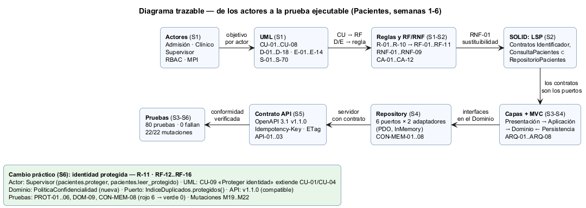
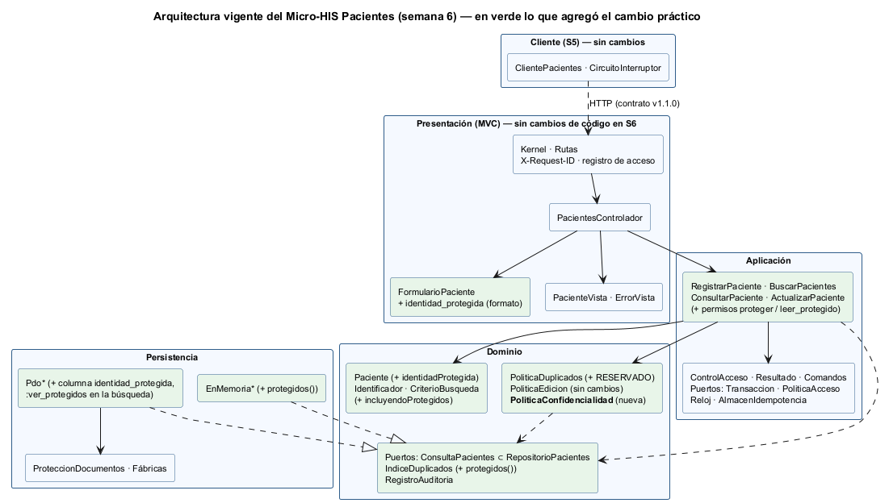

# Semana 6 — Defensa de la arquitectura: «registro, búsqueda y actualización segura de un paciente»

| | |
|---|---|
| **Estudiante** | Boris Alexander Quiroa Orellana |
| **Módulo** | ASII-03 · Pacientes: registro, edición, búsqueda y detalle |
| **Evaluación** | Primera evaluación parcial (tarea individual) |
| **Cambio práctico defendido** | Paciente con **identidad protegida** |
| **Estado del código** | 80 pruebas: **78 pasan, 0 fallan**, 2 omitidas (requieren PostgreSQL) · **22/22** mutaciones detectadas · contrato OpenAPI 1.1.0 válido |

## 1. Entregables

| Entregable pedido | Archivo |
|---|---|
| Presentación de 6–8 diapositivas | [presentacion/semana-06-defensa-pacientes.pptx](presentacion/semana-06-defensa-pacientes.pptx) (8 diapositivas, con notas del orador) · [PDF](presentacion/semana-06-defensa-pacientes.pdf) |
| Diagrama trazable | [diagramas/semana-06-trazabilidad.png](diagramas/semana-06-trazabilidad.png) ([fuente](diagramas/semana-06-trazabilidad.puml)) y la arquitectura vigente en [diagramas/semana-06-capas.png](diagramas/semana-06-capas.png) ([fuente](diagramas/semana-06-capas.puml)) |
| Matriz decisión → evidencia | [matriz-decision-evidencia.md](matriz-decision-evidencia.md) (21 decisiones, D-01..D-21) |
| Registro del cambio práctico defendido | [registro-cambio-practico.md](registro-cambio-practico.md) y la evidencia ejecutada en [evidencia/](evidencia/) |

Contenido de la presentación:

| # | Diapositiva | Qué conecta |
|:-:|---|---|
| 1 | Portada | Proceso, módulo y los tres números del estado actual (80 pruebas, 0 fallan, 21 decisiones) |
| 2 | Actores y UML | Admisión, clínico, supervisor, RBAC y MPI → CU-01..CU-08 y las vistas de actividad y secuencia |
| 3 | Requisitos y SOLID | Reglas R-01..R-10 → RF/RNF → LSP (antes/después de la semana 2) |
| 4 | Capas, MVC y Repository | Arquitectura vigente y las pruebas de arquitectura ARQ-* y CON-* |
| 5 | Contrato API y frontera | Operaciones, permisos y protocolo; la decisión medida de no dividir |
| 6 | Diagrama trazable | La cadena completa de la §2 en una imagen |
| 7 | Cambio práctico | Identidad protegida en los seis aspectos; rojo 6 → verde 0 |
| 8 | Cierre | Qué **no** cambió y cómo verificarlo en vivo |

## 2. El hilo de la defensa

La arquitectura se defiende como una cadena: cada eslabón se justifica con el anterior y deja una prueba que lo comprueba.



| Eslabón | Qué decidí | Por qué (viene del eslabón anterior) | Dónde se comprueba |
|---|---|---|---|
| **Actores** (S1) | Admisión, clínico y supervisor; RBAC y MPI como sistemas externos | Cada actor tiene un objetivo distinto sobre la misma ficha | Casos de uso de la [semana 1](../semana-01/semana-01-uml-proceso-pacientes.md) |
| **UML** (S1) | Casos de uso CU-01..CU-08, actividad y secuencia con identificadores compartidos | Los objetivos de los actores se vuelven pasos, decisiones y excepciones rastreables | Matriz de trazabilidad de la semana 1 (D-01) |
| **RF/RNF** (S1–S2) | 10 reglas → 11 RF y 9 RNF con 12 criterios de aceptación | Cada decisión del diagrama de actividad es una regla; cada regla, un requisito verificable | [Semana 2](../semana-02/semana-02-lsp-requerimientos-diseno.md) |
| **SOLID: LSP** (S2) | Sin documento = `identificador null`; lectura separada de la escritura (`ConsultaPacientes ⊂ RepositorioPacientes`); el estado es un dato, no una subclase | RNF-01: cualquier implementación de un contrato debe poder sustituir a otra | D-03, D-04, D-07 |
| **Capas + MVC** (S3–S4) | Presentación → Aplicación → Dominio ← Persistencia; controlador sin SQL, reglas ni `new` | Los contratos de la semana 2 se vuelven los puertos del Dominio; las reglas no dependen de HTTP ni de la base | ARQ-01..ARQ-08, MVC-01..04 (D-09, D-10, D-12) |
| **Repository** (S4) | 6 puertos en el Dominio × 2 adaptadores (PDO, InMemory) con una suite de contrato común | Inversión de dependencias: el Dominio define lo que necesita y la Persistencia lo cumple | CON-MEM-01..08 (D-13) |
| **Contrato API** (S5) | OpenAPI 3.1 con `x-permiso`, `Idempotency-Key`, `ETag`/`If-Match`; decisión medida de no dividir en microservicio | El servidor del Repository se expone con un contrato que no puede divergir del código | API-01..03, lint (D-15..D-17) |
| **Pruebas** (S3–S6) | 80 pruebas y 22 mutaciones | Una prueba solo vale si un defecto la hace fallar | [Mutaciones](evidencia/mutaciones.txt) |

La [matriz decisión → evidencia](matriz-decision-evidencia.md) baja cada eslabón al archivo y a la prueba concretos.

## 3. Arquitectura vigente



En verde está lo que tocó el cambio práctico. Las piezas que **no** cambiaron son tan importantes para la defensa como las que sí: el controlador, las rutas, el Kernel, las vistas, `PoliticaEdicion`, el puerto `RepositorioPacientes`, el puerto `Transaccion` y la librería cliente. Que no cambiaran se comprobó con `git diff --quiet` sobre cada archivo (ver el [registro, §3](registro-cambio-practico.md#3-análisis-de-impacto-antes-de-programar)).

## 4. El cambio práctico: identidad protegida

**Solicitud:** una paciente con orden judicial de protección no debe poder ser encontrada por nombre ni identificada por quien no tiene permiso, pero hay que seguir atendiéndola y detectando si alguien la vuelve a registrar.

| Aspecto | Respuesta de la arquitectura | Prueba |
|---|---|---|
| Identidad | Atributo `identidadProtegida` de `Paciente`; ponerlo o quitarlo exige `pacientes.proteger` y un motivo, auditado | PROT-01, DOM-09 |
| Datos demográficos | Vista reducida **por defecto** (fail-closed): `Paciente::resumen()` y `detalle()` reducen salvo que se pase el permiso | PROT-03, M20 |
| Búsqueda | `CriterioBusqueda::incluyendoProtegidos()`; por nombre no aparece, por código o documento aparece reducida | PROT-02, CON-MEM-08, M19 |
| Edición | No se edita lo que no se ve (`exigirVisibilidad` antes de validar); campo ausente en el `PUT` = sin cambio | PROT-04, M21 |
| Duplicados | Se siguen detectando; el 409 muestra `RESERVADO` en vez del código y no repite el documento | PROT-05, M22 |
| Confidencialidad | Ninguna respuesta a admisión o al clínico, ni el registro de acceso, contiene datos de la paciente | PROT-06 |

Requisitos nuevos: R-11, RF-12..RF-16 y RNF-10. Se implementó con pruebas primero: [rojo, 6 fallan](evidencia/cambio-practico-1-antes-rojo.txt) → [verde, 0 fallan](evidencia/cambio-practico-2-despues-verde.txt). PROT-06 encontró una fuga real durante el cambio: el 409 de duplicado mostraba el documento enmascarado de la protegida. Se corrigió en `PoliticaDuplicados`. El detalle completo, con el análisis de impacto, las decisiones y los riesgos, está en el [registro del cambio práctico](registro-cambio-practico.md).

**Por qué la arquitectura lo absorbió bien:**
- La regla nueva fue una **política nueva** (`PoliticaConfidencialidad`), no una condición más en el controlador ni en `PoliticaEdicion` (principio abierto/cerrado).
- El filtro de búsqueda va en el **puerto** (`CriterioBusqueda`), así que PDO e InMemory lo cumplen por igual y la suite de contrato lo verifica en ambos (CON-*-08).
- El contrato API subió a **1.1.0**: solo agrega un campo opcional, así que los clientes de la semana 5 siguen funcionando sin cambios.

## 5. Cómo verificarlo en vivo

Desde `docs/modulos/pacientes/micro-his-pacientes/`:

```bash
php tests/ejecutar.php               # 80 pruebas: 78 pasan, 0 fallan, 2 omitidas
php tests/mutaciones.php             # 22/22 mutaciones detectadas
php bin/demo-proteccion.php          # los 8 pasos de la demostración
npx @redocly/cli lint api/openapi.yaml   # contrato 1.1.0 válido
```

La salida esperada de la demostración está en [evidencia/salida-demo-proteccion.txt](evidencia/salida-demo-proteccion.txt). Para ver que una prueba no pasa por casualidad, basta con aplicar a mano una mutación. Por ejemplo, en `Paciente::seMuestraReducidoPara()`, devolver `false` (M20) hace fallar DOM-09, PROT-02, PROT-03, PROT-04 y PROT-06.
