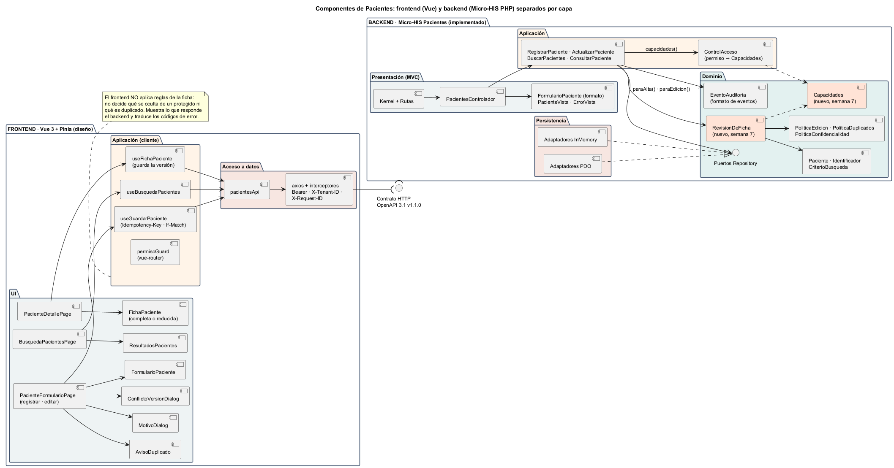
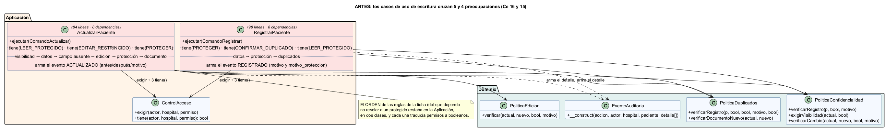
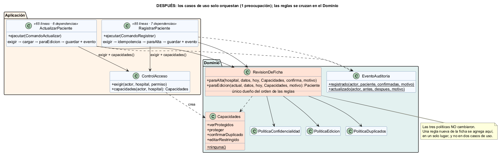

# Semana 7 — Diseño de componentes y refactorización

| | |
|---|---|
| **Curso** | Análisis de Sistemas II — Proyecto Final 2026 |
| **Módulo** | ASII-03 · Pacientes: registro, edición, búsqueda y detalle |
| **Flujo** | «Registro, búsqueda y actualización segura de un paciente» |
| **Código** | [`micro-his-pacientes/`](../micro-his-pacientes/README.md) — el MISMO proyecto de las semanas 3 a 6 |
| **Estudiante** | Boris Alexander Quiroa Orellana |
| **Fecha** | Octubre 2026 |

## Índice

1. [Resumen](#1-resumen)
2. [Diagrama de componentes](#2-diagrama-de-componentes)
3. [Contratos de entrada/salida](#3-contratos-de-entradasalida)
4. [Cómo se eligió el punto a refactorizar](#4-cómo-se-eligió-el-punto-a-refactorizar)
5. [Refactor: antes](#5-refactor-antes)
6. [Refactor: después](#6-refactor-después)
7. [Comparación medida](#7-comparación-medida)
8. [Justificación](#8-justificación)
9. [Prueba de que no se amplió el módulo](#9-prueba-de-que-no-se-amplió-el-módulo)
10. [Costos y límites del refactor](#10-costos-y-límites-del-refactor)
11. [Conclusión](#11-conclusión)
12. [Bibliografía](#12-bibliografía)

## 1. Resumen

- **Componentes:** se diseñaron los componentes propios de Pacientes en **backend**, ya implementados en el Micro-HIS, y en **frontend**, en Vue 3 + Pinia, como diseño alineado con lo que ya existe en `resources/js`. Los dos lados se separan en UI, aplicación, dominio y acceso a datos, y se comunican **solo** por el contrato OpenAPI 1.1.0.
- **Punto a refactorizar:** se eligió **midiendo** con un script nuevo, `bin/acoplamiento.php`. Los casos de uso de escritura `ActualizarPaciente` y `RegistrarPaciente` cruzaban **5 y 4** de las 6 preocupaciones que nombra la tarea (identidad, datos demográficos, edición, duplicados y confidencialidad), con Ce 16 y 15. Cada uno:
  - preguntaba los permisos uno por uno (`tiene()` tres veces) y los convertía en booleanos para las políticas;
  - decidía por su cuenta el **orden** de las reglas de la ficha, del que depende no revelar a un paciente protegido;
  - armaba a mano el detalle de su evento de auditoría.
- **Refactor:** se separaron esas responsabilidades sin agregar funcionalidad:
  - en el **Dominio**, `RevisionDeFicha` es el único dueño del cruce y del orden de las reglas; `Capacidades` reemplaza los booleanos sueltos; `EventoAuditoria` define el formato de sus eventos;
  - en la **Aplicación**, `ControlAcceso::capacidades()` es el único lugar que traduce permisos;
  - las tres políticas (`PoliticaEdicion`, `PoliticaDuplicados`, `PoliticaConfidencialidad`) **no cambiaron**.
- **Resultado:**

  | | Antes | Después |
  |---|---|---|
  | Preocupaciones de `ActualizarPaciente` / `RegistrarPaciente` | 5 / 4 | **1 / 1** |
  | Ce de `ActualizarPaciente` / `RegistrarPaciente` | 16 / 15 | 14 / 13 |
  | Lugares que deciden el orden de las reglas de la ficha | 2 | **1** |
  | Llamadas a `tiene()` en los casos de uso | 8 | **0** |

  Las **80 pruebas** existentes, más 3 de caracterización, dan el mismo resultado antes y después: 81 pasan, 0 fallan y 2 se omiten. Las 24 mutaciones se detectan.

## 2. Diagrama de componentes



Fuente: [`diagramas/semana-07-componentes.puml`](diagramas/semana-07-componentes.puml)

| Capa | Backend (implementado) | Frontend (diseño) |
|---|---|---|
| **UI / Presentación** | `Kernel` + `Rutas`, `PacientesControlador`, `FormularioPaciente` (formato), `PacienteVista`, `ErrorVista` | `BusquedaPacientesPage`, `ResultadosPacientes`, `PacienteDetallePage`, `FichaPaciente`, `PacienteFormularioPage`, `FormularioPaciente`, `AvisoDuplicado`, `MotivoDialog`, `ConflictoVersionDialog` |
| **Aplicación** | `RegistrarPaciente`, `BuscarPacientes`, `ConsultarPaciente`, `ActualizarPaciente`, `ControlAcceso` | `useBusquedaPacientes`, `useFichaPaciente`, `useGuardarPaciente`, `permisoGuard` |
| **Dominio** | `Paciente`, `Identificador`, `CriterioBusqueda`, las tres políticas, **`RevisionDeFicha`**, **`Capacidades`**, `EventoAuditoria`, puertos Repository | **No hay**: el frontend no contiene reglas de la ficha |
| **Persistencia / acceso a datos** | Adaptadores PDO e InMemory, `ProteccionDocumentos` | `pacientesApi` + interceptores de axios (Bearer, `X-Tenant-ID`, `X-Request-ID`) |

Decisiones de diseño del frontend:

1. **El frontend no decide qué ocultar.** La vista reducida de un paciente protegido la arma el Dominio. La UI muestra los `null` como «Reservado» y nunca rellena con datos que tenga de antes.
2. **La búsqueda no va a la URL.** Un nombre en `?nombre=…` quedaría en el historial del navegador y en los enlaces compartidos. Los criterios viven en el estado del componente, aunque la API los reciba por consulta.
3. **La versión viaja con la ficha.** `useFichaPaciente` guarda la versión leída y `useGuardarPaciente` la envía en `If-Match`. Ante un 409 `VERSION_DESACTUALIZADA` se ofrece recargar, nunca sobrescribir.
4. **Reintento seguro.** Una `Idempotency-Key` por intento de registro, reutilizada si hay que reintentar. El `PUT` no se reintenta solo.
5. **Diseño sin implementación.** Se reutiliza lo que ya existe (`plugins/axios.js`, `stores/auth.js`, `router/guards.js`) y se agrega `modules/pacientes/`. Esos archivos son compartidos con otros módulos, así que la implementación se coordinará con el equipo de UI/UX base.

## 3. Contratos de entrada/salida

Detalle completo, componente por componente: **[contratos-entrada-salida.md](contratos-entrada-salida.md)**. Incluye lo que cada componente recibe, devuelve y cómo falla, en backend y frontend, y las reglas que cruzan ambos lados.

## 4. Cómo se eligió el punto a refactorizar

`php bin/acoplamiento.php` analiza las clases de `src/` con el tokenizador de PHP y calcula para cada una:

- **Ce:** a cuántas clases del proyecto depende.
- **Ca:** cuántas clases del proyecto dependen de ella.
- **P:** cuántas de las **6 preocupaciones** que nombra la tarea mezcla: identidad, demografía, búsqueda, edición, duplicados y confidencialidad. Cada preocupación se reconoce por sus marcas: clases, métodos, propiedades y constantes que solo usa quien trata ese tema.

Salida **antes** ([`evidencia/acoplamiento-1-antes.txt`](evidencia/acoplamiento-1-antes.txt)):

```
Clase                      Capa            Ce   Ca  Flags  P   Preocupaciones que mezcla
PdoRepositorioPacientes    Persistencia     9    1      0  6   identidad · demografia · busqueda · edicion · duplicados · confidencialidad
ActualizarPaciente         Aplicacion      16    1      0  5   identidad · demografia · edicion · duplicados · confidencialidad
Paciente                   Dominio          5   11      1  5   identidad · demografia · busqueda · edicion · confidencialidad
PoliticaDuplicados         Dominio          3    2      2  5   identidad · demografia · busqueda · duplicados · confidencialidad
IndiceDuplicadosEnMemoria  Persistencia     3    1      0  5   identidad · demografia · busqueda · duplicados · confidencialidad
RegistrarPaciente          Aplicacion      15    1      0  4   identidad · demografia · duplicados · confidencialidad
```

Cómo se leyó la tabla:

| Clase | ¿Es un problema? | Motivo |
|---|---|---|
| `PdoRepositorioPacientes`, `IndiceDuplicadosEnMemoria` | No | Un adaptador de persistencia **debe** conocer todos los campos de la ficha para guardarla y leerla. Es acoplamiento esperado y está aislado detrás de los puertos. |
| `Paciente` | No | Es la entidad: que contenga identidad, demografía y la marca de protección es su razón de ser (alta cohesión). |
| `PoliticaDuplicados` | Parcial | Mezcla duplicados con confidencialidad a propósito, desde la semana 6 (el código `RESERVADO`). Es una sola regla: «detectar sin revelar». |
| **`ActualizarPaciente`, `RegistrarPaciente`** | **Sí** | Son **casos de uso de Aplicación** con el Ce más alto del proyecto, y cruzan reglas de Dominio que no les corresponden: ahí está el punto de mayor acoplamiento. |

## 5. Refactor: antes



Copia del código anterior: [`refactor/antes/`](refactor/antes/). Este era el centro de `ActualizarPaciente`:

```php
// ActualizarPaciente (antes): el caso de uso decidía el orden de 5 reglas y traducía 3 permisos
$this->confidencialidad->exigirVisibilidad($actual,
    $this->acceso->tiene($comando->actor, $comando->hospital, ControlAcceso::LEER_PROTEGIDO));

$datos = FormularioPaciente::aDatos($comando->datos);
$nuevo = $actual->conDatosDe(Paciente::desdeDatos($comando->hospital, $datos, $this->reloj->hoy()));
if ($datos->identidadProtegida === null) {
    $nuevo = $nuevo->conProteccion($actual->identidadProtegida); // campo ausente = sin cambio
}
$motivo = trim((string) $comando->motivo);
$this->edicion->verificar($actual, $nuevo,
    $this->acceso->tiene($comando->actor, $comando->hospital, ControlAcceso::EDITAR_RESTRINGIDO), $motivo);
$this->confidencialidad->verificarCambio($actual, $nuevo,
    $this->acceso->tiene($comando->actor, $comando->hospital, ControlAcceso::PROTEGER), $motivo);
if ($nuevo->cambiaIdentidadRespectoDe($actual)) {
    $this->duplicados->verificarDocumentoNuevo($actual, $nuevo);
}
// … y dentro de la transacción armaba el detalle del evento: ['antes' => …, 'despues' => …, 'motivo' => …]
```

`RegistrarPaciente` hacía lo mismo con su propia secuencia: datos → protección → duplicados, y otros tres `tiene()`.

**Problemas:**

| Problema | Consecuencia |
|---|---|
| El **orden de las reglas** de la ficha estaba en la Aplicación, en dos clases | Es una regla de negocio: «no se edita lo que no se ve» exige verificar la visibilidad **antes** de validar, o un 422 revelaría los campos de un protegido. Que viviera en dos casos de uso hacía fácil romperla al agregar una regla. |
| Los **permisos se traducían a booleanos** en cada caso de uso (`tiene()` 8 veces en total) | Un permiso nuevo para la ficha obligaba a tocar varios casos de uso. Los booleanos posicionales (`verificarRegistro($p, bool, bool, $motivo, bool)`) se confunden con facilidad. |
| Los casos de uso tenían **5 razones para cambiar**: el flujo, las reglas de edición, las de duplicados, las de confidencialidad y el formato del evento | Viola SRP: el cambio práctico de la semana 6 tuvo que tocar los dos casos de uso de escritura. |
| El **formato de los eventos** estaba en cada caso de uso, incluido `motivo_proteccion` | Un dato de confidencialidad se decidía en la Aplicación. |
| La validación de los datos (`Paciente::desdeDatos`) y el «campo ausente = sin cambio» estaban en la Aplicación | Detalles de la demografía y de la identidad fuera del Dominio. |

## 6. Refactor: después



```php
// ActualizarPaciente (después): solo orquesta: exigir → cargar → revisar → guardar con evidencia
$this->acceso->exigir($comando->actor, $comando->hospital, ControlAcceso::EDITAR);
$actual = $this->repositorio->porCodigo($comando->hospital, strtoupper($comando->codigo))
    ?? throw new PacienteNoEncontrado();

$motivo = (string) $comando->motivo;
$nuevo = $this->revision->paraEdicion($actual, FormularioPaciente::aDatos($comando->datos), $this->reloj->hoy(),
    $this->acceso->capacidades($comando->actor, $comando->hospital), $motivo);

$guardado = $this->transaccion->ejecutar(function () use ($comando, $actual, $nuevo, $motivo): Paciente {
    $guardado = $this->repositorio->actualizar($nuevo, $comando->versionLeida);
    $this->auditoria->registrar(EventoAuditoria::actualizado($comando->actor, $actual, $guardado, $motivo));

    return $guardado;
});
```

```php
// RevisionDeFicha (Dominio, nuevo): el único lugar donde se cruzan las reglas, en su orden
public function paraEdicion(Paciente $actual, DatosPaciente $datos, \DateTimeImmutable $hoy, Capacidades $puede, string $motivo): Paciente
{
    $this->confidencialidad->exigirVisibilidad($actual, $puede->verProtegidos);   // R-11, antes de validar
    $nuevo = $actual->conDatosDe(Paciente::desdeDatos($actual->hospital, $datos, $hoy)); // R-01
    if ($datos->identidadProtegida === null) {
        $nuevo = $nuevo->conProteccion($actual->identidadProtegida);              // campo ausente = sin cambio
    }
    $this->edicion->verificar($actual, $nuevo, $puede->editarRestringido, $motivo);           // R-08, R-07
    $this->confidencialidad->verificarCambio($actual, $nuevo, $puede->proteger, $motivo);     // R-11
    if ($nuevo->cambiaIdentidadRespectoDe($actual)) {
        $this->duplicados->verificarDocumentoNuevo($actual, $nuevo);                         // R-02
    }

    return $nuevo;
}
```

| Responsabilidad | Antes estaba en | Ahora está en | Capa |
|---|---|---|---|
| Orden de las reglas de la ficha al registrar y al editar | `RegistrarPaciente`, `ActualizarPaciente` | `RevisionDeFicha::paraAlta()` / `paraEdicion()` | Dominio |
| Validar los datos y «campo ausente = sin cambio» | Los dos casos de uso | `RevisionDeFicha` | Dominio |
| Lo que el actor puede hacer con la ficha | Booleanos sueltos calculados en 4 casos de uso | `Capacidades` (objeto de valor, fail-closed) | Dominio |
| Traducir permisos a capacidades | 8 llamadas a `tiene()` | `ControlAcceso::capacidades()` | Aplicación |
| Formato de los eventos de escritura | Los dos casos de uso | `EventoAuditoria::registrado()` / `actualizado()` | Dominio |
| Permiso de la operación, idempotencia, transacción, `Resultado` | Casos de uso | Casos de uso (es lo único que les queda) | Aplicación |

Archivos del refactor:

- **Nuevos:**
  - `src/Dominio/Servicios/RevisionDeFicha.php`
  - `src/Dominio/Modelo/Capacidades.php`
  - `bin/acoplamiento.php` (instrumento de medición) y `tests/Aplicacion/RefactorPrueba.php` (REF-01..03)
- **Modificados:**
  - `RegistrarPaciente`, `ActualizarPaciente`, `BuscarPacientes`, `ConsultarPaciente`
  - `ControlAcceso`, `EventoAuditoria`, `bootstrap/contenedor.php`
  - `tests/mutaciones.php` (M21 apunta a la nueva ubicación; se agregan M23 y M24)
- **Sin cambios:** Presentación (controlador, formulario, vistas, rutas, Kernel), Persistencia (adaptadores), las tres políticas, `Paciente`, puertos, contrato API y librería cliente.

## 7. Comparación medida

Mismo instrumento antes y después ([antes](evidencia/acoplamiento-1-antes.txt) · [después](evidencia/acoplamiento-2-despues.txt)):

| Métrica | Antes | Después | Cambio |
|---|---:|---:|---|
| Preocupaciones de `ActualizarPaciente` | 5 | **1** (edición) | Salen identidad, demografía, duplicados y confidencialidad |
| Preocupaciones de `RegistrarPaciente` | 4 | **1** (identidad: solo informa `identidad_provisional` en la respuesta) | Salen demografía, duplicados y confidencialidad |
| Ce de `ActualizarPaciente` / `RegistrarPaciente` | 16 / 15 | **14 / 13** | −2 cada uno |
| Dependencias del constructor (`Actualizar` / `Registrar`) | 8 / 8 | **6 / 7** | — |
| Líneas de `ActualizarPaciente` + `RegistrarPaciente` | 84 + 98 = 182 | 65 + 85 = **150** | −32 líneas |
| Llamadas a `ControlAcceso::tiene()` en casos de uso | 8 | **0** | Una sola llamada a `capacidades()` por caso de uso |
| Lugares que deciden el orden de las reglas de la ficha | 2 | **1** (`RevisionDeFicha`) | — |
| Lugares que definen el formato de un evento de escritura | 2 | **1** (`EventoAuditoria`) | — |
| Clases que mezclan ≥ 4 preocupaciones | 8 | **7** | Ver §10 |
| Pruebas | 80 → 83 (+3 de caracterización) | **83: 81 pasan, 0 fallan** | Mismo comportamiento |
| Mutaciones detectadas | 22/22 | **24/24** | M23 y M24 vigilan las piezas nuevas |

## 8. Justificación

| Principio | Cómo lo cumple el refactor |
|---|---|
| **SRP** | Cada caso de uso pasa de 5 razones para cambiar a una: el flujo de su operación. Las reglas de la ficha tienen un único dueño en el Dominio, y el formato de los eventos también. |
| **OCP** (semana 2) | Una regla nueva de la ficha (por ejemplo, la identidad protegida de la semana 6) se agregaría en **una** clase de Dominio, `RevisionDeFicha`. Antes había que tocar los dos casos de uso. |
| **DIP** | Los casos de uso ya no dependen de las tres políticas, sino de un servicio de Dominio que las compone. El Dominio no conoce los nombres de los permisos: recibe `Capacidades`. |
| **Separación de capas** (pedido de la tarea) | Las reglas de Dominio (orden, validación, campo ausente, formato de eventos) bajaron al Dominio. La Aplicación quedó con permiso de la operación, idempotencia, transacción y traducción a `Resultado`. La UI y la Persistencia no se tocaron. |
| **Fail-closed** | `Capacidades` vale «nada» por defecto. Si un caso de uso nuevo se olvida de pedir las capacidades, no puede ver ni proteger. |
| **R-11** (confidencialidad) | El orden que evita revelar a un protegido (visibilidad antes que validación; protección antes que duplicados) está en un solo lugar y fijado por REF-01 y REF-02. |

**Alternativas descartadas:**

| Alternativa | Motivo para descartarla |
|---|---|
| Pasar `Capacidades` también a `Paciente::resumen()` y a las tres políticas | Cambia firmas de Dominio que ya están cubiertas por pruebas de las semanas 3 a 6, sin bajar el acoplamiento del punto elegido. Es el siguiente paso natural (§10), no parte de este refactor. |
| Un «pipeline» de reglas genérico (lista de objetos `ReglaDeFicha` recorrida en orden) | El orden quedaría implícito en el armado de la lista, y cada regla necesitaría una firma común que hoy no tienen. Para 3 políticas, un método explícito por operación se lee mejor y es más fácil de defender. |
| Mover el cruce de reglas al controlador | El controlador quedaría con reglas de negocio, lo que viola ARQ-07 y la separación que pide la tarea. |
| Quitar `exigir()` de los casos de uso, porque la ruta ya pide permiso | Quitaría la defensa en profundidad: un caso de uso invocado desde otro canal (CLI, eventos) quedaría sin protección. |

## 9. Prueba de que no se amplió el módulo

1. **Línea base:** antes de tocar el código, 80 pruebas: 78 pasan, 0 fallan ([`pruebas-1-antes.txt`](evidencia/pruebas-1-antes.txt)).
2. **Pruebas de caracterización** REF-01..03, que fijan lo que el refactor iba a mover:
   - **REF-01:** el orden de las reglas al editar. Admisión recibe 403 (no 422) al editar a un protegido con datos inválidos; con identidad cambiada y documento ajeno, primero falta el motivo y después el documento en uso; el campo ausente no cambia la protección.
   - **REF-02:** el orden al registrar. Proteger sin permiso da 403 antes que el 409 del documento; los datos inválidos van primero; confirmar una coincidencia exige permiso y motivo.
   - **REF-03:** campos y orden exactos de los eventos `PACIENTE_REGISTRADO` y `PACIENTE_ACTUALIZADO`.

   Se ejecutaron **sobre el código anterior** al refactor y pasaron ([`caracterizacion-sobre-codigo-anterior.txt`](evidencia/caracterizacion-sobre-codigo-anterior.txt)).
3. **Después del refactor:** 83 pruebas: 81 pasan, 0 fallan ([`pruebas-2-despues.txt`](evidencia/pruebas-2-despues.txt)). Siguieron verdes:
   - las pruebas de arquitectura (ARQ-01..08);
   - las de contrato (API-01..03, CON-MEM-01..08);
   - las del cambio práctico de la semana 6 (PROT-01..06);
   - y todas las funcionales.
4. **Mutaciones:** 24/24 detectadas ([`mutaciones.txt`](evidencia/mutaciones.txt)). M21 se reubicó en `RevisionDeFicha`, porque el código que vigila se movió allí.
5. **Sin funcionalidad nueva:** no hay rutas nuevas, el contrato OpenAPI sigue en v1.1.0 sin cambios y la demostración de la semana 6 (`php bin/demo-proteccion.php`) produce exactamente la misma salida.

## 10. Costos y límites del refactor

- **`RevisionDeFicha` mezcla 5 preocupaciones.** Es intencional y es lo que se buscaba: el cruce de las reglas **no desaparece**, porque es real en el negocio, pero ahora tiene un único dueño en la capa correcta, con 67 líneas y sin transacciones ni permisos. Por eso las clases con ≥ 4 preocupaciones solo bajan de 8 a 7.
- **Más clases:** el Ce **total** del proyecto sube de 215 a 220, por 2 clases nuevas. El acoplamiento baja donde estaba concentrado (los casos de uso) y queda en piezas pequeñas y cohesivas.
- **La columna «Flags» del instrumento sube de 8 a 10.** El script cuenta las variables cuyo nombre empieza con `puede`, y el objeto `Capacidades` se recibe como `$puede`. No son booleanos nuevos: es un efecto del nombre. Se reporta tal cual en lugar de ajustar el instrumento después de ver el resultado.
- **`capacidades()` pregunta los 4 permisos** aunque la búsqueda y el detalle solo usen uno. Con la política estática del Micro-HIS el costo es nulo; con una política remota convendría preguntar una sola vez por petición.
- **Pendiente:** `Paciente::resumen()`, `detalle()` y las políticas siguen recibiendo booleanos. Pasarles `Capacidades` es el siguiente refactor (§8).
- **Frontend no implementado:** el diseño Vue queda listo para implementarse cuando se coordinen los archivos compartidos.

## 11. Conclusión

El punto con mayor acoplamiento de Pacientes no estaba en la entidad ni en los adaptadores, que **deben** conocer toda la ficha, sino en los **casos de uso de escritura**. Ahí se cruzaban identidad, datos demográficos, edición, duplicados y confidencialidad, y además se decidía el orden de las reglas, del que depende no revelar a un paciente protegido. Medirlo permitió elegirlo con datos y demostrar la mejora con el mismo instrumento: de 5 y 4 preocupaciones a 1, y de 2 lugares que decidían el orden a 1.

El refactor no agregó funcionalidad. Lo garantizan las pruebas existentes, más tres de caracterización verificadas también sobre el código anterior, y la misma salida de la demostración de la semana 6. El diseño de componentes deja claro que el frontend no aplica reglas de la ficha: pregunta, muestra lo que recibe y nunca deja datos personales en la URL ni en el navegador.

## 12. Bibliografía

- Fowler, M. (2018). *Refactoring: Improving the Design of Existing Code* (2.ª ed.). Addison-Wesley. (Extract Class, Move Function, Introduce Parameter Object, Remove Flag Argument).
- Feathers, M. (2004). *Working Effectively with Legacy Code*. Prentice Hall. Cap. 13 (*characterization tests*).
- Martin, R. C. (2003). *Agile Software Development: Principles, Patterns, and Practices*. Prentice Hall. (Métricas Ca/Ce; SRP, OCP, DIP).
- Martin, R. C. (2018). *Clean Architecture*. Prentice Hall. Caps. 13–14 (principios de componentes).
- Evans, E. (2003). *Domain-Driven Design*. Addison-Wesley. (Domain Services, Value Objects, Application Services).
- Vue.js. (2026). *Composables*. https://vuejs.org/guide/reusability/composables.html
