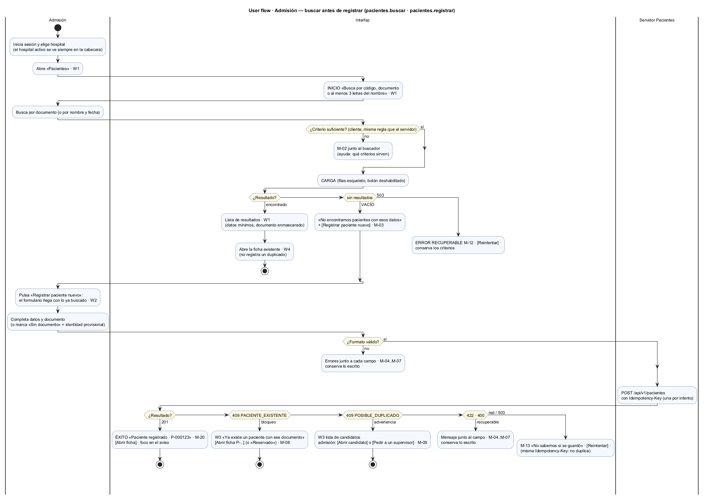
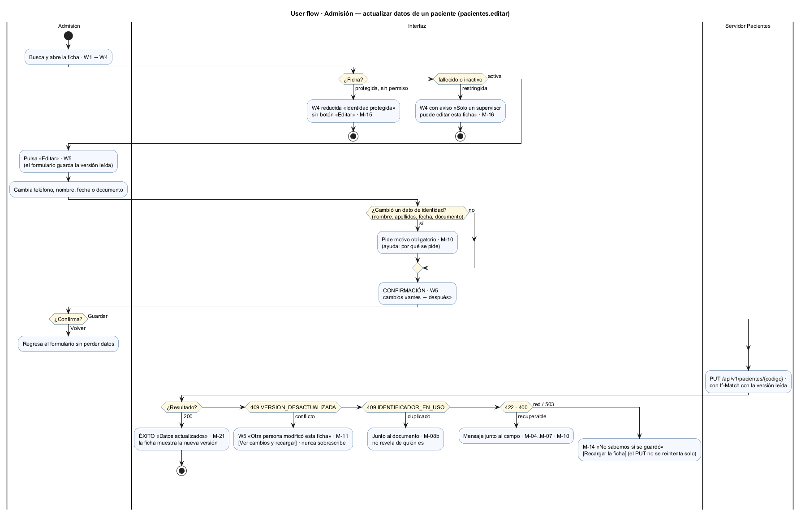
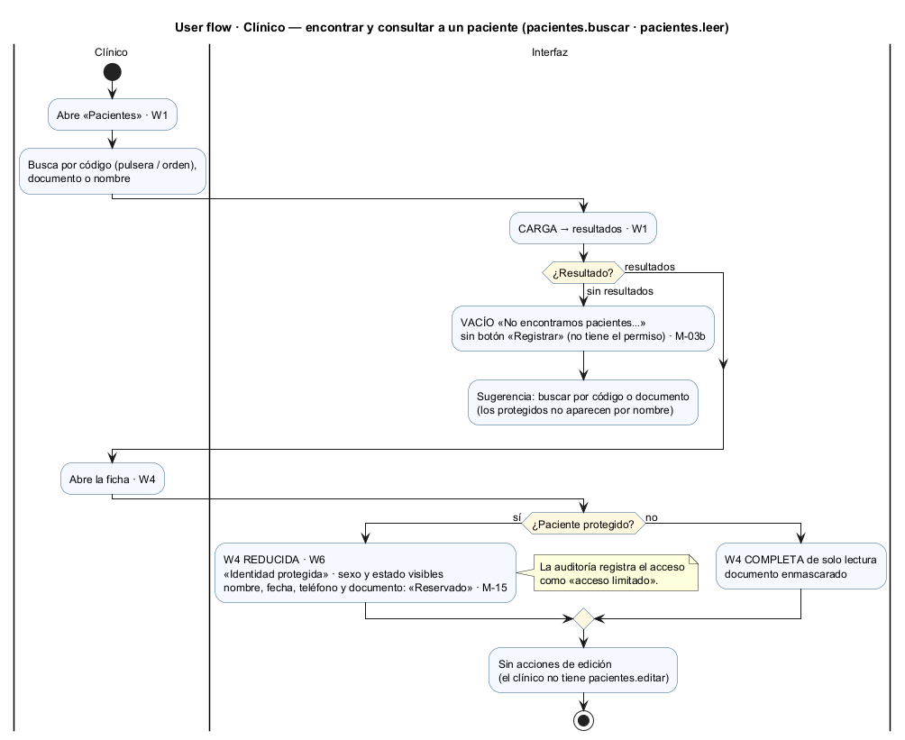
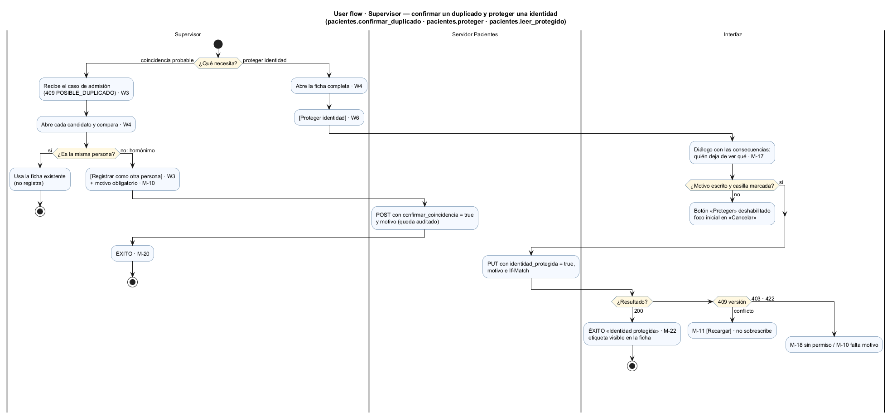
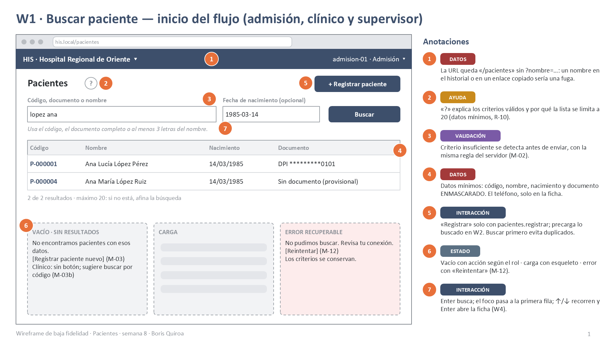
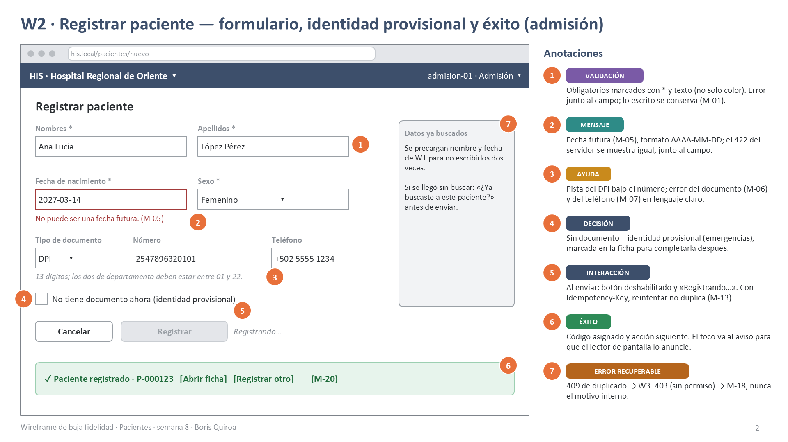
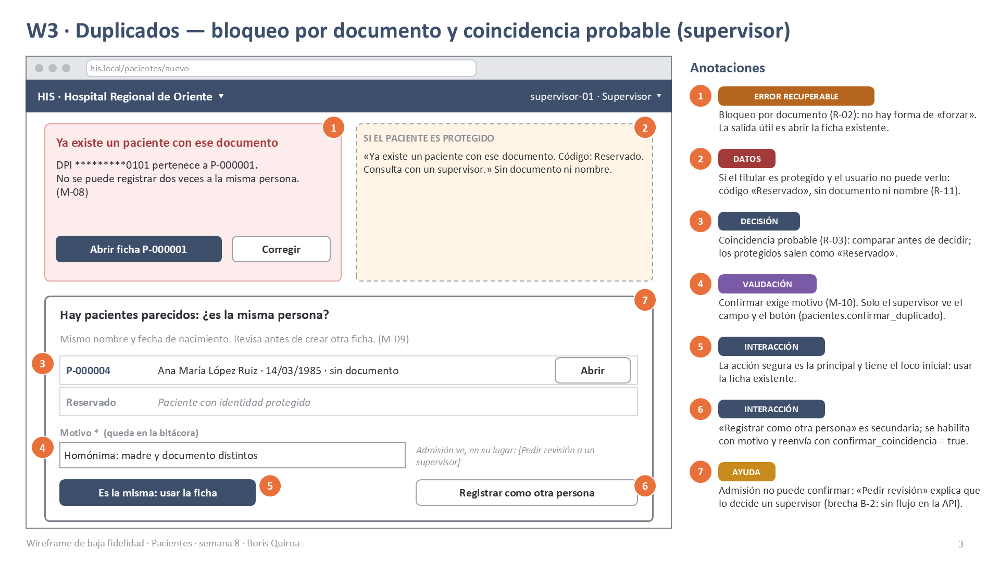
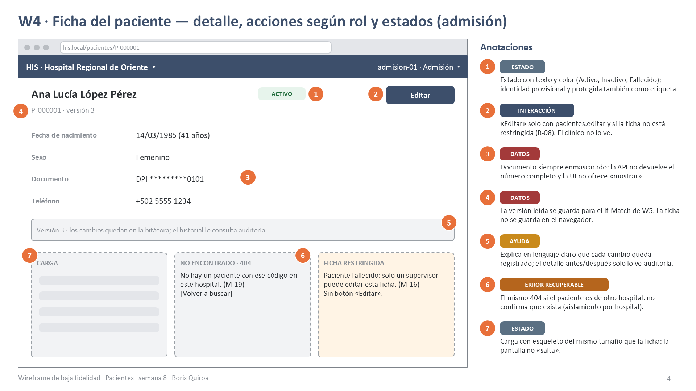
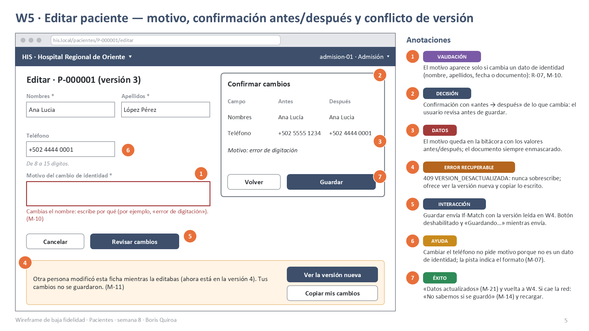
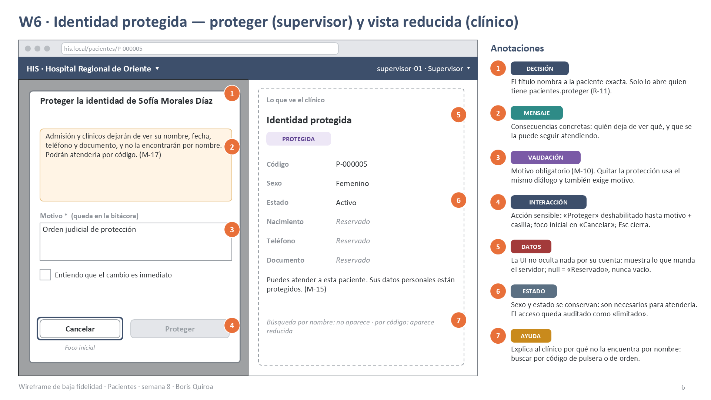

# Semana 8 — Diseño de experiencia de usuario del módulo Pacientes

**Estudiante:** Boris Alexander Quiroa Orellana · **Módulo:** ASII-03 · Pacientes: registro, edición, búsqueda y detalle

**Proceso:** «registro, búsqueda y actualización segura de un paciente»

**Entregables:**
- user flow por rol (4 diagramas) en [diagramas/](diagramas/);
- 6 wireframes anotados en [wireframes/semana-08-wireframes-pacientes.pptx](wireframes/semana-08-wireframes-pacientes.pptx), con versión [PDF](wireframes/semana-08-wireframes-pacientes.pdf) y PNG.

## 1. Alcance y punto de partida

Este documento diseña la experiencia de uso. **No** implementa pantallas ni cambia el Micro-HIS.

Parte de lo que ya existe:

| Origen | Qué aporta a esta semana |
|---|---|
| Semana 1 (UML) | Casos de uso CU-01..CU-08 y reglas R-01..R-10 |
| Semana 2 (RF/RNF) | RF-01..RF-11 y RNF-01..RNF-09; la semana 6 agrega R-11, RF-12..RF-16 y RNF-10 (identidad protegida) |
| Semana 5 (contrato) | [openapi.yaml](../micro-his-pacientes/api/openapi.yaml) v1.1.0: rutas, códigos HTTP, `If-Match`, `Idempotency-Key` |
| Semana 7 (componentes) | Componentes Vue diseñados: `BusquedaPacientesPage`, `FichaPaciente`, `PacienteFormularioPage`, `AvisoDuplicado`, `MotivoDialog`, `ConflictoVersionDialog` y los composables `useBusquedaPacientes`, `useFichaPaciente`, `useGuardarPaciente` |

Cada mensaje y cada validación de este diseño sale de un código real del backend (§6). Así la interfaz no promete nada que el servidor no haga.

## 2. Roles autorizados y lo que ve cada uno

Los permisos son los de `config/config.php` del Micro-HIS (datos de demostración; en el HIS los decide el módulo RBAC).

| Perfil de UX | Permisos | Pantallas | User flow |
|---|---|---|---|
| **Admisión** | `pacientes.registrar`, `.buscar`, `.leer`, `.editar` | W1, W2, W3, W4, W5 | [registrar](diagramas/semana-08-flujo-admision-registrar.png), [editar](diagramas/semana-08-flujo-admision-editar.png) |
| **Clínico** | `pacientes.buscar`, `.leer` | W1, W4, W6 (vista reducida) | [clínico](diagramas/semana-08-flujo-clinico.png) |
| **Supervisor** | Los de admisión + `.confirmar_duplicado`, `.editar_restringido`, `.proteger`, `.leer_protegido` | W1–W6 | [supervisor](diagramas/semana-08-flujo-supervisor.png) |

Las pantallas se diseñan **por permiso**, no por nombre de rol. Si mañana un rol nuevo recibe `pacientes.proteger`, verá el diálogo de W6 sin cambiar la pantalla.

## 3. Principios de diseño

| # | Principio | Cómo se ve en las pantallas |
|---|---|---|
| P-1 | **Buscar antes de registrar.** | W1 es el inicio de todos los flujos. «Registrar» precarga lo buscado (W2) y el vacío ofrece registrar solo después de buscar. |
| P-2 | **La interfaz no decide; el servidor sí.** | La vista reducida de un protegido, los duplicados y los permisos los decide el backend. La UI oculta botones por comodidad, no por seguridad. |
| P-3 | **Datos mínimos y nada en el navegador.** | Listas con documento enmascarado; criterios fuera de la URL; la ficha no se guarda en `localStorage` (W1 ①, W4 ④). |
| P-4 | **Nunca sobrescribir el trabajo de otro.** | La versión leída viaja en `If-Match`. Ante un 409 se ofrece ver la versión nueva y copiar lo escrito (W5 ④). |
| P-5 | **Confirmar lo que cambia la identidad.** | Motivo para los datos de identidad, confirmación «antes → después» (W5) y diálogo con consecuencias para proteger (W6). |
| P-6 | **Detectar duplicados sin revelar.** | El 409 ofrece abrir la ficha existente; si es protegida, el código aparece como «Reservado» (W3 ②). |
| P-7 | **Errores recuperables sin perder trabajo.** | El mensaje va junto al campo, lo escrito se conserva y hay «Reintentar» seguro: el `POST` lleva `Idempotency-Key` (W2 ⑤). |

## 4. User flows por rol

Los cuatro diagramas son de actividad UML con carriles *Usuario · Interfaz · Servidor Pacientes*. Cada uno muestra:

- el **inicio**;
- las **decisiones** (rombos);
- la **confirmación**;
- los estados **vacío, carga y éxito**;
- los **errores recuperables** (`detach`: el usuario vuelve a intentar);
- la **ayuda** y la **protección de datos**.

### 4.1 Admisión — buscar antes de registrar

- Empieza en la búsqueda. Solo si no aparece nadie se ofrece «Registrar paciente nuevo», con lo buscado ya escrito.
- El resultado del registro tiene cinco salidas: éxito, bloqueo por documento, advertencia por coincidencia, error de datos y resultado incierto por la red. Esta última se recupera reintentando con la **misma** `Idempotency-Key`, sin duplicar.

### 4.2 Admisión — actualizar datos

- La ficha decide primero qué se puede hacer: un protegido no se edita sin permiso (no se edita lo que no se ve) y una ficha de fallecido o inactivo solo la edita un supervisor.
- El motivo aparece solo si cambia un dato de identidad. La confirmación muestra antes y después.
- El conflicto de versión nunca sobrescribe. El `PUT` no se reintenta solo: ante un error de red se recarga la ficha.

### 4.3 Clínico — encontrar y consultar

- El clínico no registra ni edita, así que el vacío no le ofrece «Registrar».
- Si el paciente es protegido, ve la ficha reducida y sabe por qué: puede atenderlo por código, pero no encontrarlo por nombre.

### 4.4 Supervisor — confirmar un duplicado y proteger una identidad

- Las dos decisiones con más peso del módulo: registrar a alguien **pese** a una coincidencia, y proteger una identidad. Las dos exigen motivo y quedan en la bitácora.

## 5. Wireframes anotados

Baja fidelidad, en grises, con llamadas numeradas. Cada anotación tiene una etiqueta de tipo: **ESTADO, MENSAJE, VALIDACIÓN, INTERACCIÓN, DATOS, AYUDA, DECISIÓN, ÉXITO, ERROR RECUPERABLE**. Las notas del orador de cada diapositiva resumen la pantalla. Todos los datos son ficticios.

| # | Pantalla | Rol | Cubre |
|---|---|---|---|
| W1 | Buscar paciente | Todos | Inicio · vacío · carga · resultados · error recuperable · criterios fuera de la URL |
| W2 | Registrar paciente | Admisión | Validación · identidad provisional · envío idempotente · éxito |
| W3 | Duplicados | Admisión / supervisor | Bloqueo por documento · coincidencia probable · decisión · «Reservado» |
| W4 | Ficha del paciente | Admisión | Detalle · acciones según permiso · carga · 404 · ficha restringida |
| W5 | Editar paciente | Admisión | Motivo · confirmación antes/después · conflicto de versión |
| W6 | Identidad protegida | Supervisor / clínico | Diálogo de protección · vista reducida |

### W1 · Buscar paciente

### W2 · Registrar paciente

### W3 · Duplicados

### W4 · Ficha del paciente

### W5 · Editar paciente

### W6 · Identidad protegida

## 6. Catálogo de mensajes

Cada mensaje sale de una respuesta real del backend. El texto evita jerga técnica y dice qué hacer después.

| ID | Cuándo (código del backend) | Texto para el usuario | Dónde |
|---|---|---|---|
| M-01 | 400 `FORMATO` / campo vacío | «Este dato es obligatorio.» | Junto al campo |
| M-02 | 422 `CRITERIO_INSUFICIENTE` | «Usa el código, el documento completo o al menos 3 letras del nombre.» | Bajo el buscador |
| M-03 | 200 con `total: 0` (con `registrar`) | «No encontramos pacientes con esos datos.» + [Registrar paciente nuevo] | W1 |
| M-03b | 200 con `total: 0` (sin `registrar`) | «No encontramos pacientes. Prueba con el código de la pulsera o el documento completo.» | W1 |
| M-04 | 422 `DATOS_INVALIDOS` `nombres` / `apellidos` | «Obligatorio, hasta 100 caracteres.» | Junto al campo |
| M-05 | 422 `DATOS_INVALIDOS` `nacimiento` | «No puede ser una fecha futura.» / «Fecha válida con formato AAAA-MM-DD.» | Junto al campo |
| M-06 | 422 `DATOS_INVALIDOS` `documento` | El texto del servidor: «El DPI debe tener 13 dígitos.», «El departamento del DPI debe estar entre 01 y 22.», etc. | Junto al documento |
| M-07 | 422 `DATOS_INVALIDOS` `telefono` | «De 8 a 15 dígitos.» | Junto al campo |
| M-08 | 409 `PACIENTE_EXISTENTE` | «Ya existe un paciente con ese documento: P-…» + [Abrir ficha]. Si `codigo` es `RESERVADO`: «Código: Reservado. Consulta con un supervisor.» | W3 |
| M-08b | 409 `IDENTIFICADOR_EN_USO` | «Ese documento pertenece a otro paciente. Revisa el número.» (sin decir a quién) | W5, junto al documento |
| M-09 | 409 `POSIBLE_DUPLICADO` | «Hay pacientes parecidos: ¿es la misma persona?» + candidatos | W3 |
| M-10 | 422 `MOTIVO_REQUERIDO` | «Escribe por qué haces este cambio; queda en la bitácora.» | W3, W5, W6 |
| M-11 | 409 `VERSION_DESACTUALIZADA` / 428 | «Otra persona modificó esta ficha mientras la editabas. Tus cambios no se guardaron.» + [Ver la versión nueva] [Copiar mis cambios] | W5 |
| M-12 | 503 / red al leer | «No pudimos cargar los datos. Revisa tu conexión.» + [Reintentar] | W1, W4 |
| M-13 | Red / 503 al registrar | «No sabemos si se guardó. Puedes reintentar sin riesgo de duplicarlo.» + [Reintentar] | W2 |
| M-14 | Red / 503 al editar | «No sabemos si se guardó. Recarga la ficha para comprobarlo.» + [Recargar] | W5 |
| M-15 | Detalle con `identidad_protegida` y datos en `null` | «Puedes atender a esta paciente. Sus datos personales están protegidos.» | W4, W6 |
| M-16 | 403 `REQUIERE_SUPERVISOR` | «Solo un supervisor puede editar esta ficha.» | W4 |
| M-17 | Antes de proteger | «Admisión y clínicos dejarán de ver su nombre, fecha, teléfono y documento…» | W6 |
| M-18 | 403 `ACCESO_DENEGADO` | «No tienes permiso para esta acción. Si lo necesitas, pídelo a tu supervisor.» (sin el motivo) | Aviso |
| M-19 | 404 `PACIENTE_NO_ENCONTRADO` | «No hay un paciente con ese código en este hospital.» + [Volver a buscar] | W4 |
| M-20 | 201 | «Paciente registrado · P-…» + [Abrir ficha] | W2 |
| M-21 | 200 al editar | «Datos actualizados.» | W5 → W4 |
| M-22 | 200 al proteger | «Identidad protegida. Solo quien tenga permiso verá sus datos.» | W6 → W4 |

`IDEMPOTENCY_KEY_REUTILIZADA` (422) no tiene mensaje propio: la UI genera una clave nueva por cada intento distinto, así que no debería ocurrir. Si ocurre, se muestra M-13 y se registra el error para soporte.

## 7. Reglas de interacción

| # | Regla | Pantallas |
|---|---|---|
| I-1 | Enter envía el formulario activo; Esc cierra diálogos sin perder lo escrito. | Todas |
| I-2 | Al enviar: botón deshabilitado y texto «…ando» («Registrando…», «Guardando…»). Evita el doble envío. | W2, W5, W6 |
| I-3 | En diálogos sensibles (confirmar duplicado, proteger), el foco inicial va a la acción **segura** y la acción sensible se habilita solo con motivo (y casilla en W6). | W3, W6 |
| I-4 | Tras un éxito, el foco va al aviso (anunciado por lector de pantalla) y la pantalla anterior se actualiza sin recargar. | W2, W5, W6 |
| I-5 | Los errores del servidor se muestran junto al campo correspondiente; lo escrito se conserva. | W2, W5 |
| I-6 | Resultados: ↑/↓ recorren las filas y Enter abre la ficha. | W1 |
| I-7 | El `POST` se reintenta con la misma `Idempotency-Key`; el `PUT` no se reintenta solo. | W2, W5 |
| I-8 | Cambiar de hospital en la cabecera limpia la búsqueda, la ficha abierta y cualquier formulario. | Todas |

## 8. Matriz de estados por pantalla

| Pantalla | Inicial / vacío | Carga | Éxito | Error recuperable | Sin permiso |
|---|---|---|---|---|---|
| W1 | Instrucción de criterios · sin resultados (M-03 / M-03b) | Filas esqueleto | Lista (máx. 20) | M-02, M-12 | Ruta protegida por `pacientes.buscar` → M-18 |
| W2 | Formulario precargado con lo buscado | «Registrando…» | M-20 | M-01, M-04..M-07, M-13; 409 → W3 | Sin botón «Registrar» en W1 |
| W3 | — | — | Ficha existente abierta o registro confirmado (M-20) | M-08, M-09, M-10 | Admisión: sin «Registrar como otra persona» |
| W4 | — | Esqueleto de la ficha | Ficha completa o reducida (M-15) | M-12, M-19 | Sin «Editar»; ficha restringida (M-16) |
| W5 | Formulario con la versión leída | «Guardando…» | M-21 | M-04..M-07, M-08b, M-10, M-11, M-14 | Ficha protegida sin permiso → sin acceso a W5 |
| W6 | Diálogo con «Proteger» deshabilitado | «Protegiendo…» | M-22 | M-10, M-11 | Sin el botón «Proteger identidad» |

## 9. Ayuda contextual

| Dónde | Ayuda | Por qué |
|---|---|---|
| W1 «?» | Criterios válidos y por qué la lista se limita a 20 | Evita búsquedas amplias y explica el límite (R-10) |
| W1 vacío del clínico | Buscar por código o documento | Los protegidos no aparecen por nombre (R-11) |
| W2 documento | «13 dígitos; los dos de departamento entre 01 y 22» | Previene el error más común del DPI |
| W2 «Sin documento» | Qué es una identidad provisional | Emergencias: registrar sin bloquear la atención |
| W3 | Cómo comparar candidatos antes de decidir | Evita fichas duplicadas y fusiones posteriores |
| W5 motivo | Por qué se pide y ejemplo | El motivo justifica el cambio en la auditoría (R-07) |
| W6 | Qué deja de ver cada rol | Decisión informada antes de una acción sensible |

## 10. Protección de datos

| Riesgo | Medida en el diseño | Respaldo en el backend |
|---|---|---|
| Nombre de un paciente en el historial del navegador | Los criterios de búsqueda no van a la URL (W1 ①) | — (decisión de UI, semana 7) |
| Exposición de más datos de los necesarios | Lista con datos mínimos y documento enmascarado (W1 ④) | `Paciente::resumen()` (R-10, R-04) |
| Ficha guardada en el equipo | La ficha y la versión viven solo en memoria del componente | — |
| Revelar a un paciente protegido | La UI muestra los `null` como «Reservado» y no completa con datos previos (W6 ⑤) | `Paciente::detalle()`, `PoliticaDuplicados` (`RESERVADO`) |
| Confirmar que un paciente existe en otro hospital | El 404 es el mismo mensaje (M-19) | `ConsultaPacientes::porCodigo()` por hospital |
| Explicar por qué se denegó | M-18 sin el permiso ni la regla | `ErrorVista` solo devuelve el código |
| Cambios de identidad sin justificación | Motivo obligatorio y confirmación (W5, W6) | `PoliticaEdicion`, `PoliticaConfidencialidad` y la bitácora |

## 11. Trazabilidad

| Elemento de UX | Requisito / regla | Caso de uso | Respaldo técnico |
|---|---|---|---|
| Buscar antes de registrar (W1 → W2) | R-02, R-03 | CU-02 → CU-01 | `BuscarPacientes`, `CriterioBusqueda` |
| Identidad provisional (W2 ④) | RNF-01 (LSP, semana 2) | CU-01 | `identificador = null` |
| Bloqueo y advertencia de duplicados (W3) | R-02, R-03 | CU-05, CU-06 | `PoliticaDuplicados` |
| Ficha con acciones según permiso (W4) | R-05, R-08 | CU-03 | `ControlAcceso::capacidades()` (semana 7) |
| Motivo y confirmación (W5) | R-07 | CU-04 | `PoliticaEdicion` |
| Conflicto de versión (W5 ④) | R-06 | CU-04 | `UPDATE … WHERE version`, `If-Match` |
| Proteger y vista reducida (W6) | R-11, RF-12..RF-14 | CU-09 | `PoliticaConfidencialidad`, `RevisionDeFicha` |
| Reintento seguro (W2 ⑤) | RNF de disponibilidad (semana 5) | CU-01 | `Idempotency-Key` |

**Brechas del contrato detectadas al diseñar** (se documentan; **no** se resuelven esta semana):

| ID | Brecha | Efecto en el diseño |
|---|---|---|
| B-1 | La API no permite cambiar el **estado** (inactivo, fallecido): `PUT` no recibe `estado` | W4 muestra la ficha restringida, pero no hay pantalla para marcar a un paciente como fallecido |
| B-2 | No existe un flujo para que admisión **pida revisión** de una coincidencia a un supervisor | W3 ⑦ solo puede explicar que lo decide un supervisor |
| B-3 | El historial de cambios de una ficha no se expone en la API del módulo (vive en la bitácora) | W4 ⑤ remite a auditoría en lugar de mostrar el historial |

## 12. Validación del diseño

| Pregunta de la tarea | Dónde se responde |
|---|---|
| Flujo por **roles autorizados** | §2 y los 4 user flows (§4) |
| **Inicio, decisión, confirmación** | W1 (inicio), W3 (decisión), W5 y W6 (confirmación) |
| Estados **vacío / carga / éxito** | §8 y W1, W2, W4 |
| **Errores recuperables** | §6 (M-11..M-14), W1, W3, W5 |
| **Ayuda contextual** | §9 |
| **Protección de datos** | §10, W1 ①④, W3 ②, W6 |
| Identidad, demografía, búsqueda, edición, duplicados, confidencialidad | W2 (identidad y demografía), W1 (búsqueda), W5 (edición), W3 (duplicados), W6 (confidencialidad) |

La próxima semana se evaluará este diseño con heurísticas de usabilidad y WCAG.
