# Semana 9 — Evaluación del diseño, usabilidad y accesibilidad del flujo UX de Pacientes

**Estudiante:** Boris Alexander Quiroa Orellana · **Módulo:** ASII-03 · Pacientes: registro, edición, búsqueda y detalle

**Objeto evaluado:** el diseño UX de la semana 8:

- [user flows](../semana-08/diagramas/);
- [wireframes W1–W6](../semana-08/wireframes/semana-08-wireframes-pacientes.pdf);
- [especificación](../semana-08/semana-08-ux-pacientes.md) (mensajes M-01..M-22, reglas I-1..I-8, estados).

**Entregables:**

| Entregable | Dónde |
|---|---|
| Checklist completado | [checklist-evaluacion.md](checklist-evaluacion.md): 93 ítems |
| Evidencia de hallazgos | 14 hallazgos (§4), con [recortes marcados](evidencia/hallazgos/) y [medición de contraste](evidencia/contraste-wcag.txt) |
| Backlog priorizado | §6: corrección propuesta y criterio verificable |

## 1. Resumen

El diseño cumple lo esencial del módulo:

- buscar antes de registrar;
- datos mínimos y criterios fuera de la URL;
- el conflicto de versión nunca sobrescribe;
- la vista reducida de un protegido viene del servidor.

Los problemas más graves no son de estética. Aparecen al **comparar el diseño con el backend**:

1. **W3 le muestra al supervisor «Reservado»** en un candidato protegido, aunque el backend le devuelve el código real. El supervisor decide «es otra persona» sin poder comparar (H-01).
2. **W5 pide motivo por cambiar una tilde.** El backend normaliza los nombres sin tildes, así que «Lucía» → «Lucia» no es un cambio de identidad. La UI aplica otra regla (H-02).
3. **Admisión no tiene salida ante una coincidencia probable** (W3). La salida fácil es alterar el nombre para que el aviso no salte, y eso crea un duplicado (H-03).
4. **«Copiar mis cambios» saca datos del paciente al portapapeles** del sistema operativo (H-04).

Además, 9 de 21 pares de color medidos no cumplen WCAG AA (H-05, H-06). El diseño de la semana 8 reutilizó la paleta del generador de wireframes de RBAC, incluido el gris secundario que la evaluación de RBAC ya había marcado. El defecto se heredó.

| Prioridad | Hallazgos | Tema |
|---|---|---|
| **P1** | 4 | Coherencia con el backend (duplicados, identidad), salida de admisión, datos fuera de la aplicación |
| **P2** | 6 | Contraste, sexo desconocido, formato de fecha, resultados sin anunciar, deshacer la protección |
| **P3** | 4 | Error prematuro, «Corregir» ambiguo, ayuda «?», leyenda de «*» |

## 2. Método

| Técnica | Qué cubre | Cómo |
|---|---|---|
| Evaluación heurística | Usabilidad | Las 10 heurísticas de Nielsen (1994), aplicadas a cada pantalla W1–W6 |
| Revisión WCAG 2.2 AA | Teclado, foco, contraste, etiquetas, mensajes, prevención de errores | 21 criterios de éxito seleccionados por la tarea |
| Medición de contraste | WCAG 1.4.3 y 1.4.11 | [herramientas/contraste.py](herramientas/contraste.py) calcula la razón de contraste WCAG con los colores **exactos** del generador de wireframes y el tamaño de letra de cada texto |
| Recorrido de teclado | 2.1.1, 2.4.3, 2.4.7 | Orden de tabulación paso a paso en W1, W2, W3, W5 y W6 ([checklist §4](checklist-evaluacion.md#4-recorrido-de-teclado)) |
| Coherencia con el backend | Que la UI no prometa ni oculte algo distinto de lo que hace el servidor | Cada regla de la UI se comparó con el código del Micro-HIS: `Texto::normalizar`, `PoliticaDuplicados::visibles`, `Paciente::SEXOS` |
| Checklist propio de Pacientes | Los 6 aspectos de la tarea | 12 comprobaciones, dos por aspecto: identidad, demografía, búsqueda, edición, duplicados y confidencialidad |

### 2.1 Priorización

Cada hallazgo recibe dos notas:

- **Severidad** (escala de Nielsen):
  - 1, cosmético;
  - 2, menor;
  - 3, mayor;
  - 4, catastrófico.
- **Impacto en Pacientes:**
  - **3:** puede producir una identidad equivocada, un duplicado, una edición incorrecta o la exposición de datos de un paciente;
  - **2:** dificulta la tarea de un rol en alguno de los 6 aspectos, sin esas consecuencias;
  - **1:** general o cosmético.

**Puntaje = severidad × impacto.**

| Puntaje | Prioridad |
|---|---|
| ≥ 9 | **P1** |
| 6–8 | **P2** |
| ≤ 5 | **P3** |

Los empates se rompen, en este orden:

1. por menor esfuerzo estimado (S < M < L);
2. por la cantidad de roles afectados.

## 3. Medición de contraste

```text
$ python herramientas/contraste.py
ID    Uso                                                 Actual  Mín. Estado   Propuesto  Nuevo Estado
C-01  Etiquetas de campo (10 pt negrita)                    3.26   4.5 FALLA      #5F6670   5.80 CUMPLE
C-02  Encabezados de tabla (10 pt negrita)                  2.93   4.5 FALLA      #5F6670   5.22 CUMPLE
C-03  Pistas y texto secundario (10-10.5 pt)                3.26   4.5 FALLA      #5F6670   5.80 CUMPLE
C-04  «Reservado» y candidato protegido (11 pt)             3.26   4.5 FALLA      #5F6670   5.80 CUMPLE
C-05  Títulos de estado VACÍO/CARGA (10 pt negrita)         2.93   4.5 FALLA      #5F6670   5.22 CUMPLE
C-06  Ícono de ayuda «?» (11 pt negrita)                    3.26   4.5 FALLA      #5F6670   5.80 CUMPLE
C-07  «Registrando…» / «Foco inicial» (9-10.5 pt)           3.26   4.5 FALLA      #5F6670   5.80 CUMPLE
C-08  Borde de campo de texto                               2.64   3.0 FALLA      #7D838A   3.83 CUMPLE
C-09  Borde de casilla de verificación                      2.64   3.0 FALLA      #7D838A   3.83 CUMPLE
...   (C-10 a C-20 cumplen; C-21 es un botón deshabilitado, exento)
Propuestas que no cumplen: 0
```

La salida completa está en [evidencia/contraste-wcag.txt](evidencia/contraste-wcag.txt).

- **Lo que pasa:** texto principal 13.49:1; cabecera y botón primario 8.30:1; errores 6.51:1; bloqueo 409 5.70:1; éxito 5.76:1; etiqueta PROTEGIDA 6.80:1; anillo de foco 8.30:1.
- **Lo que falla:** el gris de texto secundario `#8A8F96`, presente en etiquetas, pistas, encabezados y en el texto «Reservado» de **todas** las pantallas, y el gris de los bordes `#9AA0A6`.

## 4. Hallazgos

Cada recorte marca en rojo la zona del hallazgo sobre el wireframe original de la semana 8.

### H-01 · El supervisor ve «Reservado» en un candidato protegido — W3

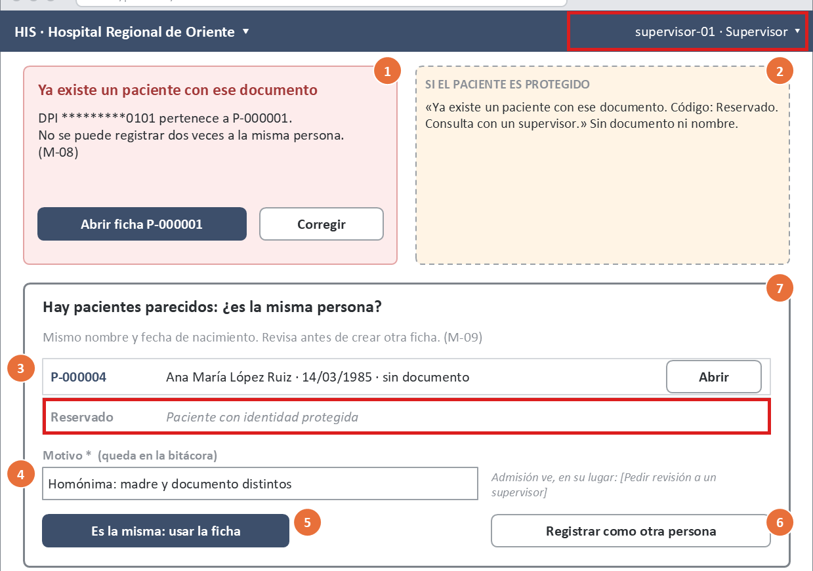

| | |
|---|---|
| Heurística / WCAG | N4 Consistencia · checklist PA-09 |
| Qué pasa | W3 está dibujado para el supervisor (cabecera) y muestra un candidato como «Reservado · Paciente con identidad protegida», sin botón «Abrir». Pero el supervisor tiene `pacientes.leer_protegido`, y `PoliticaDuplicados::visibles()` le devuelve el **código real**. «Reservado» solo corresponde a admisión y a los clínicos. |
| Por qué importa en Pacientes | Es justo la persona que decide «es otra persona». Si no puede abrir al candidato protegido, puede confirmar un duplicado de alguien que ya existe, y precisamente de una paciente con orden de protección. |
| Severidad × impacto | 3 × 3 = **9 · P1** |

### H-02 · W5 pide motivo por cambiar una tilde — W5

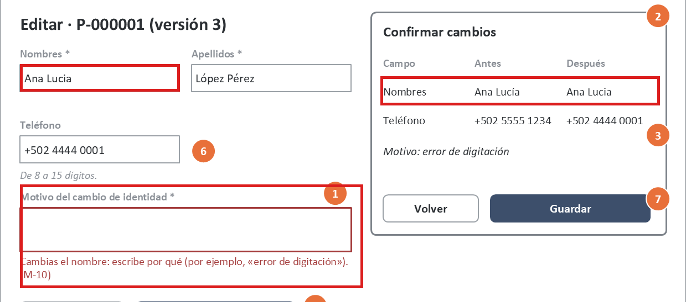

| | |
|---|---|
| Heurística / WCAG | N4 Consistencia · checklist PA-01 |
| Qué pasa | El ejemplo de W5 cambia «Ana Lucía» por «Ana Lucia» y la UI exige «Motivo del cambio de identidad». En el backend, `Paciente::cambiaIdentidadRespectoDe()` compara con `Texto::normalizar()`, que quita tildes: para el servidor **no** cambió la identidad y no pide motivo. Se comprobó ejecutando `Texto::normalizar("Ana Lucía") === Texto::normalizar("Ana Lucia")` → `true`. |
| Por qué importa en Pacientes | La UI tiene su propia regla de «cambio de identidad». Hoy pide de más: el usuario inventa motivos y la bitácora se llena de ruido. Si la regla de la UI se aflojara por error, pediría de menos, y el servidor respondería un 422 inesperado. |
| Severidad × impacto | 3 × 3 = **9 · P1** |

### H-03 · Admisión no tiene salida ante una coincidencia probable — W3

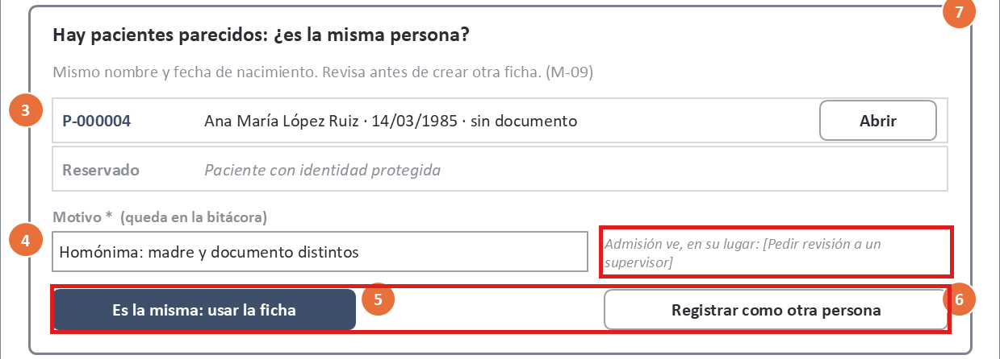

| | |
|---|---|
| Heurística / WCAG | N3 Control y libertad · N5 Prevención de errores · checklist PA-10 |
| Qué pasa | Para admisión, W3 solo ofrece «Es la misma: usar la ficha» o salir. «Pedir revisión a un supervisor» aparece como texto, pero no existe en la API (brecha B-2 de la semana 8). |
| Por qué importa en Pacientes | Si el paciente de verdad es otra persona (un homónimo), admisión queda bloqueada frente al paciente. La salida «creativa» es alterar el nombre o la fecha para que el aviso no salte, y eso crea un **duplicado con datos falsos**: lo contrario de lo que busca R-03. |
| Severidad × impacto | 3 × 3 = **9 · P1** |

### H-04 · «Copiar mis cambios» saca datos del paciente al portapapeles — W5

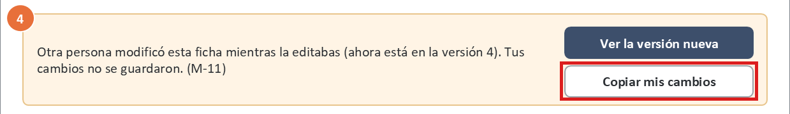

| | |
|---|---|
| Heurística / WCAG | N9 Recuperarse de errores · checklist PA-08 |
| Qué pasa | Ante el 409 de versión, W5 ofrece «Copiar mis cambios». El portapapeles del sistema operativo queda fuera del control de la aplicación: lo leen otras aplicaciones, los historiales de portapapeles y las sesiones remotas. |
| Por qué importa en Pacientes | Nombre, fecha, teléfono y documento del paciente quedan fuera del HIS sin registro. Contradice el principio P-3 de la propia semana 8: nada en el navegador. |
| Severidad × impacto | 3 × 3 = **9 · P1** |

### H-05 · Etiquetas, pistas y «Reservado» con contraste insuficiente — W1–W6

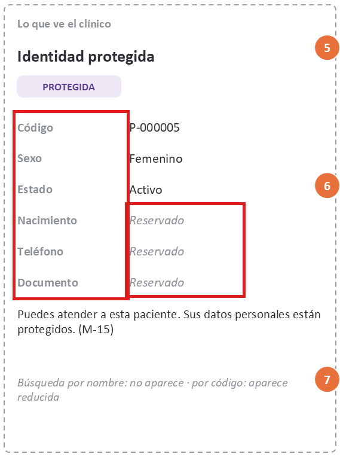

| | |
|---|---|
| Heurística / WCAG | WCAG 1.4.3 Contraste mínimo |
| Qué pasa | El gris `#8A8F96` da 3.26:1 sobre blanco y 2.93:1 sobre `#F2F3F5` (C-01..C-07). El mínimo es 4.5:1. |
| Por qué importa en Pacientes | Afecta textos que explican la confidencialidad y la evidencia: «Reservado», «Motivo * (queda en la bitácora)» y las etiquetas de la ficha. Un usuario con baja visión no distingue «Reservado» de un campo vacío. |
| Severidad × impacto | 3 × 2 = **6 · P2** |

### H-06 · Bordes de campos y casillas con contraste insuficiente — W1, W2, W3, W5, W6

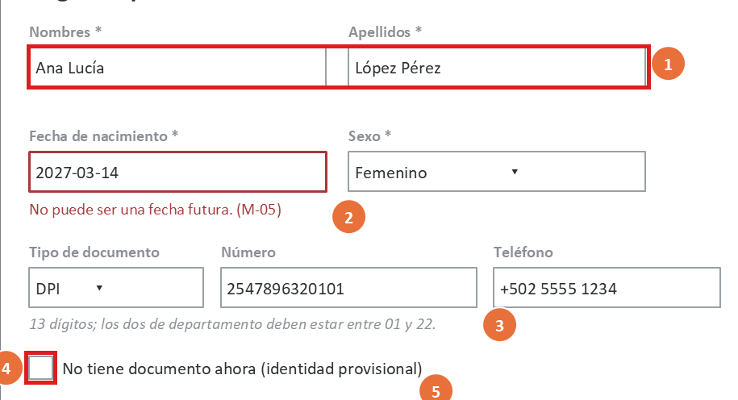

| | |
|---|---|
| Heurística / WCAG | WCAG 1.4.11 Contraste no textual |
| Qué pasa | Borde `#9AA0A6` sobre blanco: 2.64:1 (C-08, C-09). El mínimo es 3:1. |
| Por qué importa en Pacientes | Cuesta ubicar los campos del formulario y la casilla «No tiene documento ahora» (identidad provisional). |
| Severidad × impacto | 3 × 2 = **6 · P2** |

### H-07 · No se puede registrar el sexo como desconocido — W2

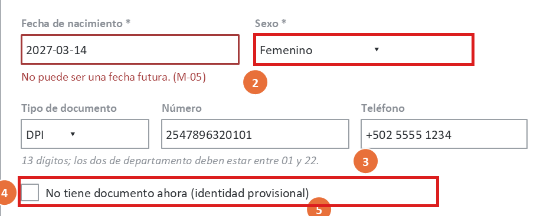

| | |
|---|---|
| Heurística / WCAG | N2 Mundo real · N5 Prevención de errores · WCAG 3.3.2 · checklist PA-02 |
| Qué pasa | «Sexo *» es obligatorio y W2 no especifica sus opciones. El backend admite `female`, `male`, `other` y `unknown` (`Paciente::SEXOS`), pero el diseño no garantiza que la UI ofrezca «Desconocido». |
| Por qué importa en Pacientes | En una emergencia con identidad provisional (paciente inconsciente, sin documento), admisión tendría que **inventar** un dato demográfico. |
| Severidad × impacto | 2 × 3 = **6 · P2** |

### H-08 · La fecha se escribe en AAAA-MM-DD y se muestra en dd/mm/aaaa — W1, W2, W4

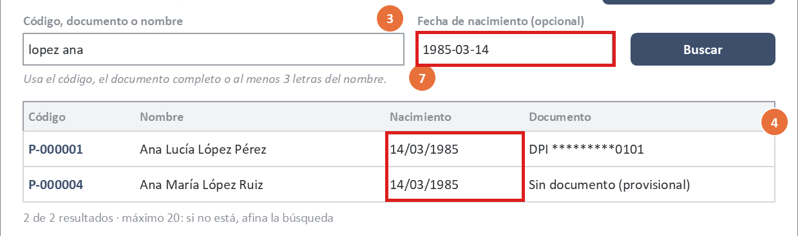

| | |
|---|---|
| Heurística / WCAG | N4 Consistencia · checklist PA-03 |
| Qué pasa | El buscador y el formulario piden `1985-03-14`; los resultados y la ficha muestran `14/03/1985`. |
| Por qué importa en Pacientes | Invertir día y mes es el error típico. La fecha de nacimiento forma parte de la detección de coincidencias (R-03): una fecha mal escrita **evita** que el sistema avise de un duplicado. |
| Severidad × impacto | 2 × 3 = **6 · P2** |

### H-09 · El número de resultados no se anuncia — W1

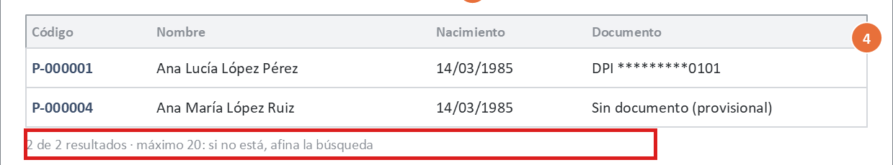

| | |
|---|---|
| Heurística / WCAG | N1 Visibilidad del estado · WCAG 4.1.3 Mensajes de estado · checklist PA-06 |
| Qué pasa | «2 de 2 resultados» y el estado «sin resultados» cambian en pantalla, pero el diseño no los define como región `aria-live`. I-6 mueve el foco a la primera fila, pero si no hay resultados, el foco no tiene adónde ir. |
| Por qué importa en Pacientes | Un usuario de lector de pantalla no sabe si la búsqueda no encontró a nadie, y puede registrar a alguien que ya existe. |
| Severidad × impacto | 3 × 2 = **6 · P2** |

### H-10 · El diálogo de protección no dice cómo deshacerla — W6

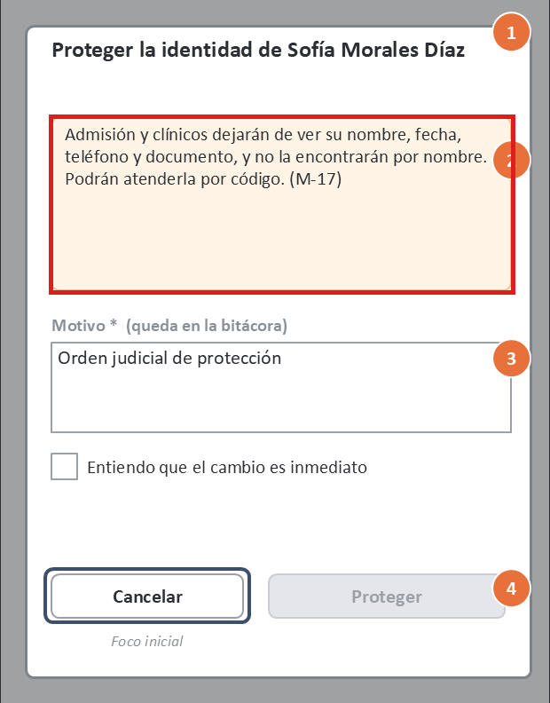

| | |
|---|---|
| Heurística / WCAG | N3 Control y libertad · checklist PA-12 |
| Qué pasa | El diálogo explica quién deja de ver qué, pero no que la protección se puede quitar, ni quién puede hacerlo (`pacientes.proteger`, con motivo). Eso solo está en la anotación del wireframe, no en el texto para el usuario. |
| Por qué importa en Pacientes | Un supervisor que no sabe si el cambio es reversible duda en proteger a quien lo necesita, o protege «por si acaso» y deja a un paciente sin poder ser encontrado por nombre. |
| Severidad × impacto | 2 × 3 = **6 · P2** |

### H-11 · El motivo aparece directamente en estado de error — W5

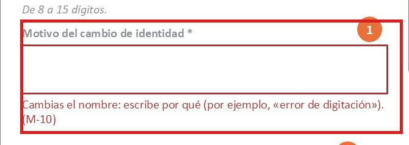

| | |
|---|---|
| Heurística / WCAG | N9 · WCAG 3.3.1 Identificación de errores |
| Qué pasa | Al cambiar el nombre, el campo «Motivo» aparece con borde rojo y texto de error antes de que el usuario haya podido escribir. |
| Por qué importa en Pacientes | Se percibe como un error del usuario cuando es una instrucción, y el lector de pantalla anuncia un error que no existe. |
| Severidad × impacto | 2 × 2 = **4 · P3** |

### H-12 · «Corregir» no dice qué corregir — W3

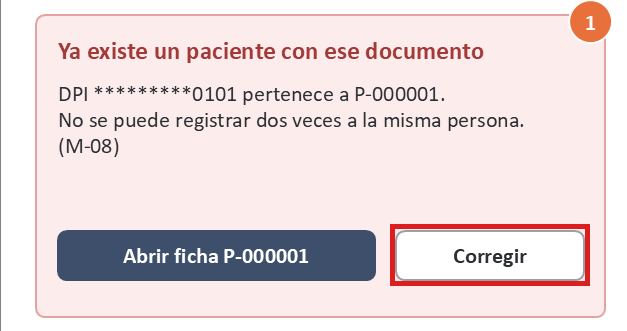

| | |
|---|---|
| Heurística / WCAG | N9 Recuperarse de errores |
| Qué pasa | En el bloqueo por documento, «Corregir» no indica qué campo ni a dónde va el foco. |
| Por qué importa en Pacientes | Puede leerse como «corrige el paciente existente». Lo correcto es revisar el número de documento escrito. |
| Severidad × impacto | 2 × 2 = **4 · P3** |

### H-13 · El «*» de obligatorio no tiene leyenda — W2

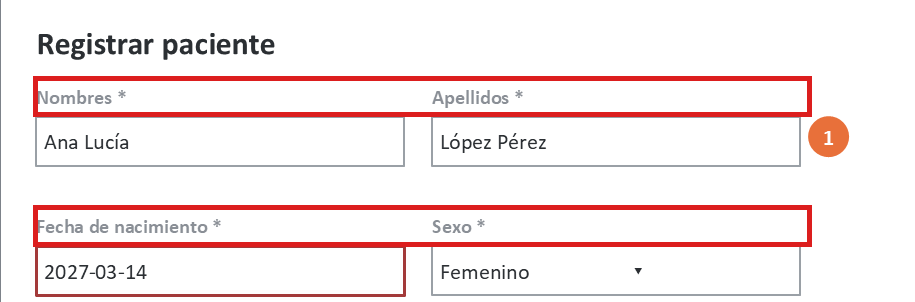

| | |
|---|---|
| Heurística / WCAG | WCAG 3.3.2 Etiquetas o instrucciones |
| Qué pasa | Los campos llevan «*», pero el formulario no dice qué significa. |
| Por qué importa en Pacientes | Es una convención extendida, pero no universal. El lector de pantalla lee «asterisco». |
| Severidad × impacto | 2 × 1 = **2 · P3** |

### H-14 · La ayuda «?» no está definida para teclado ni tiene nombre accesible — W1

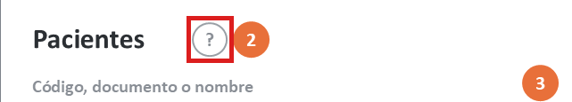

| | |
|---|---|
| Heurística / WCAG | N10 · WCAG 2.1.1, 1.4.13, 4.1.2 |
| Qué pasa | El «?» es un círculo con texto. No se especifica si es un botón, qué anuncia el lector ni cómo se cierra la ayuda. |
| Por qué importa en Pacientes | La ayuda explica los criterios de búsqueda; sin ella, el usuario recibe M-02 sin saber por qué. |
| Severidad × impacto | 2 × 1 = **2 · P3** |

## 5. Fortalezas (se mantienen)

| Aspecto | Evidencia |
|---|---|
| Buscar antes de registrar, con precarga | W1 → W2 · WCAG 3.3.7 |
| Criterios fuera de la URL y datos mínimos en la lista | W1 · P-3 |
| El conflicto de versión nunca sobrescribe | W5 · R-06 |
| La vista reducida de un protegido viene del servidor: `null` = «Reservado» | W6 · R-11 |
| Diálogo sensible: título específico, consecuencias, motivo, foco inicial en «Cancelar», `Esc` | W6 · I-3 |
| Reintento seguro del registro con `Idempotency-Key` | W2 · I-7 |
| Mismo 404 para «no existe» y «es de otro hospital» | W4 · M-19 |
| Texto principal, botones, errores y avisos con buen contraste (5.70–13.49:1) | C-10..C-20 |

## 6. Backlog priorizado

Orden: prioridad, luego puntaje, luego esfuerzo y luego roles afectados (§2.1).

**Esfuerzo:**

| Nivel | Qué implica |
|---|---|
| S | Cambio de especificación o de estilo |
| M | Cambio de interacción o de un componente |
| L | Requiere backend |

| # | Hallazgo | P | Puntaje | Esfuerzo | Corrección propuesta | Criterio verificable |
|---|---|---|---:|---|---|---|
| BL-01 | H-02 Motivo por una tilde | **P1** | 9 | S | La UI pide motivo solo si cambia un dato de identidad **según la misma normalización del backend**: minúsculas, sin tildes y espacios simples (`Texto::normalizar`). La regla vive en un solo módulo del frontend con una tabla de casos compartida con el backend. | Tabla de casos ejecutada en el frontend y en el backend con el mismo resultado: «Lucía»→«Lucia» = sin motivo; «Ana»→«Ana María» = con motivo; «Pérez »→«Perez» = sin motivo. Prueba unitaria en ambos lados. |
| BL-02 | H-04 Portapapeles | **P1** | 9 | S | Quitar «Copiar mis cambios». En su lugar, «Ver la versión nueva y reaplicar»: carga la versión nueva y vuelve a poner en el formulario los campos que el usuario cambió, en memoria, marcados para revisar. | **Dado** un 409 en W5, **cuando** el usuario elige reaplicar, **entonces** el formulario muestra la versión 4 con sus cambios marcados y ningún `navigator.clipboard.writeText` se ejecuta (prueba de componente con espía). |
| BL-03 | H-01 Supervisor ve «Reservado» | **P1** | 9 | S | Corregir W3: con `pacientes.leer_protegido`, el candidato protegido se muestra con su código real, la etiqueta PROTEGIDA y el botón «Abrir». «Reservado» queda solo para quien no tiene el permiso. | **Dado** un 409 `POSIBLE_DUPLICADO` con un candidato protegido, **cuando** el actor es supervisor, **entonces** la fila muestra `P-…` y «Abrir»; si es admisión, «Reservado» sin «Abrir». La regla ya la cumple el backend (PROT-05 pasa); se agrega una prueba de componente con las dos respuestas. |
| BL-04 | H-03 Admisión sin salida | **P1** | 9 | L | 1. Resolver la brecha B-2: operación «solicitar revisión de coincidencia», que deja el registro pendiente para un supervisor. 2. Mientras no exista: W3 muestra a admisión el supervisor de turno y conserva el formulario en memoria, con la advertencia «No cambies los datos para evitar el aviso: crearías un duplicado». | **Dado** un 409 `POSIBLE_DUPLICADO` para admisión, **entonces** hay una acción distinta de «usar la ficha» que no crea un paciente. Con B-2 resuelta: prueba de integración que verifica que la solicitud queda visible para el supervisor y que no se creó ningún paciente. |
| BL-05 | H-05 Contraste de texto secundario | **P2** | 6 | S | Gris secundario `#8A8F96` → `#5F6670` en todo el sistema de diseño. | `python herramientas/contraste.py` reporta CUMPLE en C-01..C-07 y termina con código 0. En la implementación: axe-core sin infracciones `color-contrast` en W1–W6. |
| BL-06 | H-06 Contraste de bordes | **P2** | 6 | S | Borde de campos y casillas `#9AA0A6` → `#7D838A`. | `contraste.py`: C-08 y C-09 ≥ 3.0 (3.83 con la propuesta). |
| BL-07 | H-08 Formato de fecha | **P2** | 6 | S | `<input type="date">` en el buscador y en el formulario: muestra la fecha en el formato local (dd/mm/aaaa) y envía ISO. La etiqueta dice «(dd/mm/aaaa)». | Con el navegador en `es-GT`, el campo muestra `14/03/1985` y el cuerpo enviado contiene `"fecha_nacimiento":"1985-03-14"`. Prueba de componente. |
| BL-08 | H-09 Resultados sin anuncio | **P2** | 6 | S | Región `aria-live="polite"` con «2 resultados» o «No encontramos pacientes…». El foco queda en el buscador; `↓` entra a la lista. | **Dado** NVDA activo, **cuando** termina la búsqueda, **entonces** se anuncia el número de resultados. La prueba de componente comprueba el texto de la región `aria-live` en los estados «resultados» y «vacío». |
| BL-09 | H-07 Sexo desconocido | **P2** | 6 | S | Opciones visibles del selector: Femenino, Masculino, Otro, **Desconocido** (`unknown`). Con «No tiene documento ahora» marcado, se sugiere «Desconocido» si no se eligió otro. | El `select` tiene exactamente los 4 valores de `Paciente::SEXOS`. Prueba de componente que compara las opciones con la lista del contrato OpenAPI (`enum` de `sexo`). |
| BL-10 | H-10 Deshacer la protección | **P2** | 6 | S | Agregar al diálogo: «Podrás quitar la protección desde la ficha; también exigirá un motivo y quedará registrado.» | El texto aparece en W6 y en el diálogo de «Quitar protección». Revisión de la especificación. |
| BL-11 | H-11 Error prematuro | **P3** | 4 | S | El campo «Motivo» aparece con su instrucción en gris; el rojo, M-10 y `aria-invalid` solo al salir del campo o al enviar. | **Dado** el campo recién aparecido, **entonces** no hay texto rojo y `aria-invalid` es falso. Al enviar vacío, `aria-invalid="true"` y M-10 visible. |
| BL-12 | H-12 «Corregir» ambiguo | **P3** | 4 | S | Botón «Revisar el número de documento», que pone el foco en ese campo con su contenido seleccionado. | Prueba de componente: al activarlo, `document.activeElement` es el campo «Número» de W2. |
| BL-13 | H-14 Ayuda «?» | **P3** | 2 | S | Botón con nombre accesible «Ayuda: cómo buscar pacientes», que abre un *popover* con el foco dentro; se cierra con `Esc` o «Cerrar». | Recorrido de teclado: `Tab` llega al botón, `Enter` lo abre, `Esc` lo cierra y el foco vuelve. axe-core sin `button-name`. |
| BL-14 | H-13 Leyenda de «*» | **P3** | 2 | S | Texto al inicio del formulario: «Los campos con * son obligatorios», y `aria-required="true"` en cada uno. | Inspección del DOM: cada campo con «*» tiene `aria-required="true"`; axe-core sin infracciones `label`. |

### 6.1 Qué cambia en la especificación de la semana 8

| Corrección | Documento afectado |
|---|---|
| BL-01 | W5 y regla nueva I-9 (misma normalización que el backend) |
| BL-02 | W5: reemplaza «Copiar mis cambios»; M-11 cambia de texto |
| BL-03 | W3: lo que ve cada rol en los candidatos |
| BL-04 | Brecha B-2 pasa a ser requisito del backlog del contrato |
| BL-07, BL-09, BL-14 | W2 y W1 (campos de fecha y sexo, leyenda) |
| BL-08 | Regla I-6 (anuncio en lugar de mover el foco) |
| BL-10, BL-11, BL-12 | W6, W5 y W3 |
| BL-05, BL-06 | Paleta del sistema de diseño (compartida con RBAC) |

Esta semana no se modificaron los wireframes de la semana 8: la tarea es evaluar y priorizar. Los criterios de contraste ya se pueden comprobar hoy con el script.

## 7. Limitaciones

- **Se evaluó un diseño, no una implementación.**
  - El contraste es una medición real sobre los colores definidos.
  - El teclado y el lector de pantalla se evaluaron recorriendo la especificación, no con NVDA sobre una página real.
  - Los criterios del backlog están escritos para verificarse cuando exista el frontend.
- **Un solo evaluador.** Nielsen recomienda de 3 a 5 evaluadores para encontrar la mayoría de los problemas. Un compañero del grupo podría repetir la checklist como segunda opinión.
- **Sin pruebas con usuarios.** Las severidades son el juicio del evaluador. BL-03 y BL-04 conviene validarlos con personal de admisión y supervisores reales.
- **La paleta es compartida con RBAC.** BL-05 y BL-06 son las mismas correcciones que propuso la evaluación de RBAC. Conviene aplicarlas una sola vez en el sistema de diseño.
