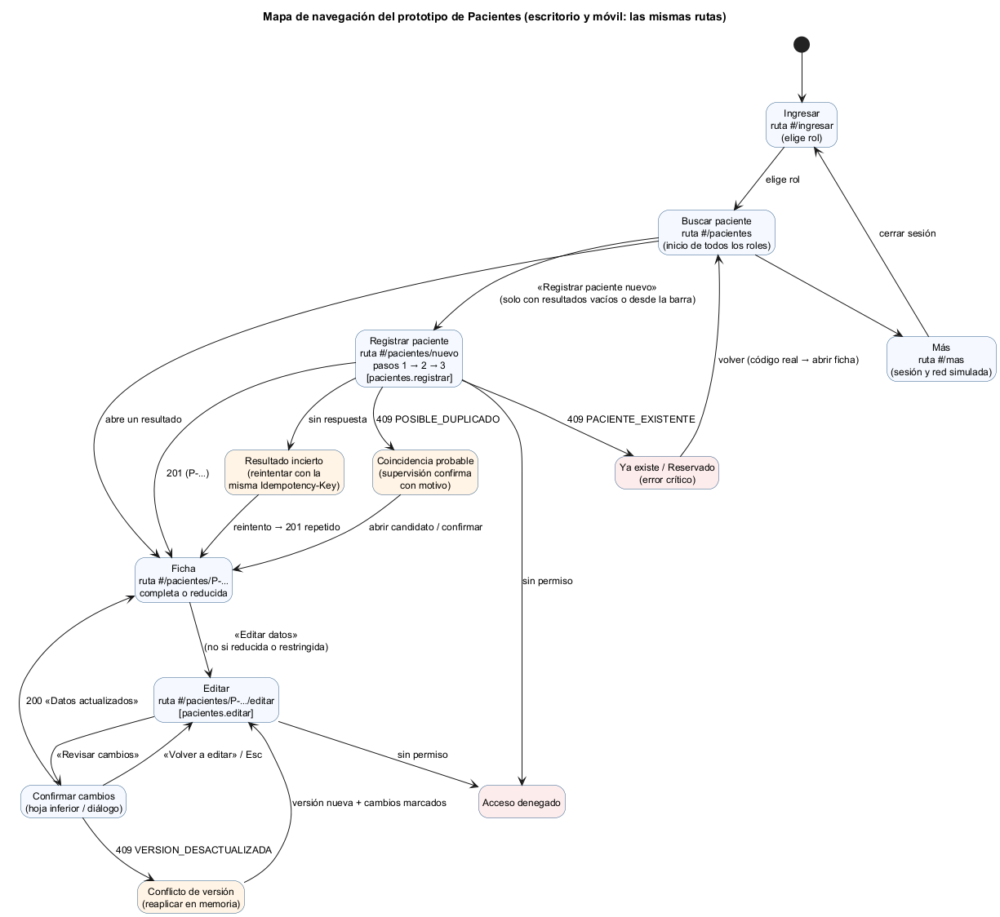

# Recorrido navegable — demostración con el prototipo

**Estudiante:** Boris Alexander Quiroa Orellana · **Prototipo:** [prototipo/index.html](prototipo/index.html) (contrato 1.2.0)

Guion para demostrar en vivo, en unos 6 minutos, cómo el flujo trata **roles, estados, errores y riesgos** en los seis aspectos de la tarea. Abrir el prototipo en Chrome; para el móvil, F12 → modo dispositivo, 360 × 740. Recargar la página vuelve todo al estado inicial.

Cada paso indica qué decir y qué decisión de la [matriz](matriz-decision-rf-rnf-evidencia.md) muestra.

## Parte A · Camino feliz: roles, estados y edición segura (≈ 3 min)

| # | Acción | Qué se ve | Qué decir | Matriz |
|---|---|---|---|---|
| 1 | Ingresar como **Marta López (Admisión)** | Navegación: Pacientes · Registrar · Más | «La navegación muestra solo lo que el rol puede usar; el servidor vuelve a decidir cada operación.» | D-23, D-24 |
| 2 | Buscar `ramirez` | «No encontramos pacientes…» + «Registrar paciente nuevo» | «Buscar antes de registrar: el vacío es el único camino al registro. La URL sigue siendo `#/pacientes`.» | D-25, D-27 |
| 3 | Registrar: Carlos · Ramírez Soto · 20/05/1990 · Masculino → DPI `4455667780105` | 3 pasos con progreso | «Una decisión por pantalla; fecha nativa; "Desconocido" disponible para emergencias.» | D-32 |
| 4 | En **Más**: «Perder la próxima respuesta». Volver y pulsar «Registrar paciente» | «No sabemos si se registró» | «La red se cortó, pero el servidor sí lo registró. ¿Reintento?» | D-33 |
| 5 | «Reintentar» | Ficha P-000006: «Ya se había registrado: no se creó otro» | «Misma Idempotency-Key: mismo 201 y un solo paciente.» | D-33 |
| 6 | «Editar datos» → cambiar el teléfono | Sin campo de motivo; documento «No cambia al guardar» | «Contrato 1.2.0, el cambio solicitado: no pido el DPI completo para corregir un teléfono.» | D-37 |
| 7 | Cambiar «Carlos» por «Carlos Andrés» | Aparece «Motivo del cambio de identidad *» | «El nombre sí es identidad; uso la misma normalización que el backend: una tilde no cuenta.» | D-28 |
| 8 | Volver a «Carlos», «Revisar cambios» → `Tab` varias veces → «Guardar» | Hoja con antes → después; el foco no sale; «Datos actualizados», versión 2, «DPI •••• 0105» | «Confirmación de solo lo que cambia, diálogo accesible, y el documento se conservó.» | D-36, D-37 |

## Parte B · Error crítico: una paciente protegida que alguien intenta registrar otra vez (≈ 2 min)

| # | Acción | Qué se ve | Qué decir | Matriz |
|---|---|---|---|---|
| 9 | **Más → Cerrar sesión**. Recargar. Ingresar como **Marta**. Buscar `sofia morales` | 0 resultados | «Es una paciente con orden de protección: no aparece por nombre.» | D-24 |
| 10 | Registrar: Sofía · Morales Díaz · 09/08/1994 · Femenino · DPI `2233445560101` | «Esta persona ya está registrada… no podemos mostrar quién es… llama a supervisión» | «El servidor detecta el duplicado y manda `RESERVADO`. La pantalla no muestra código ni datos, y dice explícitamente: no cambies los datos para evitar el aviso.» | D-31 |
| 11 | Cerrar sesión → **Rosa Díaz (Supervisión)** → buscar `2233445560101` | P-000005, «Protegida» | «Supervisión sí la ve: tiene `pacientes.leer_protegido`.» | D-23 |
| 12 | Cerrar sesión → **Luis Ortiz (Enfermería)** → buscar `P-000005` y abrir la ficha | «Identidad protegida», datos «Reservado», sin «Editar» | «El clínico la atiende por código, sin ver sus datos. Reservado, no vacío, para que nadie la "complete".» | D-24 |

## Parte C · Riesgos y accesibilidad (opcional, ≈ 1 min)

| # | Acción | Qué decir |
|---|---|---|
| 13 | Recorrer la búsqueda solo con `Tab` y `Enter` | «Saltar al contenido, foco visible, resultados anunciados (`aria-live`).» |
| 14 | En **Más**: «Sin conexión» e intentar buscar | «Franja de red y "requiere conexión": no se encola nada ni se guarda en el teléfono.» (D-34) |
| 15 | Mostrar la salida de `node herramientas/paridad.cjs` | «Lo que acaban de ver no es una maqueta optimista: 37 de 37 respuestas iguales al backend real.» |

## Mapa

Las rutas son las mismas de la semana 11. Lo único que cambió con 1.2.0 es el contenido de «Editar»: ya no pide confirmar el documento.
