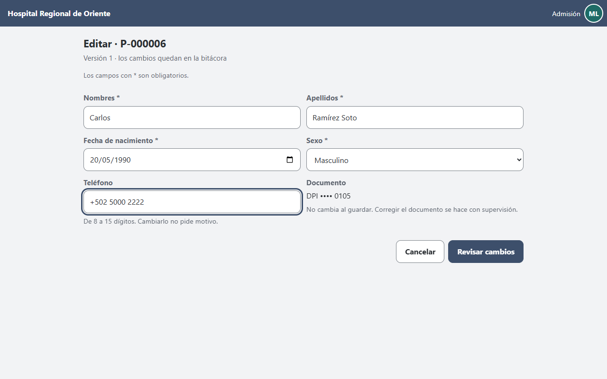
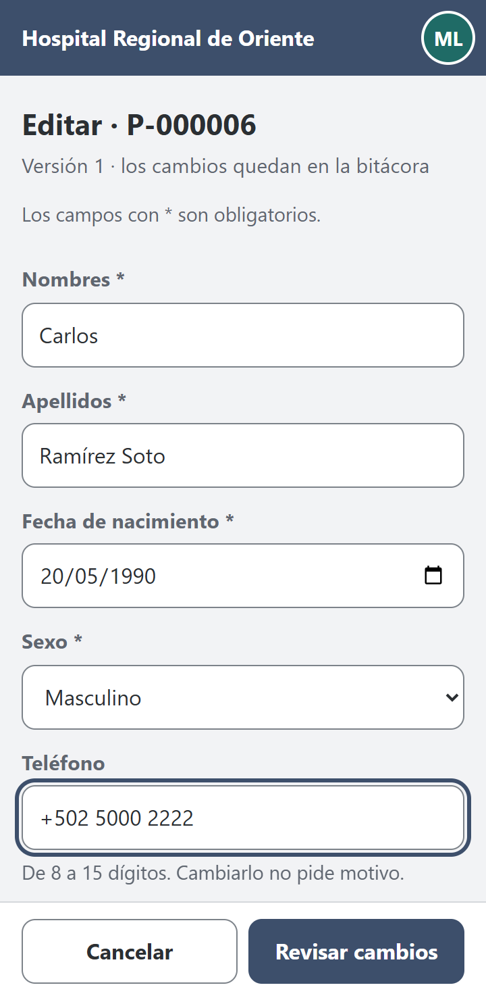
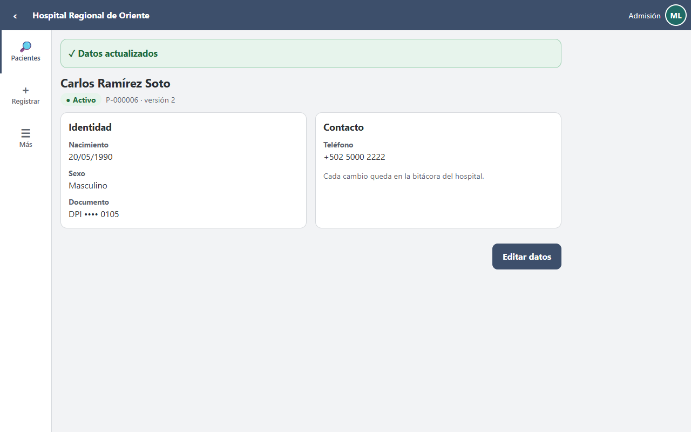
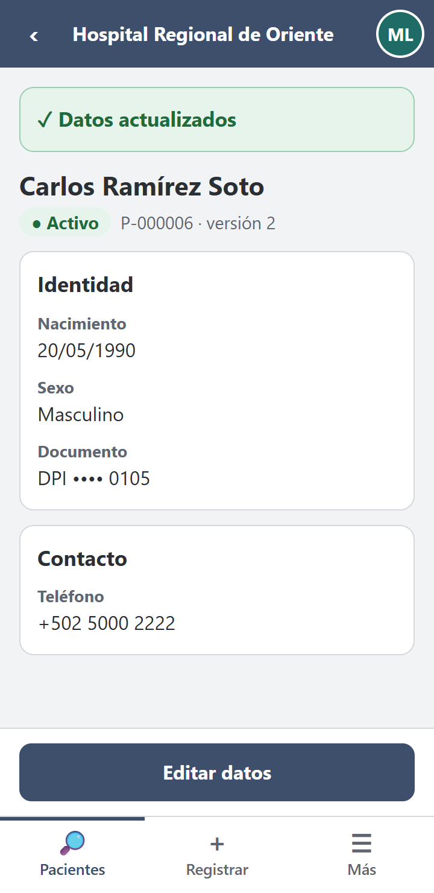

# Registro del cambio solicitado — «Corregir un teléfono sin tener el documento del paciente a mano» (B-4)

**Estudiante:** Boris Alexander Quiroa Orellana · **Módulo:** ASII-03 Pacientes · **Contrato:** OpenAPI 1.1.0 → **1.2.0** · **Método:** pruebas primero (rojo → verde) sobre el MISMO Micro-HIS

## 1. Solicitud

> «En la sala de espera, admisión corrige el teléfono de un paciente desde el teléfono móvil. La pantalla le pide confirmar el número completo de DPI, que el paciente no siempre trae. Y cuando el nombre tiene tres palabras, el formulario a veces parte mal los nombres y los apellidos. Queremos poder corregir un dato sin pedir lo que no cambia.»

El origen está en la semana 11. Al construir la edición del prototipo apareció la brecha **B-4**: el `PUT` reemplaza la ficha completa, pero el detalle no devuelve todo lo que el `PUT` exige.

| Lo que exige el `PUT` (1.1.0) | Lo que devuelve el `GET` del detalle |
|---|---|
| `nombres` y `apellidos` por separado | Un solo campo `nombre` |
| `documento` completo; si falta, se entiende «quitar el documento» | El documento **enmascarado** (`*********0101`), a propósito (R-04) |

La paridad de la semana 11 (paso 8) lo dejó medido: un `PUT` sin documento respondía 422 `MOTIVO_REQUERIDO`, porque para el servidor era un cambio de identidad. Con un motivo, **la ficha perdía su documento**.

**Aspectos de la tarea que toca:** identidad (el documento no debe perderse por omisión), datos demográficos (nombres y apellidos bien separados), edición (corregir un dato sin reenviar todo) y confidencialidad (el documento completo sigue sin viajar en las respuestas).

## 2. Requisitos nuevos

Continúan la numeración de las semanas 2 y 6.

| ID | Requisito | Criterio de aceptación | Prueba |
|---|---|---|---|
| RF-17 | En un `PUT`, si el campo `documento` no se envía, el documento del paciente no cambia. | Sin el campo → 200, sin motivo; el detalle conserva `*********0101`; la auditoría muestra el mismo identificador antes y después. | B4-01 |
| RF-18 | Quitar el documento sigue siendo posible, pero solo de forma explícita (`documento: null`) y como cambio de identidad. | `null` sin motivo → 422 `MOTIVO_REQUERIDO`; con motivo → 200 e identidad provisional. | B4-02 |
| RF-19 | El detalle devuelve `nombres` y `apellidos` por separado; en la vista reducida de un protegido, ambos en `null`. | Admisión: «Ana Lucía» / «López Pérez»; el clínico ante un protegido: `null` / `null`; supervisión: completos. | B4-03 |
| RNF-11 | Una interfaz puede editar un dato usando **solo** lo que devuelve el detalle, sin conocer el documento completo, y nada más cambia. | De punta a punta: GET → PUT con los campos del detalle y el teléfono nuevo → solo `telefono` difiere entre «antes» y «después» en la auditoría. | B4-04 |

RNF-03 se mantiene: el documento completo nunca viaja en una respuesta.

## 3. Análisis de impacto (antes de programar)

| Pieza | ¿Cambia? | Por qué |
|---|---|---|
| `FormularioPaciente` (Presentación) | Sí, 1 línea | Distinguir «no se envió» de «se envió `null`»: `array_key_exists('documento', …)`. |
| `FormularioPaciente::aDatos` (Aplicación) y `DatosPaciente` | Sí, 3 líneas | Llevar `documentoEnviado` hasta el Dominio. Por defecto `true`: todo lo demás se comporta igual. |
| `RevisionDeFicha` (Dominio, semana 7) | Sí, 3 líneas | Una regla más en el **único** lugar donde se cruzan las reglas de la ficha. Se aplica antes de `PoliticaEdicion`, igual que «protección ausente = sin cambio». |
| `Paciente` (Dominio) | Sí | `conIdentificador()` y `nombres`/`apellidos` en `detalle()`, en `null` si se muestra reducido. |
| `openapi.yaml` | Sí → 1.2.0 | Documenta la semántica del campo ausente y los dos campos nuevos del detalle. |
| Casos de uso, controlador, rutas, vistas, políticas, persistencia, librería cliente | **No** | Verificado con `git diff --quiet`: [cambio-2-impacto.txt](evidencia/cambio-2-impacto.txt). |

**¿Rompe a algún cliente?** Solo a uno que omitiera `documento` **para borrarlo**. Ese uso ya exigía un motivo y nunca lo hizo nadie: ni el prototipo, ni la librería cliente de la semana 5, ni las pruebas (`Escenario::json` siempre envía la clave `documento`). Por eso es una versión **menor** (1.2.0) y el cambio queda anotado en la descripción del contrato.

## 4. Implementación

| Archivo | Cambio |
|---|---|
| `src/Presentacion/Http/Formularios/FormularioPaciente.php` | `'documento_enviado' => array_key_exists('documento', $cuerpo)` |
| `src/Aplicacion/Comandos/FormularioPaciente.php` | Pasa `documento_enviado` a `DatosPaciente` (ausente en el arreglo = `true`) |
| `src/Dominio/Modelo/DatosPaciente.php` | Nuevo `bool $documentoEnviado = true` |
| `src/Dominio/Servicios/RevisionDeFicha.php` | `if (!$datos->documentoEnviado) $nuevo = $nuevo->conIdentificador($actual->identificador);` |
| `src/Dominio/Modelo/Paciente.php` | `conIdentificador()`; `nombres` y `apellidos` en `detalle()` |
| `api/openapi.yaml` | 1.2.0 |
| `tests/Aplicacion/CambioSolicitadoPrueba.php` | B4-01..B4-04 (nuevo) |
| `tests/mutaciones.php` | M25 (el campo ausente vuelve a quitar el documento) y M26 (el detalle reducido deja ver nombres y apellidos) |

Costo: **5 archivos de `src/`, +17 líneas**, sin tocar casos de uso ni capas externas. Que una regla nueva de la ficha costara 3 líneas en `RevisionDeFicha` es la prueba práctica del refactor de la semana 7.

## 5. Pruebas: rojo → verde

1. **Rojo** ([cambio-1-antes-rojo.txt](evidencia/cambio-1-antes-rojo.txt)): las pruebas nuevas, ejecutadas sobre el código anterior, dan 87 pruebas, 82 pasan y **3 fallan** (B4-01, B4-03, B4-04).
   - B4-02 ya pasaba a propósito: fija que `null` explícito **sigue** quitando el documento con motivo, es decir, lo que no debía cambiar.
2. **Verde** ([cambio-3-despues-verde.txt](evidencia/cambio-3-despues-verde.txt)): 87 pruebas, 85 pasan, **0 fallan** y 2 se omiten (PostgreSQL).
   - Siguieron verdes ARQ-01..08, API-01..03, CON-MEM-01..08, PROT-01..06 y REF-01..03.
3. **Mutaciones** ([mutaciones.txt](evidencia/mutaciones.txt)): **26/26** detectadas.
   - M25 la detectan B4-01 y B4-04.
   - M26 la detectan B4-03 y **PROT-06**, la prueba transversal de confidencialidad de la semana 6. Si se olvida reducir los campos nuevos, la protección lo atrapa.
4. **Contrato** ([salida-lint-openapi.txt](evidencia/salida-lint-openapi.txt)): 1.2.0 válido.

Durante el verde, B4-03 falló una vez por un error **de la prueba**: `$x['nombres'] ?? 'falta'` convierte un `null` legítimo en «falta». Se reescribió con `array_key_exists`.

## 6. Demostración de punta a punta con el prototipo

El prototipo de esta semana ([prototipo/index.html](prototipo/index.html)) usa el contrato 1.2.0:
- **Antes** (semana 11): «Confirma el número de DPI *» y la heurística «las dos últimas palabras son los apellidos».
- **Ahora:** el formulario muestra el documento enmascarado con «No cambia al guardar» y toma `nombres` y `apellidos` del detalle.

| | Escritorio | Móvil |
|---|---|---|
| Editar (1.2.0) |  |  |
| Ficha tras guardar: conserva «DPI •••• 0105» |  |  |

Verificado:
- **La paridad detecta el cambio de contrato.** El prototipo de la semana 11 (1.1.0), comparado con el kernel ya cambiado, difiere en **un solo paso: el 8**, el `PUT` sin documento (antes 422, ahora 200). Ver [paridad-prototipo-semana11-contra-kernel-1.2.0.txt](evidencia/paridad-prototipo-semana11-contra-kernel-1.2.0.txt). La carpeta de la semana 11 queda como registro histórico de 1.1.0.
- **Paridad con el kernel real: 37/37** ([paridad.txt](evidencia/paridad.txt)). La secuencia agrega 4 pasos del cambio y el paso 8 pasa de 422 a **200**.
- **Recorrido automático: 36/36** ([recorrido.txt](evidencia/recorrido.txt)). Incluye «nombres y apellidos llegan separados del detalle» y «la ficha conserva DPI •••• 0105».

## 7. Decisiones tomadas durante el cambio

| Decisión | Alternativa descartada | Por qué |
|---|---|---|
| Campo ausente = sin cambio, solo para `documento` | Un `PATCH` completo (JSON Merge Patch) | Mucho más grande, y nuevo para los clientes. Ya existía el mismo patrón para `identidad_protegida` (semana 6): se extendió lo conocido. |
| `null` explícito sigue quitando el documento | Prohibir quitarlo | Hay casos reales: un documento registrado por error. Se conserva, con motivo y auditado. |
| Devolver `nombres` y `apellidos`, no el documento completo | Devolver el documento a admisión | Rompería R-04/RNF-03. La interfaz no lo necesita si el `PUT` no lo exige. |
| La regla vive en `RevisionDeFicha` | Resolverla en el caso de uso o en el controlador | El refactor de la semana 7 dejó un solo dueño para el orden de las reglas; ponerla en otro lugar habría deshecho ese trabajo. |

## 8. Riesgos y pendientes

- **Cambiar el documento** (no quitarlo) sigue exigiendo enviarlo completo, que es lo correcto: es un dato de identidad nuevo. En la interfaz, esa corrección queda para supervisión.
- **PostgreSQL:** el cambio no toca la persistencia, pero las 2 pruebas de integración siguen sin ejecutarse por falta de credenciales.
- La **librería cliente** (semana 5) no necesitó cambios. Sus usuarios deben saber que omitir `documento` ya no lo borra; queda dicho en la descripción del contrato 1.2.0.
