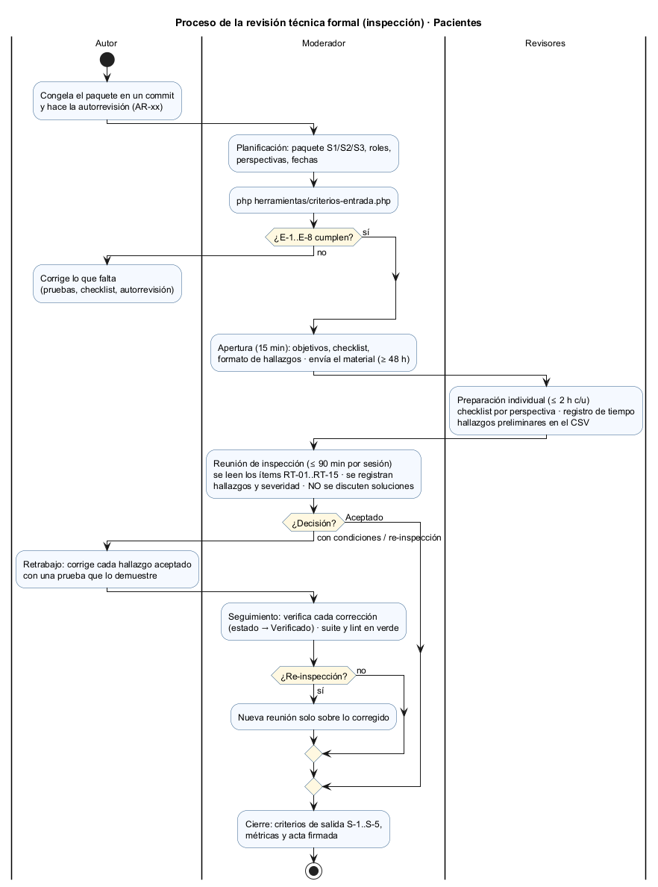

# Plan de la revisión técnica formal — Pacientes

**Módulo:** ASII-03 · Pacientes: registro, edición, búsqueda y detalle · **Autor:** Boris Alexander Quiroa Orellana

**Proceso revisado:** «registro, búsqueda y actualización segura de un paciente»

## 1. Objetivo y tipo de revisión

**Tipo:** **inspección** (IEEE 1028, revisión formal de producto). Incluye:
- roles separados;
- preparación individual con checklist;
- una reunión moderada en la que **solo se registran hallazgos**;
- retrabajo verificado;
- criterios de entrada y salida explícitos.

Se elige inspección, y no un *walkthrough*, porque lo que se revisa es la **ficha del paciente**: identidad, datos demográficos y la confidencialidad de personas protegidas. Un defecto aquí crea duplicados, pierde ediciones o expone a una víctima, y la revisión debe dejar evidencia.

**Preguntas que la revisión debe responder:**

| # | Pregunta | Ítems del checklist |
|---|---|---|
| P1 | ¿Las **reglas de dominio** (R-01..R-11) deciden lo que dicen, en un solo lugar y en el orden correcto? | RT-01..RT-04 |
| P2 | ¿Se mantiene la **integridad**: ficha y evento atómicos, sin duplicados, sin ediciones perdidas? | RT-03..RT-05 |
| P3 | ¿El **contrato API** describe exactamente lo que el código hace, sin filtrar información en los errores? | RT-06..RT-08 |
| P4 | ¿**Permisos y tenant** se aplican a toda operación y a todo dato devuelto, con la identidad tomada solo del token? | RT-09..RT-11 |
| P5 | ¿La **confidencialidad** de protegidos y del documento se mantiene en búsquedas, detalle, errores y registros? | RT-07, RT-12, RT-13 |
| P6 | ¿Las **dependencias** son estrictamente las necesarias para el flujo, y la regla de capas se cumple? | RT-14, RT-15 |

**Fuera del objetivo:**
- **Estilo** del código, salvo que oculte un defecto.
- **UX y accesibilidad del prototipo**, evaluadas en las semanas 9 a 12.
- **Rendimiento**, que entra en el plan SQA de la semana 14.
- **Otros módulos** (RBAC, MPI). Solo se revisa cómo Pacientes los **usa**: el puerto `PoliticaAcceso` y el índice de duplicados.

## 2. Alcance y paquete de revisión

El paquete se **congela en un commit** (E-1) y se divide en **tres** sesiones para respetar el límite de tamaño (E-4). La lista exacta de archivos y líneas la genera [herramientas/criterios-entrada.php](herramientas/criterios-entrada.php) ([salida](evidencia/criterios-entrada-2-despues.txt)).

| Sesión | Contenido | Archivos | Líneas efectivas | Preguntas |
|---|---|---:|---:|---|
| **S1** · Reglas de dominio | `src/Dominio/**`, `database/schema.sql` | 25 | 957 | P1, P2, P5 |
| **S2** · Aplicación y persistencia | `src/Aplicacion/**`, `src/Persistencia/Pdo/*`, `src/Persistencia/Seguridad/*` | 24 | 865 | P2, P4, P5 |
| **S3** · Contrato, frontera, permisos/tenant y dependencias | `api/openapi.yaml`, `src/Presentacion/Http/**`, `bootstrap/contenedor.php`, `config/config.php`, `public/index.php` | 19 | 1284 | P3, P4, P6 |
| **Total** | | 68 | **3106** | |

**Por qué tres sesiones y no dos.** El primer reparto (dominio + aplicación + persistencia en una sesión) daba **1822 líneas** y la verificación de entrada lo rechazó por E-4. El paquete se rearmó en tres sesiones antes de guardar la [primera evidencia](evidencia/criterios-entrada-1-antes.txt), así que esa corrida ya muestra E-4 en PASA; el rechazo de 1822 líneas queda registrado en la [declaración de IA](DECLARACION_IA.md).

**Material de referencia** (se consulta, no se revisa):

| Material | Para qué |
|---|---|
| Reglas R-01..R-11 (semanas 1 y 6), RF/RNF (semanas 2, 6 y 12) | Saber qué se exige |
| Matrices de decisión: [semana 6](../semana-06/matriz-decision-evidencia.md) y [semana 12](../semana-12/matriz-decision-rf-rnf-evidencia.md) | Saber por qué se decidió así |
| Pruebas (`tests/`) | Evidencia; los revisores **no** revisan las pruebas en sí |
| Persistencia InMemory | Se verifica con la suite de contrato (CON-MEM) |
| `src/Cliente/*` | Solo para RT-14 |

## 3. Roles y responsabilidades

| Rol | Quién | Responsabilidades | No hace |
|---|---|---|---|
| **Autor** | Boris Alexander Quiroa Orellana | Congela el paquete. Hace la [autorrevisión](autorrevision-autor.md). Responde preguntas en la reunión. Hace el retrabajo. | No modera, no registra, no defiende ni discute severidades. Escucha y aclara. |
| **Moderador** | Compañero/a del grupo que **no** sea el autor *(nombre por confirmar, E-8)* | Verifica los criterios de entrada. Convoca y envía el material. Dirige la reunión y controla el tiempo. Decide la severidad si no hay consenso. Toma la decisión de salida. Verifica el retrabajo. Firma el acta. | No es revisor principal de ninguna perspectiva. Cubre RT-14 y RT-15 con R3. |
| **Registrador** | Uno de los revisores, por turno *(por confirmar)* | Llena en vivo el [registro de hallazgos](plantillas/registro-hallazgos.csv) y el [acta](plantillas/acta-revision.md) | No debate mientras registra |
| **Revisor R1** · Permisos, tenant y confidencialidad | Compañero/a *(por confirmar)*; idealmente quien hizo RBAC | RT-09..RT-13 | — |
| **Revisor R2** · Contrato y frontera | Compañero/a *(por confirmar)* | RT-06..RT-08 | — |
| **Revisor R3** · Dominio e integridad | Compañero/a *(por confirmar)* | RT-01..RT-05 y, con el moderador, RT-14 y RT-15 | — |

- Las **perspectivas** reparten la atención, pero cada revisor lee completo el paquete de su sesión. Un hallazgo fuera de la propia perspectiva también se registra.
- Si el grupo no alcanza para cinco personas, el **registrador** puede ser el mismo moderador. El **autor nunca** puede ser moderador ni registrador.
- Los nombres se dejan por confirmar a propósito: los acuerda el grupo, y el moderador los anota en el acta (E-8).

## 4. Proceso y calendario

Día D = reunión de la sesión S1. S2 y S3 se hacen en D+1 y D+2 con la misma preparación.

| Fase | Cuándo | Duración | Quién | Entrada → salida |
|---|---|---|---|---|
| 1. Planificación | D−4 | 30 min | Autor + moderador | Paquete congelado → plan, roles y fechas |
| 2. Verificar la entrada | D−3 | 5 min | Moderador | `criterios-entrada.php` → E-1..E-6 PASA |
| 3. Apertura | D−3 | 15 min | Todos | Objetivos, checklist y formato explicados; material enviado (E-7: ≥ 48 h antes) |
| 4. Preparación individual | D−3 a D+1 | ≤ 2 h por revisor y sesión (≈ 150–200 LOC/h en lo propio) | Revisores | Checklist marcado + hallazgos preliminares en el CSV + tiempo en [registro-preparacion.csv](plantillas/registro-preparacion.csv) |
| 5. Reuniones S1, S2, S3 | D, D+1, D+2 | ≤ 90 min cada una | Todos | Hallazgos registrados con severidad + decisión |
| 6. Retrabajo | D+2 a D+6 | Según hallazgos | Autor | Cada hallazgo aceptado se corrige con una prueba que lo demuestre, o se rechaza con razón |
| 7. Seguimiento | D+7 | 30–45 min | Moderador | Estados → Verificado; suite y lint en verde |
| 8. Cierre | D+7 | 15 min | Moderador | Criterios de salida S-1..S-5, métricas, acta firmada |

**Por qué estos límites.** Más de ~200 LOC/h en la preparación, o más de 90–120 minutos de reunión, bajan claramente la detección: el revisor deja de leer y empieza a hojear.

## 5. Reglas de la reunión

1. Se revisa el **producto**, no a la persona. Los hallazgos se redactan sobre el código («la política no filtra…»).
2. **No se discuten soluciones.** Se registra la propuesta en una frase y se sigue; la decide el autor en el retrabajo.
3. El moderador recorre los ítems **en orden** (RT-01 → RT-15). En cada uno, cada revisor dice sus hallazgos preliminares y se registran.
4. La severidad se decide por consenso con el criterio del [formato](formato-hallazgos.md#2-severidad). Si no hay consenso en 2 minutos, decide el moderador.
5. Las preguntas al autor tienen respuesta corta. Si la respuesta revela un defecto, se registra.
6. Máximo 90 minutos. Lo pendiente se registra como «no revisado» y pasa al seguimiento.
7. Los hallazgos de la [autorrevisión](autorrevision-autor.md) se tratan **igual** que los de los revisores: se confirman, se ajustan o se rechazan.

## 6. Criterios de entrada

Automatizados en [herramientas/criterios-entrada.php](herramientas/criterios-entrada.php). Si alguno falla, la reunión **no** se hace.

| ID | Criterio | Cómo se verifica |
|---|---|---|
| E-1 | Paquete congelado en un commit, sin cambios locales en `micro-his-pacientes/` | `git status --porcelain` vacío; se anota el commit |
| E-2 | Suite automatizada sin fallas | `php tests/ejecutar.php` → `Fallan: 0` |
| E-3 | Guardas de contrato (API-01..03) y de capas (ARQ-01..08) en verde | Se leen en la salida de la suite |
| E-4 | Cada sesión ≤ 1600 líneas efectivas | Conteo automático por sesión |
| E-5 | Checklist de 12–15 ítems y formato de hallazgos publicados | Cuenta las filas `RT-xx`; verifica la plantilla CSV |
| E-6 | Autorrevisión del autor registrada con el mismo formato | Cuenta los `AR-xx` en el CSV y en el documento |
| E-7 | Material enviado ≥ 48 h antes | Manual: el moderador anota la fecha en el acta |
| E-8 | Roles asignados y revisores confirmados | Manual: nombres en el acta |

**La puerta funciona.** La primera corrida se hizo **antes** de escribir el checklist y la autorrevisión. Falló en E-4 (sesión de 1822 líneas, corregido rearmando el paquete), y la corrida guardada falla en E-5 y E-6 ([evidencia](evidencia/criterios-entrada-1-antes.txt)). La corrida actual pasa los 6 criterios automáticos ([evidencia](evidencia/criterios-entrada-2-despues.txt)).

## 7. Criterios de salida y decisión

| ID | Criterio de salida | Quién lo verifica |
|---|---|---|
| S-1 | **Cero** hallazgos **críticos** abiertos | Moderador |
| S-2 | Cada **mayor** está corregido y verificado, **o** tiene una decisión documentada aprobada por el moderador más un issue con fecha | Moderador |
| S-3 | Tras el retrabajo: suite con `Fallan: 0`, mutaciones sin sobrevivientes y lint del contrato válido | Moderador (vuelve a correr los comandos) |
| S-4 | Cada hallazgo corregido tiene su **verificación** anotada: prueba nueva o comando | Moderador |
| S-5 | Métricas calculadas y acta firmada y archivada en `semana-13/` | Moderador |

**Decisión al final de cada reunión:**

| Decisión | Cuándo |
|---|---|
| **Aceptado** | Sin críticos ni mayores |
| **Aceptado con condiciones** | Hay mayores, pero ningún crítico, y no más de 3 mayores. El moderador verifica el retrabajo sin otra reunión. |
| **Re-inspección** | Al menos un crítico, **o** más de 3 mayores, **o** densidad Crítico + Mayor > 2 por KLOC. Nueva reunión solo sobre lo corregido. |

Con lo que trae la autorrevisión (AR-02 crítico), la S1 y la S3 llegarían a **re-inspección** si el equipo confirma la severidad. El retrabajo de AR-02 está previsto en la semana 15 (pruebas de caja negra de tenant).

## 8. Formato de hallazgos

Definido en [formato-hallazgos.md](formato-hallazgos.md). Cada hallazgo registra:
- ID, ítem RT y ubicación `archivo:línea`;
- descripción y evidencia reproducible;
- regla afectada;
- severidad (Crítico · Mayor · Menor · Observación) y tipo (Defecto · Riesgo · Mejora · Pregunta);
- propuesta, responsable, estado y verificación.

El registro está en [plantillas/registro-hallazgos.csv](plantillas/registro-hallazgos.csv) y ya contiene los 7 hallazgos de la autorrevisión (AR-01..AR-07) como ejemplo real.

## 9. Métricas

| Métrica | Se registra en | Uso |
|---|---|---|
| Minutos de preparación por revisor | `registro-preparacion.csv` | Tasa de preparación (LOC/h); si supera 300, la preparación fue superficial |
| Hallazgos por severidad, tipo, ítem y origen (preparación o reunión) | `registro-hallazgos.csv` | Densidad por KLOC; utilidad de cada ítem del checklist |
| Duración de cada reunión | Acta | Respetar los 90 min |
| Hallazgos corregidos y verificados ÷ aceptados | CSV (estado) | Criterio S-2 |

**Línea base:** la autorrevisión encontró **7 hallazgos en 3106 líneas**: 1 crítico, 3 mayores y 3 menores, es decir **2.25 por KLOC**. La revisión del equipo se compara contra esa cifra. Si encuentra lo mismo, el checklist cumplió y el autor ya lo había visto. Si encuentra más, eso mide el valor de la revisión.

## 10. Riesgos de la propia revisión

| Riesgo | Mitigación |
|---|---|
| Los revisores no conocen PHP ni el código del módulo | La apertura incluye un recorrido de 10 minutos por la [matriz de la semana 12](../semana-12/matriz-decision-rf-rnf-evidencia.md), y cada ítem dice **dónde mirar**. |
| RT-05 (transacción) no se puede comprobar de punta a punta sin PostgreSQL | Se revisa leyendo `PdoTransaccion`. Queda anotado en el acta. |
| El autor sesga la reunión defendiendo decisiones de diseño (por ejemplo, la búsqueda en toda la red de AR-02) | Regla 2: no se discuten soluciones; el moderador controla los turnos. |
| Hallazgos de la autorrevisión aceptados sin mirarlos | Regla 7: se confirman o se ajustan como cualquier otro. |
| El paquete cambia entre la preparación y la reunión | E-1: el commit queda anotado; si cambia, se vuelve a correr la verificación de entrada. |
