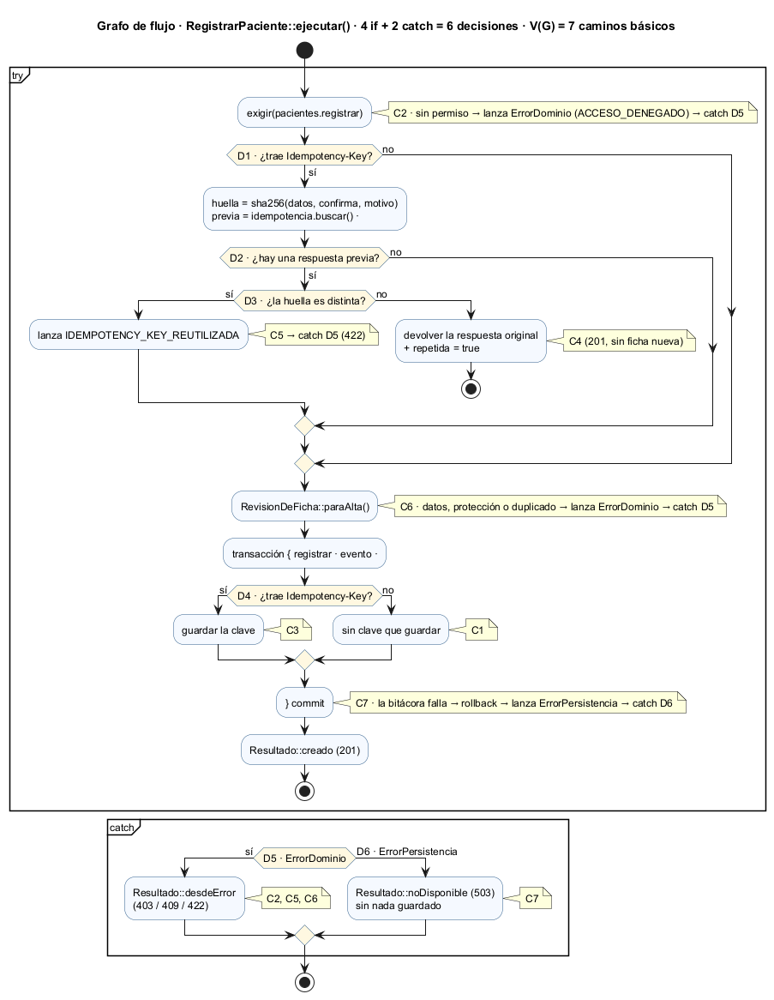
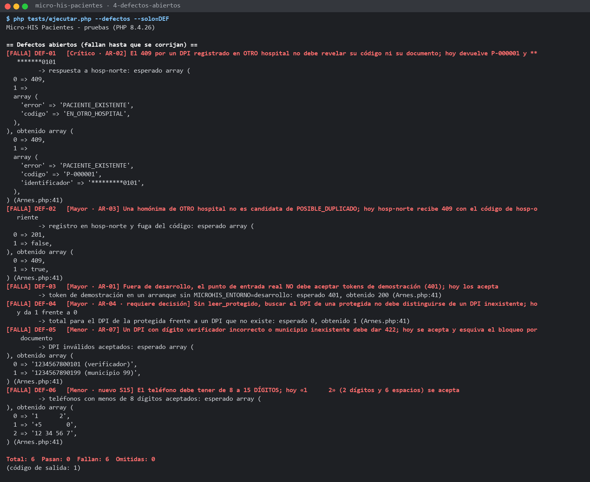

# Semana 15 — Pruebas unitarias, de caja blanca y de caja negra de Pacientes

**Estudiante:** Boris Alexander Quiroa Orellana · **Módulo:** ASII-03 · Pacientes: registro, edición, búsqueda y detalle

**Proceso:** «registro, búsqueda y actualización segura de un paciente»

## Entregables

| Pedido | Dónde |
|---|---|
| Matriz RF/RNF → prueba | [matriz-rf-rnf-pruebas.md](matriz-rf-rnf-pruebas.md): RF-01..RF-19 y RNF-01..RNF-15 contra las pruebas nuevas y las existentes |
| Mínimo 3 unitarias | **10**: UNI-01..UNI-10 → [`tests/Dominio/UnitariasReglasPrueba.php`](../micro-his-pacientes/tests/Dominio/UnitariasReglasPrueba.php) |
| Mínimo 2 de caja blanca | **4**: CB-01..CB-04, con **98.2 %** de cobertura de líneas medida → [`tests/Aplicacion/CajaBlancaPrueba.php`](../micro-his-pacientes/tests/Aplicacion/CajaBlancaPrueba.php) |
| Mínimo 4 de caja negra | **7**: CN-01..CN-07 → [`tests/Presentacion/CajaNegraPrueba.php`](../micro-his-pacientes/tests/Presentacion/CajaNegraPrueba.php) |
| Comandos y resultados | §5 y [evidencia/](evidencia/), salidas reales |
| Capturas | [capturas/](capturas/), una por ejecución |
| Defectos registrados | [registro-defectos.md](registro-defectos.md): 6 defectos, cada uno con una prueba que lo reproduce (uno **nuevo**: el teléfono). Además, 3 observaciones y 1 no conformidad del plan SQA. |

Las pruebas cubren los seis temas que pide la tarea:

| Tema | Unitarias | Caja blanca | Caja negra |
|---|---|---|---|
| Identidad del paciente | UNI-01, UNI-02, UNI-03, UNI-05 | CB-03 (A ∨ B ∨ C) | CN-01, CN-03 |
| Datos demográficos | UNI-04 | CB-01 (C6) | CN-01, CN-03 |
| Búsqueda | UNI-06, UNI-07 | CB-03 (`coincideCon`) | CN-02, CN-04 |
| Edición | UNI-05, UNI-10 | CB-02, CB-04 | CN-02, CN-04 |
| Duplicados | UNI-09 | CB-01 (C4, C5), CB-02 (R8) | CN-01, CN-07 |
| Confidencialidad | UNI-07, UNI-08, UNI-10 | CB-02 (R1, R3, R7) | CN-05, CN-07 |

## 1. Qué se prueba y qué no

**Sí se prueba** la implementación de Pacientes: el Micro-HIS (`docs/modulos/pacientes/micro-his-pacientes/`), con sus reglas, casos de uso, kernel HTTP y contrato OpenAPI 1.2.0.

**No se prueba:**

| Excluido | Por qué |
|---|---|
| La decisión de permisos de RBAC | Pacientes **consume** el puerto `PoliticaAcceso`. Aquí se usa la política estática de `config.php` y se prueba solo que cada operación **pida** su permiso y **respete** la respuesta (CN-05). Las membresías, la vigencia y la auditoría de la denegación son del módulo RBAC. |
| Autenticación (JWT) y tenancy del proyecto Laravel | Son módulos de otros compañeros. Lo único que se prueba es que el kernel rechaza la falta de hospital o de token y el token de otro hospital (CN-05, CN-06). DEF-03 se refiere solo a **cómo arranca este módulo**, no al login del HIS. |
| El MPI (índice maestro de pacientes) | No existe todavía. DEF-01 y DEF-02 proponen delegarle la conciliación entre hospitales. |
| La interfaz | Se cubrió en S10–S12 con `recorrido.cjs` y `verificar-responsive.cjs`. |

## 2. Pruebas unitarias (UNI-01..10)

Cada regla de dominio se prueba **aislada**: sin caso de uso y sin HTTP. Si hace falta un puerto, se arma en la propia prueba con el adaptador en memoria. Casi todas usan **valores límite**.

| ID | Unidad | Qué afirma | RF/RNF |
|---|---|---|---|
| UNI-01 | `Dpi` | Longitud 12/13/14 → no/sí/no. Departamento 00/01/22/23 → no/sí/sí/no. Una «O» en lugar de un 0 no pasa. Con guiones y espacios es el mismo DPI. Enmascarado y canónico. | RF-01, RNF-01 |
| UNI-02 | `Pasaporte` | Longitud 5/6/20/21. País de 2/3/4 letras. Se pasa a mayúsculas. **El mismo número de otro país es otra identidad.** | RF-01, RNF-01 |
| UNI-03 | `FabricaIdentificador` | Sin tipo ni número → `null` (provisional), y lo mismo con solo espacios. Número sin tipo → rechazo. Tipo fuera del catálogo → rechazo. El tipo no distingue mayúsculas. | RF-04 |
| UNI-04 | `Paciente::desdeDatos` (R-01) | Nombres de 100 «ñ» (200 bytes) sí; de 101, no. Nacido hoy sí; mañana, no. 29 de febrero en año bisiesto sí y en año no bisiesto no. Sexo del catálogo, con mayúsculas exactas. Teléfono de 7/8/15/16 dígitos. Se informan **los 5 campos** inválidos a la vez. | RF-01 |
| UNI-05 | `cambiaIdentidadRespectoDe` (R-07) | El teléfono, las tildes, las mayúsculas y los espacios dobles **no** cambian la identidad. Otro nombre, un día de diferencia, otro DPI o quitar el documento **sí**. | RF-08, RF-18 |
| UNI-06 | `CriterioBusqueda::desde` (R-10) | Prioridad: código > documento > nombre. Con 2 letras → `CRITERIO_INSUFICIENTE`; se cuentan **letras**, no caracteres. Nacimiento en formato AAAA, AAAA-MM o AAAA-MM-DD; «85» y «1985-3» no valen. El resumen auditable no lleva ni el nombre ni la fecha. | RF-05, RNF-05 |
| UNI-07 | `coincideCon` + R-11 | Por nombre no aparece la protegida, salvo con `leer_protegido`. Por código o documento sí aparece. El criterio es inmutable. | RF-13 |
| UNI-08 | `resumen()`, `detalle()` y `instantanea()` | Reducido: 7 campos en `null` o con el rótulo, aunque se conservan el código, la marca y la versión. Completo con permiso. **Ninguna** vista lleva el DPI en claro. | RF-14, RF-19, RNF-03 |
| UNI-09 | `PoliticaDuplicados` (R-02, R-03) | Mismo DPI → código y documento enmascarado; si el titular es protegido → solo `RESERVADO`. Homónima → candidatos. Confirmar sin permiso → 403; sin motivo → 422; con motivo → pasa. **Dos provisionales distintos no son duplicados.** | RF-02, RF-03, RF-04, RF-16 |
| UNI-10 | `PoliticaEdicion` + `PoliticaConfidencialidad` | Inactivo o fallecido sin permiso → `REQUIERE_SUPERVISOR`, aunque solo cambie el teléfono. Un motivo de solo espacios o tabuladores no vale. Visibilidad. Cambio de protección: sin permiso / sin motivo / completo / sin cambio. | RF-09, RF-12, RF-15 |

## 3. Pruebas de caja blanca (CB-01..04)

Diseñadas **leyendo el código**.

### CB-01 · Caminos básicos de `RegistrarPaciente::ejecutar()` (McCabe)



**V(G) = 6 decisiones + 1 = 7 caminos básicos.** Las 6 decisiones son 4 `if` y 2 `catch`. Cada camino se fuerza por la API del caso de uso, con dobles que fallan a pedido.

| Camino | Permiso | D1 clave | D2 previa | D3 huella distinta | Revisión | Transacción | Resultado esperado y obtenido |
|---|:-:|:-:|:-:|:-:|:-:|:-:|---|
| C1 | sí | no | — | — | pasa | ok | 201; 1 ficha, 1 evento, ninguna clave guardada |
| C2 | **no** | — | — | — | — | — | 403, **antes** de mirar la clave o los datos (los datos son inválidos y no se ve 422) |
| C3 | sí | sí | no | — | pasa | ok | 201; la clave queda guardada |
| C4 | sí | sí | **sí** | no | — | — | 201 `repetida: true`; sigue habiendo 1 ficha y 1 evento |
| C5 | sí | sí | sí | **sí** | — | — | 422 `IDEMPOTENCY_KEY_REUTILIZADA` |
| C6 | sí | no | — | — | **lanza** | — | 422 `DATOS_INVALIDOS`; no se guarda nada |
| C7 | sí | sí | no | — | pasa | **la bitácora falla** | 503; rollback **incluida la clave**: el reintento con la misma clave crea la ficha |

### CB-02 · Ramas y orden de `RevisionDeFicha::paraEdicion()`

Se usa un **índice espía** que cuenta las consultas de titular. Así se sabe si se tomó la rama de duplicados.

| Rama | Caso | Resultado | Consultas al índice | Qué demuestra |
|---|---|---|:-:|---|
| R1 | Protegida + datos inválidos, sin permiso | `ACCESO_DENEGADO` | 0 | La visibilidad va **antes** que los datos: un 422 revelaría qué campos tiene |
| R2 | Datos inválidos | `DATOS_INVALIDOS` | 0 | |
| R3 | Protección ausente / quitarla sin permiso | Se conserva / `ACCESO_DENEGADO` | 0 | `null` = sin cambio |
| R4 | `documento` no enviado (B-4) | Pasa, conserva `*********0101` | **0** | No es un cambio de identidad, así que no consulta el índice |
| R5 | `documento` enviado vacío, sin motivo | `MOTIVO_REQUERIDO` | 0 | Quitarlo es un cambio de identidad |
| R6 | Fallecida + cambio de protección | `REQUIERE_SUPERVISOR` | 0 | El estado se evalúa **antes** que la protección |
| R7 | Proteger con permiso, sin motivo | `MOTIVO_REQUERIDO` | 0 | |
| R8 | DPI de otro paciente, con motivo | `IDENTIFICADOR_EN_USO` | 1 | |
| R9 | Solo el teléfono | Pasa | **0** | Corto circuito |
| R10 | Otro nombre, con motivo | Pasa | 1 | Verifica el documento aunque no haya cambiado |

### CB-03 · MC/DC de dos condiciones compuestas

**`CriterioBusqueda::coincideCon()`, rama por nombre: `(P ∨ ¬Q) ∧ R ∧ (S ∨ T)`**

| Condición | Significado |
|---|---|
| P | Incluir protegidos |
| Q | El paciente es protegido |
| R | El nombre contiene el texto |
| S | No hay fecha de nacimiento en el criterio |
| T | La fecha de nacimiento coincide |

| Caso | P | Q | R | S | T | Resultado | Demuestra |
|---|:-:|:-:|:-:|:-:|:-:|:-:|---|
| 1 | F | F | V | V | — | V | Caso base |
| 2 | F | **V** | V | V | — | F | Efecto de Q (frente al 1) |
| 3 | **V** | V | V | V | — | V | Efecto de P (frente al 2) |
| 4 | F | F | **F** | V | — | F | Efecto de R (frente al 1) |
| 5 | F | F | V | F | V | V | T sostiene el resultado cuando S es falsa |
| 6 | F | F | V | **F** | **F** | F | Efecto de T (frente al 5) y de S (frente al 1) |

**`Paciente::cambiaIdentidadRespectoDe()`: `A ∨ B ∨ C`**

| Condición | Significado |
|---|---|
| A | El nombre normalizado cambia |
| B | La fecha de nacimiento cambia |
| C | El documento canónico cambia (comparación segura con `null`) |

| Caso | A | B | C | Resultado |
|---|:-:|:-:|:-:|:-:|
| 1 | F | F | F | F |
| 2 | **V** | F | F | V |
| 3 | F | **V** | F | V |
| 4 | F | F | **V** | V |

Con documento `null` hay dos casos más:
- quitar el documento → V;
- dos provisionales → F.

### CB-04 · Todos los puntos de salida de `ActualizarPaciente::ejecutar()`

| Salida | Cómo se fuerza | Resultado | Qué se comprueba |
|---|---|---|---|
| S1 | Clínico, con `porCodigo` configurado para fallar | 403 (no 503) | El permiso se revisa **antes** de cargar la ficha |
| S2 | `porCodigo` falla | 503 | |
| S3 | Código que no existe en el hospital | 404 | La rama `?? throw` |
| S4 | Otro nombre, sin motivo | 422 | |
| S5 | Versión 7 cuando la vigente es 1 | 409 + `version_vigente: 1` | El conflicto sale del repositorio, dentro de la transacción |
| S6 | La bitácora falla | 503 | S4–S6 no dejan cambios ni eventos |
| S7 | Código en minúsculas, solo el teléfono | 200, versión 2 | Un evento con antes y después, y sin motivo |

### Cobertura medida

Medida con `phpdbg`, que viene con PHP. [herramientas/cobertura-caja-blanca.php](herramientas/cobertura-caja-blanca.php) corre **solo** CB-01..04 y cuenta las líneas ejecutadas:

```text
src/Aplicacion/CasosDeUso/RegistrarPaciente.php       16/16   100.0 %
src/Aplicacion/CasosDeUso/ActualizarPaciente.php      10/10   100.0 %
src/Dominio/Servicios/RevisionDeFicha.php             16/16   100.0 %
src/Dominio/Servicios/PoliticaEdicion.php              4/4    100.0 %
src/Dominio/Servicios/PoliticaConfidencialidad.php     9/10    90.0 %
      sin cubrir  l.21   $this->exigirPermisoYMotivo($puedeProteger, $motivo);
TOTAL                                                 55/56    98.2 %
```

La única línea sin cubrir es el **alta** de una protegida (`verificarRegistro`). Las pruebas de caja blanca diseñan la **edición**. El alta protegida la cubren UNI-10, PROT-01 y CN-07 en la suite completa.

**Limitación:** `phpdbg` mide **líneas**, no ramas. La cobertura de ramas y condiciones se garantiza por diseño, con las tablas de CB-01, CB-02 y CB-03.

## 4. Pruebas de caja negra (CN-01..07)

Diseñadas desde el **contrato** (OpenAPI 1.2.0) y las reglas R-01..R-11, sin mirar el código. Solo usan la interfaz HTTP (`Kernel::manejar`), y cada caso empieza con un sistema nuevo.

| ID | Técnica | Casos |
|---|---|---|
| CN-01 | **Particiones de equivalencia** (registro) | 3 clases válidas: DPI, pasaporte, sin documento (provisional). 10 inválidas: nombres vacíos, sexo fuera del catálogo, fecha futura, fecha inexistente, tipo no admitido (422); DPI repetido, homónima (409); tipo no texto, booleano mal formado, sin cuerpo (400). |
| CN-02 | **Particiones de equivalencia** (búsqueda y edición) | Búsqueda: código en minúsculas, código inexistente, DPI con espacios, nombre con tilde y mayúsculas, sin criterio, DPI incompleto. Edición: solo teléfono, identidad sin/con motivo, DPI ajeno, `documento` ausente / `null` sin motivo / `null` con motivo. |
| CN-03 | **Valores límite** (registro) | Nombres y apellidos 100/101 · teléfono 7/8/15/16 · nacimiento hoy/mañana · pasaporte 5/6/20/21 · DPI 12/13/14 · departamento 00/01/22/23 |
| CN-04 | **Valores límite** (búsqueda, versión, claves, ruta) | Nombre de 2/3 letras. **21 coincidencias → 20.** Fecha AAAA / AAAA-MM / AAAA-MM-DD / AA. `If-Match` vigente − 1 / + 1 / vigente; 9 / 10 dígitos. `Idempotency-Key` 7/8/64/65. Código de 20/21 caracteres (404 de paciente frente a 404 de ruta). |
| CN-05 | **Permisos** (tabla de decisión) | **7 identidades × 6 operaciones = 41 celdas evaluadas**, una fuera: ver DEF-02. Identidades: admisión, clínico, supervisión, admisión de otro hospital, sin token, token inválido, token de oriente con cabecera de norte. Operaciones: registrar, buscar, leer, editar, proteger, confirmar. Solo pasa quien tiene el permiso. Todo rechazo trae **únicamente** `error` y no registra a nadie. |
| CN-06 | **Errores** (conjetura de errores) | 400 sin hospital, 404 ruta, 405 `DELETE`, 428 sin `If-Match`, 400 `If-Match: v1`. El 404 de otro hospital es **idéntico** al de «no existe». Con la base caída, búsqueda y registro dan `503 {"error":"SERVICIO_NO_DISPONIBLE"}`, sin mensaje interno. |
| CN-07 | **Escenario** de punta a punta (confidencialidad) | Proteger → el clínico no la encuentra por nombre → por código, reducida → detalle reducido → su DPI da 409 `RESERVADO` → admisión no la edita → supervisión quita la protección sin motivo (422) y con motivo (200) → el clínico ya la encuentra → la auditoría muestra antes, después y motivo. |

**Pruebas exploratorias.** Antes de cerrar CN-03 se probaron entradas raras con [herramientas/exploratorias.php](herramientas/exploratorias.php): teléfonos con espacios, nombres sin letras, fechas muy antiguas, país `ZZZ`, motivos de 5000 caracteres y el dígito verificador del DPI. Los límites de CN-03 usaban solo dígitos y pasaban, pero la exploración con espacios encontró **DEF-06**. También salieron OBS-01..OBS-03 y un dato importante para corregir DEF-05: los DPI ficticios de las pruebas no cumplen el verificador.

## 5. Comandos y resultados

Todos se corren desde `docs/modulos/pacientes/micro-his-pacientes/`, salvo los que se indican.

| Comando | Resultado | Evidencia | Captura |
|---|---|---|---|
| `php tests/ejecutar.php --solo=UNI` | 10 · 10 pasan · 0 fallan | [1-unitarias.txt](evidencia/1-unitarias.txt) | [png](capturas/1-unitarias.png) |
| `phpdbg -qrr herramientas/cobertura-caja-blanca.php` (en `semana-15/`) | CB-01..04 pasan · **98.2 %** de líneas | [2-caja-blanca-cobertura.txt](evidencia/2-caja-blanca-cobertura.txt) | [png](capturas/2-caja-blanca-cobertura.png) |
| `php tests/ejecutar.php --solo=CN` | 7 · 7 pasan · 0 fallan | [3-caja-negra.txt](evidencia/3-caja-negra.txt) | [png](capturas/3-caja-negra.png) |
| `php tests/ejecutar.php --defectos --solo=DEF` | 6 · **6 fallan** (defectos abiertos, a propósito) | [4-defectos-abiertos.txt](evidencia/4-defectos-abiertos.txt) | [png](capturas/4-defectos-abiertos.png) |
| `php tests/ejecutar.php` | **108 · 106 pasan · 0 fallan · 2 omitidas** (antes: 87 · 85 · 0 · 2) | [5-suite-completa.txt](evidencia/5-suite-completa.txt) | [png](capturas/5-suite-completa.png) |
| `php herramientas/medir-sqa.php` (en `semana-14/`) | M1: 85/85 → **106/106**. M5 y M7 siguen en ROJO (DEF-01..04 abiertos) → **NC-01** | [6-medir-sqa-despues.txt](evidencia/6-medir-sqa-despues.txt) | [png](capturas/6-medir-sqa-despues.png) |
| `php herramientas/exploratorias.php` (en `semana-15/`) | Entradas raras: DEF-06, OBS-01..03 y el verificador de los DPI de prueba | [7-exploratorias.txt](evidencia/7-exploratorias.txt) | [png](capturas/7-exploratorias.png) |
| `php tests/mutaciones.php` | **26/26** mutaciones detectadas (sin cambios) | — | — |



**Cambio en el ejecutor de pruebas.** `tests/ejecutar.php` acepta dos opciones nuevas, las mismas que en RBAC:
- `--solo=UNI,CB,CN`: muestra y cuenta solo esos prefijos;
- `--defectos`: incluye `tests/Defectos/`.

Sin opciones se comporta igual que antes. Los defectos van aparte para no poner en rojo la suite (M1 del plan SQA), pero se pueden reproducir cuando se quiera.

**Nota sobre DEF-03.** Esa prueba arranca el kernel **real** (`crearKernel`), que escribe su registro de acceso JSON en stderr. Las evidencias guardan solo la salida estándar.

## 6. Limitaciones

- **Pruebas sin ejecutar.** CON-PDO e INT-00 siguen omitidas por falta de una base PostgreSQL. RNF-09 (rendimiento) y la atomicidad con una base real (RS-05) no tienen prueba ejecutada esta semana.
- **Cobertura de líneas, no de ramas.** Las ramas y condiciones están cubiertas por diseño (CB-01 a CB-03), no medidas.
- **Defectos sin corregir.** Los 6 defectos quedan abiertos. Por eso el hito S15 del plan SQA no se cumplió, y queda registrado como **NC-01**: se escala y la liberación queda congelada. Cada defecto tiene su prueba lista para pasar a regresión.
- **DEF-04 depende del negocio.** La prueba afirma una de las dos opciones; si se elige la otra, se reescribe.
