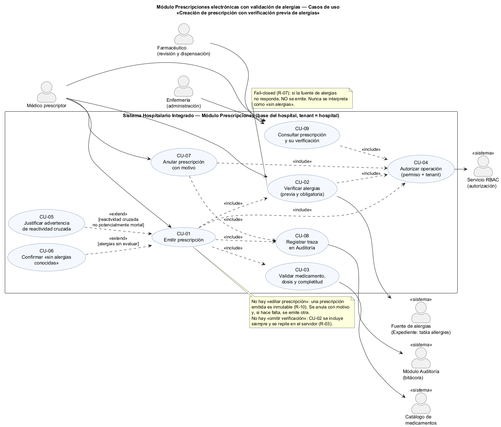
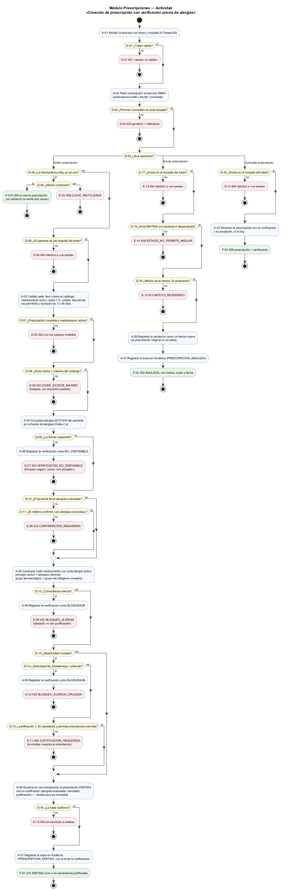
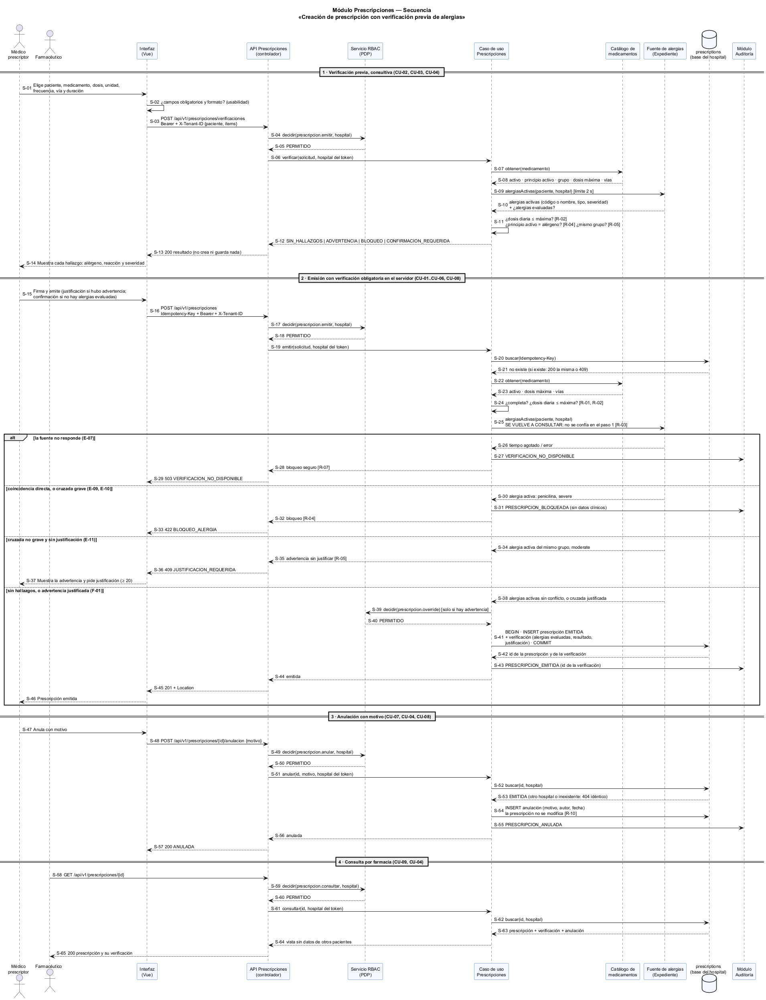

# Semana 1 — Modelado UML del proceso de prescripción con verificación previa de alergias

| | |
|---|---|
| **Curso** | Análisis de Sistemas II — Proyecto Final 2026 |
| **Proyecto** | Sistema Hospitalario Integrado (HIS) |
| **Módulo** | Prescripciones electrónicas con validación de alergias |
| **Tema de la semana** | Conceptos generales, orientación a objetos y UML |
| **Proceso modelado** | «Creación de prescripción con verificación previa de alergias» |
| **Estudiante** | Boris Alexander Quiroa Orellana |
| **Fecha** | Octubre 2026 |

## Índice

1. [Introducción](#1-introducción)
2. [Narrativa de alcance](#2-narrativa-de-alcance)
3. [Actores](#3-actores)
4. [Reglas de negocio](#4-reglas-de-negocio)
5. [Diagrama de casos de uso](#5-diagrama-de-casos-de-uso)
6. [Especificación de casos de uso](#6-especificación-de-casos-de-uso)
7. [Diagrama de actividad](#7-diagrama-de-actividad)
8. [Diagrama de secuencia](#8-diagrama-de-secuencia)
9. [Matriz de trazabilidad](#9-matriz-de-trazabilidad)
10. [Conclusión](#10-conclusión)
11. [Bibliografía](#11-bibliografía)

## 1. Introducción

Una prescripción a un paciente alérgico al medicamento es uno de los errores de medicación más evitables y más graves. El sistema ya **sabe** la alergia (está en el expediente); el error ocurre porque nadie la mira en el momento de prescribir, o porque la verificación existe solo en la pantalla y se puede saltar.

Este módulo modela la **creación de una prescripción** en la que la verificación de alergias:

1. **Es previa:** el médico ve los hallazgos **antes** de firmar.
2. **Es obligatoria en el servidor:** al emitir se repite; la verificación de la pantalla no basta.
3. **Bloquea de forma segura:** ante una coincidencia directa, o si la fuente de alergias no responde, **no se emite**. La falta de datos nunca se interpreta como «sin alergias» (*fail-closed*).

El modelo tiene tres vistas:

| Vista | Qué muestra |
|---|---|
| Casos de uso | Quién interactúa con el módulo y con qué objetivo |
| Actividad | El flujo con sus decisiones, excepciones y resultados |
| Secuencia | Los mensajes entre participantes, las validaciones y las respuestas |

Las tres comparten identificadores para poder **trazarse** entre sí (§9):

| Prefijo | Qué identifica |
|---|---|
| CU | Caso de uso |
| A | Actividad |
| D | Decisión |
| E | Excepción |
| F | Resultado final |
| R | Regla de negocio |
| S | Mensaje de la secuencia |

**Punto de partida en el esquema real del proyecto:**
- La base de cada hospital ya tiene la tabla `allergies` (`database/migrations/hospital/2026_08_11_000401_…`): alérgeno por **código o nombre** (`allergen_code`, `allergen_name`), `allergy_type` (`allergy`, `intolerance`, `unknown`), `severity` (`mild`, `moderate`, `severe`, `life_threatening`, `unknown`) y `status` (`active`, `inactive`, `resolved`). Solo puede haber una alergia activa equivalente por paciente, y un trigger impide borrarlas.
- **No existen todavía** las tablas de medicamentos ni de prescripciones: son la tarea 3.5 pendiente del plan del esquema (`openspec/changes/postgresql-federated-schema-rebuild/tasks.md`: «`PrescriptionIntegrityTest.php` then `000500_create_medication_tables.php`; prove signed/blocked checks and immutable prescription behavior»). Este modelo es, por lo tanto, una propuesta para esa tarea.
- La especificación del esquema clínico exige que los registros firmados sean **inmutables** y que las correcciones se hagan con versiones enlazadas y motivo. Este modelo lo respeta: una prescripción emitida no se edita; se anula con motivo.

Tres hechos del esquema real condicionan el diseño:

| Hecho | Consecuencia en el modelo |
|---|---|
| El alérgeno puede venir **solo con nombre**, sin código | La comparación por nombre normalizado es posible, pero menos fiable; se trata como coincidencia directa cuando el nombre coincide con el principio activo (R-04) |
| `severity` admite `unknown` | Una severidad desconocida se trata como la peor (R-05): no se puede «justificar» lo que no se conoce |
| No hay campo de «alergias evaluadas / sin alergias conocidas» | Que no haya filas no prueba que el paciente no sea alérgico; por eso se exige una confirmación explícita (R-06) |

## 2. Narrativa de alcance

**Objetivo del proceso.** Que el médico prescriptor emita una prescripción electrónica completa y con dosis válidas, sabiendo antes de firmar si choca con una alergia activa del paciente, y que el sistema **impida** emitir la que choca de forma directa o grave, deje constancia de cada verificación y permita a farmacia y enfermería ver qué se verificó.

**Dentro del alcance:**

| Elemento | Detalle |
|---|---|
| Verificación previa consultiva | El médico pide la verificación mientras prepara la prescripción; no guarda nada |
| Emisión | Valida catálogo, completitud y dosis; **repite** la verificación de alergias; guarda la prescripción y su verificación en una transacción |
| Bloqueo seguro | Coincidencia directa, cruzada grave, dosis por encima del máximo o fuente de alergias caída: no se emite |
| Advertencia justificada | Reactividad cruzada no grave: se puede emitir con justificación y permiso `prescripcion.override` |
| Confirmación «sin alergias conocidas» | Obligatoria cuando el paciente no tiene alergias evaluadas |
| Anulación con motivo | La prescripción emitida no se edita; se anula y, si hace falta, se emite otra |
| Consulta | Farmacia y enfermería ven la prescripción con su verificación |
| Traza | Cada emisión, bloqueo, verificación no disponible y anulación se envía al módulo Auditoría |

**Fuera del alcance (otros módulos o fases):**
- El **registro** de alergias (lo hace el Expediente; aquí solo se leen).
- La **dispensación** y el control de inventario de farmacia.
- La administración de medicamentos por enfermería (el MAR).
- Las interacciones **medicamento–medicamento** y las contraindicaciones por diagnóstico, embarazo o función renal: son otras verificaciones con el mismo patrón y se dejan como extensión.
- El mantenimiento del catálogo de medicamentos.

**Supuestos:**
- El catálogo de medicamentos entrega, por medicamento: estado activo, principio activo (con su código), grupo farmacológico, dosis máxima diaria y vías permitidas.
- El grupo del alérgeno se resuelve con el mismo catálogo (p. ej. penicilina → betalactámicos).
- La identidad y los permisos los resuelven los módulos de identidad y RBAC; el tenant es el hospital del token.
- La hora se guarda en UTC y se muestra en la hora de Guatemala.

## 3. Actores

| Actor | Tipo | Objetivo |
|---|---|---|
| Médico prescriptor | Primario | Emitir una prescripción segura; anularla si se equivocó |
| Farmacéutico | Primario | Revisar la prescripción y su verificación antes de dispensar |
| Enfermería | Primario | Consultar qué se prescribió y con qué advertencias, antes de administrar |
| Fuente de alergias (Expediente) | Secundario (sistema) | Entregar las alergias activas del paciente |
| Catálogo de medicamentos | Secundario (sistema) | Entregar principio activo, grupo, dosis máxima y vías |
| Servicio RBAC | Secundario (sistema) | Decidir si el usuario puede emitir, anular, justificar o consultar en ese hospital |
| Módulo Auditoría | Secundario (sistema) | Guardar la traza de cada movimiento |

## 4. Reglas de negocio

| ID | Regla | Tipo |
|---|---|---|
| R-01 | **Prescripción completa:** paciente, y por cada ítem medicamento **activo** del catálogo, dosis > 0, unidad, frecuencia, vía permitida para ese medicamento y duración de 1 a 90 días | Validación |
| R-02 | **Dosis máxima:** la dosis diaria (dosis × tomas por día) no supera la máxima del catálogo. Si la supera, **bloqueo** (no se puede justificar) | Bloqueo |
| R-03 | **Verificación obligatoria en el servidor:** la emisión vuelve a consultar las alergias en la misma operación; el resultado de la verificación previa no se acepta del cliente | Seguridad |
| R-04 | **Coincidencia directa:** principio activo = alérgeno de una alergia **activa** (por código; por nombre normalizado si no hay código) → **bloqueo absoluto** | Bloqueo |
| R-05 | **Reactividad cruzada:** mismo grupo farmacológico que el alérgeno → advertencia que exige justificación de al menos 20 caracteres y el permiso `prescripcion.override`. Si la severidad es `life_threatening` o `unknown` → **bloqueo** | Advertencia / bloqueo |
| R-06 | **Alergias no evaluadas:** si el paciente no tiene alergias registradas en el expediente, se exige la confirmación explícita «sin alergias conocidas», que queda guardada con su autor | Validación |
| R-07 | **Bloqueo seguro:** si la fuente de alergias no responde en 2 s o responde con error, **no se emite** (503). Nunca se interpreta como «sin alergias» | Seguridad (*fail-closed*) |
| R-08 | **Tenant:** paciente y prescripción son del hospital del token; fuera de él, 404 idéntico a «no existe» | Seguridad |
| R-09 | **Permisos:** `prescripcion.emitir`, `prescripcion.override`, `prescripcion.anular` y `prescripcion.consultar`, decididos por RBAC | Seguridad |
| R-10 | **Inmutable tras emitir:** no se edita; se anula con motivo de al menos 10 caracteres, solo si está EMITIDA (no dispensada ni anulada) | Integridad |
| R-11 | **Idempotencia:** la emisión lleva `Idempotency-Key`; un reintento con el mismo contenido devuelve la misma prescripción; con otro contenido, 409 | Integridad |
| R-12 | **Traza:** la verificación (alergias evaluadas, resultado y justificación) se guarda con la prescripción; la emisión, el bloqueo, la verificación no disponible y la anulación se registran en Auditoría, sin datos clínicos en el detalle | Trazabilidad |

## 5. Diagrama de casos de uso

Fuente: [semana-01-casos-de-uso.puml](diagramas/semana-01-casos-de-uso.puml)

**Decisiones visibles en el diagrama:**
- **No hay «editar prescripción» ni «omitir verificación».** Su ausencia es una decisión de diseño (R-10, R-03).
- **`include`:** CU-01 siempre incluye verificar alergias (CU-02), validar el medicamento y la dosis (CU-03), autorizar (CU-04) y registrar la traza (CU-08).
- **`extend`:** justificar una advertencia (CU-05) y confirmar «sin alergias conocidas» (CU-06) solo ocurren bajo su condición.
- **CU-02 tiene también acceso directo del médico:** es la verificación **previa**, consultiva, que no guarda nada.

## 6. Especificación de casos de uso

### CU-01 Emitir prescripción

| Campo | Contenido |
|---|---|
| Actor principal | Médico prescriptor |
| Objetivo | Dejar emitida una prescripción completa, con dosis válidas y sin conflicto de alergias no resuelto |
| Precondiciones | Sesión válida; permiso `prescripcion.emitir` en el hospital; paciente del hospital |
| Disparador | El médico firma y emite |
| Flujo principal | 1. La interfaz envía la prescripción con `Idempotency-Key` (S-16). 2. RBAC autoriza (CU-04). 3. Se comprueba la clave (R-11). 4. Se valida catálogo, completitud y dosis (CU-03). 5. Se **vuelven a consultar** las alergias y se comparan (CU-02, R-03). 6. Sin hallazgos: se guarda la prescripción EMITIDA con su verificación en una transacción. 7. Se registra la traza (CU-08). 8. 201 |
| Flujos alternativos | 3a. Clave repetida con el mismo contenido: 200 con la misma prescripción (F-01b). 5a. Reactividad cruzada no grave con justificación y permiso: se emite con advertencia justificada (CU-05). 5b. Sin alergias evaluadas: se exige la confirmación (CU-06) |
| Excepciones | E-03 409 clave reutilizada · E-04 404 paciente ajeno · E-05 422 incompleta · E-06 422 dosis · E-07 503 fuente caída · E-08 422 falta confirmación · E-09 / E-10 422 bloqueo · E-11 409 justificación · E-12 503 base |
| Postcondición | Prescripción EMITIDA, inmutable, con su verificación; traza en Auditoría. En un bloqueo: **nada** emitido y la verificación BLOQUEADA en la traza |

### CU-02 Verificar alergias (previa y obligatoria)

| Campo | Contenido |
|---|---|
| Actores | Médico prescriptor (verificación previa); CU-01 (verificación obligatoria); Fuente de alergias |
| Objetivo | Saber si algún medicamento choca con una alergia **activa** del paciente |
| Flujo | 1. Se piden las alergias activas del paciente, con límite de 2 s. 2. Por cada ítem y cada alergia: coincidencia directa (R-04) o del mismo grupo (R-05). 3. Resultado: `SIN_HALLAZGOS`, `ADVERTENCIA`, `BLOQUEO` o `CONFIRMACION_REQUERIDA`, con alérgeno, reacción y severidad de cada hallazgo |
| Reglas | R-03, R-04, R-05, R-06, R-07 |
| Excepción | La fuente no responde: `VERIFICACION_NO_DISPONIBLE` (E-07). En la previa se informa; en la emisión, **bloquea** |
| Postcondición | La previa no guarda nada; la de la emisión se guarda con la prescripción o, si bloquea, en la traza |

### CU-03 Validar medicamento, dosis y completitud

| Campo | Contenido |
|---|---|
| Actor secundario | Catálogo de medicamentos |
| Flujo | Por cada ítem: medicamento activo, vía permitida, dosis > 0 con unidad, frecuencia válida, duración de 1 a 90 días y dosis diaria ≤ máxima |
| Reglas | R-01, R-02 |
| Excepciones | E-05 422 con los campos inválidos · E-06 422 `DOSIS_EXCEDE_MAXIMO` |

### CU-04 Autorizar operación

| Campo | Contenido |
|---|---|
| Actor secundario | Servicio RBAC |
| Flujo | El controlador pide la decisión con usuario, permiso y hospital del token. En la emisión con advertencia se pide además `prescripcion.override` |
| Reglas | R-08, R-09 |
| Excepciones | E-01 401 · E-02 403 genérico con referencia (el detalle de la denegación lo audita RBAC) |

### CU-05 Justificar advertencia de reactividad cruzada (extiende CU-01)

| Campo | Contenido |
|---|---|
| Condición | Reactividad cruzada con severidad `mild`, `moderate` o `severe` |
| Flujo | El médico escribe la justificación (≥ 20 caracteres); RBAC confirma `prescripcion.override`; la justificación queda en la verificación |
| Excepción | Sin justificación o sin permiso: E-11 409 `JUSTIFICACION_REQUERIDA` |
| Regla | R-05 |

### CU-06 Confirmar «sin alergias conocidas» (extiende CU-01)

| Campo | Contenido |
|---|---|
| Condición | El expediente no tiene alergias registradas para el paciente |
| Flujo | El médico marca la confirmación al emitir; queda guardada con su autor y fecha en la verificación |
| Excepción | Sin confirmación: E-08 422 `CONFIRMACION_REQUERIDA` |
| Regla | R-06 |

### CU-07 Anular prescripción con motivo

| Campo | Contenido |
|---|---|
| Actor | Médico prescriptor |
| Precondiciones | Permiso `prescripcion.anular`; prescripción del hospital y en estado EMITIDA |
| Flujo | 1. Envía el motivo. 2. RBAC autoriza. 3. Se busca la prescripción en el hospital. 4. Se registra la anulación como un hecho nuevo; la prescripción no se modifica. 5. Traza. 6. 200 |
| Excepciones | E-13 404 · E-14 409 `ESTADO_NO_PERMITE_ANULAR` · E-15 422 `MOTIVO_REQUERIDO` |
| Regla | R-10 |

### CU-08 Registrar traza en Auditoría

| Campo | Contenido |
|---|---|
| Actor secundario | Módulo Auditoría |
| Movimientos | `PRESCRIPCION_EMITIDA`, `PRESCRIPCION_BLOQUEADA`, `VERIFICACION_NO_DISPONIBLE`, `PRESCRIPCION_ANULADA` |
| Regla | R-12: el movimiento lleva el recurso (`prescripcion:<id>`) y el resultado, **no** el nombre del medicamento ni la alergia |

### CU-09 Consultar prescripción y su verificación

| Campo | Contenido |
|---|---|
| Actores | Farmacéutico, enfermería, médico |
| Flujo | RBAC autoriza `prescripcion.consultar`; se devuelve la prescripción con su verificación (alergias evaluadas, resultado, justificación o confirmación) y su anulación, si la hay |
| Excepción | E-13 404 idéntico a «no existe» si es de otro hospital |
| Reglas | R-08, R-09 |

## 7. Diagrama de actividad

Fuente: [semana-01-actividad.puml](diagramas/semana-01-actividad.puml)

| Elemento pedido | Dónde está |
|---|---|
| **Decisiones** | D-01..D-20: token, permiso, operación, clave de idempotencia, mismo contenido, tenant del paciente, completitud, dosis, respuesta de la fuente, alergias evaluadas, confirmación, coincidencia directa, cruzada, severidad, justificación, confirmación de la base, y en anular y consultar: existencia, estado y motivo |
| **Excepciones** | E-01..E-15, en rojo, cada una con su respuesta: 401, 403, 404, 409, 422 o 503 |
| **Resultados** | F-01..F-03, en verde: 201 emitida (F-01b: 200 reintento), 200 anulada, 200 consulta |

Cuatro decisiones de diseño se ven en el diagrama:

| Decisión | Dónde |
|---|---|
| El catálogo y la dosis se validan **antes** de consultar alergias | D-07 y D-08 antes de A-04: no se consulta el expediente por una prescripción que igual sería rechazada |
| La fuente caída **bloquea** | D-09 → E-07: el «no» lleva a un 503, nunca a «sin hallazgos» |
| La coincidencia directa se evalúa **antes** que la cruzada y no tiene salida por justificación | D-12 → E-09 sin pasar por D-15 |
| La severidad se evalúa **antes** que la justificación | D-14 antes de D-15: ni con justificación se emite contra una alergia potencialmente mortal o de severidad desconocida |

## 8. Diagrama de secuencia

Fuente: [semana-01-secuencia.puml](diagramas/semana-01-secuencia.puml)

**Participantes:** médico prescriptor, farmacéutico, interfaz (Vue), API Prescripciones (controlador), Servicio RBAC (PDP), caso de uso, catálogo de medicamentos, fuente de alergias, tabla `prescriptions` y módulo Auditoría.

| Bloque | Mensajes | Validaciones visibles | Respuestas |
|---|---|---|---|
| 1 · Verificación previa | S-01..S-14 | Formato en la interfaz (S-02), permiso (S-04), catálogo (S-07), alergias (S-09), dosis, directa y cruzada (S-11) | 200 con el resultado, sin guardar nada |
| 2 · Emisión | S-15..S-46 | Permiso (S-17), idempotencia (S-20), completitud y dosis (S-24), **nueva** consulta de alergias (S-25), override (S-39), transacción (S-41) | 503 fuente caída · 422 bloqueo · 409 justificación · 201 emitida |
| 3 · Anulación | S-47..S-57 | Permiso (S-49), tenant y estado (S-52, S-53) | 200 ANULADA |
| 4 · Consulta por farmacia | S-58..S-65 | Permiso (S-59), tenant (S-62) | 200 prescripción y verificación |

La verificación se hace **dos veces**: en el bloque 1, por usabilidad (el médico corrige antes de firmar), y en el bloque 2 (S-25), por seguridad. Entre una y otra pueden pasar minutos y alguien pudo registrar una alergia nueva. Esa es la razón de R-03.

## 9. Matriz de trazabilidad

| Caso de uso | Actividad (nodos) | Secuencia (mensajes) | Resultado / HTTP |
|---|---|---|---|
| CU-01 Emitir prescripción | A-03..A-07; D-04..D-16; E-03..E-12; F-01, F-01b | S-15..S-46 | 201 / 200 / 404 / 409 / 422 / 503 |
| CU-02 Verificar alergias | A-04, A-05, A-08; D-09, D-12..D-14; E-07, E-09, E-10 | S-03..S-14, S-25..S-33, S-38 | 200 (previa) / 422 / 503 |
| CU-03 Validar medicamento y dosis | A-03; D-07, D-08; E-05, E-06 | S-07, S-08, S-11, S-22..S-24 | 422 |
| CU-04 Autorizar | A-02; D-01, D-02; E-01, E-02 | S-04, S-05, S-17, S-18, S-39, S-40, S-49, S-50, S-59, S-60 | PERMITIDO / 401 / 403 |
| CU-05 Justificar advertencia | D-13..D-15; E-11; F-01 | S-34..S-40 | 409 / 201 |
| CU-06 Confirmar «sin alergias conocidas» | D-10, D-11; E-08 | S-10, S-12, S-15 | 422 / 201 |
| CU-07 Anular con motivo | A-09, A-07; D-17..D-19; E-13..E-15; F-02 | S-47..S-57 | 200 / 404 / 409 / 422 |
| CU-08 Registrar traza | A-07, A-08 | S-27, S-31, S-43, S-55 | Movimiento en Auditoría |
| CU-09 Consultar | A-10; D-20; E-13; F-03 | S-58..S-65 | 200 / 404 |

| Regla | Actividad | Secuencia |
|---|---|---|
| R-01 Completa | A-03, D-07; E-05 | S-02, S-24 |
| R-02 Dosis máxima | D-08; E-06 | S-11, S-24 |
| R-03 Verificación en el servidor | A-04 (siempre en la emisión) | S-25 |
| R-04 Coincidencia directa | A-05, D-12; E-09 | S-11, S-30..S-33 |
| R-05 Reactividad cruzada | D-13..D-15; E-10, E-11 | S-11, S-34..S-40 |
| R-06 Alergias no evaluadas | D-10, D-11; E-08 | S-10, S-12, S-15 |
| R-07 Bloqueo seguro | D-09; A-08; E-07 | S-09 (límite), S-26..S-29 |
| R-08 Tenant | D-06, D-17, D-20; E-04, E-13 | S-06, S-19, S-52, S-53, S-62 |
| R-09 Permisos | A-02, D-02, D-15; E-02 | S-04, S-17, S-39, S-49, S-59 |
| R-10 Inmutable | A-06, A-09; D-18; E-14, E-15 | S-54 |
| R-11 Idempotencia | D-04, D-05; F-01b, E-03 | S-16, S-20, S-21 |
| R-12 Traza | A-06, A-07, A-08 | S-27, S-31, S-41, S-43, S-55 |

Toda regla aparece en las dos vistas dinámicas, y todo caso de uso tiene nodos y mensajes.

## 10. Conclusión

Modelar en tres vistas dejó claro que «validar alergias» no es una sola comprobación, sino **cuatro**, y que cada una cubre un fallo distinto:

| Mecanismo | Fallo que cubre |
|---|---|
| Verificación previa (bloque 1) | El médico se entera tarde, cuando ya firmó |
| Verificación repetida en el servidor (R-03) | Una interfaz manipulada, otra aplicación que llama a la API, o una alergia registrada entre la previa y la emisión |
| Bloqueo seguro (R-07) | La fuente caída que, por error, se lee como «sin alergias» |
| Confirmación explícita (R-06) | La lista vacía que, por error, se lee como «sin alergias» |

Las dos últimas son la misma idea: **la ausencia de datos no es un dato**. Es la regla que más pesa en el diseño, y la que en la semana 2 se protegerá con DIP: el caso de uso dependerá de un puerto `FuenteAlergias` que, ante un fallo, lanza una excepción y nunca devuelve una lista vacía.

La autorización se delega en RBAC y la traza en Auditoría: este módulo no decide permisos ni guarda la bitácora, solo los pide.

## 11. Bibliografía

- Object Management Group. (2017). *Unified Modeling Language (UML), Version 2.5.1*. https://www.omg.org/spec/UML/2.5.1
- Institute for Safe Medication Practices. (2019). *ISMP Guidelines for Safe Electronic Communication of Medication Information*. https://www.ismp.org
- World Health Organization. (2017). *Medication Without Harm — Global Patient Safety Challenge on Medication Safety*. https://www.who.int/initiatives/medication-without-harm
- HL7 International. (2023). *FHIR R5 — AllergyIntolerance* y *MedicationRequest*. https://hl7.org/fhir/R5/
- Sommerville, I. (2016). *Software Engineering* (10.ª ed.). Pearson.
- Proyecto HIS: `database/migrations/hospital/2026_08_11_000401_create_allergy_and_vital_sign_tables.php` y `openspec/changes/postgresql-federated-schema-rebuild/tasks.md`.
