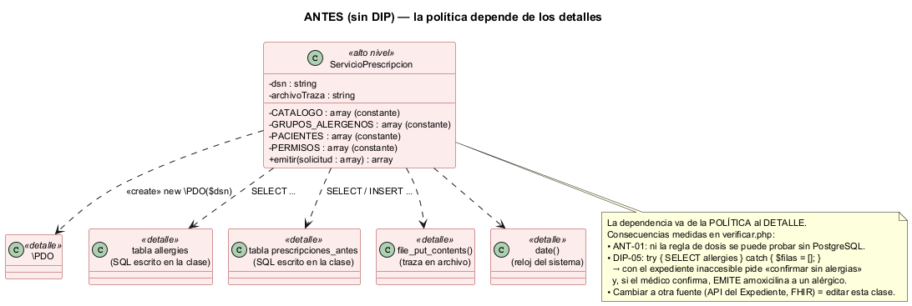
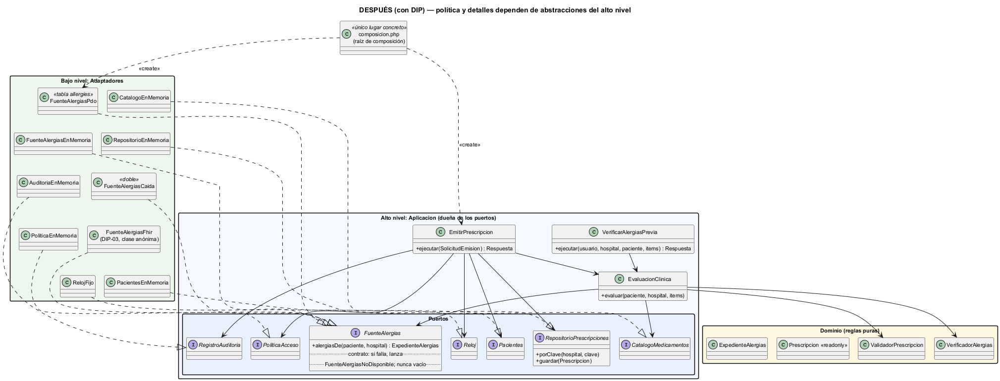

# Semana 2 — Requerimientos, criterios de aceptación y aplicación de DIP

| | |
|---|---|
| **Curso** | Análisis de Sistemas II — Proyecto Final 2026 |
| **Proyecto** | Sistema Hospitalario Integrado (HIS) |
| **Módulo** | Prescripciones electrónicas con validación de alergias |
| **Tema de la semana** | Proceso y modelo de diseño; principios SOLID |
| **Principio aplicado** | DIP — Principio de inversión de dependencias |
| **Flujo** | «Creación de prescripción con verificación previa de alergias» |
| **Estudiante** | Boris Alexander Quiroa Orellana |

## Índice

1. [Introducción](#1-introducción)
2. [Requerimientos funcionales](#2-requerimientos-funcionales)
3. [Requerimientos no funcionales](#3-requerimientos-no-funcionales)
4. [Criterios de aceptación](#4-criterios-de-aceptación)
5. [El principio de inversión de dependencias (DIP)](#5-el-principio-de-inversión-de-dependencias-dip)
6. [Diseño antes de aplicar DIP](#6-diseño-antes-de-aplicar-dip)
7. [Diseño después de aplicar DIP](#7-diseño-después-de-aplicar-dip)
8. [Responsabilidades y dependencias](#8-responsabilidades-y-dependencias)
9. [Evidencia verificable](#9-evidencia-verificable)
10. [Trazabilidad con la semana 1](#10-trazabilidad-con-la-semana-1)
11. [Conclusión](#11-conclusión)
12. [Bibliografía](#12-bibliografía)

## 1. Introducción

La semana 1 modeló el proceso con 12 reglas (R-01..R-12). Esta semana:
- las convierte en **requerimientos verificables** (RF, RNF y criterios de aceptación);
- aplica **DIP** al diseño del flujo, con código ejecutable antes y después ([ejemplo-dip](ejemplo-dip/README.md)).

**¿Por qué DIP en este flujo?** La política de negocio («no emitir si choca con una alergia; si no se puede verificar, no emitir») es lo más estable y lo más valioso del módulo. Los detalles cambian:
- hoy las alergias están en la tabla `allergies` de la base de cada hospital; mañana pueden llegar por la API del Expediente o como recursos FHIR;
- el catálogo, los permisos (RBAC) y la traza (Auditoría) son **otros módulos**.

Si la política depende de esos detalles, cada cambio de un detalle obliga a tocar la política. Peor: el manejo de las fallas del detalle termina **dentro** de la política. El «antes» de esta semana lo muestra con un caso medido: un `try/catch` que convierte «no pude leer el expediente» en «el paciente no tiene alergias».

## 2. Requerimientos funcionales

| ID | Requerimiento | Regla (S1) |
|---|---|---|
| RF-01 | El sistema debe emitir una prescripción con paciente e ítems (medicamento, dosis, unidad, frecuencia en horas, vía y duración), y responder 201 con su id y el resultado de la verificación. | R-01 |
| RF-02 | El sistema debe rechazar con 422 y la lista de campos un ítem con medicamento inexistente o inactivo, dosis ≤ 0, unidad distinta de la del catálogo, frecuencia fuera de {4, 6, 8, 12, 24} h, vía no permitida o duración fuera de 1..90 días. | R-01 |
| RF-03 | El sistema debe bloquear (422 `DOSIS_EXCEDE_MAXIMO`) el ítem cuya dosis diaria (dosis × 24 / frecuencia) supere la máxima del catálogo; la máxima exacta se acepta. | R-02 |
| RF-04 | La emisión debe consultar las alergias en el servidor en la misma operación; no acepta del cliente el resultado de la verificación previa. | R-03 |
| RF-05 | El sistema debe bloquear (422 `BLOQUEO_ALERGIA`) un medicamento cuyo principio activo coincide con una alergia **activa** (por código, o por nombre normalizado si la alergia no tiene código), aunque haya justificación. | R-04 |
| RF-06 | Ante reactividad cruzada (mismo grupo farmacológico), el sistema debe exigir una justificación de al menos 20 caracteres y el permiso `prescripcion.override` (si no, 409 `JUSTIFICACION_REQUERIDA`); si la severidad es `life_threatening` o `unknown`, debe bloquear (422 `BLOQUEO_ALERGIA_CRUZADA`). | R-05 |
| RF-07 | Si el paciente no tiene alergias registradas, el sistema debe exigir la confirmación «sin alergias conocidas» (422 `CONFIRMACION_REQUERIDA`) y guardarla con la prescripción. | R-06 |
| RF-08 | Si la fuente de alergias no responde, el sistema debe responder 503 `VERIFICACION_NO_DISPONIBLE` sin emitir, aun con la confirmación «sin alergias». | R-07 |
| RF-09 | Un paciente de otro hospital debe responder igual que uno inexistente (404). | R-08 |
| RF-10 | Emitir exige `prescripcion.emitir` en el hospital del token (403). | R-09 |
| RF-11 | Una prescripción emitida no se modifica ni se borra. | R-10 |
| RF-12 | La emisión con la misma `Idempotency-Key` y el mismo contenido devuelve la misma prescripción (200); con otro contenido, 409. | R-11 |
| RF-13 | El sistema debe guardar la verificación con la prescripción y registrar en Auditoría `PRESCRIPCION_EMITIDA`, `PRESCRIPCION_BLOQUEADA` y `VERIFICACION_NO_DISPONIBLE`, sin datos clínicos. | R-12 |
| RF-14 | La verificación previa debe informar `SIN_HALLAZGOS`, `ADVERTENCIA`, `BLOQUEO`, `CONFIRMACION_REQUERIDA` o `VERIFICACION_NO_DISPONIBLE` con cada hallazgo, sin guardar ni trazar nada. | R-03 |

## 3. Requerimientos no funcionales

| ID | Atributo | Requerimiento medible |
|---|---|---|
| RNF-01 | **Mantenibilidad (DIP)** | `Aplicacion` y `Dominio` no mencionan PDO, SQL, archivos, HTTP, variables de entorno ni el reloj del sistema; solo dependen de interfaces de `Aplicacion\Puertos` (análisis automático DIP-01, DIP-02) |
| RNF-02 | **Sustituibilidad** | Cambiar la fuente de alergias (memoria, PDO, FHIR) no modifica ninguna clase de `Aplicacion` ni de `Dominio`: solo `composicion.php` (DIP-03, DIP-04) |
| RNF-03 | **Seguridad del paciente (fail-closed)** | Ninguna falla técnica de la fuente se traduce en «sin alergias»: el contrato del puerto lo prohíbe y el adaptador PDO lo cumple (DIP-05) |
| RNF-04 | **Testabilidad** | Todos los criterios de aceptación se ejecutan sin base de datos (21 de 24 pruebas); el diseño «antes» no permite probar ni la regla de dosis sin PostgreSQL (ANT-01) |
| RNF-05 | Confiabilidad | Si la base no confirma, 503 sin traza de emisión |
| RNF-06 | Seguridad de consultas | Los valores viajan como parámetros de sentencias preparadas, nunca concatenados |
| RNF-07 | Minimización | La traza lleva `prescripcion:<id>` o `paciente:<id>` y el resultado; ni medicamentos ni alergias |
| RNF-08 | Rendimiento | La consulta de alergias tiene un límite de 2 s; se mide en la semana 5 |

## 4. Criterios de aceptación

Formato «Dado / Cuando / Entonces», resumido. Cada criterio es una prueba de [`verificar.php`](ejemplo-dip/verificar.php).

| CA | Dado | Cuando | Entonces | RF/RNF |
|---|---|---|---|---|
| CA-01 | un médico con permiso y un paciente sin conflicto | emite paracetamol | 201 `SIN_HALLAZGOS`; prescripción y verificación guardadas; traza `PRESCRIPCION_EMITIDA` con `prescripcion:1` | RF-01, RF-13 |
| CA-02 | un médico de otro hospital | emite | 403 y nada guardado | RF-10 |
| CA-03 | un paciente de otro hospital y uno inexistente | se emite | 404 idéntico en ambos | RF-09 |
| CA-04 | 4 ítems con 8 defectos y una prescripción sin ítems | se emite | 422 con los 8 campos; `items` | RF-02 |
| CA-05 | paracetamol, máximo 4000 mg/día | 1000 mg cada 6 h / cada 4 h | 201 / 422 `DOSIS_EXCEDE_MAXIMO` | RF-03 |
| CA-06 | alergia activa a amoxicilina (por código) | emite amoxicilina con justificación y override | 422 `BLOQUEO_ALERGIA`, nada guardado, traza `PRESCRIPCION_BLOQUEADA` | RF-05, RF-13 |
| CA-07 | alergia registrada solo con el nombre «  AMOXICILINA » | emite amoxicilina | 422 `BLOQUEO_ALERGIA` | RF-05 |
| CA-08 | alergia moderada a penicilina | emite cefalexina sin justificación / con 19 caracteres / sin override / con 20 y override | 409 / 409 / 409 / 201 `ADVERTENCIA` con la justificación guardada | RF-06 |
| CA-09 | alergia `life_threatening` a AAS; alergia `unknown` a penicilina | emite ibuprofeno / cefalexina con justificación | 422 `BLOQUEO_ALERGIA_CRUZADA` en ambos | RF-06 |
| CA-10 | un paciente sin alergias registradas | emite sin / con confirmación | 422 `CONFIRMACION_REQUERIDA` / 201 con la confirmación guardada | RF-07 |
| CA-11 | la fuente de alergias caída | emite, aun confirmando «sin alergias» | 503 `VERIFICACION_NO_DISPONIBLE`, nada guardado, traza | RF-08, RNF-03 |
| CA-12 | una alergia a amoxicilina **resuelta** | emite amoxicilina | 201 sin hallazgos ni confirmación | RF-05 |
| CA-13 | una emisión con clave `k-1` | se repite igual / con otro contenido | 200 con el mismo id / 409; una sola guardada | RF-12 |
| CA-14 | la base sin confirmar | se emite | 503 `ERROR_PERSISTENCIA` y sin traza de emisión | RNF-05 |
| CA-15 | advertencia, paciente sin alergias, fuente caída | verificación previa | `ADVERTENCIA`, `CONFIRMACION_REQUERIDA`, `VERIFICACION_NO_DISPONIBLE`; nada guardado ni trazado | RF-14 |
| CA-16 | una verificación previa sin hallazgos | se registra una alergia y luego se emite | 422 `BLOQUEO_ALERGIA` | RF-04 |
| CA-17 | el puerto del repositorio y la prescripción | se inspeccionan | solo `porClave` y `guardar`; clase `readonly` | RF-11 |

## 5. El principio de inversión de dependencias (DIP)

Robert C. Martin lo formula en dos partes:

> «a. Los módulos de alto nivel no deben depender de los módulos de bajo nivel. Ambos deben depender de abstracciones.»
> «b. Las abstracciones no deben depender de los detalles. Los detalles deben depender de las abstracciones.»

La palabra clave es **inversión**: la abstracción (la interfaz) la define y la **posee** el módulo de alto nivel, según lo que **él** necesita. El detalle se adapta a ella. No es «poner una interfaz encima de PDO»: es que el caso de uso diga «necesito las alergias activas del paciente, y si no se pueden obtener, quiero enterarme», y que PDO (o FHIR, o una API) cumpla eso.

**Aplicado a este módulo:**

| | Qué significa aquí |
|---|---|
| **Alto nivel** | `EmitirPrescripcion`, `VerificarAlergiasPrevia`, `EvaluacionClinica` (Aplicación) y las reglas puras `VerificadorAlergias`, `ValidadorPrescripcion` (Dominio) |
| **Abstracciones del alto nivel** | 7 puertos en `Aplicacion\Puertos`: `FuenteAlergias`, `CatalogoMedicamentos`, `RepositorioPrescripciones`, `RegistroAuditoria`, `PoliticaAcceso`, `Pacientes`, `Reloj` |
| **Detalles** | `FuenteAlergiasPdo` (tabla `allergies`), adaptadores en memoria, el doble `FuenteAlergiasCaida` y un adaptador FHIR escrito en la prueba |
| **Quién conoce los detalles** | Solo `composicion.php` |

**El contrato del puerto es parte de la inversión.** `FuenteAlergias` no solo declara un método; declara la semántica de su falla: *si no puede responder, lanza `FuenteAlergiasNoDisponible`; nunca devuelve un expediente vacío*. Ese es el requisito de seguridad R-07 escrito en la abstracción, donde **cualquier** adaptador futuro lo hereda.

## 6. Diseño antes de aplicar DIP



Fuente: [semana-02-clases-antes.puml](diagramas/semana-02-clases-antes.puml) · Código: [antes/ServicioPrescripcion.php](ejemplo-dip/antes/ServicioPrescripcion.php) (149 líneas)

Una clase hace todo, y depende directamente de los detalles:

| Dependencia directa | Dónde | Consecuencia |
|---|---|---|
| `new \PDO($dsn)` y el SQL de `allergies` y `prescripciones_antes` | `emitir()` | Para probar **cualquier** regla hace falta PostgreSQL: ANT-01 muestra que ni la regla de dosis se evalúa sin base |
| Catálogo, grupos, pacientes y permisos como constantes | La clase | Cambiar el catálogo o los permisos es editar la política |
| `file_put_contents()` y `date()` | `emitir()` | La traza y la hora no se pueden sustituir ni verificar |
| `try { SELECT allergies } catch (\PDOException) { $filas = []; }` | La verificación | **Defecto de seguridad** (ver abajo) |

**El defecto que DIP evita.** Como la política conoce la excepción del detalle (`PDOException`), alguien la «manejó» ahí mismo para que la prescripción «no se caiga». El efecto, medido en DIP-05 con el expediente inaccesible:

1. Al paciente P-001, alérgico a la amoxicilina, el sistema le responde `CONFIRMACION_REQUERIDA`: le dice al médico que **no tiene alergias registradas**.
2. El médico confirma «sin alergias conocidas».
3. El sistema **emite amoxicilina** (201).

No es un error de programación aislado: es la consecuencia natural de que la política dependa del detalle. El `catch` vive donde vive la dependencia.

## 7. Diseño después de aplicar DIP



Fuente: [semana-02-clases-despues.puml](diagramas/semana-02-clases-despues.puml) · Código: [despues/](ejemplo-dip/despues/)

| Capa | Contenido | Depende de |
|---|---|---|
| Dominio | `VerificadorAlergias` (R-04, R-05), `ValidadorPrescripcion` (R-01, R-02), `Alergia`, `ExpedienteAlergias`, `Prescripcion` (readonly), `ResultadoVerificacion` | Nada |
| Aplicación | `EmitirPrescripcion`, `VerificarAlergiasPrevia`, `EvaluacionClinica` y los **7 puertos** | Dominio y sus propios puertos |
| Adaptadores | `FuenteAlergiasPdo` y 8 adaptadores en memoria | Los puertos (los implementan) |
| Composición | `composicion.php` | Todo lo concreto: es el único lugar acoplado |

**Cómo queda R-07 después:**
- `FuenteAlergiasPdo` captura `PDOException` **dentro del detalle** y la traduce a `FuenteAlergiasNoDisponible`, como exige el contrato.
- `EmitirPrescripcion` solo conoce `FuenteAlergiasNoDisponible` (una excepción **del puerto**, no de PDO) y responde 503.
- Un adaptador nuevo que no cumpla el contrato lo detecta la misma prueba (DIP-05 con el adaptador; M1 lo demuestra).

**Lo que DIP no cambia.** Las reglas (R-01..R-12) y las respuestas son las mismas: en el camino normal, antes y después responden igual en 15 escenarios (PAR-01). DIP cambió **de quién depende quién**, no qué hace el sistema; salvo en la falla, donde el antes era incorrecto.

## 8. Responsabilidades y dependencias

### Responsabilidades

| Clase / interfaz | Responsabilidad única | Razón para cambiar |
|---|---|---|
| `EmitirPrescripcion` | Orden del proceso: permiso → idempotencia → tenant → evaluación → confirmación → bloqueo/advertencia → guardar → traza | El **proceso** de emisión |
| `VerificarAlergiasPrevia` | Informar sin efectos | Lo que se muestra antes de firmar |
| `EvaluacionClinica` | Resolver el catálogo, validar, consultar la fuente y verificar (común a previa y emisión) | Los pasos clínicos compartidos |
| `ValidadorPrescripcion` | R-01 y R-02, puras | Las reglas de completitud y dosis |
| `VerificadorAlergias` | R-04 y R-05, puras | Las reglas de coincidencia |
| `Alergia` | Valores del esquema real; `impideJustificar()` | La clasificación de severidad |
| `FuenteAlergias` (puerto) | Qué necesita la política del expediente, **incluida la semántica de la falla** | Lo que la política necesita |
| `FuenteAlergiasPdo` | SQL sobre `allergies` y traducción de fallas | El esquema de la tabla |
| `composicion.php` | Elegir y conectar los adaptadores | Cada cambio de detalle: **es el único lugar que cambia** |

### Dependencias

| Quién | Depende de | Tipo | Justificación |
|---|---|---|---|
| `EmitirPrescripcion` | `PoliticaAcceso`, `Pacientes`, `RepositorioPrescripciones`, `RegistroAuditoria`, `Reloj` | Abstracciones propias | RBAC, Pacientes y Auditoría son otros módulos; la base y el reloj son detalles |
| `EmitirPrescripcion`, `VerificarAlergiasPrevia` | `EvaluacionClinica` | Concreta, misma capa | Es política compartida, no un detalle: no hay nada que invertir |
| `EvaluacionClinica` | `FuenteAlergias`, `CatalogoMedicamentos` | Abstracciones propias | El expediente y el catálogo son otros módulos |
| `EvaluacionClinica` | `VerificadorAlergias`, `ValidadorPrescripcion` | Concretas del dominio | Reglas puras y estables: invertirlas solo agregaría indirección |
| Adaptadores | Puertos de `Aplicacion\Puertos` | Abstracción | **La flecha apunta hacia la política** |
| `composicion.php` | Todas las clases concretas | Concreta | Único punto acoplado a implementaciones, a propósito |

**Dónde NO se aplicó DIP, y por qué.** Las reglas del dominio no tienen interfaz: no hay varias implementaciones posibles de «la coincidencia directa bloquea». DIP se aplica a las dependencias **volátiles** (E/S, otros módulos, el tiempo), no a todo.

## 9. Evidencia verificable

**Ejecución:** con PHP 8.2 o superior, desde la raíz del repositorio.

```bash
php docs/modulos/prescripciones-alergias/semana-02/ejemplo-dip/verificar.php     # 21 pasan, 3 omitidas (necesitan base)
PRESCRIPCIONES_DB_DSN="pgsql:host=127.0.0.1;port=55432;dbname=micro_his_prescripciones" PRESCRIPCIONES_DB_USUARIO=postgres \
  php docs/modulos/prescripciones-alergias/semana-02/ejemplo-dip/verificar.php   # 24/24
PRESCRIPCIONES_DB_DSN=… php docs/modulos/prescripciones-alergias/semana-02/ejemplo-dip/mutaciones.php   # 13/13
```

**Resultado** ([con PostgreSQL 18](evidencia/salida-verificar.txt) · [sin base](evidencia/salida-verificar-sin-base.txt)): **24 pruebas: 24 pasan, 0 fallan.** Sin base: 21 pasan y 3 se omiten.

| Grupo | Demuestra |
|---|---|
| CA-01..CA-17 | El diseño cumple los RF y RNF, **sin base de datos** |
| DIP-01 | `Aplicacion` y `Dominio` no mencionan PDO, SQL, archivos, entorno ni el reloj (análisis del código sin comentarios) |
| DIP-02 | `EmitirPrescripcion` solo recibe puertos; los 9 adaptadores implementan un puerto del alto nivel |
| DIP-03 | Un adaptador FHIR nuevo, escrito en la prueba, da el mismo resultado sin tocar el caso de uso |
| DIP-04 | El adaptador PDO, sobre una tabla con las columnas y `CHECK` de la migración real, devuelve el mismo expediente que el de memoria para los 7 pacientes y las mismas decisiones en 15 escenarios |
| DIP-05 | Con el expediente inaccesible: después → 503 dos veces; antes → `CONFIRMACION_REQUERIDA` y luego **201 a un alérgico** |
| ANT-01 | El antes no puede evaluar ni la regla de dosis sin una base disponible |
| PAR-01 | En el camino normal, antes y después responden igual en 15 escenarios |

**¿Las pruebas detectan defectos?** ([salida](evidencia/salida-mutaciones.txt)): **13 de 13 mutaciones detectadas.**

| Mutación | La detecta |
|---|---|
| M1 el adaptador PDO devuelve vacío si falla (fail-open) | DIP-05 |
| M2 el caso de uso trata la fuente caída como «sin alergias» | CA-11, CA-15, DIP-05 |
| M3 la coincidencia directa deja de bloquear | CA-06, CA-07, CA-16, PAR-01 |
| M4 toda reactividad cruzada se puede justificar | CA-09, PAR-01 |
| M5 la severidad `unknown` se trata como leve | CA-09, PAR-01 |
| M6 la dosis máxima se duplica | CA-05, PAR-01 |
| M7 no se exige confirmar «sin alergias conocidas» | CA-10, PAR-01 |
| M8 la advertencia no exige `prescripcion.override` | CA-08, PAR-01 |
| M9 sin idempotencia | CA-13 |
| M10 las alergias resueltas también cuentan | CA-12, CA-16, PAR-01 |
| M11 no se verifica el hospital del paciente | CA-03, PAR-01 |
| M12 el bloqueo no deja traza | CA-06 |
| M13 **regresión de DIP:** el caso de uso toma `new \DateTimeImmutable('now')` | DIP-01 |

**Hallazgo del proceso.** La primera ejecución de DIP-01 **falló**: encontró «PDO» en `EmitirPrescripcion`. Era el docblock que dice «ni PDO, ni SQL». Se corrigió el **instrumento**, no el código: ahora analiza los tokens sin comentarios (`token_get_all`). M13 prueba que el instrumento corregido sigue detectando una dependencia real.

**Limitaciones:**
- M1 solo se detecta con PostgreSQL: es un defecto del adaptador, y el adaptador solo se prueba contra una base real.
- La tabla de prueba omite las FK de `allergies` a `local_patients` y `local_user_refs`, y usa `text` en lugar de `uuid` para el paciente, para que los ids sean legibles.
- `FuenteAlergiasPdo` no aplica todavía el límite de 2 s (RNF-08): llega en la semana 5 con la resiliencia.

## 10. Trazabilidad con la semana 1

| Semana 1 | Semana 2: requerimiento | Semana 2: clase | Prueba |
|---|---|---|---|
| CU-03, R-01; A-03, D-07; E-05 | RF-01, RF-02 | `ValidadorPrescripcion` | CA-01, CA-04 |
| R-02; D-08; E-06 | RF-03 | `ValidadorPrescripcion` | CA-05 |
| R-03; A-04; S-25 | RF-04 | `EvaluacionClinica` (siempre consulta) | CA-16 |
| R-04; D-12; E-09 | RF-05 | `VerificadorAlergias` | CA-06, CA-07, CA-12 |
| R-05; D-13..D-15; E-10, E-11; CU-05 | RF-06 | `VerificadorAlergias`, `Alergia::impideJustificar()`, `EmitirPrescripcion` | CA-08, CA-09 |
| R-06; D-10, D-11; E-08; CU-06 | RF-07 | `ExpedienteAlergias::evaluado`, `EmitirPrescripcion` | CA-10 |
| R-07; D-09; E-07; S-26..S-29 | RF-08, RNF-03 | `FuenteAlergias` (contrato), `FuenteAlergiasPdo` | CA-11, DIP-05 |
| R-08; D-06; E-04 | RF-09 | `Pacientes` (puerto) | CA-03 |
| R-09; D-02; E-02; CU-04 | RF-10 | `PoliticaAcceso` (puerto) | CA-02, CA-08 |
| R-10 | RF-11 | `RepositorioPrescripciones` sin actualizar ni borrar; `Prescripcion` readonly | CA-17 |
| R-11; D-04, D-05; E-03; F-01b | RF-12 | `SolicitudEmision::huella()`, `EmitirPrescripcion` | CA-13 |
| R-12; A-07, A-08; CU-08 | RF-13 | `RegistroAuditoria` (puerto) | CA-01, CA-06, CA-11 |
| CU-02 (previa); S-01..S-14 | RF-14 | `VerificarAlergiasPrevia` | CA-15 |
| D-16; E-12 | RNF-05 | `RepositorioPrescripciones::guardar()` | CA-14 |

## 11. Conclusión

DIP suele explicarse como «programar contra interfaces» para poder cambiar la base de datos. En este flujo, su valor principal fue otro: **poner la semántica de la falla en la abstracción**.

| Antes | Después |
|---|---|
| La política conocía `PDOException` y decidía, ahí mismo, que una falla del expediente equivalía a «sin alergias» | La política solo conoce `FuenteAlergiasNoDisponible`, definida en su propio puerto, y la regla R-07 queda escrita en el contrato |
| Probar la regla de dosis exigía PostgreSQL | 21 de 24 pruebas corren sin base |
| Una fuente nueva = editar la política | Una fuente nueva = una clase y una línea en `composicion.php` |

La evidencia lo respalda de cuatro formas:
1. El análisis del código confirma que la política no nombra ningún detalle (DIP-01, DIP-02).
2. Tres fuentes distintas (memoria, PDO, FHIR) dan las mismas decisiones (DIP-03, DIP-04).
3. La paridad en el camino normal muestra que no se cambió el comportamiento (PAR-01), y DIP-05 muestra el único lugar donde sí cambió: la falla.
4. Trece defectos inyectados fueron detectados, incluida una regresión de DIP (M13).

Los puertos y adaptadores de esta semana son la base del Micro-HIS de la semana 3.

## 12. Bibliografía

- Martin, R. C. (2003). *Agile Software Development: Principles, Patterns, and Practices*. Prentice Hall. Cap. 11: «The Dependency-Inversion Principle».
- Martin, R. C. (2017). *Clean Architecture*. Prentice Hall.
- MVP Cluster. *Principios básicos del diseño de software* (fuente obligatoria del curso).
- Sommerville, I. (2016). *Software Engineering* (10.ª ed.). Pearson.
- HL7 International. (2023). *FHIR R5 — AllergyIntolerance*. https://hl7.org/fhir/R5/allergyintolerance.html
- Proyecto HIS: `database/migrations/hospital/2026_08_11_000401_create_allergy_and_vital_sign_tables.php`.
