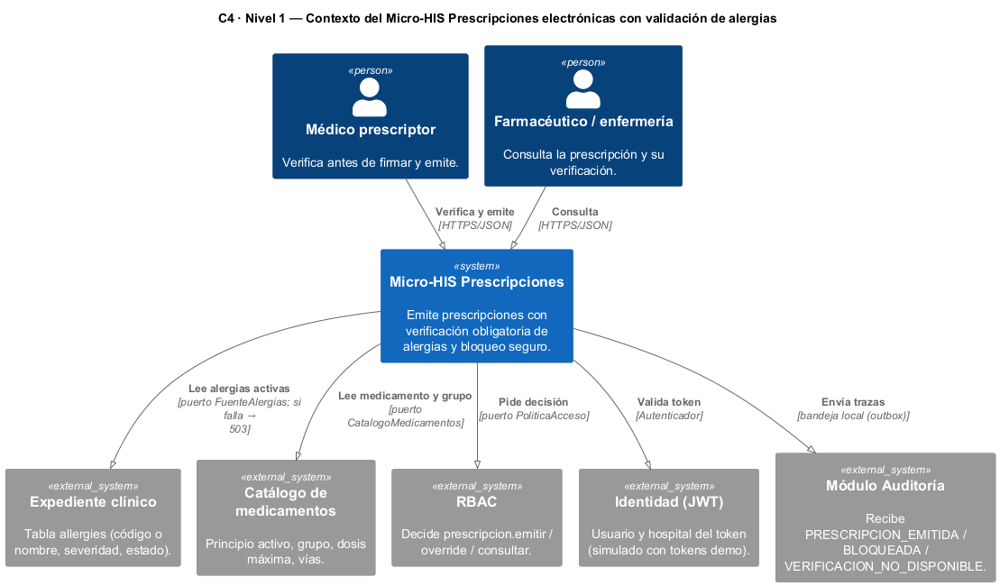
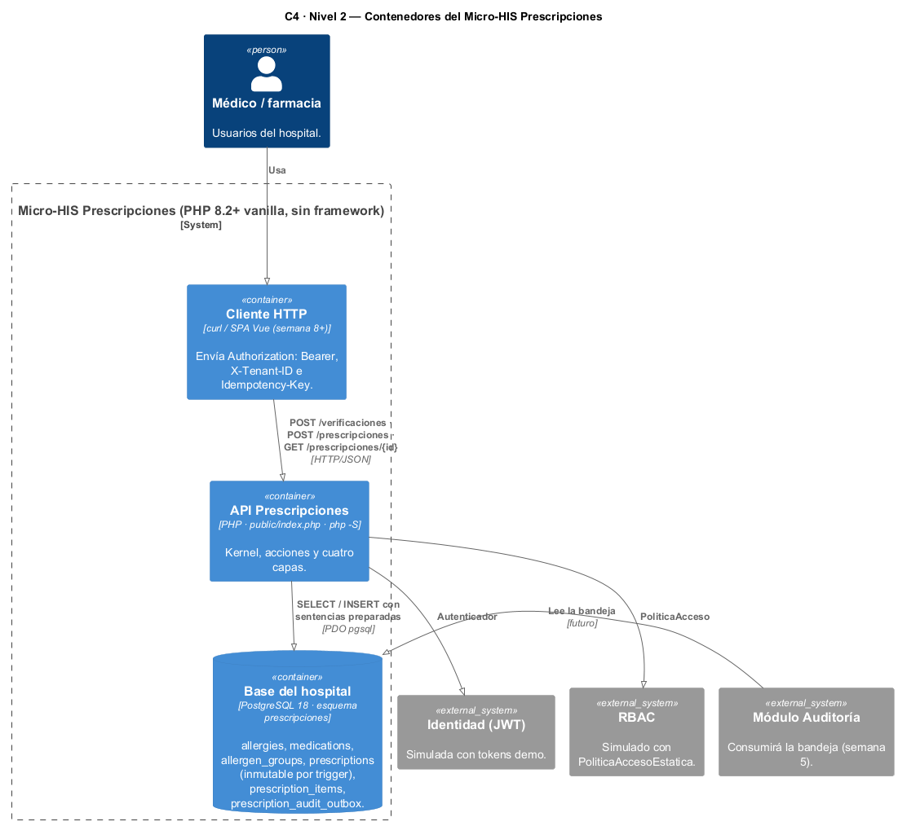
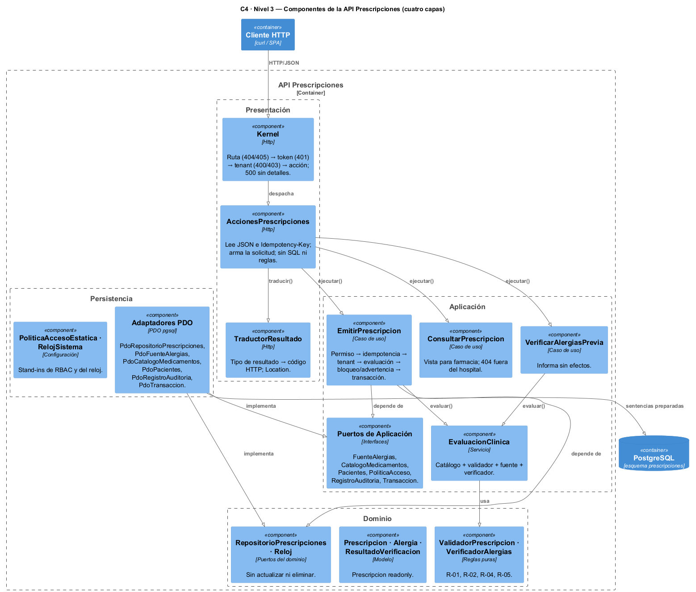
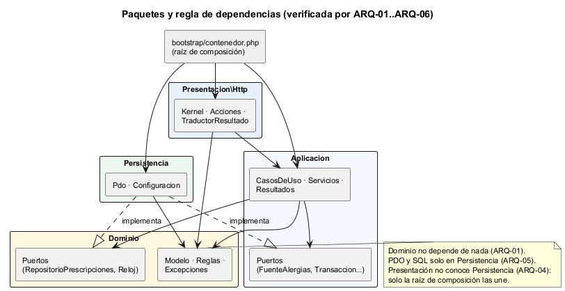
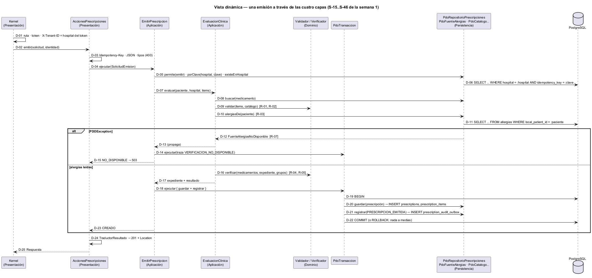

# Semana 3 — Arquitectura del Micro-HIS Prescripciones electrónicas con validación de alergias

| | |
|---|---|
| **Curso** | Análisis de Sistemas II — Proyecto Final 2026 |
| **Módulo** | Prescripciones electrónicas con validación de alergias |
| **Tema de la semana** | Diseño arquitectónico, vistas y patrones |
| **Flujo** | «Creación de prescripción con verificación previa de alergias» |
| **Código** | [micro-his-prescripciones](../micro-his-prescripciones/README.md) |
| **Estudiante** | Boris Alexander Quiroa Orellana |

## Índice

1. [Introducción](#1-introducción)
2. [Decisiones arquitectónicas](#2-decisiones-arquitectónicas)
3. [Vista de contexto (C4 nivel 1)](#3-vista-de-contexto-c4-nivel-1)
4. [Vista de contenedores (C4 nivel 2)](#4-vista-de-contenedores-c4-nivel-2)
5. [Vista de componentes (C4 nivel 3)](#5-vista-de-componentes-c4-nivel-3)
6. [Paquetes y regla de dependencias](#6-paquetes-y-regla-de-dependencias)
7. [Vista dinámica: una emisión a través de las capas](#7-vista-dinámica-una-emisión-a-través-de-las-capas)
8. [Responsabilidades por capa](#8-responsabilidades-por-capa)
9. [Persistencia: PDO, sentencias preparadas y el esquema](#9-persistencia-pdo-sentencias-preparadas-y-el-esquema)
10. [Patrones aplicados](#10-patrones-aplicados)
11. [Pruebas y evidencia](#11-pruebas-y-evidencia)
12. [Hallazgos: lo que solo apareció con el servidor y la base reales](#12-hallazgos-lo-que-solo-apareció-con-el-servidor-y-la-base-reales)
13. [Trazabilidad con las semanas 1 y 2](#13-trazabilidad-con-las-semanas-1-y-2)
14. [Limitaciones y trabajo siguiente](#14-limitaciones-y-trabajo-siguiente)
15. [Conclusión](#15-conclusión)

## 1. Introducción

Esta semana se inicia el **Micro-HIS Prescripciones** en PHP vanilla. Ejecuta de punta a punta el flujo modelado en la semana 1: verificación previa, emisión con verificación obligatoria en el servidor, bloqueo seguro y consulta por farmacia.

**Lo que pide la tarea, y dónde está:**

| Pedido | Dónde |
|---|---|
| PHP 8.2+ vanilla, sin framework | Autoload PSR-4 propio (22 líneas); ARQ-06 comprueba que no hay Composer ni dependencias de terceros |
| Separar Presentation, Application, Domain y Persistence | `src/Presentacion`, `src/Aplicacion`, `src/Dominio`, `src/Persistencia`; la regla de dependencias se verifica con ARQ-01..ARQ-05 |
| PDO con sentencias preparadas | 6 adaptadores en `src/Persistencia/Pdo`; PER-04 analiza que ninguno concatena valores en el SQL |
| Probar camino feliz, regla de dominio y error de persistencia | APP-01..02 e INT-01 (camino feliz); DOM-*, APP-05..12 (reglas); APP-13..16, PER-01..05 e INT-05..06 (errores de persistencia), **con dobles y con PostgreSQL 18** |
| Vista arquitectónica C4/UML y dependencias | §3–§7: contexto, contenedores, componentes, paquetes y vista dinámica |

**Punto de partida:** el diseño DIP de la semana 2. Sus puertos y su dominio pasaron al Micro-HIS casi sin cambios; lo nuevo son los adaptadores PDO, la transacción, la bandeja de trazas, la capa HTTP y el esquema.

## 2. Decisiones arquitectónicas

| ID | Decisión | Alternativa descartada | Por qué |
|---|---|---|---|
| AD-01 | **Cuatro capas** con la dependencia hacia el Dominio (Presentación → Aplicación → Dominio ← Persistencia) | MVC «plano» con modelos activos | Las reglas clínicas (R-04, R-05, R-07) deben probarse sin HTTP ni base |
| AD-02 | **Los puertos los define quien los usa:** `RepositorioPrescripciones` y `Reloj` en el Dominio; `FuenteAlergias`, `Transaccion`, `RegistroAuditoria`… en la Aplicación | Interfaces junto a los adaptadores | Es DIP (semana 2): la política no depende del paquete del detalle |
| AD-03 | **Bandeja local (outbox)** para las trazas, en la misma transacción que la prescripción | Llamar al módulo Auditoría por HTTP dentro de la emisión | Una llamada remota no participa de la transacción: podría quedar una prescripción sin traza, o una traza sin prescripción |
| AD-04 | **Inmutabilidad en dos niveles:** sin métodos de cambio (`Prescripcion` readonly, repositorio sin `actualizar`) **y** un trigger que rechaza `UPDATE`/`DELETE` | Solo en la aplicación | La especificación del esquema del HIS exige que lo firmado no cambie, aun con SQL directo |
| AD-05 | **Idempotencia** por `(hospital, Idempotency-Key)` con una restricción `UNIQUE` | Solo la búsqueda previa | Dos peticiones simultáneas pasan ambas la búsqueda; la restricción decide la carrera (`ClaveEnUso`) |
| AD-06 | **El resultado del caso de uso no conoce HTTP:** `Resultado` con un tipo, y `TraductorResultado` en la Presentación | Devolver códigos HTTP desde la Aplicación | La verificación previa responde 200 con `VERIFICACION_NO_DISPONIBLE` y la emisión 503 con el mismo código: es la Presentación la que decide |
| AD-07 | **El hospital sale del token**, nunca del cuerpo; `X-Tenant-ID` debe coincidir | Tomar el hospital del cuerpo | R-08: un cliente no elige el tenant |
| AD-08 | **Errores de la base sin detalles hacia afuera** | Propagar el mensaje del driver | El mensaje de PDO puede contener el host o la contraseña (PER-02 lo comprueba) |

## 3. Vista de contexto (C4 nivel 1)



Fuente: [semana-03-c4-contexto.puml](diagramas/semana-03-c4-contexto.puml)

Los cinco sistemas externos (Expediente, Catálogo, RBAC, Identidad y Auditoría) son otros módulos del HIS. Cada uno entra por **un puerto**, y en este Micro-HIS se satisface así:

| Sistema externo | Cómo se satisface aquí |
|---|---|
| Expediente | La tabla `allergies` real, en la misma base |
| Catálogo | Tablas `medications` y `allergen_groups` |
| RBAC | `PoliticaAccesoEstatica` |
| Identidad | Tokens de demostración |
| Auditoría | La bandeja `prescription_audit_outbox` |

## 4. Vista de contenedores (C4 nivel 2)



Fuente: [semana-03-c4-contenedores.puml](diagramas/semana-03-c4-contenedores.puml)

| Contenedor | Tecnología | Responsabilidad |
|---|---|---|
| Cliente HTTP | curl (la SPA llega en la semana 8) | Envía `Authorization`, `X-Tenant-ID` e `Idempotency-Key` |
| API Prescripciones | PHP 8.4 (compatible con 8.2), `php -S`, `public/index.php` | Las cuatro capas |
| Base del hospital | PostgreSQL 18, esquema `prescripciones` | Datos, restricciones, trigger de inmutabilidad y bandeja |

## 5. Vista de componentes (C4 nivel 3)



Fuente: [semana-03-c4-componentes.puml](diagramas/semana-03-c4-componentes.puml)

## 6. Paquetes y regla de dependencias



Fuente: [semana-03-paquetes-dependencias.puml](diagramas/semana-03-paquetes-dependencias.puml)

| Regla | Prueba |
|---|---|
| El Dominio no depende de Aplicación, Persistencia ni Presentación | ARQ-01 |
| La Aplicación no depende de Persistencia ni Presentación | ARQ-02 |
| La Persistencia no depende de la Presentación | ARQ-03 |
| La Presentación no depende de la Persistencia (solo la raíz de composición las une) | ARQ-04 |
| PDO y SQL solo en Persistencia | ARQ-05 |
| Sin framework ni Composer | ARQ-06 |

Las pruebas analizan el código **sin comentarios** (`token_get_all`), por la lección del falso positivo de la semana 2.

## 7. Vista dinámica: una emisión a través de las capas



Fuente: [semana-03-dinamica-emision.puml](diagramas/semana-03-dinamica-emision.puml)

Es la secuencia S-15..S-46 de la semana 1, ahora con las clases reales. Hay dos transacciones distintas:
- **la emisión** (D-18..D-22): prescripción, ítems y traza `PRESCRIPCION_EMITIDA`, todo o nada;
- **la traza de un bloqueo o de la fuente caída** (D-14): en su propia transacción, porque no hay prescripción a la que atarla.

## 8. Responsabilidades por capa

| Capa | Clases | Responsabilidad | No hace |
|---|---|---|---|
| Presentación (9 archivos, 336 líneas) | `Kernel`, `AccionesPrescripciones`, `TraductorResultado`, `Solicitud`, `Respuesta`, `AutenticadorTokenDemo` | Rutas, autenticación, tenant, JSON, `Idempotency-Key`, códigos HTTP | SQL, reglas clínicas, decidir permisos |
| Aplicación (12, 399) | `EmitirPrescripcion`, `VerificarAlergiasPrevia`, `ConsultarPrescripcion`, `EvaluacionClinica`, 7 puertos, `Resultado` | Orden del proceso, transacción, permisos (vía puerto), traza | Conocer PDO o HTTP |
| Dominio (13, 450) | `ValidadorPrescripcion`, `VerificadorAlergias`, `Prescripcion`, `Alergia`, `ResultadoVerificacion`, `RepositorioPrescripciones` | Reglas R-01, R-02, R-04, R-05; modelo inmutable | E/S de ningún tipo |
| Persistencia (9, 371) | 6 adaptadores PDO, `PoliticaAccesoEstatica`, `RelojSistema` | SQL preparado, traducción de fallas (`PDOException` → `ErrorPersistencia` / `FuenteAlergiasNoDisponible` / `ClaveEnUso`) | Decidir reglas |

## 9. Persistencia: PDO, sentencias preparadas y el esquema

**Esquema** ([schema.sql](../micro-his-prescripciones/database/schema.sql)):

| Tabla | Origen | Lo importante |
|---|---|---|
| `allergies` | **Columnas y `CHECK` de la migración real** del HIS (`2026_08_11_000401`) | Código **o** nombre; severidad con `unknown`; índice único de alergia activa equivalente |
| `medications`, `allergen_groups` | Propuesta para la tarea 3.5 pendiente | Principio activo, grupo, dosis máxima, vías (`text[]`) |
| `prescriptions`, `prescription_items` | Propuesta para la tarea 3.5 | `UNIQUE (hospital, idempotency_key)`; `CHECK` de la justificación ≥ 20 en una advertencia; solo `SIN_HALLAZGOS` o `ADVERTENCIA` (un bloqueo no se puede guardar); trigger `prescripcion_inmutable` |
| `prescription_audit_outbox` | Bandeja hacia Auditoría | Acción, recurso y resultado; **sin datos clínicos** |

**Las restricciones de la base son una segunda línea de defensa**, no la primera. Las reglas se aplican en el Dominio y la base las respalda: INT-07 demuestra que, aun saltándose la aplicación, no se puede guardar una advertencia sin justificación, un `BLOQUEO`, una dosis 0 ni una frecuencia de 5 h.

**Sentencias preparadas:**
- todo valor viaja como parámetro con nombre (`:paciente`, `:hospital`…);
- `exec()` solo se usa con constantes (configurar la sesión);
- PER-04 lo verifica sobre el código.

**Traducción de fallas:**

| Adaptador | Lanza |
|---|---|
| `PdoFuenteAlergias` | `FuenteAlergiasNoDisponible`, el contrato de la semana 2 |
| `PdoRepositorioPrescripciones` | `ClaveEnUso` si viola la restricción de idempotencia; `ErrorPersistencia` en lo demás |
| El resto | `ErrorPersistencia` |

Ningún mensaje lleva el texto del driver.

## 10. Patrones aplicados

| Patrón | Dónde | Para qué |
|---|---|---|
| Arquitectura en capas / puertos y adaptadores | Toda la estructura | Probar la política sin E/S |
| Repository | `RepositorioPrescripciones` + `PdoRepositorioPrescripciones` | El dominio pide prescripciones, no filas (se formaliza en la semana 4) |
| Unit of Work (simple) | `Transaccion` + `PdoTransaccion` | Prescripción, ítems y traza: todo o nada |
| Transactional Outbox | `PdoRegistroAuditoria` | Traza atómica con el dato; el envío a Auditoría queda para la semana 5 |
| Idempotency Key | `EmitirPrescripcion` + `UNIQUE` | Un reintento no emite dos veces |
| Front Controller | `public/index.php` + `Kernel` | Un solo punto de entrada que autentica y exige el tenant |
| Composition Root | `bootstrap/contenedor.php` | Único lugar con clases concretas; las pruebas usan las **mismas** funciones con dobles |
| Fail-closed | `FuenteAlergias` | La ausencia de datos no es un dato |

## 11. Pruebas y evidencia

```bash
cd docs/modulos/prescripciones-alergias/micro-his-prescripciones
php tests/ejecutar.php                     # sin base: 46 pasan, 9 omitidas
PRESCRIPCIONES_DB_DSN=… php tests/ejecutar.php    # 55/55 con PostgreSQL 18
PRESCRIPCIONES_DB_DSN=… php tests/mutaciones.php  # 14/14
PRESCRIPCIONES_DB_DSN=… bash bin/demo-http.sh     # recorrido con php -S
```

| Grupo | Pruebas | Qué cubre |
|---|---|---|
| DOM | 8 | R-01, R-02 (límite inclusivo), R-04 (código y nombre), R-05 (severidades), alergias activas, huella, inmutabilidad |
| APP | 16 | **Camino feliz** (APP-01..04), **reglas de dominio** a través del caso de uso (APP-05..12, incluida la carrera de idempotencia) y **errores de persistencia** con dobles (APP-13..16: fuente caída, traza que falla dentro de la transacción, COMMIT que falla, base caída en cada paso) |
| PER | 6 | Traducción de fallas con un doble de PDO, sin filtrar datos de conexión; sentencias preparadas; transacción |
| HTTP | 10 | Códigos de cada regla, autenticación, tenant, entrada mal formada, rutas, 500 sin detalles, frase del 422 |
| ARQ | 6 | Regla de dependencias, PDO solo en Persistencia, sin framework |
| INT | 9 | Con **PostgreSQL 18**: camino feliz HTTP, trigger, bloqueo en la bandeja, `UNIQUE` → `ClaveEnUso`, todo o nada, tabla `allergies` caída → 503, restricciones, catálogo, **paridad dobles ↔ PDO en 11 escenarios** |

| Evidencia | Resultado |
|---|---|
| [1-pruebas-dobles.txt](evidencia/1-pruebas-dobles.txt) | 46 pasan, 9 omitidas (sin base) |
| [2-pruebas-postgres.txt](evidencia/2-pruebas-postgres.txt) | **55/55** con PostgreSQL 18 |
| [3-mutaciones.txt](evidencia/3-mutaciones.txt) | **14/14** detectadas, incluidas 3 que solo detecta la integración (SQL sin hospital, carrera sin traducir, esquema sin trigger) |
| [4-demo-http.txt](evidencia/4-demo-http.txt) | 8 peticiones reales: previa, 409, 201 + `Location`, reintento 200, bloqueo 422, dosis 422, consulta de farmacia, 401 |
| [5-hallazgos-en-rojo.txt](evidencia/5-hallazgos-en-rojo.txt) | INT-01 y HTTP-10 fallan si se deshace cada corrección (H-2, H-1); con ellas, 19/19 |

## 12. Hallazgos: lo que solo apareció con el servidor y la base reales

| ID | Hallazgo | Por qué no lo vieron los dobles | Corrección | Prueba (en rojo antes) |
|---|---|---|---|---|
| H-1 | El servidor embebido respondía `HTTP/1.1 422 Unknown Status Code` | Las pruebas en proceso miran el número, no la línea de estado que arma el SAPI | `Respuesta::enviar()` envía su propia línea de estado con la frase | HTTP-10 |
| H-2 | `emitida_en` salía `…-06:00` con PDO y `…+00:00` con los dobles: el mismo instante, dos textos | La sesión de PostgreSQL usa la zona del servidor; el doble usa UTC | `FabricaConexion` fija `SET TIME ZONE 'UTC'` | INT-01 |
| H-3 | La primera versión de APP-12 (carrera de idempotencia) fallaba | **Defecto del doble**, no del código: el rollback simulado deshacía también la prescripción de la otra transacción | El doble guarda las de «otras transacciones» fuera de su instantánea | APP-12 |

Para H-1 y H-2 se comprobó, deshaciendo cada corrección, que su prueba falla sin ella ([5-hallazgos-en-rojo.txt](evidencia/5-hallazgos-en-rojo.txt)). H-3 es la razón por la que la paridad dobles ↔ PDO (INT-09) existe: un doble también puede estar equivocado.

## 13. Trazabilidad con las semanas 1 y 2

| Semana 1 | Semana 2 | Semana 3: clase | Prueba |
|---|---|---|---|
| R-01, R-02; D-07, D-08 | RF-02, RF-03 | `ValidadorPrescripcion` | DOM-01, DOM-02, APP-09, INT-07 |
| R-03; S-25 | RF-04 | `EvaluacionClinica` | APP-10 |
| R-04; D-12; E-09 | RF-05 | `VerificadorAlergias` | DOM-03, APP-05, INT-03 |
| R-05; D-13..D-15 | RF-06 | `VerificadorAlergias`, `Alergia`, `EmitirPrescripcion` | DOM-04, APP-06, APP-07 |
| R-06; D-10, D-11 | RF-07 | `EmitirPrescripcion` | APP-08 |
| R-07; D-09; E-07 | RF-08 | `PdoFuenteAlergias` | PER-01, APP-13, INT-06 |
| R-08; D-06 | RF-09 | `Kernel`, `PdoPacientes`, `PdoRepositorioPrescripciones` | APP-11, HTTP-04, INT-01 |
| R-09; D-02 | RF-10 | `PoliticaAcceso` | APP-11, PER-06 |
| R-10 | RF-11 | `Prescripcion` readonly + trigger | DOM-08, INT-02 |
| R-11; D-04, D-05 | RF-12 | `EmitirPrescripcion` + `UNIQUE` | APP-12, HTTP-01, INT-04 |
| R-12; A-07, A-08 | RF-13 | `PdoRegistroAuditoria` (outbox) | APP-01, APP-14, INT-05 |
| CU-02 previa | RF-14 | `VerificarAlergiasPrevia` | APP-04, HTTP-08 |
| CU-09 | — | `ConsultarPrescripcion` | APP-03, HTTP-07 |

## 14. Limitaciones y trabajo siguiente

| Limitación | Cuándo se atiende |
|---|---|
| `AccionesPrescripciones` todavía arma la solicitud y valida tipos; no hay controlador ni vista separados | Semana 4 (MVC) |
| Solo hay adaptadores PDO en producción; los de memoria viven en `tests/Dobles` | Semana 4 (InMemory de producción y suite de contrato) |
| La bandeja no se envía al módulo Auditoría | Semana 5 |
| `PdoFuenteAlergias` no aplica el límite de 2 s | Semana 5 (resiliencia) |
| La anulación (CU-07) no está implementada | Se modeló; se implementará como cambio controlado |
| Autenticación y permisos son stand-ins (tokens demo, política estática) | Integración con JwtAuth y RBAC del HIS |

## 15. Conclusión

El Micro-HIS confirma con código lo que la semana 2 propuso en un ejemplo:
- la política clínica (validar, verificar, bloquear, no emitir sin poder verificar) vive en el Dominio y la Aplicación;
- esa política se prueba entera con dobles (46 pruebas sin base);
- la misma composición con PDO da **las mismas respuestas** (INT-09).

Las capas no son solo carpetas: seis pruebas de arquitectura las vigilan.

Dos lecciones de esta semana:
1. **El servidor y la base reales encuentran cosas que los dobles no.** H-1 y H-2 solo aparecieron con `php -S` y PostgreSQL.
2. **Los dobles también pueden estar equivocados.** H-3 fue un error del doble, y por eso la paridad dobles ↔ PDO es parte de la suite.
