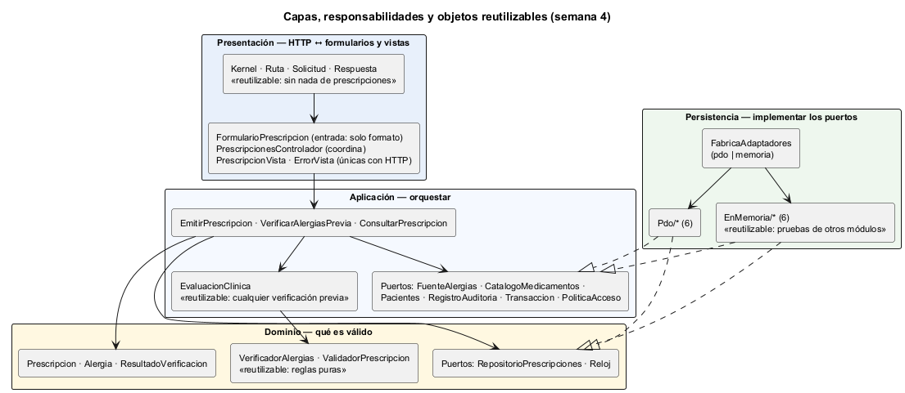
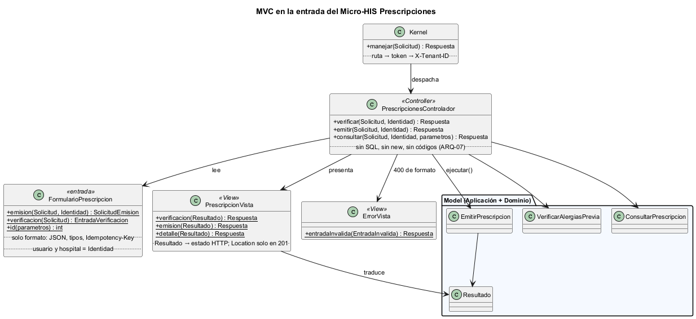
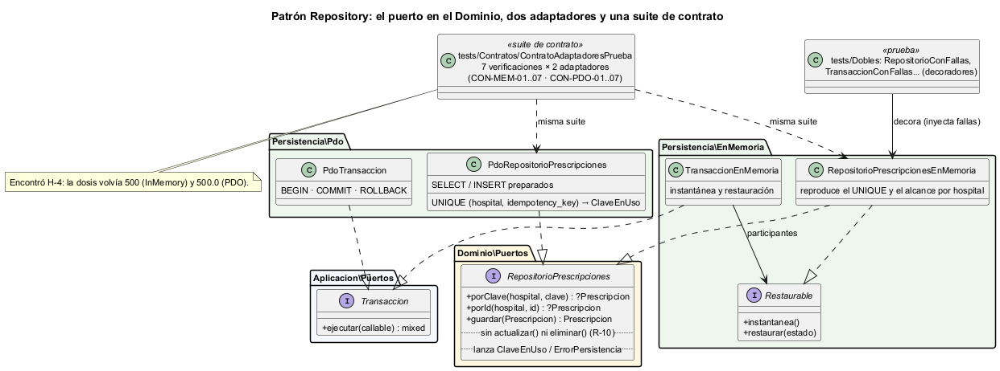
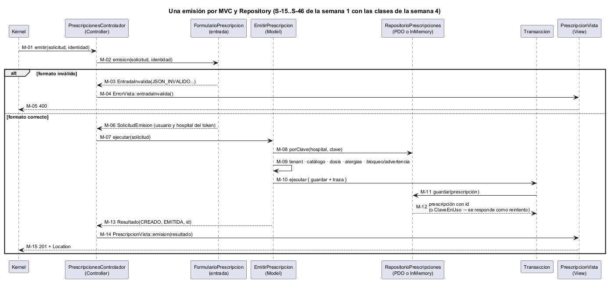
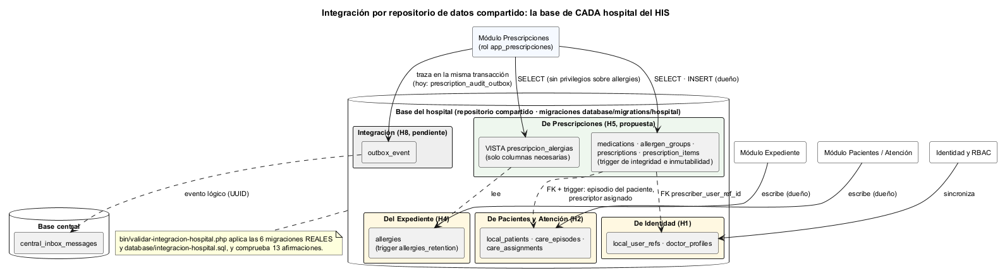

# Semana 4 — Arquitectura en capas, MVC y patrón Repository

| | |
|---|---|
| **Curso** | Análisis de Sistemas II — Proyecto Final 2026 |
| **Módulo** | Prescripciones electrónicas con validación de alergias |
| **Tema de la semana** | Arquitectura en capas y patrón repositorio |
| **Flujo** | «Creación de prescripción con verificación previa de alergias» |
| **Código** | [micro-his-prescripciones](../micro-his-prescripciones/README.md) (el MISMO Micro-HIS de la semana 3) |
| **Estudiante** | Boris Alexander Quiroa Orellana |

## Índice

1. [Qué cambió respecto de la semana 3](#1-qué-cambió-respecto-de-la-semana-3)
2. [Capas, responsabilidades y objetos reutilizables](#2-capas-responsabilidades-y-objetos-reutilizables)
3. [MVC en la entrada](#3-mvc-en-la-entrada)
4. [Patrón Repository](#4-patrón-repository)
5. [Vista dinámica: una emisión por MVC y Repository](#5-vista-dinámica-una-emisión-por-mvc-y-repository)
6. [Integración con un repositorio de datos compartido](#6-integración-con-un-repositorio-de-datos-compartido)
7. [Hallazgos de la semana](#7-hallazgos-de-la-semana)
8. [Evidencia](#8-evidencia)
9. [Trazabilidad](#9-trazabilidad)
10. [Limitaciones y trabajo siguiente](#10-limitaciones-y-trabajo-siguiente)
11. [Conclusión](#11-conclusión)

## 1. Qué cambió respecto de la semana 3

| Antes (semana 3) | Ahora (semana 4) | Por qué |
|---|---|---|
| `AccionesPrescripciones`: leer la petición, llamar al caso de uso y traducir, todo en una clase | **MVC:** `FormularioPrescripcion` (entrada) → `PrescripcionesControlador` → `PrescripcionVista` / `ErrorVista` | Separar quién lee la petición, quién coordina y quién presenta |
| `TraductorResultado` | Las **vistas** son las únicas con códigos HTTP (ARQ-08) | Un solo lugar decide el protocolo |
| Los adaptadores en memoria vivían solo en `tests/Dobles` | **6 adaptadores InMemory de producción** en `Persistencia/EnMemoria` | La tarea pide PDO **e** InMemory; además permite una demo sin base |
| Un solo modo de persistencia | `PRESCRIPCIONES_PERSISTENCIA=pdo` o `memoria`, decidido en `FabricaAdaptadores` | El mismo `crearKernel()` sirve para los dos |
| Los dobles eran otra implementación de los puertos | Los dobles son **decoradores** (`RepositorioConFallas`, `TransaccionConFallas`…) sobre los adaptadores de producción | Las pruebas ejercitan el código real y solo agregan la falla |
| Sin contrato entre adaptadores | **Suite de contrato:** 7 verificaciones para InMemory y PDO | Si un adaptador se aparta, falla su fila. Encontró H-4 (§7) |

**Lo que no cambió:**
- la Aplicación;
- el Dominio, salvo una línea que la suite de contrato hizo necesaria (H-4).

Las 55 pruebas de la semana 3 siguen pasando. Solo cambió cómo se arman los dobles, más una comprobación agregada a INT-09 por H-4.

## 2. Capas, responsabilidades y objetos reutilizables



Fuente: [semana-04-capas.puml](diagramas/semana-04-capas.puml)

| Capa | Responsabilidad | Clases | No hace |
|---|---|---|---|
| **Presentación** | HTTP ↔ formularios y vistas; orden de seguridad del kernel | `Kernel`, `Ruta`, `Solicitud`, `Respuesta`, `FormularioPrescripcion`, `PrescripcionesControlador`, `PrescripcionVista`, `ErrorVista`, `AutenticadorTokenDemo` | Reglas de negocio, SQL |
| **Aplicación** | Orquestar: permiso, idempotencia, tenant, evaluación, transacción, traza | 3 casos de uso, `EvaluacionClinica`, `Resultado`, 7 puertos | HTTP, PDO |
| **Dominio** | Qué es válido y qué choca con una alergia | `ValidadorPrescripcion`, `VerificadorAlergias`, `Prescripcion`, `Alergia`, `ResultadoVerificacion`, puertos `RepositorioPrescripciones` y `Reloj` | E/S |
| **Persistencia** | Implementar los puertos | 6 adaptadores PDO, 6 InMemory, `FabricaAdaptadores`, `PoliticaAccesoEstatica`, `RelojSistema` | Decidir reglas |

**Objetos reutilizables** (lo que pide el entregable):

| Objeto | Reutilizable para | Por qué es reutilizable |
|---|---|---|
| `VerificadorAlergias` + `Alergia` | Cualquier verificación de alergias del HIS: órdenes de enfermería, alimentación hospitalaria, medios de contraste en imágenes | Es una regla pura, sin E/S; usa los valores reales de la tabla `allergies` |
| `ValidadorPrescripcion` | Conciliación de medicación al ingreso o al alta | Recibe el catálogo ya resuelto; no sabe de dónde viene |
| `EvaluacionClinica` | Cualquier flujo de «verificar antes de firmar» | Catálogo + validación + fuente + verificación, detrás de puertos |
| `FuenteAlergias` (puerto + contrato *fail-closed*) | Otros módulos que lean alergias | El contrato prohíbe devolver vacío ante una falla |
| `Kernel`, `Ruta`, `Solicitud`, `Respuesta` | Otro micro-HIS en PHP vanilla | No tienen nada de prescripciones |
| Adaptadores `EnMemoria` + `Restaurable` | Las pruebas de **otros** módulos que necesiten un catálogo o un expediente de prueba | Cumplen el mismo contrato que los PDO |
| Suite de contrato | Cualquier adaptador futuro (p. ej. una `FuenteAlergias` sobre la API del Expediente) | Basta con agregar una fábrica más al arreglo `$fabricas` |

## 3. MVC en la entrada



Fuente: [semana-04-mvc.puml](diagramas/semana-04-mvc.puml)

| Rol MVC | Clase | Hace | Verificado por |
|---|---|---|---|
| **Model** | Casos de uso + Dominio | La lógica | APP-*, DOM-* |
| **View** | `PrescripcionVista`, `ErrorVista` | `Resultado` → `Respuesta`; únicas con códigos HTTP; `Location` solo en 201 | MVC-02, ARQ-08 |
| **Controller** | `PrescripcionesControlador` | Formulario → caso de uso → vista. Recibe **solo** casos de uso | MVC-03, ARQ-07 |
| (entrada) | `FormularioPrescripcion` | Solo formato: JSON, tipos, `Idempotency-Key`. El usuario y el hospital salen de la `Identidad`, **nunca del cuerpo** | MVC-01 |

```php
public function emitir(Solicitud $solicitud, Identidad $identidad): Respuesta
{
    try {
        $comando = FormularioPrescripcion::emision($solicitud, $identidad);
    } catch (EntradaInvalida $e) {
        return ErrorVista::entradaInvalida($e);
    }

    return PrescripcionVista::emision($this->emitir->ejecutar($comando));
}
```

**El controlador no tiene SQL ni reglas de negocio,** como exige la tarea. ARQ-07 lo comprueba leyendo el archivo sin comentarios. Falla si aparece cualquiera de estos elementos:
- SQL;
- un `new`;
- un código de negocio escrito a mano (`'BLOQUEO_ALERGIA'`);
- `Respuesta::json`;
- un número de estado HTTP;
- un acceso a reglas, puertos o persistencia.

La mutación M15 lo demuestra: hacer que el controlador arme él mismo el 400 hace fallar ARQ-07 y ARQ-08.

**Formato frente a regla (MVC-04).** Un cuerpo que no es JSON es un problema de formato: 400 del formulario. Una dosis 0 tiene formato válido pero rompe una regla: 422 del Dominio. Los dos entran por el mismo endpoint y salen por capas distintas.

## 4. Patrón Repository



Fuente: [semana-04-repositorio.puml](diagramas/semana-04-repositorio.puml)

### 4.1 El límite apropiado de la interfaz

`RepositorioPrescripciones` está en el **Dominio** y habla su idioma:
- «la prescripción de este hospital con esta clave»;
- «guardar una prescripción emitida».

No menciona tablas, filas ni SQL. Lo que **no** tiene también es diseño: no hay `actualizar()` ni `eliminar()`, porque una prescripción emitida es inmutable (R-10).

Los demás puertos de datos están en la **Aplicación**, porque son necesidades del caso de uso, no conceptos del dominio:
- `FuenteAlergias`, `CatalogoMedicamentos` y `Pacientes`: otros módulos que se consultan;
- `RegistroAuditoria`: la traza;
- `Transaccion`: «todo o nada».

### 4.2 Dos adaptadores por puerto

| Puerto | PostgreSQL (`Persistencia/Pdo`) | En memoria (`Persistencia/EnMemoria`) |
|---|---|---|
| `RepositorioPrescripciones` | `PdoRepositorioPrescripciones`: `INSERT … RETURNING`, `UNIQUE` → `ClaveEnUso` | `RepositorioPrescripcionesEnMemoria`: reproduce el `UNIQUE` y el alcance por hospital |
| `Transaccion` | `PdoTransaccion` | `TransaccionEnMemoria`: instantánea y restauración de los `Restaurable` |
| `RegistroAuditoria` | `PdoRegistroAuditoria` (bandeja) | `RegistroAuditoriaEnMemoria` |
| `FuenteAlergias` | `PdoFuenteAlergias` (tabla `allergies`) | `FuenteAlergiasEnMemoria` |
| `CatalogoMedicamentos` | `PdoCatalogoMedicamentos` | `CatalogoEnMemoria` |
| `Pacientes` | `PdoPacientes` | `PacientesEnMemoria` |

El modo se elige con `PRESCRIPCIONES_PERSISTENCIA` y lo decide solo `FabricaAdaptadores`. ARQ-09 verifica que cada uno de los 6 puertos de datos tenga los dos adaptadores. Los datos del modo memoria ([`datos-demo.php`](../micro-his-prescripciones/database/datos-demo.php)) son los mismos que los de `datos-demo.sql`, y la suite de contrato lo comprueba (CON-*-06, CON-*-07).

### 4.3 Contrato: la misma suite para los dos adaptadores

[`tests/Contratos/ContratoAdaptadoresPrueba.php`](../micro-his-prescripciones/tests/Contratos/ContratoAdaptadoresPrueba.php) define **7 verificaciones** una sola vez y las corre contra las dos fábricas:

| # | Verifica |
|---|---|
| 01 | Ids crecientes; lo leído es **idéntico** a lo guardado (ítems, verificación, alérgenos, justificación, fecha) |
| 02 | `porClave` por (hospital, clave); otro hospital no la ve |
| 03 | La misma clave en el mismo hospital → `ClaveEnUso`; en otro hospital se acepta |
| 04 | `porId` fuera del hospital o inexistente → `null` |
| 05 | La transacción revierte si el trabajo falla y confirma si no |
| 06 | `FuenteAlergias` devuelve exactamente el expediente de los datos de demostración |
| 07 | `CatalogoMedicamentos`: medicamentos y grupo del alérgeno por código o por nombre |

**Resultado:** CON-MEM-01..07 pasan siempre; CON-PDO-01..07 pasan contra PostgreSQL 18.

**¿Detecta un adaptador que se aparta?** Sí, de dos formas:
- **Defecto real (§7, H-4):** la primera ejecución encontró uno.
- **Mutaciones M16 y M17** (InMemory ignora el hospital; InMemory acepta una clave repetida): hacen fallar CON-MEM-04 y CON-MEM-03, mientras su fila PDO sigue en verde.

## 5. Vista dinámica: una emisión por MVC y Repository



Fuente: [semana-04-secuencia-mvc.puml](diagramas/semana-04-secuencia-mvc.puml)

Es el bloque 2 de la secuencia de la semana 1 (S-15..S-46) con las clases de esta semana. Muestra:
- las dos salidas del formulario (400 de formato o la solicitud del caso de uso);
- que el repositorio puede ser cualquiera de los dos adaptadores.

## 6. Integración con un repositorio de datos compartido



Fuente: [semana-04-repositorio-compartido.puml](diagramas/semana-04-repositorio-compartido.puml)

### 6.1 Qué es y cuál es el del HIS

Un **repositorio de datos compartido** es un estilo arquitectónico: varios componentes se integran a través de un almacén común en lugar de llamarse entre sí.

Para Prescripciones ese almacén es la **base de cada hospital** (`database/migrations/hospital/`). Allí ya conviven:
- `allergies`, del Expediente;
- `local_patients`, `care_episodes` y `care_assignments`, de Pacientes y Atención;
- `local_user_refs` y `doctor_profiles`, de Identidad.

El plan del esquema (`design.md`) reserva el slice **H5** para `medication` y `prescription`, y el **H8** para `outbox_event`, que alimenta la bandeja central.

### 6.2 Correspondencia con el Micro-HIS

| Micro-HIS (`schema.sql`) | Repositorio compartido ([`integracion-hospital.sql`](../micro-his-prescripciones/database/integracion-hospital.sql)) | Diferencia |
|---|---|---|
| `prescription_id bigserial`, `local_patient_id text` | `uuid`, FK a `local_patients` | Convención de claves del HIS |
| Columna `hospital` | **No existe** | Cada hospital tiene su base (aislamiento físico); el tenant lo da la conexión |
| `prescriber text` | `prescriber_user_ref_id uuid` FK a `local_user_refs` | Referencia real al usuario local |
| — | `care_episode_id uuid` FK a `care_episodes` | Una prescripción pertenece a una atención |
| Lee `allergies` directamente | Lee la **vista** `prescripcion_alergias` | El módulo no recibe privilegios sobre la tabla del Expediente |
| `prescription_audit_outbox` | `outbox_event` (H8, pendiente) → `central_inbox_messages` | La misma idea, con la tabla común del HIS |

### 6.3 Cómo se integraría

| Opción | Cómo | Ventajas | Riesgos | Decisión |
|---|---|---|---|---|
| A · Leer y escribir libremente en las tablas de otros | `SELECT`/`UPDATE` sobre `allergies`, `local_patients`… | Simple | Un módulo puede corromper datos que no son suyos; acopla a todos a todas las columnas | **Descartada** |
| B · **Repositorio compartido con propiedad de datos** | Prescripciones escribe solo sus tablas H5 y lee lo ajeno por vistas o en solo lectura; FK y triggers garantizan la coherencia | Verificación de alergias **síncrona y consistente** (misma base, misma transacción); reutiliza las reglas del HIS (asignación del médico) | Acoplamiento al esquema del hospital; migraciones coordinadas | **Recomendada** |
| C · API del Expediente | `GET /expediente/{paciente}/alergias` | Desacople total | Una llamada remota en el camino crítico de cada emisión: si el Expediente cae, no se prescribe (R-07); más latencia | Para cuando el Expediente sea un servicio aparte (semana 5) |

**Por qué B y no C para leer alergias:**
- **Consistencia.** R-03 exige verificar en el mismo momento de emitir; en la misma base, la lectura de alergias y la inserción de la prescripción ven el mismo estado.
- **Disponibilidad.** C agrega un punto de falla en el camino crítico: con *fail-closed*, cada caída del Expediente bloquea las prescripciones.

### 6.4 Decisiones sobre el esquema compartido (verificadas)

[`bin/validar-integracion-hospital.php`](../micro-his-prescripciones/bin/validar-integracion-hospital.php) **extrae el SQL de las 6 migraciones reales** de la base de hospital, aplica encima `integracion-hospital.sql` en un esquema temporal y comprueba ([salida](evidencia/5-integracion-hospital.txt)):

| Afirmación | Resultado |
|---|---|
| Las tablas H5 se crean con FK reales a `local_patients`, `care_episodes` y `local_user_refs` | OK |
| El prescriptor **con** asignación activa en el episodio puede emitir | OK |
| Un médico **sin** asignación en el episodio no puede: es la misma regla que el HIS aplica a `vital_signs` | OK |
| Un episodio de **otro** paciente se rechaza | OK |
| Un paciente inexistente se rechaza | OK |
| `UPDATE` y `DELETE` de una prescripción se rechazan | OK |
| La misma `Idempotency-Key` se rechaza (23505) | OK |
| El Expediente ya impide **borrar** una alergia (trigger real `allergies_retention`) | OK |
| El rol del módulo lee las alergias por la vista, con las columnas que usa `PdoFuenteAlergias` | OK |
| El rol del módulo **no** puede leer `allergies` directamente (42501) | OK |
| El rol del módulo **no** puede escribir alergias ni modificar pacientes (42501) | OK |
| `PUBLIC` no tiene privilegios sobre las prescripciones | OK |

**13 de 13.** El validador crea un rol temporal `NOLOGIN` y lo elimina al terminar, junto con el esquema.

**Una consecuencia para el diseño.** Que el Expediente no permita borrar alergias (solo cambiar su estado a `resolved`/`inactive`) es lo que hace correcta la regla «solo cuentan las activas» (CA-12 de la semana 2): una alergia nunca desaparece en silencio.

### 6.5 Ventajas y riesgos del repositorio compartido para este módulo

| Ventaja | Riesgo | Mitigación |
|---|---|---|
| Verificación de alergias consistente con la emisión | Acoplamiento a las columnas de `allergies` | Solo a través de la vista: si el Expediente cambia la tabla, ajusta la vista sin tocar el módulo |
| Las reglas del HIS (asignación del médico) se reutilizan con un trigger | Un trigger más en la emisión | Es una consulta indexada (`care_assignments_care_episode_id_index`) |
| FK reales: no hay prescripciones huérfanas | Migraciones coordinadas entre equipos | El slice H5 depende de H4 y se despliega en ese orden (`design.md`) |
| Un solo respaldo por hospital | Una mala concesión de privilegios afecta a todos | Roles por módulo; `PUBLIC` sin privilegios (verificado) |

## 7. Hallazgos de la semana

| ID | Hallazgo | Cómo apareció | Corrección | Prueba |
|---|---|---|---|---|
| H-4 | La dosis volvía `500` (InMemory) y `500.0` (PDO, columna `numeric`). La **consulta** respondía distinto según el modo | La **suite de contrato**: CON-PDO-01 falló en su primera ejecución ([evidencia](evidencia/6-contrato-h4-en-rojo.txt)). INT-09 no lo veía porque comparaba solo emisiones, que no devuelven los ítems | `Prescripcion` normaliza la dosis a decimal; INT-09 ahora compara también las consultas | CON-PDO-01, INT-09, M18 |
| H-5 | Al hacer que el InMemory de producción reproduzca el `UNIQUE`, la mutación **M8 «sin idempotencia» sobrevivió** ([evidencia](evidencia/7-mutaciones-m8-sobrevive.txt)) | Mutaciones | **No era equivalente:** sin la búsqueda previa, un reintento vuelve a consultar el expediente (503 si está caído) y una clave reutilizada con datos inválidos da 422 en vez de 409. Se agregó la prueba que faltaba | APP-17 |

H-5 es una lección sobre los dobles: en la semana 3, la prueba de idempotencia pasaba **gracias a** que el doble no reproducía la restricción de la base. Cuando el adaptador se volvió fiel, la prueba dejó de proteger lo que decía proteger.

## 8. Evidencia

| Comando | Resultado | Evidencia |
|---|---|---|
| `php tests/ejecutar.php` | **78 · 62 pasan** · 0 fallan · 16 omitidas (sin base) | [1-pruebas-sin-base.txt](evidencia/1-pruebas-sin-base.txt) |
| La misma, con PostgreSQL 18 | **78 · 78 pasan** · 0 · 0 | [2-pruebas-postgres.txt](evidencia/2-pruebas-postgres.txt) |
| `php tests/mutaciones.php` | **19/19** detectadas (5 nuevas: M15 controlador, M16 y M17 InMemory, M18 H-4, M19 vista) | [3-mutaciones.txt](evidencia/3-mutaciones.txt) |
| `php bin/demo.php` | 8 pasos de punta a punta **sin base de datos** | [4-demo-sin-base.txt](evidencia/4-demo-sin-base.txt) |
| `php bin/validar-integracion-hospital.php` | **13/13** afirmaciones del análisis, sobre las migraciones reales | [5-integracion-hospital.txt](evidencia/5-integracion-hospital.txt) |
| Contrato antes de corregir H-4 | CON-PDO-01 falla | [6-contrato-h4-en-rojo.txt](evidencia/6-contrato-h4-en-rojo.txt) |
| Mutaciones antes de APP-17 | M8 sobrevive | [7-mutaciones-m8-sobrevive.txt](evidencia/7-mutaciones-m8-sobrevive.txt) |

**Pruebas nuevas esta semana (23):**
- CON-MEM-01..07 y CON-PDO-01..07;
- MVC-01..05;
- ARQ-07 (controlador limpio), ARQ-08 (solo las vistas arman respuestas) y ARQ-09 (dos adaptadores por puerto);
- APP-17 (reintento sin reverificar).

## 9. Trazabilidad

| Requisito / regla | Semana 4 | Prueba |
|---|---|---|
| Tarea: «organice la entrada con MVC» | Formulario → controlador → vista | MVC-01..05 |
| Tarea: «el controlador no tendrá SQL ni reglas de negocio» | `PrescripcionesControlador` | ARQ-07, MVC-03, M15 |
| Tarea: «interfaz Repository en el límite apropiado y adaptadores PDO e InMemory» | `RepositorioPrescripciones` en el Dominio; 6 puertos × 2 adaptadores | ARQ-09, CON-*, M16, M17 |
| Tarea: «analice y diagrame un repositorio de datos compartido» | §6, `integracion-hospital.sql` | 13 afirmaciones verificadas |
| R-08 tenant | Kernel + `porId`/`porClave` acotados; en el HIS, la base del hospital | CON-*-02, CON-*-04, M16 |
| R-10 inmutable | Contrato sin modificar; trigger en las dos versiones del esquema | DOM-08, INT-02, validación |
| R-11 idempotencia | `UNIQUE` en los dos adaptadores y en el HIS | CON-*-03, APP-17, validación |
| R-12 traza | Bandeja en la misma transacción | CON-*-05, APP-14 |
| RNF-04 testabilidad | Modo memoria de producción y decoradores de prueba | 62 pruebas sin base |

## 10. Limitaciones y trabajo siguiente

- El rol `app_prescripciones` y sus `GRANT` se **probaron** con un rol temporal; crearlos de verdad le corresponde al despliegue del HIS.
- `outbox_event` (H8) no existe todavía: el Micro-HIS sigue con su `prescription_audit_outbox` hasta que exista.
- El adaptador que lee por la vista `prescripcion_alergias` en lugar de la tabla es un cambio de una línea en `PdoFuenteAlergias`. Se hará cuando el módulo corra sobre la base real del HIS.
- La anulación (CU-07) sigue pendiente.

## 11. Conclusión

- La entrada quedó en MVC con roles verificables: el formulario lee, el controlador coordina y la vista presenta.
- El Repository quedó en el límite del Dominio, con dos adaptadores que **demuestran** cumplir el mismo contrato. En su primera ejecución, ese contrato encontró una diferencia real entre ellos (H-4).
- Hacer más fiel el adaptador en memoria destapó una prueba que pasaba por casualidad (H-5): los dobles no solo pueden estar equivocados; también pueden esconder huecos.
- El análisis del repositorio compartido no se quedó en un diagrama: el SQL se ejecutó sobre las migraciones reales del hospital. De ahí salieron tres decisiones con fundamento:
  - leer alergias por una vista y sin privilegios sobre la tabla del Expediente;
  - reutilizar la regla de asignación del médico que el HIS ya aplica a los signos vitales;
  - apoyarse en que el Expediente nunca borra una alergia.
