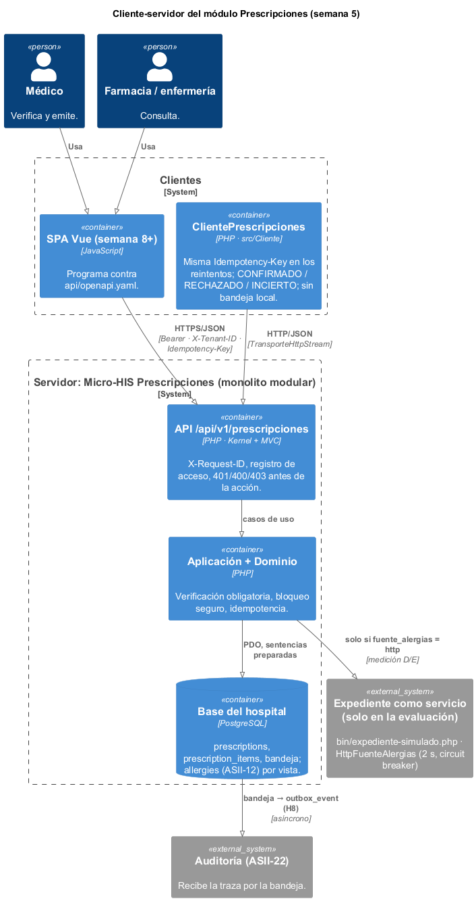
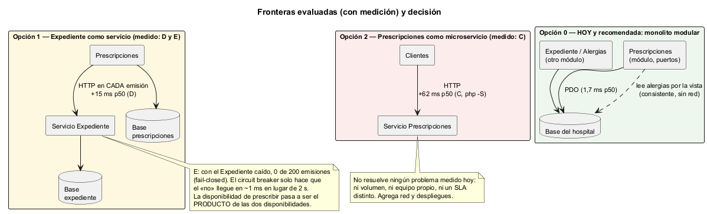
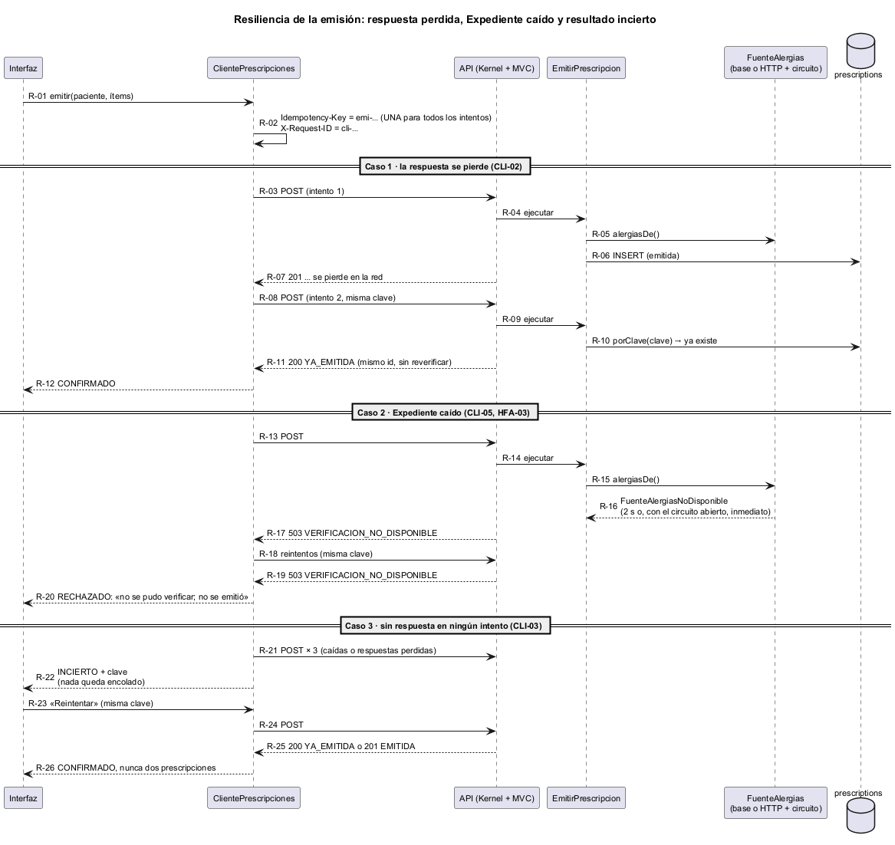
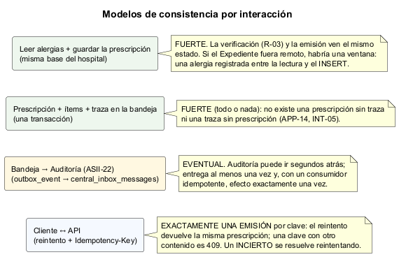
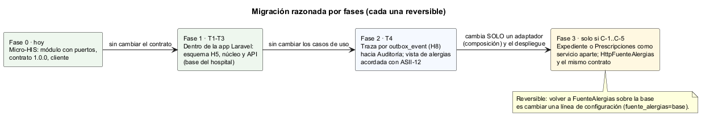
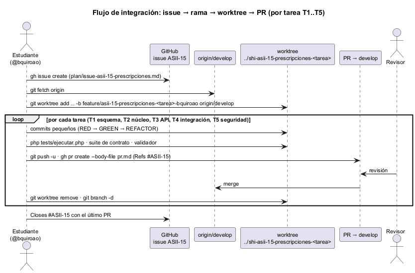

# Semana 5 — Cliente-servidor, API REST, frontera de microservicio e integración

| | |
|---|---|
| **Curso** | Análisis de Sistemas II — Proyecto Final 2026 |
| **Módulo** | Prescripciones electrónicas con validación de alergias (ASII-15) |
| **Tema de la semana** | Cliente-servidor, API REST, microservicios e integración |
| **Flujo** | «Creación de prescripción con verificación previa de alergias» |
| **Código** | [micro-his-prescripciones](../micro-his-prescripciones/README.md) (el MISMO Micro-HIS) · [contrato](../micro-his-prescripciones/api/openapi.yaml) |
| **Estudiante** | Boris Alexander Quiroa Orellana |

## Índice

1. [Introducción y decisión](#1-introducción-y-decisión)
2. [Qué se construyó esta semana](#2-qué-se-construyó-esta-semana)
3. [Diseño cliente-servidor](#3-diseño-cliente-servidor)
4. [Contrato API](#4-contrato-api)
5. [Evaluación de la frontera de microservicio](#5-evaluación-de-la-frontera-de-microservicio)
6. [Propiedad de los datos](#6-propiedad-de-los-datos)
7. [Comunicación](#7-comunicación)
8. [Seguridad](#8-seguridad)
9. [Resiliencia](#9-resiliencia)
10. [Observabilidad](#10-observabilidad)
11. [Consistencia](#11-consistencia)
12. [Migración razonada](#12-migración-razonada)
13. [Plan de issue, rama, worktree y PR](#13-plan-de-issue-rama-worktree-y-pr)
14. [Evidencia](#14-evidencia)
15. [Limitaciones](#15-limitaciones)
16. [Conclusión](#16-conclusión)

## 1. Introducción y decisión

**La pregunta de la semana:** ¿debe Prescripciones, o la verificación de alergias que la sostiene, ser un microservicio?

**Respuesta medida:** **no, por ahora.** El módulo se diseña como servicio (contrato, cliente, adaptador remoto listo, frontera de datos clara) pero se queda **dentro del monolito modular**, en la misma base que el Expediente.

`PRESCRIPCIONES_DB_DSN=… php bin/medir.php 200` ([salida](evidencia/1-medicion-frontera.txt)):

| Escenario | p50 | p95 | Emitidas |
|---|---|---|---|
| A · en proceso, memoria | 0,019 ms | 0,028 ms | 200/200 |
| B · en proceso, PostgreSQL | **1,7 ms** | 2,6 ms | 200/200 |
| C · por HTTP (`php -S`) + PostgreSQL, con el cliente | 63,4 ms | 175,8 ms | 200/200 |
| D · en proceso + PostgreSQL, **Expediente remoto** por HTTP | 16,8 ms | 33,9 ms | 200/200 |
| E · como D, con el **Expediente caído** | 0,9 ms | 1,8 ms | **0/200** |

**El argumento decisivo no es la latencia; es la disponibilidad, por el *fail-closed*.** Si el Expediente fuera un servicio aparte, cada caída suya **bloquearía todas las prescripciones del hospital** (E: 0 de 200). Es el comportamiento correcto (R-07) y por eso es caro. Supongamos dos servicios con 99,5 % de disponibilidad cada uno:

| Configuración | Disponibilidad de «poder prescribir» | Horas al año sin poder prescribir |
|---|---|---|
| Hoy (misma base) | ≈ 99,5 % | ≈ 44 h |
| Expediente como servicio | 99,5 % × 99,5 % ≈ 99,0 % | ≈ 88 h |

En la misma base, «no puedo leer las alergias» y «no puedo guardar la prescripción» son la misma falla, así que separar no agrega un modo de falla nuevo.

**Sobre los números:**
- La latencia de C y D está inflada por `php -S`, que abre un proceso y una conexión por petición; un servidor real la bajaría.
- La conclusión no depende de esos milisegundos: depende de multiplicar disponibilidades en el camino crítico de la seguridad del paciente.

## 2. Qué se construyó esta semana

| Pieza | Dónde | Para qué |
|---|---|---|
| Contrato OpenAPI 3.1 (3 operaciones, 21 códigos de error) | `api/openapi.yaml` | Fuente de verdad de la API; lint de Redocly sin errores ([evidencia](evidencia/2-lint-openapi.txt)) |
| Conformidad API-01..03 | `tests/Api/ContratoApiPrueba.php` | Contrato = código: operaciones, `x-permiso`, y estado y código de 24 escenarios reales |
| Capa **Cliente** | `src/Cliente/` | `ClientePrescripciones`: reintento con la misma `Idempotency-Key`, resultados CONFIRMADO / RECHAZADO / INCIERTO, **sin bandeja local** |
| Adaptador remoto del Expediente | `src/Persistencia/Http/HttpFuenteAlergias` + `CircuitoInterruptor` | Evaluar la frontera; cumple el contrato *fail-closed* con el límite de **2 s** (RNF-08 de la semana 2, pendiente hasta hoy) |
| Expediente simulado | `bin/expediente-simulado.php` | Un `php -S` que responde, tarda o falla a pedido; **no** es infraestructura de producción |
| Observabilidad | `Kernel` + `Observabilidad/RegistroAccesoJson` | `X-Request-ID` en toda respuesta; una línea JSON por petición sin datos clínicos |
| Medición | `bin/medir.php` | La justificación medible de la frontera |
| Plan de integración | [`plan/issue-asii-15-prescripciones.md`](plan/issue-asii-15-prescripciones.md), [`plan/pr-integracion-prescripciones.md`](plan/pr-integracion-prescripciones.md) | Issue, rama, worktree y PR |

## 3. Diseño cliente-servidor

Fuente: [semana-05-cliente-servidor.puml](diagramas/semana-05-cliente-servidor.puml)

| Rol | Quién | Qué hace |
|---|---|---|
| **Cliente clínico** | SPA Vue (semana 8) con `ClientePrescripciones` | Verifica antes de firmar, emite y muestra el resultado; nunca deja una prescripción «pendiente» |
| **Cliente de lectura** | Farmacia y enfermería | Consulta la prescripción con su verificación |
| **Servidor** | Micro-HIS: Kernel → MVC → casos de uso → adaptadores | Único que decide; vuelve a verificar aunque el cliente ya lo haya hecho |

El cliente se programa **contra el contrato**, no contra las clases del servidor. ARQ-10 impide que `src/Cliente` importe cualquier capa del servidor, y que alguna capa importe el cliente.

## 4. Contrato API

[`api/openapi.yaml`](../micro-his-prescripciones/api/openapi.yaml), OpenAPI 3.1, versión 1.0.0:

| Método y ruta | operationId | `x-permiso` | Respuestas |
|---|---|---|---|
| `POST /api/v1/prescripciones/verificaciones` | `verificarAlergias` | `prescripcion.emitir` | 200 · 400 · 401 · 403 · 404 · 422 · 500 · 503 |
| `POST /api/v1/prescripciones` + `Idempotency-Key` | `emitirPrescripcion` | `prescripcion.emitir` (+ `x-permiso-advertencia: prescripcion.override`) | 201 · 200 `YA_EMITIDA` · 400 · 401 · 403 · 404 · 409 · 422 · 500 · 503 |
| `GET /api/v1/prescripciones/{id}` | `consultarPrescripcion` | `prescripcion.consultar` | 200 · 400 · 401 · 403 · 404 · 405 · 500 · 503 |

**Decisiones del contrato:**

| Decisión | Por qué |
|---|---|
| **`Idempotency-Key` en una cabecera, obligatoria** | La emisión no tiene una identidad natural (Auditoría usa `event_id`; una prescripción no). La clave representa la **intención** de emitir y se repite en los reintentos |
| **El reintento con la misma clave no vuelve a verificar** | Devuelve lo que ya se emitió (APP-17). Si reverificara, un reintento podría responder 503 o 422 sobre algo ya emitido |
| **La verificación previa siempre responde 200** | Es informativa: el «bloqueo» se informa como resultado, no como error. La emisión sí responde 422 |
| **Un 503 distinto según la causa** | `VERIFICACION_NO_DISPONIBLE` dice «no se emitió»; `ERROR_PERSISTENCIA` dice «reintenta con la misma clave». El cliente los trata distinto (§9) |
| **Sin `PUT`, `PATCH` ni `DELETE`** | Si se intentan, 405 (documentado). R-10 se ve en el contrato |
| **Un `enum` de códigos de error** | Los clientes programan contra códigos, no contra textos |
| **`x-permiso` por operación** | El permiso es parte del contrato; API-01 verifica que coincida con la constante del caso de uso |

**Conformidad (no solo documentación):**

| Prueba | Verifica |
|---|---|
| API-01 | Las operaciones del contrato y las rutas del código son las mismas 3, y cada `x-permiso` es la constante del caso de uso (`EmitirPrescripcion::PERMISO`…) |
| API-02 | Cada operación documenta los errores transversales y su respuesta de éxito |
| API-03 | En **24 escenarios reales** por el kernel, cada estado y cada código que sale está documentado (cubre 15 o más códigos distintos) y toda respuesta trae `X-Request-ID` |

La mutación M27 (cambiar un `x-permiso` en el YAML) la detecta API-01: si el contrato y el código se separan, la suite falla.

## 5. Evaluación de la frontera de microservicio

Fuente: [semana-05-frontera-microservicio.puml](diagramas/semana-05-frontera-microservicio.puml)

### 5.1 ¿Es un buen candidato?

| A favor de separar | En contra |
|---|---|
| Sus datos (`prescriptions`) solo los escribe él | Lee **en cada emisión** datos de otros dos módulos: alergias (ASII-12) y catálogo (ASII-14) |
| La verificación de alergias podría servir a otros (enfermería, alimentación, imágenes) | Con *fail-closed*, una dependencia remota en el camino crítico multiplica la indisponibilidad (§1) |
| Contrato y cliente ya definidos | Hoy no hay volumen, SLA distinto ni equipo propio que lo justifique |

### 5.2 Medición

La tabla de §1 sale de `bin/medir.php`. Se mide la **emisión completa**, que es el camino crítico, y no una consulta aislada:

| Costo | Valor (p50) |
|---|---|
| La base (B − A) | 1,7 ms |
| La API por HTTP (C − B) | 61,7 ms |
| El Expediente remoto (D − B) | 15,1 ms |
| Expediente caído (E) | 0 de 200 emisiones; el «no» llega en < 1 ms gracias al circuito |

**Lo que el circuito resuelve y lo que no.** Sin circuito, cada emisión esperaría el límite de 2 s antes de responder 503; con circuito, el rechazo es inmediato (HFA-03). Pero la decisión clínica es la misma: no se emite. Un circuito evita esperar; no evita la indisponibilidad.

### 5.3 Criterios medibles para extraer un servicio

| ID | Criterio | Cómo se mide |
|---|---|---|
| C-1 | Más de 20 emisiones/s sostenidas en un hospital | Conteo por minuto en `prescriptions` |
| C-2 | p95 de la emisión > 300 ms en producción con la base local | `bin/medir.php` sobre el volumen real |
| C-3 | Otro módulo necesita la **verificación de alergias** (enfermería, alimentación) con su propio ritmo de cambios | Pedido formal de un segundo consumidor |
| C-4 | Los despliegues del monolito bloquean cambios urgentes de reglas clínicas | Frecuencia de despliegues bloqueados |
| C-5 | El Expediente ofrece disponibilidad ≥ 99,95 % **con réplica de lectura local** | SLA firmado; sin eso, D/E vuelven a aplicar |

Mientras ninguno se cumpla, separar solo agrega red, despliegues y un modo de falla que bloquea la atención.

## 6. Propiedad de los datos

| Dato | Dueño | Acceso de Prescripciones |
|---|---|---|
| `prescriptions`, `prescription_items` | **Prescripciones (ASII-15)** | `INSERT` y `SELECT`; nadie más escribe |
| `prescription_audit_outbox` (luego `outbox_event`, H8) | Prescripciones escribe; Auditoría consume | `INSERT` en la misma transacción |
| `allergies` | **Alergias (ASII-12)** | Solo lectura por la vista `prescripcion_alergias` (semana 4) |
| `medications`, `allergen_groups` | **Catálogo de medicamentos (ASII-14)** | Solo lectura |
| `local_patients`, `care_episodes`, `care_assignments` | Pacientes y Expediente (ASII-03, ASII-10) | FK + trigger de asignación |
| Permisos | RBAC (ASII-02) | Pregunta por el puerto `PoliticaAcceso` |

**Corrección respecto de la semana 4.** La propuesta H5 creaba `medications` dentro del módulo. El listado de módulos del proyecto asigna el catálogo a **ASII-14**: Prescripciones solo lo lee. El issue lo registra como riesgo de T1.

## 7. Comunicación

| Interacción | Estilo | Por qué |
|---|---|---|
| Interfaz → Prescripciones | HTTP síncrono + `ClientePrescripciones` | El médico necesita saber **ya** si quedó emitida |
| Prescripciones → Alergias y Catálogo | En proceso, **misma base** (vista y solo lectura) | Consistencia con la emisión y sin modo de falla adicional (§1) |
| Prescripciones → Auditoría | **Asíncrona** (bandeja → `outbox_event` → `central_inbox_messages`) | La atención no espera a la auditoría |
| Prescripciones → RBAC e identidad | Por puertos, en proceso | Hoy en el monolito |
| (Evaluado) Prescripciones → Expediente remoto | HTTP con 2 s y circuito | Solo si C-5 se cumple |

Se usa el **mismo `X-Request-ID` en todos los reintentos** (CLI-01), y el servidor lo devuelve en cada respuesta. Así una emisión se sigue de punta a punta en el registro de acceso.

## 8. Seguridad

| Amenaza | Defensa | Prueba |
|---|---|---|
| Prescribir en otro hospital | Hospital del token; `X-Tenant-ID` debe coincidir; 404 idéntico para lo ajeno | HTTP-04, APP-11, CON-*-04 |
| Saltarse la verificación desde un cliente propio | El servidor reverifica siempre; el resultado previo no se acepta | APP-10 (R-03) |
| Emitir con una advertencia sin autorización | `x-permiso-advertencia: prescripcion.override` | APP-06, M7 |
| Inyección SQL | Sentencias preparadas | PER-04 |
| Datos clínicos en registros técnicos | El registro de acceso no lleva token, cuerpo, paciente ni medicamento | OBS-02, M26 |
| Cabecera inyectada vía `X-Request-ID` | Solo `[A-Za-z0-9-]{8,64}`; si no, se genera | OBS-01, M25 |
| Un Expediente remoto comprometido o defectuoso responde «sin alergias» | El adaptador rechaza respuestas fuera del esquema y la contradicción «no evaluado con alergias» | HFA-02, M20, M21 |
| Fuga de detalles en errores | 500 `ERROR_INTERNO`; mensajes del driver nunca hacia afuera | HTTP-09, PER-02 |

## 9. Resiliencia

Fuente: [semana-05-secuencia-resiliencia.puml](diagramas/semana-05-secuencia-resiliencia.puml)

| Falla | Comportamiento | Prueba |
|---|---|---|
| Se pierde la respuesta del 201 | Reintento con la misma clave → 200 `YA_EMITIDA`; **una** prescripción | CLI-02 |
| Red caída o 502 de un proxy | 1 + 2 reintentos con espera creciente, la misma clave y el mismo `X-Request-ID` | CLI-01 |
| Sin respuesta en ningún intento | **INCIERTO** con la clave. No se encola: la interfaz lo dice y «Reintentar» con la misma clave lo resuelve | CLI-03 |
| 4xx (bloqueo, datos, permiso) | No se reintenta: es una decisión clínica o de datos | CLI-04, M23 |
| Expediente caído | 503 `VERIFICACION_NO_DISPONIBLE`; el cliente lo informa como **RECHAZADO** («no se emitió»), no como incierto | CLI-05, M24 |
| Expediente lento (> 2 s) | Corta a los 2 s y no emite | HFA-04 (servidor real que tarda 3 s) |
| Expediente caído varias veces | Circuito ABIERTO 30 s: rechazo inmediato; luego un intento de prueba | HFA-03, M22 |
| Puerto cerrado | `FallaTransporte` en < 5 s | CLI-06 |
| El registro de acceso falla | La respuesta no cambia | OBS-03 |

**Por qué aquí NO hay bandeja local, a diferencia de Auditoría.**
- Un movimiento de auditoría puede llegar tarde sin dañar a nadie.
- Una prescripción «pendiente de enviar» sí puede dañar: el médico cree que prescribió, farmacia no la ve y el paciente no recibe su tratamiento.

Por eso el cliente solo tiene tres salidas, todas visibles: confirmado, rechazado o incierto.

## 10. Observabilidad

| Señal | Dónde | Contenido |
|---|---|---|
| `X-Request-ID` | Toda respuesta (también 401, 404 y 500) | Se respeta el del cliente si es seguro; si no, uno nuevo |
| Registro de acceso | `RegistroAccesoJson` → stderr | `request_id`, método, ruta, estado, duración, usuario y tenant; **nunca** token, cuerpo, paciente ni medicamento |
| Traza de negocio | Bandeja → Auditoría | `PRESCRIPCION_EMITIDA`, `PRESCRIPCION_BLOQUEADA`, `VERIFICACION_NO_DISPONIBLE` |
| Estado del circuito | `CircuitoInterruptor::estado()` | Alertar si queda ABIERTO |
| Tasa de `VERIFICACION_NO_DISPONIBLE` | Bandeja | Alerta operativa: cada uno es una prescripción que no se pudo emitir (tarea T5) |

## 11. Consistencia

Fuente: [semana-05-consistencia.puml](diagramas/semana-05-consistencia.puml)

| Dónde | Modelo | Garantía |
|---|---|---|
| Leer alergias y guardar la prescripción | **Fuerte** (misma base) | La verificación y la emisión ven el mismo estado. Con un Expediente remoto habría una ventana: una alergia registrada entre la lectura y el `INSERT` |
| Prescripción + ítems + traza | **Fuerte** (una transacción) | No existe una prescripción sin traza, ni al revés |
| Bandeja → Auditoría | **Eventual** | Al menos una vez, con consumidor idempotente |
| Cliente ↔ API | **Exactamente una emisión por clave** | El reintento devuelve la misma prescripción; otra con la misma clave es 409 |

## 12. Migración razonada

Fuente: [semana-05-migracion.puml](diagramas/semana-05-migracion.puml)

| Fase | Qué cambia | Entra si | Reversible |
|---|---|---|---|
| 0 (hoy) | Micro-HIS con puertos, contrato 1.0.0 y cliente | — | — |
| 1 (T1–T3) | Dentro de la app Laravel: esquema H5, núcleo y API sobre la base del hospital | Se aprueba el issue | Sí: el contrato no cambia |
| 2 (T4) | Traza por `outbox_event` hacia Auditoría; vista acordada con ASII-12 | Existe H8 | Sí: los casos de uso no cambian |
| 3 | Expediente (o Prescripciones) como servicio aparte | Se cumple alguno de C-1..C-5 | Sí: es `fuente_alergias=http` o `base`, una línea de configuración |

## 13. Plan de issue, rama, worktree y PR

Fuente: [semana-05-flujo-issue-pr.puml](diagramas/semana-05-flujo-issue-pr.puml)

| Paso | Detalle |
|---|---|
| Issue | [`plan/issue-asii-15-prescripciones.md`](plan/issue-asii-15-prescripciones.md). Contiene la plantilla `module_task.md` llena, cinco tareas de integración y las dependencias con ASII-12, 14, 10, 01, 02, 22, 24 y 30. Está listo para `gh issue create`. Las tareas son: **T1** esquema H5 (la tarea 3.5 pendiente del plan del esquema), **T2** núcleo, **T3** API, **T4** integración y **T5** seguridad. |
| Rama | `feature/asii-15-prescripciones-bquiroao`, con una rama por tarea (`…-esquema-…`, `…-api-…`, `…-integracion-…`) |
| Worktree | `git worktree add ../shi-asii-15-prescripciones-<tarea> -b feature/asii-15-prescripciones-<tarea>-bquiroao origin/develop`, como pide el README del proyecto |
| PR | [`plan/pr-integracion-prescripciones.md`](plan/pr-integracion-prescripciones.md): la plantilla del repositorio prellenada para T1, en orden RED → GREEN (`PrescriptionIntegrityTest` antes que la migración), con los comandos de apertura y cierre del worktree |

## 14. Evidencia

| Comando | Resultado | Evidencia |
|---|---|---|
| `php bin/medir.php 200` | Tabla de §1 | [1-medicion-frontera.txt](evidencia/1-medicion-frontera.txt) |
| `npx @redocly/cli@1.34.3 lint api/openapi.yaml` | Válido, sin advertencias | [2-lint-openapi.txt](evidencia/2-lint-openapi.txt) |
| `php tests/ejecutar.php` | **95 · 79 pasan** · 0 fallan · 16 omitidas (sin base) | [3-pruebas-sin-base.txt](evidencia/3-pruebas-sin-base.txt) |
| La misma, con PostgreSQL 18 | **95 · 95 pasan** | [4-pruebas-postgres.txt](evidencia/4-pruebas-postgres.txt) |
| `php tests/mutaciones.php` | **27/27** detectadas (8 nuevas: M20–M27) | [5-mutaciones.txt](evidencia/5-mutaciones.txt) |

**Pruebas nuevas (17):**
- API-01..03;
- CLI-01..06;
- HFA-01..04, incluida una con un `php -S` real que tarda 3 s;
- OBS-01..03;
- ARQ-10.

## 15. Limitaciones

- El reenvío de la bandeja a Auditoría está diseñado, no implementado: depende de `outbox_event` (H8).
- La medición usa `php -S`, que no representa un servidor de producción; las conclusiones se apoyan en la disponibilidad, no en esos milisegundos.
- La disponibilidad del 99,5 % por componente es un **supuesto** para ilustrar la multiplicación; no es una medición del HIS.
- `TransporteHttpStream` no usa TLS en las pruebas; en el HIS lo da el API Gateway (ASII-30).

## 16. Conclusión

- Diseñar como servicio no obliga a desplegar como servicio. El módulo ya tiene todo lo que un servicio necesita:
  - un contrato verificado contra el código;
  - un cliente con reintentos seguros;
  - un adaptador remoto que cumple el mismo contrato *fail-closed*;
  - observabilidad.
- La medición y el análisis de disponibilidad muestran por qué no conviene separarlo hoy: con *fail-closed*, cada dependencia remota en el camino crítico se convierte en una causa más de «no se puede prescribir».
- La decisión queda atada a cinco criterios medibles, y revertirla, en cualquier dirección, es cambiar una línea de configuración.
- Esta semana también aplicó dos decisiones distintas de las de Auditoría, por razones del dominio:
  - sin bandeja local: una prescripción nunca queda «pendiente»;
  - el reintento no vuelve a verificar: lo emitido se devuelve tal cual.
