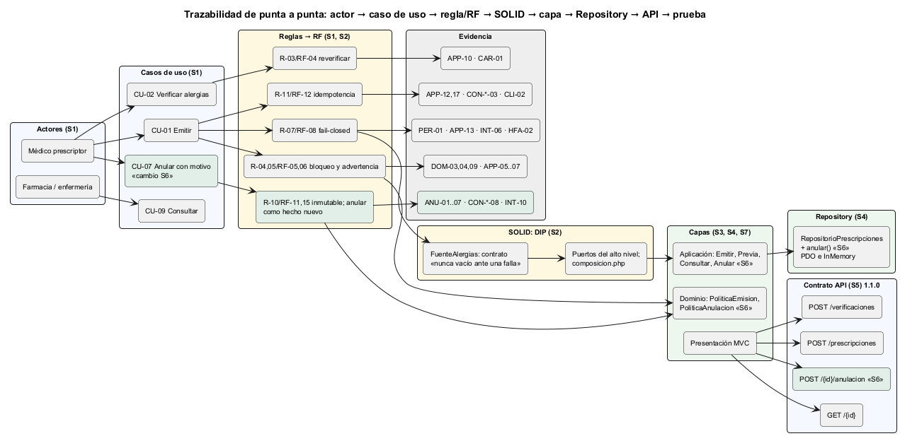
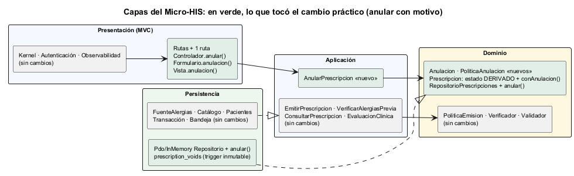

# Semana 6 — Primera evaluación parcial: defensa de la arquitectura

| | |
|---|---|
| **Curso** | Análisis de Sistemas II — Proyecto Final 2026 |
| **Módulo** | Prescripciones electrónicas con validación de alergias (ASII-15) |
| **Proceso** | «Creación de prescripción con verificación previa de alergias» |
| **Estudiante** | Boris Alexander Quiroa Orellana |

> **Nota de calendario:** las instrucciones de esta semana llegaron después de entregar la semana 7. Por eso la defensa incluye lo construido hasta la semana 7 (el refactor de la política de emisión), y el cambio práctico se hizo sobre ese código.

## Entregables

| Pedido | Dónde |
|---|---|
| Presentación de 6–8 diapositivas | [`presentacion/semana-06-defensa-prescripciones.pptx`](presentacion/semana-06-defensa-prescripciones.pptx) (8 diapositivas, con notas del orador) · [PDF](presentacion/semana-06-defensa-prescripciones.pdf) |
| Diagrama trazable | [`diagramas/semana-06-trazabilidad.png`](diagramas/semana-06-trazabilidad.png): actor → caso de uso → regla/RF → DIP → capa → Repository → API → prueba |
| Matriz decisión → evidencia | [`matriz-decision-evidencia.md`](matriz-decision-evidencia.md): 23 decisiones, cada una con requisito, lugar, prueba y (18 de ellas) mutación |
| Registro del cambio práctico defendido | [`registro-cambio-practico.md`](registro-cambio-practico.md): anular una prescripción emitida con motivo |

## 1. La arquitectura en una página



Fuente: [semana-06-trazabilidad.puml](diagramas/semana-06-trazabilidad.puml)

| Pieza que pide la tarea | Cómo quedó | Semana | Evidencia principal |
|---|---|---|---|
| **Actores** | Médico prescriptor (primario), farmacia y enfermería; Expediente, Catálogo, RBAC y Auditoría como sistemas | 1 | [UML](../semana-01/semana-01-uml-proceso-prescripciones.md) |
| **UML** | Casos de uso CU-01..09, actividad D-01..20, secuencia S-01..65 con identificadores compartidos | 1 | Matriz de trazabilidad de la semana 1 |
| **RF/RNF** | RF-01..14 y RNF-01..08 (semana 2), más **RF-15..18** y **RNF-16** de este cambio | 2, 6 | 17 criterios ejecutables (CA-01..17) |
| **Principio SOLID (DIP)** | Los puertos son del alto nivel; el contrato de `FuenteAlergias` prohíbe devolver vacío ante una falla | 2 | El «antes» emitía a un alérgico con el expediente caído; el «después», 503 |
| **Capas** | Presentación (MVC) → Aplicación → Dominio ← Persistencia; las decisiones clínicas, en el Dominio | 3, 4, 7 | ARQ-01..10; decisiones clínicas fuera del Dominio: 10 → 0 |
| **Repository** | `RepositorioPrescripciones` en el Dominio; PDO e InMemory con la misma suite de contrato | 4 | CON-MEM-01..08, CON-PDO-01..08 |
| **Contrato API** | OpenAPI 3.1, **1.1.0**: 4 operaciones con `x-permiso`; conformidad contrato = código | 5, 6 | API-01..03; lint sin errores |



Fuente: [semana-06-capas.puml](diagramas/semana-06-capas.puml). En verde, lo que tocó el cambio práctico.

## 2. El cambio práctico defendido

**Pedido:** «la paciente reaccionó a una cefalosporina después de que se le prescribió cefalexina; hay que dejar la prescripción sin efecto, sin editarla».

| | |
|---|---|
| **Decisión central** | La anulación es un **hecho nuevo** (tabla `prescription_voids`, también inmutable). El estado ANULADA se **deriva**: un `UPDATE` lo rechazaría el trigger de R-10, y con razón |
| **Lo más interesante** | **Bloqueo seguro asimétrico:** emitir falla cerrado si el Expediente no responde; anular **no** depende de él, porque reduce el riesgo (ANU-06) |
| **Método** | Pruebas primero: ANU-01..07 **fallaron las 7** antes de implementar y pasan las 7 después |
| **Compatibilidad** | Contrato 1.0.0 → 1.1.0 compatible: la clave `anulacion` solo aparece si existe, y los **32 escenarios de caracterización** de la semana 7 siguen idénticos |
| **Lo que las pruebas de guarda atajaron** | API-01 falló hasta documentar la operación en el contrato; DOM-08 obligó a revisar que `conAnulacion()` no modifica nada |

El detalle completo está en [`registro-cambio-practico.md`](registro-cambio-practico.md).

## 3. Estado verificable

| Medida | Valor | Evidencia |
|---|---|---|
| Pruebas | **107/107** con PostgreSQL 18 | [cambio-3-postgres.txt](evidencia/cambio-3-postgres.txt) |
| Mutaciones | **33/33** detectadas (M31..M33 nuevas) | [mutaciones.txt](evidencia/mutaciones.txt) |
| Contrato | 1.1.0, lint sin errores | [lint-openapi.txt](evidencia/lint-openapi.txt) |
| Cambio en rojo → verde | 7 fallan → 0 fallan | [antes](evidencia/cambio-1-antes-rojo.txt) · [después](evidencia/cambio-2-despues-verde.txt) |
| Demo del cambio | 10 pasos sin base, incluido «Expediente caído: emitir 503, anular 200» | [demo-anulacion.txt](evidencia/demo-anulacion.txt) |
| Integración con la base real del hospital | 13/13 afirmaciones (incluye `prescription_voids`) | `bin/validar-integracion-hospital.php` |

## 4. Cómo verificarlo en vivo

```bash
cd docs/modulos/prescripciones-alergias/micro-his-prescripciones
php tests/ejecutar.php --solo=ANU,CAR,API          # el cambio, la caracterización y el contrato
php bin/demo-anulacion.php                          # la historia de punta a punta, sin base
PRESCRIPCIONES_DB_DSN=… php tests/ejecutar.php      # 107/107
PRESCRIPCIONES_DB_DSN=… php tests/mutaciones.php    # 33/33
npx @redocly/cli@1.34.3 lint api/openapi.yaml
```

Para demostrar que una prueba no pasa por casualidad: en `src/Dominio/Reglas/PoliticaAnulacion.php`, reemplazar la condición del motivo por `null` (la mutación M31). Falla ANU-02. Después, restaurar.
