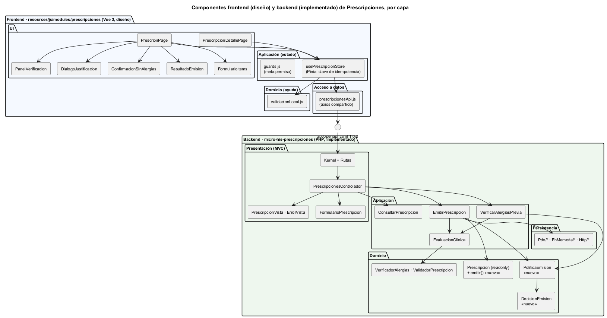
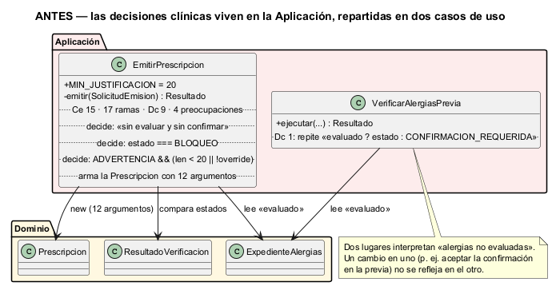
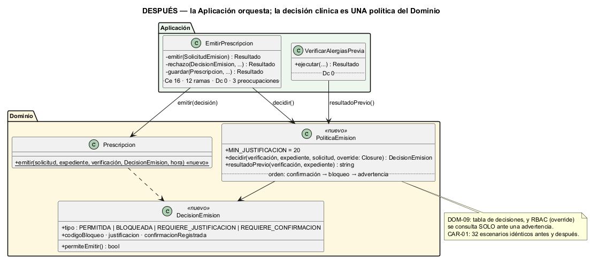

# Semana 7 — Diseño de componentes y refactorización

| | |
|---|---|
| **Curso** | Análisis de Sistemas II — Proyecto Final 2026 |
| **Módulo** | Prescripciones electrónicas con validación de alergias |
| **Proceso** | «Creación de prescripción con verificación previa de alergias» |
| **Estudiante** | Boris Alexander Quiroa Orellana |

## Entregables

| Pedido | Dónde |
|---|---|
| Diagrama de componentes | [`diagramas/semana-07-componentes.png`](diagramas/semana-07-componentes.png): frontend y backend, por capa |
| Contratos de entrada/salida | [`contratos-entrada-salida.md`](contratos-entrada-salida.md) |
| Comparación antes/después de un refactor concreto con justificación | §3–§8 de este documento · diagramas [antes](diagramas/semana-07-refactor-antes.png) y [después](diagramas/semana-07-refactor-despues.png) · código anterior en [`refactor/antes/`](refactor/antes/) |

## 1. Resumen

- **Componentes:** el backend está implementado en el Micro-HIS (cuatro capas y el Cliente). El frontend Vue está diseñado con la convención del HIS. Los une el contrato OpenAPI 1.0.0 de la semana 5.
- **Punto de mayor acoplamiento:** `EmitirPrescripcion`, elegido **midiendo** (§3). Además de orquestar, tomaba **9 decisiones clínicas** que son del Dominio:
  - qué hacer con un bloqueo;
  - cuándo una advertencia exige justificación y cuánto debe medir;
  - qué pasa si las alergias no están evaluadas.

  `VerificarAlergiasPrevia` repetía una de ellas por su cuenta.
- **Refactor:** `PoliticaEmision` y `DecisionEmision` en el Dominio, y el constructor con nombre `Prescripcion::emitir()`. Los dos casos de uso quedaron como orquestadores.
- **Sin ampliar el módulo:**
  - mismas rutas y mismo contrato;
  - 32 escenarios de caracterización idénticos antes y después;
  - el demo de la semana 4 da la misma salida.

## 2. Diagrama de componentes



Fuente: [semana-07-componentes.puml](diagramas/semana-07-componentes.puml)

| Lado | Capa | Componentes | Responsabilidad |
|---|---|---|---|
| Frontend | UI | `PrescribirPage`, `FormularioItems`, `PanelVerificacion`, `DialogoJustificacion`, `ConfirmacionSinAlergias`, `ResultadoEmision`, `PrescripcionDetallePage` | Mostrar y capturar; sin reglas |
| Frontend | Aplicación | `usePrescripcionStore` (Pinia), `guards.js` | Estado de la pantalla; **una `Idempotency-Key` por intención**, guardada mientras el resultado sea incierto |
| Frontend | Dominio (ayuda) | `validacionLocal.js` | Validación de formato para el usuario; el servidor decide |
| Frontend | Acceso a datos | `prescripcionesApi.js` sobre el `axios` compartido | HTTP, `X-Request-ID` y normalización de errores |
| Backend | Presentación | `Kernel`, `Rutas`, `PrescripcionesControlador`, `FormularioPrescripcion`, vistas | HTTP ↔ solicitudes y resultados |
| Backend | Aplicación | 3 casos de uso, `EvaluacionClinica`, 7 puertos | Flujo, transacción, permisos, traza |
| Backend | Dominio | `PoliticaEmision` y `DecisionEmision` (nuevos), `VerificadorAlergias`, `ValidadorPrescripcion`, `Prescripcion` | Reglas clínicas |
| Backend | Persistencia | PDO, InMemory y HTTP | Implementar los puertos |

Los contratos de cada componente están en [`contratos-entrada-salida.md`](contratos-entrada-salida.md).

**Lo que el frontend no tiene, a propósito:**
- un «emitir sin verificar» (R-03);
- editar o borrar (R-10);
- una cola de pendientes de enviar (semana 5).

## 3. Cómo se midió el acoplamiento

[`bin/acoplamiento.php`](../micro-his-prescripciones/bin/acoplamiento.php) analiza los tokens de cada clase de `src/`, sin comentarios ni literales:

| Medida | Qué cuenta |
|---|---|
| **Ce** | Clases del proyecto que usa (acoplamiento eferente) |
| **Ca** | Clases que la usan (aferente) |
| **Ramas** | `if`, `foreach`, `case`, `catch`, `?:`, `??`, `&&`, `\|\|` |
| **Dc** | Decisiones **clínicas** propias: compara con `BLOQUEO` o `ADVERTENCIA`, mira `evaluado`, usa el mínimo de la justificación o la confirmación «sin alergias» |
| **P** | Cuántas de las 6 preocupaciones de la tarea mezcla: prescripciones, medicamentos, dosis, alergias, validación previa, bloqueo seguro |

Resultado antes del refactor ([evidencia](evidencia/acoplamiento-1-antes.txt)):

| Clase | Capa | Ce | Ramas | Dc | P |
|---|---|---|---|---|---|
| `EvaluacionClinica` | Aplicación | 8 | 7 | 0 | 5 |
| **`EmitirPrescripcion`** | **Aplicación** | **15** | **17** | **9** | **4** |
| `VerificadorAlergias` | Dominio | 5 | 7 | 0 | 4 |
| `VerificarAlergiasPrevia` | Aplicación | 7 | 6 | 1 | 2 |
| **Total Dc en Aplicación y Presentación** | | | | **10** | |

**Por qué `EmitirPrescripcion` y no `EvaluacionClinica`, aunque esta mezcle más preocupaciones:**
- `EvaluacionClinica` las mezcla **porque su trabajo es reunirlas**: catálogo, validación, fuente y verificación. No decide nada (Dc = 0) y delega cada regla en el Dominio.
- `EmitirPrescripcion` es la que más depende de otros (Ce 15), la más ramificada (17) y la única que **decide reglas clínicas que no son suyas** (Dc 9).
- Las 10 decisiones clínicas fuera del Dominio estaban todas en los dos casos de uso.

## 4. Refactor: antes



Fuente: [semana-07-refactor-antes.puml](diagramas/semana-07-refactor-antes.puml) · Código: [`refactor/antes/EmitirPrescripcion.php`](refactor/antes/EmitirPrescripcion.php), [`refactor/antes/VerificarAlergiasPrevia.php`](refactor/antes/VerificarAlergiasPrevia.php)

```php
// EmitirPrescripcion::emitir(), antes (extracto)
if (!$expediente->evaluado && !$s->confirmaSinAlergias) { … CONFIRMACION_REQUERIDA }
if ($verificacion->estado === ResultadoVerificacion::BLOQUEO) { … traza … BLOQUEO }
if ($verificacion->estado === ResultadoVerificacion::ADVERTENCIA
    && (mb_strlen(trim((string) $s->justificacion)) < self::MIN_JUSTIFICACION
        || !$this->acceso->permite($s->usuario, 'prescripcion.override', $s->hospital))) { … 409 }
$prescripcion = new Prescripcion(null, $s->hospital, …, $verificacion->estado === ResultadoVerificacion::ADVERTENCIA
    ? trim((string) $s->justificacion) : null, !$expediente->evaluado && $s->confirmaSinAlergias, …);   // 12 argumentos

// VerificarAlergiasPrevia::ejecutar(), antes
$codigo = $expediente->evaluado ? $verificacion->estado : 'CONFIRMACION_REQUERIDA';
```

| Problema | Consecuencia |
|---|---|
| Las reglas R-04, R-05 y R-06 vivían en la **Aplicación** | Para probarlas había que armar el caso de uso completo, con repositorio, transacción y RBAC |
| «Alergias no evaluadas» se interpretaba en **dos** clases | Un cambio en una (p. ej. aceptar la confirmación ya en la previa) no llega a la otra: la pantalla y el servidor dirían cosas distintas |
| `MIN_JUSTIFICACION` era una constante de un caso de uso | Una regla clínica, dueña de quien orquesta |
| La justificación normalizada y la confirmación registrada se calculaban **al construir** la prescripción | La regla «solo se guarda la justificación si hubo advertencia» estaba escondida en un argumento ternario |

## 5. Refactor: después



Fuente: [semana-07-refactor-despues.puml](diagramas/semana-07-refactor-despues.puml)

| Pieza | Capa | Dueña de |
|---|---|---|
| `PoliticaEmision::decidir()` | Dominio | El orden **confirmación → bloqueo → advertencia**, el mínimo de 20 caracteres, la normalización de la justificación y si la confirmación queda registrada. Consulta el override **solo** si hay una advertencia |
| `PoliticaEmision::resultadoPrevio()` | Dominio | Lo que informa la verificación previa (la misma regla de «no evaluado») |
| `DecisionEmision` | Dominio | El resultado de la decisión, inmutable, con constructores con nombre |
| `Prescripcion::emitir()` | Dominio | Construir la prescripción **a partir de la decisión**; si la decisión no permite emitir, `LogicException` |
| `EmitirPrescripcion` | Aplicación | Solo el orden del proceso y la traducción de la decisión a un `Resultado` (`rechazo()`), más guardar (`guardar()`) |

```php
// EmitirPrescripcion::emitir(), después
$decision = $this->politica->decidir($verificacion, $expediente, $s,
    fn (): bool => $this->acceso->permite($s->usuario, self::PERMISO_OVERRIDE, $s->hospital));
if (!$decision->permiteEmitir()) {
    return $this->rechazo($decision, $verificacion, $s);
}

return $this->guardar(Prescripcion::emitir($s, $expediente, $verificacion, $decision, $this->reloj->ahora()), $s);
```

**Una decisión de diseño fina: el override como `Closure`.** RBAC es un puerto de la Aplicación, y el Dominio no puede conocerlo. Pasarle un booleano ya calculado obligaría a preguntar a RBAC en **cada** emisión, aunque no haya advertencia; el código anterior preguntaba solo cuando hacía falta. La `Closure` conserva ese comportamiento: el Dominio decide **si** pregunta, y la Aplicación decide **a quién**. DOM-09 lo verifica, y la mutación M29 (preguntar siempre) lo demuestra.

## 6. Comparación medida

| Medida | Antes | Después | Evidencia |
|---|---|---|---|
| Decisiones clínicas en Aplicación y Presentación | **10** | **0** | [antes](evidencia/acoplamiento-1-antes.txt) · [después](evidencia/acoplamiento-2-despues.txt) |
| `EmitirPrescripcion`: ramas | 17 | 12 | ídem |
| `EmitirPrescripcion`: Dc | 9 | 0 | ídem |
| `EmitirPrescripcion`: preocupaciones | 4 | 3 | ídem |
| `EmitirPrescripcion`: Ce | 15 | **16** | ídem |
| `VerificarAlergiasPrevia`: Dc | 1 | 0 | ídem |
| Lugares que interpretan «no evaluado» | 2 | 1 (`PoliticaEmision`) | código |
| Argumentos para construir una prescripción en el caso de uso | 12 | 5 | código |
| Pruebas | 96 | 97 (+DOM-09) | [antes](evidencia/pruebas-1-antes.txt) · [después](evidencia/pruebas-2-despues.txt) · [PostgreSQL](evidencia/pruebas-3-postgres.txt) |
| Mutaciones | 27/27 | **30/30** (+M28..M30; M6 y M7 se movieron a la política) | [mutaciones](evidencia/mutaciones.txt) |

**El Ce de `EmitirPrescripcion` subió de 15 a 16, y está bien que lo haga.** Ahora depende de dos clases pequeñas del Dominio (`PoliticaEmision`, `DecisionEmision`) en lugar de interpretar por su cuenta cuatro conceptos de otras. El refactor no buscaba bajar el número de dependencias: buscaba que las que tiene apunten hacia el Dominio y no hacia los detalles de las reglas.

## 7. Justificación

| Criterio | Cómo lo cumple |
|---|---|
| **Responsabilidad única** | `EmitirPrescripcion` cambia si cambia el **proceso** de emisión; `PoliticaEmision` cambia si cambia la **regla clínica** |
| **Separación de capas** (lo que pide la tarea) | UI → contrato → Presentación → Aplicación → Dominio ← Persistencia. La regla clínica ya no está en la Aplicación (Dc = 0) |
| **Probabilidad de cambio** | El mínimo de la justificación, el orden de las decisiones o el tratamiento de la severidad son lo primero que pedirá el comité de farmacia; ahora se cambian en una clase pura, con DOM-09 |
| **Una sola fuente de verdad** | La previa y la emisión ya no pueden contradecirse sobre «no evaluado» |
| **Testabilidad** | DOM-09 prueba la política con una tabla, sin repositorio, transacción ni RBAC |

## 8. Prueba de que no se amplió el módulo

| Evidencia | Resultado |
|---|---|
| **Caracterización** ([código anterior](evidencia/caracterizacion-1-codigo-anterior.txt)) | `bin/caracterizar.php` grabó, **antes** de tocar el código, lo observable de 32 escenarios: estado, cuerpo, `Location`, trazas y cuántas prescripciones quedaron (29 por HTTP y 3 con fallas inyectadas). CAR-01 los compara después: **idénticos** |
| Demo de la semana 4 | Las 8 respuestas son idénticas a las de la evidencia de la semana 4, que corrió con el código anterior; solo cambia la hora de emisión ([diff](evidencia/demos-sin-cambios.txt)) |
| Contrato | Sin cambios: API-01..03 pasan; `openapi.yaml` sigue en 1.0.0 |
| Rutas, códigos y tablas | Sin cambios |

`esperado.json` no se vuelve a grabar para «arreglar» una prueba que falle: es la línea base del comportamiento.

## 9. Observación para la semana 8 (no es un defecto)

La verificación previa responde `ADVERTENCIA` también al médico **sin** permiso de override (dr-ruiz). Él solo se entera al emitir (409) de que su justificación no alcanza: necesita a otro médico. La política ya puede responderlo (`decidir()` con la `Closure` de RBAC). Mostrarlo en la previa **amplía** el módulo, así que no se hizo en un refactor. Queda para el diseño UX de la semana 8.

## 10. Costos y límites

- **Dos clases más** en el Dominio y una indirección (la `Closure`).
- La métrica Dc cuenta **menciones**, no semántica. Por eso Persistencia se excluye del total: allí `confirmaSinAlergias` es el nombre de una columna.
- El frontend es **diseño**: sus contratos se verificarán cuando exista (semanas 10 y 11, prototipo).

## 11. Conclusión

El punto más acoplado no era el más grande ni el que más preocupaciones mezclaba: era el que **decidía lo que no le tocaba**. `EmitirPrescripcion` interpretaba bloqueos, advertencias, justificaciones y alergias no evaluadas, y la previa repetía una parte por su cuenta.

Después del refactor, la Aplicación no toma ninguna decisión clínica (Dc 10 → 0). Toda la regla vive en una política del Dominio que se prueba con una tabla. La caracterización, el demo y el contrato prueban que el módulo hace exactamente lo mismo que antes.
