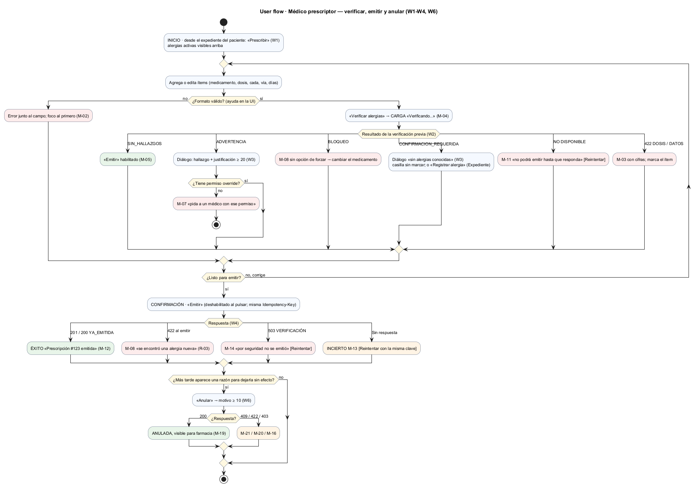
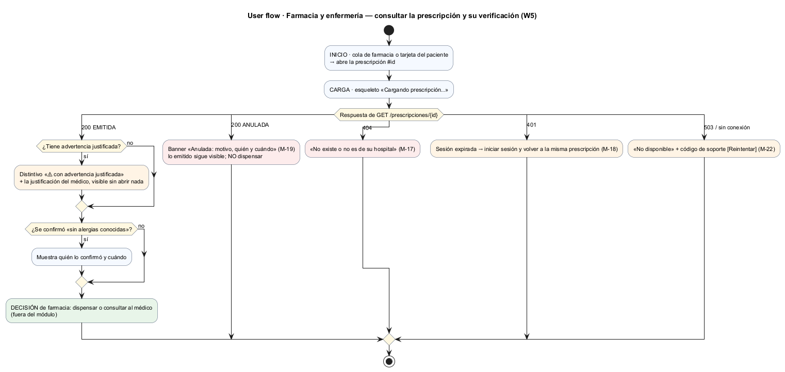
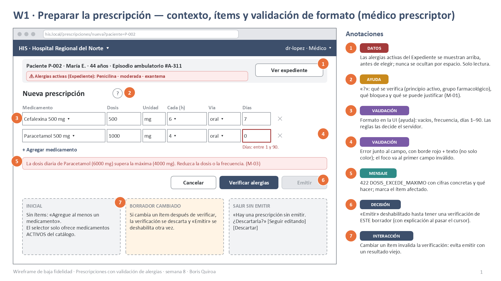
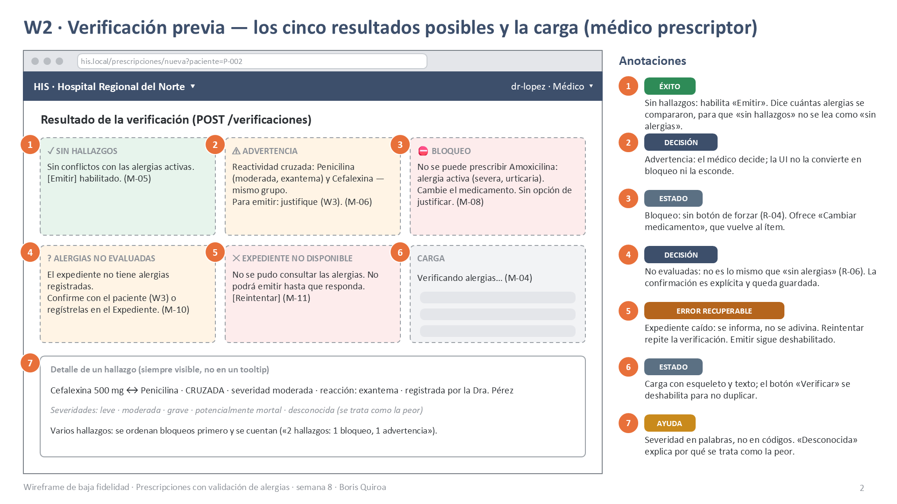
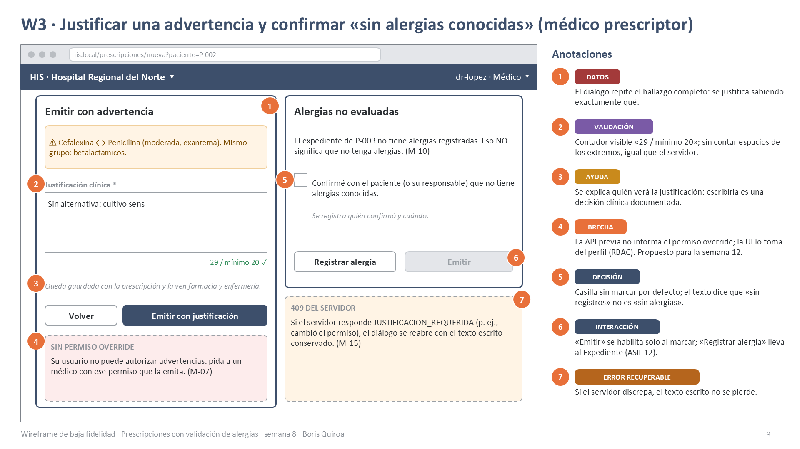
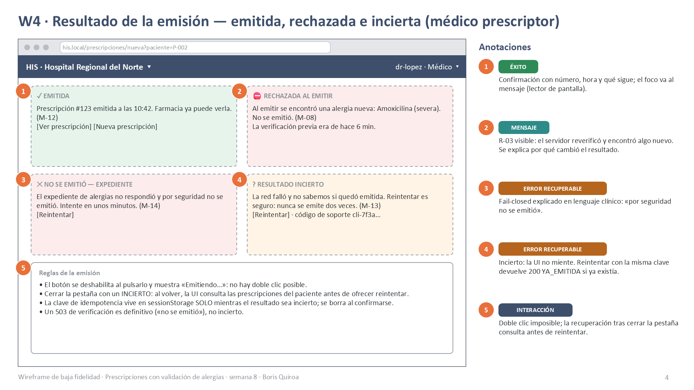
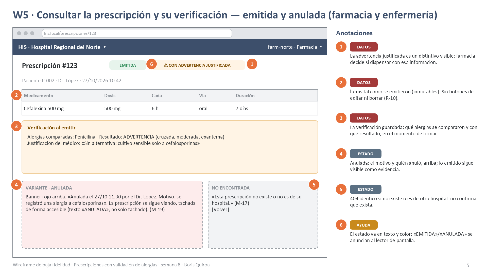
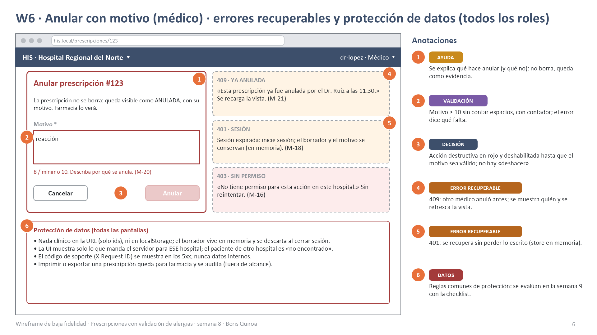

# Semana 8 — Diseño de experiencia de usuario de Prescripciones electrónicas

| | |
|---|---|
| **Curso** | Análisis de Sistemas II — Proyecto Final 2026 |
| **Módulo** | Prescripciones electrónicas con validación de alergias (ASII-15) |
| **Proceso** | «Creación de prescripción con verificación previa de alergias» |
| **Estudiante** | Boris Alexander Quiroa Orellana |

## Entregables

| Pedido | Dónde |
|---|---|
| User flow por rol | [Médico prescriptor](diagramas/semana-08-flujo-medico.png) · [Farmacia y enfermería](diagramas/semana-08-flujo-farmacia.png) |
| 4–6 wireframes anotados con estados, mensajes, validaciones y reglas de interacción | 6 wireframes con 38 anotaciones: [PPTX](wireframes/semana-08-wireframes-prescripciones.pptx) · [PDF](wireframes/semana-08-wireframes-prescripciones.pdf) · PNG en [`wireframes/`](wireframes/) |

**Cobertura pedida por la tarea:**

| Elemento | Dónde |
|---|---|
| Inicio | W1 |
| Decisión | W2 y W3 |
| Confirmación | W3 y W4 |
| Vacío | W2: «sin alergias registradas» ≠ «sin alergias» |
| Carga | W2 y W4 |
| Éxito | W2 y W4 |
| Errores recuperables | W2, W4 y W6 |
| Ayuda contextual | W1, W3 y W6 |
| Protección de datos | W5 y W6 |

## 1. Alcance y punto de partida

- **Flujo diseñado:** el del médico, que prepara, verifica y emite (y anula si hace falta), y el de farmacia y enfermería, que consultan.
- **Base técnica:**
  - la API ya implementada (OpenAPI **1.1.0**, con la anulación de la semana 6);
  - los componentes Vue de la [semana 7](../semana-07/contratos-entrada-salida.md).
- **Criterio:** cada estado de pantalla corresponde a una respuesta real de la API, contrastada con los 24 escenarios de API-03.
- **Brecha:** la única cosa que la API todavía no informa (si el médico tiene permiso override) se marca como **BRECHA** en el diseño, en lugar de inventarla (ver M-07).

## 2. Roles autorizados y lo que ve cada uno

| Rol | Permisos (RBAC) | Ve | No ve |
|---|---|---|---|
| **Médico con override** (dr-lopez, dr-sur) | `emitir`, `override`, `consultar`, `anular` | W1–W6; puede emitir con advertencia justificada | — |
| **Médico sin override** (dr-ruiz) | `emitir`, `consultar`, `anular` | W1–W6; ante una advertencia ve M-07 | «Emitir con justificación» activo |
| **Farmacia / enfermería** (farm-norte) | `consultar` | W5 (y los errores de W6) | «Prescribir», «Anular» (el menú no los muestra) |
| Otro hospital | — | 404 (M-17) | Si la prescripción existe |
| Sin sesión | — | 401 (M-18) | Todo |

## 3. Principios de diseño

1. **La seguridad la decide el servidor.**
   - La UI valida el formato solo como ayuda (`validacionLocal.js`).
   - La emisión vuelve a verificar (R-03). Por eso existe el estado «Al emitir se encontró una alergia nueva» (W4).
2. **«Sin registros» no es «sin alergias».** Cuando el expediente está vacío se pide una confirmación explícita, desmarcada por defecto y guardada con su autor (R-06).
3. **El bloqueo no tiene salida por la puerta de atrás.** No existe un botón para forzar. La salida es «Cambiar medicamento» (R-04).
4. **Si falla, falla cerrado y lo dice:** «por seguridad no se emitió» (R-07). Nunca se muestra un resultado que no se sabe.
5. **Una prescripción emitida es evidencia.** No hay editar ni borrar. Anularla deja visible lo emitido, con su motivo (R-10).

## 4. User flows por rol

### 4.1 Médico prescriptor — verificar, emitir y anular

**Recorrido:**
- **Inicio:** desde el expediente del paciente («Prescribir»), con las alergias activas visibles.
- **Bucle de corrección:**
  - formato → verificación previa;
  - cinco resultados posibles, más el 422 de dosis o de datos;
  - el bucle se repite hasta que el borrador está listo.
- **Confirmación:** «Emitir», con la misma `Idempotency-Key` en cada reintento.
- **Cuatro finales:** emitida, rechazada por una alergia nueva, 503 de verificación o incierto.
- **Anulación (opcional):** motivo ≥ 10 → ANULADA, o 409/422/403.

### 4.2 Farmacia y enfermería — consultar

**Recorrido:**
- **Inicio:** la cola de farmacia o la tarjeta del paciente.
- **Carga**, y luego uno de cinco resultados:
  - EMITIDA (con o sin advertencia justificada);
  - ANULADA;
  - 404;
  - 401;
  - 503.
- **Lo que queda fuera del módulo:** la decisión de dispensar. La UI solo le da a farmacia la información para tomarla.

## 5. Wireframes anotados

Cada llamada numerada lleva una etiqueta: ESTADO, MENSAJE, VALIDACIÓN, INTERACCIÓN, DATOS, AYUDA, DECISIÓN, ÉXITO, ERROR RECUPERABLE o BRECHA.

| # | Pantalla | Rol | Estados | Mensajes |
|---|---|---|---|---|
| W1 | [Preparar la prescripción](wireframes/semana-08-w1-preparar.png) | Médico | inicial · error de formato · 422 dosis | M-01, M-02, M-03, M-09 |
| W2 | [Verificación previa](wireframes/semana-08-w2-verificacion-previa.png) | Médico | carga · 5 resultados | M-04, M-05, M-06, M-08, M-10, M-11 |
| W3 | [Justificar / confirmar](wireframes/semana-08-w3-justificar-confirmar.png) | Médico | validación · sin permiso · 409 | M-07, M-10, M-15 |
| W4 | [Resultado de la emisión](wireframes/semana-08-w4-resultado-emision.png) | Médico | éxito · rechazada · 503 · incierto | M-08, M-12, M-13, M-14 |
| W5 | [Consultar](wireframes/semana-08-w5-consultar.png) | Farmacia y enfermería | emitida · con advertencia · anulada · 404 | M-17, M-19 |
| W6 | [Anular · errores · protección](wireframes/semana-08-w6-anular-errores.png) | Médico / todos | validación · 409 · 401 · 403 | M-16, M-18, M-20, M-21, M-22 |

## 6. Catálogo de mensajes

| ID | Cuándo | Texto | Origen (código de la API) |
|---|---|---|---|
| M-01 | Ayuda «?» del título (W1) | «Antes de emitir se comparan los medicamentos con las alergias activas del paciente: el mismo principio activo bloquea; el mismo grupo pide justificación.» | UI (R-04, R-05) |
| M-02 | Formato inválido | Junto al campo: «Indique la dosis (mayor que 0)», «Días entre 1 y 90»… | `validacionLocal.js` y 422 `DATOS_INVALIDOS` (lista de campos) |
| M-03 | Dosis excedida | «La dosis diaria de {medicamento} ({n} mg) supera la máxima ({max} mg). Reduzca la dosis o la frecuencia.» | 422 `DOSIS_EXCEDE_MAXIMO` |
| M-04 | Cargando la verificación | «Verificando alergias…» (`aria-live`) | UI |
| M-05 | Sin hallazgos | «Sin conflictos con las {n} alergias activas.» | `SIN_HALLAZGOS` |
| M-06 | Advertencia | «Reactividad cruzada: {alérgeno} ({severidad}) y {medicamento}, mismo grupo. Para emitir: justifique.» | `ADVERTENCIA` |
| M-07 | Advertencia sin permiso override | «Su usuario no puede autorizar advertencias: pida a un médico con ese permiso que la emita.» | **BRECHA:** la previa no informa el permiso; la UI lo toma del perfil de RBAC. Si se equivoca, el servidor responde 409 (M-15) |
| M-08 | Bloqueo | «No se puede prescribir {medicamento}: alergia activa ({severidad}, {reacción}). Cambie el medicamento.» Al emitir: «Al emitir se encontró una alergia nueva…» | `BLOQUEO`; 422 `BLOQUEO_ALERGIA` / `BLOQUEO_ALERGIA_CRUZADA` |
| M-09 | «Emitir» deshabilitado | Al pasar el cursor o con el foco: «Verifique las alergias de este borrador para poder emitir.» | UI (cambiar un ítem invalida la verificación) |
| M-10 | Expediente sin alergias | «El expediente no tiene alergias registradas. Eso NO significa que no tenga alergias.» | `CONFIRMACION_REQUERIDA` (previa y 422 al emitir) |
| M-11 | Expediente caído (previa) | «No se pudo consultar las alergias. No podrá emitir hasta que responda. [Reintentar]» | 503 `VERIFICACION_NO_DISPONIBLE` |
| M-12 | Emitida | «Prescripción #{id} emitida a las {hora}. Farmacia ya puede verla.» | 201 `EMITIDA` · 200 `YA_EMITIDA` |
| M-13 | Sin respuesta al emitir | «La red falló y no sabemos si quedó emitida. Reintentar es seguro: nunca se emite dos veces.» | Cliente (INCIERTO) |
| M-14 | Expediente caído al emitir | «El expediente de alergias no respondió y por seguridad no se emitió. Intente en unos minutos.» | 503 `VERIFICACION_NO_DISPONIBLE` |
| M-15 | El servidor exige justificación | El diálogo se reabre, con el texto conservado: «Esta advertencia necesita justificación y el permiso override.» | 409 `JUSTIFICACION_REQUERIDA` |
| M-16 | Sin permiso | «No tiene permiso para esta acción en este hospital.» | 403 `PERMISO_DENEGADO` |
| M-17 | No encontrada | «Esta prescripción no existe o no es de su hospital.» | 404 `NO_ENCONTRADO` (R-08) |
| M-18 | Sesión expirada | «Su sesión expiró. Inicie sesión; el borrador y el motivo se conservan.» | 401 `NO_AUTENTICADO` |
| M-19 | Prescripción anulada | Banner: «Anulada el {fecha} por {usuario}. Motivo: {motivo}.» | `estado: ANULADA` + `anulacion` (1.1.0) |
| M-20 | Motivo corto | «{n} / mínimo 10. Describa por qué se anula.» | 422 `MOTIVO_REQUERIDO` |
| M-21 | Ya anulada | «Esta prescripción ya fue anulada por {usuario} a las {hora}.» Se recarga la vista. | 409 `ESTADO_NO_PERMITE_ANULAR` |
| M-22 | Falla técnica o código que la UI no debería provocar | «El servicio no está disponible. Intente en unos minutos. Código de soporte: {X-Request-ID}» | 500 `ERROR_INTERNO`, 503 `SERVICIO_NO_DISPONIBLE` / `ERROR_PERSISTENCIA`; sin conexión; `CLAVE_REUTILIZADA`, `IDEMPOTENCY_KEY_REQUERIDA`, `JSON_INVALIDO`, `CUERPO_INVALIDO`, `TENANT_*` (defensivos) |

**Comprobación:** los 23 códigos del enum `Error` del contrato tienen su mensaje. `RUTA_NO_ENCONTRADA` y `METODO_NO_PERMITIDO` no pueden salir de la UI, porque usa rutas fijas.

## 7. Reglas de interacción

| Regla | Dónde |
|---|---|
| Cambiar cualquier ítem invalida la verificación y deshabilita «Emitir» (M-09): nunca se emite con un resultado viejo | W1, W2 |
| «Verificar» y «Emitir» se deshabilitan mientras esperan respuesta: no hay doble clic | W2, W4 |
| Una `Idempotency-Key` por intención. Mientras el resultado sea INCIERTO, la clave (no el contenido) se conserva y «Reintentar» la reutiliza | W4 |
| Al reabrir la pestaña con una emisión incierta pendiente, primero se reintenta con la misma clave: el servidor responde `YA_EMITIDA` si ya existía | W4 |
| Los diálogos (justificación, «sin alergias», anular) atrapan el foco; Esc cancela; el foco inicial está en el campo de texto, no en el botón que confirma | W3, W6 |
| Los contadores (20 para la justificación, 10 para el motivo) ignoran los espacios de los extremos, igual que el servidor | W3, W6 |
| Un 422 marca el ítem o el campo, muestra el texto del servidor y mueve el foco; un 409 reabre el diálogo sin perder lo escrito | W1, W3, W6 |
| «Anular» va en rojo y está deshabilitado hasta tener un motivo válido; no hay «deshacer» | W6 |
| Un 4xx no se reintenta; un 5xx o la falta de respuesta, sí (con la misma clave) | W4, W6 |

## 8. Matriz de estados por pantalla

| Pantalla | Inicial | Carga | Éxito | Vacío | Error recuperable | Error no recuperable |
|---|---|---|---|---|---|---|
| W1 Preparar | Paciente y alergias activas; un ítem vacío | Esqueleto de las alergias | Borrador válido | Sin alergias → aviso (M-10 en W2) | M-02, M-03, M-18 | M-16, M-17 (paciente de otro hospital) |
| W2 Previa | «Emitir» deshabilitado (M-09) | M-04 | M-05 | M-10 (confirmar) | M-11, M-22 | M-08 (cambiar el medicamento) |
| W3 Justificar / confirmar | Casilla desmarcada; texto vacío | — | Habilita «Emitir» | — | M-15 | M-07 (otro médico) |
| W4 Emisión | — | «Emitiendo…» | M-12 | — | M-13, M-14, M-22 | M-08 (alergia nueva) |
| W5 Consultar | — | Esqueleto | Detalle (± advertencia; M-19) | — | M-18, M-22 | M-17 |
| W6 Anular | Motivo vacío | «Anulando…» | ANULADA (M-19) | — | M-20, M-18, M-22 | M-21, M-16 |

## 9. Ayuda contextual

| Dónde | Ayuda |
|---|---|
| «?» del título (W1) | Qué se compara y qué bloquea o se puede justificar (M-01) |
| Junto a la dosis (W1) | La máxima diaria del catálogo y cómo se calcula (dosis × 24 / frecuencia) |
| Severidad (W2) | En palabras, no en códigos. «Desconocida» explica por qué se trata como la peor |
| Justificación (W3) | Quién la verá (farmacia y enfermería) y que queda guardada con la prescripción |
| «Sin alergias conocidas» (W3) | La diferencia entre «sin registros» y «sin alergias», y el enlace «Registrar alergia» (Expediente, ASII-12) |
| Anular (W6) | Qué hace y qué no: no borra; lo emitido queda visible como evidencia |

## 10. Protección de datos

1. **Nada clínico en la URL** (solo ids), ni en `localStorage` ni en la caché.
   - El borrador vive en memoria (Pinia) y se descarta al cerrar sesión o al cambiar de hospital.
   - Lo único que va a `sessionStorage` es la `Idempotency-Key` de una emisión incierta, que no es un dato clínico.
2. **El paciente se identifica con lo mínimo.** El nombre y la edad vienen del Expediente; la UI no los copia a otro lado.
3. **El 404 no revela otros tenants:** «no existe o no es de su hospital».
4. **La traza no muestra datos clínicos:** la Auditoría recibe `prescripcion:<id>` y el resultado (RNF-07). La UI no muestra la traza.
5. **El código de soporte es el `X-Request-ID`**, nunca un mensaje interno. El 500 no trae detalles (HTTP-09).
6. **Imprimir o exportar** queda fuera de alcance. Si se hace, se audita (anotado como mejora).

## 11. Trazabilidad

| Elemento de UX | Requisito / regla | Evidencia en el backend |
|---|---|---|
| «Emitir» solo con una verificación de ESTE borrador; la emisión reverifica | RF-04, R-03 | APP-10 |
| Bloqueo sin botón de forzar | RF-05, R-04 | DOM-03, APP-05 |
| Diálogo de justificación (≥ 20) + override | RF-06, R-05 | APP-06, APP-07, DOM-09 |
| Confirmación «sin alergias conocidas» | RF-07, R-06 | APP-08 |
| «Por seguridad no se emitió» (M-11, M-14) | RF-08, R-07, RNF-03 | APP-13, HTTP-03, HFA-02 |
| 422 con cifras de dosis | RF-03, R-02 | DOM-02, APP-09 |
| Reintento seguro (M-13) | RF-12, R-11 | APP-12, APP-17, CLI-02, CLI-03 |
| 404 sin revelar el tenant | RF-09, R-08 | APP-11, HTTP-07, ANU-04 |
| Sin editar ni borrar; anular con motivo | RF-11, R-10 | DOM-08, ANU-01..07 |
| Lo que ve farmacia (verificación y justificación) | RF-13, R-12 | HTTP-07, APP-02 |
| Los cinco resultados de la previa | RF-14 | APP-04, HTTP-08 |
| Cada código de la API tiene su mensaje | Contrato 1.1.0 | API-03 |

## 12. Validación del diseño y brecha

- **Mensajes:** se contrastaron con el enum `Error` del contrato (23 códigos) y con los cinco códigos de la verificación previa.
- **Brecha M-07:** la UI no puede saber con certeza si el médico tiene override antes de emitir.
  - **Hoy:** lo toma del perfil de RBAC y el servidor tiene la última palabra (409 → M-15).
  - **Propuesta para la semana 12:** que la previa devuelva `puede_justificar: true|false`.
- **Siguientes pasos:**
  - la evaluación heurística y WCAG se hace en la semana 9 sobre estos wireframes;
  - el prototipo navegable, en la semana 11.
