# Semana 9 — Evaluación de usabilidad y accesibilidad del flujo UX de Prescripciones

| | |
|---|---|
| **Curso** | Análisis de Sistemas II — Proyecto Final 2026 |
| **Módulo** | Prescripciones electrónicas con validación de alergias (ASII-15) |
| **Proceso** | «Creación de prescripción con verificación previa de alergias» |
| **Estudiante** | Boris Alexander Quiroa Orellana |

## Entregables

| Pedido | Dónde |
|---|---|
| Checklist completado | [`checklist-evaluacion.md`](checklist-evaluacion.md): 40 ítems (10 heurísticas de Nielsen, 21 criterios de WCAG 2.2 AA y 9 propios del módulo) y un recorrido de teclado por pantalla |
| Evidencia de al menos 6 hallazgos | **15 hallazgos**, cada uno con su recorte marcado en [`evidencia/hallazgos/`](evidencia/hallazgos/) y el contraste medido en [`evidencia/contraste-wcag.txt`](evidencia/contraste-wcag.txt) |
| Backlog priorizado con corrección propuesta y criterio verificable | [§6](#6-backlog-priorizado): 15 ítems B-01..B-15 en 3 prioridades |

## 1. Resumen

- **Qué se evaluó:** los 6 wireframes y los 2 flujos de la semana 8, con las heurísticas de Nielsen y WCAG 2.2 AA (teclado, foco, contraste, etiquetas, mensajes y prevención de errores).
- **Resultado del checklist:** 17 ✅, 14 ⚠️ y 9 ❌.
- **Hallazgos:** 15. Cinco son de severidad 3.
- **Los tres más importantes para la seguridad del paciente:**
  1. **H-01:** «Emitir» deshabilitado explica por qué solo al pasar el ratón. Quien usa el teclado o un lector de pantalla no encuentra el botón ni sabe que le falta verificar. Es el paso que garantiza la verificación previa.
  2. **H-03:** la casilla «Confirmé que no tiene alergias conocidas» es la afirmación clínica más delicada del flujo, y es un objetivo de ≈ 21 px con un borde de 2,64:1. Falla WCAG 2.5.8 y 1.4.11.
  3. **H-07:** en la grilla de ítems, un lector de pantalla anuncia «0, campo de edición» sin decir que es «Días» del ítem 2. Se puede corregir una dosis en el ítem equivocado.
- **Dos decisiones de la semana 8 se contradicen:**
  - **H-02:** el 401 promete conservar el borrador, pero la regla de protección lo guarda solo en memoria.
  - **H-10:** W4 promete consultar «las prescripciones del paciente», una operación que la API no tiene.
- **Contraste:** el instrumento dio **13 pares que fallan**, con los colores **tal cual** salen del generador de los wireframes. Con la paleta propuesta, los 13 cumplen (`contraste.py` termina con 0).

## 2. Método

| Paso | Cómo |
|---|---|
| 1. Heurísticas | Se revisaron las 10 de Nielsen sobre cada wireframe y sus anotaciones |
| 2. WCAG 2.2 AA | Los criterios que pide la tarea: teclado (2.1.1, 2.1.2), foco (2.4.3, 2.4.7, 2.4.11, 3.2.1, 3.2.2), contraste (1.4.3, 1.4.11, más 1.4.1, 1.4.13 y 2.5.8), etiquetas (1.3.1, 3.3.2, 4.1.2), mensajes (3.3.1, 3.3.3, 4.1.3) y prevención de errores (3.3.4, 3.3.7, 3.3.8) |
| 3. Contraste medido | [`contraste.py`](herramientas/contraste.py) calcula la razón WCAG de los 27 pares de color del generador de wireframes |
| 4. Recorrido de teclado | Se simuló Tab, Shift+Tab, Enter, Espacio, Esc y las flechas en el orden definido por las anotaciones ([checklist §4](checklist-evaluacion.md#4-recorrido-de-teclado)) |
| 5. Contraste con la API | Cada promesa de la UI se contrastó con el contrato 1.1.0 (operaciones y códigos) |
| 6. Evidencia | [`recortes.py`](herramientas/recortes.py) marca en rojo cada hallazgo sobre el PNG de la semana 8 |

### 2.1 Priorización

**Severidad** (escala de Nielsen):

| Valor | Significado |
|:-:|---|
| 0 | No es un problema |
| 1 | Cosmético |
| 2 | Menor |
| 3 | Mayor |
| 4 | Catástrofe |

En este módulo, un problema que puede llevar a **emitir sin verificar o con el dato equivocado** sube un nivel.

**Prioridad:**

| Prioridad | Cuándo | Se corrige en |
|---|---|---|
| **P1** | Severidad 3, o un criterio WCAG A/AA que deja a alguien sin poder completar la tarea | Antes del prototipo (semanas 10–11) |
| **P2** | Severidad 2 | En el prototipo |
| **P3** | Severidad 1 | Si el tiempo alcanza; si no, queda registrado |

## 3. Medición de contraste

`python herramientas/contraste.py` ([salida completa](evidencia/contraste-wcag.txt)):

| Par | Uso | Actual | Mín. | Propuesto | Nuevo |
|---|---|---:|---:|---|---:|
| C-01 | Etiquetas de campo y columnas | 3,26 | 4,5 | `#5F6670` | 5,80 |
| C-02 | Encabezados de tabla | 2,93 | 4,5 | `#5F6670` | 5,22 |
| C-03 | Pistas en cursiva | 3,26 | 4,5 | `#5F6670` | 5,80 |
| C-04 | Títulos de estado sobre gris | 2,93 | 4,5 | `#5F6670` | 5,22 |
| C-05 | Títulos de estado sobre ámbar | 3,00 | 4,5 | `#5F6670` | 5,34 |
| C-06 | Títulos de estado sobre rosa (BLOQUEO, 403) | 2,85 | 4,5 | `#5F6670` | 5,08 |
| C-07 | Título SIN HALLAZGOS sobre verde | 2,88 | 4,5 | `#5F6670` | 5,12 |
| C-08 | Íconos «?» y «✕» | 3,26 | 4,5 | `#5F6670` | 5,80 |
| C-09 | Datos de cabecera de la prescripción | 3,26 | 4,5 | `#5F6670` | 5,80 |
| C-10 | Chip «EMITIDA» | 3,75 | 4,5 | `#1F6B43` | 5,72 |
| C-11 | Contador válido «29 / mínimo 20 ✓» | 4,25 | 4,5 | `#1F6B43` | 6,48 |
| C-12 | Borde de campo | 2,64 | 3,0 | `#7D838A` | 3,83 |
| C-13 | Borde de la casilla «sin alergias conocidas» | 2,64 | 3,0 | `#7D838A` | 3,83 |

**Los otros 14 pares cumplen**, entre ellos:
- las alergias activas en rojo (5,70);
- el hallazgo en ámbar (6,82);
- el error junto al campo (6,51);
- la cabecera y los botones primarios (8,30).

Los botones deshabilitados «Emitir» y «Anular» están exentos (1.4.3), pero eso no exime a su **explicación** (H-01).

## 4. Hallazgos

### H-01 · «Emitir» deshabilitado explica por qué solo al pasar el ratón — W1, W2, W6 · Severidad 3 · P1

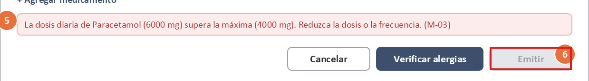

- **Qué pasa:** «Emitir» está deshabilitado hasta que se verifica el borrador. La razón (M-09) aparece en un tooltip «al pasar el cursor». Un botón deshabilitado sale del orden de Tab y no muestra tooltips con el foco. Lo mismo pasa con «Anular» (W6).
- **Por qué importa:**
  - viola **WCAG 2.1.1**, **1.4.13** y **3.3.1**, y la heurística **N9**;
  - quien usa el teclado o un lector de pantalla llega al final del formulario sin encontrar «Emitir» y sin saber que le falta verificar. Es el paso que hace cumplir la verificación previa.
- **Corrección:**
  - un texto **siempre visible** junto al botón: «Primero verifique las alergias de este borrador», enlazado con `aria-describedby`;
  - el botón queda alcanzable con `aria-disabled="true"`, en lugar de `disabled`;
  - al pulsarlo sin verificar, el foco va a «Verificar alergias». En W6, igual: «Escriba el motivo (mínimo 10)».

### H-02 · El 401 promete conservar el borrador, pero no se puede — W6 · Severidad 3 · P1

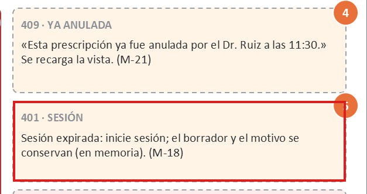

- **Qué pasa:** M-18 dice «el borrador y el motivo se conservan (en memoria)». La regla de protección de W6 los guarda solo en memoria (Pinia), y la memoria se pierde al navegar a `/login`.
- **Por qué importa:**
  - viola **N4**, **WCAG 3.3.7** y **3.3.8**: el médico vuelve a escribir los ítems y la justificación;
  - además, la promesa empuja a guardar datos clínicos en el navegador para cumplirla, y eso rompe P-09.
- **Corrección:** renovar la sesión en un **diálogo sobre la misma página**, sin navegar, para que el store sobreviva. Si la renovación falla, M-18 dice la verdad: «Deberá volver a cargar la prescripción».

### H-03 · La casilla «sin alergias conocidas» es pequeña y de bajo contraste — W3 · Severidad 3 · P1

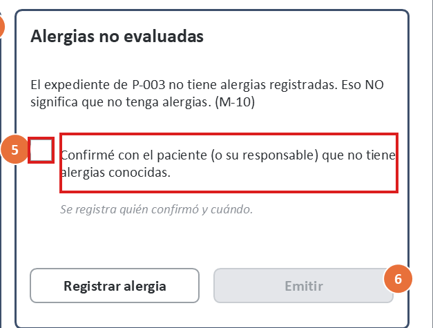

- **Qué pasa:** la casilla mide 0,22 in (≈ 21 px CSS), su borde tiene 2,64:1 y no se define que el texto sea su `<label>`.
- **Por qué importa:**
  - viola **WCAG 2.5.8** (mínimo 24 × 24 px) y **1.4.11**;
  - es la afirmación clínica más delicada del flujo (R-06): queda guardada con el nombre del médico. Que cueste verla o marcarla invita a errores en los dos sentidos.
- **Corrección:**
  - la casilla de 24 px como mínimo, con el borde `#7D838A`;
  - el texto como `<label for>`, para que toda la frase sea el objetivo.

### H-04 · Texto secundario con contraste insuficiente — W1–W6 · Severidad 3 · P1

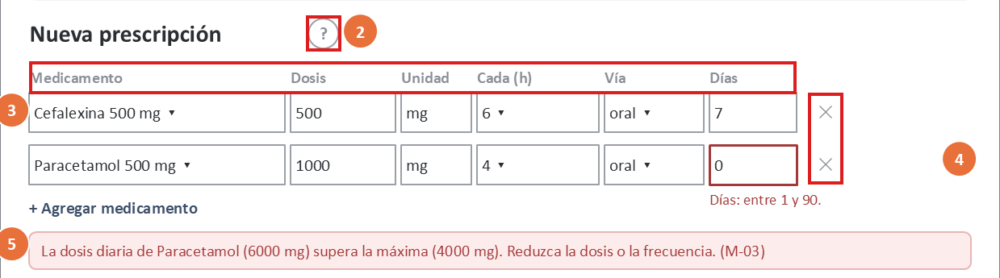

- **Qué pasa:** etiquetas, columnas, títulos de estado, pistas, la cabecera de W5 y los íconos «?» y «✕» usan `#8A8F96`, con razones de 2,85 a 3,26:1 (C-01..C-09).
- **Por qué importa:** viola **WCAG 1.4.3** en todas las pantallas. Las etiquetas dicen qué va en cada campo de dosis.
- **Corrección:**
  - `#5F6670` (5,08–5,80:1);
  - además, un token de **anillo de foco** `#3D4F6B` de 2 px (8,30:1), que hoy no está dibujado (2.4.7).

### H-05 · Los verdes de éxito no alcanzan 4,5:1 — W3, W5 · Severidad 2 · P2

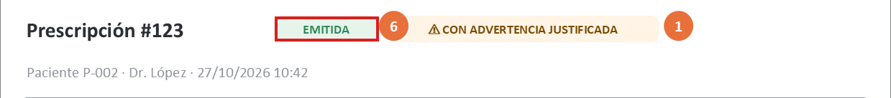

- **Qué pasa:** el chip «EMITIDA» (3,75:1) y el contador «29 / mínimo 20 ✓» (4,25:1) usan `#2E8B57`.
- **Por qué importa:** viola **WCAG 1.4.3**. «EMITIDA» es lo primero que mira farmacia.
- **Corrección:** `#1F6B43` (5,72 y 6,48:1).

### H-06 · Bordes de campos con contraste insuficiente — W1, W3 · Severidad 2 · P2

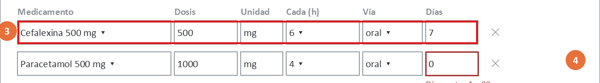

- **Qué pasa:** el borde `#9AA0A6` sobre blanco tiene 2,64:1.
- **Por qué importa:** viola **WCAG 1.4.11**. Con baja visión, la grilla de ítems es un mar de texto sin límites.
- **Corrección:** `#7D838A` (3,83:1).

### H-07 · Los campos de cada ítem no tienen etiqueta propia — W1 · Severidad 3 · P1

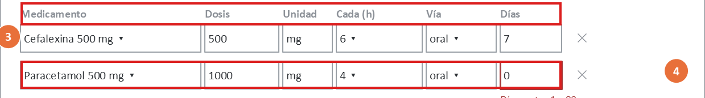

- **Qué pasa:** «Medicamento», «Dosis»… son texto suelto sobre la grilla. Cada campo no tiene un nombre accesible, y nada dice a qué ítem pertenece.
- **Por qué importa:**
  - viola **WCAG 1.3.1**, **3.3.2** y **4.1.2**;
  - un lector de pantalla anuncia «1000, campo de edición». Con dos ítems, se puede cambiar la dosis del medicamento equivocado;
  - el error «Días: entre 1 y 90» no se asocia a su campo.
- **Corrección:**
  - cada ítem es un `<fieldset>` con la leyenda «Ítem 2: Paracetamol»;
  - cada campo, con `aria-label` («Días»);
  - el error, enlazado con `aria-describedby` y `aria-invalid`.

### H-08 · «✕» quita un ítem sin nombre ni confirmación — W1 · Severidad 2 · P2

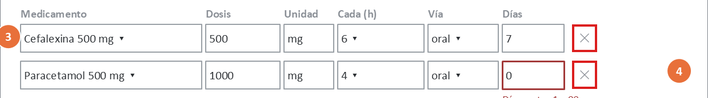

- **Qué pasa:** el ícono «✕» no tiene nombre accesible, tiene 3,26:1 de contraste y quita el ítem al instante.
- **Por qué importa:** viola **WCAG 4.1.2** y **N5**. Un lector de pantalla diría «multiplicación», y un clic de más borra un medicamento ya cargado.
- **Corrección:** un `<button aria-label="Quitar ítem 2: Paracetamol">` y, en lugar de confirmar, **deshacer**: «Se quitó Paracetamol. [Deshacer]» durante 10 s, anunciado con `aria-live`.

### H-09 · La severidad y el «no evaluadas» usan palabras distintas para lo mismo — W2, W3, W4 · Severidad 2 · P2

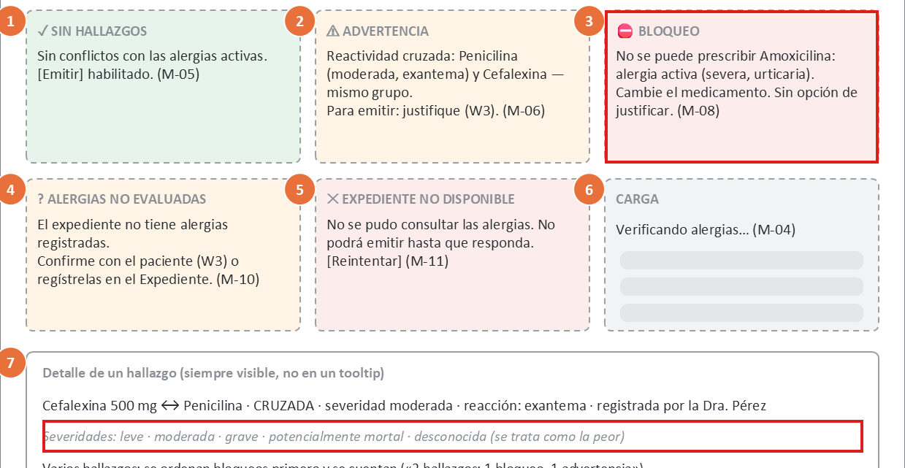

- **Qué pasa:**
  - BLOQUEO dice «severa» (W2) y RECHAZADA dice «severa» (W4), pero la escala de ayuda de W2 dice «grave»;
  - el título «Alergias no evaluadas» (W2, W3) es el nombre técnico de `CONFIRMACION_REQUERIDA`, mientras el texto dice «no tiene alergias registradas».
- **Por qué importa:** viola **N2** y **N4**. En una decisión clínica, dos nombres para la misma severidad hacen dudar de si son la misma.
- **Corrección:**
  - un **glosario fijo** del enum `severidad`: mild = leve, moderate = moderada, severe = grave, life_threatening = potencialmente mortal, unknown = desconocida, usado en todas las pantallas;
  - el título pasa a «Sin alergias registradas».

### H-10 · W4 promete una operación que la API no tiene y trunca el código de soporte — W4 · Severidad 2 · P2

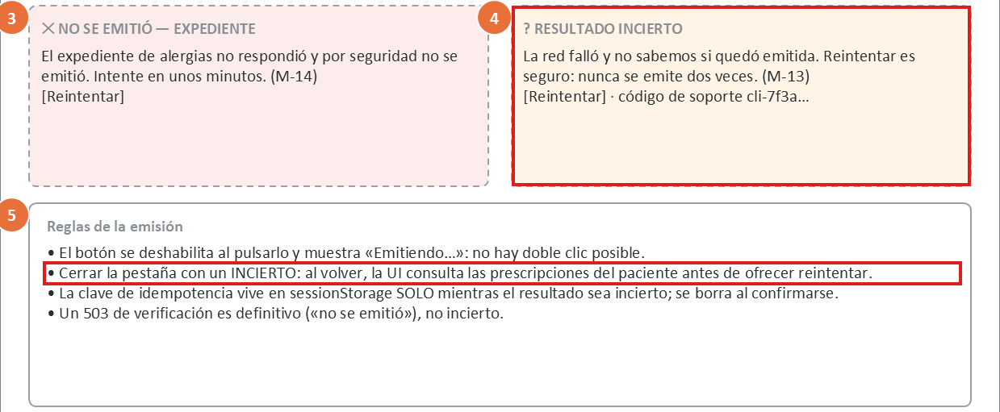

- **Qué pasa:**
  - la regla de W4 dice «al volver, la UI consulta las prescripciones del paciente antes de ofrecer reintentar». El contrato 1.1.0 no tiene un listado por paciente, y el documento de la semana 8 (§7) dice otra cosa: reintentar con la misma clave;
  - el código de soporte se muestra como «cli-7f3a…».
- **Por qué importa:** viola **N4** y **N9**. Quien implemente W4 no puede cumplirla, y un código truncado no sirve para dictarlo a soporte.
- **Corrección:**
  - la regla pasa a ser: «al volver, se reintenta con la misma `Idempotency-Key`; el servidor responde `YA_EMITIDA` si ya existía» (CLI-02);
  - el código completo, con un botón «Copiar».

### H-11 · El médico sin override escribe la justificación antes de saber que no puede — W3 · Severidad 2 · P2

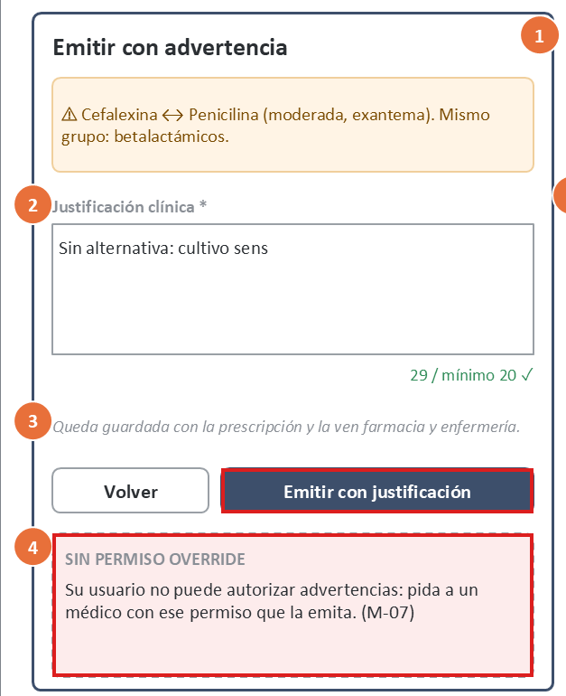

- **Qué pasa:** M-07 aparece **debajo** de «Emitir con justificación», que sigue activo. El médico escribe 20 caracteres o más, pulsa y recién entonces se entera.
- **Por qué importa:** viola **N5** y P-04, y contradice la nota de la propia diapositiva («se lo decimos ANTES de que escriba»).
- **Corrección:** si el perfil no tiene override, el diálogo **reemplaza** el área de texto y el botón por M-07, con «Volver» como única acción. Mientras la brecha de la semana 12 siga abierta, el 409 (M-15) sigue siendo la red de seguridad.

### H-12 · El resultado de la verificación no se anuncia — W2 · Severidad 2 · P2

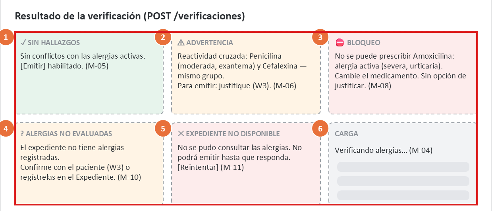

- **Qué pasa:** «Verificando alergias…» se anuncia (M-04), pero el resultado (sin hallazgos, advertencia o bloqueo) no.
- **Por qué importa:** viola **WCAG 4.1.3** y **N1**. Con lector de pantalla no se sabe si la verificación terminó ni qué dijo, y es justo la información que el médico necesita.
- **Corrección:** una región `aria-live` que anuncia el resultado con su número de hallazgos: «Bloqueo: 1 hallazgo. Amoxicilina, alergia grave». En BLOQUEO, el anuncio es `assertive`.

### H-13 · El motivo se marca como error mientras se escribe — W6 · Severidad 1 · P3

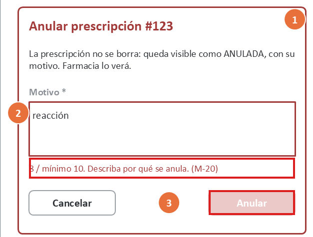

- **Qué pasa:** con 8 caracteres escritos, el campo ya está en rojo con «8 / mínimo 10».
- **Por qué importa:** viola **N9**: señala como error algo que el usuario todavía está escribiendo.
- **Corrección:** el contador es neutro mientras se escribe y pasa a error solo al salir del campo o al pulsar «Anular» (ver H-01).

### H-14 · El «*» de obligatorio no tiene leyenda — W3, W6 · Severidad 1 · P3

- **Qué pasa:** «Justificación clínica *» y «Motivo *» no tienen una explicación del asterisco.
- **Por qué importa:** viola **WCAG 3.3.2**.
- **Corrección:** la leyenda «* obligatorio» al inicio de cada diálogo y `aria-required="true"` en los campos.

### H-15 · La ayuda «?» no está definida para el teclado ni tiene nombre accesible — W1 · Severidad 2 · P2

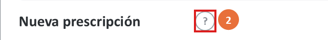

- **Qué pasa:** el «?» es un círculo con un signo. No se define si es un botón ni qué anuncia.
- **Por qué importa:** viola **WCAG 2.1.1** y **4.1.2**. M-01 explica qué bloquea y qué se puede justificar, y queda fuera de alcance.
- **Corrección:** un `<button aria-label="Ayuda: cómo se verifican las alergias" aria-expanded>` que despliega la ayuda; Esc la cierra.

## 5. Fortalezas (se mantienen)

| Fortaleza | Dónde |
|---|---|
| Las alergias activas se ven antes de elegir el medicamento | W1 |
| «Sin registros» ≠ «sin alergias»: la confirmación es explícita y desmarcada | W2, W3 |
| El bloqueo no tiene ninguna forma de forzarse; la salida es cambiar el medicamento | W2 |
| Fail-closed explicado en lenguaje clínico, y el incierto no se disfraza de éxito | W2, W4 |
| Los colores de estado nunca van solos: ícono + texto (1.4.1) | W2, W4, W5 |
| La prescripción emitida es de solo lectura y la anulada sigue visible | W5, W6 |

## 6. Backlog priorizado

| ID | Prioridad | Hallazgo | Corrección propuesta | Criterio verificable | Semana |
|---|:-:|---|---|---|:-:|
| B-01 | P1 | H-01 | Texto visible junto a «Emitir» y «Anular» con `aria-describedby`; `aria-disabled` en lugar de `disabled`; al pulsar sin verificar, el foco va a «Verificar alergias» | Con solo Tab se llega a «Emitir», y el lector de pantalla anuncia «Emitir, no disponible. Primero verifique las alergias de este borrador» | 11 |
| B-02 | P1 | H-02 | Renovar la sesión en un diálogo sobre la página; si falla, M-18 dice que habrá que volver a cargar | Simulando un 401 con dos ítems cargados: tras renovar, los ítems y la justificación siguen; `localStorage` vacío y `sessionStorage` sin datos clínicos | 11 |
| B-03 | P1 | H-03 | Casilla ≥ 24 px, borde `#7D838A` y texto como `<label for>` | La caja de la casilla mide ≥ 24 × 24 px CSS; un clic en el texto la marca; C-13 cumple en `contraste.py` | 10–11 |
| B-04 | P1 | H-04 | Texto secundario `#5F6670` y anillo de foco `#3D4F6B` de 2 px | `python herramientas/contraste.py --solo-propuestos` termina con código 0; el prototipo usa esos tokens; cada control enfocado muestra el anillo | 10–11 |
| B-05 | P1 | H-07 | `<fieldset>` por ítem, con leyenda; `aria-label` por campo; errores con `aria-describedby` y `aria-invalid` | El árbol de accesibilidad lista «Ítem 2: Paracetamol › Días» y su error «Días: entre 1 y 90» | 11 |
| B-06 | P2 | H-05 | Verde de éxito `#1F6B43` | C-10 y C-11 cumplen en `contraste.py` | 10–11 |
| B-07 | P2 | H-06 | Bordes `#7D838A` | C-12 cumple en `contraste.py` | 10–11 |
| B-08 | P2 | H-08 | «Quitar ítem n: {medicamento}» como botón; «Deshacer» durante 10 s, anunciado | Tras quitar, «Deshacer» restaura el ítem con sus valores; el lector anuncia «Se quitó Paracetamol» | 11 |
| B-09 | P2 | H-09 | Glosario único de severidad; «Sin alergias registradas» como título | 0 apariciones de «severa» y de «no evaluadas» en el prototipo; las 5 severidades usan las mismas palabras en W2, W4 y W5 | 11 |
| B-10 | P2 | H-10 | Regla de W4 = reintento con la misma clave; código de soporte completo y «Copiar» | Reabriendo la pestaña con un INCIERTO, la petición enviada lleva la misma `Idempotency-Key`; ningún código de soporte termina en «…» | 11 |
| B-11 | P2 | H-11 | Sin override, el diálogo muestra solo M-07 y «Volver» | Con el perfil de dr-ruiz, el diálogo de advertencia no tiene área de texto ni «Emitir con justificación» | 11 |
| B-12 | P2 | H-12 | `aria-live` con el resultado de la verificación (`assertive` en BLOQUEO) | El lector de pantalla anuncia el resultado y el número de hallazgos sin mover el foco | 11 |
| B-13 | P2 | H-15 | «?» como botón con nombre y `aria-expanded` | Tab llega al «?»; se anuncia «Ayuda: cómo se verifican las alergias, botón, contraído»; Esc lo cierra | 11 |
| B-14 | P3 | H-13 | Contador neutro mientras se escribe; error al salir del campo o al pulsar | Escribiendo «reacción», el contador no está en rojo; al salir del campo, sí | 11 |
| B-15 | P3 | H-14 | Leyenda «* obligatorio» y `aria-required` | La leyenda es visible en W3 y W6, y los campos con «*» tienen `aria-required="true"` | 11 |

### 6.1 Qué cambia en la especificación de la semana 8

| Elemento de la semana 8 | Cambio |
|---|---|
| W1-6 y M-09 | De tooltip a texto visible; `aria-disabled` |
| M-18 | Se reformula según B-02 |
| W3: casilla | 24 px y etiqueta clicable |
| W3: M-07 | Reemplaza el área de texto en lugar de sumarse debajo |
| W4: regla 2 | «Se reintenta con la misma clave»; se borra la mención al listado por paciente |
| Títulos | «Alergias no evaluadas» → «Sin alergias registradas»; glosario de severidad |
| Paleta | `#8A8F96` → `#5F6670`, `#9AA0A6` → `#7D838A`, `#2E8B57` → `#1F6B43`, y un nuevo token de foco |

## 7. Limitaciones

- **Evaluación de un solo evaluador**, sobre wireframes y no sobre un producto que funcione. Nielsen recomienda de 3 a 5 evaluadores: los hallazgos de severidad 1–2 podrían cambiar con más evaluadores.
- **El recorrido de teclado se simuló siguiendo las anotaciones.** La verificación real con lector de pantalla y con axe se hace sobre el prototipo (semana 11), usando los criterios de B-01..B-15.
- **Los colores medidos son los del generador de los wireframes.** El prototipo debe usar los mismos tokens para que la medición siga valiendo.
- **No se evaluó con médicos ni con farmacia.** Los textos de severidad (H-09) deberían validarse con ellos.
