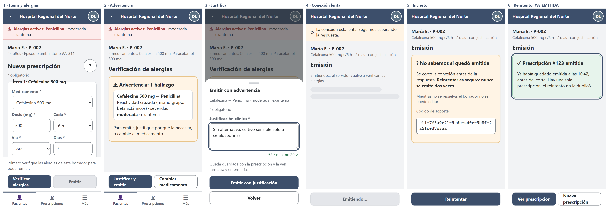
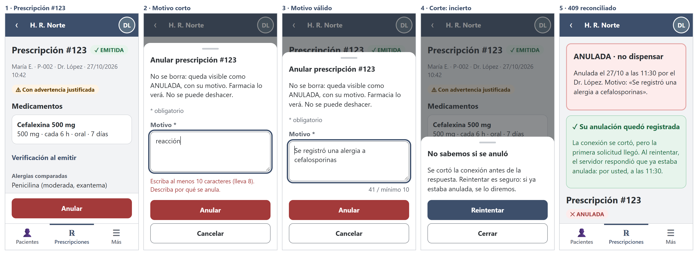

# Semana 10 — Diseño para movilidad del flujo de Prescripciones (320–430 px)

| | |
|---|---|
| **Curso** | Análisis de Sistemas II — Proyecto Final 2026 |
| **Módulo** | Prescripciones electrónicas con validación de alergias (ASII-15) |
| **Proceso** | «Creación de prescripción con verificación previa de alergias» |
| **Estudiante** | Boris Alexander Quiroa Orellana |

## Entregables

| Pedido | Dónde |
|---|---|
| Propuesta responsive de 3–5 pantallas | **4 pantallas** navegables con sus estados en [`prototipo/`](prototipo/) (M1–M4), y 46 capturas de 320 a 1024 px en [`capturas/`](capturas/) |
| Reglas de breakpoint | [§4](#4-reglas-de-breakpoint), verificadas con [`herramientas/verificar-responsive.cjs`](herramientas/verificar-responsive.cjs): 46/46 vistas cumplen |
| Dos escenarios móviles con decisiones de contenido y error | [§8](#8-escenario-1--el-médico-emite-con-advertencia-en-la-ronda-con-señal-débil-360-px) (360 px) y [§9](#9-escenario-2--la-médica-de-guardia-anula-con-red-intermitente-320-px) (320 px) |

## 1. Punto de partida

- **Base de diseño:**
  - los wireframes de escritorio de la [semana 8](../semana-08/semana-08-ux-prescripciones.md);
  - el backlog de la [semana 9](../semana-09/semana-09-evaluacion-ux-prescripciones.md#6-backlog-priorizado).
- **Quién usa esto en el teléfono:**
  - el médico en la ronda de sala, junto a la cama, prescribiendo uno o dos medicamentos;
  - el médico de guardia que anula desde el pasillo;
  - farmacia y enfermería, que consultan una prescripción concreta.

  Nadie arma un tratamiento de diez ítems en 320 px.
- **Consecuencia:** el diseño móvil prioriza **una prescripción corta y segura**. Las alergias no se pierden de vista, y la red inestable nunca produce una prescripción duplicada ni una «emitida» que no lo está.
- **Cómo abrir el prototipo:** HTML y CSS estáticos. Se abre `prototipo/m1-prescribir.html` en un navegador; los estados se eligen con `?estado=…` (la lista está en el comentario al inicio de cada archivo).

## 2. Jerarquía de contenido

| Prioridad | Contenido | Dónde en el teléfono |
|:-:|---|---|
| 0 | **Alergias activas** del paciente | Franja **fija** bajo la barra en M1 y M2: no se desplaza, no se pliega (P-01) |
| 1 | Medicamento, dosis, frecuencia (lo que se firma) | Tarjeta por ítem, con su `fieldset` y su leyenda «Ítem n: medicamento» (semana 9, B-05) |
| 2 | Vía y días | En la misma tarjeta, en una o dos columnas según el ancho |
| 3 | Máxima diaria del catálogo, episodio, edad | Texto secundario de la tarjeta y del encabezado |
| — | Verificación guardada (alergias comparadas, justificación) | En M4, plegada en «Verificación al emitir», **abierta por defecto para farmacia** |

## 3. Reducción de carga cognitiva

| Decisión | Antes (escritorio, W1–W6) | Teléfono |
|---|---|---|
| Ítems | Grilla de 6 columnas | Una tarjeta por ítem; los campos se apilan en 320 px |
| Unidad | Columna propia | Va en la etiqueta («Dosis (mg)»): la decide el catálogo, no se escribe |
| Resultado de la verificación | Cinco paneles a la vista | **Un** veredicto a la vez, con una sola acción principal en la barra del pulgar |
| Justificar / confirmar | Diálogo modal | Hoja inferior con la acción principal arriba y «Volver» abajo |
| Sin permiso override | M-07 debajo del área de texto | La hoja **reemplaza** el área de texto: no se escribe en vano (B-11) |
| Por qué no se puede emitir | Tooltip | Frase visible sobre los botones (B-01) |

## 4. Reglas de breakpoint

**Mobile-first:** la base es 320 px y cada breakpoint **agrega**.

| Nombre | Ancho | Qué cambia |
|---|---|---|
| **XS** | 320–359 | Base. Nombre corto del hospital («H. R. Norte»). Campos del ítem en **una** columna. Barra de acción fija sobre la navegación inferior |
| **S** | 360–430 | Nombre largo del hospital. Dosis y frecuencia, vía y días, en dos columnas |
| **M** | 431–767 | Tres columnas por ítem; el rol en la barra; los botones de la hoja inferior en fila |
| **L** | 768–1023 | Navegación lateral; la hoja inferior pasa a diálogo centrado; la barra de acción deja de ser fija |
| **XL** | ≥ 1024 | Cada ítem en **una fila** de 6 campos, como W1, pero con `fieldset` y etiquetas propias |

### 4.1 Reglas transversales (verificadas)

`verificar-responsive.cjs` abre cada pantalla y estado en Chrome sin interfaz, al ancho indicado, y mide:

| Regla | Qué mide | Umbral |
|---|---|---|
| **R-W1** sin desborde | Ancho del documento contra `clientWidth`, y controles que salen de la ventana | 0 |
| **R-T1** objetivos táctiles | Botones, enlaces, campos, `summary` y etiquetas de casillas | ≥ 44 px (WCAG 2.5.8 pide 24) |
| **R-T2** fuente en campos | `input`, `select` y `textarea` | ≥ 16 px (iOS no hace zoom al enfocar) |
| **R-A1** hospital visible | La barra muestra el hospital | Siempre |
| **R-D1** datos clínicos fuera de la URL | Ningún enlace lleva `medicamento`, `dosis`, `items`, `alergia(s)`, `justificacion`, `motivo`, `via` ni `dias` (los ids sí) | 0 |
| **R-P1** alergias a la vista | En M1 y M2, la franja de alergias está **pegada** a la barra (o al aviso de red), dentro del 40 % superior | Siempre |
| **R-B1** sin `disabled` | Ningún control usa `disabled`; se usa `aria-disabled` con la razón visible (B-01) | 0 |

**Resultado final:** 46 vistas, 0 fallas ([`evidencia/verificacion-responsive-2-final.txt`](evidencia/verificacion-responsive-2-final.txt)).

**Lo que encontré antes de llegar a 0:**

| # | Defecto | Cómo se encontró | Corrección |
|---|---|---|---|
| 1 | `summary` de 22 px de alto (R-T1) en 12 de las 14 vistas de M4 | Primera corrida ([evidencia](evidencia/verificacion-responsive-1-primera.txt)) | La misma regla que ya había corregido Auditoría en su semana 10. Había quedado en la parte **propia** de Auditoría y no en la base común, así que no se heredó. Ahora está en la base |
| 2 | La franja de alergias quedaba 44 px más abajo: dejaba un hueco bajo la barra y **tapaba el nombre del paciente** | **Mirando las capturas**: el instrumento decía 0. Causa: `.red ~ .alergias` también se aplica cuando el aviso de red está **oculto** | El aviso de red y la franja van juntos en un bloque fijo (`.fijas`), sin alturas supuestas |
| 3 | El instrumento no veía el defecto 2 | R-P1 solo pedía que la franja estuviera «en el 40 % superior» | R-P1 exige ahora que la franja esté pegada a lo fijo de encima. Control: sobre el prototipo **sin** el arreglo, la regla corregida da 8 fallas ([evidencia](evidencia/verificacion-responsive-control-alergias.txt)) |

## 5. Navegación

| Ancho | Patrón | Contenido |
|---|---|---|
| < 768 | Barra inferior | «Pacientes», «Prescripciones» y «Más» |
| ≥ 768 | Barra lateral | Las mismas secciones |
| Emisión (M3) | Pantalla sin navegación | No se sale a otra sección con una emisión en curso o incierta |
| «‹» con un borrador | Hoja «¿Descartar la prescripción sin emitir?» | El borrador no se guarda en el teléfono (semana 8, protección de datos), así que salir lo pierde y se pregunta |

## 6. Tablas, formularios, confirmaciones y conexión limitada

### 6.1 Formularios

| Elemento | Decisión |
|---|---|
| Dosis | `inputmode="decimal"`: teclado numérico con coma |
| Días | `type="number"`, `min=1`, `max=90`, `inputmode="numeric"` |
| Medicamento, frecuencia y vía | `select`: el catálogo decide (solo activos, solo vías permitidas) |
| Errores | Resumen arriba con enlace al campo, campo con `aria-invalid` y `aria-describedby`; la vista se desplaza hasta él |
| Quitar un ítem | Botón con nombre («Quitar ítem 2: Paracetamol 500 mg») y **Deshacer** durante 10 s, no una confirmación (B-08) |
| Casilla «sin alergias conocidas» | 24 px, y **toda la frase** es la etiqueta: el objetivo táctil mide ≥ 44 px de alto (B-03, medido por R-T1) |
| Contadores | La justificación muestra «52 / mínimo 20 ✓»; el motivo es neutro mientras se escribe, y el error aparece al pulsar «Anular» (B-14) |

### 6.2 Tablas → tarjetas

La tabla de ítems de W5 pasa a una lista de tarjetas con la pauta en una línea («500 mg · cada 6 h · oral · 7 días»). En una prescripción anulada, la pauta se tacha **y** el chip dice «ANULADA» (el tachado no es el único indicador).

### 6.3 ¿Es seguro reintentar? Medido, no supuesto

Con conexión inestable, el teléfono puede no recibir una respuesta que el servidor sí produjo. [`herramientas/reintento.php`](herramientas/reintento.php) repite la petición contra el **kernel real** del Micro-HIS ([salida](evidencia/reintento.txt)):

| Caso (la misma intención, dos peticiones) | 1.ª | 2.ª | Prescripciones | Anuladas | Trazas |
|---|---|---|:-:|:-:|:-:|
| Repetir la verificación previa | 200 SIN_HALLAZGOS | 200 SIN_HALLAZGOS | 0 | 0 | 0 |
| Repetir «Emitir» con la **misma** clave | 201 EMITIDA | 200 YA_EMITIDA | **1** | 0 | 1 |
| Repetir «Emitir» con una clave **nueva** (anti-patrón) | 201 EMITIDA | 201 EMITIDA | **2** | 0 | 2 |
| Expediente caído, luego vuelve (misma clave) | 503 VERIFICACION_NO_DISPONIBLE | 201 EMITIDA | 1 | 0 | 2 |
| Misma clave, pero el médico cambió la dosis | 201 EMITIDA | 409 CLAVE_REUTILIZADA | 1 | 0 | 1 |
| Repetir «Anular» con el mismo motivo | 200 ANULADA | **409 ESTADO_NO_PERMITE_ANULAR** | 1 | 1 | 2 |
| Repetir la consulta | 200 | 200 | 1 | 0 | 1 |

**Lo que dice la medición:**

1. **La verificación previa y la consulta se pueden repetir sin efectos:** no guardan nada ni dejan traza.
2. **«Emitir» es seguro solo con la misma clave.** Con una clave nueva hay **dos prescripciones del mismo medicamento**: el peor resultado posible del módulo. La clave pertenece a la **intención**, no a la petición.
3. **Un 503 de verificación no consume la clave:** cuando el Expediente vuelve, el reintento emite. La traza deja las dos cosas: la falla y la emisión.
4. **Si el médico edita el borrador mientras el resultado es incierto,** el reintento con la misma clave da 409 `CLAVE_REUTILIZADA`, y con otra clave puede duplicar.
5. **Esto no estaba previsto: anular no es idempotente.** Un reintento después de un corte responde **409** aunque la anulación **sí** se hizo. Si la UI mostrara ese 409 como error, el médico creería que falló.

**Decisiones que salen de la medición:**

| Decisión | Por qué |
|---|---|
| La `Idempotency-Key` se crea al pulsar «Emitir» y se reutiliza en **todo** reintento de esa intención (sin respuesta, 5xx o reapertura de la pestaña) | Caso 2 frente a caso 3 |
| Mientras el resultado sea INCIERTO, **el borrador queda bloqueado** (solo lectura). Las únicas acciones son «Reintentar» o descartar la intención | Casos 3 y 5 |
| Tras un 503 de verificación, «Reintentar» usa la **misma** clave | Caso 4 |
| «Anular» sin respuesta → hoja «No sabemos si se anuló» → «Reintentar». Si llega 409, la UI **consulta** la prescripción, y si está anulada por el mismo usuario, muestra «Su anulación quedó registrada» | Caso 6 |
| **Sin reintentos automáticos** de emitir ni de anular; solo el botón | Cada uno es una decisión clínica y deja traza |
| La verificación previa sí puede reintentarse sin preguntar | Caso 1: no tiene efectos |

**Mejora propuesta para la API** (semana 12, junto con la brecha M-07): que `POST /anulacion` acepte una `Idempotency-Key`, o que el 409 incluya `anulada_por` y `anulada_en`, para no tener que consultar.

### 6.4 Estados de la red

| Estado | Señal | Comportamiento |
|---|---|---|
| Lenta (sin respuesta tras 5 s) | Barra ámbar «La conexión está lenta…» | Se sigue esperando hasta 20 s; el botón dice «Emitiendo…» y no se puede pulsar otra vez |
| Sin conexión al preparar | Barra oscura | El borrador sigue en pantalla; «Verificar · requiere conexión» |
| Sin respuesta al emitir | Veredicto «? No sabemos si quedó emitida», con el código de soporte **completo** (B-10) | «Reintentar» con la misma clave; el borrador queda bloqueado |
| 503 del Expediente | «Por seguridad, no se emitió» | «Reintentar», manual |

### 6.5 Lo que el diseño **no** hace sin conexión, a propósito

- **No verifica alergias en el teléfono.** La verificación es del servidor (R-03); una copia local de las alergias podría estar vieja.
- **No encola emisiones para «cuando vuelva la red».** Una prescripción emitida más tarde, sin que el médico lo vea, rompería la reverificación al emitir y la decisión clínica del momento (semana 5: sin bandeja local).
- **No guarda el borrador en el navegador.** Solo la `Idempotency-Key` de una emisión incierta va a `sessionStorage`, y no es un dato clínico.

## 7. Las 4 pantallas

| Pantalla | Rol | Estados | Capturas clave |
|---|---|---|---|
| **M1** Prescribir | Médico | `base`, `error`, `deshacer`, `salir`, `sin-conexion` | [320](capturas/m1-prescribir-base-320.png) · [360](capturas/m1-prescribir-base-360.png) · [430](capturas/m1-prescribir-base-430.png) · [768](capturas/m1-prescribir-base-768.png) · [1024](capturas/m1-prescribir-base-1024.png) · [error](capturas/m1-prescribir-error-360.png) |
| **M2** Verificación | Médico | `carga`, `sin-hallazgos`, `advertencia`, `bloqueo`, `sin-registros`, `no-disponible`, `justificar`, `sin-override`, `confirmar` | [advertencia](capturas/m2-verificacion-advertencia-360.png) · [bloqueo](capturas/m2-verificacion-bloqueo-360.png) · [justificar](capturas/m2-verificacion-justificar-360.png) · [confirmar 320](capturas/m2-verificacion-confirmar-320.png) |
| **M3** Emisión | Médico | `emitiendo`, `lenta`, `emitida`, `rechazada`, `no-emitida`, `incierto`, `reintentando`, `ya-emitida`, `sin-conexion` | [incierto 320](capturas/m3-emision-incierto-320.png) · [ya emitida](capturas/m3-emision-ya-emitida-360.png) · [rechazada](capturas/m3-emision-rechazada-360.png) |
| **M4** Consultar / anular | Farmacia (`base`) y médico | `base`, `medico`, `carga`, `anulada`, `no-encontrado`, `sin-conexion`, `anular`, `anular-error`, `anular-incierto`, `anulada-por-usted` | [farmacia 320](capturas/m4-prescripcion-base-320.png) · [anulada](capturas/m4-prescripcion-anulada-360.png) · [1024](capturas/m4-prescripcion-base-1024.png) |

## 8. Escenario 1 · El médico emite con advertencia en la ronda, con señal débil (360 px)

**Situación:** en la ronda de las 7:00, el Dr. López necesita cefalexina para María E., que es alérgica a la penicilina. Está junto a la cama y el wifi de la sala es débil.



| Paso | Pantalla | Decisión de contenido | Decisión ante el error |
|---|---|---|---|
| 1 | M1 `base` | La franja roja «Alergias activas: Penicilina» está fija arriba **antes** de elegir el medicamento. «Emitir» dice por qué todavía no | — |
| 2 | M2 `advertencia` | Un solo veredicto: el hallazgo con la severidad en palabras («moderada») y una acción principal, «Justificar y emitir» | — |
| 3 | M2 `justificar` | Hoja inferior con el hallazgo repetido y el contador «52 / mínimo 20 ✓» | Si no tuviera override, la hoja muestra solo M-07 (B-11) |
| 4 | M3 `lenta` | — | A los 5 s, barra ámbar. «Emitiendo…» no se puede pulsar dos veces |
| 5 | M3 `incierto` | El borrador queda bloqueado y el código de soporte aparece completo | **No adivina:** «No sabemos si quedó emitida. Reintentar es seguro» |
| 6 | M3 `ya-emitida` | «Ya había quedado emitida a las 10:42. Hay una sola prescripción» | El reintento usó la misma clave: **200 YA_EMITIDA**, medido en §6.3 |

## 9. Escenario 2 · La médica de guardia anula con red intermitente (320 px)

**Situación:** a las 23:30, el Expediente registra una alergia a cefalosporinas. La médica de guardia recibe el aviso en un teléfono pequeño y tiene que anular la prescripción #123 antes de que farmacia la dispense.



| Paso | Pantalla | Decisión de contenido | Decisión ante el error |
|---|---|---|---|
| 1 | M4 `medico` | «EMITIDA», con advertencia justificada; la verificación guardada a la vista; «Anular» en rojo en la barra del pulgar | — |
| 2 | M4 `anular-error` | La hoja explica que no se borra y que no se puede deshacer | Escribió «reacción» (8): el error aparece **al pulsar**, dice cuánto lleva y el foco queda en el campo |
| 3 | M4 `anular` | Motivo válido; el contador es neutro | — |
| 4 | M4 `anular-incierto` | — | Se corta la red sin respuesta: «No sabemos si se anuló. Reintentar es seguro: si ya estaba anulada, se lo diremos» |
| 5 | M4 `anulada-por-usted` | Banner «ANULADA · no dispensar» con el motivo; farmacia ve lo mismo | El reintento recibió **409**. La UI consultó y vio la anulación hecha por ella: lo muestra como **éxito**, no como error (§6.3, caso 6) |

## 10. Trazabilidad

| Decisión móvil | Requisito / regla | Evidencia |
|---|---|---|
| Franja de alergias fija | RF-05, P-01 | R-P1: 21 vistas de M1/M2 |
| Sin «Emitir» `disabled`; razón visible | R-03, B-01 | R-B1: 0 en 46 vistas |
| Misma clave en todo reintento; borrador bloqueado en INCIERTO | RF-12, R-11 | `reintento.txt` (casos 2, 3 y 5) |
| «Por seguridad, no se emitió» y reintento | RF-08, R-07 | `reintento.txt` (caso 4) |
| Anulación reconciliada tras un 409 | R-10 (semana 6) | `reintento.txt` (caso 6) |
| Confirmación «sin alergias» con etiqueta clicable | RF-07, R-06, B-03 | R-T1 sobre la etiqueta |
| 404 «no existe o no es de su hospital» | RF-09, R-08 | M4 `no-encontrado` |
| Nada clínico en la URL ni en el almacenamiento | Protección de datos (semana 8) | R-D1: 0 en 46 vistas |

## 11. Backlog de la semana 9 aplicado

| Ítem | Aplicado en | Cómo se comprueba |
|---|---|---|
| B-01 razón visible, sin `disabled` | M1, M2 | R-B1 = 0; la frase «Primero verifique…» con `aria-describedby` |
| B-03 casilla de 24 px y etiqueta | M2 `confirmar` | R-T1 mide la etiqueta (≥ 44 px) |
| B-04 / B-06 / B-07 colores y foco | Todas | Tokens `--secundario`, `--borde`, `--ok: #1F6B43` y `:focus-visible` |
| B-05 `fieldset` por ítem | M1 | Leyenda «Ítem 2: Paracetamol 500 mg» |
| B-08 quitar con nombre y deshacer | M1 `deshacer` | Botón con `aria-label`; aviso con `role="status"` |
| B-09 glosario de severidad | M2, M3 | «moderada», «grave»; el título dice «Sin alergias registradas» |
| B-10 código de soporte completo | M3 `incierto` | Sin «…» |
| B-11 sin override reemplaza el texto | M2 `sin-override` | La hoja no tiene `textarea` |
| B-12 resultado anunciado | M2, M3 | `role="status"`; el bloqueo y el rechazo, `role="alert"` |
| B-13 «?» accesible | M1 | Botón con `aria-label` y `aria-expanded` |
| B-14 contador neutro | M4 `anular` | El error aparece en `anular-error` |
| B-15 «* obligatorio» | M1, M2, M4 | Leyenda y `aria-required` |
| **B-02** renovar la sesión sin salir | **Pendiente** | Necesita el prototipo con estado (semana 11) |

## 12. Verificación y limitaciones

```bash
# desde docs/modulos/prescripciones-alergias/semana-10 (requiere Chrome y puppeteer-core)
node herramientas/verificar-responsive.cjs prototipo capturas     # 46 vistas, 0 fallan
python herramientas/escenarios.py capturas escenarios              # las dos láminas de escenarios
php herramientas/reintento.php                                     # tabla de §6.3
```

- **El prototipo es estático:** muestra los estados, pero no los recorre solo. El flujo navegable, con datos y errores simulados, es la semana 11.
- **Las capturas son de Chrome con emulación móvil.** No se probó en un teléfono físico ni con VoiceOver o TalkBack.
- **Los tiempos de §6.4 (5 s y 20 s) son una propuesta**, no una medición sobre redes reales.
