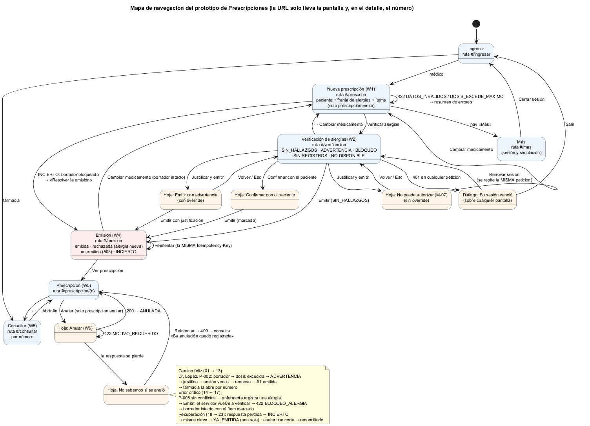

# Semana 11 — Prototipo navegable desktop y móvil del flujo de Prescripciones

| | |
|---|---|
| **Curso** | Análisis de Sistemas II — Proyecto Final 2026 |
| **Módulo** | Prescripciones electrónicas con validación de alergias (ASII-15) |
| **Proceso** | «Creación de prescripción con verificación previa de alergias» |
| **Estudiante** | Boris Alexander Quiroa Orellana |

## Entregables

| Pedido | Dónde |
|---|---|
| Enlace o archivo del prototipo | [`prototipo/index.html`](prototipo/index.html): se abre en el navegador, sin servidor ni instalación |
| Mapa de navegación | [`diagramas/semana-11-mapa-navegacion.png`](diagramas/semana-11-mapa-navegacion.png) |
| Capturas desktop y móvil del camino feliz y del error crítico | [`capturas/escritorio/`](capturas/escritorio/) (1280 px) y [`capturas/movil/`](capturas/movil/) (360 px): 25 pasos en cada una, generadas por el recorrido automático |

## 1. Qué es el prototipo

- **Una sola aplicación** (HTML, CSS y JavaScript sin dependencias) para escritorio y móvil, sobre el CSS mobile-first de la semana 10.
- **Une las pantallas de las semanas 8 y 10** (W1 preparar, W2 verificación, W4 emisión, W5 consultar, W6 anular) en un flujo real. Ya no se cambia de estado con `?estado=`: cada resultado sale de una respuesta de la API.
- **La API está simulada en el navegador** ([`api-simulada.js`](prototipo/api-simulada.js)) y reproduce el kernel del Micro-HIS:
  - el mismo orden: ruta (404/405) → token (401) → tenant (400/403) → formato (400) → caso de uso;
  - las mismas reglas R-01..R-12: completitud, dosis máxima, coincidencia directa y cruzada, severidades que impiden justificar, confirmación sin registros, idempotencia con huella y anulación;
  - los mismos códigos HTTP y de negocio, y las mismas trazas.
- **Los datos son copia de los del Micro-HIS** (`datos-demo.php` y `config.php`): pacientes, alergias, catálogo, grupos, tokens y permisos.
- **Paridad probada, no supuesta:** [`herramientas/paridad.cjs`](herramientas/paridad.cjs) primero comprueba que los 6 conjuntos de datos son iguales. Después ejecuta 42 peticiones en la API simulada y en el **kernel real**, y compara una huella de cada respuesta y el estado final: prescripciones y trazas. Resultado: **0 diferencias** ([evidencia](evidencia/paridad.txt)).
- **Control de la paridad:** se inyecta un defecto en una copia de la API simulada: una caída del Expediente se lee como «sin alergias», lo que viola R-07. La misma herramienta detecta **4 diferencias** ([evidencia](evidencia/paridad-control.txt)): los pasos 28, 29 y 30 y las trazas.
- **La interfaz no decide reglas clínicas:** muestra lo que responde la API y traduce cada código al mensaje del catálogo de la semana 8 (M-01..M-22). Los permisos locales solo muestran u ocultan acciones; el servidor vuelve a decidir.

### 1.1 Cómo usarlo

1. Abrir `prototipo/index.html` en Chrome, Edge o Firefox. Para ver el móvil: F12 → modo dispositivo, 360 px.
2. Elegir una persona:
   - **Dr. López:** puede emitir, autorizar advertencias y anular.
   - **Dra. Ruiz:** emite y anula, pero **no** puede autorizar advertencias.
   - **Farmacia Norte:** solo consulta.
3. En «Más» se puede simular:
   - fallas de la red: sin conexión, lenta, **respuesta perdida** (el servidor sí procesó la petición), sesión vencida;
   - el Expediente caído;
   - **otra persona registrando una alergia** mientras la pantalla está abierta.

**Datos ficticios** (los de `datos-demo.php`):

| Paciente | Alergias en el Expediente | Para probar |
|---|---|---|
| P-002 | Penicilina (sin código), moderada, activa | Cefalexina → ADVERTENCIA (cruzada) |
| P-005 | Amoxicilina, leve, **resuelta** | Amoxicilina → sin conflictos (hasta que se registra la nueva) |
| P-003 | Ninguna | Pide confirmar con el paciente |
| P-004 | AAS, potencialmente mortal | Ibuprofeno → BLOQUEO cruzado |
| P-001, P-006, P-007 | Amoxicilina grave; penicilina «desconocida»; «  AMOXICILINA » escrita con espacios | Cruzada sin bloqueo; bloqueo por severidad desconocida; coincidencia por nombre normalizado |

## 2. Camino feliz: el médico emite con una advertencia justificada y farmacia la ve

| # | Paso | Escritorio | Móvil |
|---|---|---|---|
| 01 | Ingresa como Dr. López | [captura](capturas/escritorio/01-ingresar.png) | [captura](capturas/movil/01-ingresar.png) |
| 02 | Elige a P-002: la franja de alergias aparece **antes** de elegir el medicamento (P-01) | [captura](capturas/escritorio/02-paciente.png) | [captura](capturas/movil/02-paciente.png) |
| 03 | Dos ítems con fieldset y leyenda propia (B-05); «Quitar ítem 2: Paracetamol 500 mg» | [captura](capturas/escritorio/03-borrador.png) | [captura](capturas/movil/03-borrador.png) |
| 04 | Quita el ítem 2: «Se quitó Paracetamol 500 mg · Deshacer»; deshacer restaura los valores (B-08) | [captura](capturas/escritorio/04-quitar-deshacer.png) | [captura](capturas/movil/04-quitar-deshacer.png) |
| 05 | Verifica con 1500 mg cada 6 h: 422 `DOSIS_EXCEDE_MAXIMO` → resumen de errores con el foco y enlace al campo (M-03) | [captura](capturas/escritorio/05-dosis-excedida.png) | [captura](capturas/movil/05-dosis-excedida.png) |
| 06 | Corrige a 500 mg: **ADVERTENCIA**, Cefalexina ↔ Penicilina, cruzada, moderada; el resultado recibe el foco y se anuncia (B-12) | [captura](capturas/escritorio/06-advertencia.png) | [captura](capturas/movil/06-advertencia.png) |
| 07 | «Justificar y emitir»: hoja con contador neutro que pasa a «55 / mínimo 20 ✓» (B-14) | [captura](capturas/escritorio/07-justificar.png) | [captura](capturas/movil/07-justificar.png) |
| 08 | La sesión vence justo al emitir: diálogo **sobre la página**, foco en «Renovar sesión» (B-02) | [captura](capturas/escritorio/08-sesion-vencida.png) | [captura](capturas/movil/08-sesion-vencida.png) |
| 09 | «Renovar sesión»: se repite la **misma** petición, con la misma `Idempotency-Key` → **#1 emitida**, una sola (B-10) | [captura](capturas/escritorio/09-emitida.png) | [captura](capturas/movil/09-emitida.png) |
| 10 | «Ver prescripción»: estado, ítems, verificación y la justificación | [captura](capturas/escritorio/10-detalle-medico.png) | [captura](capturas/movil/10-detalle-medico.png) |
| 11 | Farmacia: sin «Prescribir» en la navegación; abre por número | [captura](capturas/escritorio/11-farmacia-consultar.png) | [captura](capturas/movil/11-farmacia-consultar.png) |
| 12 | Farmacia ve #1 «con advertencia justificada», sin «Anular» | [captura](capturas/escritorio/12-farmacia-detalle.png) | [captura](capturas/movil/12-farmacia-detalle.png) |
| 13 | Farmacia escribe `#/prescribir` a mano: «Acceso denegado» (M-16) | [captura](capturas/escritorio/13-farmacia-sin-permiso.png) | [captura](capturas/movil/13-farmacia-sin-permiso.png) |

## 3. Error crítico: aparece una alergia nueva entre la verificación y la emisión

En este módulo, el peor error no es un fallo de la pantalla. Es **emitir un medicamento al que el paciente es alérgico**. El caso más difícil es el que ninguna pantalla puede ver:
1. el médico verifica y no hay conflicto;
2. mientras tanto, enfermería registra una alergia en el Expediente;
3. el médico pulsa «Emitir».

La regla que lo cubre es R-03: **el servidor vuelve a verificar al emitir** y nunca acepta el resultado de la verificación que trae el cliente. El prototipo lo demuestra con la misma secuencia que el paso 14 de la paridad, donde el kernel real también bloquea.

| # | Paso | Escritorio | Móvil |
|---|---|---|---|
| 14 | P-005, Amoxicilina: la franja dice «Sin alergias activas · 1 registrada como resuelta»; **sin conflictos** | [captura](capturas/escritorio/14-sin-conflictos.png) | [captura](capturas/movil/14-sin-conflictos.png) |
| 15 | «Más» → enfermería registra Amoxicilina, grave, en el Expediente | [captura](capturas/escritorio/15-alergia-registrada.png) | [captura](capturas/movil/15-alergia-registrada.png) |
| 16 | Vuelve y pulsa «Emitir» (la pantalla seguía con la foto anterior, la carrera es real): **«⛔ No se emitió: alergia nueva»**, Amoxicilina ↔ Amoxicilina, grave; «No se guardó nada»; foco en el veredicto, anunciado como alerta | [captura](capturas/escritorio/16-bloqueo-al-emitir.png) | [captura](capturas/movil/16-bloqueo-al-emitir.png) |
| 17 | «Cambiar medicamento»: la franja ya muestra la alergia; el ítem queda marcado; dosis, frecuencia y días se conservan | [captura](capturas/escritorio/17-borrador-intacto.png) | [captura](capturas/movil/17-borrador-intacto.png) |

Comprobado en el recorrido:
- no se guardó ninguna prescripción;
- el bloqueo quedó trazado (`PRESCRIPCION_BLOQUEADA`);
- la pantalla abierta **no** se había enterado de la alergia nueva.

### 3.1 Recuperación: la red pierde respuestas

Después del error crítico, el médico cambia a Paracetamol. Los pasos 18 a 23 prueban en la interfaz las decisiones que la semana 10 midió contra el kernel:

| # | Paso | Escritorio | Móvil |
|---|---|---|---|
| 18 | Emite y **la respuesta se pierde** (el servidor sí la procesó): «? No sabemos si quedó emitida», código de soporte completo y «Copiar código» (B-10) | [captura](capturas/escritorio/18-incierto.png) | [captura](capturas/movil/18-incierto.png) |
| 19 | Intenta volver al borrador: «Hay una emisión sin confirmar», **bloqueado** hasta resolverla | [captura](capturas/escritorio/19-borrador-bloqueado.png) | [captura](capturas/movil/19-borrador-bloqueado.png) |
| 20 | «Reintentar» con la misma clave → «#2 emitida… el reintento no la duplicó»: **2** prescripciones en total, no 3 | [captura](capturas/escritorio/20-ya-emitida.png) | [captura](capturas/movil/20-ya-emitida.png) |
| 21 | Anula #2 con «error»: 422 `MOTIVO_REQUERIDO` → «Escriba al menos 10 caracteres (lleva 5)» (M-20) | [captura](capturas/escritorio/21-motivo-corto.png) | [captura](capturas/movil/21-motivo-corto.png) |
| 22 | Anula con un motivo válido y la respuesta se pierde: «No sabemos si se anuló», foco en «Reintentar» | [captura](capturas/escritorio/22-anular-incierto.png) | [captura](capturas/movil/22-anular-incierto.png) |
| 23 | «Reintentar» → 409 → la interfaz consulta #2 → **«✓ Su anulación quedó registrada… por usted»**; una sola anulación trazada | [captura](capturas/escritorio/23-anulacion-reconciliada.png) | [captura](capturas/movil/23-anulacion-reconciliada.png) |

### 3.2 Roles y fuente caída

| # | Paso | Escritorio | Móvil |
|---|---|---|---|
| 24 | Dra. Ruiz, sin override, ante la misma advertencia: la hoja dice solo M-07, **sin** área de texto; foco en «Volver»; Esc la cierra y el foco vuelve al botón (B-11) | [captura](capturas/escritorio/24-sin-override.png) | [captura](capturas/movil/24-sin-override.png) |
| 25 | Con el Expediente caído, la verificación dice «No se pudo consultar las alergias. No podrá emitir…» (M-11), **nunca** «sin conflictos» | [captura](capturas/escritorio/25-expediente-caido.png) | [captura](capturas/movil/25-expediente-caido.png) |

## 4. Mapa de navegación



- **La URL solo lleva la pantalla y, en el detalle, el número.** Ningún paciente, medicamento, dosis, justificación ni motivo va en la URL (R-D1). El recorrido lo verifica en cada paso.
- **Nada clínico se guarda en el navegador:** el recorrido comprueba que `localStorage` y `sessionStorage` tienen 0 claves.
- **Las hojas y los diálogos no son pantallas:**
  - se abren sobre la pantalla actual y la vuelven inerte;
  - Esc los cierra;
  - el foco vuelve a quien los abrió.
- **Las pantallas intermedias no quedan en el historial.** Si «Verificando…» termina en un 422, «‹» no vuelve a una verificación vacía.

## 5. Consistencia de roles, estados y mensajes

| Aspecto | Cómo se mantiene |
|---|---|
| **Roles** | Farmacia no ve «Prescribir» ni «Anular». Si escribe la ruta a mano, ve «Acceso denegado». Y si llama a la API igual, recibe 403 (pasos 9 y 10 de la paridad) |
| **Permiso override** | La Dra. Ruiz ve la hoja M-07. Si la interfaz se equivocara, el servidor responde 409 igual (paso 12 de la paridad) |
| **Alergias** | La franja está siempre visible al prescribir y al verificar. Tiene tres variantes, cada una con icono y texto: activas, «sin alergias activas · resueltas» y «sin alergias registradas · no significa que no tenga» |
| **Estados** | Carga (esqueletos con `aria-busy`), sin conflictos, advertencia, bloqueo, sin registros, no disponible, emitida, ya emitida, rechazada, no emitida, incierto, anulada. Usan los mismos textos que las semanas 8 y 10 |
| **Mensajes** | Cada texto lleva su id del catálogo de la semana 8. Están M-01 y M-03 a M-22; M-02 se usa sin id, en los mensajes de cada campo |
| **Severidad** | Un solo glosario (B-09): leve, moderada, grave, potencialmente mortal, desconocida. 0 apariciones de «severa» o «no evaluada» en pantalla |
| **Inmutabilidad** | No hay «Editar» ni «Borrar». Anular es un hecho nuevo con motivo: lo emitido sigue visible, tachado y con el banner M-19 |

## 6. Accesibilidad

`herramientas/recorrido.cjs` recorre el prototipo como una persona, con clics y teclado, en las dos vistas. En **cada** paso:
- corre **axe-core** (WCAG 2.2 A/AA);
- toma la captura;
- comprueba que no hay datos clínicos en la URL.

En móvil también comprueba:
- el desborde, medido contra `clientWidth`;
- los objetivos táctiles de 44 px;
- una regla nueva de esta semana: **ningún control del contenido queda tapado** por la barra de acción o la navegación cuando se lo desplaza al centro.

**Resultado: 82 comprobaciones, 0 fallas** ([evidencia](evidencia/recorrido.txt)).

| Comprobación (además de axe) | Criterio |
|---|---|
| Con un 422, el foco va al resumen de errores, que enlaza a cada campo | 3.3.1 |
| El resultado de la verificación y el de la emisión reciben el foco y se anuncian (`role="status"`; bloqueo y rechazo como `alert`) | 4.1.3 (B-12) |
| El foco inicial de «Su sesión venció» está en «Renovar sesión» | 2.4.3 (B-02) |
| En la hoja sin override, el foco inicial está en «Volver»; Esc la cierra y el foco vuelve al botón | 2.4.3, 2.1.2 (B-11) |
| «Deshacer» restaura el ítem con sus valores; tras quitar, el foco («+ Agregar medicamento») no queda debajo del aviso | 2.4.11 (B-08) |
| «Emitir» nunca se deshabilita: o no aparece, o al pulsarlo explica qué falta (la confirmación con el paciente) | B-01 |

## 7. Defectos que encontró la construcción

| # | Defecto | Cómo se encontró | Corrección |
|---|---|---|---|
| 1 | El hallazgo mostraba **«Amoxicilina 500 mg ↔ J01CA04»**. La API devuelve el alérgeno como lo guarda el Expediente: el código si lo tiene, si no el nombre. La semana 8 había dibujado siempre nombres | El recorrido esperaba «↔ Amoxicilina» (pasos 16 y 17) | La interfaz busca el nombre en el Expediente. Queda como observación del **contrato** para la semana 12 (§9) |
| 2 | En 360 px, «+ Agregar medicamento» quedaba **siempre** debajo de la barra de acción fija: la semana 10 reservaba 80 px y la barra, con el texto de «por qué», mide unos 120. La página no se podía desplazar lo suficiente para tocarlo | El recorrido no encontraba el ítem 2: el clic caía en la barra. La regla «tapados» lo confirmó en 5 pantallas ([primera corrida](evidencia/recorrido-1-primera.txt)) | `app.js` mide el alto real de la barra y del aviso «Deshacer»; el CSS reserva esa suma y la usa como `scroll-padding` |
| 3 | Tras «Quitar», el foco iba a «+ Agregar medicamento», **debajo** del aviso «Deshacer» (WCAG 2.4.11, foco no oculto) | La misma primera corrida (paso 04, «tapado bajo SPAN») | La misma corrección, más una comprobación explícita del foco en el recorrido |
| 4 | El veredicto no recibía el foco tras verificar: le faltaba `tabindex="-1"` | El recorrido (B-12) | Una sola función `enfocarVeredicto()` para los tres resultados |
| 5 | El anillo de foco del selector de paciente tocaba la leyenda «Ítem 1» | Revisión de la captura 02 en móvil | Más margen sobre el primer ítem |

**La semana 10 ya había pasado sus 46 vistas sin fallas.** Los defectos 2 y 3 no podían verse ahí: cada vista se miraba quieta, nunca se intentaba **usar** el último control. Lo encontró un recorrido que pulsa como una persona. La regla quedó en la herramienta.

Sobre la comprobación de 2.4.11: se agregó junto con la corrección y **no se corrió contra la versión anterior**. La primera corrida sí muestra el aviso tapando el botón (paso 04, «tapado bajo SPAN»).

## 8. Backlog de la semana 9: estado final

| Ítem | Estado | Comprobado en |
|---|---|---|
| B-01 «Emitir» sin `disabled`, razón visible | ✅ | «Para emitir, primero verifique…» junto a «Verificar alergias» (pasos 02–05). En la hoja «Confirmar con el paciente», «Emitir» explica qué falta; esa hoja **no** la recorre la herramienta. Se probó aparte con P-003, en una prueba puntual de Chrome sin interfaz que no quedó en el repositorio: sin marcar, muestra el error, lleva el foco a la casilla y no emite; marcada, emite con `confirma_sin_alergias: true` |
| B-02 renovar la sesión sin salir | ✅ (nuevo en la semana 11) | Pasos 08–09: tras renovar se repite la misma petición; 0 claves en el almacenamiento |
| B-03 casilla ≥ 24 px con la frase como etiqueta | ✅ | Hoja «Confirmar con el paciente», con el CSS de la semana 10. En la misma prueba puntual con P-003: la casilla mide 24 × 24 px y un clic en el texto la marca |
| B-04 a B-07 contraste y foco | ✅ | Tokens de la semana 10; axe sin `color-contrast` en 50 capturas |
| B-05 fieldset por ítem | ✅ | Leyenda «Ítem n: medicamento»; errores con `aria-describedby` y `aria-invalid` |
| B-08 «Quitar» con nombre y «Deshacer» | ✅ (nuevo) | Paso 04 |
| B-09 glosario de severidad | ✅ | Un solo diccionario en `datos.js` |
| B-10 reintento con la misma clave; código completo | ✅ (nuevo) | Pasos 09, 18 y 20; 2 prescripciones, no 3 |
| B-11 sin override, solo M-07 | ✅ (nuevo) | Paso 24 |
| B-12 resultado anunciado | ✅ (nuevo) | Pasos 06 y 16 |
| B-13 «?» como botón con nombre | ⚠️ parcial | Botón con `aria-expanded` y `aria-controls`; **Esc no cierra la ayuda** (B-13 lo pedía) |
| B-14 contador neutro; error al pulsar | ✅ (nuevo) | Pasos 07 y 21 |
| B-15 «* obligatorio» y `aria-required` | ✅ | Leyenda en W1, en la hoja de justificación y en la de anular |

## 9. Lo que el prototipo dejó ver de la API (para la semana 12)

| # | Observación | Impacto | Propuesta |
|---|---|---|---|
| A-1 | La verificación previa no dice si el usuario **puede justificar** (brecha M-07, ya conocida) | La interfaz depende de su copia de los permisos | `puede_justificar` en la respuesta de la previa |
| A-2 | Anular no es idempotente: el reintento responde 409 sin decir quién anuló | Hace falta una segunda petición para reconciliar (pasos 22–23) | `Idempotency-Key` en la anulación, o `anulada_por` en el 409 |
| A-3 | El hallazgo trae el **código** del alérgeno sin su nombre (defecto 1) | La interfaz necesita el Expediente para mostrar un texto legible; farmacia, en el detalle, también | Agregar `alergeno_nombre` al hallazgo (compatible: campo nuevo) |
| A-4 | No hay una operación para **listar** prescripciones | Farmacia abre por número, como desde la receta impresa | Fuera del alcance del módulo: lo resuelve la cola de farmacia del HIS |

## 10. Verificación y limitaciones

```bash
# desde docs/modulos/prescripciones-alergias/semana-11 (requiere PHP 8.2+, Node, puppeteer-core, axe-core y Chrome)
node herramientas/paridad.cjs                         # 6 conjuntos de datos + 42 pasos + estado final contra el kernel real: 0 diferencias
node herramientas/paridad.cjs <copia-con-defecto.js>  # control (evidencia/paridad-control.txt): 4 diferencias
node herramientas/recorrido.cjs                       # 82 comprobaciones en escritorio y móvil: 0 fallas, y las 50 capturas
```

- **La huella de idempotencia de la API simulada no es sha256**, es el JSON del contenido. Solo se compara consigo misma, así que el comportamiento es el mismo; la paridad lo confirma en los pasos 4 a 6.
- **La paridad cubre las 42 peticiones de la secuencia, no todas las entradas posibles.** Hay casos límite del formato que no reproduce. En PHP, un `7.0` en «días» es decimal y se rechaza; en JavaScript no se distingue de `7`. El kernel real sigue siendo la fuente de verdad.
- **«Renovar sesión» y «Registrar la alergia» se simulan con un botón.** En el HIS lo harían el módulo de autenticación y el Expediente.
- **La franja de alergias lee el Expediente simulado,** que no es parte de la API de Prescripciones. En el HIS, ese dato lo da el módulo Expediente.
- **No se probó con lectores de pantalla reales** (NVDA, VoiceOver). axe cubre solo lo automatizable de WCAG; los anuncios se comprobaron por el foco y las regiones `role="status"`/`alert`, no escuchándolos.
