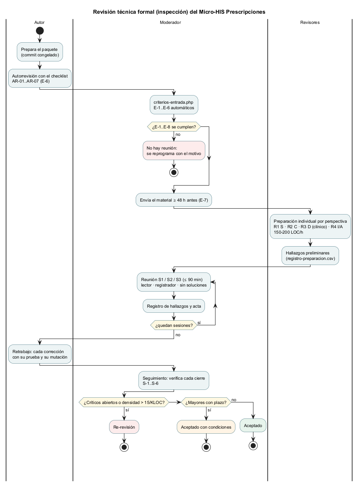

# Plan de la revisión técnica formal — Prescripciones con validación de alergias

**Autor del objeto revisado:** Boris Alexander Quiroa Orellana · **Objeto:** Micro-HIS Prescripciones (`docs/modulos/prescripciones-alergias/micro-his-prescripciones`), contrato 1.2.0 · **Versión del plan:** 1.0, 27/10/2026

## 1. Objetivo y tipo de revisión

**Objetivo:** encontrar defectos y riesgos, **sin corregirlos en la reunión**, en las cinco áreas que pide la tarea:
1. las reglas de dominio (prescripción, medicamentos, dosis y alergias);
2. el contrato API;
3. los permisos y el tenant;
4. la integridad: validación previa, reverificación y bloqueo seguro;
5. las dependencias estrictamente necesarias.

**Tipo:** **inspección formal** (Fagan, adaptada a IEEE 1028), con **lectura basada en perspectivas**. Cada revisor lee el paquete de sus sesiones desde una perspectiva asignada (D, C, S, I, A), para que no todos miren lo mismo.

**Por qué una inspección y no un walkthrough:**

| Criterio | Inspección | Walkthrough |
|---|---|---|
| Quién conduce | El moderador (no el autor) | El autor |
| Preparación individual | Obligatoria y medida | Opcional |
| Salida | Registro de hallazgos con severidad y decisión formal | Comentarios |
| Adecuado para | Código cuyo error **daña a un paciente** | Diseño temprano |

**Por qué inspección en este módulo:** un defecto en la regla de alergias no se ve usando el sistema, porque el caso feliz funciona. Se descubre cuando un paciente recibe el medicamento al que es alérgico. La autorrevisión ya encontró uno de ese tipo (AR-03).

## 2. Alcance y paquete de revisión

**Qué entra:** el paquete lo arma y congela [`herramientas/criterios-entrada.php`](herramientas/criterios-entrada.php), con un commit y el listado de archivos y líneas efectivas de cada sesión ([evidencia](evidencia/criterios-entrada-2-despues.txt)).

| Sesión | Contenido | Líneas efectivas | Perspectivas principales |
|---|---|---:|---|
| **S1** · Dominio clínico | `src/Dominio/**`, `database/schema.sql` | 672 | D, I |
| **S2** · Aplicación y persistencia | `src/Aplicacion/**`, `src/Persistencia/**` (PDO, InMemory, HTTP), `integracion-hospital.sql` | 1241 | D, I, S |
| **S3** · Contrato, frontera, permisos/tenant y dependencias | `api/openapi.yaml`, `src/Presentacion/Http/**`, `bootstrap/contenedor.php`, `config/config.php`, `public/index.php` | 1023 | C, S, A |

**Fuera del alcance:**
- **Las pruebas (`tests/**`):** se dan por buenas porque la suite pasa (E-2). Pero los revisores **pueden** citar un caso que las pruebas no cubren.
- **El cliente** (`src/Cliente`, revisado en la semana 5) y **los prototipos de UX** (semanas 10–12).
- **Los módulos ajenos** (Expediente, RBAC, JwtAuth): solo su **contrato** con Prescripciones.

**Material de apoyo que se entrega con el paquete:**
- requisitos (semanas 1, 2, 6 y 12) y reglas R-01..R-12;
- matrices de decisión (semanas 6 y 12);
- [checklist](checklist-revision.md), [formato](formato-hallazgos.md) y [autorrevisión](autorrevision-autor.md).

## 3. Roles y responsabilidades

| Rol | Quién | Perspectiva | Responsabilidad |
|---|---|:-:|---|
| **Autor** | Boris Alexander Quiroa Orellana | — | Prepara el paquete y hace la autorrevisión (E-6). En la reunión **solo aclara**, no defiende. Cierra los hallazgos después |
| **Moderador** | Integrante de otro módulo (por confirmar, E-8) | — | Verifica la entrada, conduce la reunión y el ritmo, corta las discusiones de solución, decide la severidad final y el resultado (§7) y hace el seguimiento |
| **Registrador** | Integrante del equipo (por confirmar) | — | Llena el registro de hallazgos y el [acta](plantillas/acta-revision.md) en el momento |
| **Lector** | R3 (rota por sesión) | — | Recorre el código en voz alta en el orden del flujo: formulario → caso de uso → evaluación → política → repositorio |
| **R1** · Permisos, tenant e identidad | Revisor con experiencia en seguridad (por confirmar) | S | RT-08, RT-10, RT-11, RT-12 |
| **R2** · Contrato y frontera | Responsable de un módulo cliente, por ejemplo Farmacia o Enfermería (por confirmar) | C | RT-07, RT-08, RT-09 |
| **R3** · Dominio clínico | **Un farmacéutico o médico**, con apoyo técnico (por confirmar) | D | RT-01..04, RT-06 |
| **R4** · Integridad y dependencias | Docente o par técnico con base de datos (por confirmar) | I, A | RT-05, RT-13, RT-14, RT-15 |

**Reglas de independencia:**
- El autor **no** puede ser moderador ni registrador.
- Ningún revisor revisa un módulo propio en la misma sesión.
- **R3 debe tener formación clínica:** AR-03 y AR-07 son decisiones que el autor no puede tomar.

## 4. Proceso y calendario

| Fase | Quién | Cuándo | Salida |
|---|---|---|---|
| 1. Planificación | Moderador y autor | D-5 | Este plan; roles confirmados (E-8) |
| 2. Autorrevisión y congelación | Autor | D-3 | [autorrevision-autor.md](autorrevision-autor.md); `criterios-entrada.php` en verde |
| 3. Reunión de presentación (opcional, 20 min) | Todos | D-3 | Contexto: R-01..R-12 y el flujo previa → emisión |
| 4. Envío del material | Moderador | **≥ 48 h** antes de la reunión (E-7) | Paquete y commit |
| 5. Preparación individual | Cada revisor | D-2 a D-1 | Hallazgos preliminares; minutos y líneas en `registro-preparacion.csv` |
| 6. Reuniones S1, S2 y S3 | Todos | D, D+1 y D+2 (≤ 90 min cada una) | Registro de hallazgos y acta |
| 7. Retrabajo | Autor | D+3 a D+10 | Correcciones, cada una con su prueba y su mutación |
| 8. Seguimiento | Moderador | D+10 | Verificación de cada cierre; decisión final |

**Ritmo de preparación:** de 150 a 200 líneas efectivas por hora y revisor. Con 2936 líneas en total, quien revisa las tres sesiones dedica de 15 a 20 h. Por eso cada perspectiva tiene asignadas solo las sesiones que le corresponden.

## 5. Reglas de la reunión

1. Se revisa el **producto**, no al autor.
2. **No se discuten soluciones**: se registra la propuesta y se sigue.
3. El autor solo responde preguntas de hecho («¿esto se llama también desde la anulación?»).
4. Máximo **90 minutos**; si no alcanza, se agenda una sesión de continuación.
5. Cada hallazgo se registra **en el momento** con todos los campos obligatorios.
6. Las discrepancias de severidad las decide el moderador, y queda anotado el voto en contra. **En las reglas clínicas, la opinión de R3 pesa más que la del autor.**

## 6. Criterios de entrada

| ID | Criterio | Cómo se verifica |
|---|---|---|
| E-1 | Paquete congelado en un commit y sin cambios locales | `criterios-entrada.php` (automático) |
| E-2 | Suite automatizada sin fallas | Automático: ejecuta `tests/ejecutar.php` |
| E-3 | Guardas de contrato (API-01..03, JUS-04) y de capas (ARQ-01..10) en verde | Automático |
| E-4 | Cada sesión ≤ 1600 líneas efectivas | Automático |
| E-5 | Checklist de 12–15 ítems y formato de hallazgos publicados | Automático |
| E-6 | Autorrevisión del autor registrada con el mismo formato | Automático: cuenta los AR en el CSV y en el documento |
| E-7 | Material distribuido ≥ 48 h antes | Manual: el moderador lo anota en el acta |
| E-8 | Roles asignados y revisores confirmados | Manual: §3 y el acta |

**Si un criterio no se cumple, la reunión no se hace.**

**Evidencia del «antes y después»:**
- **Antes:** E-5 y E-6 fallaban, porque no existían ni el checklist ni la autorrevisión ([antes](evidencia/criterios-entrada-1-antes.txt)).
- **Después:** los 6 criterios automáticos pasan ([después](evidencia/criterios-entrada-2-despues.txt)).

## 7. Criterios de salida y decisión

| ID | Criterio de salida |
|---|---|
| S-1 | Las 3 sesiones se hicieron con todos los roles, y cada revisor registró su preparación |
| S-2 | Los 15 ítems tienen un resultado anotado (✅ / hallazgo) en cada sesión que los cubre |
| S-3 | Cada hallazgo tiene todos los campos obligatorios y una severidad decidida |
| S-4 | Cada hallazgo **Crítico** está `Cerrado`, con una prueba y una mutación nuevas que lo vigilan |
| S-5 | Cada hallazgo **Mayor** está `Cerrado` o tiene responsable, plazo y verificación acordados |
| S-6 | Después del retrabajo, la suite completa (con PostgreSQL) y las mutaciones siguen en verde, y el contrato pasa el lint |

**Decisión** (la toma el moderador al final del seguimiento):

| Resultado | Cuándo |
|---|---|
| **Aceptado** | S-1..S-6 y ningún Crítico ni Mayor abierto |
| **Aceptado con condiciones** | Sin Críticos abiertos; Mayores con plazo (S-5) |
| **Re-revisión** | Algún Crítico sin cerrar; densidad > 15 hallazgos/KLOC en una sesión; o un retrabajo que cambie más del 20 % de las líneas de una sesión |

**Estado al cerrar la autorrevisión:** hay un **Crítico abierto** (AR-01) y dos Mayores (AR-02, AR-03). Con lo conocido hoy, el resultado sería **«Re-revisión»**. AR-01 tiene que cerrarse antes de la reunión o en el retrabajo. AR-03 necesita una decisión de farmacia antes de programar nada.

## 8. Formato de hallazgos

Se usa el [formato de hallazgos](formato-hallazgos.md), una fila por hallazgo en [`plantillas/registro-hallazgos.csv`](plantillas/registro-hallazgos.csv). Los campos obligatorios son:
- `id`, `item`, `ubicacion`, `descripcion` y `evidencia`;
- `regla_afectada`, `severidad`, `tipo`, `responsable`, `estado` y `encontrado_en`.

## 9. Métricas

| Métrica | Umbral | Uso |
|---|---|---|
| Ritmo de preparación | 150–200 LOC/h | Por encima, se vuelve a preparar |
| Densidad de hallazgos por sesión | > 15/KLOC → re-revisión | Decisión |
| Hallazgos nuevos en la reunión frente a la autorrevisión | Informativa | Calidad de la autorrevisión |
| Tiempo de cierre por severidad | Crítico ≤ 3 días; Mayor ≤ 7 | Plan SQA (semana 14) |

**Densidad de la autorrevisión, como referencia:** 7 hallazgos en 2,94 KLOC, unos 2,4 por KLOC. Muy por debajo del umbral: hoy, la re-revisión la exige el Crítico, no la densidad.

## 10. Riesgos de la propia revisión

| Riesgo | Mitigación |
|---|---|
| Los revisores confían en que «las pruebas pasan» | Cada ítem pide buscar el caso que las pruebas **no** cubren, y sugiere uno |
| Nadie con formación clínica: las reglas se revisan solo como código | R3 con formación clínica es obligatorio (§3); sin R3, E-8 no se cumple |
| El autor defiende en lugar de aclarar | Regla 3; el moderador corta |
| Todos miran el tenant y nadie mira cómo se escribe una alergia | Perspectivas asignadas; métrica de hallazgos por perspectiva |
| El paquete cambia durante la revisión | E-1: commit congelado; cualquier cambio reinicia la entrada |
| Equipo pequeño: los revisores son también autores de otros módulos | Regla de independencia (§3); el docente como R4 |
